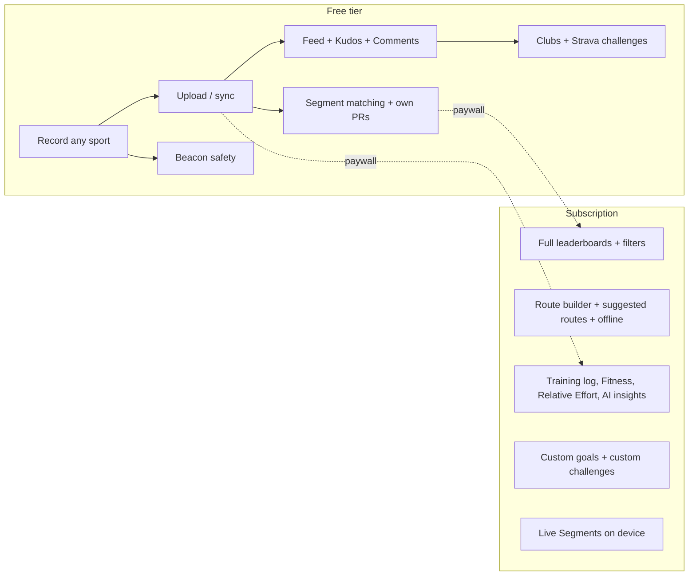
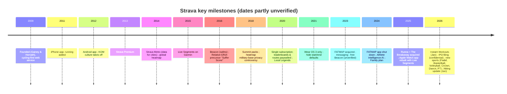
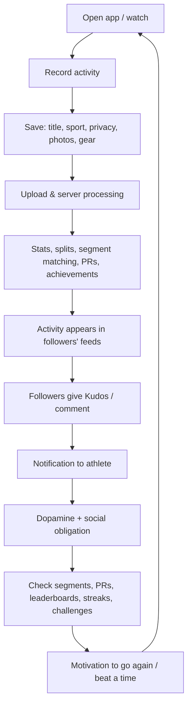
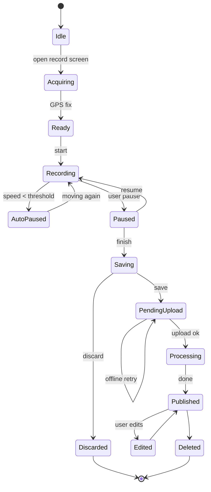

# 00 — Product Overview: Strava (reference teardown for StravaFit)

> Scope: what Strava is, who uses it, every sport type it supports, its platforms, free vs subscription tiers, pricing, bundles and acquisitions, product history, the core loops, and a glossary.
> Primary target: the Android (Play Store) app, with iOS differences noted.
> Research date: 2026-10-29. Anything not confirmed against a source is marked **(unverified)**.
> IP note: everything here is described in our own words. Strava trademarks are named only for reference. The OSS notes at the end propose neutral names.

---

## 1. What Strava is

Strava is a social fitness network built around GPS-recorded activities. A user records a workout (run, ride, hike, swim, gym session and so on) with the phone app, a smartwatch, a bike computer, or a third-party service. The activity is uploaded to Strava's servers. There it is processed (distance, pace, elevation, splits, heart-rate and power analysis, segment matching), then published to a feed where followers can give it a "like" (Kudos) and comment.

Three things set it apart from a plain workout logger:

1. **The social graph.** Users follow other athletes, join clubs and see a chronological or ranked feed of their friends' activities.
2. **Segments.** These are user-defined stretches of road or trail with public leaderboards (KOM/QOM, Local Legend). They turn every outing into an asynchronous race.
3. **Hub / platform role.** Strava is the de facto aggregation point for data from Garmin, Apple Watch, Wahoo, Coros, Suunto, Polar, Zwift, Peloton and others. Its public API v3 and webhooks make it the place where many third-party tools read activity data.

Headline numbers (third-party estimates, not company disclosures):

| Metric | Value | Confidence |
|---|---|---|
| Registered users | 150M+ in 185+ countries; some sources say 195M | Third-party; varies |
| Monthly actives | ~50M (unverified) | Third-party estimate |
| Paying share | 2–5% or 10–15% depending on source | Conflicting estimates |
| Valuation | ~US$2.2B (May 2025 round) | Press |
| IPO | Confidential draft S-1 filed around Jan/Feb 2026; no public listing date yet | Press |

Strava is headquartered in San Francisco and was founded in 2009 by Mark Gainey and Michael Horvath. Michael Martin has been CEO since 2024 (unverified, from general knowledge).

---

## 2. Target users and personas

| Persona | Primary sports | What they come for | Most-used surfaces |
|---|---|---|---|
| Competitive amateur cyclist | Ride, VirtualRide, GravelRide | Segment leaderboards, power analysis, KOMs | Segments, activity analysis, Live Segments on bike computer |
| Recreational / marathon runner | Run, TrailRun | Training log, PRs, best efforts, plans (Runna) | Feed, Progress/Training tab, Best Efforts |
| Social / casual mover | Walk, Hike, Workout | Streaks, kudos, friends, monthly challenges | Feed, Challenges, Groups |
| Hiker / outdoor adventurer | Hike, BackcountrySki, Snowshoe | Routes, offline maps, 3D/winter maps (ex-FATMAP) | Maps, Routes, Heatmaps |
| Triathlete / multisport | Swim, Ride, Run | Unified history across devices | Training log, Fitness |
| Club / brand organiser | Any | Clubs, group events, sponsored challenges | Clubs, Events, Posts |
| Gym / indoor | WeightTraining, HIIT, Yoga, Pilates | Logging non-GPS work for streaks | Manual entry, Instant Workouts (2026) |
| Developer / data nerd | n/a | API, exports, third-party analytics | API v3, bulk export |

Demographic skew (unverified): more male, 25–45, urban, endurance-sport focused. Strava has been actively broadening this with walking, hiking, racket sports and gym types (2024–2026).

---

## 3. Supported sport types (complete list)

Strava has two related enums:

- **`ActivityType`**: the legacy, coarse type, kept for backwards compatibility.
- **`SportType`**: the current, fine-grained type. The app's "sport" picker maps to this. Introduced in the API around 2022 (unverified date).

### 3.1 SportType (current, per API v3 reference, fetched 2026-10)

| # | SportType | Category (our grouping) | GPS typical? | Legacy ActivityType | Notes |
|---|---|---|---|---|---|
| 1 | Run | Foot | Yes | Run | |
| 2 | TrailRun | Foot | Yes | Run | Split from Run as a sport type |
| 3 | Walk | Foot | Yes | Walk | |
| 4 | Hike | Foot | Yes | Hike | Hiking feature push in June 2026 |
| 5 | VirtualRun | Foot (indoor) | No | VirtualRun | Treadmill apps such as Zwift Run |
| 6 | Ride | Cycle | Yes | Ride | |
| 7 | MountainBikeRide | Cycle | Yes | Ride | |
| 8 | GravelRide | Cycle | Yes | Ride | |
| 9 | EBikeRide | Cycle | Yes | EBikeRide | Excluded from normal ride segment boards |
| 10 | EMountainBikeRide | Cycle | Yes | EBikeRide | |
| 11 | VirtualRide | Cycle (indoor) | No / virtual GPS | VirtualRide | Zwift, Rouvy and similar |
| 12 | Velomobile | Cycle | Yes | Velomobile | |
| 13 | Handcycle | Adaptive | Yes | Handcycle | |
| 14 | Wheelchair | Adaptive | Yes | Wheelchair | |
| 15 | Swim | Water | Open water: yes; pool: no | Swim | |
| 16 | Rowing | Water | Yes | Rowing | |
| 17 | VirtualRow | Water (indoor) | No | Rowing | Indoor erg |
| 18 | Canoeing | Water | Yes | Canoeing | |
| 19 | Kayaking | Water | Yes | Kayaking | |
| 20 | StandUpPaddling | Water | Yes | StandUpPaddling | |
| 21 | Surfing | Water | Yes | Surfing | |
| 22 | Kitesurf | Water | Yes | Kitesurf | |
| 23 | Windsurf | Water | Yes | Windsurf | |
| 24 | Sail | Water | Yes | Sail | |
| 25 | AlpineSki | Snow | Yes | AlpineSki | |
| 26 | BackcountrySki | Snow | Yes | BackcountrySki | |
| 27 | NordicSki | Snow | Yes | NordicSki | |
| 28 | Snowboard | Snow | Yes | Snowboard | |
| 29 | Snowshoe | Snow | Yes | Snowshoe | |
| 30 | IceSkate | Snow/ice | Yes | IceSkate | |
| 31 | RollerSki | Wheels | Yes | RollerSki | |
| 32 | InlineSkate | Wheels | Yes | InlineSkate | |
| 33 | Skateboard | Wheels | Yes | Skateboard | |
| 34 | Golf | Other outdoor | Yes | Golf | |
| 35 | RockClimbing | Other | Optional | RockClimbing | |
| 36 | Soccer | Team | Optional | Soccer | |
| 37 | Basketball | Team | Optional | Workout | Added 2025/26 |
| 38 | Volleyball | Team | Optional | Workout | Added 2025/26 |
| 39 | Cricket | Team | Optional | Workout | Added 2025/26 |
| 40 | Tennis | Racket | Optional | Workout | |
| 41 | Badminton | Racket | Optional | Workout | |
| 42 | Pickleball | Racket | Optional | Workout | |
| 43 | Padel | Racket | Optional | Workout | Added 2025/26 |
| 44 | Squash | Racket | No | Workout | |
| 45 | Racquetball | Racket | No | Workout | |
| 46 | TableTennis | Racket | No | Workout | |
| 47 | WeightTraining | Gym | No | WeightTraining | |
| 48 | Crossfit | Gym | No | Crossfit | |
| 49 | HighIntensityIntervalTraining | Gym | No | Workout | HIIT |
| 50 | Elliptical | Gym | No | Elliptical | |
| 51 | StairStepper | Gym | No | StairStepper | |
| 52 | Yoga | Mind/body | No | Yoga | |
| 53 | Pilates | Mind/body | No | Workout | |
| 54 | Dance | Mind/body | No | Workout | Added 2025/26 |
| 55 | PhysicalTherapy | Health | No | Workout | Added 2025/26 |
| 56 | Workout | Generic | Optional | Workout | Catch-all |

That gives **56 sport types**. The app UI may label some differently: for example "E-Bike Ride", "HIIT", "Stand Up Paddling" and "Weight Training". The Legacy ActivityType column for the newer types is our inference: the API returns `Workout` as the coarse `type` for sport types that have no matching legacy value **(unverified per type)**.

### 3.2 Legacy ActivityType (37 values)

AlpineSki, BackcountrySki, Canoeing, Crossfit, EBikeRide, Elliptical, Golf, Handcycle, Hike, IceSkate, InlineSkate, Kayaking, Kitesurf, NordicSki, Ride, RockClimbing, RollerSki, Rowing, Run, Sail, Skateboard, Snowboard, Snowshoe, Soccer, StairStepper, StandUpPaddling, Surfing, Swim, Velomobile, VirtualRide, VirtualRun, Walk, WeightTraining, Wheelchair, Windsurf, Workout, Yoga.

### 3.3 How sport type affects behaviour

| Behaviour | Depends on sport type? | Detail |
|---|---|---|
| Pace vs speed display | Yes | Foot sports and swim show pace (min/km, min/100m). Wheels, cycle and snow show speed. |
| Segment matching | Yes | Segments are either "ride" or "run" type. Ride-family activities match ride segments; foot activities match run segments. E-bikes are excluded from normal boards **(unverified detail)**. Virtual activities don't match real segments. |
| Best Efforts | Yes | Run (400m … marathon) and Ride (power/distance bests) only. |
| Map shown | Yes | Indoor or no-GPS types show a stats card instead of a map. |
| Calories model | Yes | MET-based for non-power activities; power-based (kJ) for rides with power. |
| Relative Effort | All with HR (or perceived exertion) | Cross-sport. |
| Challenge eligibility | Yes | Each challenge whitelists sport types. |
| Auto-pause default | Yes | On by default for ride **(unverified)**. |

---

## 4. Platforms

| Platform | Status (2026) | Record? | Notes |
|---|---|---|---|
| **Android phone** | Primary native app (Play Store "Strava: Run, Bike, Hike") | Yes (GPS, foreground service) | Uses Health Connect for import/export of some data **(unverified scope)**. Supports sensors over BLE. |
| **iOS phone** | Primary native app ("Strava: Run, Bike, Walk") | Yes | Apple Health read/write. Live Activities and lock-screen widgets **(unverified)**. Store titles differ by platform. |
| **Web (strava.com)** | Full site | No live recording; file upload and manual entry | Route builder, heatmaps, segment explorer, settings, bulk export. Some analysis views are web-only or richer on web. |
| **Apple Watch** | Native watchOS app, redesigned Sept 2025 | Yes, standalone | Sept 2025 added Live Segments on watch (all users get entry/exit; subscribers get live PR comparison). |
| **Wear OS** | Native app for Wear OS 3+ (Pixel Watch, Galaxy Watch 4+) | Yes | Wear OS 2 dropped in Aug 2021. External sensor pairing on the watch is limited. Less feature-rich than the Apple Watch app **(unverified)**. |
| **Garmin** | Not a Strava-built Connect IQ recorder for most uses. Garmin Connect auto-syncs to Strava. Live Segments and route sync run on Garmin devices. | Via Garmin's own recorder | Live Segments on Garmin needs a subscription (long-standing). Routes and segments sync to compatible Edge and Forerunner/Fenix devices. |
| **Wahoo, Hammerhead, Coros, Suunto, Polar, Zwift, Peloton, etc.** | Partner integrations (auto-upload, some route and segment sync) | Via partner | Strava acts as the hub. |
| **Strava Metro** | B2G data product (aggregated, de-identified trips for city planners) | n/a | Free to qualifying organisations **(unverified current terms)**. |

### Android vs iOS differences (known or likely)

| Area | Android | iOS |
|---|---|---|
| Health platform | Health Connect (replaced Google Fit) | Apple Health / HealthKit |
| Watch | Wear OS app | Apple Watch app (richer, Live Segments as of 2025) |
| Background recording | Foreground service with persistent notification | Background location mode and Live Activity **(unverified)** |
| Widgets | Home-screen widgets **(unverified)** | Home and lock-screen widgets |
| Subscriptions | Google Play Billing (or web purchase) | Apple IAP (or web purchase) |
| Beacon SMS | Sends via Strava servers to contacts | Same |

---

## 5. Free vs subscription

Strava runs a **freemium** model. The free tier is "record, share and socialise". The subscription (marketed as "Strava Subscription"; earlier "Summit", earlier still "Premium") unlocks analysis, routes, segments competition depth, goals and training tools. In 2020 Strava moved full segment leaderboards and the route builder behind the paywall, which caused a major community backlash.

The official comparison on strava.com/subscribe (fetched 2026-10) lists 13 rows. Our tier assignment below combines that page with reviews. Rows marked **(unverified)** could not be pinned to a column with certainty.

### 5.1 Complete feature matrix

Legend: **[FREE]** available on the free tier · **[SUB]** subscription only · **[PARTIAL]** free gets a limited version.

#### Recording and devices

| Feature | Tier | Notes |
|---|---|---|
| GPS recording of all sport types (phone) | [FREE] | Core |
| Manual activity entry | [FREE] | |
| File upload (FIT/GPX/TCX) on web | [FREE] | |
| Device / partner auto-sync (Garmin, Apple Watch, Wear OS, Wahoo, Zwift...) | [FREE] | |
| BLE heart-rate sensor pairing in the app | [FREE] | |
| Audio cues (distance/time splits) | [FREE] | |
| Auto-pause | [FREE] | |
| Beacon (live location sharing with safety contacts) | [FREE] | Free since 2023. Earlier it was sub-only for phone Beacon **(unverified date)**. |
| Instant Workouts (guided workouts, 2026) | [PARTIAL] (unverified) | Launched globally Jan 2026 |
| Live Segments on device (Garmin/Wahoo) | [SUB] | |
| Live Segments on Apple Watch: entry/exit alerts | [FREE] | Sept 2025 |
| Live Segments on Apple Watch: real-time PR/target comparison | [SUB] | |
| Recording a route with turn-by-turn navigation | [SUB] (unverified) | Following a route needs a saved route, and saving or creating routes is mostly sub |

#### Social and community

| Feature | Tier | Notes |
|---|---|---|
| Activity feed | [FREE] | |
| Kudos and comments | [FREE] | |
| Follow/followers, privacy approvals | [FREE] | |
| Clubs: join and create | [FREE] | |
| Club group events | [FREE] | |
| Club leaderboards (weekly) | [FREE] | |
| Messaging (DM / group chats) | [FREE] | Added 2023 |
| Photos and video on activities | [FREE] | Video length limits may differ **(unverified)** |
| Athlete search, contacts sync | [FREE] | |
| Flyby (who you passed during an activity) | [FREE] | Opt-in privacy setting |
| Mentions and tagging others in group activities | [FREE] | |
| Strava-hosted challenges (monthly distance etc.) | [FREE] | |
| Create your own group challenges | [SUB] | "Join and create challenges with friends" |
| Year in Sport (annual recap) | [PARTIAL] | Full recap for subscribers, short version free **(unverified, varies by year)** |
| Shareable stats stickers / images | [FREE] | |

#### Safety and privacy

| Feature | Tier | Notes |
|---|---|---|
| Privacy zones (hide start/end) | [FREE] | |
| Per-activity visibility (Everyone / Followers / Only Me) | [FREE] | |
| Hide individual stats (pace, HR...) | [FREE] | |
| Beacon | [FREE] | See above |
| Muting activities from feed | [FREE] | |
| Blocking and reporting | [FREE] | |

#### Segments

| Feature | Tier | Notes |
|---|---|---|
| Automatic segment matching on activities | [FREE] | |
| Personal segment efforts (PR, 2nd, 3rd) | [FREE] | |
| See KOM/QOM / CR holder | [FREE] | |
| Top-10 leaderboard | [FREE] (unverified) | Free users see a limited board |
| Full segment leaderboards with filters (age, weight, following, club, this year/today) | [SUB] | "Compete on Segment leaderboards" |
| Segment effort analysis and comparison | [SUB] | |
| Local Legend (most efforts in 90 days) | [PARTIAL] | Free users can earn it; viewing the full LL leaderboard is sub **(unverified)** |
| Starred segments | [FREE] | Used for device sync |
| Create segments (web/app) | [FREE] | |
| Segment explorer | [FREE] (unverified) | |

#### Maps and routes

| Feature | Tier | Notes |
|---|---|---|
| Base map, satellite | [FREE] | |
| Global heatmap at low zoom | [FREE] | Full-zoom heatmap needs a login |
| Personal heatmap | [SUB] | |
| Map layers (3D terrain, winter, slope angle; ex-FATMAP) | [SUB] | |
| Suggested / recommended routes ("Routes made for you") | [SUB] | Free users may get limited suggestions **(unverified)** |
| Route builder (draw your own routes) | [SUB] | |
| Saved routes: filter and search | [SUB] | |
| Offline maps / routes | [SUB] | |
| Off-route alerts (hiking update June 2026) | [SUB] | |
| Route sync to Garmin / Apple Watch / Coros | [FREE] (June 2026 hiking update) | Press says route sync is available to all users |
| Live elevation while recording | [FREE] | June 2026 |
| Points of interest, trail info | [PARTIAL] (unverified) | |

#### Training and analysis

| Feature | Tier | Notes |
|---|---|---|
| Basic activity stats (distance, time, pace, elevation, splits) | [FREE] | |
| Best Efforts (run), PR trophies | [FREE] | |
| Weekly/monthly totals on profile | [FREE] | |
| Training log / calendar | [SUB] | "View your training history in one place" |
| Advanced insights: HR zones, power curve, pace zones, matched activities | [SUB] | "Analyze workouts with advanced insights" |
| Grade Adjusted Pace (GAP) | [SUB] (unverified, partly free) | |
| Relative Effort (cross-activity effort score) | [SUB] | "Measure effort across activities". Free users may see a teaser. |
| Fitness & Freshness (fitness/fatigue/form chart) | [SUB] | "See your Fitness Score over time" |
| Athlete Intelligence (AI summaries of activities) | [SUB] | Launched 2024 |
| Custom goals (distance, time, segment goals) | [SUB] | "Set and track custom Goals" |
| Training plans | [SUB]/bundle | Now delivered via Runna (bundle) |
| Matched runs (compare repeat routes) | [SUB] | |
| Power analysis for rides | [SUB] | |
| Estimated race times / finish predictions | Runna bundle | |
| Progress charts (Progress tab comparing periods) | [PARTIAL] (unverified) | |
| Bulk data export (account archive) | [FREE] | GDPR-style |
| Per-activity original file download | [FREE] | |

### 5.2 Summary diagram



---

## 6. Pricing

### 6.1 Plans (2025–2026)

| Plan | USD (strava.com/pricing, 2025) | India (strava.com/subscribe, fetched 2026-10) | Billing | Notes |
|---|---|---|---|---|
| Individual monthly | $11.99 / mo | — (annual shown) | Monthly | |
| Individual annual | $79.99 / yr | ₹2,499 / yr (₹208/mo) | Annual | 30-day free trial |
| Family (up to 4 accounts) | $139.99 / yr | ₹6,499 / yr | Annual only | Organiser pays and invites |
| Student (verified) | $39.99 / yr (third-party) | ₹1,249.50 / yr | Annual only | ~50% off, 30-day trial |
| Teacher discount | Mentioned by third parties | — | — | **(unverified)** |
| Strava + Runna bundle | $149.99 / yr | ₹4,999.99 / yr | Annual only | Not combinable with Family or other discounts |
| Runna standalone (reference) | $19.99 / mo or $119.99 / yr | — | — | £15.99 / mo or £99.99 / yr in UK |

Prices exclude tax. Regional pricing is PPP-adjusted (India is ~40% of US price). Other regions (UK £, EU €, AU $) follow similar ratios but were not verified here **(unverified)**.

### 6.2 Pricing history

| Year | Event |
|---|---|
| 2009–2017 | "Strava Premium", ~$5.99/mo **(unverified exact)** |
| 2018 | Rebranded to "Summit" packs (Training / Safety / Analysis), ~$2.99 each **(unverified)** |
| May 2020 | Single "Strava Subscription". Leaderboards and route builder move behind the paywall. ~$5/mo, $59.99/yr |
| 2023 | Price increase to ~$11.99/mo, $79.99/yr in US **(unverified date)** |
| 2023–24 | Family plan launched **(unverified date)** |
| 2025 | Strava + Runna bundle launched |

---

## 7. Acquisitions and integration state

| Company | Year | What it was | Integration state (late 2026) |
|---|---|---|---|
| **FATMAP** | 2023 | 3D outdoor mapping app (ski, hike, MTB) | Standalone app **shut down** (2024). 3D terrain, winter imagery, slope-angle and other layers migrated into Strava Maps (sub). Some users were unhappy with the shutdown. |
| **Recover Athletics** | 2023 (unverified) | Injury-prevention exercise app | Folded in or sunset **(unverified)** |
| **Runna** | Apr 2025 | AI/coach-built running plans (London) | Still a **separate app**. Joint **Strava + Runna bundle** ($149.99/yr). Plans and workouts sync to Strava. |
| **The Breakaway** | 2025 | Cycling training-guidance app | Separate app; deeper integration expected **(unverified status)** |
| **Komoot** | — | *Not* acquired by Strava. Bending Spoons bought it in March 2025. | Competitor. Listed here because people often assume otherwise. |

---

## 8. Product history / timeline



Notable controversies worth learning from:
- **2018 heatmap leak.** The global heatmap revealed military-base patrol routes. Lesson: aggregated public heatmaps need opt-out, minimum-density thresholds and exclusion zones.
- **2020 paywall move.** Moving leaderboards behind the paywall caused a large backlash. StravaFit's "everything free" position is a differentiator.
- **2023 API terms changes.** Third-party apps lost the right to show Strava data to other users, and AI training on API data was banned **(unverified detail)**. This is why an open alternative with open data export matters.
- **2025 Garmin dispute.** Garmin challenged Strava over device-data attribution requirements in the API terms **(unverified)**.

---

## 9. Core loops

### 9.1 Primary loop: record → upload → feed → kudos → compete



### 9.2 Secondary loops

| Loop | Trigger | Reward | Retention lever |
|---|---|---|---|
| Social reciprocity | See friend's activity | Give kudos, get kudos back | Feed habit |
| Competition | Segment matched | Trophy, crown, Local Legend laurel | Revisit segments |
| Streaks / consistency | Weekly goal or streak | Badge, streak counter | Weekly cadence |
| Challenges | Monthly challenge join | Digital badge, sometimes prizes | Monthly reset |
| Clubs | Club event or leaderboard | Belonging, rank | Group rides |
| Progress | Training log / fitness chart | Visible improvement | Subscription value |
| Recap | Year in Sport | Shareable recap | Annual virality |

### 9.3 Activity lifecycle state machine



### 9.4 App navigation (Android, 2025–26)

Bottom navigation, five tabs **(labels may vary by version, unverified exact)**:

```
+----------------------------------------+
| [=]  Home                 [search][bell]|
|----------------------------------------|
|  (Athlete avatar)  Alex R.  - Ride     |
|  "Morning loop"                         |
|  Dist 42.1 km  Elev 512 m  Time 1:38   |
|  +----------------------------------+  |
|  |          (route map)             |  |
|  +----------------------------------+  |
|  [thumb] 23 kudos   [chat] 4          |
|----------------------------------------|
| Home | Maps | (Record) | Groups | You  |
+----------------------------------------+
```

| Tab | Content |
|---|---|
| Home | Feed, suggested athletes, challenge cards, Athlete Intelligence cards |
| Maps | Routes, heatmaps, segment explore, map layers (renamed from "Explore" / "Maps") |
| Record | Recording screen (center, prominent) |
| Groups | Clubs, Challenges, Messages **(unverified grouping)** |
| You | Profile, Progress, Activities, Training (sub) |

---

## 10. Glossary of Strava-specific terms

| Term | Meaning | Tier | Proposed StravaFit neutral name |
|---|---|---|---|
| Activity | One recorded workout | Free | Activity |
| Sport type | Fine-grained activity category | Free | Sport |
| Kudos | One-tap appreciation on an activity | Free | Cheers / Props |
| Feed | List of followed athletes' activities | Free | Feed |
| Segment | User-defined stretch with a leaderboard | Free/Sub | Sector |
| KOM / QOM | King/Queen of the Mountain: fastest time on a segment (by gender) | Free | Sector Crown (fastest) |
| CR | Course Record (gender-neutral/run version of KOM) | Free | Course best |
| Local Legend (LL) | Most efforts on a segment in rolling 90 days | Partial | Sector Regular / Local Hero |
| PR | Personal Record on a segment or distance | Free | Personal best (PB) |
| Best Efforts | Fastest times for standard distances inside activities | Free | Best Splits |
| Achievement / trophy | Award icons for PR, top-10 and similar | Free | Medals |
| Leaderboard | Ranked list of segment efforts | Sub (full) | Rankings |
| Live Segments | Real-time segment racing on a device | Sub (mostly) | Live Sectors |
| Starred segment | Bookmarked segment, synced to devices | Free | Pinned sector |
| Flyby | Replay of who you crossed paths with | Free | Crossings |
| Beacon | Real-time location sharing with safety contacts | Free | SafeTrack / Live Share |
| Privacy zone / Hide start & end | Masks route near sensitive locations | Free | Privacy zone |
| Heatmap (global/personal) | Aggregated density of activities | Free/Sub | Heatmap |
| Route | Planned path to follow | Sub (create) | Route |
| Relative Effort | HR-based cross-sport effort score (was "Suffer Score") | Sub | Effort Score |
| Fitness & Freshness | Fitness (CTL), Fatigue (ATL), Form (TSB) chart | Sub | Fitness Trend |
| Training Load | Power-based load per ride | Sub | Load |
| Intensity | Ride intensity vs FTP | Sub | Intensity |
| GAP | Grade Adjusted Pace | Sub/partial | Grade-adjusted pace |
| Weighted Avg Power | Normalised-power-style figure | Sub | Weighted power |
| Matched Activities / Runs | Comparison of repeated routes | Sub | Repeat compare |
| Athlete Intelligence | AI-generated activity summaries | Sub | Insights (local/LLM optional) |
| Goals | Custom time/distance targets | Sub | Goals |
| Streak | Consecutive weeks/days active | Free | Streak |
| Challenge | Time-boxed goal with badge | Free (join) / Sub (create) | Challenge |
| Club | Group with feed, events, leaderboard | Free | Club / Crew |
| Group Event | Scheduled club meetup | Free | Meetup |
| Post | Text/photo post in a club or profile | Free | Post |
| Gear | Shoes/bikes with mileage tracking | Free | Gear |
| Year in Sport | Annual recap | Partial | Year Review |
| Summit | Former name of the subscription (2018–2020) | — | n/a |
| Strava Metro | De-identified trip data for cities | B2G | Open data export |
| Instant Workouts | On-demand guided workouts (2026) | Partial | Quick Workouts |
| Athlete | Any user | — | Athlete |
| Follower / Following | Social graph edges (approval optional) | Free | Follow |
| Mute | Hide someone's activities without unfollowing | Free | Mute |
| Elapsed vs Moving time | Wall-clock vs time in motion | Free | Same |
| Splits | Per-km/mile breakdown | Free | Splits |
| Laps | Device or manual laps | Free | Laps |
| Perceived Exertion | User-entered 1–10 RPE | Free | RPE |

---

## OSS implementation notes

**Principle:** StravaFit has no paywall. Every [SUB] feature above is free in our app. Cost control comes from on-device computation (analysis, AI summaries optional and local) and cheap server work (tile caching, batch jobs).

### Naming (avoid trademarks)
Use the neutral names in the glossary: Cheers (kudos), Sectors (segments), Crown (KOM/QOM/CR), Local Hero (Local Legend), Crossings (Flyby), SafeTrack (Beacon), Effort Score (Relative Effort), Fitness Trend (Fitness & Freshness).

### Sport-type model
- Store a single `sport_type` enum mirroring the 56 values in §3.1. Also store a derived `family` (foot, cycle, water, snow, wheels, racket, team, gym, mind_body, health, adaptive, other) and flags: `has_gps_default`, `pace_unit` (per_km, per_100m, speed), `sector_family` (run/ride/none), `virtual`.
- Keep the mapping table in a versioned JSON (`sport_types.json`) shared by Android, server and web, so adding a new sport (like Padel in 2026) is data, not code.
- Map to and from Strava `sport_type` and legacy `type` in the importer. Map to Health Connect `ExerciseSessionRecord` exercise types on Android and HealthKit `HKWorkoutActivityType` on iOS.
- Edge cases: e-bike vs bike (exclude from human sector rankings); virtual (no sector matching); swim pool vs open water (no GPS, lap-based).

### Core loop architecture
- **Record:** Android foreground service (`FOREGROUND_SERVICE_LOCATION`, plus `FOREGROUND_SERVICE_HEALTH` on Android 14+) with FusedLocationProvider, falling back to raw GNSS. Room DB for crash-safe point buffering (write every N seconds). BLE HR/power/cadence via standard GATT profiles. Wear OS companion using Health Services `ExerciseClient`.
- **Upload:** WorkManager with constraints and exponential backoff. Upload FIT/GPX to the server, which is idempotent by client-generated UUID.
- **Process:** server job queue for track smoothing (Kalman or Douglas-Peucker for display), elevation correction from DEM (SRTM/Copernicus), splits, best efforts (sliding window), sector matching (map-matching with spatial index such as PostGIS plus Fréchet/start-end proximity), and achievements.
- **Feed:** fan-out-on-read for small graphs, with a hybrid push for active users. Postgres plus Redis.
- **Cheers/comments:** simple tables. Push via FCM, or UnifiedPush for de-Googled devices.
- **Compete:** sector leaderboards as materialised views refreshed per effort insert. Local Hero = count of efforts in a rolling 90-day window.

### Training metrics (all free)
- Effort Score: TRIMP-style HR-zone-weighted minutes. Fall back to RPE × duration when there is no HR.
- Fitness Trend: CTL = 42-day EWMA of daily load, ATL = 7-day EWMA, Form = CTL − ATL.
- GAP: Minetti energy-cost-of-running curve.
- Power: normalised power (30 s rolling 4th-power mean), IF = NP/FTP, TSS.

### Maps
MapLibre Native (Android) and MapLibre GL JS (web). OpenStreetMap vector tiles (self-hosted Protomaps PMTiles or OpenFreeMap). Terrain from open DEMs. Routing with BRouter, GraphHopper or Valhalla (open-source, with profiles per sport). Offline via PMTiles region download. Heatmaps built in batch, excluding privacy zones, with minimum-athlete thresholds per tile (learn from the 2018 leak).

### Safety
SafeTrack: a server-issued share token that streams locations every 15–30 s to a public, time-limited web page, with an SMS/share-sheet link. Low-battery and stopped-for-too-long alerts.

### Platforms priority
1. Android phone + Wear OS (MVP). 2. Web (view, route builder, upload). 3. iOS + Apple Watch. 4. Device integrations via FIT import, plus Garmin Connect / Health Connect / HealthKit sync, and an optional importer that uses the user's own Strava API token.

### Data portability
Full export (activities as FIT/GPX, JSON metadata) as a first-class feature. Import of Strava bulk-export archives so users can migrate.

### No-paywall considerations
Server costs scale with tiles, heatmap compute and storage. Use self-hosted tiles and on-device analysis. Optional donations or sponsorships, never feature gates.

---

## Sources

- https://developers.strava.com/docs/reference/ (SportType and ActivityType enums)
- https://www.strava.com/subscribe (feature comparison and India pricing, fetched 2026-10)
- https://strava.com/pricing
- https://www.thepricer.org/how-much-does-strava-cost/
- https://the5krunner.com/2026/10/14/is-runna-free/
- https://marathonhandbook.com/strava-and-runna-launch-joint-subscription/
- https://pricingsaas.com/companies/strava
- https://marathonhandbook.com/strava-acquires-the-breakaway-to-deepen-its-subscription-based-fitness-ecosystem/
- https://dcrainmaker.com/2025/04/strava-acquires-runna-thoughts-forward.html
- https://startups.co.uk/news/runna-acquired-by-strava/
- https://the5krunner.com/2026/06/12/strava-hiking-features-ipo/
- https://the5krunner.com/2026/01/09/strava-ipo-filing-3-billion-valuation-analysis/
- https://sacra.com/c/strava/
- https://www.bikeradar.com/news/strava-leaderboards-routes-subscription/
- https://www.triathlete.com/gear/tech-wearables/strava-moves-segment-leaderboards-route-builder-to-subscription/
- https://www.tomsguide.com/reviews/strava-review
- https://www.wareable.com/sport/is-strava-premium-worth-it
- https://the5krunner.com/2025/09/04/strava-updates-apple-watch-app-with-new-interface-plus-live-segments/
- https://9to5mac.com/2025/09/04/strava-updates-apple-watch-app-introduces-live-segments/
- https://www.wareable.com/running/strava-compatible-watches
- https://www.techradar.com/health-fitness/fitness-apps/how-to-use-strava-with-your-smartwatch
- https://9to5google.com/2021/08/31/strava-no-longer-updating-wear-os-2-0/
- https://en.wikipedia.org/wiki/Komoot
- https://www.bikeradar.com/news/komoot-acquisition
