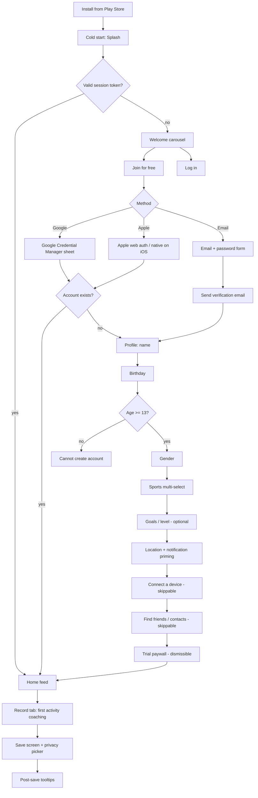
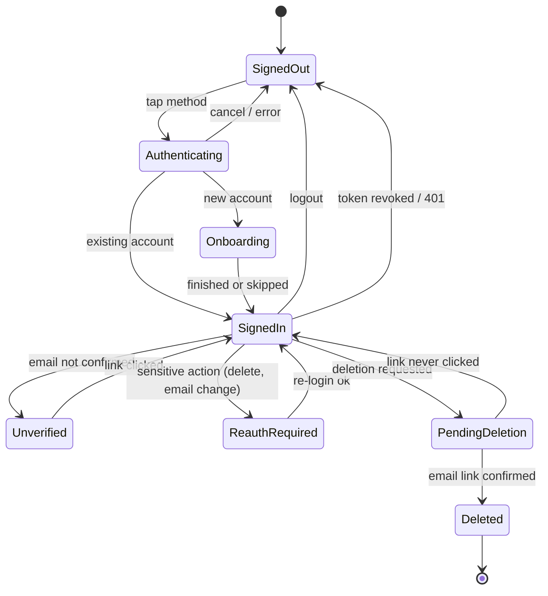
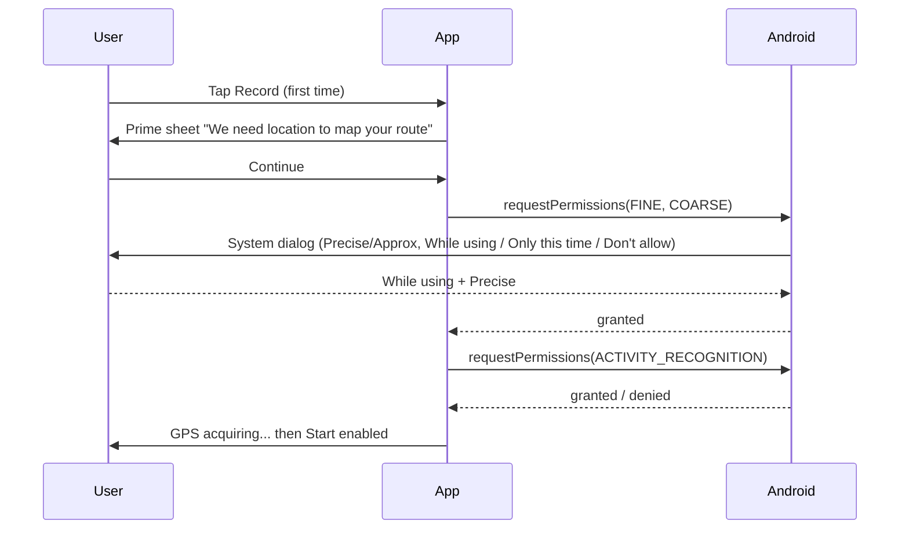
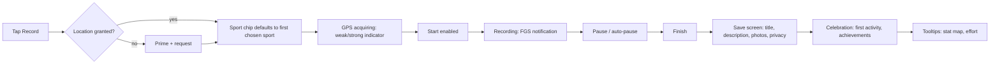
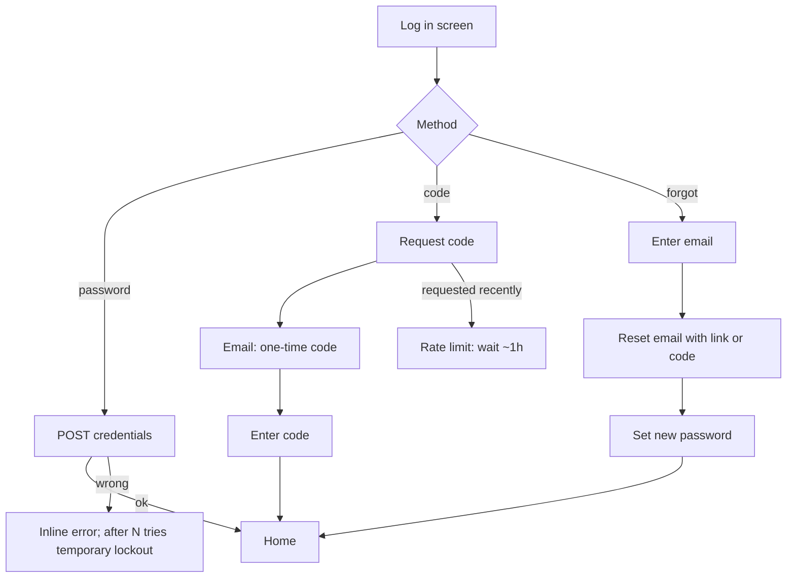
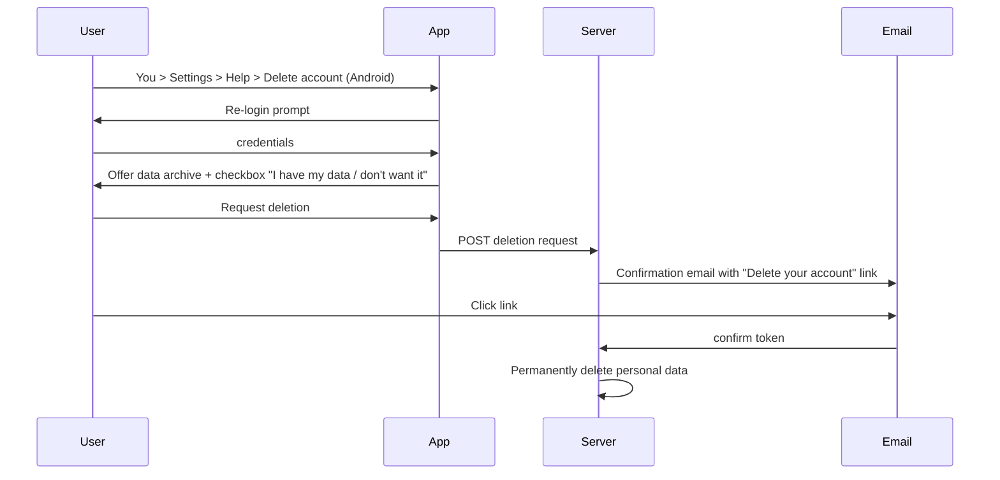

# 01 — Onboarding, Authentication & Account Lifecycle

> Scope: everything from install to first recorded activity, plus login, logout, password reset and account deletion.
> Reference target: the Strava Android app (Play Store), with iOS differences called out. Research snapshot: **October 2026**.
> IP rule: all copy is paraphrased; no assets. Strava trademarks are named only for reference. Our neutral names are in the OSS notes.
> Legend: **[FREE]** free in Strava · **[SUB]** subscription-gated in Strava (in StravaFit everything is free) · **(unverified)** = could not confirm from a public source.

---

## 0. TL;DR

| # | Stage | Strava behaviour (2025-2026) | Confidence |
|---|---|---|---|
| 1 | Install / splash | Brand splash, then a welcome carousel with "Join for free" and "Log in" | High (behaviour), copy unverified |
| 2 | Sign-up methods | **Google**, **Apple**, **email + password**. **Facebook login was removed on 16 Mar 2026** | High |
| 3 | Passwordless | Accounts can switch to **one-time email codes** in place of a password | High |
| 4 | Email verification | Email accounts need to confirm the address; a reminder banner persists until they do (unverified on the banner) | Medium |
| 5 | Profile | First/last name, birthday, gender (Man / Woman / Non-binary / Prefer not to say) | High |
| 6 | Age gate | 13+ to sign up; under-16 get no HR data; under-18 get stricter privacy defaults | High |
| 7 | Sports | Multi-select grid of sport types (Run, Ride, Walk, Hike, Swim, ...) | High |
| 8 | Goals / level | Goal and fitness-level questions in the newer flow | Medium |
| 9 | Permissions | Location (foreground, precise), activity recognition, notifications (Android 13+), Bluetooth for sensors; asked in context | Medium (ordering unverified) |
| 10 | Devices | Prompt to connect Garmin / watch / Health Connect / Apple Health; skippable | Medium |
| 11 | Paywall | **30-day free trial** paywall after initial setup, with a trial timeline | Medium-High |
| 12 | Social | Contact sync / "who to follow"; Facebook friend suggestions removed in 2026 | Medium |
| 13 | Privacy | Adults default to **Everyone**; under-18 defaults to **Followers** and hides first/last 400 m | High |
| 14 | First run | Empty feed with prompts; tooltips after the first save (e.g., stat maps, perceived effort) | Medium |
| 15 | Delete account | Settings, then Help, then Delete. Re-auth, optional archive, then an email confirmation link | High |

---

## 1. Master flow



> The order of steps 9 to 12 (permissions, devices, social, paywall) varies with A/B tests. Public walkthroughs agree on **profile, then sports/goals, then a trial offer after setup**. The exact placement of the device and contacts screens is **(unverified)**.

### 1.1 Auth state machine



---

## 2. Step-by-step

### Step 1: Install and store listing

- Play Store title in 2025-26 is roughly "Strava: Run, Bike, Walk". The older wording was "Run, Bike, Hike".
- First launch needs no permissions. Android asks for nothing at install; every runtime permission comes later, in context.
- Declared permissions in recent builds, from an Exodus Privacy scan of v398.13 (Feb 2025): fine and coarse location, `ACTIVITY_RECOGNITION`, `FOREGROUND_SERVICE_LOCATION`, `BODY_SENSORS`, `POST_NOTIFICATIONS`, Bluetooth scan/connect, internet, wake lock. The scan lists location as foreground-only and **no `ACCESS_BACKGROUND_LOCATION`**, so recording works through a foreground service.

### Step 2: Splash and welcome carousel

Behaviour:
- The splash shows a brand mark on the brand colour. On Android 12+ it uses the system SplashScreen API, so no separate splash activity is needed.
- With no session, the app shows a full-bleed welcome screen with lifestyle imagery or video, a tagline, and two CTAs.
- On some versions the welcome is a 2-4 page carousel of value props: record, explore, connect (unverified on page count).

```
+--------------------------------------+
|                                      |
|         [ full-bleed photo /         |
|           looping video ]            |
|                                      |
|            <brand mark>              |
|                                      |
|   Your community of active people.   |
|   Track it, share it, find routes.   |
|                                      |
|            o  o  *  o                |
|                                      |
|  +--------------------------------+  |
|  |         Join for free          |  |
|  +--------------------------------+  |
|  +--------------------------------+  |
|  |            Log in              |  |
|  +--------------------------------+  |
+--------------------------------------+
```

Copy tone, paraphrased: short and aspirational, community-first ("join the community of athletes"). It never mentions price on this screen. "Free" sits on the primary CTA so the paywall later doesn't feel like bait.

### Step 3: Choose a sign-up method

| Method | Android | iOS | Notes |
|---|---|---|---|
| Google | Yes (native account picker) | Yes | Gmail users can also log in with Google later |
| Apple | Yes, via web flow (unverified on Android) | Yes, native | Hide My Email gives a **relay address**; you must set a password before changing that email |
| Email + password | Yes | Yes | Needs verification; can later switch to one-time codes |
| Facebook | **Removed 16 Mar 2026** | Removed | Existing FB users were told to confirm their email before the cutoff; FB friend suggestions also removed |
| One-time code | For login (not a sign-up option) | Same | "Email me a code"; rate-limited; wait about 1 h before re-requesting |

```
+--------------------------------------+
| <                                    |
|   Create your account                |
|                                      |
|  +--------------------------------+  |
|  | G  Continue with Google        |  |
|  +--------------------------------+  |
|  +--------------------------------+  |
|  |    Continue with Apple        |  |
|  +--------------------------------+  |
|  -------------- or ----------------  |
|  +--------------------------------+  |
|  |   Sign up with email           |  |
|  +--------------------------------+  |
|                                      |
|  By continuing you agree to the      |
|  Terms and acknowledge the Privacy   |
|  Policy.                             |
|                                      |
|  Already a member?  Log in           |
+--------------------------------------+
```

Notes:
- The legal consent is an implicit "by continuing" line with links. Separate marketing-email consent appears later or in the EU flow (unverified).
- Account linking: if a Google or Apple email matches an existing email account, Strava links them. With Apple this only works if the user **shares** their real email; picking "Hide My Email" creates a new account instead.

### Step 4: Email sign-up form

```
+--------------------------------------+
| <        Sign up with email          |
|                                      |
|  Email                               |
|  +--------------------------------+  |
|  | you@example.com                |  |
|  +--------------------------------+  |
|  Password                            |
|  +----------------------------+-+--+ |
|  | ••••••••                    | eye| |
|  +----------------------------+----+ |
|  Use 8+ characters (unverified rule) |
|                                      |
|  [ ] Send me news and offers         |
|      (regional, unverified)          |
|                                      |
|  +--------------------------------+  |
|  |          Sign up               |  |
|  +--------------------------------+  |
+--------------------------------------+
```

Validation:
- Inline email-format check, and a server check for duplicates ("an account already exists, log in instead?").
- An error saying the email is "not valid" on an email change usually means another account already holds that address (from the Strava Apple-sign-in article).

### Step 5: Email verification

- A verification email is sent right after sign-up. The user can **keep going through onboarding**; verification doesn't block. A persistent banner or feed card reminds them to confirm (non-blocking behaviour unverified).
- Some features probably require a verified email: account deletion (the confirmation link goes to the profile email), password reset, and possibly uploads or messaging (unverified).

```
+--------------------------------------+
| ! Confirm your email. We sent a  [x] |
|   link to you@example.com. Resend    |
+--------------------------------------+
```

### Step 6: Profile, name

```
+--------------------------------------+
| <                          1 / 4     |
|                                      |
|  What's your name?                   |
|  This is how others will find you.   |
|                                      |
|  First name                          |
|  +--------------------------------+  |
|  | Alex                           |  |
|  +--------------------------------+  |
|  Last name                           |
|  +--------------------------------+  |
|  | Rivera                         |  |
|  +--------------------------------+  |
|                                      |
|  +--------------------------------+  |
|  |           Continue             |  |
|  +--------------------------------+  |
+--------------------------------------+
```

Google and Apple prefill these from the identity token. Apple only sends the name on the **first** authorisation, so the app must save it right away.

### Step 7: Birthday (age gate)

- The date picker is required. Under 13, sign-up stops.
- 13-15: heart-rate data can't be uploaded or analysed. Strava applies the EU rule globally.
- Under 18: an alternate privacy preset (§Step 13). Third-party guides also say messaging is off for under-18s.
- Nothing verifies the age; it's self-declared (per a 2021 Safer Schools review).
- From 10 Dec 2025, Australia bars under-16s from certain social media platforms. Whether Strava is covered is **(unverified)**.

```
+--------------------------------------+
| <                          2 / 4     |
|  When's your birthday?               |
|  We use it for age-appropriate       |
|  settings and calorie estimates.     |
|                                      |
|     +-------+ +------+ +------+      |
|     |  Mar  | |  14  | | 1994 |      |
|     +-------+ +------+ +------+      |
|                                      |
|  Not shown on your profile.          |
|  +--------------------------------+  |
|  |           Continue             |  |
|  +--------------------------------+  |
+--------------------------------------+
```

### Step 8: Gender

Options seen in 2025 captures: **Man, Woman, Non-binary, Prefer not to say**. Gender drives leaderboard filtering (the KOM/QOM split) and calorie estimation. Leaderboard handling for non-binary athletes is **(unverified)**.

```
+--------------------------------------+
| <                          3 / 4     |
|  How do you identify?                |
|  Used for leaderboards and           |
|  calorie estimates.                  |
|                                      |
|  ( ) Man                             |
|  ( ) Woman                           |
|  ( ) Non-binary                      |
|  ( ) Prefer not to say               |
|                                      |
|  +--------------------------------+  |
|  |           Continue             |  |
|  +--------------------------------+  |
+--------------------------------------+
```

**Weight** and **profile photo** aren't required during onboarding. Weight lives in Settings, then My Performance or Profile, and feeds calories and power estimates. Photo upload is suggested later through the profile empty state (exact placement **unverified**).

### Step 9: Sport selection

A multi-select grid. Options seen include Run, Ride, Walk, Hike, Swim, CrossFit, Elliptical, Golf, Kayak, Rock Climb, plus more behind "show more". The choice personalises the feed, routes, challenges and the default sport on the record screen.

```
+--------------------------------------+
| <                          4 / 4     |
|  What do you like to do?             |
|  Pick as many as you want.           |
|                                      |
|  +--------+ +--------+ +--------+    |
|  |  Run  v| |  Ride  | |  Walk v|    |
|  +--------+ +--------+ +--------+    |
|  +--------+ +--------+ +--------+    |
|  |  Hike  | |  Swim  | |CrossFit|    |
|  +--------+ +--------+ +--------+    |
|  +--------+ +--------+ +--------+    |
|  |Ellipt. | |  Golf  | | Kayak  |    |
|  +--------+ +--------+ +--------+    |
|           Show more sports v         |
|                                      |
|  +--------------------------------+  |
|  |       Continue (2 selected)    |  |
|  +--------------------------------+  |
+--------------------------------------+
```

### Step 10: Goals and fitness level (newer flow)

2025 UX teardowns mention screens for **activity goals** (get fit, train for an event, explore, connect with friends) and **fitness level** (beginner to advanced). These shape the trial paywall copy and the suggested content. Exact options are **(unverified)**.

```
+--------------------------------------+
|  What brings you here?               |
|  [ ] Get more active                 |
|  [ ] Train for a race or event       |
|  [ ] Discover new routes             |
|  [ ] Stay connected with friends     |
|                                      |
|  How active are you right now?       |
|  ( ) Just starting                   |
|  ( ) Somewhat active                 |
|  ( ) Very active                     |
|            [ Continue ]   Skip       |
+--------------------------------------+
```

### Step 11: Permission prompts (Android 13/14/15)

Principle: the app primes each permission with an in-app explanation, then asks the system right before the feature that needs it.

| Permission | When requested | Prime screen? | If denied |
|---|---|---|---|
| `POST_NOTIFICATIONS` (Android 13+) | End of onboarding, or first social action (unverified) | Yes, with a value pitch (kudos, comments, friends) | Settings banner later |
| `ACCESS_FINE_LOCATION` (+ coarse) | First tap on Record, or the onboarding location step | Yes | Record screen shows a "GPS needed" state with "Open settings" |
| Precise vs approximate (Android 12+) | Same dialog | n/a | If only approximate is granted, warn that tracks will be inaccurate |
| `ACTIVITY_RECOGNITION` (Android 10+) | First recording, for auto-pause and step cadence | Probably inline (unverified) | Auto-pause degrades to speed-based |
| `BLUETOOTH_SCAN/CONNECT` (Android 12+) | Pairing an HR sensor under Settings, Sensors | Contextual | Sensor pairing unavailable |
| `BODY_SENSORS` | Wear OS / HR sensors | Contextual | n/a |
| Background location | **Not requested.** Recording runs in a `FOREGROUND_SERVICE_LOCATION` service with an ongoing notification | n/a | n/a |
| Battery optimisation exemption | Help article / troubleshooting for OEMs (Samsung, Xiaomi, ...) (unverified in-app prompt) | Help link | GPS gaps |
| Contacts (`READ_CONTACTS`) | Only when the user taps "Find friends from contacts" | Yes | Search by name instead |
| Health Connect | When the user enables Health Connect sync in settings | System HC sheet | No sync |

Android 14 note: `FOREGROUND_SERVICE_LOCATION` must be declared, and the service can only start while the app is visible. Recording therefore starts from the UI and keeps going with the screen off.
Android 15/16 note: with edge-to-edge enforced, permission prime screens need inset handling.

iOS difference: Location gives "Allow Once" / "While Using", and Strava asks for "Always" only for features like Beacon (unverified). Motion & Fitness takes the place of activity recognition. The notification prompt comes as a system alert, often after a soft prime.



Location prime (paraphrased tone: practical, privacy-reassuring):

```
+--------------------------------------+
|                                      |
|            ( map pin art )           |
|                                      |
|   Map your activities                |
|   Turn on location so we can track   |
|   distance, pace and your route.     |
|   You choose who sees your maps.     |
|                                      |
|  +--------------------------------+  |
|  |          Turn on               |  |
|  +--------------------------------+  |
|              Not now                 |
+--------------------------------------+
```

Notification prime:

```
+--------------------------------------+
|            ( bell art )              |
|   Don't miss the love                |
|   Get notified when friends give     |
|   you kudos, comment, or follow.     |
|  +--------------------------------+  |
|  |      Allow notifications       |  |
|  +--------------------------------+  |
|              Maybe later             |
+--------------------------------------+
```

### Step 12: Connect a device or app

Offered in onboarding as a skippable list (exact placement **unverified**), and always available under Settings, then Applications, Services, and Devices.

| Partner | Mechanism (Strava) | StravaFit equivalent |
|---|---|---|
| Garmin | OAuth with Garmin Connect; Garmin pushes activities server-to-server | Garmin Connect IQ / Health API requires partner approval; fallback is FIT file import |
| Health Connect (Android) | On-device permissions sheet; read/write exercise sessions + routes | Health Connect Jetpack SDK |
| Apple Health (iOS) | HealthKit | n/a on Android |
| Wear OS | Companion app | Wear OS module |
| Wahoo, COROS, Polar, Suunto, Zwift, ... | Partner OAuth | Generic FIT/GPX/TCX import + partner OAuth where open |
| Samsung Health | Via Health Connect (unverified) | Health Connect |

```
+--------------------------------------+
|  Got a watch or another app?         |
|  Sync activities automatically.      |
|                                      |
|  [ ] Garmin                     >    |
|  [ ] Health Connect             >    |
|  [ ] Wear OS                    >    |
|  [ ] COROS / Polar / Suunto     >    |
|  [ ] Wahoo                      >    |
|                                      |
|  I'll record with my phone   (Skip)  |
+--------------------------------------+
```

### Step 13: Privacy defaults

Strava doesn't show a privacy setup step in most flows. It applies defaults and explains them on the save screen and in Settings, then Privacy Controls. Teardowns mention a "privacy education" screen in newer flows (unverified).

| Setting | Adult default | Under-18 default |
|---|---|---|
| Profile page | Everyone | Followers (approved followers only) |
| Activities | Everyone | Followers |
| Group activity (appear in others' group) | Everyone | Followers (unverified) |
| Map visibility | Full map | Hide the first and last **400 m** (third-party, unverified as current) |
| Messaging | On | Off (third-party) |
| Heart rate | Allowed | Not stored under 16 |
| Follow approval | Off (auto-accept) | On |
| Aggregated data / heatmap contribution | On | (unverified) |

Per-activity "Quick Edit" after upload overrides visibility and map hiding. **Edit past activities** applies a visibility level to all historical activities in bulk. Map hiding by address applies to past and future activities; the other map options only affect future uploads.

### Step 14: Find friends / follow suggestions

- Sources: phone contacts (opt-in, hashed upload, unverified on hashing), name search, QR / profile link, and a "suggested athletes" algorithm (mutuals, nearby, clubs).
- Facebook friend suggestions ended **16 Mar 2026**, together with Facebook login.
- After onboarding, "Who to follow" cards keep appearing in the feed.

```
+--------------------------------------+
|  Find your friends                   |
|  Follow people to see their          |
|  activities in your feed.            |
|  +--------------------------------+  |
|  |   Sync contacts                |  |
|  +--------------------------------+  |
|  Q Search by name                    |
|  ----------------------------------  |
|  Suggested                           |
|  (o) Sam K.   12 mutual   [Follow]   |
|  (o) Priya D. Nearby      [Follow]   |
|  (o) Run Club Leeds       [Join]     |
|                          Skip >      |
+--------------------------------------+
```

### Step 15: Trial paywall

- Comes **after initial setup**, before the user reaches the home feed (2025 captures show it about 80 s into a first-run video).
- Offers a **30-day free trial** that converts to an **annual** plan, with a monthly option. The pitch is a visual timeline: today you get full access, a reminder comes a few days before the trial ends, then billing starts. It lists the features unlocked: routes, segments leaderboards, training analysis, Beacon, heatmaps, and so on.
- Dismissible ("Not now" / X). Historic variants: a 60-day trial (2020) and region-specific offers. Trial length changes with A/B tests and promotions.
- Billing goes through Google Play Billing on Android and StoreKit on iOS. Web subscriptions are also possible.

```
+--------------------------------------+
| [x]                                  |
|   Try everything free for 30 days    |
|                                      |
|   * Today        Full access         |
|   |                                  |
|   * Day 25       We remind you       |
|   |                                  |
|   * Day 30       Plan starts         |
|                                      |
|   v Routes & offline maps            |
|   v Training insights                |
|   v Live safety sharing              |
|                                      |
|  ( ) Annual   ...  /yr  Best value   |
|  ( ) Monthly  ...  /mo               |
|  +--------------------------------+  |
|  |     Start free trial           |  |
|  +--------------------------------+  |
|  Cancel anytime in Play Store.       |
+--------------------------------------+
```

StravaFit: **no paywall.** Replace the screen with a "What you get" tour that has no purchase (see OSS notes).

### Step 16: Home, empty states and first-run tooltips

- **Home feed (empty):** a hero card nudging the first activity ("record your first activity"), cards for connecting a device, follow suggestions, and challenge cards. The "Get started" checklist card is (unverified).
- **You / Profile (empty):** a placeholder avatar with "add photo", zero stats, and a prompt to upload or record.
- **Maps / Explore:** usable right away (routes, segments). Some features show [SUB] lock badges.
- Tooltips appear **contextually after the first save**, not as a long tutorial. Examples: stat maps, the perceived-effort slider, sharing, and the privacy/visibility selector.

```
+--------------------------------------+
| Home                      (bell) (+) |
| ------------------------------------ |
| +----------------------------------+ |
| | Welcome, Alex!                   | |
| | Your feed fills up as you and    | |
| | friends get moving.              | |
| | [ Record an activity ]           | |
| +----------------------------------+ |
| +----------------------------------+ |
| | Sync your watch      [Connect]   | |
| +----------------------------------+ |
| | Who to follow                    | |
| | (o) Sam   (o) Priya  (o) Jo  >   | |
| +----------------------------------+ |
| | Join a challenge: 5K this month  | |
| +----------------------------------+ |
| [Home] [Maps] [Record] [Groups] [You]|
+--------------------------------------+
```

### Step 17: First activity coaching



```
+--------------------------------------+
| v                    Run v      (gear)|
|                                      |
|         [   map, blue dot    ]       |
|                                      |
|  GPS: acquiring...  ***..            |
|  Tip: wait for a strong signal       |
|  before you start.                   |
|                                      |
|  (sensor)      ( START )     (route) |
+--------------------------------------+
```

Save screen privacy picker (first time it shows a tooltip):

```
+--------------------------------------+
| Discard           Save Activity      |
|  Morning Run                         |
|  How did it go? ...                  |
|  [ + Add photos ]                    |
|  Type: Run v      Effort: ---o---    |
|  Who can see:  Everyone v  <- tip:   |
|                "Change who sees this"|
|  Hide start/end  >                   |
|  +--------------------------------+  |
|  |          Save Activity         |  |
|  +--------------------------------+  |
+--------------------------------------+
```

---

## 3. Login, logout, recovery

### 3.1 Login options (2026)
- Email + password
- **One-time code** to email ("Email me a code"). Users can opt in to codes only under Settings, then My Account, then "Switch to One-Time Codes".
- Google
- Apple
- Facebook: removed 16 Mar 2026. Former FB users recover through email reset or one-time code using the email from their FB account.

```
+--------------------------------------+
| <            Log in                  |
|  +--------------------------------+  |
|  | G  Continue with Google        |  |
|  +--------------------------------+  |
|  |    Continue with Apple        |  |
|  +--------------------------------+  |
|  ------------- or ----------------   |
|  Email  [______________________]     |
|  Password [___________________]      |
|  [        Log in               ]     |
|  [     Email me a code         ]     |
|        Forgot password?              |
+--------------------------------------+
```



### 3.2 Password reset
- Log out, use "Forgot your password?", and enter the account email. FB-era users enter their FB primary email.
- Google-signup users who want a password use the **account recovery link** to set one. The same route applies to Apple relay-email users before they change their email.
- No email access means contacting support, which verifies with security questions: email, birth month and year, connected devices.
- Some forum reports describe temporary lockouts after logging in on a new device (unverified as policy).

### 3.3 Logout
- Settings (gear on the You tab), then scroll to the bottom, then **Log out**. A confirmation dialog follows (unverified).
- The local cache is cleared. Unsynced recordings: the app warns before logout if there are pending uploads (unverified; important for us to implement).

### 3.4 Change email / switch login type
- Settings, then My Account, then email. Re-auth is needed. A relay (Apple) email requires setting a password first.

---

## 4. Account deletion



- iOS path: You, then Settings, then Help, then "Delete your account on iOS". Android: You, then Settings, then Help, then Delete. Web: Settings, then My Account, then "Get Started".
- Cancelling a subscription doesn't delete the account, and deleting doesn't cancel a store subscription.
- Data after deletion: personal data is removed, and private routes and segments are removed. **Public segments and routes stay** under licence, but the user's efforts leave the leaderboards. Clubs they own stay ownerless, so ownership should be transferred first. Developer content gets attributed to "Former Member".
- Processing time isn't published. Deletion is irreversible.

```
+--------------------------------------+
| <        Delete account              |
|  This permanently removes your       |
|  profile, activities and photos.     |
|  It can't be undone.                 |
|                                      |
|  [ Request my data archive ]         |
|                                      |
|  [x] I've downloaded my data or      |
|      don't need it                   |
|                                      |
|  +--------------------------------+  |
|  |   Request account deletion     |  |  (red)
|  +--------------------------------+  |
|  We'll email you a link to confirm.  |
+--------------------------------------+
```

---

## 5. Copy-tone notes (paraphrased)

| Surface | Tone | Pattern |
|---|---|---|
| Welcome | Aspirational, community | "Join" + "free"; athletes as identity ("you're an athlete") |
| Profile questions | Friendly, short; each explains *why* | Single question per screen, progress indicator |
| Permission primes | Practical + reassurance | Benefit first, then control ("you choose who sees") |
| Paywall | Transparent "honest paywall" | Timeline + reminder promise + "cancel anytime" |
| Empty states | Encouraging, action-led | One primary CTA per card |
| Errors | Plain, non-blaming | Says what happened and offers a fix |
| Deletion | Serious, explicit consequences | Checkbox acknowledgement + email confirmation |
| First activity | Celebratory | Achievements / trophies, kudos prompts |

---

## 6. Free vs subscription in onboarding

| Feature | Strava | StravaFit |
|---|---|---|
| Account, recording, feed, follow, kudos, privacy controls | [FREE] | Free |
| Device sync (Garmin, Health Connect) | [FREE] | Free |
| Trial paywall | [SUB] offer | **Removed** |
| Routes, segment leaderboards, training insights, Beacon, heatmaps teased in paywall | [SUB] | Free |
| One-time code login | [FREE] | Free |

---

## 7. iOS vs Android differences (summary)

| Topic | Android | iOS |
|---|---|---|
| Apple sign-in | Web flow (unverified) | Native, Hide My Email |
| Google sign-in | Credential Manager / account picker | Google SDK web flow |
| Notifications | Runtime prompt on Android 13+ | Always prompted |
| Motion | `ACTIVITY_RECOGNITION` | Motion & Fitness |
| Health | Health Connect | Apple Health |
| Delete path | Settings, then Help, then Delete | Settings, then Help, then "Delete on iOS" |
| Paywall billing | Play Billing | StoreKit |
| Background tracking | Foreground service + notification | Background location mode |

---

## OSS implementation notes

### Neutral naming
| Strava term | StravaFit name |
|---|---|
| Kudos | **Cheers** |
| KOM / QOM | **Segment Crown** |
| Local Legend | **Regular** / **Local Hero** |
| Beacon | **Live Share** |
| Flyby | **Crossings** |
| Strava subscription | (none; all free) |

### Architecture (Android, Kotlin + Jetpack Compose)
- **Navigation:** a separate `onboarding` nav graph inside `NavHost`. The start destination comes from `AuthRepository.state: StateFlow<AuthState>` (SignedOut / Onboarding(step) / SignedIn). Persist `onboardingStep` in DataStore so a killed process resumes at the same step.
- **Splash:** `androidx.core:core-splashscreen`, with `setKeepOnScreenCondition { authState == Loading }`.
- **Auth backend options:** self-hosted **Supabase Auth** or **Keycloak**/**Ory Kratos**, or a custom OIDC server. Requirements:
  - Email + password (Argon2id hashing), email verification tokens (single-use, 24 h TTL), password reset tokens (single-use, 1 h TTL).
  - **Magic code (OTP):** 6-digit code, 10-minute TTL, max 5 attempts, re-request cooldown of 60 s, and a cap of 5 per hour per email. Rate-limit by email and by IP.
  - Google: `androidx.credentials` + `googleid` (Sign in with Google), with the ID token verified server-side.
  - Apple on Android: a web OAuth flow via Custom Tabs + a server redirect (`form_post`). Save the name on first auth only, and handle relay emails (`@privaterelay.appleid.com`) by marking them `is_relay=true` and blocking email change until a password is set, or allow change with OTP.
  - **No Facebook**: drop it, which matches Strava 2026.
  - Account linking: link a new IdP identity to an existing account only when the verified email matches **and** the IdP asserts `email_verified=true`. Otherwise create a separate account.
  - Tokens: short-lived access JWT (15 min) + rotating refresh token kept in `EncryptedSharedPreferences` / DataStore + Android Keystore. A 401 triggers silent refresh, then logout.
- **Age gate:** compute age from the birthday server-side. Under 13, reject without storing data (COPPA). 13-15: disable HR ingestion (strip HR streams on import). Under 18: apply the minor privacy preset, disable DMs, require follow approval. Store `birthdate` encrypted and never return it in public profile APIs.
- **Profile schema:** `users(id, first_name, last_name, birthdate, gender enum{man,woman,nonbinary,unspecified}, weight_kg nullable, avatar_url nullable, sports text[], goals text[], fitness_level, units enum, locale, created_at, email_verified_at)`.
- **Privacy defaults table:** `privacy_settings(user_id, profile_visibility, activity_visibility, group_activity_visibility, map_hide_start_end_m int, hidden_addresses geography[], follow_approval bool, allow_messages bool, heatmap_opt_in bool)`. Seed it from `PrivacyPreset.forAge(age)`. **Recommendation:** default adults to **Followers** rather than Everyone. That's a privacy-respecting departure from Strava; document it, and show a dedicated privacy step in onboarding with a clear 3-option choice.
- **Hide start/end:** clip polylines server-side when serving to non-owners. Trim the first and last N metres (200-1000 m configurable) and also any points within radius R of hidden addresses. Never send unclipped coordinates to other clients.
- **Permissions (Android 13-16):**
  - Use the Accompanist-free approach: `rememberLauncherForActivityResult(RequestMultiplePermissions())` in Compose, with a prime sheet before each system request. Track "denied twice" using `shouldShowRequestPermissionRationale` → deep-link to `Settings.ACTION_APPLICATION_DETAILS_SETTINGS`.
  - Request order: **notifications at the end of onboarding** (soft-primed, skippable). **Location + activity recognition on the first Record tap** (contextual). **Bluetooth** only in sensor pairing. **Contacts** only on "Sync contacts".
  - Recording: a `ForegroundService` with `foregroundServiceType="location|health"` (Android 14 requires the `FOREGROUND_SERVICE_LOCATION` / `FOREGROUND_SERVICE_HEALTH` permissions). Start it only from a visible activity. Don't request `ACCESS_BACKGROUND_LOCATION`. Handle the approximate-only grant with a warning banner.
  - OEM battery killers: link to dontkillmyapp.com-style guidance and optionally request `REQUEST_IGNORE_BATTERY_OPTIMIZATIONS` (Play policy allows it for fitness tracking, with justification).
- **Device connections:** Health Connect via `androidx.health.connect:connect-client`. Read/write `ExerciseSessionRecord`, `ExerciseRoute` (needs the separate route permission), `HeartRateRecord`, `DistanceRecord`. Check `HealthConnectClient.getSdkStatus()` and deep-link to the Play Store if HC is missing (Android 13 and lower). Android 14+ has it built in. Garmin's official API needs partner approval, so ship **FIT/GPX/TCX import** (e.g., Garmin FIT SDK Java, or a pure-Kotlin FIT parser) plus a share-intent target.
- **Contacts sync:** on-device, normalise phone numbers to E.164 (`libphonenumber`) and emails to lowercase, then hash with SHA-256 + a server-provided pepper. Upload hashes only, match server-side, and never store the raw address book. Make it opt-in, with a clear explanation, and give a "remove uploaded contacts" control.
- **Follow suggestions:** rank by mutual follows (count), shared clubs, geographic proximity of activity start cells (H3 res 7, opt-in), and sport overlap. Exclude blocked users and minors (for adult viewers).
- **"Paywall" slot:** replace it with a 3-card skippable feature tour (Routes, Segments, Live Share), or drop it entirely. Keep the onboarding to ≤ 8 screens. Every non-essential step gets a Skip.
- **Empty states:** a feed "Getting started" checklist card (record first activity, add photo, connect device, follow 3 people, set privacy). Store dismissals server-side.
- **Tooltips:** a lightweight coach-mark system (a Compose `Popup` anchored via `onGloballyPositioned`) with a `seen_tips` set in DataStore, synced to the server so tips aren't repeated across devices. Show at most one tip per screen view.
- **Logout:** before clearing, check the Room `pending_uploads` table. If it isn't empty, block with the dialog "You have N unsynced activities. Upload now / Log out anyway (they'll be kept on device until next login)". Revoke the refresh token server-side and clear the WorkManager jobs that belong to the user.
- **Account deletion (Play policy requires in-app deletion + a web URL):**
  1. Re-auth (password or OTP or IdP).
  2. Offer an export: a ZIP of original files + GPX + JSON metadata, built asynchronously by a worker with a download link emailed.
  3. Confirm via an email link. Use a soft-delete state `pending_deletion` with a grace period (e.g., 7 days, cancellable by logging in). Then hard delete activities, photos (object storage), tokens, contacts hashes and push tokens. Anonymise public segments/routes to "Former member", or offer to delete them. Transfer or close owned clubs.
  4. Publish the web deletion page URL in the Play Console Data Safety form.
  5. Cancelling a store subscription isn't applicable, since we have none.
- **Edge cases:** an Apple re-auth returns no name; an email already used by an IdP account; the user kills the app mid-onboarding; a timezone shift around the birthday; under-13 retries with a different date (soft cooldown on the device, no data stored); offline at sign-up (block with retry); the verification link opened on a desktop (the app polls `email_verified` on resume); a changed email awaiting re-verification while the old email still logs in; locales and RTL; TalkBack labels on chip grids; large font scales on the 40-column layouts.
- **Analytics (privacy-respecting):** self-hosted, opt-in funnel events (`onboarding_step_viewed/completed/skipped`) to measure drop-off with no third-party trackers. A notable contrast: Exodus lists several trackers in Strava.

## Sources
- https://www.bikeradar.com/news/strava-drops-facebook-login
- https://escapecollective.com/strava-to-drop-facebook-login-from-mid-march/
- https://support.strava.com/hc/en-us/articles/32040867673485-One-Time-Codes-on-Strava
- https://support.strava.com/en-us/articles/15401605-one-time-codes-on-strava
- https://support.strava.com/hc/en-us/articles/36009863440013-Sign-in-With-Apple
- https://support.strava.com/en-us/articles/15401587-sign-in-with-apple
- https://support.strava.com/hc/en-us/articles/216918827 (Delete Your Strava Account)
- https://support.strava.com/hc/en-us/articles/216918817-How-to-switch-to-an-email-password-login
- https://support.strava.com/hc/en-us/articles/360000841610-Can-I-use-Strava-if-I-m-under-the-age-of-16
- https://www.internetmatters.org/parental-controls/social-media/strava-parental-controls/
- https://www.esafety.gov.au/key-topics/esafety-guide/strava
- https://oursaferschools.co.uk/2021/02/16/activity-tracking-apps/
- https://tomsguide.com/wellness/fitness/how-to-adjust-your-strava-privacy-settings
- https://www.androidcentral.com/apps-software/how-to-control-your-privacy-settings-strava
- https://tomsguide.com/how-to/how-to-log-in-and-set-up-a-strava-account
- https://screensdesign.com/showcase/strava-run-bike-hike
- https://lazyweb.com/canvas/flows/strava/onboarding
- https://coachweb.com/fitness-apps/8582/strava-premium-subscription
- https://uxdesign.cc/stravas-bumpy-road-to-monetisation-5b82f23fcf07
- https://reports.exodus-privacy.eu.org/en/reports/562039
- https://reports.exodus-privacy.eu.org/en/reports/737
- https://developer.android.com/health-and-fitness/health-connect/experiences/workouts
- https://developer.android.com/health-and-fitness/health-connect/features/exercise-routes
- https://www.thryve.health/blog/strava-for-beginners-guide
