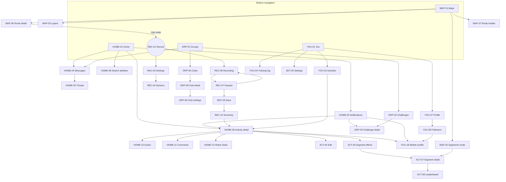
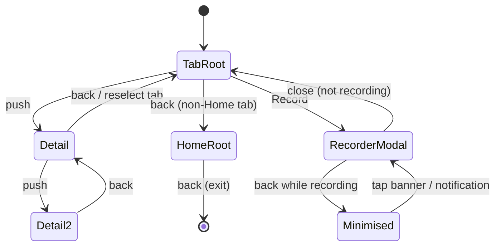

# 02 · Information Architecture & Navigation

> Teardown of how the Strava mobile app (Android first, with iOS differences noted) is organised: tabs, top bars, every screen we could identify, how screens connect, deep links, back-stack rules, notifications, search, settings, widgets, shortcuts and share integrations. Ends with the plan for **StravaFit**.
>
> Everything here is written in our own words. Strava trademarks (Strava, Kudos, KOM/QOM, Local Legend, Beacon, Flyby, Athlete Intelligence) are named only for reference. **Legend:** [FREE] = available to free Strava accounts, [SUB] = needs a Strava subscription (reference only, because StravaFit has no paywall), **(unverified)** = we could not confirm it against a public source in this pass.
>
> Research date: 2026-10. This was a time-boxed pass, so labels inside the app change often. Before building pixel layouts, recheck each "(unverified)" item on a live device.

---

## 1. Top-level structure

### 1.1 The current bottom tab bar (since the 2021 redesign)

The persistent bottom navigation has five destinations. This set arrived with the May 2021 redesign and was still the publicly documented structure in 2024–2025 support articles.

| # | Tab | Purpose | Tier | Replaced (pre-2021) |
|---|-----|---------|------|----------------------|
| 1 | **Home** | Social feed of your activities and the people you follow, plus posts and suggestions. Hosts the notifications bell and the messaging bubble. | [FREE] | "Feed" |
| 2 | **Maps** | Map-centred discovery: routes (suggested and saved), segments explorer, heatmaps, points of interest. | [FREE] base; route generation, offline maps and some heatmap layers [SUB] | "Explore" |
| 3 | **Record** | Opens the full-screen recorder. Strictly it is an action, not a tab: it launches a modal flow and hides the tab bar. | [FREE] | "Record" (unchanged) |
| 4 | **Groups** | Challenges, clubs and (since 2023) group or club chat entry points. | [FREE] | Clubs/challenges were reached from Profile and the feed before |
| 5 | **You** | Personal hub: Progress (training stats and log), Activities list, Profile. Holds the settings gear. | [FREE]; deeper training analytics [SUB] | "Profile" + "Training" |

**History of changes**

| Period | Tabs (left to right) | Notes |
|--------|----------------------|-------|
| ≤ 2020 | Feed · Explore · Record · Profile · Training (Training was web-heavy, and the mobile order varied by platform) | Clubs were inside Profile/Explore. Training calendar sat under its own tab. |
| May 2021 → now | Home · Maps · Record · Groups · You | The press called it "the biggest navigation change in years". Feed was refocused on followed athletes, and clubs moved to Groups. |
| Dec 2023 | (same tabs) | A **messaging** speech bubble was added to the top bar of Home and Groups (app v335+). |
| 2024–2026 | (same tabs) | Incremental changes followed: Athlete Intelligence summaries on activities [SUB], the "Your Progress" redesign under You, Maps improvements (route generation, Night/Weekly heatmaps), and a Home feed with personalised ordering. No public source reports the five-tab set itself changing. **(unverified for releases in late 2025 and 2026)** |

### 1.2 Global chrome

```
┌────────────────────────────────────────┐
│ ◀/Title          [🔍] [💬] [🔔]         │  ← top app bar (actions vary per tab)
├────────────────────────────────────────┤
│                                        │
│            tab content                 │
│                                        │
├────────────────────────────────────────┤
│ ⌂Home  ◫Maps  ●Record  ⚇Groups  ☺You   │  ← bottom nav (5)
└────────────────────────────────────────┘
```

- The Record item is visually emphasised: it is the brand-colour icon in the centre (iOS and Android alike).
- A badge dot or count appears on the bell (unread notifications) and on the message bubble (unread chats). It does not appear on the bottom tabs themselves **(unverified)**.
- A persistent "recording in progress" banner or mini-bar appears above the bottom nav while a recording runs in the background and the user browses other tabs. Tapping it returns to the recorder **(unverified as an in-app banner; the Android foreground-service notification is confirmed behaviour for any background GPS recorder)**.

### 1.3 Top bar actions per tab

| Tab | Left | Title area | Right actions | Notes |
|-----|------|-----------|---------------|-------|
| Home | (avatar/none) | "Home" | 🔍 search/find friends **(unverified exact icon)**, 💬 messages, 🔔 notifications | The support centre confirms the bell sits top right on Home, and press coverage confirms the chat bubble next to it. |
| Maps | — | Search field ("Search location / routes") | Layers button (map style, heatmap type, overlays), filter chips (sport, distance, elevation, surface), "my location" FAB | Segment/Route mode switcher at the top or bottom sheet **(unverified exact placement)** |
| Record | ✕/Close (back to previous tab) | Sport selector chip | ⚙ recording settings, sensors | Full-screen and modal. The bottom bar is hidden. |
| Groups | — | "Groups" with sub-tabs (Active / Challenges / Clubs) **(unverified exact sub-tab labels)** | 💬 messages, 🔍 search clubs/challenges | Messages bubble confirmed on Groups in 2023 press. |
| You | — | Athlete name or "You" | ⚙ settings (confirmed by Strava help centre), share/QR profile **(unverified)** | Sub-tabs: **Progress · Activities** with the profile reachable from the header **(label set "Progress/Activities" confirmed by the help centre)** |

---

## 2. Screen inventory

IDs are our own (`AREA-NN`). "Parent" is the screen that normally hosts it. "Type": S = full screen, BS = bottom sheet, M = modal dialog, FS = full-screen modal flow, W = web view.

### 2.1 Launch, onboarding, auth

| ID | Screen | Type | Parent | Entry points | Purpose | Tier |
|----|--------|------|--------|--------------|---------|------|
| AUTH-01 | Splash | S | — | App launch | Brand splash while the session restores | FREE |
| AUTH-02 | Welcome / sign-up landing | S | AUTH-01 | First launch, logout | Choose to sign up or log in | FREE |
| AUTH-03 | Sign up with email | S | AUTH-02 | "Sign up" | Email + password account creation | FREE |
| AUTH-04 | Continue with Google / Apple / Facebook | W/system | AUTH-02 | Social buttons | Federated sign in. Apple is on iOS and also offered on Android **(unverified)**. | FREE |
| AUTH-05 | Log in | S | AUTH-02 | "Log in" | Email/password. Also offers passwordless / one-time code login **(unverified; reported in 2024+)** | FREE |
| AUTH-06 | Forgot password | S | AUTH-05 | Link | Reset email | FREE |
| ONB-01 | Basic profile (name, gender, birthday) | S | AUTH-03 | Post sign-up | Profile basics and age gate | FREE |
| ONB-02 | Pick sports / goals | S | ONB-01 | Onboarding | Personalisation of feed, maps and recorder defaults | FREE |
| ONB-03 | Permissions primer (location, notifications, activity recognition, contacts) | M | ONB-02 | Onboarding / first Record | Explains the OS permission request before showing it | FREE |
| ONB-04 | Connect a device | S | ONB-02 | Onboarding | Garmin, Wahoo, COROS, Apple Watch, Health Connect, etc. | FREE |
| ONB-05 | Find friends | S | ONB-02 | Onboarding / Home | Contacts sync, suggested athletes, Facebook | FREE |
| ONB-06 | Subscription upsell / trial | FS | ONB-05 | Onboarding end, many locked features | Paywall | SUB (n/a for us) |
| ONB-07 | Privacy primer | S | ONB-02 | Onboarding | Introduces profile/activity visibility defaults **(unverified as a standalone step)** | FREE |

### 2.2 Home tab

| ID | Screen | Type | Parent | Entry points | Purpose | Tier |
|----|--------|------|--------|--------------|---------|------|
| HOME-01 | Home feed | S (tab root) | — | Bottom nav | Activity cards from you and the people you follow, club posts, challenge joins, suggestions, promos | FREE |
| HOME-02 | Feed ordering option | BS | HOME-01 / settings | Settings → Feed ordering **(unverified location)** | Personalised vs. latest (chronological) | FREE |
| HOME-03 | Notifications inbox | S | HOME-01 | 🔔, push tap | List of kudos, comments, follows, crowns lost, challenge updates, club posts | FREE |
| HOME-04 | Messages: conversation list | S | HOME-01, GRP-01 | 💬 | DMs and group chats | FREE |
| HOME-05 | Conversation thread | S | HOME-04 | Tap thread, push | Chat with text, reactions, shared activities and routes | FREE |
| HOME-06 | New message / pick recipients | S | HOME-04 | Compose | Choose followers or mutuals | FREE |
| HOME-07 | Chat settings / members | S | HOME-05 | Header tap | Name the group, mute, leave, report | FREE |
| HOME-08 | Search / find athletes | S | HOME-01 | 🔍 / "Find friends" | Athlete search, suggested, contacts, QR | FREE |
| HOME-09 | Activity detail | S | Any card | Card tap, deep link | Map, stats, splits, segments, photos, kudos, comments | FREE (analysis panels SUB) |
| HOME-10 | Kudos list | S | HOME-09 | Kudos count | Who gave kudos | FREE |
| HOME-11 | Comments | S | HOME-09 | 💬 on card | Thread, @mentions | FREE |
| HOME-12 | Media viewer | FS | HOME-09 | Photo tap | Swipe through photos and video | FREE |
| HOME-13 | Activity overflow menu | BS | HOME-09 | ⋯ | Edit, share, crop, delete, report, refresh, "View flyby" | FREE |
| HOME-14 | Share activity sheet | BS | HOME-09 / HOME-13 | Share icon | Strava-made share images and stickers, link copy, OS share sheet | FREE |
| HOME-15 | Post (text/photo) composer | FS | HOME-01 / You | "+" or "Create post" **(unverified entry)** | Non-activity posts | FREE |
| HOME-16 | Post detail | S | HOME-01 | Post tap | Post content, likes, comments | FREE |
| HOME-17 | Flyby viewer | S/W | HOME-13 | "Flyby" | Replay with nearby athletes. Historically a web page. | FREE |
| HOME-18 | Athlete Intelligence summary | BS | HOME-09 | AI card | Natural-language activity insights | SUB |
| HOME-19 | Report content | FS | HOME-13/11 | "Report" | Moderation reasons | FREE |
| HOME-20 | Suggested athletes / clubs carousel "see all" | S | HOME-01 | Carousel | Discovery | FREE |

### 2.3 Activity sub-screens (reachable from Home, You, notifications, links)

| ID | Screen | Type | Parent | Purpose | Tier |
|----|--------|------|--------|---------|------|
| ACT-01 | Activity detail (own) | S | HOME-09 | As HOME-09, plus owner actions | FREE |
| ACT-02 | Edit activity | FS | ACT-01 | Title, description, sport, type tag (race/long/workout/commute), gear, perceived exertion, private notes, visibility, hide stats, mute from feed, media, map type | FREE |
| ACT-03 | Splits / laps | S | ACT-01 | Per-km/mi splits, laps | FREE |
| ACT-04 | Pace / speed / HR / power analysis | S | ACT-01 | Charts, zones | SUB (basic charts FREE) |
| ACT-05 | Segment efforts list | S | ACT-01 | Matched segments, PRs, crowns | FREE |
| ACT-06 | Segment effort detail | S | ACT-05 | Effort vs. PR, leaderboard snippet | FREE (full leaderboards SUB) |
| ACT-07 | Segment detail | S | ACT-06, MAP | Elevation, leaderboards, Local Legend, star | FREE / leaderboards SUB |
| ACT-08 | Segment leaderboard | S | ACT-07 | Filters: overall, gender, age, weight, following, clubs, this year | SUB (top 10 FREE) |
| ACT-09 | Best efforts | S | ACT-01 | 400 m … marathon PR detections | FREE |
| ACT-10 | Matched activities / compare | S | ACT-01 | Same-route history | SUB |
| ACT-11 | Crop activity | FS | ACT-02/13 | Trim start and end | FREE |
| ACT-12 | Map type / 3D / flyover | S | ACT-01 | 3D map flyover **(unverified as SUB)** | SUB |
| ACT-13 | Save activity as route | M | ACT-01 | Create a route from the activity | FREE |
| ACT-14 | Gear picker | BS | ACT-02 | Choose shoes or bike | FREE |
| ACT-15 | Group activity (with ...) | S | ACT-01 | People you did it with | FREE |
| ACT-16 | Delete confirmation | M | ACT-13 | Irreversible delete | FREE |

### 2.4 Maps tab

| ID | Screen | Type | Parent | Entry points | Purpose | Tier |
|----|--------|------|--------|--------------|---------|------|
| MAP-01 | Maps root (routes mode) | S (tab root) | — | Bottom nav | Map + bottom sheet of suggested routes | FREE (generation SUB) |
| MAP-02 | Segments explore mode | S | MAP-01 | Mode switch | Segments in the viewport, filter by sport/climb | FREE |
| MAP-03 | Map layers sheet | BS | MAP-01 | Layers button | Base map (standard/satellite/hybrid/winter), heatmap (global/personal/weekly/night), POIs, segments overlay | Some layers SUB |
| MAP-04 | Route filters | BS | MAP-01 | Filter chips | Sport, distance, elevation, surface (paved/dirt), difficulty, starting point | SUB/FREE mix |
| MAP-05 | Location search | S | MAP-01 | Search field | Places and addresses | FREE |
| MAP-06 | Route detail | S | MAP-01, saved | Card tap, deep link | Elevation profile, surface mix, segments on route, save, navigate, share, send to device | FREE |
| MAP-07 | Route builder / creator | FS | MAP-01 | "Create route" | Tap-to-add waypoints with routing snapped to popular paths | SUB on mobile **(unverified current tier)** |
| MAP-08 | Saved routes & segments | S | MAP-01, You | "Saved" | Starred routes and segments | FREE |
| MAP-09 | Offline maps manager | S | MAP-06 | "Download" | Download routes or areas for offline use | SUB |
| MAP-10 | Point of interest / photo spot sheet | BS | MAP-01 | POI tap | Photo, name, related routes **(unverified)** | FREE |
| MAP-11 | Start navigation (follow route) | → REC-01 | MAP-06 | "Use route" | Opens the recorder with the route loaded | FREE |
| MAP-12 | Segment detail (from map) | S | MAP-02 | Pin tap | See ACT-07 | FREE |

### 2.5 Record flow

| ID | Screen | Type | Parent | Entry points | Purpose | Tier |
|----|--------|------|--------|--------------|---------|------|
| REC-01 | Recorder (pre-start) | FS | bottom nav | Record tab, app shortcut, widget, route "Use", notification action | GPS lock, sport, route, sensors, beacon, music | FREE |
| REC-02 | Sport picker | BS | REC-01 | Sport chip | 40+ sport types, favourites at the top | FREE |
| REC-03 | Recording settings | S | REC-01 | ⚙ | Audio cues, auto-pause, 3D/map style, screen on, countdown, Beacon, safety | FREE (Beacon now FREE for safety contacts per 2023/24 change, **unverified**) |
| REC-04 | Sensors | S | REC-03 | Sensors | BLE HR/cadence/power pairing | FREE |
| REC-05 | Route picker | BS | REC-01 | "Route" | Choose a saved route to follow | FREE |
| REC-06 | Recording (live stats) | FS | REC-01 | Start | Big-number stat pages, map page, splits, lap button | FREE |
| REC-07 | Paused | FS | REC-06 | Stop/auto | Resume / Finish | FREE |
| REC-08 | Discard confirm | M | REC-07 | "Discard" | Throw away recording | FREE |
| REC-09 | Save activity | FS | REC-07 | Finish | Title, description, media, gear, type, visibility, hide stats, mute | FREE |
| REC-10 | Post-save celebration / summary | S | REC-09 | Save | Achievements, PRs, streaks, share prompt | FREE |
| REC-11 | Beacon contacts / share link | S | REC-03 | Beacon | Pick safety contacts, SMS link | FREE / SUB legacy **(unverified)** |
| REC-12 | Manual activity entry | FS | You / "+" | "Add manual activity" | Type, time, distance, no GPS | FREE |
| REC-13 | Upload from file | W | Web only | — | GPX/FIT/TCX upload is web-only in Strava **(Android app cannot upload files; confirmed by long-standing user complaints, recheck)** | FREE |

### 2.6 Groups tab

| ID | Screen | Type | Parent | Entry | Purpose | Tier |
|----|--------|------|--------|-------|---------|------|
| GRP-01 | Groups root | S (tab root) | — | Bottom nav | Sub-tabs for Active / Challenges / Clubs **(unverified labels)** | FREE |
| GRP-02 | Challenges gallery | S | GRP-01 | Sub-tab | Joinable challenges by sport and category | FREE |
| GRP-03 | Challenge detail | S | GRP-02 | Card, link, push | Goal, progress, leaderboard, rewards, join/leave | FREE |
| GRP-04 | Challenge leaderboard | S | GRP-03 | "Leaderboard" | Rankings | FREE |
| GRP-05 | Create group challenge | FS | GRP-02 | "Create" | Private challenge with friends | SUB |
| GRP-06 | Clubs list (my clubs) | S | GRP-01 | Sub-tab | Joined clubs | FREE |
| GRP-07 | Club search / discover | S | GRP-06 | 🔍 | Search by name, sport and location | FREE |
| GRP-08 | Club detail | S | GRP-06/07 | Tap, link | Feed of posts, events, members, leaderboard | FREE |
| GRP-09 | Club settings (gear) | S | GRP-08 | ⚙ | Notification level: all posts / announcements / none; leave club | FREE |
| GRP-10 | Club members | S | GRP-08 | Members | Admins, members | FREE |
| GRP-11 | Club weekly leaderboard | S | GRP-08 | Leaderboard | Weekly distance ranking | FREE |
| GRP-12 | Club event detail | S | GRP-08 | Event | Date, route, RSVP | FREE |
| GRP-13 | Club post composer | FS | GRP-08 | "Post" | Text and photo post | FREE |
| GRP-14 | Create club | FS | GRP-06 | "Create a club" | Name, sport, privacy, image | FREE |
| GRP-15 | Club chat | S | GRP-08 / HOME-04 | Chat | Club-wide conversation **(planned 2024; unverified shipped)** | FREE |
| GRP-16 | Active (group activities/events nearby) | S | GRP-01 | Sub-tab | Upcoming group events **(unverified)** | FREE |

### 2.7 You tab

| ID | Screen | Type | Parent | Entry | Purpose | Tier |
|----|--------|------|--------|-------|---------|------|
| YOU-01 | You root: Progress | S (tab root) | — | Bottom nav | Weekly/period summary, charts by sport, streaks, fitness trend | FREE basic / SUB summary at top |
| YOU-02 | You: Activities list | S | YOU-01 | Sub-tab | All activities, search with filters (sport, distance, time, elevation, date, type) | FREE |
| YOU-03 | Activity search & filters | S/BS | YOU-02 | 🔍 | Keyword + filters (confirmed in the help centre) | FREE |
| YOU-04 | Training log / calendar | S | YOU-01 | "See more of your training" | Bubble calendar per week | FREE **(tier changed over time; unverified)** |
| YOU-05 | Fitness & freshness | S | YOU-01 | Card | Training load curve | SUB |
| YOU-06 | Goals | S | YOU-01 | Goals card | Weekly/annual distance or time goals | SUB (some FREE) |
| YOU-07 | Profile (own) | S | YOU-01 header | Avatar/name | Bio, stats, trophy case, followers, clubs, gear, photos | FREE |
| YOU-08 | Edit profile | FS | YOU-07 | Edit | Photo, name, city, bio, weight, gender | FREE |
| YOU-09 | Followers / Following | S | YOU-07 | Counts | Lists with follow buttons and requests | FREE |
| YOU-10 | Follow requests | S | YOU-09 / HOME-03 | Badge | Approve/decline (private accounts) | FREE |
| YOU-11 | Trophy case | S | YOU-07 | Trophies | Challenge badges | FREE |
| YOU-12 | Gear list & detail | S | YOU-07 | Gear | Shoes/bikes, distance, retire, default per sport | FREE |
| YOU-13 | Best efforts / PRs | S | YOU-07 | PRs | Record table | FREE |
| YOU-14 | Starred segments | S | YOU-07 | Segments | Starred list | FREE |
| YOU-15 | Saved routes | S | YOU-07 | Routes | = MAP-08 | FREE |
| YOU-16 | Photos grid | S | YOU-07 | Photos | All activity media | FREE |
| YOU-17 | Year in Sport | FS | YOU-01 / promo | Dec–Jan promo | Year review story | FREE base / SUB extras |
| YOU-18 | Other athlete profile | S | Anywhere | Avatar tap, link | Public profile, follow, block, report | FREE |
| YOU-19 | Profile share / QR | BS | YOU-07 | Share | QR code and link **(unverified)** | FREE |
| YOU-20 | Subscription management | S/W | Settings | — | Play billing / App Store | SUB (n/a) |

### 2.8 Settings (see section 7 for the full tree)

| ID | Screen | Type | Parent |
|----|--------|------|--------|
| SET-00 | Settings root | S | YOU-01 ⚙ |
| SET-01 … SET-30 | Each sub-screen listed in section 7 | S | SET-00 |

### 2.9 System / cross-cutting

| ID | Screen | Type | Purpose |
|----|--------|------|---------|
| SYS-01 | OS permission dialogs (location fine/background, notifications on Android 13+, activity recognition, nearby devices/BLE, contacts, camera/photos) | M | Runtime permissions |
| SYS-02 | Force-update / maintenance | M | Minimum version gate |
| SYS-03 | Offline / no-connection banner | Banner | Network state |
| SYS-04 | Upload queue / sync pending | Banner/S | Unsynced recordings retry |
| SYS-05 | In-app web view (help centre, legal, flyby, some settings) | W | Content not yet built natively |
| SYS-06 | Rating prompt | M | Play In-App Review / SKStoreReviewController |
| SYS-07 | Feature announcement sheet ("What's new") | BS | Release education |
| SYS-08 | Paywall | FS | Upsell (n/a for us) |
| SYS-09 | Foreground recording notification | System | Live stats and Pause/Resume actions in the notification shade |
| SYS-10 | Wear OS / Apple Watch companion | Separate app | Out of scope here (see the wearables doc) |

---

## 3. Navigation map



---

## 4. Deep links & URL schemes

### 4.1 What is publicly confirmed

| Mechanism | Example | Confirmed by |
|-----------|---------|--------------|
| Custom scheme `strava://` | `strava://oauth/mobile/authorize?client_id=…&redirect_uri=…&response_type=code&approval_prompt=auto&scope=…&state=…` | Strava developer docs (iOS mobile OAuth) |
| HTTPS app link for OAuth on Android | An implicit intent to `https://www.strava.com/oauth/mobile/authorize?...` opens the app if it is installed | Strava developer docs (Android sample) |
| Branch-powered short links | `https://strava.app.link/<id>`: share links for activities. They open the app or fall back to the web. | Branch.io case study; user reports of `strava.app.link` share URLs |
| Web URLs that the app intercepts (Android App Links / iOS Universal Links) | `https://www.strava.com/activities/{id}`, `/athletes/{id}`, `/segments/{id}`, `/routes/{id}`, `/clubs/{id}`, `/challenges/{slug}` | Third-party deep-link tools describe activity, athlete, club and route links opening in the app. **The exact set of intercepted paths is unverified.** |

### 4.2 Likely internal routes (unverified)

Strava has never published an internal-route list. Community posts mention patterns like `strava://activities/{id}`, `strava://athletes/{id}`, `strava://record` and `strava://feed`. Treat all of these as **(unverified)** and do not depend on them for interoperability.

### 4.3 Deep-link → screen resolution (behaviour model)

| Incoming | Resolves to | Back goes to |
|----------|------------|--------------|
| Activity link | HOME-09 on top of the Home tab | Home feed (synthetic back stack) |
| Athlete link | YOU-18 on top of Home | Home |
| Segment link | ACT-07 on top of Maps | Maps |
| Route link | MAP-06 on top of Maps | Maps |
| Club / challenge link | GRP-08 / GRP-03 on top of Groups | Groups |
| Push: kudos/comment | HOME-09 (comments scrolled) | Notifications inbox → Home **(unverified whether the inbox is inserted)** |
| Push: new follower | YOU-18 | Home |
| Push: message | HOME-05 | HOME-04 → Home |
| Not logged in | AUTH-02, then resume the target after login | — |

---

## 5. Back-stack behaviour

- **One stack per tab.** Each bottom tab keeps its own history. Switching tabs and coming back restores the previous position (the standard Android/iOS multi-back-stack pattern). Strava follows this on both platforms in practice **(behaviour observed in reviews; unverified on the latest Android build)**.
- **Reselecting the active tab** pops to the tab root and/or scrolls to top (iOS convention; Android Material guidance is the same).
- **System back on Android** (gesture or button):
  - Inside a tab stack: pop one screen.
  - At a non-Home tab root: goes to the Home tab **(unverified; the alternative is exiting the app)**.
  - At the Home root: exits the app (moves the task to the background).
- **Record is modal.** Back on the pre-start recorder closes it. During a recording, back minimises it (the recording continues in the foreground service). It never discards the recording. Discarding needs an explicit confirm dialog.
- **Save screen** blocks accidental back: it asks to keep editing or discard **(unverified exact copy)**.
- **Bottom sheets** close on back or swipe-down before the underlying screen pops.
- **Deep links** build a synthetic back stack (tab root underneath), so back never drops the user out of the app unexpectedly.
- **Android predictive back** (Android 14+): support status in Strava is **(unverified)**. We should support it.



---

## 6. Notifications inbox & push

### 6.1 Inbox (HOME-03)

- Location: bell icon, top right of **Home** (confirmed by the Strava help centre). On the web, the bell sits next to the avatar.
- In-app (inbox) notifications **cannot be turned off**. Only push and email can be (confirmed for the web; we assume the same for the app).
- Row anatomy: actor avatar, a short sentence ("X gave you kudos", "Y commented…"), relative time, and an optional activity thumbnail. Repeated kudos are grouped ("X and 12 others") **(unverified grouping logic)**.
- Unread rows are highlighted. Opening the inbox clears the badge **(unverified whether opening clears it or each row must be read)**.

### 6.2 Notification categories

| Category | Inbox | Push | Email | Notes |
|---------|-------|------|-------|-------|
| Kudos on your activity | ✔ | toggle | toggle | |
| Comments / replies | ✔ | toggle | toggle | |
| Mentions (@) | ✔ | toggle | toggle | Who can mention you is a privacy setting |
| New follower / follow request / accepted | ✔ | toggle | toggle | |
| Lost a KOM/QOM/CR | ✔ | toggle | toggle | No email for some segments (e.g. ≤0 % grade), per help centre |
| Local Legend gained/lost | ✔ | toggle | toggle | |
| Challenge joined/completed/reminders | ✔ | toggle | toggle | |
| Club posts | ✔ | per-club: all / announcements / none | — | Configured in GRP-09, plus the global "Clubs" toggle |
| Club events | ✔ | toggle | toggle | |
| Messages | badge on 💬 | toggle | — | |
| Friend joined Strava (contacts) | ✔ | toggle | — | **(unverified)** |
| Activity uploaded/processed (from device) | — | toggle | — | |
| Group activity (you were together) | ✔ | toggle | — | |
| Beacon (live tracking started) | SMS | — | — | Sent to contacts, not to the user |
| Newsletter / product | — | — | toggle | Required for monthly stats email |

### 6.3 Paths to settings

- Push: **You → ⚙ → Push Notifications** (help centre).
- Email: **You → ⚙ → Email Notifications** (help centre). Also on the web: profile menu → Settings → Email Notifications.
- Per club: **Groups → Club → ⚙** (help centre).

---

## 7. Search

| Surface | Scope | Entry | Notes |
|---------|-------|-------|-------|
| Athlete search | Athletes by name, with suggestions and contacts | Home 🔍 / "Find friends" / Profile → Followers | Private profiles still appear by name unless hidden **(privacy setting dependent)** |
| Club search | Clubs by name, sport, location | Groups → Clubs → 🔍 | |
| Challenge browse | Categories and filters, no free text **(unverified)** | Groups → Challenges | |
| Map location search | Places, addresses | Maps search bar | |
| Route/segment search | Viewport + filters, not by name **(segment name search unverified on mobile)** | Maps | |
| Own activity search | Keyword + sport, distance, time, elevation, date range, type | You → Activities → 🔍 | Confirmed by the help centre |
| Message search | — | Not available **(unverified)** | |

There is **no single global search** that spans every entity type. Search is scoped per tab. This is a notable IA gap that we can improve on.

---

## 8. Settings tree

Path: **You → ⚙ (top right)**. Labels are paraphrased. Sub-items marked (unverified) come from third-party guides or memory of earlier builds and need a device check.

```
Settings (SET-00)
├── Account (SET-01)
│   ├── Email / change email
│   ├── Password / change password
│   ├── Login methods (Google, Apple, Facebook links) (unverified)
│   ├── Subscription: manage / restore purchases  [SUB]
│   ├── Download / request your data (archive)  (web-backed)
│   └── Delete account  (web-backed, confirm)
├── Privacy Controls (SET-02)
│   ├── Profile page: Everyone / Followers
│   ├── Activities (default visibility): Everyone / Followers / Only You
│   ├── Group activities: Everyone / Followers / No one
│   ├── Flybys: Everyone / No one
│   ├── Local Legends: Everyone / No one
│   ├── Mentions: Everyone / Followers / No one
│   ├── Messaging: who can message you (Following / Mutuals / No one)
│   ├── Map Visibility (SET-02a)
│   │   ├── Hide start/end points (by distance)
│   │   ├── Hide specific addresses (privacy zones)
│   │   └── Hide all maps (unverified label)
│   ├── Edit Past Activities (bulk-change visibility)
│   ├── Blocked athletes
│   ├── Aggregated data usage (Metro / heatmap contribution) on/off
│   └── Contacts / find-me-by-phone/email (unverified)
├── Data Permissions (SET-03) (unverified as a separate screen)
│   ├── Health-related data (HR) processing consent
│   └── Contacts upload
├── Push Notifications (SET-04): per category toggles (see 6.2)
├── Email Notifications (SET-05): per category + newsletter
├── Units of measure (SET-06): Metric / Imperial; temperature °C/°F
├── Display / Appearance (SET-07): Light / Dark / System theme (unverified label)
├── Feed ordering (SET-08): Personalised / Latest (unverified location)
├── Default highlight / map type (SET-09) (unverified)
├── Recording (SET-10)  — also reachable from Recorder ⚙
│   ├── Audio cues (voice feedback: time/distance/pace/HR, interval)
│   ├── Auto-pause (run / ride)
│   ├── Keep screen on / screen lock
│   ├── 3D maps / map style during recording (unverified)
│   ├── Countdown timer (unverified)
│   ├── Sensors (BLE)
│   ├── Beacon (safety contacts, message)
│   └── Default sport (unverified)
├── Applications, Services & Devices (SET-11)
│   ├── Connected devices (Garmin, Wahoo, COROS, Polar, Suunto, Zwift, …)
│   ├── Health Connect / Google Fit (Android) · Apple Health (iOS)
│   ├── Authorised third-party apps (revoke API access)
│   └── Music / Spotify integration (unverified)
├── Gear defaults (SET-12): default shoes/bike per sport (also in Profile → Gear)
├── Heart-rate / power zones (SET-13): max HR, FTP, custom zones (some SUB)
├── Weight & body (SET-14)
├── Language (SET-15): follows the OS (Android 13 per-app language) (unverified)
├── Help & Feedback (SET-16): help centre (web view), contact support, report a bug
├── Legal (SET-17): terms, privacy policy, open-source licences
├── About / version (SET-18)
└── Log out (SET-19)
```

**iOS differences:** Apple Health replaces Health Connect. The subscription is managed through App Store settings. iOS adds Live Activities and Dynamic Island settings for recording (Strava shipped Live Activities for iOS in 2023 **(unverified)**). The settings gear location is the same.

---

## 9. Widgets, app shortcuts & system surfaces

| Surface | Android | iOS | Status |
|---------|---------|-----|--------|
| Home-screen widget | Strava ships a stats/record widget **(unverified; we found no public source confirming an official Android widget in 2024–26)** | An official weekly-stats widget is described by Tom's Guide **(unverified as first-party)**. Third-party apps (Dash, Stratiles, RunRide Studio) fill the gap via the API. | Partial |
| Lock-screen widget | n/a | Third-party | — |
| Live Activity / Dynamic Island | n/a | Recording stats live on the lock screen **(unverified)** | — |
| Launcher app shortcuts (long-press icon) | "Record activity" type shortcut **(unverified)** | Quick action "Record" **(unverified)** | — |
| Recording notification | Ongoing notification with time/distance and Pause/Resume/Finish **(Pause/Resume actions unverified)** | Live Activity | — |
| Quick Settings tile | Not offered **(unverified)** | n/a | — |
| Wear OS / watchOS | Separate apps (see the wearables doc) | | — |
| Assistant / Siri | Google Assistant "start a run on Strava" via App Actions **(unverified)**; Siri Shortcuts **(unverified)** | | — |

---

## 10. Share-sheet integrations

**Outbound (Strava → others)**

- An activity's share button opens a Strava sheet with: generated share images (map + stats, several templates), a transparent-background **sticker** for Instagram Stories, "Copy link" (a `strava.app.link` short link), and "More…" (the OS share sheet).
- Direct targets surfaced by Strava: Instagram Stories, WhatsApp, Facebook, X, Snapchat, and messages (in-app chat) **(exact list unverified)**.
- Routes and segments: share link, send to device (Garmin, etc.), export GPX (web; mobile GPX export **unverified**).
- Profile: share profile link / QR **(unverified)**.
- Year in Sport: story-format share cards.

**Inbound (others → Strava)**

- Strava does **not** register as a share target for GPX/FIT files on Android **(unverified; long-standing user requests suggest uploads are web-only)**. Photos can be added from the gallery picker inside Edit Activity, not via the share sheet.
- OAuth: other apps open Strava via `strava://oauth/mobile/authorize` or the https equivalent to request authorisation (confirmed).

---

## 11. IA observations (strengths and gaps)

| Observation | Impact for StravaFit |
|-------------|---------------------|
| Five tabs with a centred Record button make the core loop (record → share → social) fast | Copy this pattern |
| Messages live on two tab top bars (Home, Groups), but notifications only on Home | Keep both on a global top bar, or on Home only, and be consistent |
| No global search | Add a unified search (athletes, clubs, routes, segments, my activities) |
| Training data is split between You → Progress, the Training log and web-only analysis | Bring analysis to mobile, free |
| Settings mix native and web views (delete account, data export) | Build all of them natively |
| Paywall interstitials across Maps, You, Groups | None in StravaFit |
| File import is web-only | Make "Open GPX/FIT/TCX with StravaFit" a first-class share target |

---

## OSS implementation notes

### Neutral naming

| Strava term | StravaFit name |
|-------------|----------------|
| Home | **Feed** |
| Maps | **Explore** |
| Record | **Record** (generic) |
| Groups | **Community** |
| You | **Me** |
| Kudos | **Cheers** |
| KOM/QOM/CR | **Segment crown / Course record** |
| Local Legend | **Local Regular** |
| Flyby | **Crossings** / **Replay** |
| Beacon | **LiveShare** |
| Athlete Intelligence | **Insights** |

### Architecture (Android)

- **Jetpack Compose + Navigation Compose (type-safe routes, 2.8+)** with **multiple back stacks**: one `NavHost` with a nested graph per tab, `saveState = true / restoreState = true` on tab switches, and `popUpTo(startDestination)` for reselect-to-root.
- Bottom bar: Material 3 `NavigationBar`. The centre "Record" item is not a destination: `onClick` navigates to a **full-screen modal graph** (a `dialog`-less route with the bar hidden). The bar's visibility is derived from `currentBackStackEntry.destination.hierarchy`.
- **Predictive back**: enable `android:enableOnBackInvokedCallback="true"` and use `BackHandler`/`PredictiveBackHandler` in the recorder to minimise instead of discard.
- Adaptive layouts: `NavigationSuiteScaffold` gives a bottom bar on phones and a navigation rail on tablets and foldables.
- Recording runs in a **foreground service** (`foregroundServiceType="location|health"` on Android 14+), independent of UI navigation. The UI binds to it via a `StateFlow` repository. The ongoing notification carries Pause/Resume/Finish `PendingIntent` actions and a content intent that deep-links to `stravafit://record`.

### Deep links

- Custom scheme `stravafit://` plus verified App Links on `https://<our-domain>/…` (`assetlinks.json`). Route table:

| Path | Destination |
|------|-------------|
| `/a/{activityId}` | Activity detail |
| `/u/{userId}` | Profile |
| `/s/{segmentId}` | Segment |
| `/r/{routeId}` | Route |
| `/c/{clubId}` | Club |
| `/ch/{challengeId}` | Challenge |
| `/msg/{threadId}` | Thread |
| `/record?sport=run&route={id}` | Recorder |
| `/settings/{section}` | Settings sub-page |

- Use Navigation's `navDeepLink { uriPattern = … }` so synthetic back stacks are built automatically. Wrap auth-required links with a pending-destination store that is resumed after login.
- Self-hosted federation: links should embed the instance host (e.g. `https://instance.example/a/123`) so that links to other instances open in the app via a generic handler, with a web fallback.

### Notifications

- Server-side `notifications` table (id, recipient, type enum, actor_ids[], object_type, object_id, created_at, read_at, group_key). The inbox groups by `group_key` (e.g. `kudos:activity:123`) within a time window.
- Push: FCM, with **UnifiedPush** as the de-Googled option (important for an OSS audience; F-Droid builds). Android notification channels map 1:1 to categories in 6.2 so users can also control them at the OS level.
- Android 13+ `POST_NOTIFICATIONS` runtime permission, requested in context (after the first save or the first follow), not at launch.

### Search

- Unified search screen with a scoped chip row: All / People / Clubs / Routes / Segments / My activities / Places. Backend: Postgres full-text search (`tsvector`) + `pg_trgm` for names, PostGIS for viewport queries. Places via **Nominatim/Photon** (OSM).
- Search results respect privacy settings server-side (never filter on the client only).

### Settings

- Build every settings screen natively, with no web views. Persist local prefs in **DataStore (Proto)**. Server-side prefs (privacy, notification toggles) use a `user_settings` JSON column with a typed schema, plus optimistic UI and offline queueing.
- Privacy zones: store as a centre + radius per address. Hide-start/end: a distance slider (e.g. 0–1.6 km). Apply on the **server** when rendering to non-owners, and recompute when settings change ("edit past activities" runs as a batch job).
- Theme: `MaterialTheme` with dynamic colour (Android 12+) as an option, plus Light/Dark/System. Per-app language via `LocaleManager` / AppCompat `setApplicationLocales`.
- Account deletion and data export (GDPR) are in-app, with an async job + email/notification when the export ZIP (GPX/FIT + JSON) is ready.

### Widgets, shortcuts, share

- **Glance** app widgets: (1) "This week" stats (distance/time/streak), (2) one-tap "Start <sport>" button. Both deep-link via `stravafit://record?sport=…`. Update via WorkManager after sync.
- Static launcher shortcuts in `shortcuts.xml`: Record run, Record ride, Messages, Explore. Dynamic shortcut for the last-used sport.
- Quick Settings `TileService` "Start/Pause recording" (something we can offer that Strava does not).
- Inbound share target: an `ACTION_SEND`/`ACTION_VIEW` intent filter for `application/gpx+xml`, `application/vnd.ant.fit`, `.tcx`, `application/octet-stream` (with extension sniffing) → import preview screen → save as activity or route.
- Outbound: generate share images with Compose → `Bitmap` (via `GraphicsLayer.toImageBitmap`) and share with `FileProvider` + `ACTION_SEND`. Instagram Stories: `com.instagram.share.ADD_TO_STORY` intent with a sticker asset (transparent PNG).
- iOS (if built later with KMP/Compose Multiplatform or natively): WidgetKit, App Intents for Siri/Shortcuts, a Live Activity for recording, and a Share Extension for GPX import.

### Edge cases

- A deep link to a private or deleted object shows a "not available" state, not a crash. A deep link while recording opens on top of the recorder's minimised state and must never stop the recording.
- Process death: Navigation state is restored by `SavedStateHandle`. The recording state lives in the service plus Room, not in the UI.
- Tab reselect while a modal sheet is open: dismiss the sheet first.
- Badge counts are synced from the server on resume and on push receipt. Clear them when the inbox is opened.
- Notification permission denied: the inbox still works, so show a one-time banner in the inbox to enable push.

---

## Sources

- https://bikerumor.com/2021/05/05/strava-redesigns-their-app-navigation-to-make-it-easier-to-track-rides-find-friends/
- https://www.quadlockcase.co.uk/blogs/news/new-strava-layout-preview
- https://bikeradar.com/news/strava-beta-test-layout
- https://velo.outsideonline.com/road/road-racing/strava-overhauls-mobile-app-look-and-feel/
- https://zenocycleparts.com/blogs/cyclingtips/new-strava-update-makes-big-changes-to-layout-organization-and-navigation
- https://support.strava.com/hc/en-us/articles/216918417-Viewing-your-activity-history-on-Strava
- https://support.strava.com/hc/en-us/articles/216918367-Strava-Notifications
- https://support.strava.com/en-us/articles/15402139-how-do-i-manage-my-strava-notifications
- https://developers.strava.com/docs/authentication/
- https://www.branch.io/resources/blog/how-strava-unifies-in-app-experiences-with-deep-links-mobile-user-acquisition-engagement/
- https://community.brave.com/t/cant-open-strava-app-link-urls/480279
- https://u2l.ai/deep-link-generator/strava
- https://www.techradar.com/computing/software/strava-gets-a-handy-direct-messaging-feature-to-make-organizing-rides-easier
- https://www.bikeradar.com/news/you-can-finally-send-direct-and-group-messages-on-strava
- https://www.globalcyclingnetwork.com/tech/news/messaging-comes-to-strava-functionality-launches-for-dms-and-group-chats
- https://runningmagazine.ca/?p=108236
- https://www.kaspersky.co.za/blog/running-apps-privacy-settings-part2-strava/33876
- https://www.internetmatters.org/parental-controls/social-media/strava-parental-controls/
- https://androidcentral.com/apps-software/how-to-control-your-privacy-settings-strava
- https://www.tomsguide.com/wellness/fitness/this-easy-strava-trick-means-i-never-miss-a-run-how-to-add-the-strava-widget-to-your-iphone-homescreen
- https://apps.apple.com/app/id1556281712
- https://android-developers.googleblog.com/2017/07/whats-new-for-shortcuts-and-widgets-in.html
- https://developer.android.com/training/app-links
