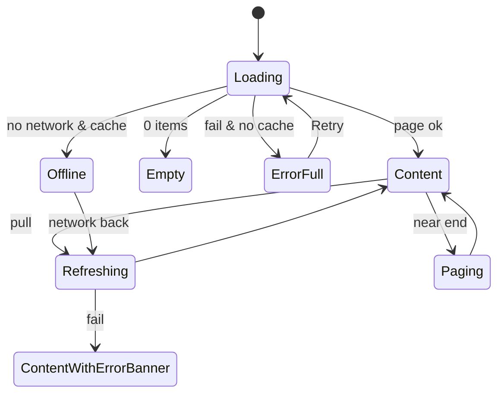
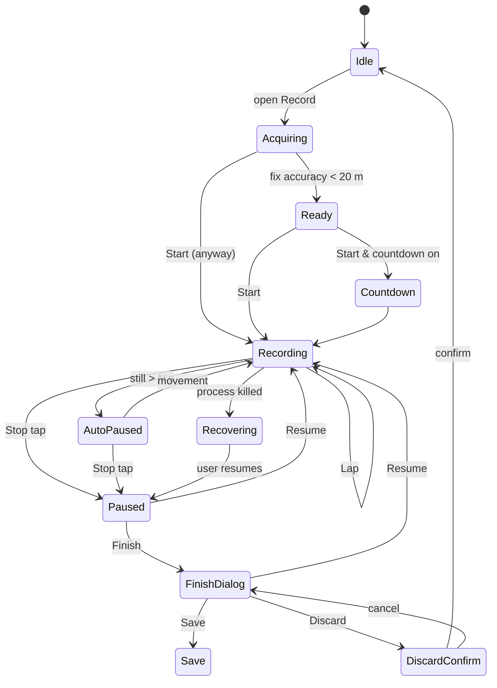
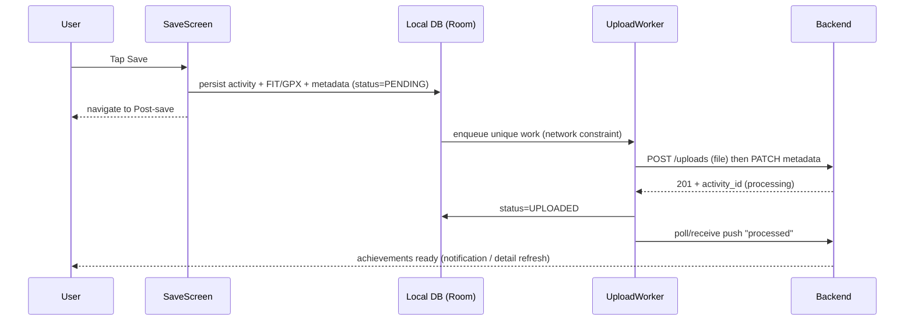
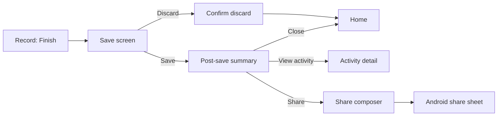

# 03 — Core Screen Wireframes (Home, Activity Detail, Record, Save, Post-save)

> **Scope:** These are low-fidelity ASCII wireframes of the five core screen groups in the Strava Android app, with iOS differences noted. They show the reference app's structure and are paired with the layout we propose for StravaFit. Everything is described in our own words. No Strava assets, icons or copy are reproduced.
>
> **Conventions**
> - Frame width is about 40 characters, roughly a 360dp Android phone in portrait.
> - `[Btn]` is a button, `( )` a radio, `[x]` a checkbox, `<..>` a dropdown or picker, `>` a chevron or row link, `===` a divider, `###` a map or image area, and `~~~` a chart area.
> - `@` is an avatar, `*` an icon placeholder, and `•` a page indicator.
> - Annotations follow each frame as `#n → ComponentName (spacing / behaviour)`.
> - `[FREE]` means free in Strava. `[SUB]` means Strava subscription-gated. **In StravaFit every feature is free.**
> - `(unverified)` marks a detail I could not confirm in public docs during this pass.
> - Spacing tokens (StravaFit proposal): `s1=4dp s2=8dp s3=12dp s4=16dp s5=24dp s6=32dp`. Screen gutter is `s4`. Card gap is `s2`. Touch targets are at least 48dp.

---

## 0. Global shell

### 0.1 Bottom navigation (reference, 2023 to present)

Strava reorganised its navigation in 2023 into five tabs: **Home, Maps, Record, Groups, You**. Record sits in the centre. It replaced the older Feed / Explore / Record / Challenges / Profile layout, and these labels were still current in 2025 (unverified for late 2026).

```
+--------------------------------------+
|                                      |
|            (screen content)          |
|                                      |
+======================================+
|  *      *      (*)      *      *     |  #1
| Home   Maps   Record  Groups   You   |
+--------------------------------------+
```
- `#1 → BottomNavBar`: 5 destinations, height 56–64dp, and the active tab uses the accent tint. Record is centred and may be emphasised. On Android it is a Material3 `NavigationBar`. On iOS it is a `UITabBar`, which sits above the home indicator.
- Re-tapping the active tab scrolls its content to the top. Tapping a second time pops the tab's stack to its root.
- Tapping **Record** opens a full-screen recording flow outside the tab stack. The bottom nav is hidden there.

### 0.2 Shared state patterns

| State | Pattern used on every screen |
|---|---|
| Loading (first load) | Skeleton shimmer blocks shaped like the final content. No full-screen spinner |
| Loading (refresh) | Pull-to-refresh indicator at the top, with existing content still visible |
| Loading (paging) | Small inline spinner row at the end of the list |
| Empty | Illustration placeholder, one-line headline, sub-copy and one primary CTA |
| Error | Inline banner (`! Couldn't load. [Retry]`) when cached data exists. Full-state error with Retry when it doesn't |
| Offline | Persistent slim banner under the top bar (`Offline — showing saved data`). Write actions queue up and show a "pending" chip |

---

## 1. Home feed

### 1.1 Default state

```
+--------------------------------------+
| Home                  *    *    *    |  #1
|                     search chat bell |
+--------------------------------------+
| [ Following v ]                      |  #2
+--------------------------------------+
| +----------------------------------+ |
| | @ Ana Ruiz              ...      | |  #3
| | Today at 7:02 AM · Pune · *watch | |
| |                                  | |
| | Easy morning shakeout            | |  #4
| | Felt good after rest day         | |
| |                                  | |
| | Distance   Pace       Time       | |  #5
| | 8.02 km    5:21 /km   42m 56s    | |
| |                                  | |
| | ################################ | |  #6
| | ####  route polyline map  ###### | |
| | ################################ | |
| | * 2 achievements: 2nd best 5K    | |  #7
| |                                  | |
| | @@@ 12 gave kudos                | |  #8
| | ---------------------------------| |
| |  [*Kudos]  [*Comment]  [*Share]  | |  #9
| +----------------------------------+ |
|  (s2 gap)                            |
| +----------------------------------+ |
| | @ Dev K.  ...                    | |
| | ...                              | |
+--------------------------------------+
|  Home   Maps  (Rec)  Groups   You    |
+--------------------------------------+
```
- `#1 → TopAppBar`: title on the left. On the right are **Search** (athletes and clubs), **Messages / chat**, which Strava added in 2024 (unverified for the exact placement), and **Notifications** with an unread badge. Height is 56dp.
- `#2 → FeedFilterDropdown`: switches between "Following" and "Your Activities". Strava has also offered a "Club" scope over time (unverified for 2026). Tapping it opens a bottom sheet with radio options.
- `#3 → CardHeader`: 40dp avatar, athlete name in bold, then timestamp, location and device or source. The overflow menu `...` opens a sheet. For your own activity it offers Edit, Share, Delete and Mute. For someone else's it offers Report and Unfollow (unverified).
- `#4 → TitleBlock`: title is 18sp bold, description is at most 2 lines with an ellipsis and a "more" link.
- `#5 → StatTriplet`: three columns. Which stats appear depends on the sport (see the table in 1.2). Labels are 12sp in a muted colour and values are 18sp.
- `#6 → MapThumbnail`: about 180dp tall, full card width, with a static rendered polyline. The map is hidden when visibility hides it or the activity has no GPS. Privacy zones trim the start and end.
- `#7 → AchievementStrip`: trophy or medal icon with a count and the top achievement. Tapping it opens Activity detail with the achievements section expanded.
- `#8 → SocialProofRow`: up to 3 stacked avatars with "N gave kudos" and "M comments". Tapping it opens the Kudos/Comments screen.
- `#9 → ActionBar`: Kudos is a toggle. When it is filled the action is done. Tapping it twice does nothing, because kudos can't be undone in the reference app (unverified). Comment opens the comment composer. Share opens the share sheet.

**Gestures and interactions**

| Gesture | Target | Result |
|---|---|---|
| Tap | Card body or map | Push Activity detail |
| Tap | Avatar or name | Push athlete profile |
| Double-tap | Card or photo | Gives kudos in some versions (unverified). StravaFit: yes, with a heart-burst animation |
| Long-press | Card | StravaFit: quick actions sheet (Kudos, Comment, Share, Hide) |
| Pull down | List | Refresh |
| Scroll to end | List | Load the next page using a cursor |
| Horizontal swipe | Photo carousel inside a card | Next or previous media |

### 1.2 Card variants

#### a) Run card (no photo)
```
| @ Name                      ...      |
| Today · City                         |
| Lunch Run                            |
| Distance   Pace       Time           |
| 5.00 km    4:58 /km   24m 50s        |
| #####  map  #######################  |
```
#### b) Ride card
```
| @ Name                      ...      |
| Yesterday · City · *bike computer    |
| Sunday loop                          |
| Distance   Elev Gain   Time          |
| 64.3 km    812 m       2h 31m        |
| #####  map  #######################  |
```
Stat triplet defaults by sport (reference behaviour, approximate):

| Sport | Stat 1 | Stat 2 | Stat 3 |
|---|---|---|---|
| Run / Walk / Hike | Distance | Pace | Time |
| Ride / E-bike / Virtual ride | Distance | Elev Gain | Time |
| Swim | Distance | Pace /100m | Time |
| Weight training / Yoga / Workout (no GPS) | Time | (Avg HR if present) | (Calories if present) |
| Indoor (trainer, treadmill) | Distance | Pace or speed | Time, with no map and a sport pictogram instead |

#### c) Activity with photos
```
| @ Name                      ...      |
| Today · City                         |
| Trail day                            |
| Distance   Elev Gain   Time          |
| 14.2 km    640 m       2h 05m        |
| +--------------------------------+   |
| |##############|#################|   |  #1
| |#  photo 1   #|#   map        #|    |
| |##############|#################|   |
| +--------------------------------+   |
|            •  ○  ○  ○                |  #2
```
- `#1 → MediaCarousel`: a horizontal pager mixing photos, videos and the map tile. The map is usually first or second (unverified for order). The aspect ratio is fixed (about 4:3) and photos are center-cropped. Videos autoplay muted (unverified).
- `#2 → PageIndicator`.
- Tapping a photo opens a full-screen media viewer. There you can pinch to zoom and swipe down to dismiss.

#### d) Group activity
```
| @ Name  and 3 others        ...      |  #1
| Today · City                         |
| Saturday social ride                 |
| Distance   Elev Gain   Time          |
| 48.0 km    300 m       1h 50m        |
| #####  map  #######################  |
| @@@@ Ana, Dev, Li, +1 rode together  |  #2
```
- `#1`: when people's activities are matched by time and location (Strava calls this a "group activity"), the header names one athlete plus a count. Strava may also collapse several matched activities into one card (unverified for the current layout).
- `#2 → GroupMembersRow`: tapping it opens a list of participants, each linking to their own activity.

#### e) Challenge / club post / milestone
```
| * Challenge                          |
| @ Ana joined the October 5K          |  #1
| Challenge                            |
| +----------------------------------+ |
| | [badge placeholder]  Run 5K in   | |
| |                      October     | |
| |                      [ Join ]    | |  #2
| +----------------------------------+ |
| --------------------------------     |
| @ Club name · Post                   |  #3
| "Group run moved to 6:30 tomorrow"   |
| [*Like] [*Comment]                   |
```
- `#1 → SocialEventCard`: covers joined challenges, earned trophies and club announcements.
- `#2`: Join is a primary button. After tapping it shows a "Joined" state with a check.
- `#3 → ClubPostCard`: plain text and optional photo, with like and comment.

#### f) Suggested / promoted modules
```
| Suggested athletes             [x]   |  #1
| +--------+ +--------+ +--------+     |
| |  @     | |  @     | |  @     | >>  |  #2
| | Name   | | Name   | | Name   |     |
| |[Follow]| |[Follow]| |[Follow]|     |
| +--------+ +--------+ +--------+     |
| ------------------------------------ |
| Sponsored / Suggested challenge      |  #3
```
- `#1 → DismissibleModule`: the `[x]` hides the module.
- `#2 → HorizontalCarousel`: snap-scroll person cards.
- `#3`: Strava places sponsored challenge or partner content in the feed. StravaFit has no ads, so it would show only local, community-run suggestions.

#### g) Your own activity, privacy flags
```
| @ You                       ...      |
| Today · *lock Only You               |  #1
| Morning Run   [Muted]                |  #2
```
- `#1`: a visibility icon is shown on your own card when the activity isn't public (unverified for exact iconography).
- `#2`: muted activities never appear in followers' feeds. They stay visible on your own profile and still count towards goals and challenges ([support: Mute Activity]).

### 1.3 States

```
LOADING (first)                         EMPTY (new user)
+--------------------------------------+ +--------------------------------------+
| Home                  *    *    *    | | Home                  *    *    *    |
+--------------------------------------+ +--------------------------------------+
| +----------------------------------+ | |                                      |
| | (o) ▒▒▒▒▒▒▒▒▒                    | | |        [ illustration ]              |
| |     ▒▒▒▒▒                        | | |                                      |
| | ▒▒▒▒▒▒▒▒▒▒▒▒▒▒                   | | |   Your feed is quiet                 |
| | ▒▒▒▒   ▒▒▒▒   ▒▒▒▒               | | |   Follow people or record your       |
| | ▒▒▒▒▒▒▒▒▒▒▒▒▒▒▒▒▒▒▒▒▒▒▒▒▒▒▒▒▒▒▒▒ | | |   first activity.                    |
| | ▒▒▒▒▒▒▒▒▒▒▒▒▒▒▒▒▒▒▒▒▒▒▒▒▒▒▒▒▒▒▒▒ | | |                                      |
| +----------------------------------+ | |   [   Find friends   ]  (primary)    |
| +----------------------------------+ | |   [ Record activity  ]  (secondary)  |
| | (o) ▒▒▒▒▒▒▒▒▒   ...              | | |                                      |
+--------------------------------------+ +--------------------------------------+
```
Shimmer skeletons are 2–3 cards tall. The shimmer animation sweeps every 1.2s and is turned off when the system "reduce motion" setting is on.

```
ERROR (no cache)                        OFFLINE (cache present)
+--------------------------------------+ +--------------------------------------+
| Home                  *    *    *    | | Home                  *    *    *    |
+--------------------------------------+ +--------------------------------------+
|                                      | | * Offline — showing saved feed       |  #1
|        [ broken-link glyph ]         | +--------------------------------------+
|                                      | | +----------------------------------+ |
|   Couldn't load your feed            | | | @ Ana ...                        | |
|   Check your connection and          | | | (cached card, map tile cached)   | |
|   try again.                         | | | [*Kudos ⧗]                       | |  #2
|                                      | | +----------------------------------+ |
|          [   Retry   ]               | | | 1 activity waiting to upload  >  | |  #3
|                                      | | +----------------------------------+ |
+--------------------------------------+ +--------------------------------------+
```
- `#1 → ConnectivityBanner`: 32dp tall, neutral colour. It slides away once the connection is back.
- `#2`: a kudos given offline shows as pending (hourglass) and syncs later.
- `#3 → PendingUploadRow`: activities saved offline wait in an outbox. Tapping the row opens the upload queue.



---

## 2. Activity detail

This is the long, vertically scrolling page you reach by tapping a feed card. Section order follows the reference app approximately. In the reference app some sections open as their own sub-screens (unverified for the 2025–26 layout). The 2025 redesign coverage concerned the Record screen, and I found no public account of an activity-detail redesign.

### 2.1 Default (top of page)

```
+--------------------------------------+
| <-  Run                 *share  ...  |  #1
+--------------------------------------+
|######################################|
|######                          ######|  #2
|######   interactive map,     ######  |
|######   start ● ... ■ end    ######  |
|######################################|
|                       [ * expand ]   |  #3
+--------------------------------------+
| @ Ana Ruiz                           |  #4
| Oct 29, 2026 at 7:02 AM · Pune       |
| Easy morning shakeout                |  #5
| Felt good after rest day             |
| [photo][photo][+2]                   |  #6
+--------------------------------------+
| Distance        Pace                 |  #7
| 8.02 km         5:21 /km             |
| Moving Time     Elevation Gain       |
| 42:56           38 m                 |
| Calories        Avg Heart Rate       |
| 512 Cal         146 bpm              |
| Relative Effort  [SUB]               |
| 54  (Moderate)  >                    |
|--------------------------------------|
| * 2 achievements                  >  |  #8
|  * 2nd fastest 5K       24:31        |
|  * PR  1 mile           7:42         |
|--------------------------------------|
| @@@ 12 kudos · 3 comments         >  |  #9
+--------------------------------------+
| [*Kudos]  [*Comment]  [*Share]       |  #10 (sticky)
+--------------------------------------+
```
- `#1 → TopAppBar`: back arrow and the sport as the title. On the right are share and overflow. For your own activity the overflow holds Edit, Crop, Change privacy, Delete and Export GPX (export is web-only in Strava, unverified). For someone else's it holds Report. The bar starts transparent over the map and turns solid once you scroll past it.
- `#2 → MapHero`: 220–260dp tall. It is static at first, and tapping it opens a full-screen map (see 2.6).
- `#3 → ExpandMapButton`.
- `#4 → AthleteHeader`.
- `#5 → TitleDescription`: the description expands fully and links are detected.
- `#6 → MediaStrip`: thumbnails that open a full-screen pager.
- `#7 → StatsGrid`: a 2-column grid with a large value and a small label. The set depends on sport and available sensors: Power, Cadence, Temperature, Elapsed Time, Max Speed, Device and Gear. A "Show more" link expands it. Relative Effort is `[SUB]` in Strava, so it is free in StravaFit and shown here.
- `#8 → AchievementsSection`: PRs, best efforts, segment PRs and KOM/QOM or Local Legend placements. Each row links to the segment effort.
- `#9 → SocialSummary`: opens the kudos and comments screen.
- `#10 → StickyActionBar`: 56dp tall and pinned to the bottom.

### 2.2 Middle of page: splits, laps, segments

```
+--------------------------------------+
| Splits                       [km|mi] |  #1
| KM   PACE        ELEV   HR           |
| 1    5:34  ████████████ +4  138      |  #2
| 2    5:20  █████████████ -2  144     |
| 3    5:18  █████████████ +1  147     |
| 4    5:22  █████████████ +6  149     |
| ...                                  |
| 8    5:02  ██████████████ 0  158     |
| 0.02 4:50  ██              0  160    |  #3
|--------------------------------------|
| Laps (6)                          >  |  #4
| #  Dist   Time    Pace               |
| 1  1.00   5:34    5:34               |
| ...                                  |
|--------------------------------------|
| Segments (4)                      >  |  #5
| * Riverside sprint                   |
|   0.6 km · 2:58 · *PR                |
| * Hill climb to temple               |
|   1.1 km · 6:40 · 3rd best           |
|   [ Show all segments ]              |
+--------------------------------------+
```
- `#1 → SplitsTable` with a unit toggle (km or mi). It follows the profile's unit preference by default.
- `#2 → SplitBar`: the bar length is proportional to speed, so a faster split gets a longer bar. The fastest split is highlighted. Elevation delta and HR columns appear only when that data exists.
- `#3`: the final partial split shows its real distance.
- `#4 → LapsSection`: appears only when laps exist, from a device, from manual laps or as auto-laps. It opens a full lap table with HR, power and cadence.
- `#5 → SegmentEffortsList`: each row has a segment icon, name, distance, time and a medal or PR chip. Tapping a row opens segment effort detail, with a leaderboard, comparison and the effort map. Starred segments come first (unverified). Hidden or flagged efforts are omitted.

### 2.3 Lower page: analysis charts

```
+--------------------------------------+
| Analysis                             |
| [Pace][HR][Elev][Power][Cadence]     |  #1
|--------------------------------------|
| Pace                avg 5:21 /km     |
|  4:30 ┤      ╭╮                      |
|  5:00 ┤ ╭───╯ ╰──╮   ╭─╮             |  #2
|  5:30 ┤─╯        ╰───╯ ╰──           |
|  6:00 ┤                              |
|       └──┬───┬───┬───┬───┬───┬──     |
|          1   2   3   4   5   6  km   |
|  ▲ scrub: 3.42 km · 5:12 /km         |  #3
|--------------------------------------|
| Heart Rate          avg 146 bpm      |
|  ~~~~~~~~~~~~~~~~~~~~~~~~~~~~~~~~    |
| Zones                        [SUB]   |  #4
| Z1 ██ 6%                             |
| Z2 ██████████ 41%                    |
| Z3 ████████ 33%                      |
| Z4 ████ 15%                          |
| Z5 █ 5%                              |
|--------------------------------------|
| Elevation         gain 38 m          |
|  ▁▂▃▃▂▁▁▂▄▅▄▃▂▁▁▁▂▂▃▂▁               |  #5
|--------------------------------------|
| Power (rides)     avg 182 W          |
| NP 201 W · IF 0.78 · TSS-like [SUB]  |  #6
| Power curve                     >    |
|--------------------------------------|
| Best Efforts (runs)                  |  #7
| 400m 1:41 · 1/2 mi 3:40 · 1K 4:30 … |
|--------------------------------------|
| Gear: Shoe "Pegasus 41" · 612 km  >  |  #8
| Device: Galaxy Watch / Strava app    |
+--------------------------------------+
```
- `#1 → MetricTabs`: horizontal chips that switch the main chart. Only metrics with stream data appear.
- `#2 → LineChart`: the X axis can be distance or time (a toggle in StravaFit). The pace axis is inverted, so faster is higher. Pace is smoothed with a moving window of about 15s.
- `#3 → ScrubCursor`: drag horizontally to scrub. A marker on the map tracks the same point (linked brushing), and a tooltip shows every metric at that point.
- `#4 → HRZoneDistribution`: `[SUB]` in Strava, free in StravaFit. Zones come from max HR or user-set zones.
- `#5 → ElevationProfile`: an area chart.
- `#6 → PowerSummary`: weighted or normalised power, intensity, the power curve and zones. These are `[SUB]` in Strava (unverified per metric) and free in StravaFit.
- `#7 → BestEfforts`: standard distances found inside the run.
- `#8 → GearRow`: opens the gear detail page.

**Interactions:** tap a split row to highlight that km on the map and the chart (StravaFit addition). Long-press the chart to freeze the tooltip. Pinch the chart to zoom along the X axis. Tap a segment to push its effort detail.

**Segment effort detail (sub-screen)**
```
+--------------------------------------+
| <-  Riverside sprint           ...   |
|######  map with segment in color #####|
| Your effort       2:58  *PR          |
| Your PR           2:58  (today)      |
| Leaderboard: [All][Following][Club]  |
|  1  @ X   2:11                       |
|  2  @ Y   2:14                       |
|  …                                   |
| 37  @ You 2:58                       |
| [ Compare efforts ]  [SUB]           |
+--------------------------------------+
```

### 2.4 Kudos and comments

```
+--------------------------------------+
| <-  Kudos & Comments                 |
| [ Kudos (12) ] [ Comments (3) ]      |  #1
|--------------------------------------|
| @ Dev K.                    2h       |
|   Great pace!                        |  #2
|   [*like] Reply                      |
| @ Li                        1h       |
|   @Ana coffee after?                 |
|--------------------------------------|
| [ Add a comment...        ] [Post]   |  #3
+--------------------------------------+
```
- `#1 → SegmentedTabs`.
- `#2 → CommentRow`: long-press to delete (own comments, or any comment on your own activity) or to report. Comments support reactions and likes (unverified for the 2026 state).
- `#3 → Composer`: typing `@` triggers mention autocomplete. Post is disabled while the field is empty, and the keyboard pushes the composer up.

The Kudos tab is a list of athletes, each with a Follow button.

### 2.5 States

```
LOADING                                 ERROR / NOT FOUND / PRIVATE
+--------------------------------------+ +--------------------------------------+
| <-  ▒▒▒▒                             | | <-                                   |
|▒▒▒▒▒▒▒▒▒▒▒▒▒▒▒▒▒▒▒▒▒▒▒▒▒▒▒▒▒▒▒▒▒▒▒▒▒▒| |                                      |
|▒▒▒▒▒▒▒▒ (map skeleton) ▒▒▒▒▒▒▒▒▒▒▒▒▒▒| |   This activity isn't available      |
| (o) ▒▒▒▒▒▒▒                          | |   It may be private or deleted.      |
| ▒▒▒▒▒▒▒▒▒▒▒▒▒▒                       | |                                      |
| ▒▒▒▒▒   ▒▒▒▒▒                        | |   [ Go back ]                        |
| ▒▒▒▒▒   ▒▒▒▒▒                        | |                                      |
+--------------------------------------+ +--------------------------------------+
```
- **Optimistic header:** when you arrive from a feed card, the header, title, stats and map thumbnail are drawn immediately from the card data. Only the streams, splits and segments show skeletons.
- **Processing:** right after upload the server may still be analysing the activity, so segments and achievements show "Analyzing… pull to refresh". Strava shows a similar "processing" placeholder (unverified for the wording).
- **Empty sections:** sections without data are hidden rather than shown empty, for example no HR means no HR tab.
- **Offline:** the activity is viewable if cached (your own activities are always cached in StravaFit). Kudos and comments are queued. The leaderboard shows "Unavailable offline".
- **Hidden map:** if the owner hid the map, it is replaced by a sport pictogram header and the stats remain.

### 2.6 Full-screen map

```
+--------------------------------------+
| X                       *layers      |  #1
|######################################|
|#####                           ######|
|#####  polyline, km markers,    ######|  #2
|#####  segment highlights       ######|
|#####                           ######|
|######################################|
| ▁▂▃▅▃▂▁▁▂▃▄▃▂▁  elevation mini-chart  |  #3
+--------------------------------------+
```
- `#1 → LayerPicker`: Standard, Satellite, Hybrid, plus Heatmap / 3D / Winter, which are `[SUB]` in Strava.
- `#2`: pinch, pan, rotate and tilt are supported.
- `#3`: dragging along the mini elevation chart moves a dot along the route.

---

## 3. Record screen

Strava rebuilt Record in mid-2025, launching on Android first. Key metrics now sit over the map, so you no longer need to switch between map and data views. The data page was reorganised (pace is more prominent for runs), live splits were added, sport selection was simplified, and live laps were announced as "coming later". Swiping up the bottom sheet reveals Beacon, HR sensor pairing and More settings. The wireframes below follow that design. Exact pixel layout is (unverified).

### 3.1 Pre-start, GPS acquiring

```
+--------------------------------------+
| v                         *settings  |  #1
|######################################|
|######                          ######|
|######   map centred on user    ######|  #2
|######        (◉)  blue dot     ######|
|######   accuracy halo pulsing  ######|
|######################################|
|                     [*recenter]      |  #3
|      * Acquiring GPS…  ◌             |  #4
+--------------------------------------+
|  ─────  (grab handle)                |  #5
|  [*Run v]                 [*Route]   |  #6
|                                      |
|  (*Sensor)    ( ● START )   (*Beacon)|  #7
|                                      |
+--------------------------------------+
```
- `#1`: `v` closes Record and returns to the previous tab. The gear opens Record settings (3.3).
- `#2 → LiveMap`: follows the user and is pannable. Panning turns off follow mode.
- `#3 → RecenterFab`: shown only when follow mode is off.
- `#4 → GpsStatusPill`: grey "Acquiring GPS…" with a spinner, green "GPS ready" with a check, red "GPS signal weak" or "Location off" with a fix action.
- `#5 → BottomSheet`: collapsed by default. Dragging it up shows sensors, Beacon, audio and More.
- `#6 → SportSelectorChip`: opens the sport picker (3.2). Route opens the saved routes list and draws the chosen route on the map.
- `#7`: Sensor (BLE HR status: grey when disconnected, green when connected with live bpm), START is a 72dp primary circle, and Beacon is live location sharing with up to 3 safety contacts. Beacon is free on the phone app (unverified) and was originally a Strava subscription feature.

**States of the START button**

| GPS state | START | Note |
|---|---|---|
| Acquiring | Enabled. Tapping prompts "GPS not ready. Start anyway?" (unverified in reference) | StravaFit: allow it and backfill the track once there is a fix |
| Ready | Enabled, accent colour | |
| Indoor sport selected | Enabled. GPS pill reads "Indoor — GPS off" | No map; a large timer shows instead |
| Permission denied | Disabled. Pill shows "Allow location" | Tapping it opens the permission flow |

### 3.2 Sport picker (bottom sheet)

```
+--------------------------------------+
|  ─────                               |
|  Choose a sport                  X   |
|  [ Search sports…              ]     |  #1
|  Recent                              |
|  (*Run)  (*Ride)  (*Walk)  (*Hike)   |  #2
|  -------------------------------     |
|  Foot sports                         |
|   * Run              ( )             |  #3
|   * Trail Run        ( )             |
|   * Walk             ( )             |
|   * Hike             ( )             |
|  Cycle sports                        |
|   * Ride             (●)             |
|   * Mountain Bike Ride ( )           |
|   * Gravel Ride      ( )             |
|   * E-Bike Ride      ( )             |
|  Water · Winter · Fitness · Other …  |  #4
+--------------------------------------+
```
- `#1`: incremental filter.
- `#2 → RecentChips`: the last 4 sports used.
- `#3 → SportRow`: selecting a row closes the sheet and updates the chip.
- `#4`: grouped sections. The reference app covers 50+ sport types. The list matches the API `sport_type` enum: Run, TrailRun, Ride, MountainBikeRide, GravelRide, EBikeRide, Swim, Rowing, WeightTraining, Yoga, Workout and so on.

### 3.3 Record settings (sheet expanded / More)

```
+--------------------------------------+
| <-  Record settings                  |
| Sensors                           >  |  #1
|   Heart rate: Polar H10 · 72 bpm     |
| Audio cues                        >  |  #2
|   On · every 1 km                    |
| Auto-pause                  [ ON ]   |  #3
| Screen display              <Always> |  #4
| Live segments [SUB]         [ ON ]   |  #5
| Beacon                            >  |  #6
| Countdown timer (3 s)       [ OFF]   |  #7
| Map type                    <Std>    |
| Units                       <km>     |
+--------------------------------------+
```
- `#1 → SensorsScreen`: BLE scan. Lists devices found with signal strength, with Pair and Forget actions. Strava's phone app supports BLE heart-rate straps. Speed, cadence and power sensor support has varied (unverified).
- `#2 → AudioCuesScreen`: announcements for start, pause and stop, splits, and Live Segment start and finish ([support: Recording an Activity]). Voice can be chosen (unverified).
- `#3 → AutoPauseToggle`: for running it uses an accelerometer-based rest detector. For cycling it uses GPS speed and was on by default. Settings let you pick Off, Runs only or Rides only (unverified wording). Strava recommends pausing manually indoors. If auto-pause is off, the server computes moving time after upload.
- `#4 → ScreenDisplay` (the Android label): keeps the screen on while recording.
- `#5`: live segment alerts while recording. `[SUB]` in Strava, free in StravaFit.
- `#6 → BeaconSetup`: choose up to 3 contacts and send them an SMS link.
- `#7`: StravaFit addition (a reference equivalent is unverified).

### 3.4 Recording, map view (default after Start)

```
+--------------------------------------+
| ● REC  00:12:47          *settings   |  #1
|######################################|
|#####                          #######|
|#####   ───track drawn──(◉)   #######|  #2
|#####                          #######|
|######################################|
| +----------------------------------+ |
| |  2.41 km    5:18 /km    00:12:47 | |  #3
| |  Distance   Pace(now)   Time     | |
| +----------------------------------+ |
|                     [*recenter]      |
+--------------------------------------+
|  ─────                               |
|  (*Lap)       ( ■ STOP )   (*Stats)  |  #4
+--------------------------------------+
```
- `#1 → RecordingStatusBar`: a pulsing red dot and the elapsed time. On Android a foreground-service notification shows the same data with Pause and Resume actions.
- `#2 → LiveTrack`: a polyline in the accent colour. The map follows the user and the heading is shown by a cone.
- `#3 → MetricOverlayCard`: the 2025 change, where 3 metrics sit over the map. Tapping a metric cycles it through current pace, average pace, split pace, HR and elevation (StravaFit; unverified in reference).
- `#4`: Lap marks a manual lap. Live laps were announced as "coming later" in July 2025, so status is unverified. STOP is a 72dp square-in-circle that pauses (see 3.6). Stats opens the stats-only view (3.5). Swiping horizontally also switches between map and stats.

**Lap feedback**
```
| +----------------------------------+ |
| |   LAP 3   ·  1.02 km  ·  5:11    | |  toast, 3 s, plus haptic & audio
| +----------------------------------+ |
```

**Live segment banner** (`[SUB]` in Strava)
```
| +----------------------------------+ |
| | * Riverside sprint  0.4 km left  | |
| | vs PR  -0:06  ▲ ahead            | |
| +----------------------------------+ |
```

### 3.5 Recording, stats view

```
+--------------------------------------+
| ● REC  00:12:47                      |
|                                      |
|              TIME                    |
|           00:12:47                   |  #1
|  ----------------------------------  |
|      PACE (now)       AVG PACE       |
|      5:18 /km         5:20 /km       |  #2
|  ----------------------------------  |
|      DISTANCE         HEART RATE     |
|      2.41 km          ♥ 151          |
|  ----------------------------------  |
|  Splits                              |  #3
|  1  5:24   2  5:17   3 (cur) 5:18    |
+--------------------------------------+
|  (*Lap)       ( ■ STOP )   (*Map)    |
+--------------------------------------+
```
- `#1 → HeroMetric`: about 56sp and tabular figures. For runs the 2025 data page gives pace more prominence, so pace may be the hero metric (unverified for exact order).
- `#2 → MetricGrid`: 2 columns. For rides it shows Speed and Avg Speed, and Elev Gain replaces pace. StravaFit lets users choose the metrics by long-pressing a cell.
- `#3 → LiveSplits`: added in 2025.

### 3.6 Auto-paused and manually paused

```
AUTO-PAUSED                             PAUSED (after STOP tap)
+--------------------------------------+ +--------------------------------------+
| ‖ AUTO-PAUSED  00:12:47              | | ‖ PAUSED  00:12:47                   |
|######  map (dimmed 40%)  ############| |######  map  #########################|
| +----------------------------------+ | | +----------------------------------+ |
| | 2.41 km   --:-- /km   00:12:47   | | | | 2.41 km   5:20 avg   00:12:47    | |
| +----------------------------------+ | | +----------------------------------+ |
|  Will resume when you move           | |                                      |
+--------------------------------------+ +--------------------------------------+
|  (*Lap)       ( ■ STOP )   (*Stats)  | |  ( ▶ RESUME )       ( FINISH )       |
+--------------------------------------+ +--------------------------------------+
```
- Auto-pause: a yellow status bar with an audio cue ("Paused" / "Resumed"). Moving time freezes while elapsed time keeps running internally. Resume happens automatically.
- Manual pause: two large buttons. Resume is the accent colour and Finish is outlined. Holding Finish (StravaFit option) or tapping it opens 3.8. On Android the notification shows Resume.

### 3.7 GPS loss / low battery / interruptions

```
| +----------------------------------+ |
| | ! GPS signal lost — still        | |  #1
| |   recording time                 | |
| +----------------------------------+ |
| +----------------------------------+ |
| | ! Battery 10% — recording will   | |  #2
| |   continue; consider saving      | |
| +----------------------------------+ |
```
- `#1`: the time keeps counting and distance pauses. When the fix returns, a straight segment is drawn between the gap's endpoints.
- `#2`: StravaFit addition.
- **Process death or crash:** on the next launch, a "Recover activity in progress?" dialog offers Resume or Save. Strava does recover interrupted recordings (unverified for the exact UX).

### 3.8 Finish confirmation

```
+--------------------------------------+
|                                      |
|   +------------------------------+   |
|   | Finish activity?             |   |
|   |                              |   |
|   | 8.02 km · 42:56              |   |
|   |                              |   |
|   | [  Save  ]  (primary)        |   |  #1
|   | [ Resume ]                   |   |
|   | [ Discard ] (destructive)    |   |  #2
|   +------------------------------+   |
+--------------------------------------+
```
- `#1`: opens the Save screen (section 4).
- `#2 → DiscardConfirm`: a second dialog ("Discard this activity? This can't be undone.") with Discard in red and Cancel.
- **Too short:** if the distance is 0, the reference app may warn that there's no distance or let you save a no-GPS activity (unverified). StravaFit saves it as a time-only activity.

### 3.9 Record state machine



### 3.10 Record screen states summary

| State | Visual | Notes |
|---|---|---|
| Loading | Map tiles shimmer and the GPS pill shows a spinner | Offline tiles from cache |
| Empty | n/a (always a map or timer) | Indoor sports show a timer instead of a map |
| Error | Location permission denied or GPS disabled: full-width banner with a fix CTA | Android 14+ also needs foreground-service-location type and notification permission |
| Offline | Recording works fully. A small "Offline map" chip shows on the map | Uploading happens after save |
| Background | Foreground notification with live time, distance, pause and stop | iOS: blue location pill, Live Activity / Dynamic Island (unverified in Strava) |

---

## 4. Save activity screen

Reached from Finish → Save. The same layout is reused as "Edit activity" from the detail overflow menu.

### 4.1 Default

```
+--------------------------------------+
| Discard          Save Activity  SAVE |  #1
+--------------------------------------+
| ###############  map preview  ###### |  #2
| 8.02 km · 42:56 · 5:21 /km           |
|--------------------------------------|
| [ Morning Run                    ]   |  #3
| [ How'd it go? Share more...     ]   |  #4
| [                                ]   |
|--------------------------------------|
| [*Run                        v ]     |  #5
| Type: ( Race )( Long Run )( Workout )|  #6
|--------------------------------------|
| [ + Add photos / video ]             |  #7
|  [▣][▣][+]                           |
|--------------------------------------|
| How did that activity feel?       >  |  #8
|--------------------------------------|
| Gear       <Pegasus 41 · 612 km  v>  |  #9
|--------------------------------------|
| Private notes  [SUB?]                |  #10
| [ only visible to you            ]   |
|--------------------------------------|
| Who can view   <Everyone          v> |  #11
| Mute activity                [ OFF ] |  #12
| Hide map / Hide stats …           >  |  #13
|--------------------------------------|
| [ Discard activity ]  (text, red)    |  #14
+--------------------------------------+
```
- `#1 → TopBar`: Discard on the left (with a confirm dialog), Save on the right as a text button that is always enabled. On iOS, Strava places a large Save button at the bottom (unverified). StravaFit uses the top-bar action and a bottom sticky button.
- `#2 → MapPreview`: a static thumbnail. Tapping it opens map visibility options, such as hiding the start and end.
- `#3 → TitleField`: pre-filled with a time-of-day name ("Morning Run" / "Afternoon Ride"). There's a 1-line limit with a soft cap (about 255 chars in the API, unverified).
- `#4 → DescriptionField`: multi-line, supports `@mentions` and hashtags (unverified for hashtags).
- `#5 → SportTypeDropdown`: opens the same sheet as 3.2.
- `#6 → WorkoutTypeChips`: runs use Default, Race, Long Run and Workout. Rides use Default, Race and Workout. The options match the API `workout_type`.
- `#7 → MediaPicker`: opens the Android Photo Picker. Strava may suggest photos taken during the activity window (unverified). Thumbnails can be long-pressed and dragged to reorder.
- `#8 → PerceivedExertionRow`: opens a sheet (4.2). This is free in Strava.
- `#9 → GearPicker`: shoes for runs and walks, bikes for rides. It defaults to the sport's default gear. "Add new gear" sits at the bottom.
- `#10 → PrivateNotes`: notes only visible to the owner (unverified as `[SUB]`). Free in StravaFit.
- `#11 → VisibilityPicker`: Everyone, Followers, Only You. Defaults to the profile setting.
- `#12 → MuteToggle`: keeps the activity out of home and club feeds while it stays on your profile and still counts towards stats and challenges. Muting can't be set as a default.
- `#13 → GranularHide`: hide individual stats such as pace, HR, power, calories and start time. Strava rolled this out in 2021 (unverified for the current list).
- `#14`: discard (with confirm).

### 4.2 Perceived exertion sheet

```
+--------------------------------------+
|  ─────                               |
|  How did that activity feel?     X   |
|                                      |
|   1  2  3  4  5  6  7  8  9  10      |
|   ●──────────────○                   |  #1
|   Easy   Moderate   Hard   Max       |
|                                      |
|   7 · Hard                           |  #2
|   "Heavy breathing, can speak a      |
|    few words"  (our own copy)        |
|                                      |
|   [x] Prefer perceived exertion      |  #3
|       over heart rate                |
|                                      |
|   [ Done ]                           |
+--------------------------------------+
```
- `#1 → DiscreteSlider` from 1 to 10, with a haptic tick on each step. The four bands are Easy (1–3), Moderate (4–6), Hard (7–9) and Max (10).
- `#2`: the description updates live as the value changes.
- `#3`: makes this rating the input for the effort score instead of HR. In Strava it feeds Relative Effort and Fitness. Exertion can be set later on past activities, one at a time.

### 4.3 States

| State | Visual |
|---|---|
| Saving | Save is replaced by a spinner and the form is disabled. On success the user sees 5 (post-save) |
| Offline | Save still succeeds locally. A toast reads "Saved. Will upload when online". Feed shows the pending row (1.3) |
| Upload error | A banner on the feed's pending row: "Upload failed · Retry". The activity file is never lost |
| Validation | An empty title falls back to the default name; there is no blocking validation |
| Photo upload failing | Thumbnail gets a red `!` overlay and a retry tap target. The activity saves without that photo |
| Discard confirm | Dialog: "Discard activity? This can't be undone." |



---

## 5. Post-save celebration and summary

Public documentation here is thin. Strava shows a celebration or summary right after upload, along with achievements, progress towards goals, streaks, and share options such as a stats sticker or image for Instagram Stories. The exact composition varies and is A/B tested, so everything below is (unverified) except the share-to-stories feature, which is widely documented in user guides. Our StravaFit design follows.

### 5.1 Celebration / summary (default)

```
+--------------------------------------+
| X                                    |  #1
|                                      |
|           ✦  ✦   ✦                   |  #2
|        Nice work, Ana!               |
|      Your 3rd run this week          |  #3
|                                      |
| +----------------------------------+ |
| | 8.02 km    42:56      5:21 /km   | |  #4
| | Distance   Time       Pace       | |
| +----------------------------------+ |
|                                      |
| Achievements                         |  #5
| +------+ +------+ +------+           |
| | PR   | | 2nd  | | Seg  |  >>       |
| | 1 mi | | 5K   | | PR   |           |
| +------+ +------+ +------+           |
|                                      |
| Weekly goal  ████████░░  32/40 km    |  #6
| Streak: 4 weeks                      |
|                                      |
| [   Share   ]   (primary)            |  #7
| [ View activity ]  (secondary)       |  #8
+--------------------------------------+
```
- `#1`: close goes to the Home feed with the new activity at the top.
- `#2 → ConfettiBurst`: about 1.2s, skipped when reduce-motion is on and when there are no achievements.
- `#3 → ContextLine`: a count this week, monthly progress or a first-of-sport.
- `#4 → SummaryStats`.
- `#5 → AchievementCarousel`: cards animate in with a stagger. Tapping one opens the related effort.
- `#6 → GoalProgress`: weekly or monthly distance or time goal. Strava's goals and streak features vary by tier (unverified).
- `#7 → ShareButton`: opens 5.2.
- `#8`: pushes Activity detail.

### 5.2 Share sheet / sticker composer

```
+--------------------------------------+
| <-  Share                            |
| +----------------------------------+ |
| |##################################| |
| |#  preview: photo or map bg     ##| |  #1
| |#   8.02 km  42:56  5:21/km     ##| |
| |#   route line overlay          ##| |
| |##################################| |
| +----------------------------------+ |
|  •  ○  ○  ○   (templates)            |  #2
| Background: (Photo)(Map)(Transparent)|  #3
|--------------------------------------|
| (*Stories) (*Feed) (*Copy link)      |  #4
| (*Save image) (*More…)               |
+--------------------------------------+
```
- `#1 → SharePreview`: a rendered bitmap.
- `#2 → TemplatePager`: swipe between layouts: stats only, map plus stats, splits, and so on.
- `#3`: the transparent background option exports a PNG sticker for stories.
- `#4 → ShareTargets`: Android `ACTION_SEND` with an image `Uri` through a FileProvider. Instagram Stories uses its documented share intent (`com.instagram.share.ADD_TO_STORY`). "Copy link" copies the public activity URL, which only exists once the upload succeeds and is disabled offline.

### 5.3 States

| State | Visual |
|---|---|
| Processing | Achievements area shows a shimmer and the caption "Finding your achievements…". The server computes segments and best efforts after upload, so the screen should refresh when they arrive |
| No achievements | The carousel is hidden and an encouraging line takes its place (for example "Steady effort logged") |
| Offline | Stats come from local data and achievements show "Available after upload". Share works with local stats, but Copy link is disabled |
| Error (processing failed) | "Couldn't analyse this activity. [Retry]". The activity itself is safe |



---

## 6. iOS vs Android differences (layout-relevant)

| Area | Android | iOS |
|---|---|---|
| Back nav | System back gesture or button. Predictive back on Android 14+ | Left-edge swipe. Back chevron in nav bar |
| Record background | Foreground service with an ongoing notification and actions | Background location mode with the blue status-bar pill. Live Activity / Dynamic Island (unverified for Strava) |
| Screen-on setting label | "Screen Display" | "Display Settings" |
| Sheets | Material bottom sheets | Native sheet detents |
| Watch | Wear OS app (Strava has one) | Apple Watch app |
| Share | `Intent.ACTION_SEND` chooser | `UIActivityViewController` |
| Photo picker | Android Photo Picker | PHPicker |

---

## 7. Key claims re-verified

1. **Bottom-sheet contents on Record (Beacon, HR sensor, More) and the "Screen Display" label on Android:** confirmed in the Recording an Activity help article.
2. **Auto-pause:** running uses the accelerometer, cycling uses GPS and was on by default, and the server computes moving time when auto-pause is off. Confirmed in the Auto-Pause and Recording articles.
3. **Audio cues** for start, stop and pause, splits, and live segments: confirmed in the Recording article.
4. **2025 Record redesign** with metrics over the map, live splits and simplified sport selection, Android first, and laps "later": confirmed in BikeRadar and the5krunner coverage.
5. **Perceived exertion:** a 1–10 scale from Easy to Max, set from "How did that activity feel?" on save or edit, feeding Relative Effort and Fitness, editable one activity at a time. Confirmed in the Perceived Exertion help article.
6. **Mute:** hides the activity from home and club feeds but keeps it on the profile and in stats, with no default-mute option. Confirmed in the Mute Activity help article.
7. **Beacon** shares location with up to 3 safety contacts: confirmed in the Recording article.
8. **Tab names:** Home, Maps, Record, Groups, You. These are from 2023 coverage (unverified for 2026).

---

## OSS implementation notes

**Naming (neutral, avoids Strava trademarks):**

| Strava term | StravaFit name |
|---|---|
| Kudos | **Props** |
| KOM / QOM | **Course Record (CR)** |
| Local Legend | **Local Regular** |
| Beacon | **Live Share** |
| Relative Effort | **Effort Score** |
| Flyby | **Crossings** |
| Segments | **Sections** (or keep "segments", which is a generic word) |
| Group activity | **Rode/Ran together** |

**Tech stack (Android):**
- **UI:** Jetpack Compose with Material3. Use `LazyColumn` with stable keys (activity id) for the feed, Paging 3 with a `RemoteMediator` backed by Room for offline-first caching, and `pullToRefresh` from Material3.
- **Skeletons:** a custom `Modifier.shimmer()`, disabled when `Settings.Global.ANIMATOR_DURATION_SCALE == 0`.
- **Maps:** **MapLibre Native Android** with OpenStreetMap vector tiles (OpenFreeMap or Protomaps PMTiles, self-hosted). There are no Google Maps API costs. Feed thumbnails should be **pre-rendered static images** generated server-side from the encoded polyline, or rendered on device into a bitmap cache, rather than as live map views in list items, which is important for scroll performance. Offline areas use MapLibre `OfflineManager`.
- **Charts:** Vico (Compose charts) or a custom `Canvas` implementation. Linked scrubbing works through a shared `StateFlow<Int?>` of the sample index that both the chart and the map marker observe. Downsample streams to about 500 points with the LTTB (Largest-Triangle-Three-Buckets) algorithm for display.
- **Splits:** walk the distance stream and interpolate the time at each km or mile boundary. The final partial split shows its actual distance. Bar width is proportional to `1/pace`, normalised to the fastest split.
- **Grade-adjusted pace (optional):** use a Minetti-style energy cost polynomial.

**Recording engine:**
- Use a `ForegroundService` with `foregroundServiceType="location|health"` for the BLE HR case (Android 14+ requires the type and the `FOREGROUND_SERVICE_LOCATION` permission). Ask for `POST_NOTIFICATIONS` on Android 13+.
- Fused Location Provider (`PRIORITY_HIGH_ACCURACY`, 1s interval). Fall back to raw `LocationManager` GPS on de-Googled devices, since this is an OSS app likely used on GrapheneOS or LineageOS.
- **Filtering:** drop fixes with accuracy over 30m. Apply a Kalman filter or a simple constant-velocity filter. Reject impossible speed jumps, for example more than 15 m/s for runs.
- **Auto-pause:** for runs, use the accelerometer's step-detector or significant-motion sensor together with GPS speed below 0.5 m/s for 3s or more. For rides, GPS speed below about 1.5 km/h for 3s or more. Resume with hysteresis. Track elapsed time and moving time separately. When auto-pause is off, compute moving time later with the same thresholds.
- **Persistence:** write every sample to Room in a WAL transaction batch every 5s so the recording survives process death. On launch, if `status=RECORDING` and the service isn't running, show the recovery dialog.
- **Laps:** a lap marker table (`activity_id, index, start_sample, end_sample`). Auto-lap every N km is optional.
- **Audio cues:** Android `TextToSpeech` with `AudioFocusRequest(AUDIOFOCUS_GAIN_TRANSIENT_MAY_DUCK)` so music ducks.
- **BLE HR:** use the standard GATT Heart Rate Service `0x180D`, characteristic `0x2A37`. The Nordic BLE library or Kable (Kotlin Multiplatform) both work. Speed and cadence use `0x1816` and power uses `0x1818`, both free in StravaFit.
- **Screen-on:** set `FLAG_KEEP_SCREEN_ON` on the record activity when the setting is enabled.
- **Live Share:** post the location to the backend every 30–60s and generate a tokenised read-only web link. The user shares it via SMS or the share intent. Offer an expiry and a stop control.
- **Export:** FIT (Garmin FIT SDK, Java) and GPX 1.1 with extensions for HR and cadence.

**Save and upload:**
- Use the outbox pattern. The Save screen writes locally and returns immediately. A unique `WorkManager` job with `NetworkType.CONNECTED` handles the upload with exponential backoff, uploading the file first and the metadata second. Photos upload as separate work items, and a failed photo never blocks the activity.
- **Data model fields:** `title, description, sport_type, workout_type, perceived_exertion (1-10, nullable), prefer_perceived_exertion (bool), gear_id, visibility (everyone|followers|only_me), muted (bool), hidden_stats (set), private_note, media[]`.
- **Default title:** a time-of-day bucket plus the sport name (Morning 5–11, Lunch 11–14, Afternoon 14–17, Evening 17–21, Night). Localise it.
- **Photo suggestion:** query MediaStore for images whose `DATE_TAKEN` falls between the activity's start and end. This needs `READ_MEDIA_IMAGES`, or use the Photo Picker without permission and skip suggestions.

**Post-save:**
- Achievements are computed server-side, as Strava's are: best efforts with a sliding window over the distance stream, segment matching, and PR comparison. The client listens through a push notification (UnifiedPush for the de-Googled case, FCM optional) or polls `/activities/{id}` until `processing=false`.
- **Confetti:** Compose particle system or the Konfetti library. Respect reduce-motion.
- **Share image:** render a Composable offscreen to a `Bitmap` (`GraphicsLayer.toImageBitmap()` in Compose 1.7+), save it to the cache dir, and share it through a FileProvider.

**Edge cases:**
- Treadmill and indoor activities have no GPS, so hide the map everywhere and allow manual distance correction after save.
- Pace display is undefined at speed 0, so show `--:--`.
- Show both elapsed and moving time and let the user pick which one the feed displays.
- Daylight-saving and time zone: store UTC plus the start's local offset.
- Privacy zones must be applied before rendering any map thumbnail, including on others' devices. Trim the polyline server-side and never send hidden points.
- Muted activities: exclude them from follower feed queries, but include them in stats and challenges.
- Very long activities (over 12h ultra or bikepacking): downsample for display and stream the samples to Room in chunks.

**Accessibility:**
- All stats get content descriptions (for example "Pace, 5 minutes 21 seconds per kilometre").
- Charts get a data-table alternative.
- Record controls are at least 72dp with haptic confirmation, so they can be operated with gloves.
- Use high-contrast text when map overlays sit on top of the map.

---

## Sources

- https://support.strava.com/hc/en-us/articles/216917397-Recording-an-Activity
- https://support.strava.com/en-us/articles/15402137-recording-an-activity
- https://support.strava.com/en-us/articles/15402141-auto-pause
- https://support.strava.com/hc/en-us/articles/4415798243597-Mute-Activity
- https://support.strava.com/en-us/articles/15401718-mute-activity
- https://support.strava.com/hc/en-us/articles/360032535512-Perceived-Exertion
- https://support.strava.com/en-us/articles/15401767-perceived-exertion
- https://www.bikeradar.com/news/strava-redesigned-record-feature
- https://the5krunner.com/2025/07/16/strava-app-redesign/
- https://www.advnture.com/tech/apps-software/no-more-switching-between-screens-strava-updates-record-function-for-a-smoother-and-smarter-experience
- https://endurance.biz/2025/industry-news/strava-streamlines-its-in-app-record-feature/
- https://dcrainmaker.com/2021/09/strava-activity-muting.html
- https://velo.outsideonline.com/2021/08/strava-rolls-out-activity-and-privacy-updates-for-subscribers-and-free-users/
- https://runnersworldonline.com.au/strava-rolls-new-features-help-track-overall-fitness/
- https://developers.strava.com/docs/reference/ (sport_type / workout_type enums; from prior knowledge, not re-fetched this pass)
