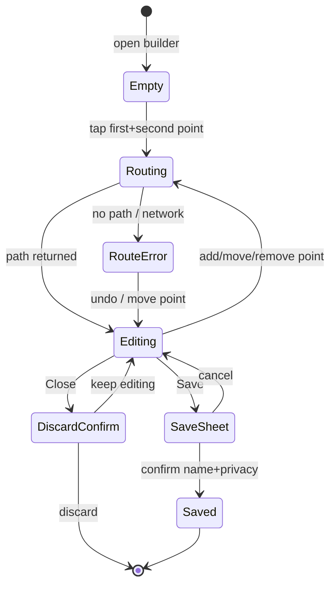
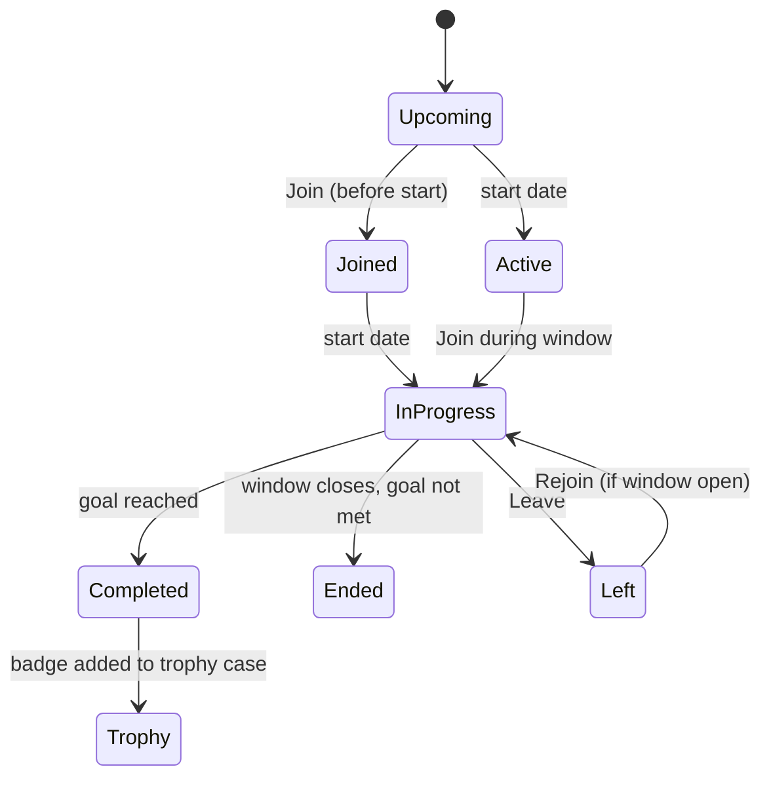
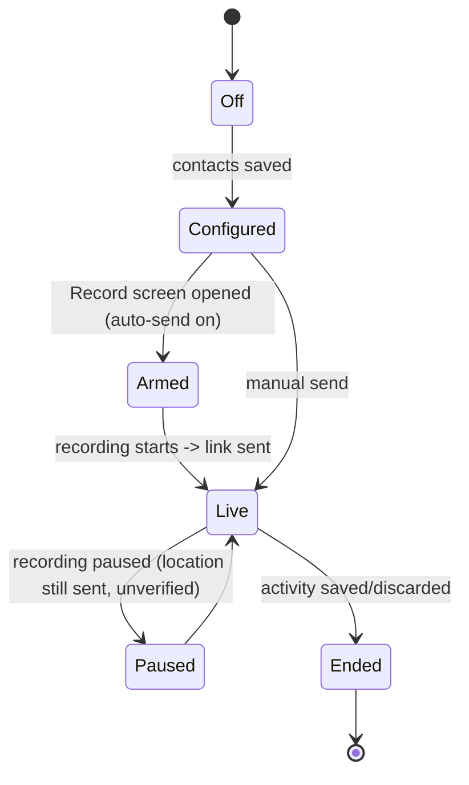
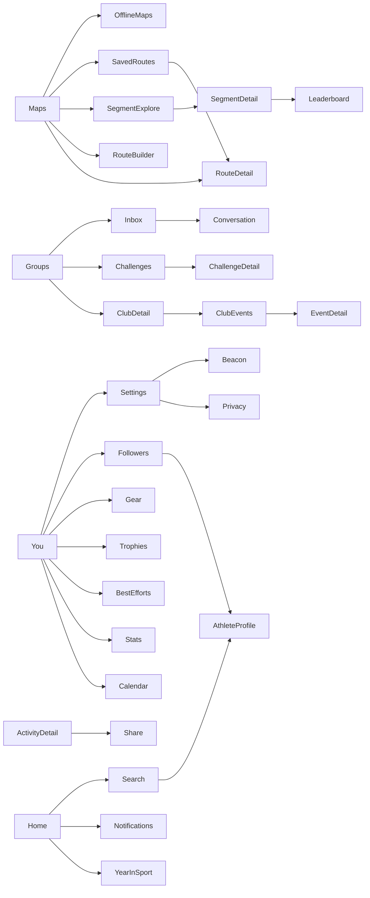

# Secondary Screens: Annotated ASCII Wireframes

> Scope: every screen outside the core Home feed / Record / Activity-detail loop. Covers the Maps tab, segments, the Groups tab, the You tab, public athlete profiles, search, notifications, settings, the paywall, Beacon, share/sticker export and Year in Sport.
> Platform: Android (Play Store) is primary. iOS differences are called out inline as **[iOS]**.
> Gating tags: **[FREE]** = available to free Strava accounts; **[SUB]** = Strava subscription required. **StravaFit has no subscriptions, so every [SUB] feature ships free in our app.**
> Wireframes are original, approximate layout sketches written from public descriptions (help-center articles, press, reviews). They are not pixel copies. Anything not confirmed by a source is marked **(unverified)**.

---

## 0. Conventions

### 0.1 Wireframe legend

```
+--------------------------------------+   screen frame, ~40 chars wide
| <  Title                    [i] [:]  |   top app bar: back, title, actions
|--------------------------------------|   divider
| [ Button ]   ( chip )   (o) radio    |   button / chip / radio
| [x] checkbox    [==o ] toggle on     |   checkbox / toggle
| ~~~~~ map ~~~~~                      |   map surface
| ##### image / photo #####            |   media
| ....  skeleton / loading ....        |   loading placeholder
| (A)  avatar     *  badge/dot         |   avatar, unread dot
| >  chevron / tappable row            |
| [LOCK] subscription-gated element    |   in Strava; unlocked in StravaFit
|======================================|   bottom nav / sticky footer
| Home  Maps  (Rec)  Groups  You       |   5-tab bottom navigation
+--------------------------------------+
  (1) (2) ...  numbered annotations listed under each frame
```

### 0.2 Bottom navigation (context for every tab screen)

Since the 2021 navigation overhaul, the bottom bar has five destinations: **Home, Maps, Record, Groups, You**. Maps replaced the old Explore tab; Groups gathers Clubs and Challenges; You replaced Profile/Training and holds Progress, Activities and stats. [FREE]

```
|======================================|
| [H]    [M]    ( O )   [G]    [Y]     |
| Home   Maps   Record  Groups You     |
+--------------------------------------+
```

Record is a raised center action, not a regular tab: it opens the full-screen recorder covered in the primary-screens doc.

### 0.3 Universal screen states

Each screen below lists the states that apply. They follow these shared patterns.

| State | Pattern |
|---|---|
| Loading | Skeleton rows (`....`) shaped like the final content. No full-screen spinner except for map tiles. |
| Empty | Illustration area, a one-line explanation and one primary CTA. |
| Error / offline | Inline banner "Can't connect. Showing saved data." with a Retry link. Cached content stays visible. |
| Gated [SUB] | Content is blurred or truncated and covered by a lock card with an upsell CTA. StravaFit always shows the unlocked state. |
| Private / hidden | Lock icon with copy explaining that the owner restricted visibility. |
| Pull-to-refresh | Standard Material swipe-refresh on every list. |

---

## 1. Maps tab

The Maps tab is a full-bleed map with a floating search field, a sport selector, filter chips and a draggable bottom sheet. The sheet holds route and segment results. In October 2026 Strava added natural-language route search, richer route cards with community photos, and Offline Routes, all for subscribers ([SUB] per a Strava spokesperson to Android Authority).

### 1.1 Maps home: route discovery (default)

```
+--------------------------------------+
| [Q Search a place or describe a run ]|(1)
| (Run v) (Distance) (Elev) (Surface)  |(2)
|  ~~~~~~~~~~~~~~~~~~~~~~~~~~~~~~~~~~  |
|  ~~~  ===route A===      ~~~~~~~~~~  |(3)
|  ~~~~~~~~~~  ---route B---  ~~~~~~~  |
|  ~~~~ (o) you  ~~~~~~~~~~~~~~~~~~~~  |
|  ~~~~~~~~~~~~~~~~~~~~~~~~~~ [Layers] |(4)
|  ~~~~~~~~~~~~~~~~~~~~~~~~~~~ [ (+) ] |(5)
|  ~~~~~~~~~~~~~~~~~~~~~~~~~~~ [ <o> ] |(6)
|--------------- ____ -----------------|(7)
| Routes    Segments    Saved          |(8)
|--------------------------------------|
| ##### mini map #####  ##### map ###  |
| Riverside Loop        Hill Repeats   |(9)
| 8.2 km  45 m  ~48min  5.1 km  120 m  |
|======================================|
| Home  Maps  (Rec)  Groups  You       |
+--------------------------------------+
```

1. Search field. Takes place names, and since Oct 2026 also free-text descriptions such as "flat 10k near the river" [SUB in Strava].
2. Filter chips: sport type (Run, Ride, Gravel, MTB, Hike, Walk, Trail run), distance range, elevation preference (flat / hilly / any), surface (paved / dirt / any), and difficulty (unverified). Tapping a chip opens a bottom-sheet editor.
3. Suggested routes are drawn as polylines. Tapping one highlights it and scrolls its card into view.
4. Layers button opens the layer sheet (section 1.2).
5. "Create route" entry point to the route builder (section 1.6).
6. Re-centre on my location. A second tap may toggle heading-up (unverified).
7. Drag handle. The sheet has three stops: peek (cards only), half and full list.
8. Segmented tabs inside the sheet: Routes / Segments / Saved.
9. Horizontal route cards. Since Oct 2026 they show community photos and aggregate activity data [SUB].

**States**

| State | Behaviour |
|---|---|
| No location permission | Map centres on last-known region or the account's city. Banner: "Turn on location to see routes near you" with [Allow]. |
| Loading suggestions | Card carousel shows 2-3 skeleton cards; polylines fade in. |
| No results | Card: "No routes match. Try widening distance or changing sport." with [Reset filters]. |
| Gated (free user) | Strava shows a limited suggestion set, then a lock card "Unlock all route suggestions" [SUB] (unverified exact limit). |
| Offline | Basemap is greyed except downloaded regions. Banner offers "Saved routes available offline" linking to Saved. |

### 1.2 Map layers / heatmap sheet

```
+--------------------------------------+
|  ~~~~~~~~~ map (dimmed) ~~~~~~~~~~~  |
|--------------- ____ -----------------|
| Map style                            |
| [Standard] [Satellite] [Hybrid]      |(1)
| [ 3D terrain ]                       |(2)
|--------------------------------------|
| Heatmaps                     [LOCK]  |(3)
| (o) Global heatmap                   |
| ( ) Personal heatmap                 |(4)
| Sport: (All) (Ride) (Run) (Water)    |(5)
| Color: (Hot) (Blue) (Purple) (Gray)  |(6)
| Time:  (All time) (Past year)        |
|        (Night) [LOCK]                |(7)
|--------------------------------------|
| Overlays                             |
| [x] Points of interest               |(8)
| [ ] Segments                         |
| [ ] Photos (unverified)              |
|--------------------------------------|
|              [ Done ]                |
+--------------------------------------+
```

1. Basemap style selector.
2. 3D / terrain toggle (mobile; availability by region unverified).
3. Heatmap section. Strava's global heatmap at full zoom is [SUB] in-app; lower zoom levels are shown on the web without login limits (unverified current rules).
4. Personal heatmap draws only the user's own activities [SUB].
5. Sport filter for heat intensity.
6. Colour ramp choice (unverified exact palette names).
7. Weekly or night heat variants (unverified on mobile).
8. Overlays such as POIs and segments.

### 1.3 Route discovery: natural-language search results (Oct 2026)

```
+--------------------------------------+
| < [ hilly 15k trail with views    x ]|(1)
| Interpreted as: Trail run, 12-18 km, |(2)
| hilly, near Current location  [Edit] |
|--------------------------------------|
| ##############  photo strip  ####### |(3)
| Ridge & Reservoir                    |
| 14.6 km  .  420 m  .  Trail          |
| Popular: 1.2k athletes this year     |(4)
| [Save]  [Preview on map]             |
|--------------------------------------|
| ##############  photo strip  ####### |
| Pine Forest Circuit                  |
| 15.3 km  .  310 m  .  Trail          |
|--------------------------------------|
| ....  loading more  ....             |
+--------------------------------------+
```

1. Free-text query. The prior keyword/place search still works for free users (unverified).
2. Parsed-intent chip row so the user can check and correct how the query was read.
3. Community photo carousel per route [SUB].
4. Popularity / activity summary [SUB].

States: parsing (shimmer on the "Interpreted as" line), zero results with suggested relaxations, error.

### 1.4 Route detail

```
+--------------------------------------+
| <                     [Share] [:]    |(1)
|  ~~~~~~~~~~~~~~~~~~~~~~~~~~~~~~~~~~  |
|  ~~~ S===========\ ~~~~~~~~~~~~~~~~  |(2)
|  ~~~~~~~~~~~~~~~~ \=====F ~~~~~~~~~  |
|  ~~~~~~~~~~~~~~~~~~~~~~~ [3D] [Exp]  |
|--------------------------------------|
| Riverside Loop                [Star] |(3)
| by (A) Jane D. . Created 3 Mar 2025  |
|--------------------------------------|
| Distance   Elev gain   Est. time     |(4)
| 8.2 km     45 m        48:00         |
|--------------------------------------|
|   /\      _/\_                       |(5)
| _/  \____/    \___   elevation       |
| 0      2      4      6      8 km     |
|--------------------------------------|
| Surface: 80% paved . 20% unpaved     |(6)
| Difficulty: Easy (unverified)        |
|--------------------------------------|
| Segments on this route (4)        >  |(7)
| Photos from athletes          [SUB]> |(8)
|--------------------------------------|
| [ Use route ] [ Download ] [ Send ]  |(9)
+--------------------------------------+
```

1. Overflow menu: Edit, Duplicate, Make private/public, Export GPX/TCX, Delete (own routes only).
2. Map with start (S) and finish (F); tap to go full screen, with 3D view where available.
3. Star or bookmark to Saved.
4. Summary stats. Estimated time is based on the user's recent pace for that sport (unverified algorithm).
5. Scrubbable elevation profile. Dragging moves a marker along the map polyline.
6. Surface breakdown (paved / unpaved) [FREE].
7. List of segments the route passes.
8. Community photos [SUB, Oct 2026].
9. Actions. "Use route" starts Record with the route loaded for navigation. "Download" saves it for offline use [SUB]. "Send" pushes to a connected device (Garmin/Wahoo/COROS sync) [FREE for sync to device (unverified)].

States: route deleted ("This route is no longer available"), private route from another athlete (lock screen), download in progress (progress bar replaces the Download button), downloaded (button becomes "Downloaded" with a check and a remove option).

### 1.5 Saved routes list

```
+--------------------------------------+
| Routes   Segments   [Saved]          |
|--------------------------------------|
| (Created by me) (Starred) (Offline)  |(1)
| Sort: Recent v           [Q]         |(2)
|--------------------------------------|
| ##map## Riverside Loop       [dl]  > |(3)
|         8.2 km . 45 m . Run          |
|--------------------------------------|
| ##map## Sunday Hills         [ ]   > |
|         62 km . 880 m . Ride         |
|--------------------------------------|
| ##map## Commute A            [dl]  > |
|         11 km . 60 m . Ride  Private |(4)
|--------------------------------------|
|             [+ Create route]         |
+--------------------------------------+
```

1. Filter chips: created by me, starred from others, downloaded offline.
2. Sort (recent, distance, name) and an in-list search.
3. Download indicator for offline availability [SUB].
4. Visibility label.

**Empty state**

```
+--------------------------------------+
|                                      |
|          [ route illustration ]      |
|                                      |
|      You have no saved routes yet    |
|  Star routes you like or draw your   |
|  own to find them here.              |
|                                      |
|  [ Explore routes ]  [ Create one ]  |
+--------------------------------------+
```

**Offline state (Oct 2026):** when the device has no signal, saved and downloaded routes are surfaced directly on the app home screen for navigation [SUB].

### 1.6 Route builder / creator

The mobile builder supports tap-to-add waypoints that snap to popular roads and trails (using community "popularity" routing), freehand drawing with a pen tool, and automatic loop generation. Strava moved route creation to [SUB] in the 2020 paywall changes; the details of what free users can still do today are unverified.

```
+--------------------------------------+
| X  New route               [ Save ]  |(1)
| (Ride v)  [Popularity: on]  [Undo]   |(2)
|  ~~~~~~~~~~~~~~~~~~~~~~~~~~~~~~~~~~  |
|  ~~~ (1)=========(2)~~~~~~~~~~~~~~~  |(3)
|  ~~~~~~~~~~~~~~~~~ \\ ~~~~~~~~~~~~~  |
|  ~~~~~~~~~~~~~~~~~~ (3) ~~~~~~~~~~~  |
|  ~~~~~~~~~~~~~~~~~~~~~~~~~~ [Layers] |
|--------------------------------------|
| [Tap] [Draw] [Loop] [Out&back] [Rev] |(4)
|--------------------------------------|
| 12.4 km   . 140 m up   . ~38 min    |(5)
|  _/\__/\___ (mini elevation)         |
+--------------------------------------+
```

1. Close discards (with a confirm dialog if there are waypoints). Save opens the save sheet.
2. Sport type changes the routing profile. The popularity toggle prefers community-heavy roads and trails; when it is off, routing takes the shortest path.
3. Numbered waypoints. Long-press drags a waypoint; tapping it shows [Remove].
4. Tools: Tap (waypoint), Draw (freehand, snapped), Loop (auto-close to start), Out-and-back (retrace), Reverse direction.
5. Live distance, elevation and estimate, with a mini profile.

**Builder states**



**Auto-generate a route (suggested routes)**

```
+--------------------------------------+
| <  Generate a route                  |
|--------------------------------------|
| Start:  (o) My location   [change]   |
| Type:   (Run) (Ride) (Gravel) (MTB)  |
| Length: [ 10 km ]  ----o------- 42   |
| Elev:   (Flat) (Rolling) (Hilly)     |
| Surface:(Paved) (Any) (Dirt)         |
| Shape:  (Loop) (Point-to-point)      |
|                                      |
|          [ Generate routes ]         |
|--------------------------------------|
| 3 options:  [A]  [B]  [C]            |
+--------------------------------------+
```

**Save sheet**

```
+--------------------------------------+
| Save route                           |
| Name  [ Sunday Hills Loop          ] |
| Description [ optional ...         ] |
| Privacy  (o) Everyone ( ) Only me    |
| [x] Sync to my devices               |
| [x] Make available offline   [SUB]   |
|             [ Save route ]           |
+--------------------------------------+
```

Error cases: routing impossible across water or closed areas ("Can't find a path here"), too many waypoints (cap unverified), and offline builder use (blocked with a banner).

### 1.7 Segment explore

```
+--------------------------------------+
| [Q Search segments              ]    |
| (Ride v) (Climb cat v) (Length v)    |(1)
|  ~~~~~~~~~~~~~~~~~~~~~~~~~~~~~~~~~~  |
|  ~~~ ---seg1--- ~~~~  ---seg2--- ~~  |(2)
|  ~~~~~~~~~~ ---seg3--- ~~~~~~~~~~~~  |
|--------------- ____ -----------------|
| Routes   [Segments]   Saved          |
|--------------------------------------|
| Old Mill Climb             Cat 4   > |(3)
| 2.1 km . 5.2% avg . KOM 4:51         |
|--------------------------------------|
| Canal Sprint                       > |
| 0.9 km . 0.1% . KOM 1:02             |
|--------------------------------------|
| Starred segments (12)              > |(4)
+--------------------------------------+
```

1. Filters: sport, climb category (HC, 1-4, uncategorised), length.
2. Segments in the current viewport. Panning re-queries the list (debounced).
3. Row with category, average grade and the course record [FREE to view the top of the leaderboard].
4. Starred segments shortcut. Starred segments also sync to supported devices for live segments.

### 1.8 Offline maps / downloads manager

```
+--------------------------------------+
| <  Offline maps                      |
|--------------------------------------|
| Storage used: 412 MB of 2 GB  [====] |(1)
|--------------------------------------|
| Downloaded routes                    |
| Riverside Loop      38 MB   [Delete] |
| Lake District Hike  96 MB   [Delete] |
| Sunday Hills  ....  [=====    ] 54%  |(2)
|--------------------------------------|
| [x] Download over Wi-Fi only         |(3)
| [ ] Auto-update downloads            |
|--------------------------------------|
|   [ + Download a map area ]          |(4)
+--------------------------------------+
```

1. Storage meter.
2. In-progress download with progress bar, pause and cancel.
3. Network preference.
4. Region download from a drawn bounding box (unverified as a separate feature from per-route download; Strava frames it as "Offline Routes").

The whole screen is [SUB] in Strava. In StravaFit it is free; see the OSS notes on tile licensing.

---

## 2. Segment detail & leaderboards

### 2.1 Segment detail (header + my efforts)

```
+--------------------------------------+
| <                   [Star] [Share] : |(1)
|  ~~~~~~~~~~~~~~~~~~~~~~~~~~~~~~~~~~  |
|  ~~~ S---------------------F ~~~~~~  |
|--------------------------------------|
| Old Mill Climb                       |
| Ride . 2.1 km . 5.2% avg . Cat 4     |(2)
| Elev: 112 m . Lowest 40 . Highest 152|
|   ___/^^^\__/^^^^^ (profile)         |
|--------------------------------------|
| [Leaderboards] [My Efforts] [Local]  |(3)
|--------------------------------------|
| My PR        5:42     12 Jun 2025    |(4)
| Attempts     23                      |
| Goal         [ Set a goal ] [SUB]    |(5)
|--------------------------------------|
| My efforts (graph)          [LOCK]   |(6)
|  .   .    .  . .  . (time vs date)   |
|--------------------------------------|
| KOM  4:51  (A) Rider X               |(7)
| QOM  5:30  (A) Rider Y               |
| Local Legend (A) Rider Z . 14 efforts|(8)
+--------------------------------------+
```

1. Star (adds to starred and syncs to devices), share, overflow (Flag segment, Report, Hide from my map (unverified), View on web).
2. Segment metadata. Climb category is computed from length times grade.
3. Section tabs.
4. Personal record with date [FREE].
5. Segment goal [SUB] (unverified current availability).
6. Effort-history chart and comparison [SUB].
7. Course records: fastest overall effort by gender [FREE to view].
8. Local Legend: the athlete with the most efforts in the last 90 days [FREE to view the holder; full ranking and progress [SUB] (unverified)].

### 2.2 Leaderboard

```
+--------------------------------------+
| <  Old Mill Climb  Leaderboard       |
|--------------------------------------|
| (Overall v) (All time v) (All v)     |(1)
|--------------------------------------|
| #  Athlete          Date      Time   |
| 1  (A) Rider X      2024-05   4:51   |(2)
| 2  (A) Rider Q      2023-08   4:58   |
| ...                                  |
| 10 (A) Rider K      2025-03   5:21   |
|--------------------------------------|
| ######## blurred rows ######## [LOCK]|(3)
| See where you rank — Subscribe       |
|--------------------------------------|
| 214 (A) You          2025-06  5:42   |(4) pinned
+--------------------------------------+
```

1. Filters: gender (Overall/Men/Women), time window (Today / This week / This month / This year / All time), and Following, Clubs, age group and weight class (age/weight need profile data). Since 2020, filters and full ranks are [SUB]; free users see the top 10 by gender.
2. Rows link to the effort's activity. Hazardous segments and flagged efforts are excluded.
3. Lock region for free users (top-10 only).
4. Sticky "your rank" row [SUB].

**States:** no efforts ("Be the first to complete this segment"), hazardous segment (leaderboard hidden with an explanation), private segment (only the creator sees it), filter producing no rows, loading (skeleton rows).

### 2.3 Local Legend tab

```
+--------------------------------------+
| [Leaderboards] [My Efforts] [Local]  |
|--------------------------------------|
|   (A)  Rider Z is the Local Legend   |
|   14 efforts in the last 90 days     |
|--------------------------------------|
| Your efforts: 6       [=====-----]   |(1)
| 9 more to take the title  [SUB]      |
|--------------------------------------|
| 90-day histogram                     |
|  |  ||  | |||   ||  |  |            |(2)
+--------------------------------------+
```

1. Progress toward the title.
2. Effort frequency over the rolling window.

### 2.4 Segment effort comparison [SUB]

```
+--------------------------------------+
| <  Compare efforts                   |
| You (5:42)  vs  (A) Rider X (4:51)   |
|--------------------------------------|
| Gap over distance                    |
| +0 ___                               |
|       \____                          |
|            \______  -51s             |
| 0     0.5    1.0    1.5    2.1 km    |
|--------------------------------------|
| Speed   HR   Power   Cadence         |
+--------------------------------------+
```

---

## 3. Groups tab

The Groups tab holds Clubs, Challenges and (since Dec 2023) Messages / chats. Messaging launched as free for all users on mobile, with club-topic conversations announced for 2024 (shipped status unverified).

### 3.1 Groups home

```
+--------------------------------------+
| Groups                  [Q] [chat]*  |(1)
| [Clubs]  Challenges  Active          |(2)
|--------------------------------------|
| Your clubs                     See > |
| (C) Riverside Runners   1.2k  *  >   |(3)
| (C) Commute Crew          86     >   |
|--------------------------------------|
| Suggested clubs                      |
| ##cover## Local Gravel  [Join]       |(4)
| ##cover## City Track    [Join]       |
|--------------------------------------|
| [ + Create a club ]                  |(5)
|======================================|
| Home  Maps  (Rec)  Groups  [You]     |
+--------------------------------------+
```

1. Search clubs; messaging inbox with an unread dot.
2. Segmented control. "Active" (unverified label) lists joined challenges.
3. Club row with member count and a new-post dot.
4. Suggestions based on location and sport.
5. Create club (mobile creation availability unverified; historically web-first).

### 3.2 Club detail

```
+--------------------------------------+
| <                       [Share] [:]  |
| #########  cover photo  ############ |
|   (C)  Riverside Runners  [verified] |(1)
|   Running . Public . Leeds, UK       |
|   1,204 members        [ Joined v ]  |(2)
|--------------------------------------|
| [Feed] Events  Leaderboard  Members  |(3)
|--------------------------------------|
| (A) Admin . 2d                       |
| Sunday long run moves to 8am!        |(4)
| [Like 12]  [Comment 3]               |
|--------------------------------------|
| (A) Sam ran 10.2 km . 1h             |(5)
|   ~~~~ map ~~~~                      |
+--------------------------------------+
```

1. Club identity; verified badge for brand clubs.
2. Join / Joined menu (Leave, Notification settings). Private clubs show "Request to join" and then "Requested".
3. Tabs. The leaderboard is a weekly distance / time / elevation ranking of members.
4. Admin post / announcement.
5. Member activities (club feed).

**Club leaderboard**

```
+--------------------------------------+
| This week  v      (Distance v)       |
| 1  (A) Sam       62.1 km  5h12       |
| 2  (A) Priya     54.0 km  4h40       |
| ...                                  |
| 17 (A) You       21.3 km  1h55       |
| Resets Monday (local)                |
+--------------------------------------+
```

**Private club, not a member**

```
+--------------------------------------+
| (C) Night Owls [lock]                |
| This club is private.                |
| [ Request to join ]                  |
| Members: 48 . Admins approve requests|
+--------------------------------------+
```

### 3.3 Club events

```
+--------------------------------------+
| Feed  [Events]  Leaderboard  Members |
|--------------------------------------|
| [ + Create event ]   (admins/opt)    |(1)
|--------------------------------------|
| SAT 14 JUN  .  08:00                 |
| Sunrise 10k social                   |(2)
| Ride? Run . Pace: 5:30/km . Level 2  |
| (A)(A)(A) +14 going    [ Join ]      |
|--------------------------------------|
| WED weekly . 18:30 (recurring)       |(3)
| Track session                        |
+--------------------------------------+
```

1. Create event (members or admins depending on club settings, unverified).
2. Event card with time, pace group, attendee avatars and a Join/Going toggle.
3. Recurring events.

**Event detail**

```
+--------------------------------------+
| <  Sunrise 10k social        [:]     |
| Sat 14 Jun 2026 . 08:00 BST          |
| Meet: Park gates ~~~~ map ~~~~       |
| Route: Riverside Loop (8.2 km)    >  |(1)
| Pace 5:30/km . Women-only? No        |
| Organiser (A) Admin                  |
|--------------------------------------|
| Going (17)  (A)(A)(A)(A) ...      >  |
| [ Join ]  [ Add to calendar ]        |(2)
|--------------------------------------|
| Discussion (4)                       |
+--------------------------------------+
```

1. Linked route opens route detail.
2. Adds to the device calendar via an Android `Intent.ACTION_INSERT` (in our build).

### 3.4 Challenges list

```
+--------------------------------------+
| Clubs  [Challenges]  Active          |
|--------------------------------------|
| Your challenges                      |
| [badge] June 5K       [====-] 80%  > |(1)
| [badge] Climb 2,000m  [==---] 40%  > |
|--------------------------------------|
| Recommended                          |
| ##art## Run 100K this month          |(2)
|         62k joined     [ Join ]      |
| ##art## Brand X Ride Challenge       |(3)
|         Reward: discount  [ Join ]   |
|--------------------------------------|
| [ + Create group challenge ] [SUB]   |(4)
+--------------------------------------+
```

1. Joined challenges with a progress bar.
2. Strava monthly challenges (distance, time, elevation, longest activity, streaks) [FREE].
3. Sponsored challenges with rewards.
4. Group (custom) challenges among friends [SUB] (creation gated; joining free, unverified).

### 3.5 Challenge detail / progress

```
+--------------------------------------+
| <                       [Share]      |
| #########  challenge art  ########## |
| Run 100K in June                     |
| 1 Jun - 30 Jun . Run activities      |
|--------------------------------------|
|   62.4 / 100 km                      |(1)
|   [==============--------] 62%       |
|   12 days left . ~3.1 km/day needed  |(2)
|--------------------------------------|
| [Overview] Leaderboard  Friends      |
| Qualifying activities (9)          > |(3)
| Reward: digital badge on completion  |(4)
| Rules & details                    > |
|--------------------------------------|
| [ Leave challenge ]                  |
+--------------------------------------+
```

1. Progress ring or bar.
2. Required daily pace, computed on the client.
3. Activities counted toward the goal.
4. Badge goes to the trophy case on completion.

**Challenge lifecycle**



**Completed overlay**

```
+--------------------------------------+
|             * * * * *                |
|          [ badge art ]               |
|     Challenge complete!              |
|     You ran 100 km in June           |
|  [ Share ]       [ View trophies ]   |
+--------------------------------------+
```

### 3.6 Messaging: inbox, DM and group chat

```
+--------------------------------------+
| <  Messages                   [new]  |(1)
| [Q Search conversations          ]   |
|--------------------------------------|
| (A) Priya                   10:42 *  |(2)
|     See you at 8!                    |
| (AA) Sunday Crew (5)        Yest     |(3)
|     Sam: route attached              |
| (A) Requests (2)                  >  |(4)
+--------------------------------------+
```

1. New message: pick one or more people. Picking several creates a group chat.
2. DM row with unread dot.
3. Group chat with participant count.
4. Message requests from people you don't follow (unverified behaviour, but standard practice; Strava lets you control who can message you in privacy settings).

```
+--------------------------------------+
| <  Sunday Crew (5)          [i]      |(1)
|--------------------------------------|
|        (A) Sam                       |
|        [ Who's in for Sunday? ]      |
|                [ Me! 7am works ] You |
|        (A) Priya                     |
|        [ ##route card## Riverside ]  |(2)
|        [ 8.2 km . Tap to view    ]   |
|        Liked by 2 (heart)            |(3)
|                     Seen by 4        |(4)
|--------------------------------------|
| [+] [ Message...           ] [Send]  |(5)
+--------------------------------------+
```

1. Info: rename group, add/remove members, mute, leave, report, block.
2. Rich cards for shared activities, routes and segments.
3. Reactions on messages.
4. Read receipts (unverified).
5. Attachment menu: photo (announced for 2024, unverified), activity, route.

States: empty conversation ("Say hi"), sending (clock icon), failed (red "!" with tap-to-retry), blocked user (composer disabled).

---

## 4. You tab

The You tab merges the old Profile and Training tabs. Top segmented control: **Progress | Activities** (and in some versions a profile header above it, unverified ordering across versions).

### 4.1 You: profile header + Progress

```
+--------------------------------------+
| You                     [share] [gear]|(1)
|  (A)  Alex Runner                    |
|       Leeds, UK                       |
|  Following 210 . Followers 198       |(2)
|  [ Edit profile ]                    |
|--------------------------------------|
| [Progress]  Activities               |
|--------------------------------------|
| (Run v)                              |(3)
| This week   24.1 km  2h10m  120 m    |
| |   |   |  ||  |   | |||   (12 wks) |(4)
|--------------------------------------|
| Training calendar                 >  |(5)
| Best efforts                      >  |
| Trophy case (14)                  >  |
| Gear                              >  |
| Statistics                        >  |
| Fitness & Freshness [SUB]         >  |(6)
| Goals [SUB]                       >  |
| Training log [SUB]                >  |
+--------------------------------------+
```

1. Settings (gear icon) opens Settings (section 8). Share profile link.
2. Follow counts open the followers/following lists.
3. Sport filter for the charts.
4. Weekly bar chart over 12 weeks; tapping a bar shows that week's totals [FREE].
5. Calendar or streak view (section 4.3).
6. Advanced training analysis: Fitness & Freshness, Relative Effort trends, Training Log [SUB].

### 4.2 Activities list

```
+--------------------------------------+
| Progress  [Activities]               |
| [Q Search]  (Sport v) (Date v)       |(1)
|--------------------------------------|
| JUNE 2026                            |
| ##map## Morning Run     12 Jun  >    |(2)
|         10.2 km . 52:10 . 5:07/km    |
|         [PR] [2 achievements]        |
|--------------------------------------|
| ##map## Lunch Ride      11 Jun  >    |
|         31 km . 1:05:00 . 220 m      |
|         Only you (lock)              |(3)
|--------------------------------------|
| ....  loading older  ....            |(4)
+--------------------------------------+
```

1. Search by title and filters (sport, date range, commute, trainer). Advanced filters are partly web-only (unverified).
2. Row with map thumbnail and key stats.
3. Visibility badge.
4. Infinite scroll in pages (the API uses `page` / `per_page`, up to 200).

Empty state: "No activities yet. Record your first one or connect a device." with [Record] and [Connect device].

### 4.3 Training calendar / streaks

```
+--------------------------------------+
| <  Calendar           < June 2026 >  |
|--------------------------------------|
|  M   T   W   T   F   S   S   Total   |
|  .   o   .   O   .   @   .   31 km   |(1)
|  o   .   .   o   .   @   .   28 km   |
|  .   .   O   .   o   .   o   24 km   |
|--------------------------------------|
| Current streak: 6 weeks (unverified  |(2)
| exact streak definition)             |
| Legend: o short  O medium  @ long    |
+--------------------------------------+
```

1. Dots scaled by activity size per day; tap a day to list its activities.
2. Weekly streak counter.

### 4.4 Statistics

```
+--------------------------------------+
| <  Statistics          (Run v)       |
|--------------------------------------|
| This year (2026)                     |
| Activities 142 . Distance 1,204 km   |
| Time 108h . Elev gain 9,800 m        |
|--------------------------------------|
| All time                             |
| Activities 1,021 . 8,450 km          |
| Biggest climb 1,102 m                |
| Longest run 42.4 km                  |
+--------------------------------------+
```

[FREE]. Matches the API's athlete stats object (recent / YTD / all-time totals per sport).

### 4.5 Best efforts

```
+--------------------------------------+
| <  Best efforts          (Run v)     |
|--------------------------------------|
| 400m         1:22    3 Mar 2025   >  |
| 1/2 mile     2:58    3 Mar 2025   >  |
| 1K           3:41    14 Jul 2024  >  |
| 1 mile       6:05    14 Jul 2024  >  |
| 5K          20:31    9 Sep 2025   >  |(1)
| 10K         43:12    9 Sep 2025   >  |
| 15K / 10mi / 20K / Half / 30K / Mar  |
|--------------------------------------|
| [ Edit / remove an effort ]          |(2)
+--------------------------------------+
```

1. Tap opens a history of top efforts for that distance [FREE for PRs; trend charts may be SUB (unverified)].
2. Users can hide a bad best effort, for example one caused by GPS drift.

Ride best efforts (power curve) are [SUB].

### 4.6 Trophy case

```
+--------------------------------------+
| <  Trophy case                       |
|--------------------------------------|
| [b] [b] [b] [b]                      |
| Jun  May  Apr  Mar  (challenge badges)
| [b] [b] [b] [b]                      |
| 2025 . 2025 . 2024 . 2024            |
|--------------------------------------|
| Tap badge -> challenge recap         |
+--------------------------------------+
```

### 4.7 Gear

```
+--------------------------------------+
| <  Gear                     [ + ]    |
|--------------------------------------|
| Shoes                                |
| Pegasus 41 (default run)    612 km > |(1)
|   [==========------] reminder 800 km |(2)
| Trail shoe                  210 km > |
|--------------------------------------|
| Bikes                                |
| Road bike (default ride) 4,320 km  > |
|--------------------------------------|
| Retired (2)                        > |(3)
+--------------------------------------+
```

1. Default gear per sport, auto-assigned to new activities.
2. Distance alert / reminder threshold (unverified current UI).
3. Retired gear is hidden from pickers but its totals are kept.

**Add / edit gear form:** type (shoe/bike), brand, model, nickname, starting distance, default-for sports (multi-select), notification threshold, [Retire], [Delete].

### 4.8 Followers / following

```
+--------------------------------------+
| <  Alex Runner                       |
| [Following 210]  Followers 198       |
| [Q Search]                           |
|--------------------------------------|
| (A) Priya K.          [ Following ]  |
| (A) Sam T.            [ Following ]  |
|--------------------------------------|
| Requests (3)                      >  |(1)
| Suggested: Find friends           >  |(2)
+--------------------------------------+
```

1. Follow requests if the account requires approval (privacy setting).
2. Contacts sync and social-graph suggestions.

---

## 5. Athlete public profile

```
+--------------------------------------+
| <                     [Share] [:]    |(1)
|  (A)  Priya K.        [SUB badge]    |(2)
|       Manchester . Runner            |
|  Following 312 . Followers 1.1k      |
|  [ Follow ]   [ Message ]            |(3)
|--------------------------------------|
| This week  32 km  3h05               |
| |  |  || |  |||  (weekly bars)       |
|--------------------------------------|
| Recent activities                  > |
| ##map## Tempo Run  8.4 km  Tue       |
|--------------------------------------|
| Trophies (22)                      > |
| Clubs (4)                          > |
| Mutual followers: Sam, Leo +3        |
+--------------------------------------+
```

1. Overflow: Block, Report, Mute (hide from feed), Copy link.
2. Subscriber badge (unverified whether shown on Android).
3. Follow states: Follow, Requested (private account), Following. Message may be hidden depending on the target's messaging privacy.

**Private / blocked variants**

```
+--------------------------------------+
| (A) Leo M.  [lock]                   |
| This account is private.             |
| Follow to see activities and stats.  |
| [ Request to follow ]                |
+--------------------------------------+
```

Blocked: "You can't see this profile" with no actions apart from Unblock where relevant.

---

## 6. Search

```
+--------------------------------------+
| < [Q Search Strava              x ]  |
| [Athletes] Clubs  Segments  Routes   |(1)
|--------------------------------------|
| Recent                               |
| (A) Priya K.                      x  |(2)
| (C) Riverside Runners             x  |
|--------------------------------------|
| Results for "pri"                    |
| (A) Priya K. . Manchester [Follow]   |
| (A) Priyanka S. . Pune    [Follow]   |
+--------------------------------------+
```

1. Scope tabs. Athlete search is the default; clubs, segments and routes use their own endpoints. Global unified search is unverified.
2. Recent searches stored on the device, each removable.

States: idle (recents), typing (debounced 300 ms), no results ("No athletes named 'xyz'. Try a different spelling."), offline (recents only).

---

## 7. Notifications

```
+--------------------------------------+
| <  Notifications                     |
|--------------------------------------|
| NEW                                  |
| (A) Sam gave you kudos on Morning  * |(1)
|     Run . 5m                         |
| (A)(A) Priya and 4 others gave kudos |(2)
| (A) Leo commented: "nice pace!"      |
| [crown] You lost the KOM on Old Mill |(3)
|     Climb [SUB? see note]            |
|--------------------------------------|
| EARLIER                              |
| (A) Mia started following you        |
|     [ Follow back ]                  |(4)
| [cal] Club event tomorrow 8:00       |
| [b] You completed June 5K!           |
+--------------------------------------+
```

1. Unread dot. Tapping deep-links to the target and marks the item read.
2. Grouped kudos.
3. Course-record lost alert (unverified gating).
4. Inline action buttons.

Types: kudos, comments, mentions, follows and follow requests, club joins/approvals/posts/events, challenge progress/completion, segment achievements, Flyby-style "you crossed paths" (unverified as a notification), messages (these go to the inbox, not this list), and Beacon (system notification only).

---

## 8. Settings

### 8.1 Settings root

```
+--------------------------------------+
| <  Settings                          |
|--------------------------------------|
| ACCOUNT                              |
| My account                        >  |(1)
| Subscription (Manage)             >  |
| Privacy controls                  >  |(2)
| Applications, services, devices   >  |(3)
|--------------------------------------|
| PREFERENCES                          |
| Units of measure       Metric     >  |
| Default sport / map type          >  |
| Notifications                     >  |(4)
| Appearance (Light/Dark/System)    >  |
| Audio cues                        >  |(5)
| Beacon                            >  |
| Heart-rate / sensors              >  |
| Data permissions                  >  |
|--------------------------------------|
| SUPPORT                              |
| Help . Send feedback . Licenses      |
| Log out                              |
| v 4xx.x (build)                      |
+--------------------------------------+
```

1. Email, password, birthday, weight (for calories), gender, delete account, download your data (web-redirect, unverified).
2. Privacy (section 8.2).
3. Connected apps and devices: Garmin, Wahoo, COROS, Apple Health / Health Connect.
4. Push and email toggles per category.
5. Spoken audio feedback during recording (interval, metrics).

### 8.2 Privacy controls

```
+--------------------------------------+
| <  Privacy controls                  |
|--------------------------------------|
| Profile page        Everyone      >  |
| Activities          Followers     >  |(1)
| Group activities    Everyone      >  |
| Flybys              Everyone      >  |
| Local Legend / leaderboards  [==o]   |(2)
| Map visibility                    >  |(3)
| Mentions            Followers     >  |
| Messaging           Followers     >  |
| Metro / heatmap data use   [==o]    |(4)
| Blocked athletes (2)              >  |
+--------------------------------------+
```

1. Default visibility per item: Everyone / Followers / Only you.
2. Leaderboard participation toggle.
3. Map visibility: hide start/end within a radius around chosen addresses, or hide the whole map.
4. Aggregated data contribution opt-out.

**Map visibility editor**

```
+--------------------------------------+
| <  Map visibility                    |
|  ~~~~ map with circle  (  o  ) ~~~~  |
| Hide start/end points                |
| Radius: 200m ---o------- 1.6km       |
| [ + Add address ]                    |
| Hide all maps on new activities [ ]  |
| [x] Apply to past activities         |
+--------------------------------------+
```

### 8.3 Notification settings (excerpt)

```
+--------------------------------------+
| <  Notifications                     |
| Push   Email                         |
| Kudos               [==o]   [o==]    |
| Comments            [==o]   [==o]    |
| New followers       [==o]   [o==]    |
| Club activity       [==o]   [o==]    |
| Challenges          [==o]   [==o]    |
| Messages            [==o]   n/a      |
| Segment achievements[==o]   [o==]    |
+--------------------------------------+
```

Android: each category maps to a separate `NotificationChannel`, and the toggle can deep-link to system channel settings.

---

## 9. Subscription paywall (reference only)

StravaFit has no paywall. This section documents Strava's upsell so we know which entry points need removing or replacing with neutral education or "learn more" screens.

```
+--------------------------------------+
| X                                    |
| #########  hero media  ############  |
|  Get more from your training         |
|--------------------------------------|
| [v] Full segment leaderboards        |
| [v] Route builder & offline routes   |
| [v] Training & fitness insights      |
| [v] Goals, Beacon devices, more      |
|--------------------------------------|
| ( ) Monthly    $11.99 / mo           |(1)
| (o) Annual     $79.99 / yr  BEST     |
| ( ) Family plan (unverified region)  |
|--------------------------------------|
| [ Start free trial ]                 |(2)
| Cancel anytime. Terms . Restore      |(3)
+--------------------------------------+
```

1. Prices as reported in 2026 coverage (US). They vary by region; the Play billing price is localised.
2. A one-month trial was offered, for example during Year in Sport 2025.
3. Restore purchases is mainly an iOS pattern; Android uses Play-account entitlement.

Entry points: lock cards on leaderboards, the route builder, heatmaps, Fitness, Year in Sport, offline routes, and Beacon on devices.

**[iOS]** Purchases go through App Store StoreKit sheets; on Android through the Google Play Billing bottom sheet.

---

## 10. Beacon setup

Beacon shares a live location link with up to three safety contacts. Recipients don't need a Strava account and see current position, the path so far, and the start location. The phone-based version has been free since 2021; Beacon from connected devices (e.g. Garmin) stays [SUB].

```
+--------------------------------------+
| <  Beacon                            |
|--------------------------------------|
| Share your live location with safety |
| contacts while you record.           |
|--------------------------------------|
| Safety contacts (max 3)              |
| (A) Mum  +44 7...           [edit]   |(1)
| (A) Partner +44 7...        [edit]   |
| [ + Add contact ]                    |
|--------------------------------------|
| Message preview                      |
| "Alex is out for an activity. Track  |
|  live: <link>"           [edit]      |(2)
|--------------------------------------|
| Auto-send when I start  [==o]        |(3)
| Send by:  (o) SMS  ( ) Share sheet   |(4)
| Beacon on device (Garmin) [SUB]      |
+--------------------------------------+
```

1. Contacts picked via the system contact picker.
2. Customisable text with a randomly generated link token.
3. Auto vs. manual sending at activity start.
4. Delivery: SMS (Android sends from the user's own number via the SMS app intent) or the share sheet.

**On the recording screen:** a Beacon icon toggles sharing. While active, the status reads "Beacon on" and the contacts' links stay live until the activity is saved or discarded.



**Recipient web page (structure only)**

```
+--------------------------------------+
| Alex is out for a run                |
| Last update: 30s ago . Battery 64%   |
|  ~~~~ map: start o --- path --> @ ~~ |
| Started 07:02 . 6.1 km so far        |
+--------------------------------------+
```

---

## 11. Share / sticker export screen

After saving an activity, or from activity detail via Share, the user picks a template and a destination. Stickers are transparent overlays with a stat or route line, designed for Instagram Stories.

```
+--------------------------------------+
| X  Share activity                    |
|--------------------------------------|
|  +--------------------------------+  |
|  | ######## preview ###########   |  |(1)
|  |  ~~ route line ~~              |  |
|  |  10.2 km   52:10   5:07/km     |  |
|  +--------------------------------+  |
|  < o o * o o >                       |(2)
|--------------------------------------|
| Style: (Map) (Photo) (Stats only)    |
|        (Sticker - transparent)       |(3)
| Stats: [x]Dist [x]Time [x]Pace [ ]HR |(4)
| Background: (Photo v) (Color v)      |
|--------------------------------------|
| [IG Story] [IG] [WhatsApp] [More..]  |(5)
| [ Save image ]   [ Copy link ]       |
+--------------------------------------+
```

1. Live preview at the 9:16 story ratio (1:1 for feed posts).
2. Carousel of templates.
3. Sticker mode exports a PNG with an alpha channel and hands it to Instagram's "share to story" sticker intent.
4. Choice of stats.
5. Destinations. "More" opens the Android share sheet (`ACTION_SEND`).

States: rendering (spinner on the preview), private activity (warns that the link only works for permitted viewers), no GPS (the template falls back to stats only).

---

## 12. Year in Sport

An annual in-app recap, mobile only, presented as tap-through story cards. For 2025 it ran 8 Dec 2025 to 23 Jan 2026, required at least 3 activities in 2025, and for the first time was [SUB]-only (it had been free since 2016), which drew user complaints.

```
+--------------------------------------+
| =====-------------------------  X    |(1)
|                                      |
|      Your 2025 in sport              |
|                                      |
|      312 activities                  |
|      2,840 km                        |
|      241 hours                       |(2)
|                                      |
|  [ tap left: back | tap right: next ]|
|                                      |
|                        [ Share ]     |(3)
+--------------------------------------+
```

1. Segmented progress bar, one segment per card; long-press pauses.
2. Card sequence (typical, exact set unverified): totals; top sport; busiest month; longest activity; elevation; streaks; most-kudosed activity; personal records; favourite time of day; top segments/routes; a heatmap of the year's tracks; clubs and challenges; closing summary.
3. Each card is shareable as a 9:16 image.

**Entry points:** a home-feed banner during the window, a notification, and the You tab.

**States:** ineligible (fewer than 3 activities: "Record a few more activities to get your recap"), gated [SUB] (teaser card plus paywall in Strava; free in StravaFit), generating ("Crunching your year..." loader), outside the window (entry point hidden).

---

## 13. Navigation map (secondary screens)



---

## OSS implementation notes

### Naming (neutral replacements)

| Strava term | StravaFit name |
|---|---|
| KOM / QOM / CR | Course Record (CR), "Top Time" |
| Local Legend | "Regular" / "Segment Regular" |
| Kudos | "Props" |
| Beacon | "LiveShare" / "Safety Link" |
| Flyby | "Crossed Paths" |
| Year in Sport | "Year Recap" |
| Relative Effort / Fitness & Freshness | "Effort Score" / "Form" (CTL/ATL/TSB) |
| Heatmap | "Activity heat layer" |

### Platform & libraries (Android)

- UI: Jetpack Compose, Material 3, `NavHost` with nested graphs per tab, `ModalBottomSheet`, and a `BottomSheetScaffold` with custom anchors (peek / half / full) for the Maps sheet.
- Maps: **MapLibre Native Android** (Apache-2.0, no Google key needed). Vector tiles from OpenMapTiles/Protomaps (PMTiles) self-hosted, or OpenFreeMap. Satellite imagery needs a licensed source (e.g. Esri with attribution, or Sentinel-2 cloudless). Check each provider's terms for offline caching; OSM tile.openstreetmap.org forbids bulk offline download.
- Offline: MapLibre `OfflineManager` regions (bounding box + zoom range) per route buffer. Or ship PMTiles extracts and read them locally. Store GPX/route geometry in Room.
- Routing: self-hosted **GraphHopper** or **Valhalla** (both support custom profiles). Emulate "popularity" with a custom cost model weighted by an edge-usage table built from opted-in public activities (map-matched with Valhalla `trace_attributes` / Meili). Loop generation: GraphHopper `round_trip` algorithm (heading + distance + seed) and offer three seeds as options A/B/C.
- Elevation: SRTM/Copernicus DEM 30m via an elevation service (Open-Elevation or Valhalla `height`). Smooth with a 5-point moving average and a hysteresis threshold (~3 m) before summing gain.
- Heatmap: pre-render raster tiles server-side (Datashader / Tippecanoe + custom raster) from aggregated, privacy-zone-clipped tracks. Personal heatmap can render on the client from local polylines with a Canvas additive blend at low zoom. Respect privacy opt-out (8.2) and exclude hidden start/end zones.
- Charts: Vico (Compose charts) for weekly bars, elevation profile and effort history; custom Canvas for the calendar dots.
- Natural-language route search: parse with a small on-device rules grammar (sport keywords, distance regex `(\d+)\s?(k|km|mi)`, "flat/hilly", "loop") into the filter struct, falling back to an optional server LLM. Always show the "Interpreted as" chips so users can correct the parse.

### Segments & leaderboards

- Segment matching: map-match the activity, then for each candidate segment (spatial index R-tree / PostGIS `ST_DWithin` on start and end) find start/end crossings within ~25 m and check the path stays within a buffer corridor (Fréchet or Hausdorff tolerance ~ 30-50 m). Elapsed time = end crossing timestamp minus start crossing timestamp, with interpolation between GPS points.
- Climb category: Strava's published approach multiplies distance (m) by grade (%). Thresholds approx. Cat 4 > 8,000, Cat 3 > 16,000, Cat 2 > 32,000, Cat 1 > 64,000, HC > 80,000, with grade > 3% (unverified exact thresholds; tune ourselves).
- Leaderboards: Postgres table `segment_efforts(segment_id, athlete_id, elapsed_s, start_date, ...)`, a best-per-athlete materialised view, and window-function ranking. Filters by time window, gender, age bracket, weight class, followed-by and club. Everything is free and fully visible; the user's own rank row is pinned.
- Anti-cheat: flag speeds above sport thresholds (e.g. run > 25 km/h sustained, ride > 100 km/h), "hazardous" segment flag hides the leaderboard, and community flagging.
- "Regular" (Local Legend equivalent): count efforts per athlete over a rolling 90 days; the holder is the athlete with the most efforts, with ties broken by most recent effort (our choice).

### Groups

- Clubs: roles (owner, admin, member), privacy (public / approval required), weekly leaderboard computed with `date_trunc('week')` in the club's timezone, resetting Monday.
- Events: RRULE (RFC 5545) for recurrence (use `lib-recur` or `ical4j`), RSVP table, add-to-calendar with `CalendarContract` insert intent.
- Challenges: rule types (total distance, total time, total elevation, single longest, activity count, streak). Evaluate incrementally on activity upload, and backfill on join if the activity falls in the window. The badge grants a trophy row.
- Messaging: Matrix (self-hostable, E2EE) via the matrix-rust-sdk Android bindings, or a simpler WebSocket service with Postgres. Rich cards = typed message payloads (`activity`, `route`, `segment`). Delivery via FCM, with UnifiedPush as the de-Googled alternative. Message-request inbox for non-followers.

### You tab

- Stats: compute from local Room data for offline use; reconcile with server totals.
- Best efforts: sliding-window minimum over the distance stream for standard distances (400 m ... marathon). Two-pointer O(n) per distance on the distance/time arrays. Allow hiding an effort.
- Form chart: CTL = 42-day EWMA of daily load, ATL = 7-day EWMA, TSB = CTL − ATL. Load from HR-based TRIMP or power-based TSS.
- Gear: sum activity distance per `gear_id`, with a notification when it passes the threshold (WorkManager daily check).

### Beacon equivalent ("LiveShare")

- A foreground location service (already running for recording) POSTs fixes every 15-30 s to `/live/{token}`. The token is a 128-bit random URL-safe string that expires at activity end + 1 h.
- The recipient page is a static web page polling or SSE-streaming the fixes, with MapLibre GL JS. No login required. Show staleness ("last update Xs ago") and battery level.
- Sending: `Intent.ACTION_SENDTO` with `smsto:` (no SEND_SMS permission needed) or the share sheet. Up to 3 contacts via `ActivityResultContracts.PickContact`.
- Edge cases: no connectivity (queue and send the latest fix when connectivity returns), app killed (the service restarts with `START_STICKY`), and privacy zones do **not** apply to LiveShare (by design; say so clearly in the UI).

### Share / sticker export

- Render a Compose layout to a Bitmap off-screen (`GraphicsLayer.toImageBitmap()` or the `captureToImage` pattern), 1080x1920. Sticker mode uses a transparent background PNG.
- Instagram Stories: `com.instagram.share.ADD_TO_STORY` intent with `interactive_asset_uri` for the sticker plus `source_application` (requires a Facebook App ID per Meta's docs). Fall back to `ACTION_SEND`.
- Share via a `FileProvider` content URI; never expose file paths.

### Year Recap

- Generate on-device from Room (fully offline, private): aggregates, top months, longest activity, PR list, and a heat-collage of all polylines drawn with low alpha on one canvas.
- Story UI: `HorizontalPager` with auto-advance (5 s per card), tap zones, long-press to pause, and a segmented progress indicator.
- Always free; available all year for any past year (an improvement over a fixed window).

### Settings & privacy

- Persist preferences with DataStore. Privacy defaults are enforced server-side (row-level security if using Supabase/Postgres).
- Privacy zones: clip the start/end of polylines server-side before publishing and in every derived artefact (heatmap, segment efforts shown publicly, shared images). Randomise the zone centre offset so the address can't be triangulated.
- Data export: zip of GPX/FIT plus a JSON profile (GDPR Article 20). Account deletion through a hard-delete job.

### Edge cases checklist

- Very long routes (> 300 km): simplify the polyline (Douglas-Peucker) for rendering and offline buffer size.
- Timezones: weekly resets use the club or athlete timezone; challenges use the athlete's local date for the window.
- Unit switching: store SI and convert only at display time.
- Accessibility: all charts need text alternatives (e.g. "Week of 9 June: 24 km"), and the leaderboard table needs content descriptions.
- RTL layouts and large font scale: the 40-char wireframes assume LTR; test at 200% font scale where stat rows wrap.

---

## Sources

- https://bikeradar.com/news/strava-beta-test-layout
- https://zenocycleparts.com/blogs/cyclingtips/new-strava-update-makes-big-changes-to-layout-organization-and-navigation
- https://www.quadlockcase.co.uk/blogs/news/new-strava-layout-preview
- https://www.techradar.com/how-to/how-to-create-a-strava-route
- https://www.bikeradar.com/news/strava-adds-routes-to-app
- https://www.bicyclingaustralia.com.au/news/new-strava-route-builder-puts-ride-planning-at-your-fingertips
- https://www.bikeradar.com/news/you-can-finally-send-direct-and-group-messages-on-strava
- https://www.globalcyclingnetwork.com/tech/news/messaging-comes-to-strava-functionality-launches-for-dms-and-group-chats
- https://www.advnture.com/news/strava-in-app-messaging
- https://www.cyclingweekly.com/news/strava-introduces-messaging
- https://www.triathlete.com/culture/news/strava-introduces-beacon-safety-feature/
- https://gizmodo.com/strava-is-making-its-most-popular-safety-feature-free-f-1847584662
- https://www.tomsguide.com/uk/news/the-one-paid-strava-feature-i-use-as-a-female-runner-is-now-free
- https://www.androidauthority.com/strava-update-natural-language-search-3727411/
- https://www.wareable.com/sport/strava-update-route-discovery-mapping-tools-offline-route-navigation-subscribers
- https://marathonhandbook.com/strava-route-search-audio-directions/
- https://appleosophy.com/2026/01/29/strava-and-komoot-bring-offline-maps-to-apple-watch/
- https://support.strava.com/hc/en-us/articles/22067973274509-Your-Year-in-Sport (returned 404 when fetched; content via search snippet)
- https://tagteam.harvard.edu/hub_feeds/3415/feed_items/17132945/content (Ars Technica syndication: Year in Sport paywall)
- https://www.tuttotech.net/news/2025/12/22/strava-year-in-sport-pagamento.html/amp
- https://www.triathlete.com/gear/tech-wearables/strava-moves-segment-leaderboards-route-builder-to-subscription/
- https://www.bikeradar.com/news/strava-leaderboards-routes-subscription/
- https://off.road.cc/node/5835
