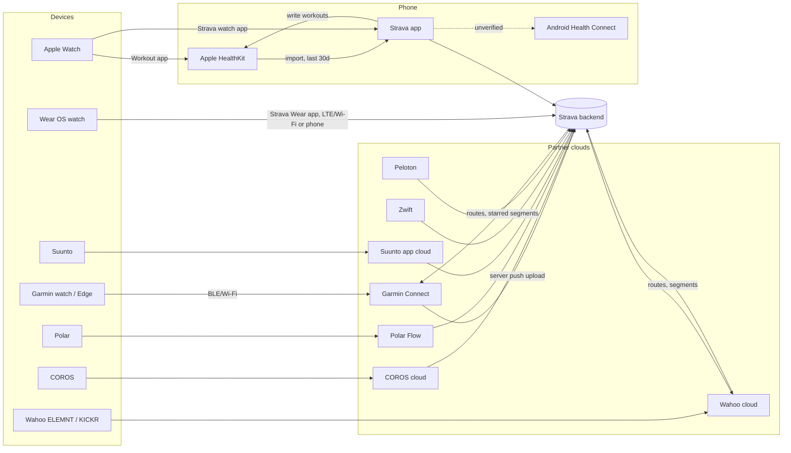
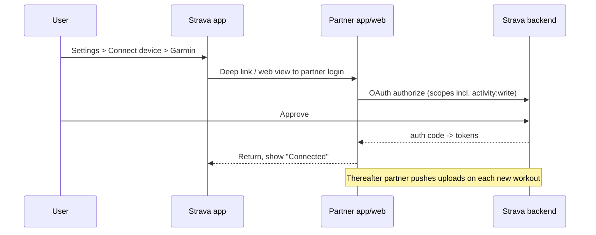
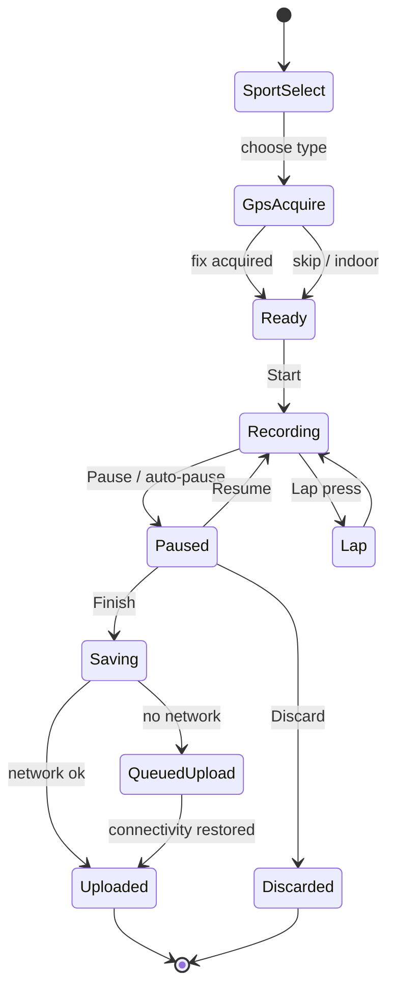
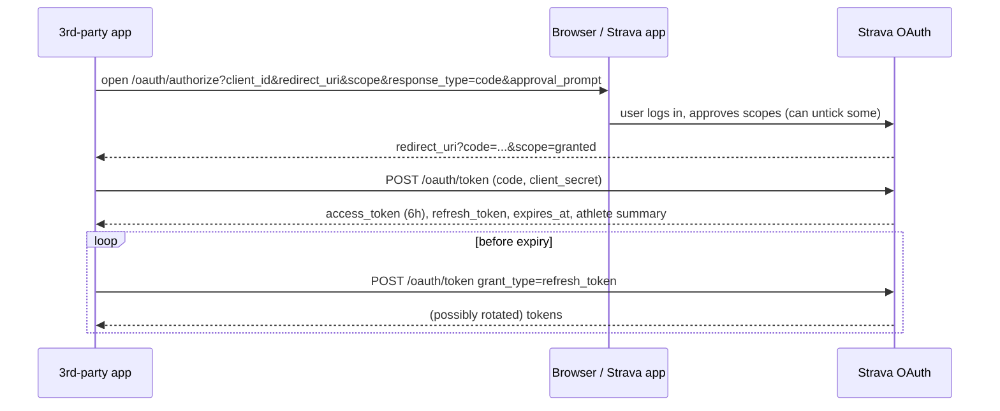
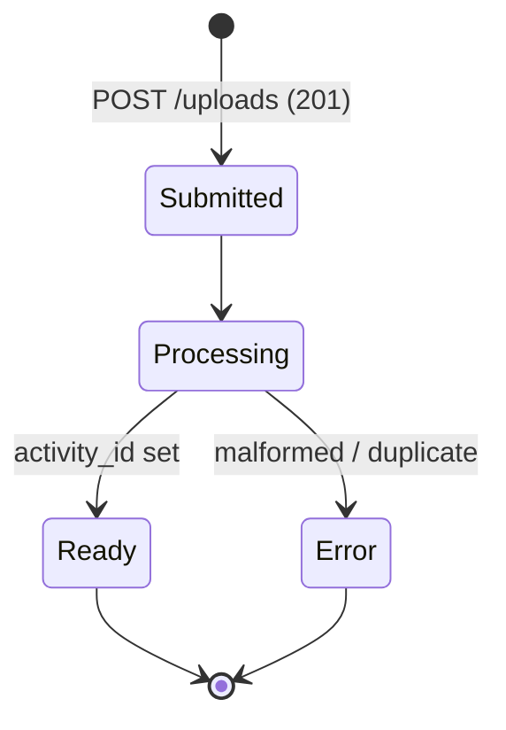
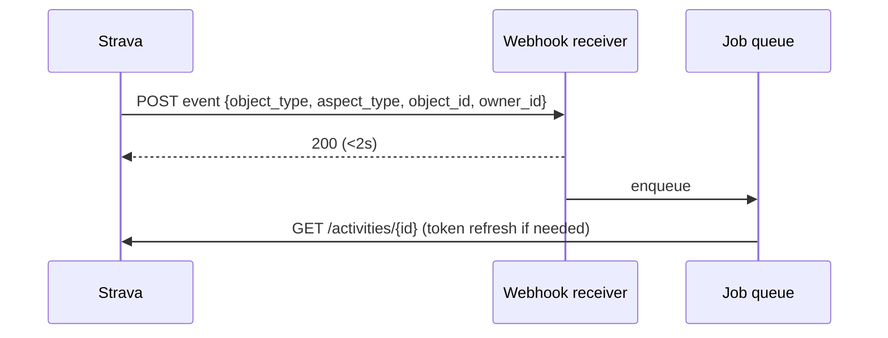
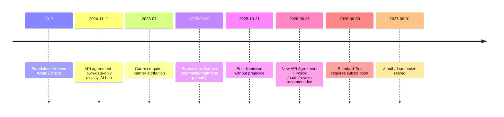
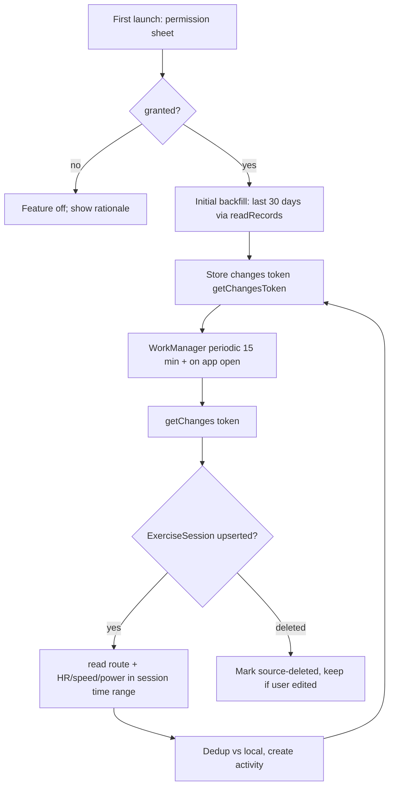

# Integrations & Devices

> Part of the StravaFit product teardown. This doc covers how Strava gets data **in** from watches, bike computers, indoor platforms and health stores, how it sends data **out**, and how its public API v3, OAuth, rate limits, webhooks and API agreement work. The OSS notes at the end describe what StravaFit can realistically integrate with.
>
> **Research note:** the research for this doc ran under a shared web-search budget that ran out partway through. Strava's API docs (auth, rate limits, webhooks, uploads) and its API Policy were fetched directly and are treated as verified. Most per-device sync details come from one 2026 third-party guide and from news coverage, so they are marked **(unverified)** where Strava's own help center was not consulted. Re-check those against support.strava.com before relying on them.

---

## 1. Summary

| Area | What Strava does | Tier |
|---|---|---|
| Watch / bike computer sync | Partner clouds (Garmin Connect, COROS, Polar Flow, Suunto, Wahoo) **push** finished activities to Strava through partner integrations after the user links accounts once | [FREE] |
| Health stores | Apple Health: imports Apple Workout-app workouts (last 30 days) and writes Strava-recorded workouts back. Android: Health Connect (details unverified) | [FREE] |
| Indoor platforms | Zwift, Peloton, TrainerRoad and others push virtual or indoor activities | [FREE] |
| Wearables / recovery | WHOOP, Oura and Fitbit/Google Health push workouts. Some sync both ways | [FREE] |
| On-watch apps | Strava apps for Wear OS (standalone since 2017) and Apple Watch (standalone recording) | [FREE] |
| Manual file upload | Web upload of FIT/TCX/GPX files (including .gz) | [FREE] |
| Live Segments on devices | Starred segments sync to Garmin, Wahoo, Hammerhead and others for live racing | [SUB] |
| Routes to device | Routes sync to Garmin, Wahoo, COROS and others for navigation | [SUB] for creating routes, sync itself (unverified) |
| Beacon (live tracking) | Phone or Garmin device shares live position with safety contacts | Free from phone, [SUB] from device (unverified, see privacy-safety.md) |
| Public API v3 | REST plus OAuth2 plus webhooks for third-party apps | Free for developers before 2026. Since June 30, 2026 the Standard Tier requires a Strava subscription |
| Strava MCP | The only AI-agent interface the 2026 API Policy allows, for subscribers' personal use | [SUB] |

---

## 2. Integration architecture (how data flows)



There are two broad patterns:

1. **Server-to-server push (most watches).** The user links their Strava account inside the vendor's app (Garmin Connect, COROS, Polar Flow, Suunto, Wahoo). This is an OAuth grant with `activity:write`. When a workout syncs to the vendor cloud, the vendor uploads the FIT file (or posts the activity) to Strava. This is the standard `POST /uploads` path, or a privileged partner variant of it (the partner details are unverified). Strava never talks to the watch directly.
2. **On-device / phone-mediated.** Strava's own phone app records, or reads a health store (HealthKit on iOS), or Strava's own watch app records and uploads.

Reverse flows (Strava to device) use the vendor's partner API. Examples are Strava routes going to Garmin Courses, and starred segments going to Garmin or Wahoo for Live Segments.

---

## 3. Device & app integrations: full catalogue

### 3.1 GPS watches & bike computers

| Partner | Direction | Mechanism | Data carried | Notes |
|---|---|---|---|---|
| **Garmin** (Connect) | Device to Strava. Strava to device for routes and segments | Link in Garmin Connect app or Strava settings. Garmin cloud pushes each new activity | Full FIT: GPS, HR, power, cadence, laps, device name | Since mid-2025 Garmin requires API partners to attribute Garmin-sourced data, and Strava's 2026 API Policy Sec. 4.4 passes this requirement on to third parties. Live Segments on Edge/Forerunner [SUB]. Strava sued Garmin on Sep 30, 2025 over segment/heatmap patents and dropped the suit on Oct 21, 2025 without prejudice |
| **Wahoo** (ELEMNT / app) | Both ways | ELEMNT companion app. Upload over Wi-Fi or BLE via phone after the ride | GPS, HR, power, cadence | Routes and Live Segments to ELEMNT [SUB]. (unverified detail) |
| **COROS** | Device to Strava (plus routes to device, unverified) | Link once in COROS app | GPS, HR, power | (unverified) |
| **Polar** (Flow) | Device to Strava | Link in Polar Flow | GPS, HR | (unverified) |
| **Suunto** | Device to Strava. Segments/routes to device (unverified) | Link in Suunto app | GPS, HR | (unverified) |
| **Hammerhead Karoo** | Both ways | Karoo dashboard links Strava | GPS, power, Live Segments | (unverified) |
| **Bryton, Lezyne, Amazfit/Zepp, Huawei Health, Samsung Health, Xiaomi** | Device to Strava | Vendor app links Strava. Behaviour varies | Varies; some send summary only | Not covered by consulted sources (unverified) |

### 3.2 Health platforms

| Platform | Direction | Behaviour |
|---|---|---|
| **Apple Health (HealthKit)** [FREE] | Both ways (partial) | Strava imports only workouts recorded in Apple's **Workout** app from the last 30 days. Workouts written to Health by other third-party apps are excluded. Strava writes its own recorded activities to Health (type, distance, time, calories, route). Routes from Garmin- or Zwift-sourced activities are not written to Health. HRV, resting HR and sleep are not exchanged. (single 2026 third-party source; treat as unverified) |
| **Android Health Connect** | (unverified) | Could not confirm Strava's current Health Connect read/write behaviour (search budget exhausted). Google Fit APIs are being deprecated in favour of Health Connect, so any older Google Fit integration has probably been replaced or removed (unverified) |
| **Google Fit (legacy)** | Strava to Fit (historical) | Strava used to write activities to Google Fit. Google is retiring the Fit APIs, so treat this as legacy (unverified) |
| **Fitbit / Google Health** | Device to Strava | Fitbit's app was reportedly renamed "Google Health" in June 2026. It now syncs both GPS and non-GPS activities. The old integration sent only GPS-tracked ones. (unverified) |
| **Samsung Health** | (unverified) | Not confirmed |

### 3.3 Indoor / virtual platforms

| Platform | Mechanism | Strava representation |
|---|---|---|
| **Zwift** | Server push after the ride | Virtual Ride/Run with virtual-world GPS route, HR, power. Excluded from real-world segments and heatmaps |
| **Peloton** | Server push | Indoor class as virtual activity. No route, HR included |
| **TrainerRoad, Rouvy, MyWhoosh, Wahoo SYSTM, Kinomap, FulGaz** | Server push via API upload | Virtual or indoor rides (unverified per platform) |
| **Concept2 Logbook, Tonal, Hydrow** | Server push | Rowing, strength and other types (unverified) |

### 3.4 Wearables / recovery

| Platform | Notes (single source, unverified) |
|---|---|
| **WHOOP** (4.0, 5.0, MG) | Pushes HR and strain. GPS only if "Track Route" was on. Strength and recovery sessions are excluded. Per-activity-type toggles. Can also import Strava activities into WHOOP |
| **Oura** (Gen 2/3+) | Two-way. Strava activities feed Oura Activity/Readiness. Oura workouts can post to Strava (private optional). No GPS |

### 3.5 Training / analysis ecosystem (API consumers)

These use the public API: TrainingPeaks, Intervals.icu, VeloViewer, Runalyze, Final Surge, TrainerRoad, Stats.training, Relive, FitnessSyncer and others. The 2024 and 2026 API terms hit them hardest (see §6).

### 3.6 Settings UI (phone)

```
+--------------------------------------+
| <  Applications, Services & Devices  |
+--------------------------------------+
|  Connect a new device to Strava   >  |
|--------------------------------------|
|  CONNECTED                           |
|  [G] Garmin Connect        Connected |
|  [Z] Zwift                 Connected |
|  [H] Health (Apple)        Connected |
|--------------------------------------|
|  AUTHORIZED APPS                     |
|  Intervals.icu              Revoke   |
|  Relive                     Revoke   |
+--------------------------------------+

+--------------------------------------+
| <  Connect a device                  |
+--------------------------------------+
|  Garmin                           >  |
|  Wahoo                            >  |
|  COROS                            >  |
|  Polar                            >  |
|  Suunto                           >  |
|  Apple Watch / Health             >  |
|  Wear OS                          >  |
|  Fitbit                           >  |
|  Zwift                            >  |
|  ...                                 |
+--------------------------------------+
```
(Layout reconstructed from general product knowledge: the entry is under **Settings > Applications, Services, and Devices** (exact labels unverified).)

Typical "connect" flow:



---

## 4. On-watch apps

### 4.1 Wear OS app [FREE]
- Strava launched a standalone Wear OS (then Android Wear 2.0) app in 2017. It records runs and rides on the watch and uploads directly when the watch has Wi-Fi or LTE, so the phone does not need to be nearby. It needs a watch with built-in GPS for outdoor GPS tracking.
- It showed distance, pace/speed, time, laps and HR at launch. The current feature set (sport types, Tiles and Complications, phone-connected mode) is unverified.
- Wear OS has a phone-connected mode in which the phone records GPS. Whether the Strava app supports it is unverified.

Wear recording state machine (behavioural model):



```
 .----------------------.
/   RUN        08:42     \
|      5.21 km           |
|   5'12"/km   152 bpm   |
|  [ II ]        [LAP]   |
\________________________/
```

### 4.2 Apple Watch app [FREE]
- Records runs, rides, walks and other types on the watch and syncs through the iPhone. Standalone recording without the phone is reportedly supported on GPS and cellular models (unverified).
- Separately, Workout-app workouts reach Strava through the HealthKit import (§3.2).

---

## 5. Public API v3 (verified against developers.strava.com)

### 5.1 OAuth 2.0

| Item | Value |
|---|---|
| Web authorize | `GET https://www.strava.com/oauth/authorize` |
| Mobile authorize | `GET https://www.strava.com/oauth/mobile/authorize`. On Android it opens via an implicit Intent, and the Strava app handles it if installed (needs app v75+). On iOS, use the `strava://` scheme or `ASWebAuthenticationSession` |
| Token exchange / refresh | `POST https://www.strava.com/oauth/token` (`grant_type=authorization_code` or `refresh_token`) |
| Access token lifetime | **6 hours** |
| Refresh | Returns the same access token if it has more than 1 hour left. The refresh token may rotate, and **the old refresh token is invalidated immediately** when a new one is issued |
| Deauthorize (legacy) | `POST /oauth/deauthorize` |
| Revoke (new) | `POST /oauth/revoke` with HTTP Basic `client_id:client_secret`, `token` and an optional `token_type_hint`. Recommended from **June 1, 2026**. It becomes the only deauth endpoint on **June 1, 2027**. Always returns 200. Revoking one token type revokes its pair |
| Notes | Google Sign-In does not work in mobile webviews. Mobile OAuth does not issue non-expiring tokens |

**Scopes**

| Scope | Grants |
|---|---|
| `read` | Public segments, routes, profile, posts, events, club feeds, leaderboards |
| `read_all` | Private routes, segments, events |
| `profile:read_all` | Full profile even if visibility is Followers/Only You |
| `profile:write` | Update weight and FTP, star/unstar segments |
| `activity:read` | Everyone/Followers activities (no privacy-zone data). Needed for activity webhooks |
| `activity:read_all` | Adds privacy-zone data and Only You activities |
| `activity:write` | Create manual activities and uploads, edit activities |



Edge case: users can untick scopes on the consent page, so always parse the returned `scope` parameter.

### 5.2 Resource families (overview)

Athlete (`/athlete`, zones, stats), Activities (CRUD, streams, laps, zones, comments, kudoers), Segments (get, starred, explore), Segment Efforts, Routes (get, GPX/TCX export), Clubs (members, activities), Gear, Uploads, and Streams (time, latlng, distance, altitude, velocity_smooth, heartrate, cadence, watts, temp, moving, grade_smooth). The endpoint inventory comes from general knowledge of the API reference and was not re-fetched in this pass, so it is unverified in detail.

### 5.3 Uploads (verified)
- `POST /api/v3/uploads` (multipart) needs `activity:write`. It returns 201 with an upload id and processes asynchronously.
- `data_type`: `fit`, `fit.gz`, `tcx`, `tcx.gz`, `gpx`, `gpx.gz`, `json`. JSON is only allowed for WeightTraining, HIIT, Workout and Crossfit.
- Poll `GET /uploads/{id}` no more than once a second. Mean processing time is under 2 s. `activity_id` appears when processing is done.
- Duplicates are detected and reported in `error` (with the existing activity id). `external_id` defaults to the filename.
- The doc states no file size limit.



### 5.4 Rate limits (verified)

| Limit | 15 min | Daily |
|---|---|---|
| Overall | 200 | 2,000 |
| Read (all except uploads/create/upload_media) | 100 | 1,000 |

- 15-minute windows reset at :00, :15, :30 and :45. The daily limit resets at midnight UTC.
- Headers: `X-RateLimit-Limit`/`-Usage` and `X-ReadRateLimit-Limit`/`-Usage`, each as `"15min,daily"`.
- A request over the limit returns 429. Rejected requests still count toward the daily limit.

### 5.5 Webhooks (verified)
- One push subscription per application covers every authorized athlete. Create it with a form-POST to `/api/v3/push_subscriptions` (`client_id`, `client_secret`, `callback_url` up to 255 chars, `verify_token`).
- Validation: Strava sends a GET with `hub.mode=subscribe`, `hub.challenge` and `hub.verify_token`. The callback must reply within **2 s** with 200 and JSON `{"hub.challenge": "..."}`.
- Event fields: `object_type` (activity|athlete), `object_id`, `aspect_type` (create|update|delete), `updates`, `owner_id`, `subscription_id`, `event_time`.
- Activity updates carry `title`, `type` and `private`. Privacy events require `activity:read_all`. Deauthorization arrives as an athlete update with `{"authorized":"false"}`.
- The receiver must return 200 within 2 s. Strava makes up to 3 delivery attempts. One save can produce several events.
- Payloads carry only ids. The app must fetch the activity, which costs rate-limit budget.



---

## 6. API agreement & policy changes

### 6.1 November 11, 2024 agreement update
- Apps may show a user's Strava data **only to that user**. Coaching dashboards, public leaderboards and team views built on Strava data broke. Reported casualties included Intervals.icu coach views and VeloViewer leaderboards.
- Strava API data may not be used in AI/ML models "or similar applications". Commentators such as DC Rainmaker read this very broadly.
- Apps must not replicate Strava's look and feel.
- Strava said fewer than 0.1% of apps were affected.

### 6.2 June 1, 2026 API Agreement + API Policy (fetched)
| Section | Rule (paraphrased) |
|---|---|
| 2.3 / 6.1 | Show a user's data only to that user, even if it is public on Strava |
| 3.3 | **Standard Tier** (up to 9,999 users) requires an active Strava subscription for the developer or the end users, effective June 30, 2026 per a third-party source. **Extended Access** (10k+ users) is granted case by case |
| 3.5 | The Strava MCP is the only authorized AI-agent interface, limited to a subscriber's personal use |
| 3.6–3.7 | Athlete limits are set by Strava at its discretion. Circumventing them leads to blocking |
| 4.1–4.4 | No Strava marks in app name, icon or logo. Attribution follows the brand guidelines. No implied endorsement. **Garmin-derived data needs Garmin attribution** |
| 5.2 | Must not compete with Strava, imitate its look, or benchmark it |
| 5.3 | No AI use: training, fine-tuning, evaluation, grounding, embeddings, RAG, context-window ingestion (including derived or anonymized data) |
| 5.4–5.5 | No aggregated analytics, no scraping or bulk export, no vector stores |
| 5.8–5.9 | No charging users for API access. No Strava data in ads |
| 5.16 | No proxies or abstraction layers that re-expose the API |
| 6.2–6.3, 7.4 | Cache at most 7 days. Remove deleted data within 48 h. Complete deletion requests within 30 days |

**What this means for StravaFit:** Sec. 5.2 bars apps that compete with Strava. StravaFit is a competing product, so it **must not depend on the Strava API**, even for "import my history". The supported migration path is the user-initiated **Strava bulk data export** (Settings > My Account > Download or Delete Your Account, delivered as a ZIP of original FIT/GPX/TCX files plus CSV; see share-export.md). The user then uploads the ZIP to StravaFit. Sec. 4.1 also bars Strava marks in an app name, and the working name "StravaFit" contains the word "Strava". Rename before any public release.

### 6.3 Timeline



---

## OSS implementation notes

Neutral names: "Connected Devices" (not "Applications, Services & Devices"), "Live Segment racing" becomes **"Live Sector"**, "Beacon" becomes **"Live Share"**, "Kudos" becomes **"Props"**. Everything here is free.

### A. Realistic integration matrix

| Integration | Feasibility | How | Priority |
|---|---|---|---|
| **FIT / GPX / TCX file import** (single + bulk ZIP) | High | Parse on device or server (see §C) | P0 |
| **Strava bulk export ZIP import** | High | User uploads `export_*.zip` with `activities.csv` plus `activities/*.fit.gz/gpx/tcx`. Map CSV metadata (name, type, gear, description) onto parsed files | P0 |
| **Android Health Connect** | High | Read and write `ExerciseSessionRecord` with `ExerciseRoute`, `HeartRateRecord`, `DistanceRecord`, `SpeedRecord`, `PowerRecord`, `StepsCadenceRecord`, `TotalCaloriesBurnedRecord`, `ElevationGainedRecord`. Brings in Samsung Health, Fitbit/Google, Garmin (if the user enables Garmin to Health Connect), Oura, WHOOP and others indirectly | P0 |
| **BLE sensors direct** (HR, power, speed/cadence, FTMS trainers, RSC footpods) | High | Standard GATT profiles (§B) | P1 |
| **Wear OS companion / standalone** | Medium | Health Services `ExerciseClient` on Wear OS. Data Layer API or direct HTTPS upload | P1 |
| **Gadgetbridge** (Amazfit, Bangle.js, PineTime, Garmin partial, Huawei, Xiaomi) | Medium | Gadgetbridge can export GPX and has an auto-export/share intent. It can also write to Health Connect in recent versions (unverified). Accept `ACTION_SEND` / `ACTION_VIEW` intents for .fit/.gpx | P1 |
| **Garmin** | Medium, file-based | (1) The watch mounts over USB MTP, so read `GARMIN/Activity/*.fit`. (2) Garmin Connect "Export Original" gives a FIT ZIP. (3) Garmin to Health Connect. (4) The official Garmin Connect Developer Program (Activity API, push) needs business approval, carries attribution requirements and is unlikely for OSS. Do not use unofficial garth/garminconnect scrapers in the default build | P1 (file), P3 (official API) |
| **Wahoo / COROS / Polar / Suunto** | Low–Medium | Polar AccessLink and Suunto have public developer APIs that require app registration (unverified current terms). Otherwise use file export or Health Connect | P2 |
| **Apple Health** | N/A for Android v1 | A future iOS app would use HealthKit `HKWorkout` plus `HKWorkoutRoute` | P3 |
| **Zwift / indoor** | Low (no public API) | FIT import. Zwift saves FIT files locally in `Documents/Zwift/Activities` | P2 |
| **Intervals.icu / TrainingPeaks export** | Medium | Users can export from StravaFit to these via their APIs (Intervals.icu has an open API) | P3 |
| **Strava API** | Do not use | Policy Sec. 5.2/5.3/5.16 | Never |
| **Our own public API** | High | Mirror the good parts: OAuth2 + PKCE, scoped tokens, upload endpoint, webhooks | P2 |

### B. BLE protocols (direct sensor recording)

| Sensor | GATT service | Characteristic | Notes |
|---|---|---|---|
| Heart rate | 0x180D | 0x2A37 HR Measurement (notify) | Flags byte: bit0 means uint16 HR. Optional RR intervals in 1/1024 s, useful for HRV |
| Cycling power | 0x1818 | 0x2A63 Power Measurement | Instantaneous power sint16. Optional crank revolutions give cadence |
| Speed & cadence | 0x1816 | 0x2A5B CSC Measurement | Cumulative wheel/crank revs plus event time (1/1024 s). Handle rollover |
| Running speed & cadence | 0x1814 | 0x2A53 RSC Measurement | Footpods |
| Smart trainer | 0x1826 FTMS | 0x2AD2 Indoor Bike Data, 0x2AD9 Control Point | ERG mode via Control Point |
| Battery | 0x180F | 0x2A19 | Show battery in sensor list |

ANT+ is mostly gone from new Android phones. Skip it, or support it via the ANT+ Plugins service only if the user has it installed.

Android specifics: `BLUETOOTH_SCAN` and `BLUETOOTH_CONNECT` (API 31+, `neverForLocation` flag for scan). Run a foreground service of type `connectedDevice|location|health` (Android 14+ requires matching foreground-service-type permissions). Use `autoConnect=true` for reconnection. Use companion device pairing (`CompanionDeviceManager`) for persistent pairing and to get background start exemptions. Libraries: Nordic `Android-BLE-Library` or Kotlin `kable`.

### C. File parsing

- **FIT:** Garmin FIT SDK (Java/Kotlin; the license permits use in apps, but check current terms), or the OSS `fit-file-parser` (JS) and `fitparse`/`fitdecode` (Python, server). Read `session`, `lap`, `record`, `event`, `device_info`, `hrv` and `sport` messages. Developer fields carry Stryd and CIQ data. Timestamps count seconds from 1989-12-31 UTC. Positions are semicircles (×180/2^31).
- **GPX:** XML with `trkpt` lat/lon/ele/time plus `gpxtpx:TrackPointExtension` (hr, cad, atemp) and power extensions (vendor-specific).
- **TCX:** `Activity/Lap/Track/Trackpoint` plus `ns3:TPX` Speed/Watts. Often contains leading whitespace that breaks strict parsers.
- **Gzip:** detect it by magic bytes `1F 8B`, not only by the `.gz` suffix.
- **Dedup:** hash of (start_time rounded to 1 s, sport, device serial if present, first and last coordinates). Also keep a per-source `external_id` unique index. On a near-duplicate (same start within 60 s and overlapping time range), prompt the user to merge or keep both. Strava rejects these; we prefer to prompt.
- **Timezone:** derive from the first GPS fix (timezone boundary DB such as `timeshape`) when the file has only UTC.
- **Sport mapping table:** FIT `sport/sub_sport` maps onto our types. Health Connect `EXERCISE_TYPE_*` constants map onto our types. Keep this mapping in one shared Kotlin enum.

### D. Health Connect design



- Changes tokens expire after about 30 days (unverified exact value). On `ChangesTokenExpired`, re-backfill.
- Exercise route access needs a separate per-session consent (`ExerciseRoute` permission flow; `READ_EXERCISE_ROUTES` on newer versions). Handle `ExerciseRouteResult.ConsentRequired`.
- Background reads need `READ_HEALTH_DATA_IN_BACKGROUND` (Android 15+/HC newer). History older than 30 days needs `READ_HEALTH_DATA_HISTORY` (unverified exact names; check the current Jetpack `connect-client` docs).
- Write back our recorded activities so other apps see them. Tag them with `Metadata` clientRecordId to avoid echo-loops: skip records where `dataOrigin == our package`.
- On Android 14+ Health Connect is part of the framework. On 13 and below, deep-link to install it from Play.
- A Play Store health-permissions declaration form is required.

### E. Wear OS

- Use Health Services `ExerciseClient`, which supplies batched GPS, HR, distance, auto-pause and laps with good battery behaviour, plus `ExerciseUpdate` listeners. Add an ongoing activity notification and a Tile.
- Sync options: (1) Data Layer `ChannelClient` streams the FIT/proto file to the phone app. (2) Direct HTTPS upload when on Wi-Fi/LTE with the stored token. Use a queue with WorkManager on the watch.
- Write a FIT file on the watch (FIT SDK encoder) so the same import path serves every source.

### F. Our public API (if we offer one)

- OAuth 2.1 with PKCE (mobile and SPA), short-lived access tokens (1 h), rotating refresh tokens with reuse detection, and an RFC 7009 revoke endpoint from day one.
- Scopes like Strava's but simpler: `profile:read`, `activities:read`, `activities:read_private`, `activities:write`, `routes:read`, `routes:write`.
- Uploads: same async model (`202` + poll or webhook). Accept fit/gpx/tcx (+gz).
- Webhooks: per-app subscriptions, HMAC-SHA256 signed bodies (Strava sends unsigned payloads, which is a weakness), retries with exponential backoff for up to 24 h, and an event id for idempotency.
- Rate limits: token bucket per app and per user, with headers in the same `limit/usage` style. Do not impose an "own data only" display rule; let users opt in to sharing. No AI ban; let users decide.

### G. Edge cases
- The same workout arrives from both Health Connect and a FIT file. Dedup per §C.
- Indoor or virtual activities with fake GPS (Zwift) must be flagged `virtual=true` and excluded from sectors and heatmaps.
- Pool swims have no GPS (lengths only). Multisport FIT files contain several sessions; split them or keep one activity with legs.
- Device clocks may be wrong (year 1989 or 2000). Fall back to file mtime and prompt the user.
- Corrupt or truncated FIT files (battery died): parse up to the last valid record and warn.
- Garmin attribution: if we ever take Garmin-API data, show "Data from Garmin" plus device model per Garmin brand rules.

---

## Sources

- https://developers.strava.com/docs/authentication/
- https://developers.strava.com/docs/rate-limits/
- https://developers.strava.com/docs/webhooks/
- https://developers.strava.com/docs/uploads/
- https://www.strava.com/legal/api_policy
- https://www.sensai.fit/es/blog/what-syncs-with-strava-2026
- https://dcrainmaker.com/2024/11/stravas-changes-to-kill-off-apps.html (via search summary)
- https://www.techradar.com/health-fitness/strava-could-soon-stop-working-with-some-of-your-third-party-apps-heres-what-you-need-to-know (via search summary)
- https://marathonhandbook.com/strava-api-changes/ (via search summary)
- https://the5krunner.com/2024/11/20/strava-issues-clarification/ (via search summary)
- https://www.dcrainmaker.com/2025/10/strava-drops-voluntarily-lawsuit-against.html (via search summary)
- https://www.bikeradar.com/news/strava-drops-lawsuit-against-garmin-21-days-after-filing-it (via search summary)
- https://www.wareable.com/running/strava-compatible-watches (via search summary)
- https://www.pocket-lint.com/apps/news/140223-standalone-strava-app-rolls-out-for-android-wear-2-0 (via search summary)
- https://www.androidcentral.com/strava-updates-their-app-android-wear-20 (via search summary)
