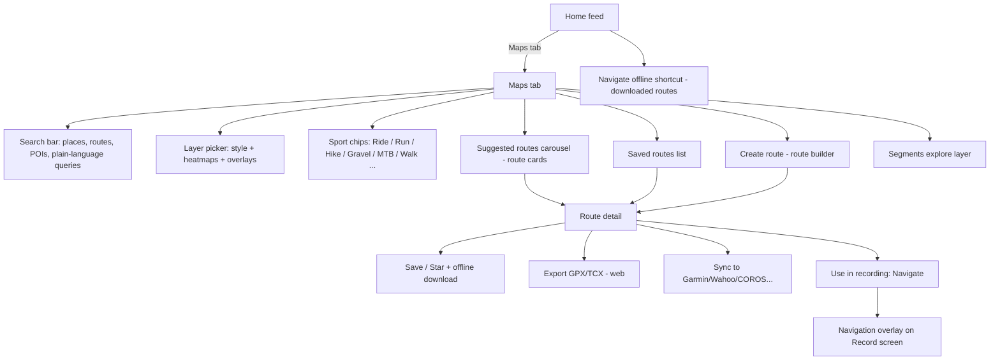
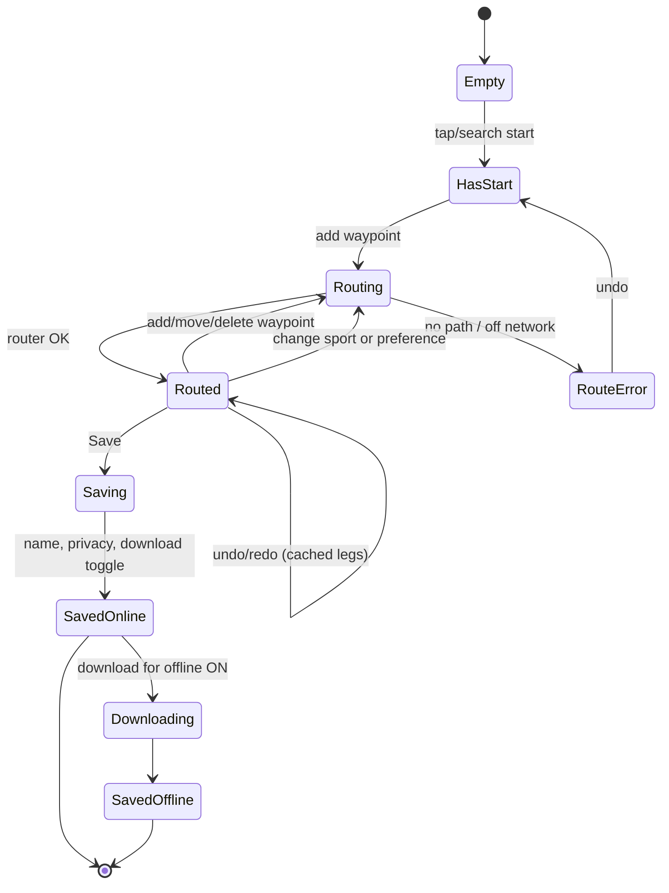
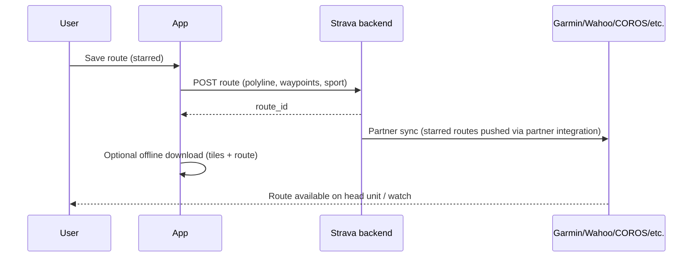
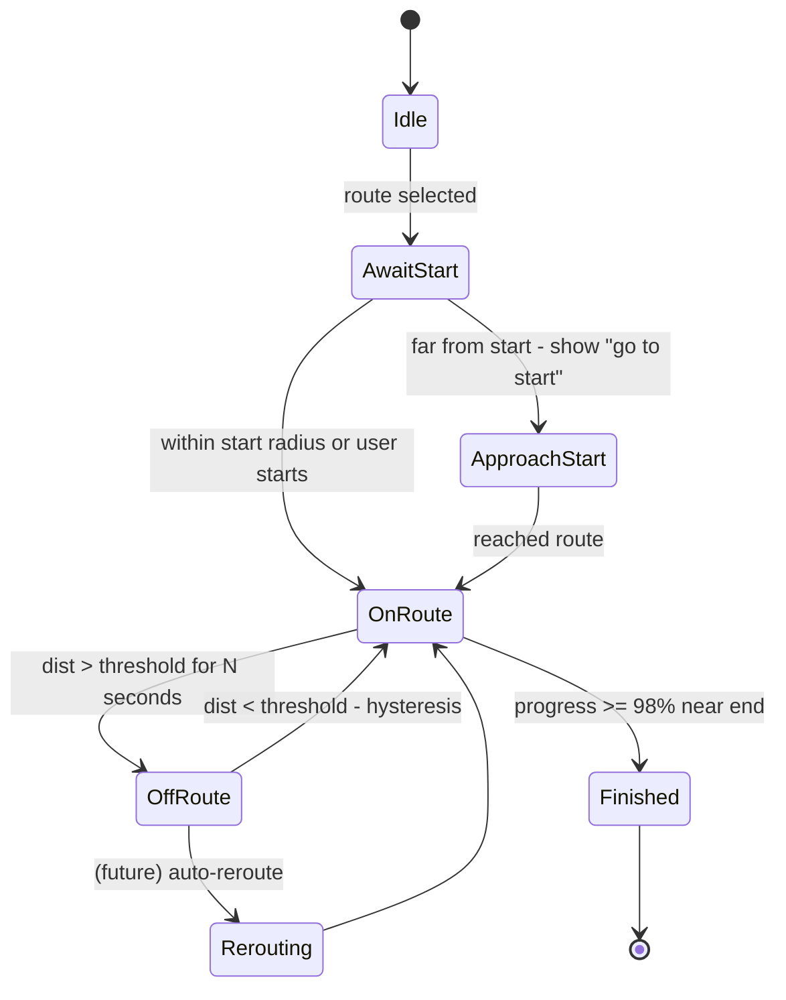

# Maps & Routes — Feature Teardown

> Scope: the Maps tab, map styles and layers, global and personal heatmaps, the route builder, route detail, saving and syncing routes, GPX import and export, offline maps, points of interest, start-point and route suggestions, and navigation while recording. It also covers features inherited from FATMAP, and notes on Komoot.
> Platform: Android (Play Store) is primary. iOS and web differences are called out where known.
> Status legend: **[FREE]** = available to free athletes, **[SUB]** = Strava subscription required, **(unverified)** = could not confirm from a public source during this pass.
> Research date: 2026-10-29. Strava ships map changes often, so re-check before implementing pixel-level details.

---

## 1. Summary

Strava's map surface has grown from "draw a line on a road map" into a combined discovery, planning and navigation product. Five pillars:

1. **Base maps and layers.** Standard, satellite, hybrid, winter and 3D terrain. The 3D and winter rendering came from FATMAP, which Strava acquired in January 2023 and shut down on 1 Oct 2024.
2. **Heatmaps.** Global [FREE], Personal [SUB], Night [SUB] and Weekly [SUB]. Night and Weekly were added in November 2024.
3. **Route creation.** A manual builder with road/trail snapping and a popularity preference. Auto-generated loop suggestions [SUB], point-to-point routing, and (since Oct 2026) plain-language route/POI search [SUB].
4. **Route consumption.** Route detail (elevation, surface, estimated time), save/star, offline download [SUB], sync to GPS devices, GPX/TCX export.
5. **Navigation.** Follow a route on the recording map with an off-route indicator [SUB]. Apple Watch route following arrived on 30 Jan 2026 [SUB]. Turn-by-turn audio for hikes, walks and runs was announced in Oct 2026 as "coming soon" [SUB].

Almost everything beyond viewing the global heatmap and recording is gated behind the subscription. **StravaFit makes all of it free.**

---

## 2. Information architecture



On Android the Maps tab is one of the bottom-nav tabs (Home, Maps, Record, Groups, You). The layout has varied between releases, and the "Explore"/"Groups" naming has also changed. A downloaded route appears in a **"Navigate offline"** module on the Home screen when the device has no signal (verified via the help center, Oct 2026).

---

## 3. Map styles and layers

### 3.1 Base map styles (Maps tab and route builder)

| Style | Description | Tier | Notes |
|---|---|---|---|
| Standard | Vector road/trail map with labels, contours on zoom-in | [FREE] | Default. Light theme; dark variant follows the system theme (unverified) |
| Satellite | Aerial imagery without labels | [SUB] for 3D. 2D satellite access has varied (unverified) | From the FATMAP-based engine (2024+) |
| Hybrid | Satellite plus road/trail labels | [SUB] (unverified) | Offered in the layer picker on mobile |
| Winter | Ski runs, lifts, backcountry-relevant shading, avalanche-angle/slope shading (unverified) | [SUB] | Inherited from FATMAP's winter layers |
| 3D terrain | Tilted terrain with draped imagery; two-finger tilt/rotate | [SUB] | Mobile and web. Uses FATMAP technology |

The layer picker is a bottom sheet. It contains a row of style thumbnails, then toggle rows for overlays: heatmap(s), segments, points of interest, photos [SUB], and on some versions "Strava Metro"/seasonal styles.

### 3.2 Activity map types (per-activity rendering)

These options control how a *recorded activity* is drawn. They are listed here because they reuse the same map engine. Source: Strava Help Center "Map Types".

| Map type | Encoding | Tier |
|---|---|---|
| Seasonal maps (e.g. Standard, Dirt, Metro-themed) | Rotating set of stylistic base maps | [FREE] |
| Heatmap (default for soccer, skateboarding, sailing, golf) | Time-density blob instead of a polyline | [FREE] |
| 3D | Route over 3D satellite. Default for hike, trail run, gravel, MTB | [SUB] |
| Winter 3D | Default for alpine/backcountry ski, snowboard, snowshoe | [SUB] |
| Pace / Speed | Darker blue = faster | [SUB] |
| Heart rate | Darker red = higher | [SUB] |
| Elevation | Yellow (low) to black (high) | [SUB] |
| Gradient | Yellow descents, red climbs | [SUB] |
| Surface type | Dashed = unpaved, solid orange = paved, white = unknown (OSM data) | [SUB] |
| Power | Darker purple = higher. Not shown for estimated power | [SUB] |
| Time | Darker red = longer elapsed | [SUB] |
| Temperature | Darker red = hotter | [SUB] |

Behaviour details:
- Change it per activity: overflow menu, then Edit Activity, then Change Map Type.
- The default 3D for trail/winter sports can be turned off: You tab, Settings, Default Maps (mobile), or Settings, Display Preferences (web). This only affects future uploads.
- The mobile app shows map types in the feed, on the profile and on activity detail. The **web shows them only in the feed**.
- **There is no color legend** on the activity page. This is a known UX gap that we should fix.

### 3.3 Overlays

| Overlay | Description | Tier |
|---|---|---|
| Global heatmap | Aggregate of public activities, colored by density | [FREE] |
| Personal heatmap | Your own activities | [SUB] |
| Night heatmap | Activities between sunset and sunrise | [SUB] (added Nov 2024) |
| Weekly heatmap | Last 7 days of activity | [SUB] (added Nov 2024) |
| Segments | Segment start markers and lines, filtered by sport | [FREE] browse. Some filters [SUB] (unverified) |
| Points of interest | Trailheads, parking, water, toilets, viewpoints, cafés (unverified exact set) | Search [SUB] since Oct 2026 |
| Community photos | Geotagged photos from public activities, refreshed about every 48 h | [SUB] |

---

## 4. Heatmaps

### 4.1 Global heatmap [FREE]

- Built from public activities (and possibly "followers"-visibility activities; not documented). Privacy zones and opt-out are excluded. The athlete-level "Contribute to aggregated data" setting removes your data.
- Filters: sport family (Ride, Run, Water, Winter, All), with sub-filters on web.
- Color schemes: orange (hot), red, blue, blue-red, purple, gray. Base maps: dark, light, winter or satellite.
- Time range: all-time, or a specific year. This was added alongside the heatmap color options (verified, running magazine coverage).
- **Street-level zoom requires login.** After the 2018 military-base controversy, Strava limited high-zoom heatmap tiles to registered users. Logged-out viewers see coarse zoom only.
- Since roughly 2024, low-usage areas may be thresholded so that single-person routes do not reveal homes (unverified exact rule).
- The 3D global heatmap view is web-only and [SUB].

### 4.2 Personal heatmap [SUB]

- Shows only your own activities. Private to you.
- Filters: date range (presets and custom), sport types, include/exclude commutes and private activities (unverified), and colors.
- 3D view on web (unverified on mobile as of 2025).
- Mobile: Maps tab, layer picker, Personal Heatmap.

### 4.3 Night and Weekly [SUB]

- **Night**: only activity recorded between local sunset and sunrise. Useful for lit, populated routes.
- **Weekly**: rolling 7-day window. Shows current conditions, e.g. which trails people are using after snow.
- Subscribers can stack heatmaps (show more than one at once) and filter by activity.

### 4.4 Heatmap behaviour in the route builder

The heatmap is also an **input** to routing. The router prefers ways with higher heat for the selected sport ("popularity"). Suggested loops are built from heat-weighted paths, so reviewers note that suggestions cluster on busy city corridors (bike-magazin.de).

---

## 5. Route builder

### 5.1 Entry points
- Maps tab, then "+" / Create Route. On mobile this usually sits in the routes sheet.
- Web: strava.com/maps/create (the old /routes/new is the legacy builder).
- From an activity: "Create route from activity" / "Save as route" [SUB] (unverified current naming).
- Route back to start during recording (navigation aid; see §9).

### 5.2 Modes

| Mode | What the user does | Output | Tier |
|---|---|---|---|
| Tap-to-add waypoints | Tap the map; each tap is a waypoint. The router fills the path between consecutive waypoints | Routed polyline | [SUB] for creating |
| Draw (finger) | Drag a freehand line; it snaps to nearby roads/trails | Snapped polyline | [SUB] |
| Point-to-point | Choose start and destination (search or tap); app returns the best path for the sport | Routed polyline | [SUB] |
| Auto-suggested loops | Choose start, sport, distance, elevation preference, surface; app returns about 3 loops | Up to 3 candidate routes with estimates | [SUB] |
| Out-and-back | If the end equals the start, the builder can auto-mirror the route. Undo to customize | Doubled polyline | [SUB] |
| Search-to-waypoint | Search a place or landmark, add it as a waypoint | Waypoint | [SUB] |
| Plain-language search | e.g. "a bike path near a lake", returns routes and POIs | List of routes/POIs | [SUB], since 23 Oct 2026 |

### 5.3 Builder controls (mobile)

```
+----------------------------------------+
| <  Create route                [Save]  |
+----------------------------------------+
| [Ride v] [Popular *] [Direct]  [Layers]|
|                                        |
|           .  map canvas  .             |
|      (S)----\                          |
|              \___(2)                   |
|                    \______(3)          |
|                            \           |
|                            (E)         |
|                                        |
|  [Undo] [Redo] [Out&back] [To start]   |
+----------------------------------------+
| 42.3 km   ^ 512 m   ~1h 48m            |
| /\_/\__/^\___   (mini elevation)       |
+----------------------------------------+
```

Controls:
- **Sport type**: Ride (road), Gravel, MTB, Run, Trail Run, Hike, Walk. Winter sports may be offered via the winter layer (unverified). This changes the routing profile.
- **Routing preference**: "Most popular" (heat-weighted) or "Most direct" (shortest). Older web versions had "Minimize elevation" and "Use popularity" toggles.
- **Elevation preference**: in suggested-loop mode, Flat / Moderate / Hilly (or any) (unverified exact labels).
- **Surface preference**: paved / unpaved / any in loop suggestions.
- **Undo / redo / clear**.
- **Out & back** and **Back to start** (close a loop by routing to the start).
- **Waypoint editing**: long-press drags a waypoint. Dragging the route line inserts a new waypoint. Tapping a waypoint offers removal.
- **Manual mode** (web legacy): straight lines, not routed. Useful for off-trail. Mobile availability is unverified.

### 5.4 Route builder state machine



Each leg (waypoint i to i+1) is routed independently and cached. Moving one waypoint re-routes only the two adjacent legs. Undo is an operation stack of waypoint edits, and the legs are recomputed from cache.

### 5.5 Auto-generated suggestions (Suggested Routes) [SUB]

Inputs: start location (current location by default, or a chosen point), sport, target distance, elevation preference, surface. The app returns about 3 loops as route cards. Since Oct 2026 the cards also show photos and activity data from other athletes on that route.

Reviewer notes:
- The loops lean on popular (heat) corridors. This is good for safety but can be repetitive.
- In early beta, a suggestion used a private road (CyclingTips via zenocycleparts.com).
- The suggestions were "AI-based", then revised to use the heatmap more (bike-magazin.de).

### 5.6 Start-point suggestions (unverified)

No public source confirms a dedicated "suggested start points" feature. What exists:
- Suggested routes default to your current location, or a location you pan the map to.
- Route cards in the discovery carousel cover the visible map area, so they effectively suggest nearby starts.
- FATMAP had trailhead/parking POIs. Strava indicated it would carry basic route info over. Whether parking/trailhead POIs are surfaced as start points in Strava is **unverified**.

For StravaFit we should build this explicitly (see OSS notes §13.7).

---

## 6. Route detail

```
+----------------------------------------+
| <  Lakeside Loop           [*] [...]   |
+----------------------------------------+
|        [ map / 3D flyover preview ]    |
|                                        |
+----------------------------------------+
| Ride · Road                            |
| 42.3 km   512 m   1h 48m est.          |
| Paved 86%  Unpaved 14%                 |
+----------------------------------------+
| Elevation                              |
|      __/\                              |
|  ___/    \__/\____/\___                |
| 0        20 km          42 km          |
+----------------------------------------+
| Segments on this route (5)          >  |
| Photos from athletes                >  |
+----------------------------------------+
| [ Download offline ] [ Send to device ]|
| [         Use route / Navigate        ]|
+----------------------------------------+
```

| Element | Behaviour | Tier |
|---|---|---|
| Title, sport, creator | Editable if yours. Created routes default to private (unverified current default) | — |
| Distance, elevation gain | Computed from the routed geometry and DEM | [FREE] to view |
| Estimated moving time | Based on your recent pace/speed for the sport, adjusted for climbing (unverified exact model) | [FREE] to view |
| Surface breakdown | Paved / unpaved / unknown share from OSM `surface` tags | [SUB] (unverified) |
| Elevation profile | Scrubbable chart. Scrubbing moves a marker on the map. Gradient coloring on 3D/web | [FREE] |
| Segments on route | Segments that the route fully covers | [FREE] |
| Photos | Community photos near the route | [SUB] |
| 3D Flyover | Animated camera flight along the route (FATMAP-derived) | [SUB] |
| Star / Save | Adds it to My Routes and syncs to connected devices | Save [FREE] for others' routes (unverified), create [SUB] |
| Download offline | Stores map tiles plus the route, about 10 MB per route (Wareable) | [SUB] |
| Export GPX / TCX | Web only. Not in the mobile app (Livelox doc) | [FREE] (unverified) |
| Edit / Duplicate / Delete | Edit opens the builder | [SUB] |
| Share | Deep link | [FREE] |

### 6.1 Estimated time model (inferred)

Strava has not published the formula. Observed behaviour:
- It is personalised: it uses your recent average moving speed for that sport.
- Climbing adds time.
- For hikes it seems to follow a Naismith-like rule (unverified).

---

## 7. Saving, syncing and devices



- **Starred/saved routes sync to partner devices.** Garmin (via Connect IQ/Courses sync), Wahoo, Hammerhead, COROS, Suunto, Polar and others pull routes through partner integrations. Supported brands change over time (unverified current list).
- **Apple Watch** [SUB]: route navigation and maps launched globally on 30 Jan 2026. It shows a map with the route line and gives off-route alerts. It has **no** spoken turn instructions and no auto-rerouting.
- **Wear OS**: route following support is unverified. The Wear OS app focuses on recording.
- **API** (developers.strava.com): `GET /athletes/{id}/routes`, `GET /routes/{id}`, `GET /routes/{id}/export_gpx`, `GET /routes/{id}/export_tcx`. Private routes need the `read_all` scope. There is **no public create-route endpoint**, so third parties cannot write routes.
- Route model fields (from API docs, partly from memory, so treat as unverified): `id`, `name`, `description`, `distance`, `elevation_gain`, `map.summary_polyline`, `type` (1 = ride, 2 = run), `sub_type` (1 road, 2 MTB, 3 cross, 4 trail, 5 mixed), `private`, `starred`, `estimated_moving_time`, `segments[]`, `waypoints[]`, `created_at`, `updated_at`.

---

## 8. GPX import and export

| Action | Where | Tier | Notes |
|---|---|---|---|
| Import GPX as a route | Web route builder, "Import GPX" (unverified that it is still available) | [SUB] (unverified) | Historically, people imported via a third party, or uploaded GPX as an activity and then made a route from it |
| Upload GPX/TCX/FIT as an activity | Web upload. Not native on Android | [FREE] | See share-export.md |
| Export a route as GPX/TCX | Route page on web (Export GPX, track or route variant) | [FREE] to export others' public routes (unverified) | GPX "route" (rtept) vs "track" (trkpt) |
| Export on mobile | **Not supported** | — | A notable gap |

---

## 9. Navigation while recording

### 9.1 Current behaviour (Android, as of Oct 2026)

1. Open a route, tap "Use route" / Navigate. Alternatively, on the Record screen, tap the route icon and pick a route.
2. The Record screen map shows the route as a line, plus your position and heading.
3. **Off-route indicator**: once you go more than about 30–50 m from the line (unverified threshold), a banner appears with a line pointing back to the route. Vibration/sound behaviour varies.
4. **Route Back to Start** (mobile): plots an efficient path back to where the activity started.
5. **No spoken turn-by-turn yet.** Strava announced audio turn-by-turn for hikes, walks and runs on 23 Oct 2026 as "coming soon" and subscriber-only.
6. Offline: downloaded routes plus tiles work without signal. Recording offline is [FREE]. Offline routes are [SUB].

```
+----------------------------------------+
| ! Off route - 85 m          [Recenter] |
+----------------------------------------+
|              map                       |
|     ======route=====                   |
|                     \\                 |
|           (you) ----> back to route    |
|                                        |
+----------------------------------------+
| 12.4 km  |  0:52:10  |  4:12 /km       |
| Remaining 7.9 km   ETA 0:33            |
+----------------------------------------+
|       [ Pause ]        [ Map/Stats ]   |
+----------------------------------------+
```

### 9.2 Navigation state machine



---

## 10. FATMAP-derived features

- Strava acquired FATMAP in **January 2023** and shut it down on **1 Oct 2024**. Users could transfer routes to Strava until then.
- **Carried into Strava**: the 3D terrain engine, satellite imagery, winter map layers, Flyover (3D route fly-through) and basic route info.
- **Not carried over**: FATMAP's guidebooks/"adventures", assigned grades, photos and waypoints (download only).
- Critics noted that FATMAP's user-generated mountain content had no replacement.
- The 2025 map rendering overhaul was built on FATMAP technology. It brought 3D terrain, satellite and winter layers to the main app.

## 11. Komoot (comparison, not Strava-owned)

**Komoot is not part of Strava.** It was acquired by Bending Spoons in 2025 (unverified from this pass). It appears here as the main competitor that Strava's route features are catching up to:
- Komoot has offline routes with turn-by-turn navigation for all users, including on Apple Watch (Jan 2026).
- It added community heatmaps (Dec 2025) and POI categories such as fuel stations (Jan 2026) to its planner.
- Its highlights (curated POIs with tips and photos) are the clearest model for Strava's "community-powered route details", which were announced as coming soon in Oct 2026.

These Komoot features are useful benchmarks for StravaFit, which should provide all of them for free.

---

## 12. Change log (maps and routes)

| Date | Change |
|---|---|
| 2018 | Global heatmap privacy controversy. High-zoom tiles now require login |
| Jan 2023 | FATMAP acquired |
| May 2023 | Camp Strava: route builder revamp and 3D plans announced (DC Rainmaker) |
| 2023–24 | Mobile route builder: draw with a finger, snapping, community photos [SUB] |
| 1 Oct 2024 | FATMAP shut down. 3D/winter/flyover moved into Strava [SUB] |
| Nov 2024 | Night and Weekly heatmaps [SUB] |
| 2025 | New map rendering engine (3D terrain, satellite, winter layers). Point-to-point routing; suggestions use more heat data |
| 30 Jan 2026 | Apple Watch route navigation and maps [SUB] |
| 23 Oct 2026 | Plain-language route/POI search, curated route selection, route cards with photos and stats, offline saved routes on Home [SUB] |
| Coming soon (Oct 2026) | Turn-by-turn audio (hike/walk/run), community route details (e.g. wildlife), maps on web [SUB] |

---

## 13. OSS implementation notes

Neutral names for StravaFit:

| Strava term | StravaFit name |
|---|---|
| Global Heatmap | **Community Heat** |
| Personal Heatmap | **My Heat** |
| Night / Weekly heatmap | **Night Heat / Fresh Heat** |
| Route builder | **Route Planner** |
| Suggested Routes | **Loop Ideas** |
| Flyover | **3D Preview** |
| Route Back to Start | **Return Home** |
| Segments | **Sections** (shared naming with segments doc) |

Every feature below is **free** in StravaFit.

### 13.1 Map stack (Android)

- **Renderer**: [MapLibre Native Android](https://github.com/maplibre/maplibre-native) (BSD-2). It supports vector tiles, style JSON, 3D terrain (`raster-dem` source with `terrain`), hillshade, camera tilt/bearing, offline region packs, and runtime layers for the route line and heat.
- Kotlin/Compose: wrap `MapView` in `AndroidView`, or use `maplibre-compose` (community). Keep one MapView per screen and handle the lifecycle (`onStart`/`onStop`/`onLowMemory`).
- **Styles**: use OpenMapTiles-schema styles (e.g. based on OSM Liberty / Americana / Protomaps basemaps themes). Create our own Light, Dark, Outdoor (contours + hillshade + trail emphasis) and Winter (piste:type, aerialway, slope-angle shading) styles.
- **Satellite**: there is no free global imagery that is high-res and licensed for redistribution. Options are Sentinel-2 cloudless (EOX, CC-BY-NC-SA 4.0 for 2016+, so check whether non-commercial use fits), ESA WorldCover, or a paid provider (MapTiler, Mapbox, Esri). Make the provider pluggable via config. **Hybrid** is satellite with a label-only vector layer on top.
- **3D terrain**: DEM tiles in Terrarium or Mapbox-RGB encoding. Copernicus GLO-30 DEM (free, attribution) or AWS Terrain Tiles (Mapzen Terrarium, open). MapLibre `setTerrain` with an exaggeration around 1.2–1.5.
- **3D Preview (flyover)**: animate `CameraPosition` along a smoothed, resampled route (Catmull-Rom). Bearing comes from a look-ahead point about 300 m ahead. Pitch is 60°, at a constant speed scaled to route length (target 30–60 s). Export to video via `MediaProjection`/`MediaCodec` is optional.

### 13.2 Tile hosting

| Option | How | Cost/ops |
|---|---|---|
| **Protomaps PMTiles** | One `.pmtiles` file (planet about 120 GB) on S3/R2/any static host, read with HTTP range requests | Cheapest. No tile server. Recommended |
| OpenMapTiles + tileserver-gl / Martin | Generate MBTiles with Planetiler; serve via Martin (Rust) | Moderate |
| MapTiler / Stadia / Thunderforest | Hosted vector/raster | Paid at scale, quick start |

- Generate the basemap with **Planetiler** (Java, builds the planet in hours on one big machine) using the OpenMapTiles or Protomaps profile. Add custom layers: `surface`, `smoothness`, `sac_scale`, `mtb:scale`, `piste:*`, `aerialway`, drinking water, toilets, bike repair and parking.
- Weekly diff updates are optional. A monthly rebuild is fine for MVP.
- Put a CDN (Cloudflare R2 + Workers) in front. Set `Cache-Control: immutable` with versioned file names.
- **Attribution is mandatory**: "© OpenStreetMap contributors" plus DEM/imagery credits, shown on every map (MapLibre attribution control).

### 13.3 Routing engine

| Engine | Strengths | Weaknesses | Fit |
|---|---|---|---|
| **GraphHopper** (Apache-2) | Custom models in JSON (per-request weighting), alternative routes, **round-trip algorithm built in**, elevation, path details (surface, road_class) | Java, high RAM for the planet with many profiles (CH/LM prep) | **Primary choice** |
| **Valhalla** (MIT) | Dynamic costing per request, isochrones, map-matching (Meili), small tiles, **on-device builds possible** | No built-in round trip; turn-by-turn text is good | Map-matching and offline/on-device option |
| **BRouter** (MIT) | Excellent bike/hike profiles, fully offline on Android, elevation-aware | Smaller community, custom profile language | Offline on-device fallback |
| OSRM | Very fast | Profiles are fixed at build time; no per-request popularity | Not recommended |

**Recommendation**: GraphHopper on the server for planning, with custom models per sport. Valhalla Meili for map-matching recorded tracks (heat generation and "create route from activity"). BRouter (or Valhalla tiles) on device for offline rerouting in v2.

**Popularity routing**:
1. Map-match public activities to OSM way IDs (Valhalla Meili or GraphHopper map-matching).
2. Aggregate per `(way_id, direction, sport_family)`: unique athletes (not activity count, to dampen one person's commute), plus a recency-weighted count.
3. Normalise to `popularity ∈ [0,1]` with log scaling and a percentile clip.
4. Inject as an encoded value in GraphHopper (a custom EV imported from CSV at graph build), then add a custom model rule such as `{"if": "popularity < 0.1", "multiply_by": 0.6}`, with tiered boosts. A "Most direct" request simply omits the popularity rules.
5. Apply a k-anonymity threshold: popularity counts only when there are ≥ 5 unique athletes, so private paths are never inferred.

**Sport profiles (custom models)**:
- Road ride: avoid unpaved (`surface` not in paved set gets ×0.1), avoid `highway=track/path`, penalise steps (block), mild penalty on primary roads.
- Gravel: prefer `surface=gravel/compacted/fine_gravel`, allow `track`, `tracktype≤grade3`.
- MTB: allow `path` with `mtb:scale≤3` (user setting), prefer singletrack.
- Run: foot network, prefer parks and pedestrian ways, allow steps.
- Trail run / Hike: `sac_scale` limit (user setting, default ≤ `mountain_hiking`), prefer paths.
- Walk: foot, avoid high-speed roads without sidewalks.
- Winter (later): `piste:type=nordic/skitour`, `aerialway` handled as connector edges.

**Round trip (Loop Ideas)**:
- GraphHopper `algorithm=round_trip` with `round_trip.distance` and `round_trip.seed`. Request 6–10 seeds and pick the 3 best.
- Score = popularity mean − λ·overlap(out vs back) − μ·|dist − target|/target + elevation match against preference (flat < 8 m/km, moderate 8–15, hilly > 15) + surface share match.
- Diversity: drop candidates whose Hausdorff/Fréchet distance to an already chosen loop is under 300 m.
- Out-and-back: route to the farthest point at about target/2, then mirror.
- Edge cases: islands/peninsulas (no loop exists, so fall back to out-and-back), private roads (`access=private/no` must be blocked), ferries (off by default), seasonal closures (`seasonal=*`), barriers (bike profile: `barrier=gate` ok, `stile` blocked).

**Plain-language search** (Oct 2026 parity): parse a query such as "flat 30 km gravel loop near lake" into structured filters (sport, distance, elevation, surface, nearby feature tags such as `natural=water`). Use a small on-device or server LLM, or a rules grammar for MVP, then run POI + route search. Must work offline-degraded (keyword fallback).

### 13.4 Route builder implementation

- Store each route as an ordered `waypoints[]` plus a `legs[]` cache (encoded polyline + path details per leg). Keep an undo stack of `WaypointOp`s.
- Snapping a freehand draw: simplify the finger path with Ramer–Douglas–Peucker (ε ≈ 20 px at the current zoom), take vertices about every 300–800 m as waypoints, then route the legs. Alternatively call Valhalla `trace_route` on the drawn line to map-match it directly.
- Manual (straight-line) legs are allowed for off-trail. Flag them with `leg.type = MANUAL` and get elevation from DEM sampling.
- Debounce routing requests (250 ms) on drag. Cancel in-flight calls with a coroutine `Job.cancel()`.
- Elevation: sample the DEM every 10–20 m, smooth (moving median of 5 plus hysteresis of 3 m) before summing gain, otherwise gain is overstated. GraphHopper `elevation=true` with SRTM/Copernicus is the alternative.
- Surface breakdown: from GraphHopper `details=surface,road_class,smoothness`. Map OSM values into Paved / Unpaved / Unknown buckets.
- Estimated time: per sport, from the user's last 90 days of moving speed on flat terrain (fallback to defaults: ride 22 km/h, run 6:00/km, hike 4.5 km/h). Add climbing via Tobler's hiking function (foot) or a power-based model for bikes (assume FTP/weight or default 2.5 W/kg). Show a range (±10%).
- Save model (Room + server):
  `Route{id, ownerId, name, description, sport, privacy, waypoints, polyline (encoded, precision 5 or 6), distanceM, gainM, lossM, surfaceStats, estTimeS, bbox, createdAt, updatedAt, source(BUILDER|IMPORT|ACTIVITY|SUGGESTED), starred}`.

### 13.5 Heatmap tile generation

Pipeline (batch, nightly for Community Heat, hourly for Fresh Heat):


- Rasterisation: draw anti-aliased line segments (Bresenham/Wu) into a uint16 accumulation grid per tile. At max zoom (z16) compute directly. For lower zooms, downsample with max/sum pooling from z16 to avoid recomputation.
- Store **raw intensity** as single-channel 8-bit WebP. Colorize **client-side** in MapLibre via a `raster-color` ramp (MapLibre GL JS ≥ 4 / Native support in recent releases, unverified on Android) or a custom layer shader. That allows orange/red/blue/purple/gray themes without re-baking. Fallback: bake one PNG set per color.
- Normalisation: global histogram equalisation per zoom (Strava-style "glow") with a minimum threshold of ≥ 3 unique athletes per pixel at z ≥ 14 (privacy).
- Tools: Python + numpy/numba, or Rust (`tiny-skia`), with tiles written to an MBTiles/PMTiles archive via `pmtiles convert`. Vector alternative: Tippecanoe line density as vector tiles plus a `heatmap`/`line` layer. That is cheaper at low volume but slower to render dense areas.
- **My Heat**: compute on device. Draw the user's own activities into a MapLibre GeoJSON source with a `line` layer at low opacity (additive look via `line-opacity` 0.15 and `line-blur`), or rasterise to local tiles when there are more than 2k activities. Data never leaves the device, which gives privacy by design.
- **Night Heat**: filter points by solar altitude < −0.833° (NOAA sunrise equation) at each point's lat/lon/timestamp.
- **Fresh Heat**: 7-day rolling window, rebuilt hourly only for tiles touched by new activities (dirty-tile set).
- Privacy: honour privacy zones (strip the first and last N metres), "exclude from community heat" per user and per activity, and the minimum-athlete threshold. Sensitive-area masks (military bases) come from OSM `landuse=military` polygons.

### 13.6 Offline maps

- MapLibre `OfflineManager.createOfflineRegion` with an `OfflineTilePyramidRegionDefinition` over a buffered route corridor. Buffer the polyline by about 1 km with JTS, take its bbox, and use zooms 10–16, which is roughly 10–40 MB per route. For a smaller download, use a `OfflineGeometryRegionDefinition` with the buffered polygon.
- Area downloads: let users draw or select a region (bbox), with a size estimate before download and a storage manager screen (list, size, delete, update).
- PMTiles extracts: `pmtiles extract --bbox` on the server, served as one file. This is simpler for large regions.
- Offline routing (v2): BRouter segments (5°×5° rd5 files) or Valhalla tiles for the region, enabling Return Home and rerouting offline.
- Android specifics: download with WorkManager (constraints: unmetered network optional, storage not low), show a foreground notification with progress, and store under `filesDir` (not cache). Respect the tile provider's ToS for bulk download; our own PMTiles avoids that issue.

### 13.7 Points of interest and start points

- POIs from OSM: `amenity=drinking_water|toilets|cafe|bicycle_parking|bicycle_repair_station|shelter`, `tourism=viewpoint|alpine_hut`, `natural=peak|spring|waterfall`, `highway=trailhead`, `amenity=parking` (with `access` check), `amenity=fuel`. Build them into the vector tiles as a `poi` layer, and also into a search index.
- Search: Photon or Pelias (OSM geocoders), or Nominatim self-hosted. On device, an SQLite FTS5 index per downloaded region.
- **Start-point suggestions**: rank candidates (trailheads, parking, transit stops, popular-heat entry points) by distance from the user, Community Heat at that node, and amenities nearby (water/toilets). Show them as pins with "Start a loop here".
- Community route notes (wildlife, conditions): user-submitted point annotations with TTL/expiry and moderation. This is a later phase.

### 13.8 Navigation and turn-by-turn (all free)

- Location: `FusedLocationProviderClient` at 1 Hz in the recording foreground service (`foregroundServiceType="location"`), with a raw GNSS fallback.
- Snap position to the route: project onto the route polyline segment within a window around the last matched index (prevents jumping on out-and-back overlaps). Track `progressM`.
- Off-route: distance > 40 m (run/hike 25 m) for ≥ 5 s triggers off-route. Return to on-route needs < 20 m (hysteresis). Provide haptic, tone and TTS feedback.
- Turn instructions: generate them from GraphHopper `instructions=true` at plan time and store them with the route (sign, distance, street name). For imported GPX without instructions, compute turns from bearing change > 35° at OSM intersections after map-matching.
- TTS: Android `TextToSpeech` with audio focus `AUDIOFOCUS_GAIN_TRANSIENT_MAY_DUCK`. Announce at 200 m and 30 m (bike) or 50 m and 10 m (foot). Use locale-aware units.
- Rerouting: call the server router when online, or on-device BRouter/Valhalla when offline. Rejoin the route at the nearest point ahead (not behind).
- Return Home: route from the current position to the activity start with the active sport profile.
- Wear OS: Tiles + an ongoing activity with next-turn arrow and distance, synced from the phone via the Data Layer API.
- Device sync: export FIT course files (Garmin) and GPX. Use the Garmin Courses API, Wahoo and Hammerhead partner APIs where licensing allows. MVP option: "Share GPX/FIT" via the Android share sheet.

### 13.9 GPX/TCX/FIT

- Import: GPX (trk/rte), TCX courses, FIT courses, KML optional. Parse with a streaming XML parser (`XmlPullParser`). For FIT, use the Garmin FIT SDK (permissive license). Resample, simplify (RDP ε 5 m), and optionally map-match to restore the routable geometry.
- Export **on mobile too** (a Strava gap): GPX 1.1 with both `trk` and `rte` options, including `<ele>` and waypoints as `<wpt>`. FIT course with course points for turns.
- Android: Storage Access Framework (`ACTION_CREATE_DOCUMENT`) for saving and `ACTION_OPEN_DOCUMENT` for import. Register an intent filter for `.gpx`/`application/gpx+xml` so "Open with StravaFit" works.

### 13.10 Data needed

| Data | Source | License |
|---|---|---|
| Roads, trails, POIs, surface | OpenStreetMap (Geofabrik extracts) | ODbL (share-alike on derived DBs) |
| DEM | Copernicus GLO-30, SRTM, AWS Terrain Tiles | Free with attribution |
| Satellite | Sentinel-2 cloudless (EOX) or paid | Check terms (NC clauses) |
| Heat | Our users' public activities | Our ToS plus privacy controls |
| Sunrise/sunset | NOAA algorithm (computed) | — |

ODbL note: the popularity layer joined to OSM way IDs may count as a "derivative database". Publish it under ODbL, or keep it as a separate produced work (not distributed) and get legal review.

### 13.11 Edge cases checklist

- Routes crossing the antimeridian, or polar latitudes (bbox math).
- Very long routes (> 500 km): leg chunking, server time limits, and offline size warnings.
- Waypoints placed in water or on buildings: snap to the nearest routable edge within 200 m, otherwise report an error.
- One-way streets for bikes (`oneway:bicycle=no`), and contraflow.
- Ferries, tunnels with poor GPS, and bridges over other roads (snapping may pick the wrong level, so use `layer` tags).
- GPS drift at the start of a recording causing false off-route alerts. Use a grace period of 60 s.
- Out-and-back progress tracking (index windowing).
- Low-end Android: 3D terrain off by default under 3 GB RAM. Limit DEM tile cache.
- Battery: the map is off-screen during recording, so pause the renderer and keep only location + navigation logic.
- Dark mode style parity. Colour-blind safe heat ramps (offer viridis/cividis).
- Activity map types need a **legend** (Strava has none).

### 13.12 Suggested phasing

| Phase | Scope |
|---|---|
| MVP | MapLibre + PMTiles OSM basemap (light/dark/outdoor), GraphHopper planner (waypoints, sport profiles, direct), route detail (elevation, surface, est. time), save, GPX import/export, follow route with off-route alert |
| v1 | Community/My Heat, popularity routing, Loop Ideas, offline route corridors, POIs + search, device export (FIT), Wear OS |
| v2 | 3D terrain + 3D Preview, winter style, Night/Fresh Heat, TTS turn-by-turn, offline rerouting, start-point suggestions, plain-language search, community route notes |

---

## Sources

- https://support.strava.com/hc/en-us/articles/360049869011-Map-Types
- https://support.strava.com/en-us/articles/17699138-how-do-i-use-strava-offline (via search summary)
- https://www.androidauthority.com/strava-update-natural-language-search-3727411/
- https://www.wareable.com/sport/strava-update-route-discovery-mapping-tools-offline-route-navigation-subscribers (via search summary; direct fetch returned 403)
- https://www.notebookcheck.net/Two-Apple-Watch-app-updates-bring-new-route-and-offline-maps-features-to-users.1213508.0.html
- https://appleosophy.com/2026/01/29/strava-and-komoot-bring-offline-maps-to-apple-watch/
- https://www.techradar.com/health-fitness/strava-has-added-four-new-features-users-will-love-including-a-massive-map-rendering-overhaul
- https://www.advnture.com/news/new-3d-maps-will-make-strava-even-better-for-hikers-and-trail-runners
- https://www.t3.com/active/hiking-walking/strava-hiking-updates-1026
- https://runningmagazine.ca/?p=77597
- https://bikebiz.com/strava-expands-mapping-tools-with-night-and-weekly-heatmaps/
- https://androidauthority.com/strava-new-heatmaps-3498849
- https://www.bikeradar.com/news/strava-global-heatmap-3d-terrain/
- https://www.bikeradar.com/news/strava-3d-personal-heatmap/
- https://www.bikeradar.com/news/strava-personal-heatmap/
- https://techcrunch.com/2024/06/26/strava-to-shutter-3d-mapping-platform-fatmap-18-months-after-acquisition
- https://alternativeto.net/news/2024/6/strava-to-shut-down-fatmap-by-oct-1st-and-integrates-key-features-into-premium-subscription/
- https://dcrainmaker.com/2023/05/announces-upcoming-features.html
- https://www.bike-magazin.de/en/training/fitness/news-from-strava-takeover-of-training-app-and-new-features/
- https://roadbikeaction.com/?p=41103
- https://zenocycleparts.com/blogs/cyclingtips/strava-overhauls-routes-feature-with-loop-suggestions
- https://androidauthority.com/new-strava-route-building-feature-is-picture-perfect-3357608
- https://bicyclingaustralia.com.au/news/new-strava-route-builder-puts-ride-planning-at-your-fingertips/
- https://www.tomsguide.com/wellness/fitness/ive-just-tried-strava-premium-and-this-is-the-feature-id-pay-for-twice
- https://completetri.com/how-to-create-a-cycling-route-using-strava-route-builder/
- https://livelox.com/Documentation/Athletes/UploadRouteFromFile
- https://developers.strava.com/docs/reference/
- https://github.com/vangent/strava/blob/master/docs/RoutesApi.md
- https://komoot.com/whats-new
