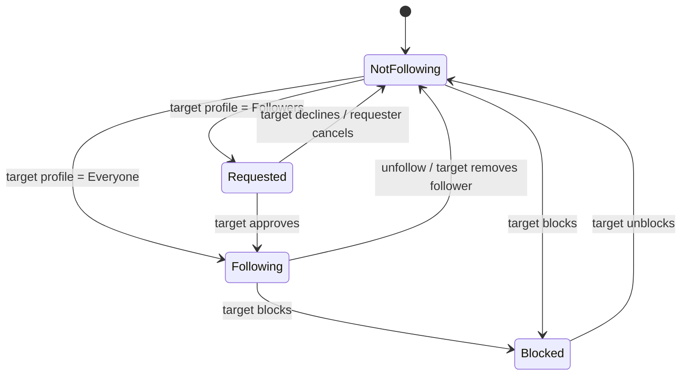
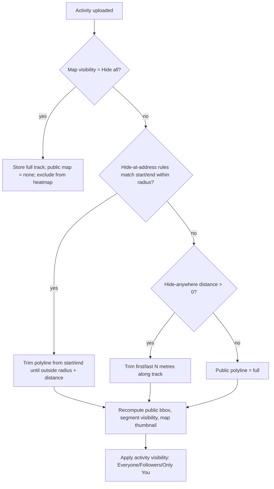
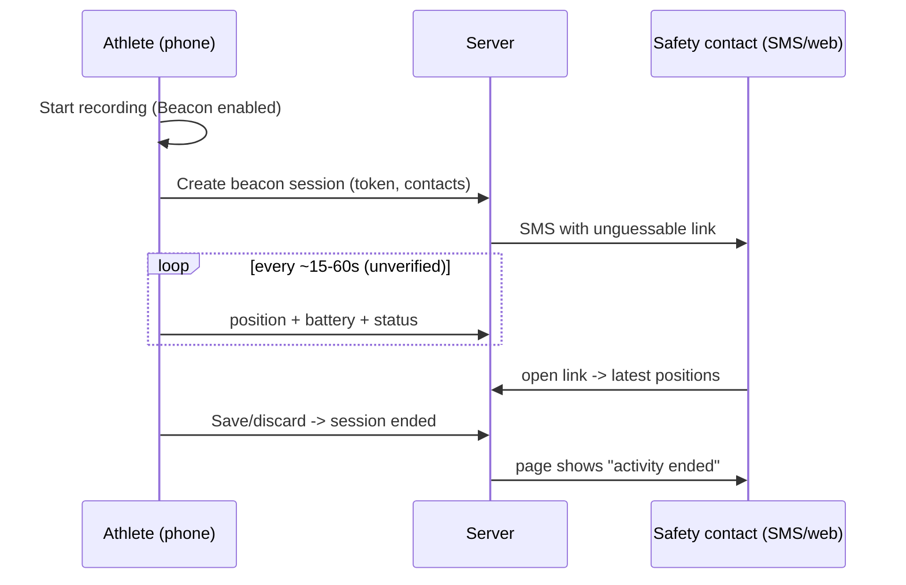
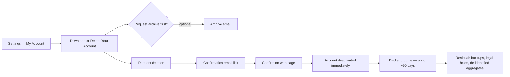

# Privacy & Safety — Feature Teardown

> Scope: Strava Android app (Play Store), with iOS differences noted. This covers profile and activity visibility, map privacy (hidden start/end points, formerly "Privacy Zones"), hidden stats, Flyby/group opt-outs, leaderboard exclusion, aggregated-data (Heatmap/Metro) opt-out, Beacon live location, blocking and reporting, data export, account deletion and retention, age rules and regional defaults, account security, and public incidents with their lessons for our design.
>
> Conventions: [FREE] means available to free Strava users. [SUB] means it needs a Strava subscription; this is for reference only, because StravaFit has no subscriptions and every feature is free. "(unverified)" marks claims I could not confirm against a primary or reliable secondary source. All descriptions are paraphrased.

---

## 1. Summary

| Area | Strava behaviour (2024–2026) | Tier |
|---|---|---|
| Profile visibility | Everyone / Followers. A followers-only profile requires follow approval and shows non-followers a minimal stub | [FREE] |
| Activity visibility | Everyone / Followers / Only You. Set as an account default and overridable per activity | [FREE] |
| Group activity visibility | Controls who can see that you were in a group activity | [FREE] |
| Map visibility | Hide start/end around a specific address, hide start/end anywhere, or hide the whole map. Distance is adjustable (max about 1 mile) | [FREE] |
| Per-activity map edit | Trim the hidden start/end distance on a single activity, or hide that map | [FREE] |
| Hide stats | Per activity: hide heart rate, power, calories, pace/speed and similar from others | [FREE] (unverified that every stat is free) |
| Flyby | Visibility of you in other people's flybys: Everyone / No one. Off by default since 2020 | [FREE] |
| Mentions | Who can @mention you: Everyone / Followers / No one (unverified exact options) | [FREE] |
| Leaderboards | Followers-only and Only You activities are excluded from public segment leaderboards | [FREE] |
| Local Legend eligibility | Toggle for whether your activities count | [FREE] |
| Aggregated data usage | Opt out of anonymised contribution to Global Heatmap and Metro | [FREE] |
| Beacon (phone) | Share live location by SMS link with up to 3 safety contacts while recording | [FREE] since Sept 2021 |
| Beacon (device: watch/bike computer) | Live location sent from a connected device | [SUB] |
| Block athlete | From profile menu. The blocked user is not notified | [FREE] |
| Report | Report athletes, activities, comments, clubs and posts (unverified full list) | [FREE] |
| Data export | "Request Your Archive" produces an emailed ZIP (originals + CSVs) | [FREE] |
| Account deletion | Self-serve with email confirmation. Some data retained up to about 90 days or longer for legal reasons | [FREE] |
| Under-18 defaults | Stricter defaults. Messaging and Instant Workouts are locked off | [FREE] |
| 2FA / login | Email one-time code ("PIN") login, Google/Apple sign-in. Details below are (unverified) | [FREE] |

---

## 2. Privacy settings information architecture

Strava groups privacy under **You → Settings (gear) → Privacy Controls**. On Android this is reached from the "You" tab, then the settings cog at top right. The page is a vertical list of rows. Each row opens a radio-button sub-screen with a short explanation and a "Learn more" link.

```
┌──────────────────────────────────────┐
│ ←  Privacy Controls                  │
├──────────────────────────────────────┤
│ PROFILE & CONTENT                    │
│ Profile page              Everyone  >│
│ Activities                Everyone  >│
│ Group activities          Everyone  >│
│ Flyby                     No one    >│
│ Local Legends             Everyone  >│
│ Mentions                  Everyone  >│
│ Messaging*                Followers >│
├──────────────────────────────────────┤
│ ADDITIONAL CONTROLS                  │
│ Edit Map Visibility                 >│
│ Hidden stats / Activity details     >│
│ Aggregated Data Usage        [ ON ]  │
│ Health-related data          [ ON ]  │
│ Product improvements         [ ON ]  │
│ Blocked athletes                    >│
├──────────────────────────────────────┤
│ Edit past activities                >│
│ (apply visibility retroactively)     │
└──────────────────────────────────────┘
 * messaging rows/labels (unverified)
```

Exact row labels change between app versions (unverified for 2026). The layout above is reconstructed from help-center descriptions and third-party guides.

### 2.1 Visibility levels

| Level | Who sees | Side effects |
|---|---|---|
| **Everyone** | Anyone, including logged-out web visitors (limited) | Eligible for public segment leaderboards, Flyby (if enabled), challenges and club feeds |
| **Followers** | Approved followers only | Excluded from segment leaderboards. Your own efforts still count for your personal records |
| **Only You** | Owner only | Excluded from leaderboards and feeds. Still counts toward your own stats, training log and fitness (unverified for every metric) |

The setting has two parts:

- **Account default.** New uploads inherit it.
- **Per-activity override.** You change it on the Save screen or later through Edit Activity → "Who can see".

A bulk **"Edit Past Activities"** tool applies a visibility level to all historical activities. It is one-way and asks for confirmation.

### 2.2 Profile visibility

- **Everyone:** the full profile is public, including the activity list (subject to each activity's visibility), stats, trophies and clubs.
- **Followers:** non-followers see only name, photo and minimal info. A follow becomes a **request** that the user approves or declines. This replaces the older pre-2018 "Enhanced Privacy" mode (unverified naming history).



---

## 3. Map visibility (hidden start/end points)

### 3.1 History

| Period | Feature | Behaviour |
|---|---|---|
| Up to Aug 2021 | **Privacy Zones** | Circles around set addresses (radius up to about 1 mile, which we infer from the later limit). GPS inside the circle was hidden from others. Only fixed addresses were supported |
| Aug 18, 2021 onward | **Edit Map Visibility** (rebrand plus expansion) | Three modes (below), an adjustable distance, and per-activity editing. Rolled out to all users |
| 2021 onward, under-18 | Default hidden start/end of **400 m** for accounts created after Sept 3, 2021 | Changeable |
| 2023 research | NC State showed heatmap plus endpoint hiding can still reveal homes | Strava pointed users to the opt-out |

### 3.2 Current modes

1. **Hide start/end at a specific address.** You enter an address and a distance. Any activity that starts or ends near it has the first and last segment of track hidden. Coverage reported that this one is **retroactive** (past and future activities).
2. **Hide start/end of all activities (any location).** A trim distance is applied to every activity regardless of where it starts. You do not have to reveal an address. This applies to **future** uploads only, and you change past ones per activity.
3. **Hide all maps.** Others see no map at all, only stats. This applies to future uploads. These activities are also excluded from the global heatmap.

The distance is user-adjustable up to about 1 mile (1.6 km). Third-party tests used values such as 800 m. The default distance for adults is (unverified). Some guides suggest 200 m, but I found no confirmation.

### 3.3 Per-activity editing

From an activity → ⋯ → **Edit Map Visibility**:

```
┌──────────────────────────────────────┐
│ ←  Edit Map Visibility        Save   │
├──────────────────────────────────────┤
│ ┌──────────────────────────────────┐ │
│ │   ░░░░(hidden)●━━━━━━━━━━━┓      │ │
│ │                           ┃      │ │
│ │          ┏━━━━━━━━━━━━━━━━┛      │ │
│ │   ░░░░(hidden)●                  │ │
│ └──────────────────────────────────┘ │
│ Hide start                           │
│ 0 ●━━━━━━━○──────────── 1.0 mi       │
│ Hide end                             │
│ 0 ●━━━━━○────────────── 1.0 mi       │
│                                      │
│ [ ] Hide entire map                  │
│ Only you can see the hidden parts.   │
└──────────────────────────────────────┘
```

The start and end sliders are independent. Coverage reported adjustment down to a hundredth of a mile.

### 3.4 Side effects and gotchas

- **Segments:** a segment that overlaps a hidden portion may be hidden from others viewing the activity. ZwiftInsider observed the segment effort disappear for other viewers.
- **Stats are not trimmed.** Distance, time and elevation still reflect the full activity, so only the polyline is truncated.
- **Owner view:** the owner still sees the full track. A grey/dashed overlay may indicate the hidden parts (unverified visual).
- **Heatmap:** hidden portions and fully hidden maps are excluded from aggregated heat.
- **Inference attacks** (published research):
  - Truncating at a *fixed radius* around a fixed point leaves the circle centre derivable. Repeated activities trace the circle boundary, and the centre is the home.
  - The newer "any location" truncation by *distance along the track* leaks less, but repeated endpoints still cluster.
  - Heatmap density near the truncation boundary can also leak.
- **API:** third-party apps reading via API v3 receive the privacy-trimmed `summary_polyline` / `map.polyline` for other athletes. The owner's own token can see the full stream (unverified edge cases).



---

## 4. Hiding specific stats

Since the Aug 2021 update, an activity can hide selected metrics from other viewers. The owner still sees them. Reported hideable fields are heart rate, power, calories, pace/speed and start time (unverified completeness). There is also a separate account-level **"Health-related data"** consent toggle, required under GDPR for heart-rate processing. Turning it off means Strava does not process HR-derived features. For under-18s this toggle is fixed (unverified mechanics).

```
┌──────────────────────────────────────┐
│ ←  Edit Activity                     │
│ ...                                  │
│ Who can see    Everyone            > │
│ Hidden details                       │
│  [x] Heart rate                      │
│  [x] Calories                        │
│  [ ] Power                           │
│  [ ] Pace / Speed                    │
│  [ ] Start time                      │
│ [ ] Mute activity (hide from feeds)  │
└──────────────────────────────────────┘
```

**Mute activity** keeps the activity off followers' Home feeds and club feeds without changing its visibility. This is useful for commutes and short walks.

---

## 5. Social opt-outs

### 5.1 Flyby

Flyby replays your activity alongside other athletes whose GPS tracks crossed yours at the same time.

- In **Oct 2020** Strava changed Flyby visibility to **off by default**. People criticised it for not notifying users.
- The setting is "who can see you in Flybys": **Everyone** or **No one**.
- Under-18 accounts default to No one, which also hides Flyby from the minor themselves.
- Flyby historically only included activities visible to Everyone.

### 5.2 Group activities

The **Group activities** setting controls who can see that you appeared in a group with others (the "with X athletes" link). Under-18 accounts default to Followers.

### 5.3 Mentions and messaging

- **Mentions:** you choose who can @mention you. Under-18 accounts default to Followers.
- **Messaging:** this is Strava's in-app chat, launched around 2023 (unverified date). You choose who can message you. It is **disabled for under-18s** and they cannot enable it.

### 5.4 Leaderboards and Local Legends

- **Segment leaderboards:** only Everyone-visible activities qualify. Followers and Only You activities do not count publicly, but your PRs still show for you.
- **Local Legends:** a separate toggle stops your activities counting.
- Users can also flag individual efforts or segments (for example, a car ride or GPS error) to remove them from leaderboards. This is moderation rather than privacy.

### 5.5 Aggregated Data Usage (Heatmap / Metro)

When **ON** (the default for adults), de-identified activity data contributes to:

- **Global Heatmap.** Public at low zoom. Street-level zoom has required login since March 2018.
- **Personal Heatmap.** This is your own data only and is unaffected by the toggle.
- **Strava Metro.** Aggregated, de-identified data shared with cities and transport planners, now free to qualifying organisations.

When **OFF**, your activities are excluded from these datasets. After the 2018 changes the heatmap was rebuilt **monthly**, so opt-outs take effect after the next refresh (unverified current cadence). Under-18s get a related **Product improvements** default of OFF.

---

## 6. Beacon (live location safety)

| Aspect | Behaviour |
|---|---|
| Purpose | Share real-time location with trusted people while recording |
| Contacts | Up to **3** safety contacts chosen from phone contacts |
| Delivery | Contacts receive an **SMS** with a web link. No Strava account is needed to view it |
| Web view | Map with current position, path so far, time elapsed, **phone battery level**, and an activity in-progress or ended state (unverified for every field) |
| Tier | Phone recording has been [FREE] since **Sept 2021**. Sending from a connected device such as a Garmin, Wahoo or Apple Watch is [SUB] |
| Auto-send | Option to send the SMS automatically every time you start recording, or manually per activity |
| End | The link stops updating when the recording is saved or discarded. The data then expires (unverified retention) |



**Recording screen (Android):**

```
┌──────────────────────────────────────┐
│  Run                     ⚙   📡Beacon │
│                                      │
│  Beacon ON · 2 contacts notified     │
│  [ Send link again ]                 │
└──────────────────────────────────────┘
```

**iOS differences:**

- iOS needs "Always" location permission for reliable background updates.
- On iOS, Beacon from Apple Watch is [SUB].
- Android needs foreground-service location plus the SMS path. Strava sends the SMS server-side, so it does not ask for the SMS permission (unverified).

---

## 7. Blocking and reporting

### 7.1 Block

- **Entry points:** profile ⋯ menu → Block Athlete. On the web it is the profile gear → Block Athlete.
- **Effects:**
  - The blocked user can no longer follow you, and an existing follow is removed.
  - They cannot see your activities in feeds, or comment on or give Kudos to your content (unverified full list).
  - They are **not notified**. They notice only through the missing profile or content.
- **Not hidden:** public segment leaderboard entries may still show your name (unverified).
- **Management:** Privacy Controls → Blocked athletes lists blocked users with an Unblock action (unverified location).

### 7.2 Report

- **Reportable items:** athletes (impersonation, harassment, spam), activities (inappropriate content or photos), comments, club posts and clubs. Exact categories are (unverified).
- **Flag activity:** flagging an activity for leaderboard integrity (cheating, wrong sport, vehicle) is a separate flow from abuse reporting.
- **Spam:** spam and porn-bot accounts have been a recurring complaint on forums. Strava removes them reactively.

---

## 8. Data export (GDPR / portability)

### 8.1 Bulk archive

Path: **Settings → My Account → Download or Delete Your Account → "Request Your Archive"**. On mobile this opens a web view, and it works on the web too. You get an email with a download link, typically within hours (unverified service level). The archive is a ZIP.

| Path in ZIP | Contents |
|---|---|
| `activities/` | Original uploaded files named by activity ID: `.fit`, `.gpx`, `.tcx`, some gzipped (`.fit.gz`, `.gpx.gz`). App-recorded activities appear as GPX or FIT |
| `activities.csv` | One row per activity: ID, date, name, type, description*, elapsed/moving time, distance, elevation, HR, calories, gear, filename, plus many columns of derived metrics |
| `profile.csv` | Account profile fields |
| `comments.csv`, `kudos.csv` (and similar) | Social interactions |
| `routes/` | Saved routes (reported as GPX/TCX) |
| `media/` | Photos (inclusion is contested: some guides say photos are excluded) (unverified) |
| Other CSVs | followers, following, clubs, segments, goals, bikes/shoes, applications, logins, contacts, connected apps, and similar (unverified exact names) |

\*Third-party guides disagree on whether descriptions are present. Treat this as (unverified).

**Caveats:**

- Export files are the **originals**. Edits you made after upload, such as crops, are not reflected, and **privacy trimming is not applied** because the export belongs to you.
- Segments, kudos and comments cannot be imported elsewhere.

### 8.2 Single-activity export

- **Original:** activity ⋯ → Export Original (web).
- **GPX:** export as GPX (web). This was historically limited to your own activities.

See `share-export.md`.

### 8.3 API

API v3 lets authorised apps read activities, streams and so on with OAuth scopes:

- `activity:read` covers activities visible to Everyone and Followers.
- `activity:read_all` adds Only You activities and full maps inside privacy zones.
- `profile:read_all` covers the profile in full.

Since the **November 2024 API agreement update**, third-party apps may show a user's data only to that user, and may not use it for AI training (paraphrased). This restricts coaching platforms.

---

## 9. Account deletion and retention



- Deletion is **irreversible** once confirmed.
- **What remains:**
  - Created clubs, public segments and routes may persist under Strava's licence.
  - De-identified aggregates such as heatmap pixels stay.
  - Backups and legal or regulatory holds are retained.
- **Subscriptions:** app-store subscriptions must be cancelled separately in Google Play or the App Store. Deleting the account does not stop billing (common support note).
- **Inactive accounts:** no published auto-deletion policy (unverified).

---

## 10. Age requirements and regional defaults

### 10.1 Age

- **Minimum age:** 13 globally (eSafety Commissioner guide), or higher where local law requires. In some EU states the digital-consent age is 16 (unverified Strava enforcement).
- **Checks:** age is self-declared via birthdate at sign-up. There is no ID check.

**Defaults for under-18 accounts created after Sept 3, 2021** (Strava help center):

| Setting | Under-18 default | Changeable? |
|---|---|---|
| Profile | Followers (approval required) | Yes |
| Activities | Followers; excluded from segment and challenge leaderboards | Yes |
| Group activities | Followers | Yes |
| Map visibility | First and last **400 m** hidden | Yes |
| Product improvements | Off | Yes |
| Local Legends | Not counted | Yes |
| Flyby | No one (including self) | Yes |
| Mentions | Followers | Yes |
| Messaging | Disabled | **No** |
| Instant Workouts | Disabled | **No** |
| Health-data processing | Restricted (per article note) | **No** |

### 10.2 Regional and adult defaults

- **Adults globally:**
  - Profile and activities default to Everyone.
  - Aggregated data is ON.
  - Flyby has been OFF since 2020.
  - Hide start/end may be suggested during onboarding (unverified current flow).
- **EU/UK (GDPR):**
  - **Explicit consent for health data** (heart rate) at onboarding.
  - Consent screens for marketing and third-party advertising pixels.
  - A cookie banner on the web.
  - Strava does not appear to set different visibility defaults by region (unverified).
- **California (CCPA/CPRA):** a "Do Not Sell or Share" style control exists on the web for ad pixels (unverified).

---

## 11. Account security

| Control | Status |
|---|---|
| Password login | Yes. Password reset by email |
| Social sign-in | Google, Apple (iOS and web), historically Facebook |
| Email one-time code login | Strava moved toward emailing a code ("PIN") at login around 2024–2025. A July 2025 blog reports that 2FA, once enabled, is hard to turn off, and suggests Google or Apple login as the workaround (unverified) |
| TOTP authenticator app | (unverified). Third-party listings claim support, but I found no official confirmation |
| Session management | "Log out of all devices" style control (unverified) |
| Connected apps | Settings → My Apps lists authorised OAuth apps with revoke (web) |
| Breach history | No major public credential breach found. Most incidents are data-exposure-by-design (see §12) |

Earlier reporting (around 2020–2021, TechCrunch) said Strava offered **no 2FA** at the time. Treat 2FA as a later addition.

---

## 12. Incidents and lessons

| Year | Incident | What leaked | Strava response | Lesson for StravaFit |
|---|---|---|---|---|
| 2014–2017 | Privacy-zone circle inference | Home location from circular truncation | Later moved to distance-along-track trimming (2021) | Trim by **distance along track** with randomised offsets, not fixed circles |
| **Jan 2018** | **Global Heatmap reveals military bases** (Nathan Ruser, student analyst) | Patrol routes and layouts of bases in Syria, Afghanistan and elsewhere, from soldiers' public activities | Mar 2018: street-level zoom limited to logged-in users; low-activity roads show no heat until several distinct athletes contribute; monthly refresh that removes private or opted-out data; more prominent opt-out; simplified privacy settings; US DoD tightened device policy | Opt-in to aggregates, a **k-anonymity threshold** (minimum distinct users per cell), never publish sparse areas, logged-in only at high zoom, honour opt-outs on rebuild |
| 2018 | Segment leaderboards used to find individuals at bases | Names and profiles via public segments | Exposed by the visibility settings | Default new accounts to non-public, or prompt at onboarding |
| 2020 | Flyby enabled by default exposed strangers | Who you ran with and routes | Default OFF, no notice to users | Social discovery features are **opt-in** |
| **2023** | **NC State research**: heatmap plus endpoint hiding can still find homes | Home addresses via heatmap "dead-ends" near hidden zones | Strava pointed to the opt-out | Exclude the whole activity from aggregates whenever any endpoint hiding is applied, and add noise near trimmed ends |
| **Oct 2024** | **"StravaLeaks"** (Le Monde): bodyguards of Macron, Biden, Trump and Putin with public profiles | Leaders' movements and private trips | Agencies downplayed the leak. No product change reported (unverified) | Warn users on sensitive locations; per-activity "hide time and place"; delayed publishing option |
| ongoing | Stalking / harassment reports via public routes | Routine runs and start times | Hide start/end, Followers default for minors | Consider a **delay-posting** option and hiding start time |

---

## OSS implementation notes

All of the features below are **free** in StravaFit. We use neutral names: "Hidden Endpoints" for privacy zones, "Pass-by" for Flyby, "Trusted Contacts Live" for Beacon, "Community Heat" for the heatmap, "Mobility Insights" for Metro, "Area Champion" for Local Legend, "Course crown" for KOM/QOM, and "Cheers" for Kudos.

### A. Data model

```kotlin
enum class Audience { PUBLIC, FOLLOWERS, PRIVATE }

data class PrivacySettings(
  val profileAudience: Audience = Audience.FOLLOWERS, // privacy-by-default
  val defaultActivityAudience: Audience = Audience.FOLLOWERS,
  val groupAudience: Audience = Audience.FOLLOWERS,
  val passByVisible: Boolean = false,
  val mentionsFrom: Audience = Audience.FOLLOWERS,
  val messagesFrom: Audience = Audience.FOLLOWERS, // forced OFF <18
  val areaChampionEligible: Boolean = false,
  val contributeToCommunityHeat: Boolean = false, // OPT-IN
  val healthDataConsent: Boolean = false,         // explicit GDPR consent
  val hideAnywhereMeters: Int = 200,
  val hiddenAddresses: List<HiddenPlace> = emptyList(),
  val hideAllMaps: Boolean = false,
  val defaultHiddenStats: Set<Stat> = emptySet(),
)
data class HiddenPlace(val lat: Double, val lon: Double, val radiusM: Int /*<=1600*/)
data class ActivityPrivacy(
  val audience: Audience, val hideMap: Boolean,
  val trimStartM: Int, val trimEndM: Int,
  val hiddenStats: Set<Stat>, val muted: Boolean,
  val publishAt: Instant? = null, // optional delayed publish
)
```

- **Defaults:** we choose stricter defaults than Strava: Followers everywhere, and every discovery or aggregation feature OFF. The onboarding screen offers a one-tap "Make me public" choice with plain explanations.
- **Under-18:** stricter defaults again, with messaging locked off and the endpoint trim at least 400 m.
- **Server enforcement:** privacy is enforced on the **server** in a single policy function, `canView(viewer, resource) -> ViewDecision(fields, polyline)`. Every API path, feed, leaderboard, search, export and webhook calls it.
- **Testing:** this is the most important piece to unit-test. Use a property-based test matrix of viewer relation (self, follower, stranger, blocked, anonymous) against the settings.

### B. Endpoint hiding algorithm

1. Keep the raw track private, stored separately. Produce a **public polyline** at write time and on every settings change, and cache it.
2. Walk from the start, accumulating haversine distance. Drop points until the cumulative distance reaches `trimStartM + jitter`. Do the same from the end.
3. Use `jitter` = a deterministic per-activity random value in [0, 0.25·trim], seeded by an HMAC of the activity ID with a server secret. This prevents averaging attacks while staying stable across reloads.
4. **Hidden address rule:** if any point within the first or last 20% of the track falls inside a hidden place's radius, keep trimming until the track **exits** radius + jitter. Do not cut exactly at the circle, because the centre can be inferred.
5. If the remaining track is under a minimum length (for example 500 m), or the trimming removes more than 60%, hide the whole map.
6. Recompute the bounding box, start/end markers and static map thumbnail from the **public** polyline only. Never put raw coordinates in OG tags, image metadata, or `start_latlng` API fields.
7. Segments, laps and splits: hide segment efforts whose geometry intersects a trimmed region from non-owners. Stats such as distance and time stay. Add an optional "round stats" setting so total distance cannot be used to infer the trim.
8. Photos: strip EXIF GPS from uploaded photos for non-owners. Do not place a photo pin when its location falls in a hidden region.
9. Retroactivity: a change to settings enqueues a background job (WorkManager on the client and a queue on the server) to recompute every affected activity. Show progress.

**Libraries:**

- Android: `osmdroid` or MapLibre GL Native for rendering.
- Shared Kotlin or Rust core (JTS / `geo` crate) for polyline maths.
- Encoded polyline (Google algorithm) for transport.

### C. Stat hiding

Hidden stats are removed in the server serializer for non-owners, so they are absent rather than null. This also covers derived fields such as hiding HR, which hides HR zones, relative effort and calories when estimated from HR. Hiding a stat should not drop the activity from leaderboards, except hiding the start time, where the leaderboard shows only the date.

### D. Community Heat (aggregates)

- **Opt-in only.**
  - Exclude Private and Followers activities, plus any activity with hidden map or hidden endpoints.
  - Additionally exclude the first and last 1 km of **every** activity.
- **Binning:** bin into map tiles (for example z14 cells, H3 resolution 10). Publish a cell only if **≥ k distinct users** (k ≥ 10) **and** ≥ N activities have contributed over a rolling window. Apply Laplace noise to counts (a differential-privacy-lite approach).
- **Access:** logged-in users only above zoom level 13. Rate-limit tile requests.
- **Rebuild:** rebuild at least monthly and make the build pipeline honour opt-outs and deletions. Document that a full purge happens at the next rebuild.
- **Geofences:** maintain a denylist of sensitive geofences (military installations from OSM `landuse=military`, shelters, schools) that never render heat.

### E. Trusted Contacts Live (Beacon equivalent)

- **Session:** while recording, the foreground service posts `{lat, lon, ts, battery, state}` every 30–60 s to `/live/{token}`. The token is 128-bit random, expires 24 h after the activity ends, and the server deletes the points after expiry.
- **Delivery:**
  - Free tier, no SMS gateway cost: use the Android **share sheet** (`Intent.ACTION_SEND`) to send the link through SMS, WhatsApp or Signal from the user's own phone.
  - Optional server SMS through a pluggable provider for self-hosters.
- **Android:**
  - `FOREGROUND_SERVICE_LOCATION` (Android 14+).
  - `ACCESS_BACKGROUND_LOCATION` is not needed if the work stays inside a foreground service.
  - Handle Doze: the foreground service is exempt, but network can still be deferred, so batch and retry.
  - Report battery level via `BatteryManager`.
  - Offline: queue points and flush on reconnect. The page shows "last seen X min ago".
- **Watch:** Wear OS can send through the phone companion. This is free in StravaFit.
- **Viewer page:** a static web page with a MapLibre map, polling every 30 s. It has no login and no indexing (`noindex`). It shows only the live track, not the full profile.
- **Phase 2 safety extras:**
  - "Check-in timer": if the activity is not ended by an expected time, alert contacts.
  - Stopped-moving or crash-detection alert, using accelerometer heuristics.

### F. Block and report

- **Block is symmetric in visibility.** Neither party sees the other in feeds, search, comments, Cheers, Pass-by or group lists, and no message or mention can pass between them. Leaderboards show "Hidden athlete" to the blocked party.
- **Silent block:** the blocked user is not notified.
- **Report:** create a moderation ticket with `{reporter, target_type, target_id, reason_code, free_text, snapshot}`. Keep a snapshot because content can be edited.
- **Rate limits:** apply rate limits and an auto-hide threshold after N independent reports, pending review.
- **Spam:** run account-age and link heuristics against spam bots.
- **Moderation tooling:** an admin web UI. For self-hosted instances, federate reports to the instance admin.

### G. Export, deletion, retention

- **Export:** a ZIP job assembled asynchronously.
  - `activities/{id}.fit|gpx` holds the original upload, and app recordings are written as FIT through the Garmin FIT SDK or as GPX.
  - Machine-readable files: `activities.json` + `activities.csv`, `profile.json`, `social/*.json`, `routes/*.gpx`, `media/`, and `privacy_settings.json`.
  - A `README.txt` describes the schema.
  - The export includes descriptions and photos, which fixes Strava's gaps.
  - Delivered by a signed URL with a 7-day expiry. Notify in-app; do not rely on email alone.
- **Deletion:**
  - An in-app flow with re-authentication and a **7-day grace period** (cancellable), then hard deletion.
  - Purge derived data: leaderboards, heat cells (marked dirty), search index and CDN caches.
  - Backups age out within 30–35 days. Publish the retention table in the privacy policy.
  - Created clubs and routes transfer to a co-admin or are deleted, as the user chooses.
- **Data minimisation:**
  - Do not keep IP logs longer than 30 days.
  - Delete Beacon points after 24 h.
  - Store hidden addresses encrypted.

### H. Age and consent

- Ask for the birth year at sign-up. Under 13: block sign-up, or 16 where national law requires (use a country table).
- 13–17: apply the minor profile above, with no ads or analytics SDKs (we have none anyway).
- GDPR Article 9: use a separate explicit consent toggle for HR and health data. Without it, HR streams are not stored, or are stored only on the device.

### I. Security

- Password (Argon2id) plus **TOTP 2FA** (RFC 6238) plus **WebAuthn/passkeys** through the Android Credential Manager API.
- 10 single-use recovery codes.
- Optional email one-time code login.
- A list of active sessions with revoke.
- A list of OAuth apps with scopes and revoke.
- Notify the user by email on new-device login.
- Never make 2FA impossible to disable. This avoids Strava's reported trap.

### J. UX copy principles

- Every privacy row shows a one-line plain description and a **preview of what a stranger sees** ("View as public").
- Do a **privacy check-up** at onboarding and every 6 months.
- Warn when saving a public activity that starts within 200 m of a previously used start cluster (home detection on device).

### K. Edge cases

- Visibility downgrade (Public → Private) must purge feed entries, notifications, leaderboard rows, cached map tiles, share-card images and webhook subscribers. Send a `visibility_changed` event to API clients.
- Group activities with mixed visibility: show each participant only per their own setting.
- Loop activities, where start equals end: trimming both ends removes the same area twice. That is acceptable.
- Very short activities: hide the whole map.
- Indoor activities have no map, so map rules are skipped.
- Imported historical files: apply the current rules on import.

---

## Sources

- https://support.strava.com/en-us/articles/15401723-your-privacy-control-defaults-when-you-re-under-18-on-strava
- https://support.strava.com/hc/en-us/articles/4412328250893-Your-Privacy-Control-Defaults-When-You-re-Under-18-on-Strava
- https://www.esafety.gov.au/key-topics/esafety-guide/strava
- https://bikerumor.com/2021/08/12/strava-privacy-zones-expand-with-new-edit-map-visibility-functions/
- https://road.cc/content/tech-news/strava-adds-privacy-features-hiding-data-285549
- https://www.bikeradar.com/news/strava-edit-activity-2021-update/
- https://the5krunner.com/2021/08/26/new-strava-privacy-zone-map-changes-quite-nice/
- https://zwiftinsider.com/strava-map-visibility/
- https://www.androidcentral.com/apps-software/how-to-control-your-privacy-settings-strava
- https://tomsguide.com/wellness/fitness/how-to-adjust-your-strava-privacy-settings
- https://www.kaspersky.com/blog/running-apps-privacy-settings-part2-strava/52409
- https://dcrainmaker.com/2020/10/strava-flyby-feature.html
- https://www.cyclingweekly.com/products/strava-makes-beacon-feature-free-to-all-users
- https://gizmodo.com/strava-is-making-its-most-popular-safety-feature-free-f-1847584662
- https://takeoutday.org/guides/how-to-export-strava-data
- https://github.com/mattpopovich/ParseStravaBulkExport
- https://github.com/flopp/StravaExportToGPX
- https://the5krunner.com/2025/07/10/strava-2fa-login-how-to-change-it-a-nice-workaround/
- https://techcrunch.com/?p=2141335
- https://www.engadget.com/2018/03/13/after-exposing-secret-military-bases-strava-restricts-data-visi/
- https://money.cnn.com/2018/03/13/technology/strava-privacy-update-settings
- https://www.wareable.com/sport/strava-feature-opt-out-update-app-8829
- https://c4isrnet.com/intel-geoint/2018/03/22/stravas-new-heat-maps-reveal-less-thanks-to-dod
- https://www.bleepingcomputer.com/news/security/strava-heatmap-feature-can-be-abused-to-find-home-addresses/
- https://www.newswise.com/articles/fitness-app-loophole-allows-access-to-home-addresses
- https://computing.co.uk/news/2024/security/world-leaders-locations-exposed-strava
- https://heise.de/-9997223
- https://businessinsider.nl/how-to-delete-strava-account
- https://conductatlas.com/platform/strava/strava-privacy-policy/data-retention-and-account-deletion
- https://www.howtogeek.com/683311/how-to-block-someone-on-strava/
