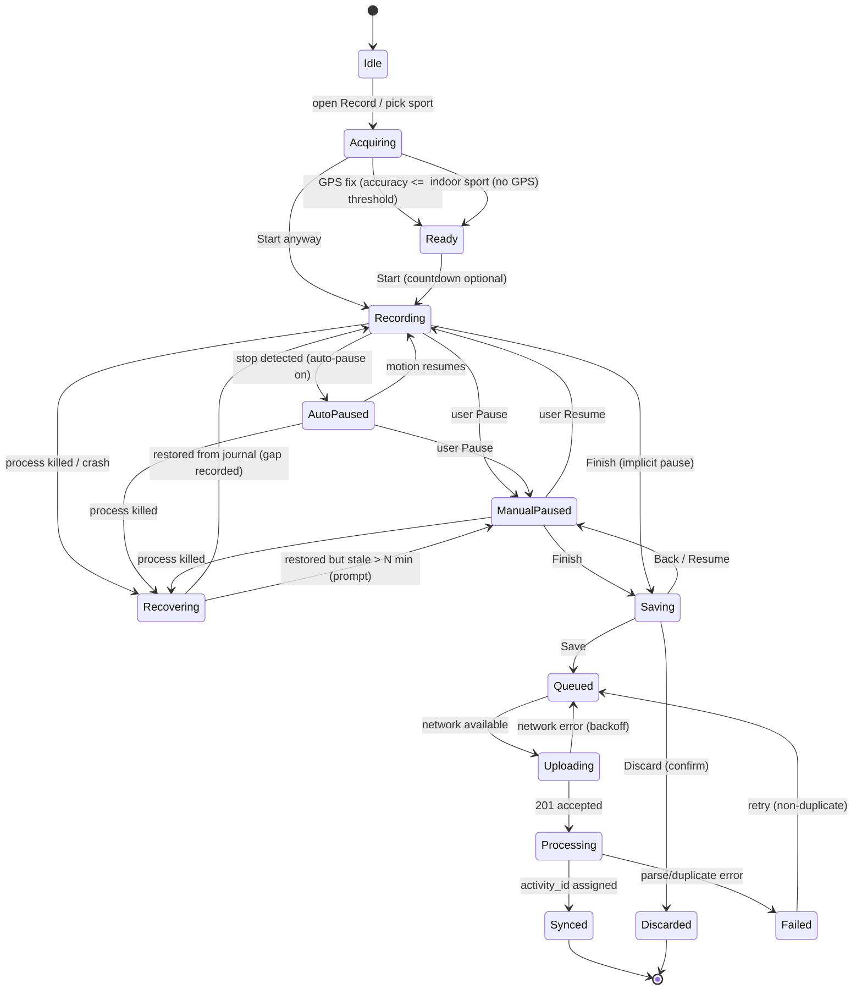
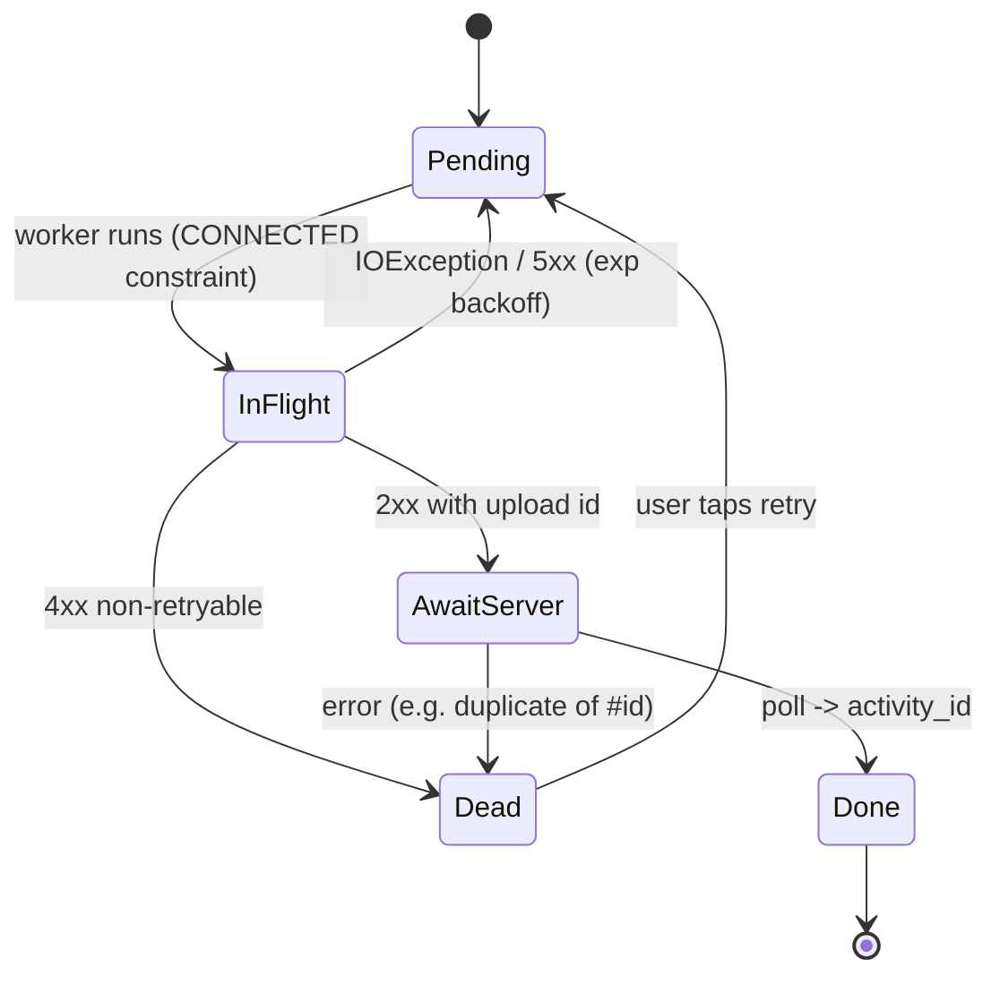
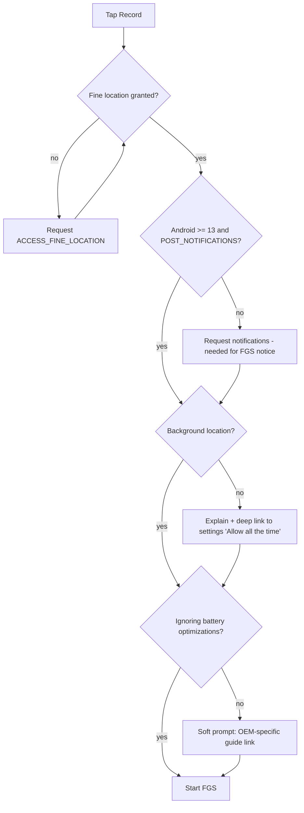
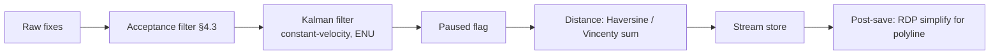
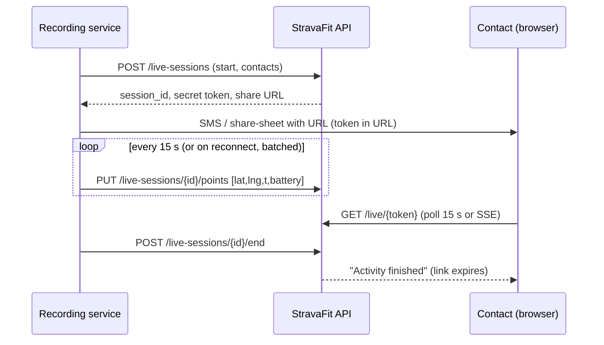

# Recording Engine: Deep Dive

> Scope: everything between the user tapping **Record** and an activity being saved and uploaded. That covers GPS sampling, the Android foreground service, battery behaviour, auto-pause, moving vs elapsed time, distance and smoothing, elevation, indoor and virtual sessions, BLE sensors, audio cues, splits and laps, live segments, live tracking (Beacon), crash recovery, the offline queue, manual entry, file import and dedupe, editing and cropping, and sport-specific metrics.
>
> Reference product: the Strava Android app (Play Store), with iOS differences noted. Our product: **StravaFit** (OSS, no subscriptions).
>
> Legend: **[FREE]** free in Strava; **[SUB]** Strava subscription-gated (reference only, since all StravaFit features are free); **(unverified)** means we could not confirm it from an official or primary source during research.

---

## 1. Summary

| Area | Strava behaviour (reference) | Confidence |
|---|---|---|
| Sampling | The phone app records GPS at roughly 1 Hz while recording. There is no user-facing "smart recording" toggle; that is a Garmin device concept. | Medium (unverified for the exact rate) |
| Auto-pause | Android options: Off / Runs only / Rides only. Ride auto-pause is **on by default** and GPS-based. Run auto-pause is **accelerometer/motion-based**. | High (support article) |
| Moving time | If auto-pause is off and there are no manual pauses, the **server** derives moving time from GPS speed. If the file has pause events, moving time follows timer time. The running moving threshold is about 30:00/mile. | High / Medium |
| Elevation | Android live elevation comes from **GPS**. iOS uses the motion/barometer sensor if Motion & Fitness permission is granted. After upload, phone activities get **corrected elevation** from Strava's basemap. Gain threshold is >10 m without a barometer and >2 m with one. | High (support FAQ) |
| Sensors | **BLE heart rate** pairing returned in late 2020 (it had been removed in 2019 along with ANT+). Support for power, cadence and speed in the phone app is unconfirmed. | High (HR) / Low (others) |
| Live tracking | **Beacon** has been **[FREE]** in the mobile app since 2021 and **[SUB]** from connected devices (Garmin, Apple Watch). It supports up to 3 safety contacts, who need no account, and shows location, route and battery. | High |
| Live segments | Introduced on mobile in 2016. Live efforts and audio are **[SUB]**. | Medium |
| Crash recovery | The app shows a "recovered from a problem and resumed your recording" notice. Lost spans appear as a straight line. | Medium (forum + staff) |
| Uploads | FIT/TCX/GPX (optionally `.gz`) via async upload. Every point needs a timestamp. Duplicates are rejected with a reference to the existing activity ID. | High (API docs) |
| Editing | Crop and split are available (crop is on web and mobile, split only on web). Elevation cannot be edited manually. | Medium |

---

## 2. Record screen and entry points

### 2.1 Entry points
1. Bottom nav **Record** tab (centre). This opens the Record screen with the map behind.
2. Notification / quick settings tile (unverified for Strava; we should add one).
3. Wear OS / Apple Watch companion apps record independently and sync (out of scope here; see the devices doc).
4. "Record" from a saved route: the route is drawn as a breadcrumb overlay with navigation cues.

### 2.2 Pre-record wireframe (idle / acquiring GPS)

```
+----------------------------------------+
| <  Run                     [gear] [?]  |
|----------------------------------------|
|                                        |
|            ( map, blue dot )           |
|        accuracy halo shrinking         |
|                                        |
|   [ GPS: Acquiring...  ##--- ]         |
|----------------------------------------|
| [sport chip: Run v] [route +] [sensor] |
| [beacon] [music] [audio cues]          |
|                                        |
|              (  START  )               |
|      (disabled grey until GPS fix,     |
|       or "start anyway" long-press)    |
+----------------------------------------+
```

* **Sport chip**: picks the sport type. It persists the last used sport per user. It affects auto-pause mode, map style, the stats layout, and whether GPS is needed at all (indoor types disable GPS).
* **GPS indicator**: shows a "searching" state, then "GPS acquired". Strava lets you start before a fix is acquired, but points stay sparse until it locks (unverified for the exact UX).
* **Sensors**: opens the "External sensors" sheet, which lists Saved sensors and Nearby sensors. Saved sensor labels turn the accent colour once connected (Bose help page). iOS also has a "Bluetooth Sensors" master toggle.
* **Beacon**: toggle plus safety contacts.
* **Settings (gear)**: auto-pause, audio cues, units, screen-on, 3D map, and other options (contents vary by version).

### 2.3 Recording wireframe (stats view)

```
+----------------------------------------+
|  ● REC   00:42:17          [lock] [map]|
|----------------------------------------|
|                TIME                    |
|              42:17                     |
|----------------------------------------|
|   SPLIT AVG PACE     |    DISTANCE     |
|     5:12 /km         |     8.13 km     |
|----------------------------------------|
|   HEART RATE   152   |  ELEV  +84 m    |
|----------------------------------------|
|  [ segment banner: "Hill Climb in      |
|    120 m"  ▲ ]                         |
|                                        |
|   (lap)        ( PAUSE )      (route)  |
+----------------------------------------+
```

### 2.4 Paused / finish wireframe

```
+----------------------------------------+
|  ‖ PAUSED  00:42:17                    |
|----------------------------------------|
|        distance 8.13 km                |
|        moving   41:02                  |
|                                        |
|    ( RESUME )         ( FINISH )       |
|                                        |
|  long-press FINISH -> save sheet       |
+----------------------------------------+
```

### 2.5 Save sheet wireframe

```
+----------------------------------------+
| < Save Activity                [Save]  |
|----------------------------------------|
| Title  [ Morning Run              ]    |
| Desc   [ How did it go?           ]    |
| Sport  [ Run v ]  Type [ Workout v ]   |
| (workout type: default/race/long/      |
|  workout  for runs)                    |
| Gear   [ Shoe A v ]                    |
| Photos [ + ]                           |
| Perceived exertion [ slider 1-10 ]     |
| Private notes [               ]        |
| Visibility [ Everyone v ]              |
| Mute in feed [ ]   Commute [ ]         |
| Map: [ hide start/end ] (privacy zone) |
|----------------------------------------|
| [ Discard activity ]  [ Resume ]       |
+----------------------------------------+
```

---

## 3. Recording state machine



Notes:
* **Manual pause dominates auto-pause.** Strava's Android article says a manual pause must be manually resumed even when auto-pause is enabled.
* **Finish while recording** goes through an implicit pause, so the timer stops when the save sheet opens and **Resume** returns to recording.
* **Recovering** is a transient state. Strava shows a message on resume ("recovered from a problem and has resumed your recording"), and the lost interval is drawn as a straight line (forum report, Strava staff comment).

### 3.1 Upload sub-machine (client)



---

## 4. GPS sampling

### 4.1 Strava behaviour
* The phone app samples location continuously while recording at a nominal ~1 s interval (unverified). There is no user setting for "smart" vs "every second" recording in the phone app.
* "Smart recording" (variable interval: points are kept only when heading, speed or elevation change meaningfully) is a **Garmin device** setting. Files uploaded from such devices arrive with irregular sample intervals, so our server pipeline **must handle variable dt**.
* The Android app uses fused or GPS location through Google Play Services (unverified; this is typical). Background location ("Allow all the time") is required on Android 10 and later for reliable recording with the screen off. Some OEM ROMs (MIUI and others) need the extra "background GPS" permission (forum reports).

### 4.2 Every-second vs smart recording (design comparison)

| Aspect | Every-second (1 Hz) | Smart / adaptive |
|---|---|---|
| Points per hour | 3,600 | ~300–1,200 |
| Storage per hour (raw, ~32 B/pt) | ~115 KB | ~10–40 KB |
| Battery | Higher (GPS chip duty cycle unchanged on phones, but more CPU/DB writes) | Lower write load; GPS power is mostly the same on phones |
| Segment matching accuracy | Best | Can miss short segments and sharp corners |
| Moving-time accuracy | Best | Must infer from dt gaps |
| Recommended for StravaFit | **Default** | Optional "battery saver" (2–5 s) mode |

On phones, GPS radio power is dominated by keeping the receiver on. A slower request interval helps only if the OS actually duty-cycles the chip, so **"battery saver" should reduce interval to 2–3 s AND relax priority** (e.g. `PRIORITY_BALANCED_POWER_ACCURACY` is too coarse for sport; keep `HIGH_ACCURACY` but larger interval).

### 4.3 Point acceptance filter (client-side)
Reject or flag raw fixes using these rules:
1. `accuracy > 50 m` (configurable) → drop while recording; keep for the "acquiring" UI only.
2. `elapsedRealtimeNanos` not monotonic → drop.
3. Implied speed from the previous accepted point > sport max (run 12 m/s, ride 35 m/s, ski 45 m/s, other 70 m/s) → drop as a teleport.
4. Mock locations (`isMock`/`isFromMockProvider`) → flag the activity as possibly spoofed (still record, but mark it so leaderboards exclude it).
5. Duplicate timestamp → keep the one with better accuracy.

---

## 5. Android foreground service and battery

### 5.1 Expected Android behaviour (what Strava must do and what we will do)
* Recording runs in a **foreground service** with `foregroundServiceType="location"` (plus `connectedDevice` when BLE sensors are attached, and `health` on Android 14 and later where applicable). It holds a **persistent notification** showing elapsed time, distance and Pause/Resume actions (Strava shows an ongoing notification with the recording timer; unverified whether it has action buttons).
* Android 12+ forbids starting a foreground service from the background, so the service must be started while the Record UI is visible.
* Android 14 requires `FOREGROUND_SERVICE_LOCATION` and runtime location permission granted before `startForeground`.
* **Battery optimisation / OEM killers:** Strava community advice is to disable battery optimisation for the app, lock it in recents, and add it to the power-saving exclusion list (Samsung, Xiaomi, Huawei). Users report recordings halting when the battery is below about 15% in power-saver mode.
* Doze: a foreground service holding location updates is exempt from most Doze restrictions. A partial wake lock is usually unnecessary for location, but **is** needed for BLE plus audio TTS timers on some OEMs (unverified for Strava).

### 5.2 Battery levers
| Lever | Effect | Strava | StravaFit |
|---|---|---|---|
| Screen off / lock screen | Biggest saver | Supported | Yes, plus an "always-on" option |
| Map hidden during recording | Saves GPU | Stats view default (unverified) | Stats view default |
| GPS interval | Small effect on phones | Fixed (unverified) | 1 s default, 3 s saver |
| Batch DB writes | Reduces flash wakeups | n/a | Flush every 5 s or 10 points |
| Beacon upload interval | Radio usage | ~15 s updates (third-party guide) | 15 s default, 60 s saver |
| BLE | Low | — | Use `CONNECTION_PRIORITY_LOW_POWER` after subscription |

### 5.3 Permissions flow (Android)



A sensor scan additionally needs `BLUETOOTH_SCAN` and `BLUETOOTH_CONNECT` on Android 12 and later (`neverForLocation` flag is allowed for scan).

---

## 6. Auto-pause

### 6.1 Strava reference (Android support article)
* The setting lives in Record screen → Settings. Options are **Off / Runs only / Rides only**. iOS offers runs, rides, both or neither.
* **Rides:** detection is GPS-based and pauses only when you are fully stopped. Ride auto-pause is **on by default**. Use manual pause indoors or where GPS is blocked.
* **Runs:** detection uses motion from the **accelerometer**.
* With auto-pause **off**, moving and resting time are computed **on upload** (server-side), unless there are manual pause events. If there are, moving time is calculated relative to **timer time**.
* Auto-pause events are announced by voice (runs) only if split announcements or live segment audio are enabled.
* Other sports (walk, hike, etc.): no auto-pause in the app (unverified). Their moving time is computed server-side.

### 6.2 StravaFit auto-pause algorithm (proposal)

| Sport | Signal | Pause when | Resume when |
|---|---|---|---|
| Ride / e-bike / MTB | GPS speed (EMA, α=0.3) + optional wheel-speed sensor | speed < 1.0 m/s for 3 s (sensor: 0 rpm for 2 s) | speed > 1.5 m/s for 2 s (hysteresis) |
| Run / trail run | Accelerometer step cadence (step detector) + GPS | cadence < 40 spm AND GPS speed < 0.5 m/s for 4 s | cadence > 100 spm for 2 s OR GPS speed > 1.2 m/s |
| Walk / hike | Step detector | 0 steps for 10 s | ≥ 3 steps in 3 s |
| Ski / snowboard | GPS speed | < 0.8 m/s for 10 s (lifts are optional "auto-detect lift": vertical gain at constant speed) | > 1.5 m/s |
| Swim (open water) | n/a | disabled | — |
| Indoor | sensor speed/cadence/power | 0 for 5 s | > 0 |

Implementation notes:
* Use `Sensor.TYPE_STEP_DETECTOR` where available, falling back to a 50 Hz accelerometer magnitude peak detector. Use the Activity Recognition Transition API as a coarse fallback (high latency, 10–30 s).
* When auto-paused, **keep recording GPS points tagged `paused=true`**. They are excluded from distance and moving time but stay available for cropping and for Strava-style "elevation gained while paused still counts" (see §8).
* Record pause/resume as **FIT `event` messages** (timer stop/start, type `stop_all`/`start`) so exports round-trip.

---

## 7. Moving time vs elapsed time

### 7.1 Definitions (Strava)
* **Elapsed time:** from pressing start to finishing, including all stops.
* **Moving time:** estimated from GPS location, distance and speed. Device pauses (auto or manual) recorded in the file are respected, so timer time is used. With no pauses, the server computes it from the GPS stream.
* **Running threshold:** anything faster than about **30:00 per mile** (~18:38/km, 0.89 m/s) counts as moving, according to Strava's glossary as quoted by users. Hiking and walking thresholds are undocumented (unverified). Users complain that slow hikes lose a lot of moving time.
* Marking a run as **Race** makes Strava use **elapsed time** for display and pace (widely reported; unverified on official pages for the current version).
* For indoor rides, all time is counted as moving (forum report), because there is no GPS.

### 7.2 StravaFit algorithm

```
moving_time = Σ dt_i  where
    dt_i = t_i - t_{i-1}
    AND not paused(i)               // timer events
    AND speed_i >= threshold(sport) // smoothed over 5 s window
    AND dt_i <= gap_cap(sport)      // e.g. 30 s; larger gaps = stopped unless speed implies motion
```

| Sport | threshold | gap_cap |
|---|---|---|
| Run / trail | 0.89 m/s (30 min/mile) | 30 s |
| Walk / hike | 0.3 m/s | 60 s |
| Ride | 1.0 m/s | 30 s |
| Ski | 0.8 m/s | 30 s |
| Indoor (no GPS) | sensor speed/cadence/power > 0, else all timer time | — |
| Swim (pool) | lengths: active vs rest intervals | — |

Edge cases:
* **Smart-recorded files** (sparse points) on a steady climb: dt can be 10–20 s. Use the speed derived from the distance over the gap, and do not treat the gap as stopped by default.
* **Treadmill files** have only timestamps plus distance from the footpod or accelerometer. Use the speed from the distance stream.
* Store both computed values. Show **moving** for training sports and **elapsed** for races (user toggle per activity).

---

## 8. Distance and GPS smoothing

### 8.1 Strava reference
Strava does not publish its exact smoothing. Observable facts:
* Distance for GPS activities is computed from the GPS stream and can differ from the device's distance (unverified for whether Strava prefers the file's distance field; community reports suggest it uses the device distance when a speed sensor is present).
* Elevation is smoothed (see §9). Distance smoothing is not documented.

### 8.2 StravaFit pipeline



* **Kalman:** 4-state (x, y, vx, vy) in a local East-North-Up plane. Measurement noise comes from `accuracy²`, and process noise depends on the sport (run: σa≈1.5 m/s², ride: 3 m/s²). Libraries: write it inline (about 150 LOC) or use `ejml`.
* **Distance:** use Haversine for consecutive points (good enough below 1 km spacing). Skip increments where `paused` or where `accuracy > 30 m && Δd < accuracy` (jitter while standing).
* **Sensor priority:** wheel-speed sensor distance > footpod distance > GPS. Indoor: sensor only.
* **Display polyline:** Ramer–Douglas–Peucker with ε≈3–5 m, encoded with the Google polyline algorithm (`com.google.maps.android:android-maps-utils` `PolyUtil.encode`).
* **Server re-computation:** after upload, recompute distance from raw points with the same code (a Kotlin Multiplatform shared module or a JVM server) so client and server agree.

---

## 9. Elevation

### 9.1 Strava reference (Elevation FAQ, Basemap article)
* Devices with a **recognized barometric altimeter** (in Strava's device database, with a Device ID in the file) show the elevation recorded in the file.
* Non-barometric devices and **mobile app** uploads get **corrected elevation**: GPS points are cross-referenced with Strava's **elevation basemap**. That basemap is built from barometric readings in past community uploads, with a fallback to a public DEM where coverage is missing.
* **Live elevation in app:** iOS uses the motion sensor (barometer) if Motion & Fitness permission is granted, otherwise GPS. **Android uses GPS.**
* **Gain thresholds:** after smoothing, climbing must be sustained for **> 10 m** to count without strong barometric data, or **> 2 m** with barometric data. These thresholds were changed recently.
* "Correct Elevation" is **web only**, applies to barometric-recorded activities, and can be reverted. Already-corrected activities do not show the option.
* Elevation **cannot be manually edited**. Elevation gained while paused **still counts**.
* No subscription requirement is mentioned **[FREE]**.

### 9.2 StravaFit design
| Stage | Source | Notes |
|---|---|---|
| Live (Android) | `TYPE_PRESSURE` barometer if present (most mid/high-end phones), else GPS altitude | Calibrate the barometer offset to GPS/DEM over the first 60 s, then hold. Convert with `SensorManager.getAltitude(p0, p)`. |
| Post-save | DEM correction | Use **Copernicus GLO-30** or **SRTM 1"** tiles (open licences). Serve via an open-elevation-style microservice or a self-hosted Terrarium/MBTiles setup. Bilinear interpolation. |
| Policy | Barometer data present → keep it, DEM-offset it, and compute gain with a 2 m hysteresis. No barometer → DEM values with a 10 m hysteresis (mirrors Strava's split). |
| Smoothing | Moving median over 5 points, then hysteresis accumulator | |

Gain accumulator (hysteresis):
```
ref = e[0]; gain = 0
for e in smoothed:
    if e - ref >= H: gain += e - ref; ref = e
    elif ref - e >= H: ref = e            // descent resets reference
```
Edge cases: tunnels and bridges (DEM gives the ground below, so clamp DEM deltas against the barometer). Indoor activities have no elevation (except treadmill incline, see §10).

---

## 10. Indoor, treadmill and virtual activities

| Kind | Strava behaviour | StravaFit |
|---|---|---|
| Indoor via app ("Virtual"/indoor toggle) | Picking an indoor sport type, or enabling the "indoor/trainer" flag, records without GPS (unverified for exact UI). Time is from the timer, and HR from BLE. | Sport types `IndoorRide`, `Treadmill`, `IndoorRow`, `Elliptical`, `StairStepper`, `WeightTraining`, `Yoga`, `HIIT`, `Workout`. GPS off. |
| Treadmill distance | Phone app: no GPS distance. The user can edit the distance after saving (unverified). Watches send footpod/accelerometer distance. | Accelerometer step count × calibrated stride length. Post-save "calibrate distance to treadmill readout" rescales the stream linearly. |
| Virtual rides (Zwift, Rouvy...) | Uploaded by partner apps as `VirtualRide`/`VirtualRun` with fake-world GPS. They are excluded from outdoor segment leaderboards. | Accept `VirtualRide`/`VirtualRun`. Never match to outdoor segments. Allow virtual-world segment tables later. |
| `trainer` flag | API upload parameter `trainer` | Same boolean |
| Moving time | All time counts as moving (forum report) | Sensor-based (§7.2) |

---

## 11. BLE sensors

### 11.1 Strava reference
* The Strava app **dropped sensor pairing (BLE and ANT+) in 2019**, citing crashes. It **reinstated Bluetooth heart rate** pairing for all users in **Nov 2020** **[FREE]**.
* At reinstatement, power and cadence meters were "to be considered later". The current support for **power, speed or cadence** in the phone app is **(unverified)**. Treat it as HR-only, plus whatever arrives via connected watches.
* ANT+ was not reinstated (phones rarely have ANT+ now).
* Pairing: Record screen → sensor icon → External sensors → Nearby list → tap → moves to Saved and highlights when connected.

### 11.2 Protocols (Bluetooth SIG GATT profiles) for StravaFit

| Sensor | Service UUID | Characteristic | Parsing notes |
|---|---|---|---|
| Heart Rate (HRP) | `0x180D` | Heart Rate Measurement `0x2A37` (notify) | Flags bit0: HR uint8/uint16. bit3: energy expended present. bit4: RR intervals present (1/1024 s units, used for HRV). Body Sensor Location `0x2A38`. |
| Cycling Speed & Cadence (CSCP) | `0x1816` | CSC Measurement `0x2A5B` | Cumulative wheel revs (u32) + last wheel event time (u16, 1/1024 s), crank revs (u16) + crank event time. Handle rollover. Wheel circumference setting (default 2105 mm for 700x25c). |
| Cycling Power (CPP) | `0x1818` | Cycling Power Measurement `0x2A63` | Flags u16, instantaneous power s16 W. Optional pedal balance, crank revs (for cadence), torque. Control point `0x2A66` for zero-offset calibration. |
| Running Speed & Cadence (RSCP) | `0x1814` | RSC Measurement `0x2A53` | Speed u16 (1/256 m/s), cadence u8 spm, optional stride length and total distance. |
| Fitness Machine (FTMS) | `0x1826` | Indoor Bike Data `0x2AD2`, Treadmill Data `0x2ACD`, Rower `0x2AD1` | Smart trainers and treadmills. The control point `0x2AD9` allows ERG mode (out of scope for v1). |
| Battery | `0x180F` | `0x2A19` | Show in the sensor list. |
| Device info | `0x180A` | Manufacturer / model | Show in the sensor list. |

Android specifics:
* Library: **Nordic Android-BLE-Library** (`no.nordicsemi.android:ble`), which handles the GATT op queue, reconnects and MTU. Alternatively use `Kable` (KMP).
* Scan with a `ScanFilter` on service UUIDs. Remember saved devices by MAC address (watch out for random-address devices: store the bonded identity).
* **Auto-reconnect:** `connectGatt(autoConnect=true)` after the first connect. Show "Sensor lost" UI and audio after 10 s.
* **Dropouts:** record missing samples as null (not 0) so averages exclude them, but treat power as 0 when the crank is not turning.
* Cadence from a CSC sensor: `Δcrank_revs / Δcrank_time × 60`. Treat 0 if no new event in 3 s.
* Speed from a CSC sensor: `Δwheel_revs × circumference / Δtime`. Prefer it over GPS for speed and distance when present.
* Store sensor streams in FIT `record` fields (`heart_rate`, `cadence`, `power`, `speed`, `distance`) and RR intervals in `hrv` messages.

---

## 12. Audio cues / voice feedback

### 12.1 Strava reference
* Audio announcements exist for splits (every km/mile per unit setting) and for live segment start/finish/progress. Auto-pause/resume is announced for runs when split announcements or live-segment audio are enabled (auto-pause article).
* Exact current settings (which metrics are spoken, time-based intervals, volume and ducking) are **(unverified)**. Third-party guides indicate split announcements cover distance, time and split pace. HR announcements are unconfirmed.
* Live segment audio is **[SUB]** (2016 launch coverage).

### 12.2 StravaFit settings (proposal, all [FREE])

```
+----------------------------------------+
| < Audio cues                           |
|----------------------------------------|
| Voice feedback           [ ON  ]       |
| Trigger                                |
|   (•) Every 1 km  ( ) 0.5  ( ) custom  |
|   [ ] Every 5 min                      |
| Say                                    |
|   [x] Distance  [x] Time               |
|   [x] Split pace [ ] Avg pace          |
|   [ ] Heart rate [ ] HR zone           |
|   [ ] Power (3s) [ ] Elevation gain    |
| Events                                 |
|   [x] Pause / resume                   |
|   [x] Segment start / finish           |
|   [x] Sensor disconnected              |
|   [x] Off-route                        |
| Duck music         [ ON  ]             |
| Volume              ----o-----         |
| Voice  [ System TTS v ] [ Test ]       |
+----------------------------------------+
```

Implementation notes:
* Use Android `TextToSpeech` with `AudioAttributes.USAGE_ASSISTANCE_NAVIGATION_GUIDANCE`. Request `AUDIOFOCUS_GAIN_TRANSIENT_MAY_DUCK` so music ducks rather than pauses. Speak in the user's locale and units.
* Queue phrases with `QUEUE_ADD`, and drop stale ones (older than 10 s).
* Triggers fire from the recording service, not the UI, so they work with the screen off.

---

## 13. Splits and laps

| Concept | Strava | StravaFit |
|---|---|---|
| Auto splits | Per km or mile (unit setting), computed post-save on the activity page. Includes pace, elevation diff, and GAP for runs (GAP [SUB]? (unverified)) | Computed from the distance stream. Store per-split: time, moving time, distance, elevation delta, avg HR, GAP |
| Manual laps | Phone app lap button availability is (unverified). Watch-recorded laps appear as "Laps" tab | Lap button in recording UI and notification. Write FIT `lap` messages |
| Best efforts (run) | 400 m, 1/2 mile, 1 km, 1 mile, 2 mile, 5 km, 10 km, 15 km, 10 mile, 20 km, half, 30 km, marathon, 50 km | Sliding window over the distance stream: O(n) two-pointer per target distance |
| Ride best efforts / power curve | Power curve [SUB] | Free: max-mean power for 1 s…5 h via two-pointer or monotonic deque |

Split algorithm: walk the cumulative distance stream and interpolate the timestamp at each boundary `k × 1000 m` (linear between points). Moving time per split uses the §7 rule.

---

## 14. Live segments

* **Strava:** introduced on mobile in 2016. When approaching a **starred** or popular segment, the screen switches to a live-segment mode with a banner (name, distance to start). During the effort, subscribers see the current effort vs PR vs KOM/QOM and get audio cues **[SUB]**. Final segment results are computed server-side after upload (segment matching is authoritative there).
* **StravaFit ("Live Sections"):**
  1. On recording start (and every 2 km), prefetch the user's starred sections plus popular sections within a 10 km radius: start/end points, polyline, the user's PR stream (time vs distance) and the leader time.
  2. **Start detection:** within 25 m of the start point, heading within 45° of the section's initial bearing.
  3. **Progress:** project the current position onto the section polyline (nearest segment, distance along). Compare elapsed time vs the PR's time at the same along-distance ("+4 s behind PR").
  4. **Finish:** within 25 m of the end and along ≥ 90% of the length. **Abort** if off-polyline by > 50 m for 20 s.
  5. The server re-matches after upload. The live result is labelled "provisional".

---

## 15. Live tracking (Beacon)

### 15.1 Strava reference
* Launched in 2016 as a Premium feature. It has been **free in the mobile app** since 2021, and remains **[SUB]** from connected devices (Garmin, Apple Watch).
* Up to **3 safety contacts**, who are sent a link (SMS/share). Contacts need **no Strava account**. The page shows current location, route so far, start point and phone battery. Updates are roughly every 15 s (third-party guide). The link stops when the recording ends.
* Contacts can be saved, so Beacon auto-sends on each recording start (one-tap reuse).

### 15.2 StravaFit "Live Share"

* Points are batched offline and flushed when connectivity returns (with gaps shown as dashed lines).
* Token: 128-bit random, expires 1 h after end. Privacy zones are **not** applied to Live Share (the contact needs the true location), and the UI explains this.
* Contacts are picked from phone contacts (`ACTION_PICK`). SMS is sent via an `Intent` (no `SEND_SMS` permission).
* The viewer page is a static web page with MapLibre GL JS and OSM tiles.

---

## 16. Crash recovery and in-progress persistence

### 16.1 Strava reference
* After process death, the app restores the recording and shows "Strava has recovered from a problem and has resumed your recording". Data from the dead interval is lost, so the map shows a straight line (forum + Strava staff). Users have seen this repeatedly on aggressive OEM ROMs.

### 16.2 StravaFit design
* **Write-ahead journal:** every accepted point and every event (pause, lap, sensor connect) is appended to SQLite (Room) in WAL mode, in a transaction batch every ≤ 5 s. Recording metadata (sport, start time, state, last-tick monotonic clock and wall clock) goes into a single `active_recording` row.
* Service `START_STICKY` plus `onTaskRemoved` → keep running. If the process is killed, Android may restart the sticky service, and `onCreate` checks for an `active_recording` row.
* App launch with an `active_recording` row → "Resume your activity?" dialog: **Resume** / **Save now** / **Discard**. If the last point is more than 6 h old, default to Save.
* Gap handling: mark a `gap` event from the last journal timestamp to the restart time. Exclude it from moving time. Draw it dashed, and do not add straight-line distance unless the user opts in.
* Clock: use `elapsedRealtimeNanos` for durations (immune to wall-clock changes) and store a wall-clock anchor at start.
* Also schedule a `WorkManager` watchdog (15 min periodic) that posts a notification "Recording stopped unexpectedly – tap to resume" if the service is not alive while `active_recording` exists.
* Low storage: pre-check ≥ 50 MB free on start and warn.

---

## 17. Offline recording and upload queue

* **Strava:** recording works fully offline (GPS needs no data). The map tiles may be blank unless offline maps are downloaded (offline maps are [SUB]; see the maps doc). Saved activities queue and upload automatically when online. Users see an "upload pending / waiting for connection" state in the feed or profile (unverified for the exact wording).
* **StravaFit:**
  * On Save: serialise to **FIT** (canonical) in app storage (`files/activities/{uuid}.fit`). Create an `upload_queue` row with `{local_id, external_id=uuid, state, attempts, last_error}`.
  * A `WorkManager` OneTimeWork job with `NetworkType.CONNECTED` and exponential backoff (30 s → 1 h) per item. A unique work name per activity avoids double uploads.
  * Upload: `POST /uploads` multipart (gzip the FIT), then poll status (≥ 1 s interval, as with the Strava API) or receive a push.
  * Idempotency: the `external_id` is the client UUID, so the server treats a repeat with the same external_id from the same user as the same upload and returns the existing activity.
  * Keep the local FIT for 30 days after success (for re-export and recovery).
  * The feed shows a local "pending" card immediately (optimistic), replaced once the server confirms.

---

## 18. Manual activity entry

* **Strava [FREE]:** "Add manual activity" (web and app). Fields: sport, title, date/time, duration (h:m:s), distance, elevation (web), description, workout type, perceived exertion, gear and visibility (unverified for the exact field list on Android). Manual activities have no map and no segments, and **do not count toward challenges** (Elevation FAQ mentions this for using manual activities to make up lost gain).
* **StravaFit:** same fields. Store `source=manual`. Exclude from segments, leaderboards, best efforts and challenges by default (challenge owner may opt in). Validate the implied pace (reject a 5 km run in 30 s with a soft warning).

```
+----------------------------------------+
| < Manual Activity              [Save]  |
|----------------------------------------|
| Sport     [ Run v ]                    |
| Date      [ 29 Oct 2026 ] [ 07:30 ]    |
| Duration  [ 0 ] h [ 45 ] m [ 00 ] s    |
| Distance  [ 8.0 ] km                   |
| Elevation [ 120 ] m                    |
| Title     [ Treadmill run       ]      |
| Desc      [                     ]      |
| Effort    [ 1 ---o------ 10 ]          |
| Gear      [ Shoe A v ]                 |
| Visibility[ Followers v ]              |
+----------------------------------------+
```

---

## 19. File upload: FIT / GPX / TCX parsing and dedupe

### 19.1 Strava reference (developers.strava.com/docs/uploads)
* Formats: `fit`, `fit.gz`, `tcx`, `tcx.gz`, `gpx`, `gpx.gz` (and `json` for set-based workouts such as WeightTraining, HIIT, Workout and Crossfit).
* **Every trackpoint must have a time.** Position, elevation, HR, etc. are optional. FIT/JSON set-based files instead need an activity timestamp and session `total_elapsed_time`.
* GPX extensions read: Garmin TrackPointExtension v1 (`atemp`, `hr`, `cad`), Cluetrust (`cadence`, `distance`, `hr`, `temp`), and generic `cadence`, `distance`, `heartrate`, `power`. TCX: `runcadence` → cadence, `watts` → power. TCX has no temperature.
* Processing is async: upload returns an id, poll ≥ 1 s, with mean processing < 2 s. `external_id` defaults to the filename. Optional `name`, `description`, `sport_type`, `trainer`, `commute`.
* **Duplicates** are flagged during initial checks, and the error references the existing activity ID. Community reports suggest dedupe is keyed on file identity, external id and/or overlapping start time (a Zwift user hit "duplicate" when a new FIT reused a filename and start time) (unverified for the exact key).
* Web uploader: drag and drop multiple files (up to 25 per batch historically, unverified).

### 19.2 StravaFit parser design
| Format | Library (JVM/Kotlin) | Key mappings |
|---|---|---|
| FIT | **Garmin FIT SDK** (Java, free licence; check licence compatibility) or the OSS `fit-parser`/`fitdecode` (Python, for the server) | `file_id` (manufacturer, product, serial, time_created) → device. `session` → sport/sub_sport, totals. `record` → streams. `event` → timer start/stop. `lap`, `length` (swim), `hrv`, `device_info` (barometer detection). Semicircles → degrees (`× 180/2^31`). |
| GPX 1.1 | StAX parser (custom) or `io.jenetics:jpx` | `trkpt lat/lon`, `ele`, `time`, extensions as listed above. Multiple `trkseg` → treat gaps as pauses. |
| TCX | StAX (custom) | `Trackpoint/Time, Position, AltitudeMeters, DistanceMeters, HeartRateBpm/Value, Cadence`, `Extensions/TPX/Speed, Watts, RunCadence`, `Lap` totals |

Sport mapping: FIT `sport`+`sub_sport` → our `sport_type` (e.g. cycling+virtual_activity → VirtualRide, running+treadmill → Treadmill/Run+trainer). GPX `type` is free text, so use heuristics (avg speed) with a confirmation prompt.

**Dedupe algorithm (server):**
1. Exact: `sha256(file_bytes)` already seen for this user → duplicate.
2. `external_id` + user already exists → duplicate (idempotent return).
3. **Fuzzy:** an existing activity for the user where `|start_a − start_b| < 60 s` AND time overlap > 80% of the shorter one AND (no GPS on either OR the first and last points are within 200 m) → duplicate. The error names the existing ID and offers "keep both" (user override flag) or "replace if new has more streams" (e.g. watch file vs phone file: prefer the one with HR/power/barometer).
4. FIT `file_id.serial_number + time_created` match → duplicate.

Validation errors to surface: no timestamps; timestamps not monotonic (sort, and drop duplicates where possible); file > 25 MB (proposed limit); 0 points; future date.

---

## 20. Activity editing and cropping

### 20.1 Strava reference
* Edit (app and web) changes: title, description, sport type, workout type, gear, visibility, perceived exertion, private notes, photos, commute/trainer flags, and hiding stats such as HR or pace (unverified for the full list).
* **Crop** trims start and/or end. It is widely used on the web, and the phone app also has it (unverified for the Android version). Some sport types without GPS cannot be cropped. The user workaround is to change the type temporarily.
* **Split** (web) divides one activity into several.
* **Correct distance** (web, for runs and for some smoothing cases) and **Correct elevation** (web, barometric activities, revertible).
* Elevation cannot be hand-edited. Moving time cannot be edited directly.
* Strava keeps the **original file**, so "Export Original" returns the uploaded file and "Export GPX" returns a generated GPX.

### 20.2 Crop UI wireframe (StravaFit)
```
+----------------------------------------+
| < Crop                         [Save]  |
|----------------------------------------|
|       (map: green start pin,           |
|        red end pin, cropped part       |
|        greyed)                         |
|----------------------------------------|
|  elev/speed mini-chart                 |
|  |~~~~/\~~~~~~~/\~~~~~~~~~~~~~~~~|     |
|  [◀==========================▶]       |
|  start 00:02:10      end 01:12:44      |
|  8.13 km -> 7.90 km                    |
+----------------------------------------+
```
Implementation: non-destructive. Store `crop_start_idx`/`crop_end_idx` on the activity, recompute all derived data (distance, splits, segments, best efforts, totals), and keep the original file. Undo = clear crop. Split = create N child activities referencing ranges of the parent stream, then hide the parent.

---

## 21. Sport-type specific metrics

| Sport group | Live metrics (recording) | Post-save metrics | Notes |
|---|---|---|---|
| Run, Trail Run, Virtual Run | time, distance, current/split/avg pace, HR, cadence (steps), elevation | splits, GAP, best efforts, HR zones, relative effort (Strava [SUB] for some analysis), workout type (race/long/workout) | Pace in min/km or mile. GAP uses a grade-cost model (e.g. a Minetti-based curve). Strava's own GAP model is proprietary; build a Minetti-based one. |
| Walk, Hike | time, distance, pace, elevation gain | splits, elevation profile | Lower moving threshold |
| Ride, MTB, Gravel, E-bike, E-MTB, Velomobile, Handcycle | speed, avg speed, distance, HR, power (3 s), cadence, elevation | power curve, NP/weighted avg power, IF/TSS-like (our naming), kJ, segments | E-bikes are excluded from regular ride leaderboards |
| Virtual Ride | as ride, from a trainer or FTMS | same | Excluded from outdoor segments |
| Swim | (phone app does not record pool swims; watch files) | lengths, laps, pace per 100 m, SWOLF (if provided) | FIT `length` messages |
| Alpine / Backcountry / Nordic Ski, Snowboard | speed, distance, vertical | runs/lifts detection, max speed | Lift detection: sustained ascent at constant speed |
| Rowing, Kayak, Canoe, SUP, Surf, Kitesurf, Windsurf, Sail | speed, distance, stroke rate (sensor) | | Pace per 500 m for rowing |
| Indoor (Weight Training, Yoga, HIIT, Crossfit, Pilates, Workout, Elliptical, Stair-Stepper) | time, HR | HR zones, calories | No GPS |
| Inline / Roller / Ice skate, Wheelchair, Golf, Racquet sports, Football (soccer), Badminton, Pickleball etc. | time, distance (if GPS), HR | | Strava has steadily added sport types (e.g. racquet sports and pickleball in recent years); keep the enum extensible |

Calories: estimate from HR (Keytel formula) when HR is present, else MET × weight × hours, or from power (kJ ≈ kcal for cycling given ~24% efficiency).

---

## 22. Data model (recording)

```kotlin
data class TrackPoint(
  val tMonoNs: Long, val tEpochMs: Long,
  val lat: Double?, val lng: Double?, val hAcc: Float?,
  val altGps: Float?, val altBaro: Float?, val vAcc: Float?,
  val speedGps: Float?, val bearing: Float?,
  val hr: Int?, val cadence: Int?, val power: Int?, val speedSensor: Float?,
  val distanceCum: Double, val paused: Boolean, val segIdx: Int
)
sealed interface RecEvent { val tMonoNs: Long }
// Start, Stop(manual|auto), Resume, Lap, Gap(fromNs,toNs), SensorConnect(id), SensorLost(id), Crash
```

Room tables: `active_recording`, `track_point` (indexed by recording_id, seq), `rec_event`, `upload_queue`, `sensor_saved`.

---

## 23. Verification log (self-check of load-bearing claims)

| Claim | Re-verified against | Result |
|---|---|---|
| Android auto-pause options Off/Runs/Rides; rides GPS-based, on by default; runs accelerometer | Strava support "Auto-Pause (Android)" | Confirmed |
| Auto-pause off → moving time computed on upload; manual pause → timer time | Same article | Confirmed |
| Android live elevation from GPS; iOS from motion sensor with permission | Elevation FAQ | Confirmed |
| Gain thresholds 10 m / 2 m | Elevation FAQ | Confirmed |
| Basemap built from community barometric data, public DB fallback | Basemap article / FAQ | Confirmed |
| Upload formats, timestamp requirement, async polling ≥ 1 s, duplicate error references ID | developers.strava.com/docs/uploads | Confirmed |
| BLE HR reinstated Nov 2020; power/cadence not at that time | BikeRadar, DC Rainmaker, TNW | Confirmed (current state of power/cadence unverified) |
| Beacon free on mobile, paid from devices, 3 contacts, no account needed | TechRadar / Cycling Weekly / BikeRadar 2021 | Confirmed |
| Running moving threshold 30:00/mile | Strava glossary as quoted on a Garmin forum | Secondhand; treat as likely |
| "Recovered from a problem" message + straight-line gap | Strava community/CycleChat thread | Secondhand |

---

## OSS implementation notes

**Neutral naming:** Kudos → "Cheers"; KOM/QOM → "Section Crown"; Local Legend → "Section Regular"; Beacon → "Live Share"; Live Segments → "Live Sections"; Flyby → "Crossings"; Relative Effort → "Effort Score"; GAP → "Grade-Adjusted Pace" (generic term, fine).

**Architecture (Android):**
* `RecordingService` (foreground, `location|connectedDevice`) owns a `RecordingEngine` (pure Kotlin, unit-testable, no Android deps). Inputs: `LocationSource`, `SensorHub` (BLE), `MotionSource` (step detector, barometer), `Clock`. Outputs: `StateFlow<RecordingSnapshot>` for the UI and notification, and the journal writer.
* The UI binds via a bound service and `StateFlow`. The notification updates at most once per second (`setOnlyAlertOnce`).
* Location: `FusedLocationProviderClient` with `Priority.PRIORITY_HIGH_ACCURACY`, interval 1000 ms, `setMinUpdateDistanceMeters(0)`, `setWaitForAccurateLocation(false)`. **Also provide a `LocationManager.GPS_PROVIDER` fallback for de-Googled devices (F-Droid build)**. This is important for an OSS audience.
* BLE: Nordic BLE library. One `SensorConnection` per saved device, with a reconnect loop and exponential backoff capped at 30 s.
* Persistence: Room + WAL. Export/import: FIT via the Garmin FIT SDK (verify the licence permits redistribution in an OSS app; otherwise write a minimal FIT encoder, since the format spec is public), and GPX/TCX via StAX.
* Background work: WorkManager for uploads and post-processing.
* Maps: MapLibre Native Android plus OSM vector tiles (self-host or a provider such as OpenFreeMap).

**Server:** recompute distance, moving time, elevation (DEM), splits, best efforts and section matching from raw streams with the shared Kotlin module (KMP) or a mirrored Python implementation with golden-file tests. Use DEM tiles from Copernicus GLO-30.

**Edge cases checklist:**
* Daylight-saving and timezone changes mid-activity: store UTC plus a start offset.
* Phone reboot mid-recording: the journal survives, and a `BOOT_COMPLETED` receiver posts a resume notification.
* GPS cold start in urban canyons: allow "start anyway", and backfill the start point from the first good fix.
* Tunnels: a gap with no distance, unless a speed sensor is present.
* Sensor reports HR 0 or 255 → treat as null.
* Multiple HR sources (strap + watch): prefer the strap.
* Very long recordings (24 h+ ultras): stream to disk, never hold everything in memory. 86,400 points/day is fine for SQLite.
* Users with no Play Services: fallbacks for location and activity recognition.
* Accessibility: TalkBack labels for big Start/Pause buttons. Audio cues double as accessibility feedback.

**Testing:** replay recorded GPX/FIT through `RecordingEngine` with a fake clock (deterministic). Build a golden dataset of 50 activities across sports. Compare moving time, distance and elevation against reference tolerances. Instrumented tests use `LocationManager` mock providers.

---

## Sources

- https://support.strava.com/hc/en-us/articles/216919277-Auto-Pause-Android
- https://support.strava.com/hc/en-us/articles/216917437-Auto-Pause-iPhone
- https://support.strava.com/hc/en-us/articles/115001294564-Elevation-on-Strava-FAQs
- https://support.strava.com/hc/en-us/articles/115000024864-Strava-s-Elevation-Basemap
- https://developers.strava.com/docs/uploads
- https://forums.garmin.com/apps-software/mobile-apps-web/f/garmin-connect-web/391657/when-walking-slow-garmin-says-you-are-not-moving/1859828
- https://forum.suunto.com/post/30384
- https://forum.intervals.icu/t/strava-pause-and-moving-time-for-indoor-rides/5404
- https://forum.suunto.com/topic/6261/weird-data-in-strava-shorter-time
- https://www.bikeradar.com/news/strava-sensor-pairing
- https://dcrainmaker.com/2019/10/strava-support-workout.html
- https://thenextweb.com/plugged/2020/11/18/strava-finally-reinstates-support-for-bluetooth-heart-rate-monitors-after-dropping-it-last-year/
- https://www.bose.co.nz/en_nz/support/article/fitness-app-setup-strava-android.html
- https://www.bose.co.nz/en_nz/support/article/fitness-app-setup-strava-ios.html
- https://www.techradar.com/news/one-of-stravas-most-important-tools-is-now-free-for-everyone
- https://www.cyclingweekly.com/products/strava-makes-beacon-feature-free-to-all-users
- https://bikerumor.com/2016/08/04/strava-beacon-offers-peace-mind-restricted-live-tracking/
- https://www.whistleout.com/CellPhones/Guides/use-strava-beacon-to-share-your-live-location-while-solo-traveling
- https://bicycleretailer.com/new-products/2016/05/16/strava-adds-live-segments-iphone-and-android-apps
- https://endurance.biz/2016/industry-news/strava-rolls-out-live-segments-for-iphone-and-android/
- https://cyclechat.net/threads/strava-on-a-mobile-stopping-recording.200031
- https://communityhub.strava.com/devices-and-connections-6/not-recording-completely-5475
- https://forums.zwift.com/t/new-ride-not-syncd-to-strava-fit-file-says-duplicate-activity/260663
- https://forum.suunto.com/topic/14506/feature-request-crop-activity-before-saving/20
- https://takeoutday.org/guides/how-to-export-strava-data
- https://bicycleretailer.com/product-tech/2014/09/18/strava-updates-mobile-app-goal-tracking-auto-pause
