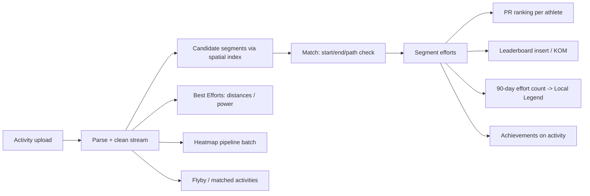
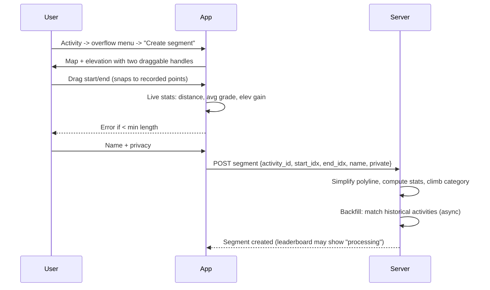
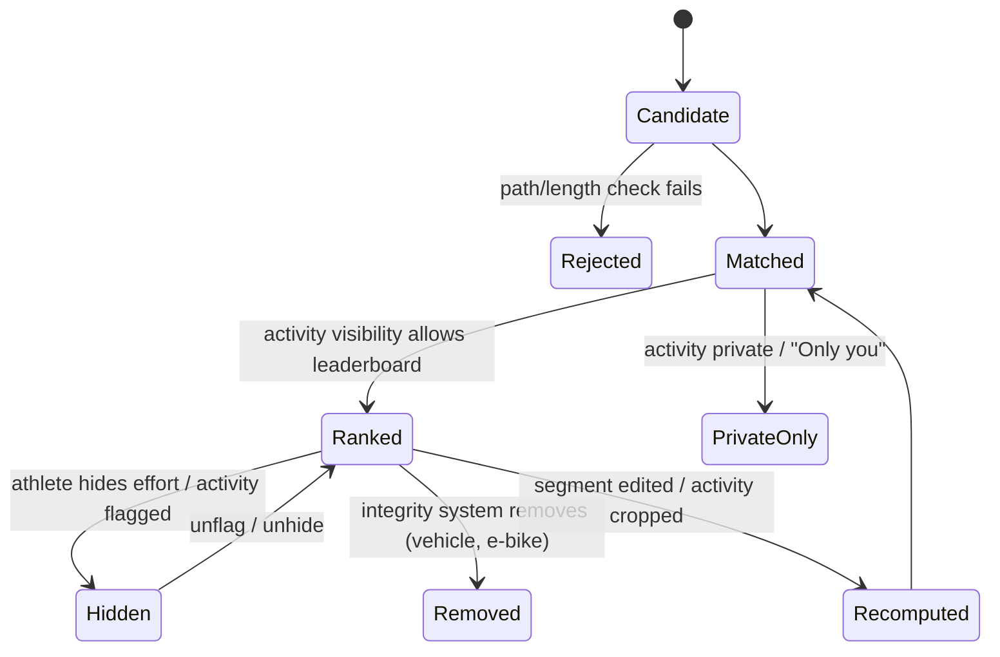
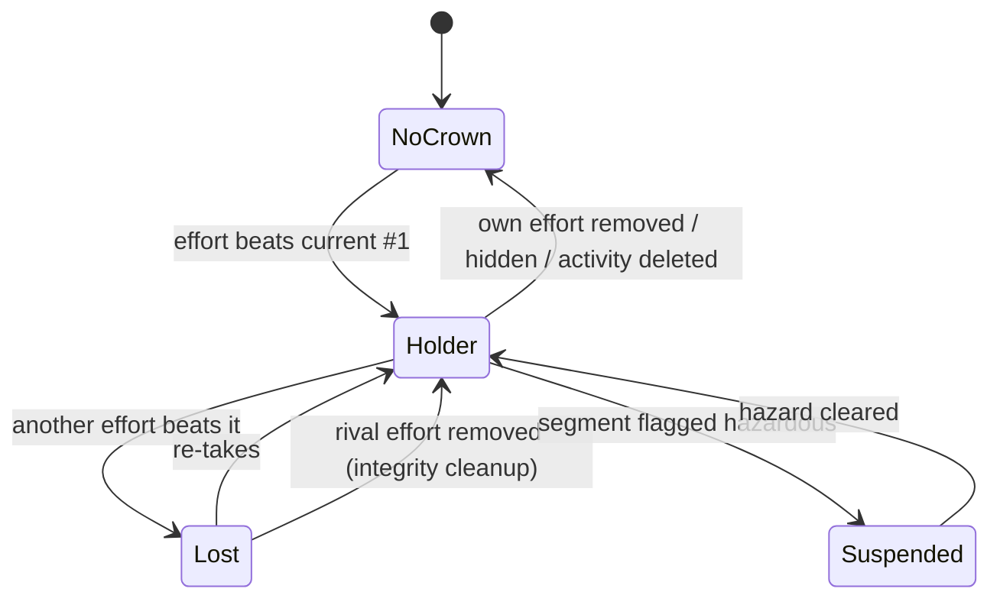
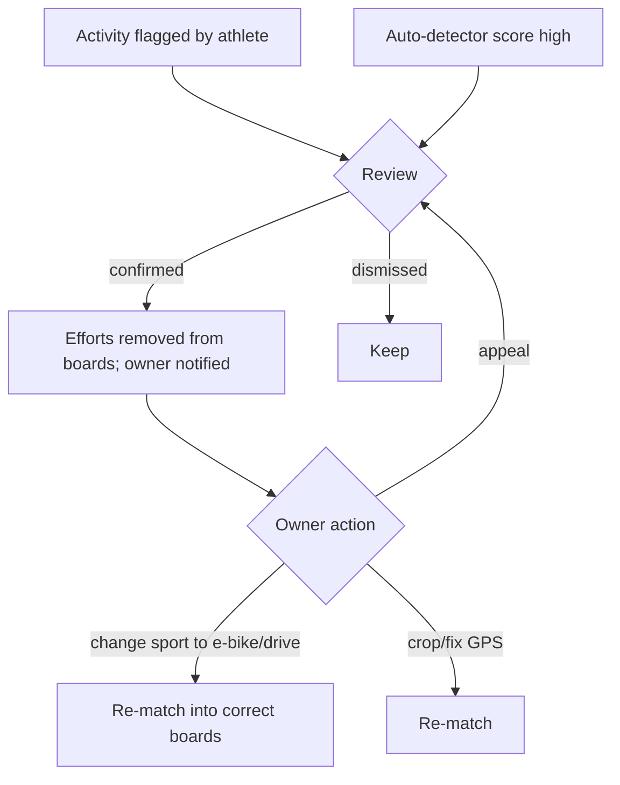
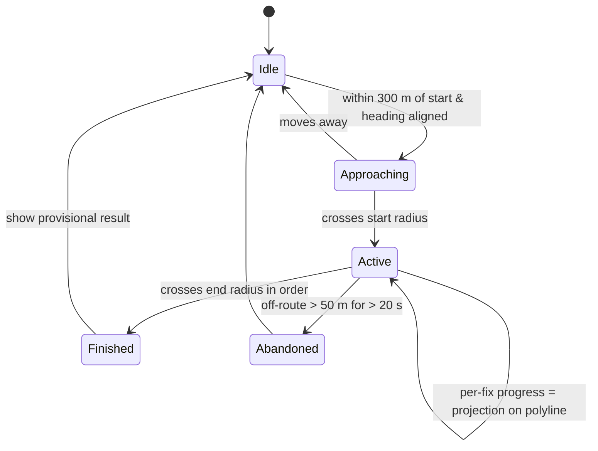

# Segments, Leaderboards & Competition

> Scope: Strava segments and the competitive layer built on them: creation, matching, leaderboards, KOM/QOM/CR, Local Legends, PRs, achievements, Best Efforts, flagging and hazards, leaderboard integrity, starred and Live Segments, Flyby, heatmaps and matched activities.
> Platform: the Android app is the primary reference, with iOS differences noted.
> Research date: 2026-10. Claims marked **(unverified)** could not be confirmed against a primary source in this pass.
> Tags: **[FREE]** means available to free Strava accounts. **[SUB]** means it needs a Strava subscription. These tags are for reference only, because every StravaFit feature is free.

---

## 1. Concept overview

A **segment** is a user-defined stretch of road or trail with a fixed start, a fixed end and a reference polyline. Every public activity of a matching sport type is checked against nearby segments. Each match creates a **segment effort**, which records the elapsed time for that stretch. Efforts feed several layers:

| Layer | Ranking basis | Window | Strava name | Gating |
|---|---|---|---|---|
| Overall leaderboard | fastest elapsed time, best effort per athlete | all time | Leaderboard | top 10 [FREE], full board and filters [SUB] |
| Course record | fastest overall (gendered / all) | all time | KOM / QOM / CR | crown visible [FREE] |
| Personal record | the athlete's own fastest | all time | PR (gold/silver/bronze = 1st/2nd/3rd best) | [FREE] |
| Frequency title | most efforts | rolling 90 days | Local Legend (LCL) | title [FREE], detailed histogram [SUB] (unverified for 2026) |
| Filtered boards | time | today / week / month / year | Filters | [SUB] |
| Social boards | time | all time | Following / Club | [SUB] |
| Demographic boards | time | all time | Age / Weight | [SUB] |



---

## 2. Segment creation

### 2.1 Rules (as publicly observed)

| Rule | Value | Confidence |
|---|---|---|
| Source of a segment | must be cut from one of **your own** recorded GPS activities, either on the web segment creator or in the app (unverified on Android: creation has historically been web-first, and the app may only deep-link to the web) | medium |
| Minimum length | **500 m**. It was 300 m until about 2022. Strava cites GPS sampling accuracy as the reason. | medium, from secondary sources (Zwift Insider) |
| Sport type | inherits from the activity. Ride segments and Run segments are separate. Other types such as swim (open water), ski, hike and walk have limited or no leaderboards (unverified) | medium |
| Name | required. Free text is moderated by flag/report | high |
| Privacy | segments can be **public** or **private**. A private segment is visible only to its creator, and the API exposes a `private` flag | high (API field) |
| Duplicates | the creator warns when a segment overlaps an existing one heavily (unverified) | low |
| Indoor / no-GPS activities | not eligible as a source | high |
| Virtual (Zwift etc.) | virtual segments exist and are matched only to virtual-type activities | high |

### 2.2 Creation flow



ASCII wireframe of the segment creator (our layout, ~40 cols):

```
+--------------------------------------+
| <  Create segment              Save  |
+--------------------------------------+
|   [ map: route polyline ]            |
|     S(o)======selected=====(o)E      |
|   --------- unselected -------       |
+--------------------------------------+
|  elevation  ___/\__/^^^\___          |
|             |<- selected ->|         |
+--------------------------------------+
| Distance   1.82 km   Avg grade 4.1%  |
| Elev gain  76 m      Category  4     |
+--------------------------------------+
| Name [ Hill Road climb            ]  |
| ( ) Public   (o) Private             |
+--------------------------------------+
```

### 2.3 Derived segment attributes

From the Strava API v3 segment model: `distance`, `average_grade`, `maximum_grade`, `elevation_high`, `elevation_low`, `start_latlng`, `end_latlng`, `climb_category` (0–5, where 0 = uncategorised, 1 = Cat 4 … 4 = Cat 1, 5 = HC), `city`, `state`, `country`, `private`, `hazardous`, `starred`, plus `effort_count`, `athlete_count`, `star_count`, `map.polyline`, `created_at` and `total_elevation_gain` on the detailed segment.

**Climb category** (widely documented community formula; unverified as Strava's exact current thresholds): score = distance_m × grade_% , with average grade ≥ 3%.

| Score | Category |
|---|---|
| > 8,000 | Cat 4 |
| > 16,000 | Cat 3 |
| > 32,000 | Cat 2 |
| > 64,000 | Cat 1 |
| > 80,000 | HC |

---

## 3. Segment matching

### 3.1 What is public

- Strava's support article on segment matching issues says the matcher picks the **recorded GPS points nearest the segment's start and end** to time the effort. Because recording is sampled, the timed portion can be slightly longer or shorter than the segment.
- Strava holds patents titled **"Defining and matching segments"** (US9116922B2, US9208175B2; inventors include Mark Shaw and Davis Kitchel). They describe matching an activity's track against a segment's geometry using proximity of start and end points and of the path in between. Read them for design ideas only, and note the patent risk in §15.
- Community analysis reports a start/finish proximity tolerance on the order of **~20 m**, and notes that it can make timings differ by tens of metres between riders (unverified).
- Each effort stores `start_index` and `end_index` into the activity stream, plus `elapsed_time` and `moving_time`. Leaderboards rank by **elapsed time**.
- Efforts can be `hidden` (for example an athlete hides an effort, or a flagged activity hides its efforts).

### 3.2 Reconstructed algorithm (our own design, consistent with public behaviour)

```
for activity A (GPS, public or private, sport s):
  bbox = A.bounds expanded by 50 m
  candidates = segmentIndex.query(bbox, sport=s)          # R-tree / geohash / PostGIS GiST
  for seg in candidates:
     starts = points in A within R_start (≈ 20-30 m) of seg.start
     for each start-run (contiguous cluster) i0:
        ends = points after i0 within R_end of seg.end
        for each end candidate j0 (first one that validates):
           sub = A[i0..j0]
           if not pathFollows(sub, seg.polyline): continue
           if length(sub) not within [0.9,1.2] × seg.distance: continue
           t0 = interpolateCrossing(A, i0, seg.start)   # optional sub-sample refine
           t1 = interpolateCrossing(A, j0, seg.end)
           emit Effort(seg, A, i0, j0, elapsed=t1-t0, moving=movingTime(sub))
           continue scanning after j0 (laps -> multiple efforts)
```

`pathFollows` options, from cheapest to most robust:
1. **Checkpoint corridor**: resample the segment every ~25 m. Each checkpoint must have an activity point within a corridor (≈ 25–50 m, adaptive to segment length) in increasing order.
2. **Discrete Fréchet distance** below a threshold (respects ordering, so a reversed direction does not match).
3. **Hausdorff distance**. It ignores direction, so add an ordering check. A third-party blog claims Strava uses this (unverified).

Behaviours to replicate:
- **Direction matters**: an out-and-back gives a match on the matching-direction leg only.
- **Laps**: repeated passes create multiple efforts. Only the best counts on the leaderboard, while all count for Local Legend.
- **GPS dropouts**: a big gap mid-segment fails the corridor check, so the effort is missed. Strava support lists GPS quality, an activity that starts or ends inside a segment, and drift as common reasons for a missing match.
- **Starting mid-segment**: there is no match, because the start was not crossed.
- **Re-matching**: if a segment is edited, deleted or created, historical activities are reprocessed asynchronously. Users report segments "moving" or leaderboards changing after an edit.
- **Privacy zones** (hidden start/end) still allow matching server-side, and the effort shows on leaderboards only for public-visibility activities. Private activities produce efforts visible only to the owner (unverified for exact rules; Strava changed visibility controls in 2020–2023).

### 3.3 Effort state machine



---

## 4. Leaderboards

### 4.1 Structure

- One row per **athlete** (their best effort), ordered by elapsed time ascending. Ties are broken by earlier date (unverified).
- Columns: rank, athlete, date, speed or pace, (HR, power if available), and time.
- Gender split: **Men / Women / Overall**. Strava added non-binary-inclusive "Overall" boards around 2022–2023, and KOM/QOM remain on the gendered boards. The **CR** (Course Record) naming is used on Overall (unverified exact naming per surface).
- E-bike activities appear only on separate **e-bike** leaderboards (2025 change, per Escape Collective/BikeRadar coverage).

### 4.2 Filters and gating

| Filter | Description | Gating |
|---|---|---|
| Overall top 10 | top of the all-time board plus the athlete's own position | [FREE] |
| Full leaderboard | paged | [SUB] |
| Today / This week / This month / This year | time windows (exact set varies by platform) | [SUB] |
| Following | athletes you follow plus you | [SUB] |
| Clubs | members of a selected club | [SUB] |
| Age groups | 19 & under, 20–24, 25–34, 35–44, 45–54, 55–64, 65–69, 70–74, 75+ (unverified; set may differ) | [SUB] |
| Weight classes | lb/kg buckets, e.g. 0–124 lb … 225+ lb (unverified exact buckets) | [SUB] |
| Hazardous segment | board hidden unless the viewer accepts a waiver for that segment | all |

The 2020 move put full leaderboards behind the subscription. Free users see the top 10 for men and women (Triathlete 2020). The current support "Subscription features" page lists filtered leaderboards (periods, following, clubs, age and weight) as subscriber features.

**API note**: the public API `GET /segments/{id}/leaderboard` endpoint was removed around 2020. The current v3 reference lists only segment explore, get, starred, star, efforts and streams. This rules out bulk leaderboard scraping for import.

### 4.3 Leaderboard screen wireframe

```
+--------------------------------------+
| <  Hill Road climb          ☆  ⋮     |
| 1.8 km · 4.1% · Cat 4                |
| [ map thumbnail + elevation ]        |
+--------------------------------------+
| Record: 4:02  (crown) A. Rider       |
| Your PR: 5:11  (Mar 2026)  #1,204    |
| Frequency title: 23 efforts / 90d    |
+--------------------------------------+
| [Overall][Men][Women][Filters v]     |
+--------------------------------------+
|  1  A. Rider       Jun 25   4:02     |
|  2  B. Climber     May 24   4:05     |
|  3  C. Cyclist     Aug 23   4:09     |
| ...                                  |
| 1204 You           Mar 26   5:11     |
+--------------------------------------+
| My efforts (12) >                    |
+--------------------------------------+
```

### 4.4 Data model

```sql
segment(id, name, sport, polyline geometry(LineString,4326), distance_m,
        avg_grade, max_grade, elev_hi, elev_lo, climb_cat, start_pt, end_pt,
        creator_id, private bool, hazardous bool, created_at, effort_count,
        athlete_count, star_count, status enum(active,flagged,deleted))
segment_effort(id, segment_id, activity_id, athlete_id, start_idx, end_idx,
        start_time, elapsed_s, moving_s, avg_watts, avg_hr, device_watts bool,
        hidden bool, visibility enum, is_ebike bool, removed_reason)
leaderboard_entry(segment_id, gender, athlete_id, best_effort_id, elapsed_s,
        effort_date, age_bucket, weight_bucket, is_ebike)  -- materialized
        PRIMARY KEY(segment_id, gender, athlete_id)
segment_pr(segment_id, athlete_id, rank 1..3, effort_id)
local_legend(segment_id, scope enum(overall,women), athlete_id, count, as_of)
```

Ranking query: `rank() over (partition by segment_id, gender order by elapsed_s, effort_date)`. Filters become `WHERE` clauses on the materialized table (age/weight bucket captured **at effort time**, unverified whether Strava uses current or effort-time demographics), or a join to follows/club membership.

---

## 5. KOM / QOM / CR

- **KOM** (King of the Mountain) or **QOM** (Queen) is #1 on the gendered all-time board. **CR** (Course Record) is the Run equivalent and/or the Overall #1 (naming varies).
- Crown icon on the activity and segment. A "You lost your KOM" push/email notification goes out when someone beats you. The athlete profile shows a KOM/QOM/CR count list. **[FREE]** to earn; viewing the full list of others' crowns is **[SUB]** (unverified).
- Not awarded on hazardous segments.
- Ties: the earlier effort keeps the crown (unverified).
- Crowns can change retroactively when the cheater removal or e-bike reclassification jobs run (2025–2026: about 2.3M e-bike plus 1.6M vehicle activities removed, and 293k athletes regained top-10 spots).



---

## 6. Local Legends (frequency competition)

Launched June 2020 (US), expanded worldwide later in 2020, and added to selected Zwift segments in October 2021.

| Aspect | Behaviour |
|---|---|
| Metric | **count of efforts** on the segment (speed is irrelevant) |
| Window | rolling **90 days** ending today, recomputed daily |
| Scopes | **Overall** and **Women** |
| Repeats | all efforts count, including several in one activity (unverified: Strava may count one per activity or day; secondary sources say "efforts") |
| Ties | holding athlete keeps it, or the one who reached the count first (unverified) |
| Coverage | "most but not all" segments. Very short, hazardous or private segments are excluded (unverified specifics) |
| Display | laurel icon, "Most efforts" tab with a histogram of efforts per athlete in the last 90 days |
| Gating | free users see whether they hold it and their own count. Full board and histogram [SUB] (2020 reviews) |
| Notifications | "You're the new Local Legend" and "you lost" (unverified wording) |

Algorithm:

```
nightly (or on effort insert/delete):
  for each segment s with an effort change OR an effort aging out today:
     window = [today-89d, today]
     counts = SELECT athlete_id, count(*) FROM segment_effort
              WHERE segment_id=s AND start_time in window AND visible AND !removed
              GROUP BY athlete_id
     leader = argmax(counts) with tie-break (earliest reaching count)
     upsert local_legend(s, scope, leader, count)
     diff vs previous -> notifications
```

Optimisation: keep a per-segment daily count table `seg_day_count(segment_id, athlete_id, day, n)` and a sliding-window sum. Only segments with an effort expiring today (day = today-90) need recomputing besides new inserts.

---

## 7. Segment PRs

- For each athlete and segment, keep their top 3 times. A new effort that ranks 1st, 2nd or 3rd shows a gold, silver or bronze medal on the activity ("PR", "2nd fastest time", "3rd fastest time"). The API exposes this as `pr_rank` (1–3 or null) and `kom_rank` (1–10 or null) on each effort, plus an `achievements` array.
- The first effort on a segment is not shown as a PR medal (unverified).
- Segment-effort history ("My efforts") with a time-trend chart is **[SUB]**. Basic PR time display is **[FREE]** (unverified exact split).
- **Effort comparison / analysis**: the effort detail page compares two efforts' pace, power and HR across distance **[SUB]**.

---

## 8. Achievements, badges, trophies

| Type | Trigger | Where shown |
|---|---|---|
| Segment PR medal (gold/silver/bronze) | effort pr_rank 1–3 | activity detail, feed card count |
| Top-10 cup / overall ranking | kom_rank 1–10 on overall board | activity |
| KOM/QOM/CR crown | rank 1 | activity, profile, notification |
| Local Legend laurel | becomes leader | activity, profile |
| Best Effort medals | top-3 lifetime at a benchmark distance or power duration | activity, Progress/You tab |
| Longest ride/run, biggest climb (year/all time) (unverified that these still exist) | athlete records | activity |
| Challenge trophies/badges | completion of a joined challenge | Trophy case on profile |
| Streaks / monthly goals | covered in goals/challenges doc | — |

The activity feed card shows a trophy icon with a count (`achievement_count` in the API).

---

## 9. Best Efforts

Best Efforts are computed from the activity's own stream, not from segments.

| Sport | Benchmarks | Gating |
|---|---|---|
| Run | 400 m, ½ mile, 1 km, 1 mile, 2 mile, 5 km, 10 km, 15 km, 10 mile, 20 km, half marathon, 30 km, marathon, 50 km | per-activity medals [FREE] (unverified); lifetime top-3 / Progress view [SUB] |
| Ride distance (added 20 Mar 2024) | 10 km, 10 mi, 20 km, 40 km, 50 km, 50 mi, 80 km, 90 km, 100 km, 100 mi, 180 km (unverified that the list is unchanged) | [SUB] |
| Ride power | best average power over 5 s, 15 s, 30 s, 1 min, 5 min, 10 min, 20 min, 30 min, 45 min, 1 h, 2 h (unverified exact set), linked to the power curve | [SUB] |
| Ride elevation | biggest climb (unverified) | [SUB] |

Users can edit or remove a Best Effort (for example after a GPS spike), per the Strava support "Best Efforts overview".

**Algorithm (fastest window of distance D):** use a two-pointer over cumulative distance. For each start i, advance j until `cum[j]-cum[i] >= D`, interpolate the exact crossing time, and record `t = time(j*) - time(i)`. Keep the minimum. This is O(n). Power uses a sliding window average over a 1 Hz resampled series, also O(n) per duration.

Guard against GPS spikes: drop points that imply a speed above a sport limit (run > 12 m/s, ride > 30 m/s), and use a smoothed distance or the device-reported distance stream.

---

## 10. Flagging, hazards and moderation

### 10.1 Hazardous segment flag (official support article)
- Reasons: road construction, blind corners and similar dangers. The option appears only if the user has **an activity matching that segment**.
- Path: Segment → ⋮ → Report Segment → "There is a hazard on this segment" → reason → submit.
- Effects: rankings and the leaderboard are **removed unless the viewer accepts a waiver** (per segment). **No goals** can be set, and **no achievements** (PRs, KOMs) are awarded.
- There is no clear public dispute process. Virtual segments are sometimes wrongly flagged (Zwift Insider critique).
- Strava staff have removed leaderboards on notorious descents after fatalities (road.cc 2016 coverage).

### 10.2 Other segment reports
Possible reasons include duplicate, poor GPS geometry, inappropriate name, private property, and "not for this sport" (unverified exact list). These go to moderation.

### 10.3 Flagging an activity
- Any athlete can flag an activity that ranks on a leaderboard as wrong sport (for example a car or e-bike) or bad GPS. A flagged activity's efforts are removed from leaderboards. The owner gets a notice and can fix the sport type or crop, then appeal (unverified exact appeal flow).
- The owner can also **hide individual efforts** or crop the activity.



---

## 11. Leaderboard integrity (automated)

| Initiative | Date | Details |
|---|---|---|
| Auto-flagging "Themis" (vehicle detection) | 2025 | about 57 features (speed, acceleration and others). Reported 4.45M activities removed (BikeRadar May 2025) |
| E-bike separation | 2025 | detected e-bike rides are moved to e-bike-only leaderboards (Escape Collective) |
| Big cleanup with 3 ML models | early 2026 | reprocessed the top 100 efforts on every global ride segment. 2.3M e-bike and 1.6M vehicle activities removed, and 293k athletes regained top-10 places (BikeRadar, Bikerumor, Tour-Magazin) |
| GPS anomaly handling | ongoing | implausible speed spikes. Leaderboard viewers can flag them |

Heuristics we can implement openly (our design, not Strava's):

1. **Physiological plausibility**: speed above the sport maximum. Example ceilings: run 1 km pace below 2:20/km is flagged; ride sustained above 70 km/h on flat or uphill grade is flagged.
2. **Kinematics**: acceleration above ~4 m/s² sustained, or a speed profile with no cadence variation (vehicle). Long stop-start patterns at intersections combined with high speed indicate a car.
3. **Power-to-speed model**: on a climb, the required W/kg = (m·g·v·sinθ + rolling + aero)/m. A requirement above 7 W/kg for 10+ min without a power meter is flagged as likely e-bike or vehicle. With a power meter, compare measured vs required.
4. **HR coherence**: very high speed with HR near resting means suspect.
5. **GPS quality**: jumps over 100 m between 1 s samples, or a low point density inside the segment.
6. **Gradient-boosted classifier** (LightGBM/XGBoost) on these features, trained on community flags plus a labelled set. Run it on top-N efforts for each segment (cheap: only rank-impacting efforts).

---

## 12. Starred segments and Live Segments

- **Star** a segment from its page (☆). The API exposes `PUT /segments/{id}/starred` and `GET /segments/starred`. Starred segments appear in the profile's "My Segments" list **[FREE]**.
- **Live Segments** **[SUB]**: in-activity real-time racing against a target (PR, the KOM/QOM, or a followed athlete), with alerts for "segment ahead", start and finish. They are available in the phone app recording screen (for Run/Ride) and synced to Garmin, Wahoo, Hammerhead, Suunto, COROS and Apple Watch (support varies by device; unverified for the 2026 list).
  - Device sync sources: starred segments, segments with goals, plus optional "popular segments" near you (toggle in My Segments settings). Garmin historically had a ~100 starred segment cap (2015; unverified now).
  - On a phone the sequence is: approaching alert → "Segment start" → live delta vs target (+/− seconds) → finish result (provisional) → final result after upload.

```
+--------------------------------------+
|  LIVE SEGMENT: Hill Road climb       |
|  ---------------------------------   |
|  vs PR 5:11        -0:07  (ahead)    |
|  [=======>          ] 41%  0.74 km   |
|  Elapsed 2:03      Remaining 1.06 km |
+--------------------------------------+
```



- **iOS difference**: Apple Watch app support for Live Segments was added in later years (unverified). Android has Wear OS app support for recording, with limited Live Segments (unverified).

---

## 13. Flyby and matched activities

### 13.1 Flyby
- A web-first tool (labs.strava.com/flyby historically; now integrated as "Flybys" on the activity) that replays your activity alongside other athletes who were **at the same place at the same time**, with a timeline scrubber.
- Privacy: there is a setting under **Privacy controls → Flybys** to choose who can see you in flybys (Everyone / Followers / No one, unverified exact options). Strava tightened defaults after privacy criticism (2023, unverified).
- Algorithm (our design): bucket every GPS point into a (geohash-7, 1-minute) cell. Activities that share at least k cells (and whose positions are within ~100 m at matching timestamps) are flyby candidates. Rank them by overlap duration.

### 13.2 Matched activities
- When you repeat a route, Strava groups activities with closely matching tracks ("Matched Runs"/"Matched Activities", **[SUB]**) and shows a trend chart of pace or time over the repeats.
- Algorithm (our design): compute a route signature. Downsample to ~200 points, then match on start and end within 200 m and on total distance within ±5%. Confirm with discrete Fréchet distance below a threshold, or with ≥ 90% overlap of geohash-8 cells.

---

## 14. Heatmaps

### 14.1 Global Heatmap
- **[FREE]** low zoom on web. **[SUB]** for the highest zoom in the app maps (unverified; Strava moved full-detail heatmaps behind the subscription and login in 2018 after the military-base privacy incident).
- Layers per sport: All, Ride, Run, Water, Winter (unverified current set). Colour variants (hot, blue, purple, gray, bluered).
- Updated roughly monthly (unverified).
- 2017 engineering rewrite ("The Global Heatmap, Now 6x Hotter", Strava Engineering on Medium): **Apache Spark + Scala** replaced a single-machine C pipeline. It rasterized activities **as paths (line segments) rather than points**, at **2× resolution**, with an improved **normalization** (a CDF/histogram-equalisation style normalisation per tile so dense cities and sparse rural roads both show detail; specifics unverified because the page returned 403 this pass). The scale was about 700M activities and 1.4T points. A later version cited ~1B activities and 10 TB of input.
- Exclusions: private activities, privacy-zone areas, users who opted out of "Aggregated data usage", and activities with implausible speed (unverified exact filters).

### 14.2 Personal Heatmap
- **[SUB]**. Shows all of the athlete's own activities as a heat layer in the app's maps, with filters for sport type, date range and commute (unverified exact filter set). Moved from the web "labs" into the app around 2022–2023.

### 14.3 Generation pipeline (our design)

```mermaid
flowchart LR
  A[Public activities w/ consent] --> B[Filter: privacy zones cut, speed sanity, sport]
  B --> C[Project to Web Mercator @ z=max]
  C --> D[Rasterize segments as lines into tile-pixel counts]
  D --> E[Aggregate counts per tile (MapReduce)]
  E --> F[Build lower zooms by 2x2 sum]
  F --> G[Normalize: per-tile CDF of nonzero pixels]
  G --> H[Colormap -> PNG/WebP raster tiles or vector-tile density]
  H --> I[CDN]
```

- Use Bresenham or Xiaolin Wu anti-aliased line drawing between consecutive points. Skip a gap when the distance is over 100 m (prevents straight lines across tunnels or privacy cuts).
- Count **one per activity per pixel** (deduplicate) so a single long run that loops does not dominate.
- Minimum-count threshold (k-anonymity, e.g. ≥ 3 distinct athletes per pixel) to protect privacy.
- Normalization: value = CDF(count) within the tile (or a neighbourhood). Map it through a colormap.

---

## 15. OSS implementation notes

**Neutral naming for StravaFit**

| Strava term | StravaFit term |
|---|---|
| Segment | Section |
| KOM / QOM / CR | Section Record (SR), shown with a crown-free "peak" icon. Separate men/women/open boards |
| Local Legend | Regular / "Section Regular" (most visits in 90 days) |
| Kudos | (out of scope here) |
| Live Segments | Live Sections |
| Flyby | Crossing Paths |
| Best Efforts | Personal Bests |
| Matched Activities | Repeat Routes |
| Global / Personal Heatmap | Community / My Heat |
| Hazardous flag | Safety flag |

**All features free**: full leaderboards, every filter, Live Sections, Personal Bests, effort analysis and personal heat are free.

**Architecture**
- **Server matching** (authoritative): PostgreSQL + **PostGIS**. Store `section.geom` as LineString with a GiST index. Candidate query: `ST_DWithin(section.start_pt, activity.geom, 30)` plus a bbox prefilter. Implement Fréchet/corridor validation in Kotlin/JVM, Go or Rust workers fed from a queue (e.g. Redis Streams/NATS). Libraries: JTS / GEOS for geometry, `geo` (Rust) which has Fréchet distance, and Turf.js on the web.
- **Backfill on section creation**: run a spatial query over activity tracks (store simplified tracks with a GiST index) to find candidates, then queue them. Rate-limit this, because popular areas can involve 10^5 activities.
- **On-device matching (Android)** for Live Sections and offline previews. Download the starred and nearby sections (polyline, start/end, target times) into Room. During recording, a foreground service uses a fused location provider (1 Hz), projects each fix onto the polyline, and computes the delta vs the target time profile (store the target effort's cumulative time per 10 m). Use TextToSpeech for alerts and a notification for a heads-up. Wear OS uses a tile/ongoing activity.
- **Leaderboards**: a materialized `leaderboard_entry` table updated transactionally on effort insert/delete. Use Redis sorted sets (`ZADD seg:{id}:{gender}`) for fast rank lookups. Filters: following and clubs are computed by intersecting with a member set (small) or by a SQL join. Age and weight buckets are stored at effort time.
- **Section Regular**: daily cron with a sliding-window count, as described in §6.
- **Personal Bests**: computed in the upload pipeline (two-pointer). Store the top 3 per benchmark per athlete.
- **Integrity**: start with rule-based checks (§11) plus community flags with quorum (e.g. 3 flags from distinct athletes who have efforts on the section leads to auto-hide pending review). Add an ML classifier later. Always offer an appeal and a "change sport type" fix.
- **Heatmap**: an offline batch job (Spark or DuckDB + Python for small scale, or Rust tile rasterizer). Output vector-tile density or raster tiles served via a CDN. Personal heat can render client-side on Android with MapLibre's `HeatmapLayer` (or line-layer with low opacity and additive blend) from the user's simplified tracks.
- **Maps**: MapLibre Native Android with OSM tiles. Avoid Strava/Mapbox proprietary styles.

**Edge cases**
- Sections across the dateline or poles: use geography types.
- Very short sections: enforce **≥ 500 m** (aligned with the observed Strava minimum) and grade sanity. For runs, consider allowing ≥ 200 m track-like sections only if GPS quality is high.
- Loop sections where start == end: require ordered checkpoint traversal and a minimum elapsed time.
- Pausing mid-section: rank by elapsed time (wall clock) regardless of pauses, matching Strava's behaviour.
- Treadmill or indoor activities: never matched. Virtual activities match only virtual sections.
- Device clock errors: reject efforts with non-monotonic timestamps.
- Activity edits (crop, sport change, delete, privacy change) trigger effort recompute and leaderboard/Regular updates. Notify the athletes whose records change.
- Section edits: version the geometry and re-match all efforts. Keep old efforts until the new match completes, then swap atomically.
- Privacy: an effort on a section that intersects the athlete's privacy zone shows on the board, but the activity map is clipped. Let athletes opt out of leaderboards entirely ("hide from leaderboards" setting) and out of community heat.

**Legal / IP**
- Strava's patents on segment definition and matching (US9116922B2, US9208175B2, and possibly others) mean counsel should review before launch. Prefer well-known prior-art techniques (Fréchet/Hausdorff, map matching, GPS-lap timing) and document independent design.
- Do not import Strava leaderboard data. Only users' own activities may be imported, via their export or API with consent, under the API agreement.

---

## Sources

- https://support.strava.com/hc/en-us/articles/216918187 (Segment matching issues)
- https://support.strava.com/en-us/articles/15402025-flagging-a-segment-as-hazardous
- https://support.strava.com/en-us/articles/15401646-best-efforts-overview
- https://support.strava.com/hc/en-us/articles/216917657 (Subscription features)
- https://developers.strava.com/docs/reference/
- https://patents.google.com/patent/US9116922
- https://patents.google.com/patent/US9208175
- https://medium.com/strava-engineering/the-global-heatmap-now-6x-hotter-23fc01d301de (403 on fetch; details via search snippets)
- https://flowingdata.com/2017/11/21/global-cycling-and-running-heatmap
- https://zwiftinsider.com/strava-minimum-segment-length/
- https://www.mbr.co.uk/news/trail_news/minimum-distance-strava-segment-372027
- https://www.cyclechat.net/threads/why-do-strava-segments-move.234595/
- https://rapidevelopers.com/clone/strava (unverified Hausdorff claim)
- https://dcrainmaker.com/2020/06/strava-legends-feature.html
- https://bikeradar.com/news/strava-local-legend-worldwide-release
- https://www.zwift.com/uk/news/27291-strava-local-legends
- https://www.androidcentral.com/strava-announces-local-legends-new-way-compete-segments
- https://www.triathlete.com/gear/tech-wearables/strava-moves-segment-leaderboards-route-builder-to-subscription/
- https://www.bikeradar.com/news/strava-deletes-2-3m-electric-bike-activities
- https://www.bikeradar.com/news/strava-cracks-down-on-leaderboard-cheats
- https://bikerumor.com/strava-uses-new-maching-learning-models-to-catch-cheaters/
- https://www.cyclingweekly.com/news/strava-clamps-down-on-vehicle-cheats-in-new-update
- https://dcrainmaker.com/2024/03/stravas-expands-cycling.html
- https://www.techradar.com/health-fitness/fitness-apps/strava-best-efforts-finally-arrives-for-cyclists
- https://www.cyclingweekly.com/news/product-news/strava-live-segments-188811
- https://dcrainmaker.com/2015/07/introduce-segments-series.html
- https://blog.veloviewer.com/category/segment-list/
- https://zwiftinsider.com/4-strava-improvements
- https://road.cc/forums/topic/162955-flag-or-not-flag
