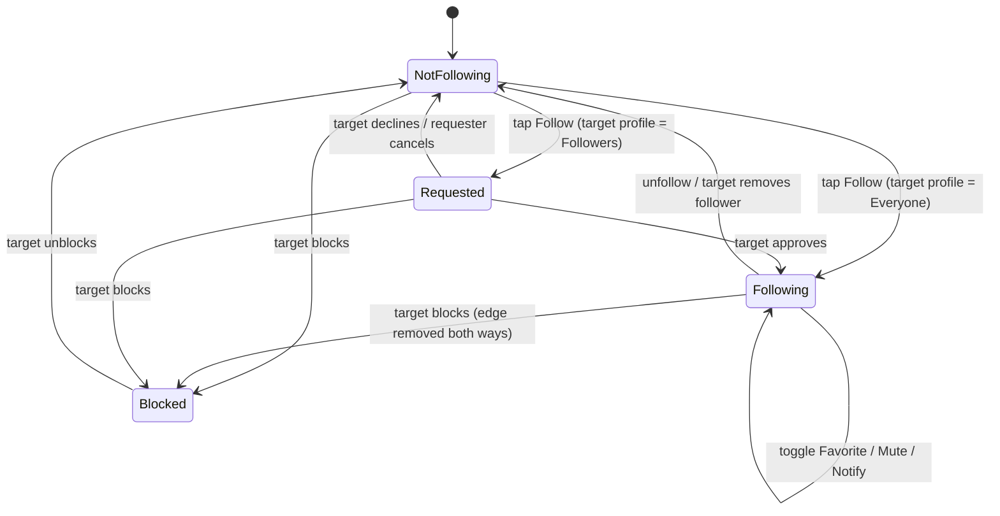
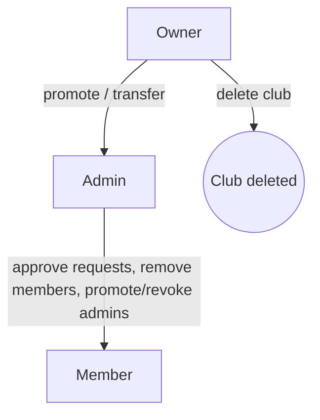
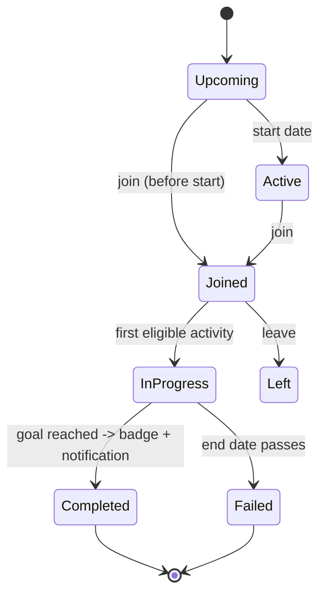
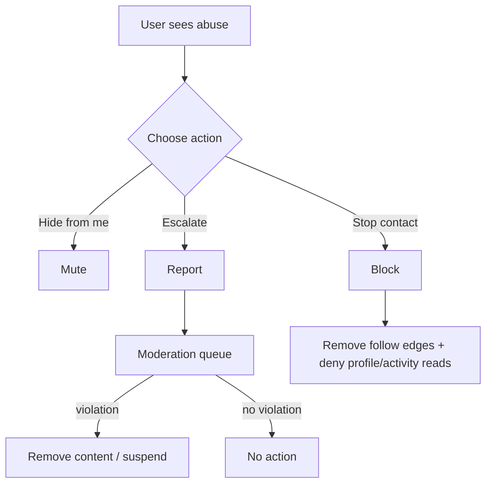

# Social Graph & Community — Feature Teardown

> Scope: Strava Android app (Play Store) as primary reference, iOS differences noted. Covers the follow model, kudos, comments, mentions, group activities, feed ranking, clubs, challenges, messaging, discovery (search, suggestions, contacts sync), safety (block, mute, report), media in posts, Instagram sharing, and the notification catalog.
>
> Conventions: **[FREE]** = available to free Strava accounts. **[SUB]** = needs a Strava subscription or trial. StravaFit has no subscriptions, so every feature here is free in our build. "(unverified)" = claim not confirmed against a primary source during research (October 2026).
>
> Trademark note: Strava, Kudos, KOM/QOM, Local Legend, Beacon and Flyby are Strava trademarks. They are named here only for reference. The OSS notes propose neutral names.

---

## 1. Overview & mental model

Strava's social layer is an **asymmetric follow graph** (Twitter-style, not Facebook-style friendship) wrapped around **activities** as the main content unit. Almost every social object hangs off an activity:

```mermaid
graph LR
  A[Athlete] -- follows --> B[Athlete]
  A -- owns --> ACT[Activity]
  ACT --> K[Kudos]
  ACT --> C[Comments]
  ACT --> M[Media: photos/videos]
  ACT --> G[Group activity link]
  C --> MEN[Mentions]
  A -- member of --> CL[Club]
  CL --> P[Club posts]
  CL --> E[Club events]
  CL --> LB[Weekly leaderboard]
  A -- joins --> CH[Challenge]
  A -- participates --> CHAT[Chat / DM]
```



Main surfaces in the Android app (bottom nav as of 2024-2026: **Home · Maps · Record · Groups · You**):

| Surface | Social content |
|---|---|
| Home | Following feed, bell icon for in-app notifications, chat icon for messages, search/find friends |
| Groups | Tabs: Active / Challenges / Clubs (labels approximate, unverified), plus group challenges [SUB] |
| You | Profile: followers/following counts, trophy case, joined challenges, clubs, settings |
| Activity detail | Kudos list, comments, group ("with N others"), media carousel, share |

---

## 2. Follow model

### 2.1 Behaviour

- **One-directional following.** Following someone puts their activities, challenge progress and created routes into your feed. They do not have to follow back. **[FREE]**
- **Profile privacy decides whether a follow needs approval.** The "Profile Page" privacy control has two values:
  - **Everyone** (default for adults 18+): follows happen at once, with no request.
  - **Followers**: every new follow becomes a **follow request** that the athlete approves or declines. Logged-in non-followers see a cut-down profile.
- Minors get stricter defaults (unverified: under-18 accounts default to approval-required/Followers).
- **Activity privacy is a separate setting** (Everyone / Followers / Only You) that applies to each activity. An activity set to Followers is only shown to approved followers, even on a public profile.
- **Mutual follows** unlock a few features. Club invites through Strava need a mutual follow. Message privacy can be limited to "mutuals".
- **Favorites** (added 2020): star a followed athlete and their new activities are pinned near the top of your feed **in both feed orders**. Athletes can see which followers have favorited them. **[FREE]**
- **Per-athlete push notification**: on the Following menu for an athlete, turn on "notify me when they upload". Whether the notification fires depends on the uploader's activity privacy. **[FREE]**
- **Mute**: hides the athlete's activities, posts, challenge joins and club joins from your feed. They are not notified. Available on mobile only. **[FREE]**
- **Remove follower**: drops someone from your followers list. They can follow you again, unlike with a block.
- There is no documented cap on how many athletes you can follow (unverified: a historical soft cap existed for anti-spam).

### 2.2 Follow state machine



Notes:
- If an account switches from Everyone to Followers, its existing followers stay (unverified).
- If an account switches from Followers to Everyone, pending requests are probably auto-approved (unverified).

### 2.3 Profile states (wireframes)

```
+----------------------------------------+
| <  Jane Runner                    ...  |
|----------------------------------------|
|   (avatar)  Jane Runner                |
|             Bengaluru, India           |
|   Following 212   Followers 340        |
|                                        |
|  [ Follow ]   [ Message ]   [ Share ]  |
|----------------------------------------|
|  This week: 42.1 km  3h51m  410 m      |
|  [Activities] [Stats] [Trophies]       |
|  ...feed of her activities...          |
+----------------------------------------+

Approval-required profile, not following:
+----------------------------------------+
| <  Sam Private                    ...  |
|   (avatar)  Sam Private                |
|   Following 80   Followers 95          |
|  [ Request to Follow ]                 |
|----------------------------------------|
|   (lock)  This profile is limited.     |
|   Follow requests must be approved.    |
+----------------------------------------+

"Following v" menu (bottom sheet):
+----------------------------------------+
|  ---                                   |
|  (*) Favorite                    [ ]   |
|  Notify me of new activities     [ ]   |
|  Mute                            [ ]   |
|  Unfollow                              |
+----------------------------------------+
```

### 2.4 Follow-request inbox

Requests show up in the in-app notification feed (bell) and on the Followers list as "Requests" with **Approve** and **Decline** buttons. Push and email notifications are controlled by the "Friends"/social notification settings.

```
+----------------------------------------+
| <  Follower Requests (3)               |
|----------------------------------------|
| (av) Alex K.   12 mutual               |
|      [Approve]  [Decline]              |
| (av) spammy_acct_99   0 mutual         |
|      [Approve]  [Decline]  [Block]     |
+----------------------------------------+
```

Spam follow requests are a known problem. Spam accounts with suggestive avatars have caused waves of requests. A public profile is a target for this.

---

## 3. Kudos (appreciation reactions)

- A single, binary "like" on an activity (and on posts). One per athlete per item. It can be taken back (unverified: removing kudos on mobile was added later. In older versions it could not be undone).
- You **cannot kudos your own activity**.
- The kudos count and a stack of avatars show in the feed card. Tapping opens the list of givers, with Follow buttons next to them.
- **Kudos limits / anti-spam**: the server rate-limits kudos (unverified exact numbers. Strava has fought "auto-kudos" browser extensions).
- Kudos given to an activity are visible to anyone who can see that activity.
- **Group kudos**: from a group activity you can give kudos to every member of the group (unverified: "Give kudos to all" button on the group view).
- Notification: "X gave you kudos". Push alerts are batched or aggregated ("X and 4 others gave you kudos") (aggregation unverified).
- **[FREE]**

```
Feed card footer
+----------------------------------------+
| (o)(o)(o) 23 kudos  ·  4 comments      |
|  [ thumb ]      [ comment ]   [ share ]|
+----------------------------------------+
```

---

## 4. Comments

- Flat thread on each activity (no nested replies, unverified as of 2026). Text plus emoji. Mentions supported. Links were **blocked at the end of 2024** as an anti-spam step and later **partly restored** in profiles, club descriptions, event descriptions and activity descriptions. Whether comments allow links again is (unverified).
- The activity owner can delete any comment on their activity. A commenter can delete their own comment. Editing comments is (unverified, probably not supported).
- **Comment reactions**: comments can get kudos/likes (unverified).
- Who can comment follows the activity's visibility. Anyone who can view the activity can comment (unverified: no separate "who can comment" setting).
- Notifications: the owner gets "X commented on your activity". Other people in the thread get "X also commented on ..." (unverified wording).
- **[FREE]**

```
+----------------------------------------+
| <  Comments                            |
|----------------------------------------|
| (av) Priya  · 2h                       |
|   Great pace @Jane! 🔥                 |
|                          (thumb) 3     |
| (av) Jane   · 1h                       |
|   thanks!                              |
|----------------------------------------|
| [ Add a comment...            ] [Post] |
+----------------------------------------+
```

---

## 5. Mentions & tagging

- Type `@` in a **comment** or an **activity description**, then start typing a name. An autocomplete list shows **athletes and clubs**.
- You can mention **clubs** (public or private) only if you are a member.
- **Who can mention me** (Privacy Controls > Mentions): **Everyone / Followers / No one**. The setting applies on the app and the web.
- The mentioned athlete gets an in-app notification and, if enabled, push and email. Club admins get a bell notification when their club is mentioned, and this cannot be turned off.
- **Tagging others in activities** happens mainly through **group activities** (Section 6). Historically you could also add athletes manually to a group (unverified for current Android).
- **[FREE]**

```
Comment input with mention autocomplete
+----------------------------------------+
| @ja|                                   |
|----------------------------------------|
| (av) Jane Runner     · follows you     |
| (av) Jacob M.                          |
| (club) Jayanagar Runners  · club       |
+----------------------------------------+
```

---

## 6. Group activities (auto-matched athletes)

### 6.1 Behaviour

- After upload, a server job compares the activity with other athletes' activities that overlap in time. A pair matches when the other activity is **"nearby" for more than 50% of the elapsed time**.
- "Nearby" means roughly **within a few hundred meters**, with more tolerance for longer activities.
- **Matching can be one-way**: if you joined someone only for the end of their ride, you may show as riding with them while they do not show as riding with you. Usually it is two-way.
- Matching **ignores sport type** (for example, a skier and a snowboarder can match).
- Grouping can take **up to ~12 hours** for big groups. A phone clock off by more than a minute from network time can stop a match.
- The detail page lists all matched athletes ("with N others"). The **feed merges grouped activities by people you follow into one card with a shared map**.
- **Privacy**: setting "Group activity" privacy to **No one** means you are never grouped. Edge case: if your privacy zone hides part of your map, a grouped partner's route can still show that area in the merged card.
- Related: **Flyby** (web, replays athletes who crossed paths) is controlled by its own privacy setting (Everyone / No one).
- **[FREE]**

### 6.2 Merged feed card

```
+----------------------------------------+
| (av)(av)(av) Jane, Priya +2 others     |
| Morning Ride · Oct 12 · Nandi Hills    |
|----------------------------------------|
|  [====== shared map, 4 colour lines ==]|
|----------------------------------------|
| Jane    62.4 km  2h41m  1,120 m        |
| Priya   61.9 km  2h40m  1,108 m        |
| Ravi    62.6 km  2h42m  1,131 m        |
|  + 1 more                              |
|----------------------------------------|
| (thumb) Give kudos to all     (cmt)    |
+----------------------------------------+
```

---

## 7. Feed ranking

### 7.1 History

| Year | Change |
|---|---|
| ≤2016 | Purely chronological following feed |
| 2017 | "Personalized" (ranked) feed launched alongside athlete posts. Users complained a lot |
| Mar 2020 | **Chronological option restored** ("Latest Activities"), **Favorites** added |
| 2020-2026 | Both orders kept. Feed also carries suggested-follow modules, challenge promos and club posts (unverified exact mix) |

### 7.2 Behaviour

- Setting: **Feed Ordering** (mobile: You > Settings > Feed Ordering. web: Display Preferences). The choice syncs across devices.
  - **Personalized**: ranked by your interaction history with athletes and sport types, plus "great efforts you may have missed" (PRs, long efforts).
  - **Latest Activities**: ordered by **when the activity was finished** (end time), not upload time (unverified: some reports say upload time).
- **Favorited athletes are pinned to the top in both orders.**
- The setting **only affects the following feed**. Your **own profile feed and club feeds are always chronological**.
- Switching order affects only new items. Items already loaded do not reorder.
- **Mute** removes an athlete from your feed. "Mute activity" (an uploader option, formerly "hide from home/club feeds") lets an uploader keep an activity public for leaderboards while keeping it out of followers' feeds. Use case: commutes.
- Feed filters (unverified for 2025): a filter for "Following / You only / Club" scopes.

### 7.3 Feed item types

| Type | Shown when |
|---|---|
| Activity (single) | A followed athlete uploads, visibility allows |
| Group activity (merged) | 2+ followed athletes grouped |
| Challenge joined / completed | Followed athlete joins or earns a badge |
| Club joined | Followed athlete joins a club |
| Route created | Followed athlete saves a route |
| Club post / announcement | Member of club with posts |
| Suggested follows carousel | Discovery module |
| Promoted / sponsored challenge | Strava marketing (unverified frequency) |
| Year in Sport / milestones | Seasonal |

---

## 8. Clubs

### 8.1 Types & settings

| Field | Values |
|---|---|
| Sport type | Any supported sport type, or **Multisport**/Triathlon |
| Club type | Casual club, racing team, company, shop, brand, etc. (category list, unverified exact values) |
| Privacy | **Public** (anyone joins at once) or **Invite-only** (still listed, but join needs admin approval. Recent activity, discussions and private events are hidden from non-members) |
| Location, description, website, cover & profile photo | Optional. Links in descriptions were restored after the 2024 link ban |
| Verified | Brands/pros/official groups get a verified badge. Some features, such as links in club posts, are limited to verified-club admins |

Creating clubs is **[FREE]**.

### 8.2 Roles



- **Owner**: the creator. Cannot leave without transferring ownership. Only the owner deletes the club.
- **Admins**: approve join requests, promote/revoke admins (including themselves), remove members, edit club info and images, create announcements and events.
- **Members**: post to discussions (if allowed), RSVP to events, appear on the leaderboard.
- Admins can restrict posting to admins only (unverified setting name).

### 8.3 Club tabs (mobile)

```
+----------------------------------------+
| <  Jayanagar Runners          (gear)   |
|  [ cover photo ..................... ] |
|  (logo) Jayanagar Runners  (verified)  |
|  Running · Bengaluru · 1,204 members   |
|  [ Joined v ]  [ Invite ]  [ Share ]   |
|----------------------------------------|
| [Overview] [Posts] [Events] [Leaderbd] |
|----------------------------------------|
|  Upcoming: Sunday Long Run · 6:00 AM   |
|  Latest post: "Route change this wk"   |
|  Recent activity: (feed of members)    |
+----------------------------------------+
```

### 8.4 Posts / discussions

- Admin posts can be marked **announcements**. They show in members' home feeds. Member posts show only in the club's Posts tab (from a third-party guide, unverified on current builds).
- Posts take text and photos, plus kudos and comments.
- Per-club notification setting (gear icon): **All posts / Announcements only / None**. This needs the global "Clubs > New Post" push toggle to be on.
- Reply notifications go out when someone replies to a thread you posted in.
- 2017: Club Posts launched. 2017 also brought "athlete posts" (personal blog-style posts), which were **later removed** (unverified date, around 2021-2022).

### 8.5 Events (group runs/rides)

- Created by admins. Fields: title, description, sport, date/time, **recurrence** (weekly etc.), meeting point, optional **route**, pace/skill level, women-only flag (unverified), privacy (members only).
- Members RSVP ("Join"). The attendee list is visible. Event reminders arrive as push notifications.
- Notifications: new event created, event updated/cancelled (unverified), reminder before start (unverified timing).

```
+----------------------------------------+
| <  Sunday Long Run                     |
|  Sun, Nov 2 · 6:00 AM · weekly         |
|  Meet: Lalbagh West Gate  (map)        |
|  Route: 21 km loop · 140 m gain        |
|  Pace: 5:30-6:15 /km   All levels      |
|----------------------------------------|
|  (av)(av)(av) 28 going                 |
|  [ I'm going ]   [ Add to calendar ]   |
|----------------------------------------|
|  Details / comments ...                |
+----------------------------------------+
```

### 8.6 Leaderboards

- Weekly. Shows the **current and previous week**. Resets **Sunday 23:59 in the club's time zone**.
- Only activities matching the club sport count (Multisport = all).
- Ranking: single-sport clubs by **distance**. Multisport by **moving time**. Sortable columns: distance, runs/rides, longest, avg pace, elevation.
- Last week shows a **podium** (top 3 in three sport-specific categories).
- **Only last week is stored**. Older history is not kept.
- Web shows the top 100. **Mobile shows the top 10** (plus your own rank).
- Private and "Only You" activities do not count (unverified for followers-only activities).

### 8.7 Limits

- Clubs with **more than 50,000 members have no Recent Activity feed**.
- The member list of large clubs shows only members you follow.
- Club invites via Strava need a **mutual follow**. Email invites are disabled. Share the club link instead.
- API: Strava announced deprecation of the Club Activities, Club Admins and Club Members API endpoints effective **1 Sep 2026** (third-party connector notice). This affects third-party integrations, not the app.
- Club **chat**: launch coverage of Messaging (Dec 2023) said club messaging was planned for 2024. Whether club chats shipped is (unverified).

---

## 9. Challenges

### 9.1 Strava-hosted challenges [FREE]

- Found in the **Challenge Gallery** (Groups > Challenges). Filter by sport.
- Duration: one day up to a month (sometimes longer).
- Goal types:
  - Distance (e.g. 5K, 100 km in a month)
  - Elevation (e.g. climb 2,000 m)
  - Time (e.g. 10 hours)
  - **Single activity** (longest run, 5K in one go)
  - **Segment** challenge (complete a specific segment)
  - **Streak / active days** (e.g. 4 weeks of 2 runs a week)
- **Join** with a single tap. Eligibility rules appear in "Details & Eligibility" (sport type, region, age).
- Progress: a progress bar on the challenge page (web and mobile). Joined challenges show on your profile (mobile). Some count retroactively from the challenge start date, even if you join late (unverified, challenge-specific).
- Leaderboard: only **Everyone-visible** activities count. **Manual activities do not count** toward challenge leaderboards (they may still count toward personal progress, unverified).
- Rewards: a digital **badge** in the **Trophy Case**. Sponsored challenges can give partner rewards (discount codes, entry into a draw). Physical rewards are partner-specific.
- Feed events: "X joined the challenge", "X completed ...".

### 9.2 Group (private) challenges [SUB]

- Mobile only. Private: visible only to participants.
- Create: Groups > Challenges > Create a Group Challenge.
- Goal types:
  - **Most Activity**: time, distance or elevation, with an optional group milestone. Ranked by total.
  - **Fastest Effort**: best average pace over a set distance (run/virtual run/wheelchair).
  - **Longest Single Activity**: ranked by the longest distance.
  - **Group Goal**: everyone works toward one shared target. No leaderboard, contributions shown.
- Invite **up to 199** athletes **who follow the creator**. Invitees must also be subscribers (or on a trial).
- Option: "Allow participants to invite others".
- Eligible activities must match the sports and be Everyone/Followers visibility. "Only You" excludes an activity.
- Has a **photo stream**. Past challenges are under You > More > Past Group Challenges.

### 9.3 Challenge state machine



```
+----------------------------------------+
| <  October 100K Challenge              |
|  [ badge art ]                         |
|  Oct 1 - Oct 31 · Running              |
|  64.2 / 100 km                         |
|  [##############--------]  64%         |
|  8 days left · 214,320 joined          |
|----------------------------------------|
| [Overview] [Leaderboard] [Details]     |
|  Friends:  Jane 100/100 (done)         |
|            Priya 72/100                |
+----------------------------------------+
```

---

## 10. Messaging / chats

- Launched **4 Dec 2023** for free and paid users (**[FREE]**).
- **1:1 and group chats**. Group chats can be named. Reported cap: **25 people per group chat** (launch coverage, may have changed: unverified for 2026).
- Supports: text, emoji **reactions**, **GIFs**, **replies**, and sharing **activities and routes** into a chat. Photo sharing was "planned for 2024" (unverified whether shipped).
- **No read receipts** and **no end-to-end encryption** at launch.
- **Who can message me**: **Everyone you follow / Mutuals / No one** (labels approximate). The default is derived from profile privacy.
- Entry points: chat bubble icon on Home, "Message" button on profile, "Share > Send in chat" on activities and routes.
- Report/block from a chat (unverified exact entry).
- Club messaging: announced as planned (unverified).

```
Chat list                               Chat thread
+--------------------+  +----------------------------------+
| Messages     (+)   |  | <  Sunday crew (5)          (i)  |
|--------------------|  |----------------------------------|
| Sunday crew   2m   |  |  Priya: see you 6am?             |
|  Priya: see you..  |  |                 Me: yes 👍       |
| Jane          1d   |  |  [shared activity card]          |
|  (route) Lalbagh.. |  |   Morning Run · 10.2 km          |
+--------------------+  |----------------------------------|
                        | [GIF] [ Message...        ] [>]  |
                        +----------------------------------+
```

---

## 11. Discovery: search, suggestions, contacts sync

### 11.1 Athlete & club search

- Global search (magnifying glass) finds **athletes, clubs** (and segments/routes in other contexts). Athletes can be searched by name. Clubs by name, location, sport, type.
- Results show mutual-connection hints and Follow buttons.

### 11.2 Suggested athletes

Sources:
- **Address book matches**: your synced contacts' emails/phones matched against Strava accounts.
- **Graph proximity**: friends-of-friends (if A and B both follow C but not each other, A may be suggested B).
- **Reverse matches**: you can be suggested to someone who synced a contact with your email/phone, **even if you never synced**.
- Other signals (unverified): shared clubs, group activities, location.
- Shown in: the feed carousel, Find Friends > **Suggested** tab, email.

### 11.3 Contacts sync

- Find Friends > Contacts: grant `READ_CONTACTS`. The client uploads emails/phone numbers (hashed or not: unverified) and the server returns matches.
- Non-members can be **invited** (you share the link, or Strava sends the email).
- Revoke from Find Friends (disconnect contacts). Android has its own help article.
- **Safety-feature contacts** (Beacon emergency contacts) are **not** used for suggestions.
- Historically you could connect Facebook for friend finding (deprecated, unverified date).

```
+----------------------------------------+
| <  Find Friends                        |
| [Suggested] [Contacts] [Search] [QR]   |
|----------------------------------------|
| (av) Alex K.  · in your contacts       |
|                        [ Follow ]      |
| (av) Mira S.  · 6 mutual followers     |
|                        [ Follow ]      |
|----------------------------------------|
| Not on Strava yet:                     |
|  Ravi (phone)           [ Invite ]     |
+----------------------------------------+
```

QR-code profile sharing (show my code / scan): (unverified for Android 2025).

---

## 12. Blocking, muting, reporting

### 12.1 Block [FREE]

From a profile, "..." > **Block athlete**. The block:
- Removes them from your followers **and** you from theirs and from their feeds.
- Stops them following you again or opening your activity detail pages.
- Hides your profile except your **name and bio**.
- **Does not** remove you from **public leaderboards** (club, challenge, segment, segment explore). They can see your summary row and photo but cannot open the activity.
- No notification is sent.
- Unblock from Settings > Privacy > Blocked athletes (unverified path).

### 12.2 Mute (see 2.1). Mute activity (see 7.2).

### 12.3 Report [FREE]

- Report an **athlete** (profile "..." > Report), an **activity** (flag: e.g. wrong sport, vehicle use, cheating, inappropriate content), a **comment**, a **club** or a **message** (unverified for every surface).
- Reasons (approximate, unverified): spam, harassment, inappropriate content/photo, impersonation, cheating / incorrect data.
- Segment leaderboard "flag" is a separate anti-cheat flow (see segments doc).

### 12.4 Anti-spam measures seen

- Link ban (late 2024) and partial restore (2025).
- Rate limits on follows and kudos (unverified exact numbers).
- Follow-request approval as a user-side defence.



---

## 13. Photos & media in posts

- Add **photos and videos** to activities while recording, after recording (on the save screen) or later (edit). **[FREE]**
- Videos: launched 2022, **up to 30 s** (longer clips are trimmed to the first 30 s). Portrait and landscape.
- Count: no hard cap is documented. The **app shows 6 items** and the **web shows 12** (Dutch help article, unverified for 2026).
- **Cover photo / highlight**: pick which media (or the map) leads in the feed card (unverified UI name: "highlight media").
- Photos are **auto-placed on the map** using EXIF timestamp/GPS matched to the track (unverified for videos).
- Media inherits the activity's visibility. Older "Enhanced privacy" settings controlled who could see photos (legacy).
- Captions on each photo (unverified).
- Club posts accept photos. Messages: photo support planned (unverified).

```
Save activity screen (media section)
+----------------------------------------+
|  Media                                 |
|  [ + ] [img] [img] [vid 0:21]          |
|  Highlight: ( ) Map  (*) First photo   |
+----------------------------------------+
```

---

## 14. Sharing out (Instagram stories / stickers)

- Share button on an activity opens a share sheet with templates. **[FREE]**
- **Sticker Stats** (spring 2025): makes a **transparent sticker** (distance, elevation, time, a line drawing of the route, branding) that you can **copy to the clipboard** or send **straight to an Instagram Story**, or save to the camera roll.
- Other templates (unverified for 2026 names): map + stats over a photo, stats-only card, splits card, "photo with overlay".
- Only **Everyone/Followers** activities can be shared this way (not Only You).
- Targets: Instagram Stories, Instagram feed, WhatsApp, X, Facebook, Snapchat, generic share sheet, copy link.
- See also `share-export.md` for image rendering.

```
+----------------------------------------+
|  Share activity                   (x)  |
|  < [sticker] [map+photo] [splits] >    |
|----------------------------------------|
|  (IG Story) (IG Feed) (WhatsApp) (...) |
|  [ Copy sticker ] [ Save image ]       |
|  [ Copy link ]                         |
+----------------------------------------+
```

---

## 15. Notifications catalog

Channels: **Push** (Android notification shade, toggles under You > Settings > Push Notifications), **In-app** (bell on Home, cannot be turned off), **Email** (per-type toggles on web, plus newsletter).

| # | Category | Event | Push | In-app | Email | Notes |
|---|---|---|---|---|---|---|
| 1 | Social | Kudos on your activity/post | ✓ | ✓ | ✓ | Aggregated (unverified) |
| 2 | Social | Comment on your activity | ✓ | ✓ | ✓ | |
| 3 | Social | Reply in a thread you commented on | ✓ | ✓ | ? | (unverified) |
| 4 | Social | Mention in comment/description | ✓ | ✓ | ✓ | Mentions privacy |
| 5 | Social | New follower | ✓ | ✓ | ✓ | |
| 6 | Social | Follow request (approval profiles) | ✓ | ✓ | ✓ | |
| 7 | Social | Follow request approved | ✓ | ✓ | ? | (unverified) |
| 8 | Social | Favorited athlete / notify-on-upload athlete posted | ✓ | — | — | Per-athlete opt-in |
| 9 | Social | You were added to a group activity | ✓ | ✓ | ? | (unverified) |
| 10 | Social | Friend joined Strava (contact match) | ✓ | ✓ | ✓ | (unverified wording) |
| 11 | Messaging | New message / group message | ✓ | chat badge | — | |
| 12 | Messaging | Reaction to your message | ✓? | — | — | (unverified) |
| 13 | Clubs | New club post (all / announcements / none) | ✓ | ✓ | ✓ | Per-club override |
| 14 | Clubs | Reply to your club post | ✓ | ✓ | ✓ | |
| 15 | Clubs | New club event | ✓ | ✓ | ✓ | |
| 16 | Clubs | Event reminder / update | ✓ | ✓ | ? | (unverified) |
| 17 | Clubs | Join request (admins) | ✓ | ✓ | ✓ | |
| 18 | Clubs | Join request approved | ✓ | ✓ | ? | (unverified) |
| 19 | Clubs | Club mentioned (admins) | — | ✓ | — | Not disableable |
| 20 | Clubs | Club invite from mutual | ✓ | ✓ | ? | |
| 21 | Challenges | Challenge completed / badge earned | ✓ | ✓ | ✓ | |
| 22 | Challenges | Challenge starting / ending soon | ✓ | ? | ✓ | Marketing-ish (unverified) |
| 23 | Challenges | Group challenge invite / accepted | ✓ | ✓ | ? | [SUB] |
| 24 | Achievements | Lost KOM/QOM/CR | ✓ | ✓ | ✓ | No email on ≤0% grade segments |
| 25 | Achievements | New Local Legend / lost LL | ✓ | ✓ | ? | |
| 26 | Activity | Upload processed / sync from device | ✓ | — | — | (unverified) |
| 27 | Activity | Flagged activity | ✓? | ✓ | ✓ | (unverified) |
| 28 | Safety | Beacon session started (contacts get SMS) | SMS | — | — | Not push |
| 29 | Routes | Shared route / saved by followed athlete | ? | ✓ | — | (unverified) |
| 30 | Recaps | Weekly/monthly progress, Year in Sport | ✓ | ✓ | ✓ | Newsletter toggle |
| 31 | Product | Marketing / offers / feature updates | ✓ | — | ✓ | Opt-out |

---

## 16. Free vs subscription summary

| Feature | Strava tier |
|---|---|
| Follow, favorites, mute, block, report | [FREE] |
| Kudos, comments, mentions | [FREE] |
| Group activity matching | [FREE] |
| Feed order choice | [FREE] |
| Clubs (create, join, posts, events, leaderboards) | [FREE] |
| Strava challenges (join, badges) | [FREE] |
| Group challenges (create/join) | [SUB] |
| Messaging (DM, group chat) | [FREE] |
| Find friends / contacts sync | [FREE] |
| Photos/videos on activities | [FREE] |
| Sticker Stats / share templates | [FREE] (some premium templates possibly [SUB], unverified) |

---

## OSS implementation notes

### Neutral naming

| Strava term | StravaFit name |
|---|---|
| Kudos | **Props** (thumbs-up "Cheer" as fallback) |
| Favorites | **Close friends / Starred** |
| Group activity / "with N others" | **Crew** ("rode with") |
| Flyby | **Crossings** |
| Club | **Club** (generic, keep) |
| Challenge | **Challenge** (generic, keep) |
| Group challenge | **Private challenge** |
| Beacon | **Live Share** |
| Sticker Stats | **Stat sticker** |
| KOM/QOM / Local Legend (in notifications) | **Segment crown / Regular** |

### Data model (Postgres sketch)

```sql
create table follow (
  follower_id bigint, followee_id bigint,
  state text check (state in ('active','pending')),
  starred bool default false, muted bool default false, notify_uploads bool default false,
  created_at timestamptz default now(),
  primary key (follower_id, followee_id)
);
create table block (blocker_id bigint, blocked_id bigint, created_at timestamptz,
  primary key (blocker_id, blocked_id));
create table props (activity_id bigint, athlete_id bigint, created_at timestamptz,
  primary key (activity_id, athlete_id));       -- one per athlete
create table comment (id bigserial primary key, activity_id bigint, author_id bigint,
  body text, mentions bigint[], deleted_at timestamptz, created_at timestamptz);
create table crew_match (activity_a bigint, activity_b bigint, overlap_ratio real,
  primary key (activity_a, activity_b));        -- directional!
create table club (id bigserial primary key, sport text, privacy text, owner_id bigint, tz text, ...);
create table club_member (club_id bigint, athlete_id bigint, role text, state text, notif text);
create table club_post (...); create table club_event (... rrule text ...);
create table event_rsvp (event_id bigint, athlete_id bigint, occurrence date, ...);
create table challenge (id, kind, metric, goal numeric, sport text[], starts_at, ends_at, private bool, creator_id);
create table challenge_entry (challenge_id, athlete_id, progress numeric, completed_at);
create table conversation (id, kind text, title text); create table message (...);
create table notification (id, recipient_id, type text, actor_ids bigint[], object_ref text,
  read_at timestamptz, created_at timestamptz);
```

Privacy enforcement: put it in one place, either a `can_view(viewer, activity)` SQL function or Row Level Security if using Supabase. It must check, in order: block (either direction) → activity visibility → follow state `active`. Leaderboards use a lighter "summary" check: blocked viewers see the row but get 403 on details.

### Follow requests
- `state='pending'` when the target's `profile_privacy='followers'`. When privacy flips to public, run a batch to auto-approve pending requests (our choice, document it).
- Rate-limit follow creation (e.g. 200/day, 30/min) and use a new-account heuristic against spam. Show "0 mutuals / new account" hints on requests.

### Crew (group activity) matching algorithm
1. After upload, query candidates: activities whose `[start,end]` overlaps by ≥50% of our elapsed time **and** whose bounding box intersects ours (PostGIS `&&` on a buffered bbox). Use a GiST index on `tstzrange` and geometry.
2. Resample both tracks to 1 Hz (or 5 s buckets) by timestamp. For each shared timestamp, compute haversine distance.
3. Threshold `d_max = clamp(200 m + 0.5% of total distance, 200, 500 m)` (tune, since Strava says "a few hundred meters, more leeway for longer").
4. `ratio_A = nearby_seconds / elapsed_A`. Match A→B if `ratio_A > 0.5`. Store directionally, so asymmetry falls out naturally.
5. Clustering: matches form a graph. Connected components (union-find) are a crew. Run async in a job queue (e.g. a Postgres-backed queue, BullMQ or Celery) with retries for late uploads (re-run for 12 h after each new upload in the window).
6. Edge cases: clock skew (allow ±60 s alignment search via cross-correlation), privacy zones (never render a partner's track inside the viewer-hidden zone of *any* crew member; stricter than Strava), user opt-out (`group_privacy='none'` skips matching both ways), indoor/no-GPS activities are skipped.

### Feed
- **Fan-out on read** to begin with (small scale): `select from activity where owner in (followees not muted) and visible_to(viewer) order by end_time desc` with keyset pagination on `(end_time, id)`.
- Move to **fan-out on write** (per-user timeline table/Redis ZSET) once follow counts grow. Use hybrid for high-follower accounts.
- Starred pinning: query starred athletes from the last 48 h first, then merge.
- "Personalized" (optional, off by default): score = `recency_decay(t) * (1 + w1*affinity(viewer,owner) + w2*sport_affinity + w3*effort_flag)`, where affinity = props/comments given in the last 90 days. Keep it explainable and open-source. Default to chronological, since users preferred it historically.
- Crew merge: when rendering, collapse items sharing a crew id into one card with a multi-polyline map.
- "Hide from feeds" flag on an activity: excluded from followers' and club feeds, still counts for leaderboards and challenges.

### Clubs
- Weekly leaderboard: materialized table, refreshed on activity insert/update. Week boundaries computed in the club's `tz` (use `java.time` on Android and `date_trunc('week', ts at time zone tz)` server-side. Note Postgres weeks start Monday, which matches a reset at Sunday 23:59). Keep **all** history (cheap, better than Strava).
- Events: store the RFC 5545 `RRULE` (lib: `rrule` on the server, `biweekly`/`ical4j` on Android). RSVP per occurrence. Reminder job at T-12h/T-1h. Export `.ics`.
- Roles: owner/admin/member, with an "admin-only posting" toggle. Ownership transfer is required before the owner leaves.
- Large clubs: cap the recent-activity feed query (e.g. members you follow first), paginate the member list.

### Challenges
- Engine: on each eligible activity (sport ∈ set, visibility ≠ private, not manual for leaderboard ranking, inside the date window), update `challenge_entry.progress` per metric: sum(distance|time|elev), max(single distance), min(pace over distance via best-effort table), count(active days / streak weeks), segment completion.
- Recompute on activity edit/delete (idempotent: rebuild from activities in the window).
- Badges: SVG generated from template + colour (no proprietary art). Trophy case = completed entries.
- Private challenges: invite cap configurable (default 200), invitees must follow the creator (or be mutual, our choice).

### Messaging
- Do not build our own crypto. Options: (a) simple server-stored messages over WebSocket/FCM (fastest), (b) **Matrix** (Synapse/Conduit + matrix-rust-sdk) for E2EE and federation. Recommend (a) for v1, with E2EE as the v2 roadmap. Add read receipts (Strava lacks them) as an opt-in.
- DM permission: `everyone | followees | mutuals | none`. Check on conversation creation **and** on each send (in case of a block).
- Group cap: 50. Shared objects: activity/route cards as typed message payloads.

### Contacts sync (privacy-first)
- Hash on device: normalize E.164 phones (libphonenumber-android) and lowercase emails, then SHA-256 with a server-provided **pepper** (rotated). Upload hashes only and don't store the raw address book. Note that hashed phone numbers can be brute-forced, so rate-limit matching and delete uploaded hashes after matching (or keep only with consent).
- Explicit opt-in with a rationale screen. `READ_CONTACTS` runtime permission. "Disconnect & delete" button.
- **Do not** do Strava-style reverse suggestion (suggesting you to people who have your number) unless the user opts in to "let people with my contact find me". Default off.
- Friends-of-friends suggestions: `select candidate, count(*) mutuals from follow f1 join follow f2 ... group by candidate order by mutuals desc limit 20`, excluding blocked, already-followed and pending.

### Safety
- Block = delete follow edges both ways + insert into `block`. Enforce in `can_view`, mention autocomplete, DM, crew rendering (hide the blocked partner from the viewer's crew card) and search results.
- Report pipeline: `report(target_type, target_id, reason, note)` → moderation queue (admin web UI). Auto-hide content after N distinct reports, pending review. Link handling: allow links but run them through an allowlist/denylist and show a "leaving app" interstitial instead of a blanket ban.
- Rate limits: token bucket per user for follows, props, comments and messages (e.g. Redis or Postgres `pg_rate_limit`).

### Media
- Android: Photo Picker (`ActivityResultContracts.PickMultipleVisualMedia`), no storage permission needed. Upload via a resumable/tus protocol to S3-compatible storage (MinIO/Supabase Storage). Make thumbnails server-side (libvips). Transcode video with ffmpeg to H.264 720p, max 30-60 s.
- **Strip EXIF GPS on upload** after reading the timestamp/location for map placement. Respect privacy zones (don't place photos inside them).
- Map placement: interpolate the track position at the photo's EXIF `DateTimeOriginal` (convert with the activity's time zone offset). Fall back to EXIF GPS, then no pin.

### Stat sticker / Instagram sharing
- Render a transparent PNG with Android `Canvas` (or Compose `GraphicsLayer.toImageBitmap`): route polyline (normalize the projected coordinates into a box), stats text, our neutral mark.
- Instagram Stories intent: `com.instagram.share.ADD_TO_STORY` with `interactive_asset_uri` (sticker) + optional `background_asset_uri`, `source_application` = our Meta App ID (required since 2023, unverified current requirement). Share through a `FileProvider` URI with `grantUriPermission` to `com.instagram.android`. Fall back to `ACTION_SEND` image/png. Copy-to-clipboard via `ClipData.newUri`.
- iOS equivalent: `instagram-stories://share` pasteboard items (for a future iOS port).
- Block sharing for private activities, and add an option to hide the map/start point in the sticker.

### Notifications
- Server: `notification` table + fan-out worker. Push via **FCM** (Android). Consider **UnifiedPush** as an FOSS alternative for de-Googled devices (F-Droid build).
- Aggregation: collapse identical `(recipient, type, object)` within 10 min into "A and N others". Use the Android `NotificationCompat` group key per activity.
- Android channels (user-adjustable in system settings): `social_props`, `social_comments`, `social_follows`, `mentions`, `messages`, `clubs_posts`, `clubs_events`, `challenges`, `achievements`, `recaps`, `product`. Request `POST_NOTIFICATIONS` at runtime on Android 13+ when the user first takes a social action, not at launch.
- Per-club override (`all | announcements | none`) and per-athlete upload notify. Add **quiet hours** (Strava lacks them).
- In-app bell: paginated list, read state, deep links (`stravafit://activity/{id}#comments`) via Navigation Compose deep links.

### Android stack suggestions
Kotlin + Jetpack Compose, Paging 3 (feed, comments, leaderboards), Room cache for feed offline, WorkManager for media upload and crew-match polling, Coil for images, Media3/ExoPlayer for video clips, MapLibre for maps (crew multi-polyline), Ktor/Retrofit + WebSocket (OkHttp) for chat.

---

## Sources

- https://communityhub.strava.com/insider-journal-9/how-to-approve-or-deny-strava-follower-requests-1501
- https://communityhub.strava.com/insider-journal-9/profile-privacy-controls-explained-1518
- https://www.cyclingweekly.com/news/latest-news/strava-spam-221645
- https://support.strava.com/en-us/articles/15402056-how-do-i-follow-athletes-on-strava
- https://support.strava.com/en-us/articles/15402163-how-do-i-manage-my-followers-and-block-athletes-on-strava
- https://www.howtogeek.com/683311/how-to-block-someone-on-strava/
- https://support.strava.com/en-us/articles/15401832-mentions-on-strava
- https://support.strava.com/en-us/articles/15401890-group-activities
- https://dcrainmaker.com/2020/03/chronological-ordering-favoriting.html
- https://road.cc/content/tech-news/271757-strava-has-brought-back-chronological-ordering-and-allows-you-favourite
- https://bikerumor.com/strava-gets-your-activity-feed-in-order-lets-you-play-favorites-with-followers/
- https://support.strava.com/en-us/articles/15402172-clubs-on-strava
- https://endurance.biz/2017/industry-news/strava-club-posts-newest-way-for-athletes-to-connect-on-strava/
- https://RUNTOGETHER.CO.UK/media/157645/strava-clubs-guide-runtogether.pdf
- https://community.qlik.com/t5/Support-Updates/Qlik-Strava-connector-upcoming-removal-of-Club-Activities-and/ba-p/2552629
- https://support.strava.com/en-us/articles/15401916-strava-challenges
- https://support.strava.com/en-us/articles/15401736-how-do-group-challenges-work-on-strava
- https://www.globalcyclingnetwork.com/tech/news/messaging-comes-to-strava-functionality-launches-for-dms-and-group-chats
- https://www.bikeradar.com/news/you-can-finally-send-direct-and-group-messages-on-strava
- https://www.androidauthority.com/strava-messaging-3391139
- https://support.strava.com/en-us/articles/15402047-syncing-your-contacts-and-connections-with-strava
- https://support.strava.com/en-us/articles/15401973-finding-friends-and-managing-contacts-on-strava-android
- https://support.strava.com/en-us/articles/15402139-strava-notifications
- https://www.cyclingweekly.com/fitness/strava-quietly-rolls-out-video-sharing-function
- https://www.androidcentral.com/wearables/how-to-add-videos-to-strava-app-android
- https://support.strava.com/nl/articles/15401859-video-s-en-foto-s-aan-een-activiteit-toevoegen
- https://www.bikeradar.com/news/strava-sticker-stats-spring-2025-updates
- https://www.remove.bg/b/strava-overlay-for-instagram-stories-and-posts
- https://tomsguide.com/wellness/fitness/good-news-for-strava-users-the-app-just-reversed-a-hugely-unpopular-decision
- https://road.cc/content/news/strava-no-longer-allows-you-add-links-310685
- https://greasyfork.org/en/scripts/550272-strava-feed-filter
