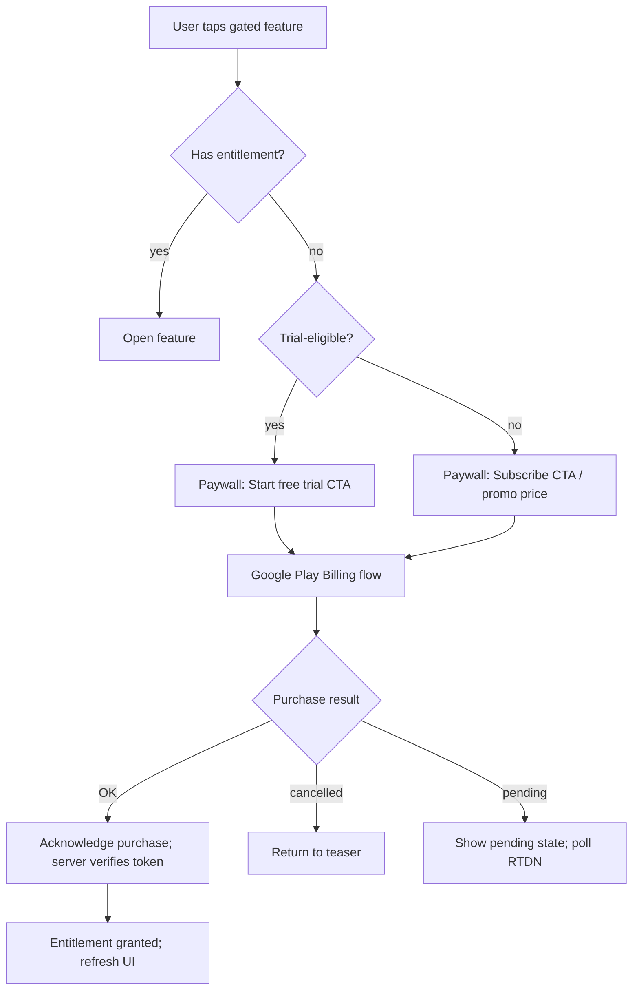
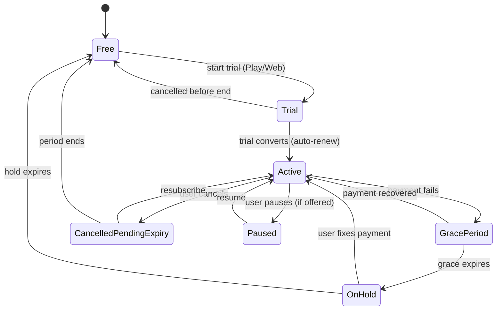
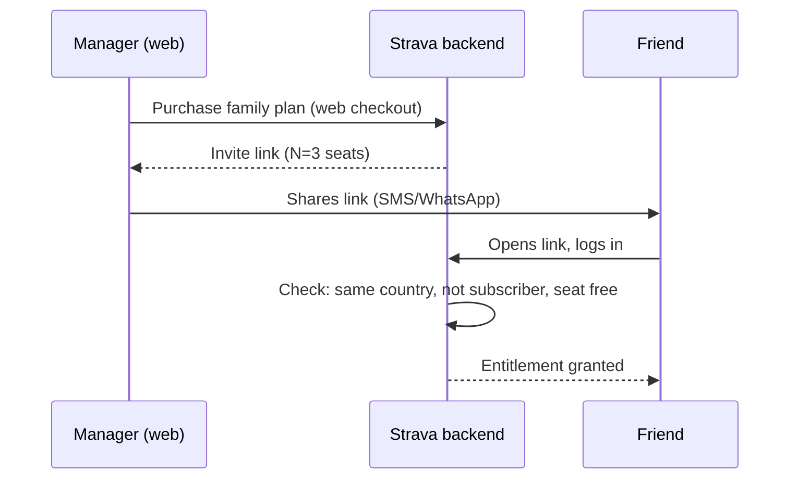
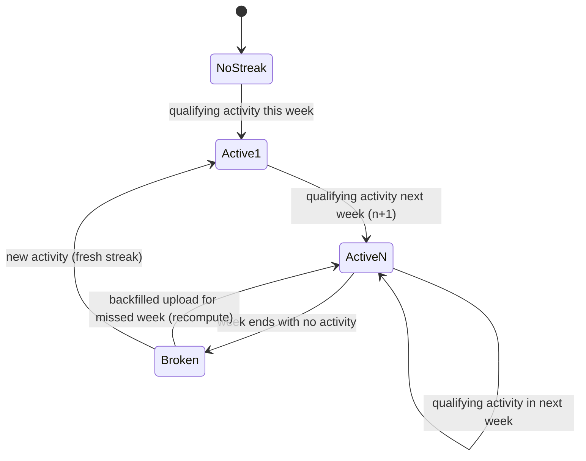
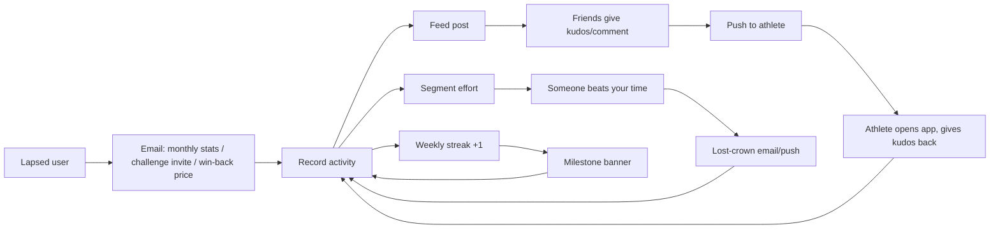

# Subscription, Engagement & Notifications

> Scope: how Strava makes money from its Android app, and how it keeps people coming back. Covers paywalls, trials, pricing, Google Play Billing, the family plan, perks and partner offers, streaks, recaps, email, push, re-engagement, gamification and sponsored challenges. Ends with the StravaFit model: no paywall, funded by donations and sponsors, with self-hosting supported, plus the server costs we have to plan for.
>
> Status: research snapshot, October 2026. Strava changes prices and feature gating often, by country and by A/B test. Anything not confirmed from a public source is marked **(unverified)**.
> Tags: **[FREE]** = available to free Strava accounts. **[SUB]** = needs a Strava subscription. StravaFit has no subscription, so every [SUB] feature is free in our app.

---

## 1. Business model at a glance

| Revenue stream | What it is | Approx. share |
|---|---|---|
| Consumer subscription | A single paid tier, monthly or annual. Bought on the web, through Google Play or through the App Store. | About 90% of revenue (analyst estimate, sacra.com) |
| Family plan | Annual plan for up to 4 people, sold on the web only | Part of subscription revenue |
| Student / org / corporate pricing | Discounted plans for students, employers, insurers and loyalty programs | Small (unverified share) |
| Bundles | Strava + Runna annual bundle, launched mid-2025 | Growing |
| Sponsored challenges | Brands pay for challenges in the app, with badges and rewards | Most of the rest |
| Sponsored segments / brand clubs | Brand-run clubs (for example Nike) and segments branded by a sponsor | Small |
| Partner offers / perks | Discounts from partner brands, shown to subscribers and in emails | Mostly a retention tool, not much direct revenue |

Strava does **not** show classic display or programmatic ads in the feed. Its "advertising" takes the form of sponsored challenges, brand clubs, and partner promotions in the newsletter (feed promos for sponsored challenges are **unverified**).

### Timeline of monetisation changes (load-bearing)

| Year | Change |
|---|---|
| 2020 | Summit packs (Training / Safety / Analysis) folded into one subscription. Segment leaderboards and several route features moved behind the paywall. |
| 2023 | Rebranded from "Summit" to "Strava Subscription". |
| Jul 2024 | Family plan launched: 4 people, annual, web-only, members in the same country, available in 32 countries. |
| Jul 2025 | Strava + Runna annual bundle launched: $149.99 US / £119.99 UK, with a 30-day trial for new users. |
| Dec 2025 | **Year in Sport recap put behind the paywall for the first time** (it had been free since 2016). This drew a strong backlash on Reddit and in the press. Monthly stat cards were described as subscriber-only too. |

---

## 2. Pricing (reference only)

| Plan | US | UK | EU | Notes |
|---|---|---|---|---|
| Individual monthly | $11.99 | £8.99 | €7.99–10.99 | Varies by country |
| Individual annual | $79.99 | £54.99 | varies | Discounted heavily at New Year and Black Friday (unverified depth) |
| Student annual | ~$39.99 | (unverified) | (unverified) | Verified through a third-party student check (unverified provider) |
| Family annual (4 seats) | ~$139.99 | (unverified) | varies | Web only |
| Strava + Runna annual | $149.99 | £119.99 | varies | Annual only, cannot be stacked with other discounts |

- Play Store prices are localised through Play's price templates. Prices in India, Brazil and similar markets are much lower (unverified exact amounts).
- Promo codes and extended trials (60 or 90 days) are handed out through partners such as device makers, races and retailers. A UK deals site listed a 90-day code.

---

## 3. Free vs subscription feature matrix

| Area | Feature | Tier |
|---|---|---|
| Recording | Record GPS activities, all sport types, auto-pause, sensors | [FREE] |
| Recording | Beacon (live location sharing) | Mostly [SUB]. A free version for one contact was reported (unverified current state). |
| Social | Feed, kudos, comments, follow, clubs, photos | [FREE] |
| Social | Group challenges (create your own) | [SUB] |
| Segments | Segment efforts, PRs, KOM/QOM crowns | [FREE] (you still earn them) |
| Segments | Full segment leaderboards, with filters by age, weight and so on | [SUB]. Free users see a limited top list (unverified exact count). |
| Segments | Live segments on device | [SUB] |
| Segments | Local Legend: the full Local Legend view and progress | Mixed (unverified) |
| Routes | Browse and save suggested routes | Partly [FREE] |
| Routes | Route builder, offline maps, points of interest, heatmap details | [SUB] |
| Maps | Global heatmap at high zoom, personal heatmaps | [SUB] |
| Training | Fitness & Freshness, training log, relative effort details | [SUB] |
| Training | Custom goals (distance, time, elevation; weekly or yearly) | [SUB] |
| Training | Best efforts history, matched activities, pace and power zone analysis | [SUB] |
| Training | Training plans | Moved to Runna (separate subscription or bundle) |
| Progress | Weekly snapshot, basic weekly totals | [FREE] |
| Progress | **Streaks** (weekly) | [FREE] |
| Progress | Trophy case / challenge badges | [FREE] |
| Recaps | **Year in Sport** (from the 2025 edition onward) | [SUB] |
| Recaps | Monthly stat cards / shareable monthly summary | [SUB] (since Dec 2025). Previously the email summary was free if the newsletter was enabled. |
| AI | Athlete Intelligence summaries of activities | [SUB] (unverified current gating) |
| Safety | Beacon emergency contacts | [SUB] / partial |
| Perks | Partner discounts, subscriber-only challenges | [SUB] |

---

## 4. Paywall locations and triggers

Strava's paywall pattern is **contextual upsell**. A locked feature is visible but shows a lock or tease, and tapping it opens a full-screen sheet offering the subscription. There is also a generic "Subscribe" or "Start free trial" entry point on the You tab and in Settings.

### 4.1 Inventory of paywall surfaces (observed / reported)

| # | Surface | Trigger | Paywall style |
|---|---|---|---|
| P1 | Onboarding end | After sign-up and permission prompts | Full-screen trial offer you can skip (unverified on every cohort) |
| P2 | Segment detail → leaderboard | Scrolling past the visible rows, or tapping a filter | Blurred rows plus an inline "unlock" card |
| P3 | Activity detail → analysis sections | Tapping a locked chart (zones, matched runs, best efforts) | Teaser chart with a lock badge, which opens a sheet |
| P4 | Maps tab → route builder / offline | Tapping "create route" or "download" | Bottom sheet |
| P5 | Maps → heatmap layers | Toggling a heatmap layer | Lock icon on the layer, then a sheet |
| P6 | You → Progress → goals | Tapping "add goal" | Sheet |
| P7 | Fitness / training log | Tapping the tile | Preview screen with a CTA |
| P8 | Year in Sport (December) | Push or email, then opening the recap | Teaser of the first card, then the paywall |
| P9 | Monthly recap card | Opening the push or banner at the start of the month | Teaser, then the paywall |
| P10 | Group challenge creation | Groups → create challenge | Sheet |
| P11 | Beacon | Recording screen → safety | Sheet |
| P12 | Post-upload "insights" | Activity saved | Inline locked insight card ("see how this compares") (unverified wording/design) |
| P13 | Settings → Subscription | Opened manually | Plan picker |

### 4.2 Paywall sheet wireframe (generic, own design description)

```
+--------------------------------------+
| [x]                                  |
|        (hero illustration area)      |
|                                      |
|  Unlock your full training picture   |
|  ----------------------------------  |
|  (check) Full leaderboards           |
|  (check) Route builder + offline     |
|  (check) Goals & progress tracking   |
|  (check) Monthly + yearly recaps     |
|                                      |
|  ( ) Monthly   $11.99/mo             |
|  (o) Annual    $79.99/yr  SAVE ~44%  |
|                                      |
| [   Start your free 30-day trial   ] |
|  Cancel anytime. Billed after trial. |
|  Restore purchase   Terms   Privacy  |
+--------------------------------------+
```

### 4.3 Paywall decision flow



---

## 5. Trial flows

- **Standard trial:** 30 days for first-time subscribers. Eligibility is per account and per store, and Google Play adds its own one-free-trial-per-subscription rule. Extended 60/90-day trials come through partner codes.
- **Reminder:** Strava sends a reminder email shortly before the trial converts (unverified timing, commonly reported as about 3 days before). The App Store and Google Play also send their own renewal notices.
- **Cancel where you paid.** Web subscriptions are cancelled on strava.com. Play subscriptions are cancelled in Play → Payments & subscriptions. Cancelling on the website does not stop a store charge. Third-party guides recommend cancelling at least 24h before the trial ends.
- **After cancelling:** access lasts until the end of the period you paid for, and no data is deleted. Gated data such as goals and saved routes stays stored but is hidden or read-only (unverified per feature).
- **Refunds:** Play refunds go through Google's policy, with a 48h self-service window. Web purchases have about 14 days in the EU and UK (third-party sources; unverified).



(Grace, hold and pause are Google Play Billing states. Whether Strava enables Pause is **unverified**.)

---

## 6. Google Play Billing details (Android)

Neutral description of how an app like Strava is required to implement Play subscriptions. This is not a claim about Strava's private code.

| Concern | Detail |
|---|---|
| Library | Play Billing Library (v7/v8 in 2025-26). Uses `BillingClient`, `queryProductDetailsAsync` and `launchBillingFlow`. |
| Product model | One subscription product with base plans (monthly, annual) and offers (free trial, intro price, win-back). |
| Acknowledgement | A purchase must be acknowledged within 3 days, or Play refunds it automatically. |
| Server verification | The backend checks the purchase token through the Google Play Developer API (`purchases.subscriptionsv2.get`). |
| Real-time Developer Notifications (RTDN) | Cloud Pub/Sub topic events: `SUBSCRIPTION_PURCHASED`, `RENEWED`, `IN_GRACE_PERIOD`, `ON_HOLD`, `CANCELED`, `EXPIRED`, `REVOKED`, `PAUSED`, and so on. |
| Cross-platform entitlement | The entitlement belongs to the Strava account, not the device. A Play purchase unlocks iOS and web too. |
| Family plan | **Not sold in-store.** It is web only, which avoids store fees and the limits of store family sharing. |
| Web vs store | Web purchases avoid the 15% store fee. Strava pushes web purchase through email campaigns and the family plan. User-choice billing in the EEA and India is **unverified** for Strava. |
| iOS differences | StoreKit 2, App Store Server Notifications v2. Trial eligibility is per Apple ID subscription group. Cancellation happens in iOS Settings. App Store review rules restrict linking out to web purchase (relaxed in the US from 2025; Strava's use is unverified). |

---

## 7. Family plan sharing

- One "manager" buys the annual family plan **on strava.com only**. If they already subscribe, they must cancel that first.
- The manager gets an **invite link** to share with up to 3 others, for 4 seats in total.
- Members must **live in the same country** and must **not already be subscribers**. They do not need to be related or share a household.
- Each member gets full subscriber features under their own account. Data is not shared between members.
- Launched in July 2024 in 32 countries. The price is about $139.99/yr in the US, marketed as "up to 50%" savings per person.
- Removing a member and transferring the manager role: (unverified details).



---

## 8. Perks, partner offers, bundles

| Type | Example | Tier |
|---|---|---|
| Partner discounts | Gear and nutrition discount codes on a "Perks" page | [SUB] (unverified list; it rotates) |
| Bundles | Strava + Runna, $149.99/yr. Strava stopped creating new training plans after acquiring Runna in 2025. | Paid |
| Brand clubs | Nike club with coach content, after the 2024 partnership | [FREE] to join (some content subscriber-only, unverified) |
| Corporate / insurer / loyalty | Discounted or free subscriptions given as a benefit | Paid by the organisation |
| Device / race promos | Extended trials bundled with watches, races or retailers | Trial |

---

## 9. Gamification inventory

| Mechanic | Description (own words) | Tier | Engagement loop |
|---|---|---|---|
| Kudos | One-tap appreciation on an activity | [FREE] | Social reciprocity, with a push for each kudos (batched) |
| Comments / mentions | Threaded comments, @mentions | [FREE] | Push |
| KOM/QOM/CR crowns | Fastest time on a segment, overall or by gender. Course records for running. | [FREE] (earned). Full board is [SUB]. | "You lost your crown" email/push is a strong re-engagement trigger |
| Local Legend | Most efforts on a segment in a rolling 90 days | Mixed | Rewards frequency, not speed |
| PRs / best efforts | Personal records on segments and standard distances | [FREE] basic, [SUB] history | Medal icons on the activity |
| Achievements | Gold, silver and bronze for top-10 efforts and PRs | [FREE] | Shown in the activity summary |
| Challenges | Monthly distance or time challenges, plus sponsored ones, with digital badges. Some brand challenges come with rewards. | [FREE] to join | Monthly reset, trophy case |
| Group challenges | User-created challenges among friends or clubs | [SUB] to create | Social pressure |
| Streaks | Count of consecutive weeks with at least one activity of 60 seconds or more, Monday to Sunday | [FREE] | Weekly cadence and milestone banners |
| Goals | Weekly or annual targets with progress rings | [SUB] | Progress bars |
| Trophy case | Collection of badges | [FREE] | Collection |
| Year in Sport | Personal annual recap story with shareable cards | [SUB] from 2025 | Huge sharing spike in December |
| Monthly recap | Shareable monthly stats | [SUB] (Dec 2025 onward) | Monthly push |
| Flyby / matched | Who you passed, and your history on the same route | Flyby [FREE] (opt-in), matched [SUB] | Curiosity |
| Relative Effort / Fitness | Training load scores | Partly [SUB] | Self-tracking |

### 9.1 Streaks (verified from the support article)

- **Unit:** weeks, Monday 00:00 to Sunday 23:59 in local time.
- **Qualifying activity:** any sport type, including manual entries, lasting **60 seconds or more**. Privacy setting doesn't matter. Files with timestamps before 1 Jan 2009 do not count.
- **Break:** a full week with no qualifying upload.
- **Restore:** uploading a backdated activity for the missed week after the fact puts the streak back. This is generous, and there is no paid "streak freeze".
- **Location:** You → Progress.
- **Celebrations:** banners at weeks 2–5, then at milestones such as 10, 15 and 25 weeks and 1, 2 and 3 years. There is **no setting to turn them off**.
- Available to free accounts.



```
+--------------------------------------+
| Progress                         (i) |
|--------------------------------------|
|  Weekly streak                       |
|   [ 12 ]  weeks                      |
|   M T W T F S S   this week: done    |
|   Best: 31 weeks                     |
|--------------------------------------|
|  This week   3 acts  21.4 km  2h05   |
|  [bar][bar][bar][  ][  ][  ][  ]     |
|--------------------------------------|
|  Goals (lock)   Add a goal  >        |
+--------------------------------------+
```

---

## 10. Recaps and summaries

| Recap | Cadence | Channel | Tier |
|---|---|---|---|
| Weekly snapshot | Weekly | In app (Progress) | [FREE] |
| Weekly email digest | Weekly (unverified whether still sent) | Email | [FREE] |
| Monthly stats | Monthly | Email (needs the newsletter toggle on), plus an in-app card | Card is [SUB] since Dec 2025 |
| Year in Sport (personal) | December | Push, email and in-app story | [SUB] since the 2025 edition. Free users are offered a 1-month trial to view it. |
| Year in Sport trend report | December | Press report on aggregate data | Public |
| Milestones (1000 km, anniversaries) | Event-driven | Push / feed (unverified) | [FREE] |

Year in Sport story layout (described in our own terms): a sequence of full-screen cards. The first card is a total-activity hero. Then come sport breakdown, total distance, time and elevation, the best month, the top photo, top kudos-givers, and comparisons with the community. Each card has a share button that exports a 9:16 image.

---

## 11. Notifications

### 11.1 Channels

| Channel | Control | Notes |
|---|---|---|
| Push (Android/iOS) | You → Settings (gear) → Push Notifications, with per-type toggles | Android notification channels mirror these (unverified channel names) |
| Email | Website → Settings → Email Notifications | One email per notification type when enabled |
| Email newsletter | Separate toggle | Product updates, personalised data visualisations, promotions and **partner offers**. **Required for monthly stats emails.** |
| In-app bell (Home) / web bell | **Cannot be disabled** | Aggregated activity feed of notifications |
| Club posts | Global "Clubs → New post" toggle, then per-club gear: all posts / announcements only / off | |

### 11.2 Notification type inventory (from settings plus public reports)

| Category | Type | Default | Channel |
|---|---|---|---|
| Social | Kudos on your activity | On | Push, bell |
| Social | Comment / reply / @mention | On | Push, email, bell |
| Social | New follower / follow request | On | Push, email |
| Social | Friend's activity (selected athletes) | Off (unverified) | Push |
| Social | Tagged in a group activity | On | Push |
| Clubs | New post / announcement / event | Per club | Push |
| Segments | Lost KOM/QOM/CR | On | Email (none for segments with 0% or lower grade), push (unverified) |
| Segments | Local Legend gained or lost | On (unverified) | Push |
| Challenges | Joined, progress, completed, new challenge available | On | Push, email |
| Streaks / milestones | Streak banners | Always (no toggle) | In app |
| Recording | Upload complete, processing failed, device sync | On | Push |
| Safety | Beacon started (to contacts) | N/A | SMS / link |
| Account | Subscription, trial ending, payment failure | Mandatory | Email |
| Marketing | Feature announcements, partner offers, recap teasers | Opt-in/out via newsletter | Email, push (unverified) |

### 11.3 Strategy and frequency (observed patterns; frequency caps unverified)

- **Activity-triggered social pushes** are the main stream. Kudos are batched ("X and N others gave kudos") so a popular post doesn't flood the user (unverified exact batching window).
- **Competitive loss pushes and emails** (lost a crown) drive users back to a segment. They are suppressed in some cases to avoid inaccurate or bad experiences. Strava says some notifications are deliberately not generated.
- **Calendar pushes:** monthly challenge launches on the 1st, the monthly recap at the start of the month, and Year in Sport in mid-December.
- **Trial lifecycle emails:** a welcome email, feature education, a reminder before conversion, and win-back offers after a lapse (unverified cadence).
- **No streak-at-risk push is documented.** Strava appears to rely on banners rather than nag pushes (unverified, since a test may exist).
- Quiet hours and a global frequency cap are **not documented** publicly.

### 11.4 Re-engagement loops



Dormant users get win-back emails. These typically carry discounted annual offers around New Year and Black Friday (seasonal discounts confirmed by press; exact cadence unverified).

---

## 12. Ads and sponsored challenges

- **Format:** a brand pays for a challenge with a target (distance, duration, elevation, streak, or a collective goal) and a time window. Finishers get a digital badge and sometimes a reward, such as a discount code, a free product or a raffle entry. Example: CamelBak discounts on bottles.
- **Reported examples:** Lululemon "40|80" (run 40 or 80 km to unlock a free top), and a New Balance challenge with about 250k participants in 180 countries. Chipotle, Hoka and Duer have also partnered on branded workouts (2024).
- **Placement:** the Challenges tab ("Groups"/"Challenges" depending on the version), feed promo cards (unverified), and the email newsletter.
- **Data sharing:** brands receive aggregate results, and possibly opted-in contact details for reward fulfilment (unverified specifics).
- **Sponsored segments:** branded segments (rare, older format).
- **No display ads** were found in the feed (unverified for every market).

---

## 13. iOS differences

| Item | Android | iOS |
|---|---|---|
| Billing | Play Billing, RTDN | StoreKit 2, App Store Server Notifications |
| Cancel path | Play Store → Payments & subscriptions | Settings → Apple ID → Subscriptions |
| Family | Web only (same) | Web only. Apple Family Sharing is not supported (unverified). |
| Notifications | Per-channel OS control plus in-app toggles | Provisional/authorisation prompt. In-app toggles are the same. |
| Widgets | Home-screen widgets with weekly stats (unverified) | Widgets and Live Activities during recording |
| Recap sharing | Share sheet to Instagram Stories | Same |

---

## 14. Critique (what to copy, what to avoid)

| Copy | Avoid |
|---|---|
| Weekly (not daily) streak, which is kind to rest days | Paywalling the emotional recap (Year in Sport) that users see as theirs |
| Restoring a streak by backfilling an upload | Teaser-then-lock patterns on the user's own data |
| Per-club notification granularity | A bell you can't disable, and a newsletter toggle that also gates useful summaries |
| Batched kudos notifications | Mixing partner promotions into the same toggle as personal stats |
| Lost-crown notifications suppressed for bad data | Store-vs-web cancel confusion |

---

## OSS implementation notes

### A. Monetisation model: no paywall

1. **Every feature is free** for every user. There are no entitlement checks in the client. The codebase has no "premium" concept at all, which keeps it simpler.
2. **Funding:**
   - GitHub Sponsors and Open Collective (transparent ledger), plus Liberapay.
   - An optional in-app "Support StravaFit" screen that links out to the web. **No Play Billing** is needed if we only link to donations. Note that Google Play policy allows donations to be collected outside Play only in some cases, so check the "Payments" policy. On F-Droid there is no restriction. If a Play build is rejected, offer a one-time "supporter" in-app product that unlocks nothing except a cosmetic badge.
   - Organisational sponsors (bike shops, run clubs, local races) shown on a **static** sponsors page. No tracking SDKs and no ads in the feed.
   - **Community challenges** run by clubs or sponsors, for free. Sponsors can host a challenge, but users opt in explicitly and no personal data goes to the sponsor except what a user chooses to submit.
3. **Self-hosting:** publish a docker-compose stack (API, Postgres+PostGIS, object storage via MinIO or S3, a tile proxy, workers). The app takes a server URL at sign-in, which allows federation later (ActivityPub as a stretch goal).
4. **Donor badge** (optional, cosmetic only) is shown on the profile.

### B. Server cost drivers (plan budget around these)

| Driver | Why it costs | Mitigation |
|---|---|---|
| Map tiles | Hosted vector tiles cost money per request | Self-host OpenMapTiles/Protomaps PMTiles on a CDN. Cache on device. Offline packs via MapLibre. |
| Heatmaps | Aggregating every GPS point is very compute-heavy | Batch nightly. Build personal heatmaps on the device. Defer a global heatmap. |
| Segment matching | Every upload is matched against nearby segments | PostGIS GiST index, bbox prefilter, an async worker queue |
| GPS / FIT storage | Each activity is roughly 50–500 KB raw | Compress streams (delta + zstd). Store original files in cold object storage. |
| Photos | Largest storage and egress cost | Resize on the client, use WebP, cap photos per activity, use a CDN |
| Push delivery | FCM itself is free, but the fan-out workers cost money | Batch, collapse keys, and respect per-user caps |
| Email | Paid relay (SES, about $0.10 per 1k) | Digest-only by default |
| Routing engine | Running BRouter/GraphHopper/Valhalla takes RAM | Run BRouter on the device, which is Android-friendly, or use a shared instance |
| Recap rendering | Image generation | Render on the device (Compose → Bitmap) |
| Leaderboards | Hot reads | Materialised views and Redis sorted sets |

### C. Neutral naming

| Strava term | StravaFit name |
|---|---|
| Kudos | **Props** |
| KOM/QOM/CR | **Segment Crown** / "Fastest" |
| Local Legend | **Regular** / "Most Laps" |
| Beacon | **LiveTrack** / "Safety Share" |
| Flyby | **Crossings** |
| Year in Sport | **Year in Motion** |
| Streaks | **Week Streak** |
| Challenges | **Challenges** (generic word) |

### D. Streak algorithm

```kotlin
// weeks are ISO weeks in the user's home timezone (store tz on profile; activity has local start time)
fun currentStreak(activityWeeks: Set<IsoWeek>, today: LocalDate): Int {
    var w = IsoWeek.of(today)
    if (w !in activityWeeks) w = w.minus(1) // current week not done yet: don't break
    var n = 0
    while (w in activityWeeks) { n++; w = w.minus(1) }
    return n
}
```
- Qualifying: `elapsed >= 60s`, any sport, manual entries allowed. Exclude anything dated before 2009 (this mirrors the anti-fake rule) and anything in the future.
- Recompute on **every** upload, edit or delete, since backfilling can restore a streak. Store `longest_streak` and also derive it.
- Edge cases: timezone travel (use the activity's local start), DST, users changing their week start day (offer Monday or Sunday as an option), and deleted activities breaking a streak (show a toast).
- Milestones: 2, 3, 4, 5, 10, 15, 25, 52, 104 and 156 weeks. **Do allow** users to turn milestone banners off (an improvement on Strava).

### E. Recaps (free for everyone)

- **Monthly recap:** a WorkManager job on the device on the 1st, computed from the local Room DB. Works offline, with no server cost.
- **Year in Motion:** run on the device from 1 December. Build cards with Jetpack Compose and render them to a Bitmap with `GraphicsLayer.toImageBitmap()`, at 1080×1920. Share through `Intent.ACTION_SEND` and a FileProvider.
- Server-side aggregate trend report: optional, opt-in, k-anonymised.

### F. Notifications architecture

- **Transport:** FCM for the Play build. For F-Droid / de-Googled builds, **UnifiedPush** (ntfy) as an alternative. Self-hosters configure their distributor.
- **Android channels** (one per category so users can control them at OS level): `social_props`, `social_comments`, `follows`, `clubs`, `segments`, `challenges`, `uploads`, `safety_livetrack` (high importance), `recaps`.
- **Server rules:**
  - Batch Props into a 10-minute window per activity and collapse them with `tag = activityId`.
  - **Frequency cap:** at most N non-safety pushes per user per day (default 8), plus **quiet hours** (default 22:00–07:00 local), with safety notifications exempt.
  - **No marketing pushes at all.** Optional email digest (weekly), off by default.
  - Suppress crown-lost alerts when the new effort is flagged, has GPS anomalies, or is on a downhill segment (grade ≤ 0%), as Strava does.
- **In-app inbox:** a notifications table (`id, user_id, type, actor_id, object_ref, created_at, read_at, batched_count`). Users can clear it and filter it (an improvement, since Strava's bell can't be turned off).
- POST_NOTIFICATIONS runtime permission (Android 13+): ask for it after the first recorded activity, not at launch.

### G. Challenges (incl. sponsored, but non-tracking)

- Data model: `challenge(id, owner_type[club|org|system], metric[distance|time|elev|count|streak], target, sport_filter, start, end, visibility)`, plus `challenge_participant(progress, completed_at)`.
- Progress is updated incrementally on activity upload, inside a transaction. Recompute on edit or delete.
- Badges are SVGs we create ourselves, or community-submitted under CC-BY.
- Sponsor rewards: a sponsor-supplied URL or code is revealed on completion. No data goes to the sponsor unless the user taps "share my name/email" each time.

### H. Gamification guardrails

- Weekly goals and weekly streaks, not daily (better for health).
- No loss-aversion dark patterns: no "your streak is about to die" pushes by default (opt-in only).
- Leaderboards: opt-in per user, with age and gender filters free for everyone. Privacy zones are respected in segment matching.

### I. Libraries

| Need | Library |
|---|---|
| Push | Firebase Messaging / UnifiedPush connector |
| Scheduling | WorkManager |
| Local DB | Room |
| Recap rendering | Jetpack Compose graphics layer |
| Email (server) | Postmark/SES/SMTP via self-hosted settings |
| Queue | Postgres-based (pg-boss / River) to keep the self-host footprint small |
| Donations | Static links (Open Collective, GitHub Sponsors). Optional Play Billing one-time "supporter" item (cosmetic only). |

---

## Sources

- https://support.strava.com/en-us/articles/15402139-strava-notifications
- https://support.strava.com/en-us/articles/15401580-streaks-on-strava
- https://support.strava.com/hc/en-us/articles/36553427481997-Streaks-on-Strava
- https://biketips.com/strava-free-vs-paid/
- https://www.thepricer.org/how-much-does-strava-cost/
- https://www.pocket-lint.com/fitness-trackers/news/152292-strava-simplifies-subscriptions-to-focus-on-paying-athletes
- https://tagteam.harvard.edu/hub_feeds/3415/feed_items/17132945/content (Ars Technica: Year in Sport paywall)
- https://road.cc/content/news/strava-year-sport-now-only-subscribers-317425
- https://t3.com/tech/dear-strava-we-have-a-paywall-problem-thats-gone-a-step-too-far
- https://gadgetsandwearables.com/2025/12/20/strava-year-in-sport/
- https://advnture.com/news/strava-family-plans
- https://the5krunner.com/2024/07/10/strava-family-plan-details/
- https://marathonhandbook.com/strava-family-plan/
- https://androidauthority.com/strava-family-plan-3458651
- https://www.wareable.com/sport/strava-runna-combined-subscription-announcement-price
- https://www.tomsguide.com/wellness/fitness/strava-and-runna-launch-joint-subscription-heres-what-you-need-to-know
- https://marathonhandbook.com/strava-and-runna-launch-joint-subscription/
- https://www.modernretail.co/marketing/brands-like-chipotle-duer-hoka-are-partnering-with-strava-to-make-branded-workouts/
- https://athletechnews.com/nike-makes-connected-fitness-play-with-strava-partnership/
- https://sacra.com/c/strava/
- https://recurdash.com/guides/how-to-cancel-strava
- https://www.hotukdeals.com/vouchers/get-a-90-day-free-trial-of-strava-premium-using-discount-code-4341968
- https://developer.android.com/google/play/billing (general Play Billing behaviour; not fetched this session)
