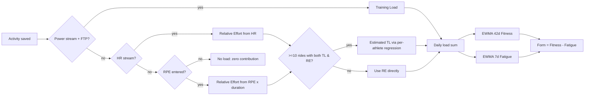
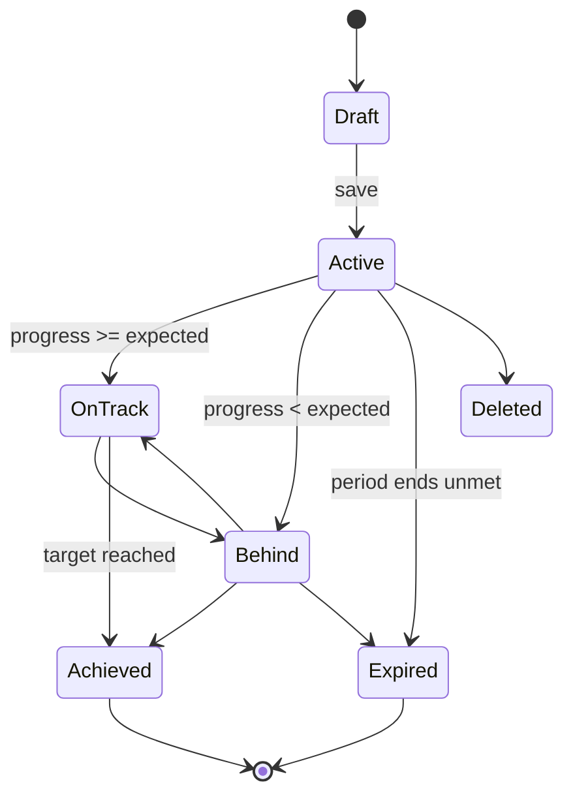
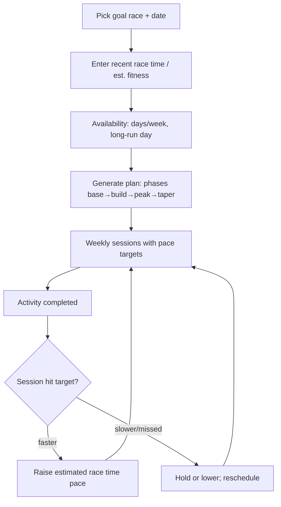

# Training & Analytics — Feature Teardown

> Scope: how Strava (Android first, iOS differences noted) measures training load, fitness, effort, pace, power and progress, and how it turns those numbers into charts, goals, AI summaries, predictions and plans. Written for the StravaFit OSS team.
>
> Conventions: **[FREE]** = available to free Strava accounts; **[SUB]** = needs a Strava subscription (reference only; in StravaFit everything is free). **(unverified)** = could not be confirmed from a public source during this research pass. Strava trademarks are named for reference only.
>
> Research date: 2026-10-29. Strava ships features gradually and runs A/B tests, so screen layouts here are approximations.

---

## 1. Feature map

| Area | Strava name | Tier | Primary input | Where it shows (mobile) |
|---|---|---|---|---|
| Cardio load per activity | Relative Effort | [FREE] score on activity (unverified for 2026); weekly range/graph [SUB] | HR, else Perceived Exertion | Activity detail, You → Progress |
| Power load per activity | Training Load | [SUB] | Power + FTP | Activity detail → Power analysis |
| Normalised power | Weighted Average Power | [FREE] value shown, deeper analysis [SUB] (unverified) | Power stream | Activity stats |
| Intensity | Intensity (%) | [SUB] | Weighted average power / FTP | Activity detail |
| Long-term model | Fitness & Freshness (Fitness, Fatigue, Form) | [SUB] | Daily Training Load and/or Relative Effort | Web "Training" menu; mobile Progress (partial) |
| Subjective effort | Perceived Exertion | [FREE] | 1–10 slider after save | Activity edit / save screen |
| Hilly-run pace | Grade Adjusted Pace (GAP) | [SUB] for charts; average GAP shown on activity (unverified) | Pace + elevation | Activity analysis |
| Zones | Heart Rate / Pace / Power zones | [SUB] for zone distribution charts | HR, pace, power streams + athlete thresholds | Activity detail → Zones |
| Power curve | Power Curve | [SUB] | Power stream, all-time bests | Activity detail, Progress |
| Estimated FTP | Estimated FTP | [SUB] | Recent power history | Power settings / curve |
| Best efforts | Best Efforts (run: 400 m … marathon; ride: power durations) | [FREE] list on activity; history/progress [SUB] (unverified) | Distance/time streams | Activity detail, Profile |
| Progress summary chart | Progress (weekly totals and comparison mode) | basic [FREE]; comparisons [SUB] | Activity totals | You → Progress |
| Training log / calendar | Training Log, Training Calendar | log [SUB] (web); mobile calendar [FREE] (unverified) | Activities | Web Training menu; mobile You tab |
| Goals | Weekly/annual goals, segment goals, power goals | [SUB] (suggested weekly goals since late 2024) | Totals, segments, power | You → Progress → Goals |
| Workout analysis | Splits, laps, workout type, "Analysis" graphs | splits [FREE]; deep analysis [SUB] | Streams | Activity detail |
| AI summaries | Athlete Intelligence | [SUB] | Last ~30 days of activities | Top of activity detail |
| Year review | Year in Sport | [SUB] since 2025 (full); teaser shown to free users (unverified) | Year of activities | In-app story only (mobile) |
| Race time prediction | Performance Predictions | [SUB] | Recent runs, ML model | You → Progress |
| Route-based estimate | Estimated route time / "predicted time" on routes | [SUB] (unverified) | Route profile + athlete history | Route detail |
| Plans | Training plans (Runna, acquired April 2025) | Separate Runna subscription / bundle | Goal race, fitness, availability | Runna app; some in-Strava cross-surfaces (unverified) |

---

## 2. Relative Effort (RE)

### 2.1 What it is
- Launched April 2018, replacing the earlier "Suffer Score". It is a heart-rate-based cardiovascular load score per activity, scaled so scores are roughly comparable across sports and athletes.
- Publicly described as built on **Banister's TRIMP** (training impulse): time spent in each HR zone is multiplied by a zone weight, with higher zones weighted more. Intensity counts for more than duration, so a hard 20-minute session can score about as high as a long easy ride.
- Strava has not published the exact zone coefficients. Third-party guides describe them only as "higher zones carry larger coefficients" or "exponential" weighting. **The exact weights are unverified.**
- When no HR is recorded, RE can be derived from **Perceived Exertion** (1–10) × duration (see §4).
- Accuracy depends on **max HR**. Strava's zones are %-of-max based, and per third-party commentary it does not support LTHR-based zones (unverified for 2026). A wrong max HR shifts every zone and corrupts RE and Fitness & Freshness.

### 2.2 Publicly described formula shape
The public material describes this structure:

```
RE_raw = Σ_zones ( minutes_in_zone_z × w_z )         w_1 < w_2 < … < w_5
RE     = normalise(RE_raw)  (scaled against Strava's population so sports compare)
```

A reasonable open equivalent is **Banister TRIMP**, which weights intensity continuously instead of by zone:

```
HRr    = (HR_avg_interval − HR_rest) / (HR_max − HR_rest)       # heart-rate reserve fraction
TRIMP  = Σ_t  Δt_min × HRr × 0.64 × e^(1.92 × HRr)              # men
TRIMP  = Σ_t  Δt_min × HRr × 0.86 × e^(1.67 × HRr)              # women
```

Or **Edwards summated-zone TRIMP**, which is closest to the zone-weighted description:

| Zone (% HRmax) | 50–60 | 60–70 | 70–80 | 80–90 | 90–100 |
|---|---|---|---|---|---|
| Weight | 1 | 2 | 3 | 4 | 5 |

### 2.3 Weekly Relative Effort range [SUB]
- The mobile Progress area shows a weekly bar or line of summed RE against a **target range** computed from the athlete's recent weeks. Third-party guides describe it as a **3-week rolling average**, which is roughly an acute:chronic workload proxy (unverified detail).
- Colour semantics described publicly:
  - inside the range: steady, healthy training
  - above the range: big week, plan recovery
  - below the range: recovery, taper or detraining

```
┌──────────────────────────────────────┐
│ Relative Effort        This week  ▾  │
│                                      │
│   ░░░░░░░░░ range 180–260 ░░░░░░░░   │
│   ●───●───●──────●                   │
│  M   T   W   T   F   S   S           │
│                                      │
│ 214  "Steady week"                   │
│ Last 3 weeks: 205 · 231 · 190        │
└──────────────────────────────────────┘
```

### 2.4 Per-activity display
```
┌──────────────────────────────────────┐
│ Relative Effort                 87   │
│ ▁▂▃▅▆▇█  "Tough"                     │
│ Zone time:                           │
│ Z1 ███        12:10                  │
│ Z2 ██████     24:33                  │
│ Z3 ████       15:02                  │
│ Z4 ██          6:40                  │
│ Z5 ▏           0:45                  │
│ Compared to your last 3 weeks: high  │
└──────────────────────────────────────┘
```
The activity card also shows an RE label band (for example easy, moderate, tough, extreme). The band names are approximate (unverified).

---

## 3. Fitness & Freshness [SUB]

### 3.1 Public description (Strava support)
- It is an **impulse-response model**. Strava credits Banister (1975) and Coggan's application of it to cycling.
- Daily input is **Training Load** (power-based) and/or **Relative Effort** (HR- or RPE-based).
- **Fitness**: training accumulated over time, which declines during breaks.
- **Fatigue**: the same model on a shorter timescale. It rises fast after hard days and drops fast during rest.
- **Form** = Fitness − Fatigue.
- **No power meter**: the chart uses Relative Effort only.
- **Estimated Training Load**: with **10 or more rides that have both RE and Training Load**, Strava fits a per-athlete best fit between them. It then uses that fit to fill in Training Load for rides that have HR or RPE but no power.
- Chart UI: adjustable time range; toggles for the Fatigue and Form lines; tapping a day shows its Fitness, Fatigue and Form; contributing activities with their "Training Impulse" are listed below the chart; races are marked in red; a 7-day fitness delta is shown.
- Strava does not publish the time constants. The standard Coggan PMC values (42 days for fitness, 7 days for fatigue) are the probable choice **(unverified)**.

### 3.2 Open equivalent (Performance Manager Chart)
```
CTL_today = CTL_yday + (Load_today − CTL_yday) × (1 − e^(−1/42))    # Fitness
ATL_today = ATL_yday + (Load_today − ATL_yday) × (1 − e^(−1/7))     # Fatigue
TSB_today = CTL_yday − ATL_yday                                     # Form (TrainingPeaks convention: yesterday's values)
```
Strava's description ("difference between Fitness and Fatigue") does not say whether it uses same-day or previous-day values (unverified).

Simplified EWMA form, which intervals.icu and others use:
`CTL += (load − CTL)/42`, `ATL += (load − ATL)/7`.

### 3.3 Form interpretation (common convention, not Strava-specific)
| TSB | Meaning |
|---|---|
| > +25 | Detraining / very fresh |
| +5 … +25 | Fresh, race-ready |
| −10 … +5 | Neutral / grey zone |
| −30 … −10 | Optimal productive training |
| < −30 | High risk of overreaching |

### 3.4 Data flow


### 3.5 Wireframe (mobile)
```
┌──────────────────────────────────────┐
│ ← Fitness & Freshness     3M ▾       │
│ Fitness 62  (+4 last 7d)             │
│                                      │
│ 80┤            ╭──╮                  │
│ 60┤     ╭──────╯  ╰─╮   Fitness      │
│ 40┤ ────╯           ╰── Fatigue ┄┄   │
│  0┼┄┄┄┄┄┄┄┄┄┄┄┄┄┄┄┄┄┄┄┄ Form ▬▬      │
│-20┤      ▬▬    ▬▬▬                   │
│   Jul      Aug      Sep   ● race     │
│ [x] Fatigue   [x] Form               │
│──────────────────────────────────────│
│ Tue 14 Sep  Fit 58 Fat 71 Form -13   │
│  • Tempo run          RE 112         │
│  • Commute ride       TL 34          │
└──────────────────────────────────────┘
```
iOS/Android: the full interactive chart historically lived on web (strava.com → Training). Mobile shows fitness trend summaries in Progress (unverified whether the full chart is in the app as of 2026).

---

## 4. Perceived Exertion (RPE) [FREE]

- Launched September 2019. After saving an activity, the athlete sets a **1–10 slider** whose labels run from "Easy" to "Max effort", grouped into bands (roughly 1–3 easy, 4–6 moderate, 7–9 hard, 10 max; exact band labels unverified).
- An optional toggle, **"Prefer Perceived Exertion"**, makes RE use RPE even when HR exists, which helps with a bad HR strap.
- RPE powers RE, and therefore Fitness, for athletes without an HR monitor. The exact RPE-to-RE mapping is not public.
- Open equivalent: **Foster session-RPE**: `sRPE load = RPE (CR-10) × duration_min`. Scale it into the RE/TRIMP range with a per-athlete linear fit when HR activities exist. Otherwise use a global constant (for example RE ≈ sRPE × 0.25; this must be calibrated, unverified).

```
┌──────────────────────────────────────┐
│ How did that feel?                   │
│ ○───○───○───○───○───●───○───○───○──○ │
│ 1               6 Hard            10 │
│ "Breathing heavily, can hold a short │
│  conversation"                       │
│ [ ] Use perceived exertion for       │
│     Relative Effort                  │
│ Private notes ______________________ │
└──────────────────────────────────────┘
```

---

## 5. Power metrics (cycling primarily, also running power)

### 5.1 Definitions from Strava support
| Metric | Strava description | Open formula |
|---|---|---|
| Weighted Average Power (WAP) | An average that accounts for power variability, so it reflects effort better than plain average power | Coggan **Normalized Power**: 30 s rolling mean → ^4 → mean → ^(1/4) |
| Intensity | WAP ÷ FTP (e.g. 225 W / 300 W = 75%) | **IF** = NP / FTP |
| Training Load | Ride power compared with FTP | **TSS** = (sec × NP × IF) / (FTP × 3600) × 100 |
| Power Curve | Best average power for every duration from 1 s up to the ride length; watts or W/kg | Mean-maximal power (MMP) curve |
| Estimated FTP | Formula not published | see §5.3 |
| Power zones | Coggan 7-zone model by % FTP (unverified that Strava uses exactly 7) | Z1 <55, Z2 56–75, Z3 76–90, Z4 91–105, Z5 106–120, Z6 121–150, Z7 >150 % FTP |

Strava's WAP is widely believed to be NP-equivalent but not branded as such (unverified whether it uses the 30 s window). Cross-platform Training Load differences are mostly caused by different FTP settings.

### 5.2 Power Curve UI [SUB]
```
┌──────────────────────────────────────┐
│ Power Curve     W ▾ | W/kg           │
│ Compare: [This ride] [6 wks] [Best]  │
│ 900┤█                                │
│ 600┤ ▀▄                              │
│ 400┤   ▀▀▄▄                          │
│ 250┤       ▀▀▀▀▄▄▄▄▄▄______          │
│    1s 5s 30s 1m  5m 20m 1h 2h        │
│ 5 min: 312 W (best 6wk: 320 W)       │
└──────────────────────────────────────┘
```
Interactions: drag a scrubber along the duration axis; overlay this activity against a period best and the all-time best; tap a period best to jump to the source activity (unverified).

### 5.3 Estimated FTP
- Not documented. Users report it is self-consistent but often higher than test-based FTP. Third-party tools such as Strautomator blend current FTP with recent best efforts.
- Open proposal (pick one; show the method in the UI):
  1. **95% of best 20-min power** in the last 6–8 weeks.
  2. **Critical Power 2-parameter fit**, `P(t) = CP + W'/t`, over MMP points from 3 to 20 min. FTP ≈ CP × 0.96 (heuristic).
  3. **Morton 3-parameter** or the **intervals.icu eFTP**-style approach for a more robust fit.
- Require a minimum amount of data, for example at least one hard effort of 8 minutes or longer, before showing an estimate.

### 5.4 Running power
Strava shows running power when the device records it (Stryd, Garmin, Apple Watch). The same WAP and curve treatment probably applies (unverified).

---

## 6. Grade Adjusted Pace (GAP)

### 6.1 History
- The original GAP followed the Minetti-style metabolic cost of running on grades.
- In **2017** Strava Engineering published an "improved GAP" model built from **heart-rate data across a large population of runners**. Instead of lab energy cost, it estimated the pace on flat ground that would produce the same HR as running at a given grade. This made downhills less "free" than in Minetti's model. (Our fetch of the Medium post was blocked, so details are from memory and **unverified**.)
- Strava patent **US11623121B1**, "Using aggregate activity data to generate a grade adjusted pace model" (inventor Drew Robb), describes selecting GPS windows where an athlete's HR falls in a set percentile band and fitting the grade→cost model on that subset. This is consistent with the 2017 approach.
- A competitor (COROS) describes the Strava model as built on data from about 240k athletes and not personalised.

### 6.2 Open equivalent: Minetti (2002) cost of running
Energy cost C(i) in J·kg⁻¹·m⁻¹ for gradient i (decimal, −0.45 … +0.45):

```
C(i) = 155.4 i^5 − 30.4 i^4 − 43.3 i^3 + 46.3 i^2 + 19.5 i + 3.6
GAP_speed = actual_speed × C(i) / C(0)          # C(0)=3.6
```
Caveats:
- Minetti gives the minimum cost at about −10% to −20%. Real runners don't gain that much on steep descents, which is why Strava moved to an HR-based model.
- Recommended StravaFit approach: use Minetti for uphill and a **flattened downhill curve** (cap the benefit around −9% to −10%; for steeper grades, cost rises back toward flat). Later, calibrate from opt-in aggregate HR data, mirroring the patent idea but with our own data.
- Smooth the grade over 20–50 m windows (barometric altitude preferred, DEM-corrected for phone GPS). Ignore stopped time.

### 6.3 Where GAP appears
- Run activity stats: Avg GAP alongside Avg Pace.
- Pace analysis chart: Pace and GAP lines overlaid on elevation [SUB].
- Splits table: a GAP column per km/mi (unverified on mobile).
- Pace zones can optionally be computed on GAP (unverified).

---

## 7. Zones and zone analysis [SUB charts]

| Zone set | Default definition (approx.) | User override |
|---|---|---|
| Heart rate | 5 zones by % max HR (≈ <65, 65–81, 81–89, 89–97, >97 of max; exact unverified) | Custom zone boundaries; max HR set or auto-estimated |
| Pace (run) | 6 zones from a recent race time / threshold pace (Recovery, Endurance, Tempo, Threshold, VO2max, Anaerobic) (unverified names) | Enter a recent race result |
| Power | %FTP zones (see §5.1) | Set FTP |

Zone distribution display: a horizontal bar per zone showing time and %. The run version can also show zones over time.

Known behaviour: Strava may **auto-recalculate max HR** from uploads, which silently shifts zones. A 2025 bug report describes this (unverified as fixed).

```
┌──────────────────────────────────────┐
│ Heart Rate Zones        Avg 152 bpm  │
│ Z5 Anaerobic  >178  ▌        2%  0:58│
│ Z4 Threshold 165-178 ████   18%  8:40│
│ Z3 Tempo     150-164 ██████ 35% 16:52│
│ Z2 Endurance 125-149 █████  30% 14:31│
│ Z1 Active rec <125  ███    15%  7:12│
│ Edit zones ›                         │
└──────────────────────────────────────┘
```

---

## 8. Best efforts & personal records [FREE list]

- **Run best efforts**: the fastest time inside an activity for the standard distances 400 m, ½ mile, 1 km, 1 mile, 2 mile, 5 km, 10 km, 15 km, 10 mile, 20 km, half marathon, 30 km, marathon, 50 km (list approximate, unverified). Each is flagged as PR / 2nd / 3rd all-time.
- **Ride best efforts**: power for set durations (5 s, 1 min, 5 min, 20 min, 1 h…) where power exists (unverified as separate from the power curve).
- **Edits**: a best effort can be hidden or removed (for example after GPS glitches). Removing one recomputes the ranking (unverified flow).
- **Profile**: a "Best efforts" / PRs list per sport. A 2024–2025 redesign added best-effort history charts [SUB] (unverified).

### Algorithm (open)
For each target distance D: two-pointer sliding window over a cumulative-distance array to find the minimum elapsed time covering ≥ D, interpolating the boundaries linearly. This is O(n) per distance. Use moving or elapsed time consistently; Strava uses elapsed time inside the window (unverified).

---

## 9. Progress summary, training log & calendar

### 9.1 Progress tab (mobile, "You → Progress")
- Weekly or monthly totals (distance, time, elevation, activity count) per sport, shown as a bar or line chart over about 12 weeks [FREE basic].
- **Comparison mode** (Feb 2025) [SUB]: overlays the current period against a past time range or against specific past activities.
- Panels also hold Relative Effort weekly, Fitness, Performance Predictions, Goals and Best efforts, depending on tier (unverified ordering).

```
┌──────────────────────────────────────┐
│ You   Progress | Activities          │
│ Sport: Run ▾   Metric: Distance ▾    │
│ This week 32.4 km  ▲ 12% vs avg      │
│  ▃ ▅ ▂ ▆ ▇ ▅ ▃ ▆ ▄ ▇ ▅ █            │
│  12 weeks                            │
│ Compare: [Last year same period]     │
│──────────────────────────────────────│
│ Goals         Weekly 40 km  81% ▓▓▓░ │
│ Predictions   5K 22:41  HM 1:44:10   │
│ Rel. Effort   214 (steady)        ›  │
└──────────────────────────────────────┘
```

### 9.2 Training Log [SUB, web-first]
- A week-per-row timeline where each activity is a **circle sized by duration, distance or RE** and coloured by sport. Weekly totals sit at the left. It scrolls back through the athlete's full history.
- Filters: sport, metric for circle size, and show/hide workout types (race, long run, workout).

### 9.3 Calendar
- The mobile "You" area shows a monthly calendar with a dot for each activity day, plus a streak count (unverified exact placement in 2026).

---

## 10. Goals [SUB]

| Goal type | Definition | Notes |
|---|---|---|
| Weekly | Distance, time or elevation per sport per week | **Suggested goal** (late 2024): weekly target recommended from recent workouts |
| Annual | Distance or time per year (per sport or combined) | Shows "on pace" vs required pace |
| Segment | Target time on a segment, with a deadline | Progress shown against current best |
| Power | Target power for a duration (e.g. 300 W for 5 min) | Uses the power curve |
| Race / event | Hosted under predictions/plans (unverified) | |

Strava's mid-2025 trend report said 41% of subscribers were on pace for their annual goals.

### Goal-state machine

`expected = target × elapsed_fraction_of_period`; "on pace" projection = `current / elapsed_fraction`.

---

## 11. Workout analysis (per activity)

- **Overview**: distance, moving time, elapsed time, pace/speed, elevation, calories, avg/max HR, cadence, power, temperature.
- **Splits** [FREE]: per km/mi rows with pace, elevation change, GAP (run), HR, and a mini bar of pace.
- **Laps** [FREE]: device laps, or auto-detected from workout structure.
- **Workout type tag**: Run = Default/Race/Long run/Workout; Ride = Default/Race/Workout. This affects the training log and predictions.
- **Analysis charts** [SUB]: stacked pace/speed, HR, power, cadence and elevation vs distance or time, with a shared scrubber and map sync. Selecting a range shows the stats for that range (unverified on Android).
- **Matched activities** [SUB]: compares runs on the same route over time (pace trend chart).
- **Segments list** with efforts (see the segments doc).

```
┌──────────────────────────────────────┐
│ Analysis               Distance ▾    │
│ Pace  ╭╮╭─╮╭──╮╭─      5:12 /km      │
│ GAP   ┄┄┄┄┄┄┄┄┄┄┄      5:01 /km      │
│ HR    ─╱‾‾‾‾‾‾‾‾╲      158           │
│ Elev  ▁▂▄▆█▆▄▂▁▁▂      +34 m          │
│           │ scrub: 6.2 km            │
│ Selection 4.0–7.5 km: 5:03 /km 164bpm│
└──────────────────────────────────────┘
```

---

## 12. Athlete Intelligence (AI summaries) [SUB]

- Beta in late 2024, **out of beta in Feb 2025**. It added virtual run/ride data, power insights and segment analysis.
- Uses about **the past 30 days of activities** (speed, endurance, HR, pace, elevation) to write a short natural-language summary at the top of an activity. Example themes: "your HR was lower than usual at this pace", "you set a 5K best effort", "elevation was above your 30-day average".
- Users can give feedback (thumbs up/down) on each summary. Strava used positive-feedback parity between runs and rides as its criterion for leaving beta.
- Reviewer reception was mixed ("not much my watch doesn't already tell me").
- The underlying LLM vendor is not public (unverified).

```
┌──────────────────────────────────────┐
│ ✦ Athlete Intelligence          (i)  │
│ Strong aerobic run: pace was 8%      │
│ faster than your 30-day average with │
│ similar heart rate. New 2nd-best 10K.│
│ 👍 👎                                │
└──────────────────────────────────────┘
```

---

## 13. Year in Sport [SUB in 2025]

- An annual recap in **story format**, available **only in the mobile app**. It needs the latest app version, at least 3 activities that year and, for the 2025 edition, an active subscription.
- Scenes depend on the data available: totals, top sport, most active month/time of day, kudos given/received, top segments/PRs, longest activity, streaks, gear, a cumulative map, and comparisons with the community.
- Each scene is shareable as an image or video. Some users noted fewer scenes in 2025 than in 2024.

---

## 14. Predictions

### 14.1 Performance Predictions [SUB] (April 2025)
- An ML model using **more than 100 data points** from recent runs, compared against **similar runners**. It predicts **5K, 10K, half marathon and marathon** times.
- Updates after every run and **drifts during rest periods** as fitness decays. Shown in the Progress tab with a trend chart.

Open equivalent:
- **Riegel**: `T2 = T1 × (D2/D1)^1.06`, using the best recent effort (best efforts from §8, decayed by age).
- **VDOT (Daniels)** from the best effort → equivalent race times.
- Improve with a regression on CTL, weekly volume, and long-run length (we lack population data at launch).
- Decay rule: weight best efforts by `e^(−age_days/45)`. If there are no hard runs in 6 weeks, widen the confidence interval.

### 14.2 Route-based time estimates
- Saved routes show an estimated moving time based on the athlete's recent pace on similar terrain (unverified detail; the route builder is covered in the routes doc).
- Open: per-segment time from flat pace × GAP cost(grade) inverse, plus surface factors for trail.

---

## 15. Training plans & Runna

- Strava **acquired Runna in April 2025**. Runna remains a separate app and subscription; a bundled Strava + Runna price was offered (unverified pricing).
- Runna plans are written by coaches. An algorithm then adapts paces and sessions from performance, mainly pace analysis of tempo and interval sessions, plus runner feedback. A single estimated race time drives all pace targets.
- Integration: Runna workouts sync to watches, and completed activities flow from Strava. Cross-promotion appears in Strava (unverified depth of in-app integration as of 2026).
- Strava's older in-house plans (marathon/half PDFs, 2010s) were retired (unverified).



---

## 16. Free vs subscription summary

| Free | Subscription |
|---|---|
| Activity stats, splits, laps, RPE, best efforts list, basic weekly totals, RE score on activity (unverified) | Fitness & Freshness, weekly RE range, zone charts, power curve, Training Load/Intensity, est. FTP, analysis graphs, goals, comparisons, Athlete Intelligence, Year in Sport (2025), Performance Predictions, matched runs |

In StravaFit, **all of the above are free**.

---

## OSS implementation notes

### Neutral naming
| Strava term | StravaFit name |
|---|---|
| Relative Effort | **Effort Score** |
| Fitness & Freshness | **Form Chart** (Fitness / Fatigue / Form) |
| Training Load (power) | **Power Load** |
| Weighted Average Power | **Normalized Power (NP)** |
| Intensity | **Intensity Factor** |
| Perceived Exertion | **How it felt (RPE)** |
| Grade Adjusted Pace | **Effort Pace / Grade-adjusted pace** |
| Athlete Intelligence | **Run Notes / Insights** |
| Year in Sport | **Year Recap** |
| Performance Predictions | **Race Estimates** |
| Best Efforts | **Best Efforts** (generic term, fine) |

### Architecture
- **On-device first** (Kotlin, Android). The metrics are cheap: compute them during activity finalisation in a `WorkManager` job, and store per-activity derived values in Room:
  - `activity_metrics(activity_id, np, if_, power_load, effort_score, effort_source{HR,RPE,POWER}, gap_avg, zone_secs_hr[], zone_secs_pace[], zone_secs_power[], mmp_curve BLOB)`
  - `daily_load(date, load, ctl, atl, tsb)` is recomputed forward from the earliest changed date whenever an activity is added, edited or deleted.
  - `best_effort(activity_id, sport, key, value, rank)`
  - `athlete_thresholds(valid_from, max_hr, rest_hr, lthr, ftp, threshold_pace, weight)`. **Version thresholds by date**, so old activities keep their own zones. Offer "recompute history with new thresholds" explicitly instead of silently re-zoning, which avoids Strava's surprise-shift problem.
- A server (optional sync) mirrors the same pure-Kotlin/TS library so web and phone agree. Put the formulas in a shared **`metrics-core`** module (Kotlin Multiplatform) with golden-file tests against known datasets (for example, compare NP/TSS to GoldenCheetah outputs).

### Algorithms (decisions)
1. **Effort Score**: Banister TRIMP on HR reserve, computed per second. Scale so that 1 h at threshold HR ≈ 100, which matches TSS intuition. Fallbacks in order: power (TSS) → HR (TRIMP) → RPE (sRPE × k, with k calibrated per user by linear regression once there are 5 or more activities with both HR and RPE).
2. **Form Chart**: CTL 42 d, ATL 7 d (user-configurable), TSB from yesterday's values. Seed CTL/ATL from the average of the first 6 weeks to avoid a cold-start ramp. Allow a "load source" preference (power vs HR) per sport. Implement Strava's ≥10-paired-activities regression for power-less rides (ordinary least squares of TSS on TRIMP, with R² shown).
3. **Weekly range**: mean ± 0.5 SD (or ±20%) of the previous 3 weeks' summed load. Label as below / within / above.
4. **NP**: 30 s rolling average (ignore zeros only when coasting is detected, as configured), then 4th power, mean, 4th root. Require ≥ 20 min of data, or show "—".
5. **MMP curve**: compute best mean power for a log-spaced duration set (1, 2, 3, 5, 10, 15, 20, 30 s, 1, 2, 3, 5, 8, 10, 12, 15, 20, 30, 45, 60, 90, 120 … min) using prefix sums; cost is O(n·k). Merge per-activity curves into period bests (6 wk, 1 yr, all time) via an upper envelope.
6. **eFTP**: CP 2-parameter least squares on 3–20 min MMP from the last 90 days, with FTP = 0.96 × CP. Show the confidence and the source efforts.
7. **GAP**: Minetti polynomial for i ≥ 0. For i < 0, use `max(C(i), C(−0.09))`, then ramp back toward C(0) beyond −20% (a tunable lookup table, so it can later be swapped for a data-fitted curve). Smooth grade with a 30 m distance window; clamp to ±45%.
8. **Zones**: HR defaults to %max (5 zones), with optional LTHR-based (Friel) and HRR (Karvonen) methods. Pace zones come from threshold pace or VDOT. Power uses Coggan 7. Tally zone time per second during finalisation.
9. **Best efforts**: two-pointer over the cumulative distance array. Reject windows with a GPS jump speed above the sport's cap (for example, more than 12 m/s for a run) to avoid fake PRs.
10. **Race estimates**: Riegel + VDOT ensemble with recency decay. Phase 2: a gradient-boosted model trained on opt-in, anonymised community data.
11. **Route estimates**: integrate `segment_length / (flat_pace_speed × C(0)/C(i))`.
12. **Insights (AI summary)**: start **rule-based**, since templates over the computed deltas (pace vs the 30-day median at similar HR, new best efforts, CTL change) are deterministic, offline and private. An optional on-device LLM (Gemma via MediaPipe LLM Inference) can rephrase the rules' output. Never send health data to third-party LLMs without explicit opt-in.
13. **Year Recap**: a stateless aggregation query plus a Compose story pager (`HorizontalPager` + auto-advance). Export frames via `Picture` → Bitmap → `MediaCodec` for MP4 sharing. Free for everyone, and available on web too.
14. **Goals**: `goals` table + the state machine above. Recompute progress on activity insert. "Suggested weekly goal" = the 4-week median weekly volume × 1.05, rounded.
15. **Training plans**: an open plan format (JSON: phases → weeks → sessions with targets as a % of threshold pace/HR/FTP). Ship a few public-domain-style templates authored by contributors. Adaptation rules: if 2 consecutive quality sessions are ≥ 3% faster than target at similar HR, raise the threshold pace by 1–2%. Export workouts to devices as **FIT workout files** and via Health Connect `PlannedExerciseSession` (Android 14+ Health Connect API; verify availability).

### Libraries / Android specifics
- Charts: **Vico** (Compose-native) or MPAndroidChart for line/bar charts. The power curve needs a log x-axis, which may need a custom Canvas.
- FIT parsing: the Garmin FIT SDK (Java), or `fit-parser` on the server.
- Health Connect: read HR, power, steps, and exercise sessions from other apps.
- Math: plain Kotlin (no heavy deps). Apache Commons Math for least squares if needed.
- Performance: a 5-hour ride at 1 Hz is 18k samples, and all metrics finish in under 100 ms on a mid-range phone. Recomputing all history after a threshold change should run in a foreground WorkManager job with progress.

### Edge cases
- HR dropouts or strap spikes: median filter, discard values outside 30–230 bpm, and mark RE "low confidence" if more than 20% of samples are missing.
- Optical HR cadence lock (HR ≈ cadence): detect and warn.
- Pauses: exclude auto-paused time from zone time and NP (configurable). Load uses moving time.
- Indoor/treadmill: no GAP unless incline data exists. Virtual rides: use the power, not the GPS-speed-based figures.
- Multi-sport days: sum loads. Per-sport CTL is an optional view.
- Edited or deleted past activities: recompute the daily load forward from that date.
- Time zones and DST: bucket days by the activity's local start date.
- Missing max HR: estimate from the highest 5 s HR across activities, and ask the user to confirm (never auto-shift silently).

---

## Sources
- https://support.strava.com/en-us/articles/15402032-how-fitness-freshness-is-calculated
- https://support.strava.com/hc/en-us/articles/216918477-Fitness-Freshness
- https://support.strava.com/hc/en-us/articles/216918457-Power-Analysis-Features-Premium-
- https://support.strava.com/hc/en-us/articles/22067973274509-Your-Year-in-Sport
- https://the5krunner.com/2025/11/17/strava-relative-effort-guide-tss-2025
- https://the5krunner.com/2021/07/20/strava-relative-effort-everthing-you-need-to-know/
- https://gearjunkie.com/health-fitness/strava-relative-effort
- https://www.quadlockcase.ca/blogs/news/what-is-stravas-new-relative-effort-all-about
- https://sportsmedicine-open.springeropen.com/articles/10.1186/s40798-022-00498-9/tables/2
- https://patents.google.com/patent/US11623121
- https://coros.com/stories/coros-metrics/c/effort-pace
- https://en.run-motion.com/equivalent-speed/
- https://medium.com/strava-engineering/an-improved-gap-model-8b07ae8886c3 (fetch blocked with HTTP 403; content not verified)
- https://bikerumor.com/2019/09/19/strava-unlocks-new-fitness-and-perceived-exertion-features-to-advance-your-training/
- https://runnersworldonline.com.au/strava-rolls-new-features-help-track-overall-fitness/
- https://www.bikeradar.com/news/strava-adds-power-analysis
- https://www.trainerroad.com/forum/t/strava-estimated-ftp/16919
- https://singletrackworld.com/forum/bike-forum/strava-estimated-ftp
- https://docs.strautomator.com/features/ftp-estimator
- https://forum.intervals.icu/t/am-i-using-the-correct-formulas-for-training-load/11767
- https://androidauthority.com/strava-performance-predictions-3547447
- https://www.advnture.com/tech/apps-software/strava-can-now-predict-how-long-it-will-take-you-to-run-that-5k-or-marathon-thanks-to-new-performance-predictions-tool
- https://dcrainmaker.com/2025/04/strava-acquires-runna-thoughts-forward.html
- https://the5krunner.com/2026/09/28/is-runna-ai/
- https://www.techradar.com/health-fitness/fitness-apps/5-fitness-apps-powered-by-ai-that-you-can-download-right-now
- https://endurance.biz/2025/industry-news/strava-revamps-athlete-intelligence-leaderboards-flyovers-and-progress-analytics
- https://stuff.co.za/2025/02/21/stravas-athlete-intelligence-out-of-beta/
