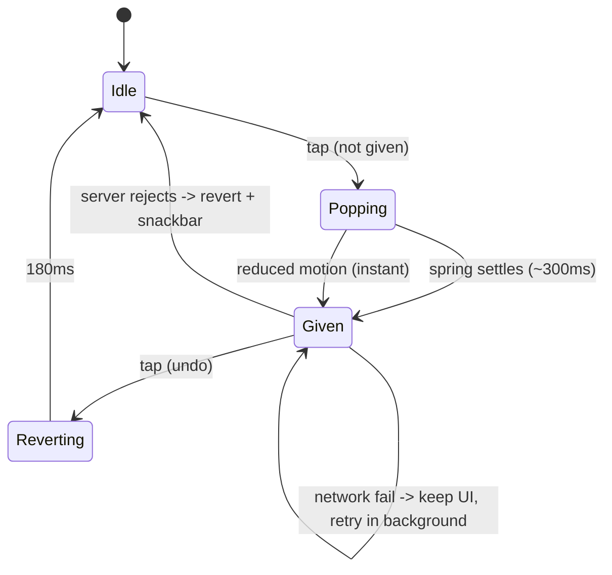
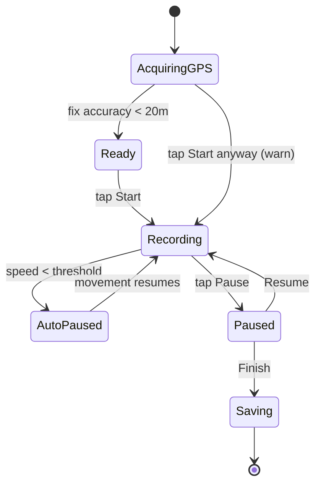

# 05 — Design System: Observed Strava Patterns + Original StravaFit System

> Scope: the visual and interaction language of the Strava Android app (iOS differences noted), described in our own words, followed by an **original** StravaFit design system: tokens, components, data viz, motion, accessibility, and a Material 3 / Jetpack Compose mapping.
>
> **Research note:** This doc was produced in a shortened run because the user asked for a faster turnaround, and the shared web-search budget was used up partway through. Only the Strava developer brand guidelines and one third-party style reference could be fetched directly. Observations about in-app UI come from general product knowledge of the app (2023–2025 versions) and are marked **(unverified)** where a reader should confirm them on a device before relying on them. None of this affects the **StravaFit proposal** in Part B, which is original.
>
> IP rules: no Strava assets, logos, icons, or copied text. Trademarks (Strava, Kudos, KOM/QOM, Local Legend, Beacon, Flyby, Relative Effort) are named only for reference. Part B uses neutral names throughout.

---

## Table of contents

- Part A — Observed design language (Strava)
  - A1. Design principles at a glance
  - A2. Color roles
  - A3. Typography
  - A4. Spacing, grid, layout
  - A5. Iconography
  - A6. Elevation, surfaces, cards
  - A7. Component catalog
  - A8. Motion and celebrations
  - A9. Data-viz conventions
  - A10. Dark mode
  - A11. Accessibility observations
  - A12. Android vs iOS differences
- Part B — StravaFit design system (original)
  - B1. Brand idea and principles
  - B2. Color system (light and dark)
  - B3. Typography
  - B4. Spacing, grid, radii, elevation
  - B5. Motion
  - B6. Iconography
  - B7. Component specs
  - B8. Data-viz palette and chart specs
  - B9. Accessibility requirements
  - B10. Tokens (JSON)
  - B11. Material 3 / Jetpack Compose mapping
- OSS implementation notes
- Sources

---

# Part A — Observed design language (Strava)

## A1. Design principles at a glance

| Principle | How it shows up (observed) |
|---|---|
| **One loud accent** | A single saturated orange is reserved for the primary action, the record button, selected tab state, and the brand mark. Almost everything else is black, white, and grays. |
| **Flat, not material-heavy** | The surfaces read as flat panels separated by hairline dividers and slight background tints. Drop shadows are minimal or absent. The third-party style reference describes the web system as having no shadows or gradients, and the app looks largely similar **(app shadows partly unverified)**. |
| **Data first, numbers big** | Activity cards and detail screens lead with large stat numerals (distance, pace, time) with small, muted labels above or below. |
| **Map as hero** | Activity cards show a route-map thumbnail or a full-width map; the polyline is drawn in the accent color. |
| **Social reinforcement** | Kudos, comments, and achievement counts sit in a fixed "social row" at the bottom of each feed card. |
| **Photography-led marketing, utilitarian product** | Marketing and onboarding use full-bleed athlete photography. In-app screens are restrained and utilitarian. |

## A2. Color roles

### A2.1 Brand accent

- Strava's developer guidelines specify **#FC5200** as the orange for text links to Strava data. A third-party style reference also lists #FC5200 as the brand orange. Older palette sites list **#FC4C02**, which is likely an older or print value. Our task brief also references #FC4C02. Either way, **StravaFit must not use any orange in this range as its brand color.**
- **Accent roles (observed):** the record or start button, primary filled CTA buttons, the selected bottom-nav icon and label, route polylines on maps, progress fills (goals, challenges), links in some contexts, and notification dots **(some roles unverified)**.

### A2.2 Neutrals

Values below come from the third-party web style reference. They are web values; the app likely uses close equivalents **(unverified for Android)**.

| Role | Approx. value | Use |
|---|---|---|
| Canvas | #FFFFFF | Main background (light) |
| Secondary surface | warm off-white ~#F9F8F5 | Footers, section bands, grouped backgrounds |
| Primary text | near-black (#000 / #21211F) | Titles, stat numerals |
| Secondary text | dark gray ~#43423F | Body, nav labels |
| Muted text | ~#64635E | Helper text, timestamps, stat labels |
| Hairline | ~#E0E0DE | Dividers, input outlines |
| Link blue (web) | ~#0060D0 | Inline legal and text links (web) |

### A2.3 Semantic and achievement colors (observed, all unverified as exact values)

| Meaning | Observed treatment |
|---|---|
| Personal record (PR) | Medal-style badge in gold, silver, or bronze for 1st/2nd/3rd best effort. |
| Segment crown (KOM/QOM) | Gold crown icon. |
| Local Legend | Laurel-style badge in a distinct accent **(unverified color)**. |
| Achievements count | Trophy icon with a number on the activity card. |
| Subscription | A small "subscriber" marker/badge, often in the brand accent or gold, on gated features **(unverified)**. |
| Errors | Standard red for form validation and failed uploads. |
| Success | Green checkmarks for things like a completed upload or a goal reached **(unverified)**. |
| HR / effort zones | A gray → blue → green → yellow/orange → red style progression, with Relative Effort using its own reddish scale **(unverified)**. |

### A2.4 Map colors
- Route line in the brand accent with a white or darker casing for contrast against the basemap.
- Start and finish markers as small green and red/checkered dots **(unverified)**.
- Heatmaps (personal and global) use a hot-color ramp. The global heatmap offers several color themes (e.g. hot, blue, purple, gray) **(unverified)**.

## A3. Typography

- **Brand typeface:** A third-party style reference names **Boathouse**, a custom humanist sans, as Strava's primary web typeface, with Inter or Source Sans 3 as fallbacks **(unverified: not confirmed by an official Strava source)**. The Android app may use the custom face or the platform default (Roboto) in places **(unverified)**.
- **Weights:** Roughly two in use: regular (400) for body text and semibold (600) for headings, button labels, and stat numerals.
- **Web sizes found:** 12, 14, 15, 16, and 32 px. Headings sit at about 32 px with a 1.2 line height. Letter spacing is normal throughout.
- **Observed app hierarchy** (approximate, unverified):

| Role | Approx. size (sp) | Weight | Example |
|---|---|---|---|
| Screen title | 20–24 | 600 | "You", "Maps" |
| Card title | 16–17 | 600 | Activity name |
| Stat value | 18–22 (card), 28–40 (detail/record) | 600 | 10.2 km |
| Stat label | 11–12 | 400, muted | "Distance" |
| Body | 14–15 | 400 | Description, comments |
| Meta | 12 | 400, muted | Date, location, device |
| Button | 14–16 | 600 | "Save Activity" |

- **Numerals:** Stats appear to use tabular-figure-like alignment on recording screens so digits don't jitter as values tick **(unverified)**.
- **Case:** Mostly sentence case. Some short labels (stat labels, section labels) appear in uppercase or small caps on older versions **(unverified)**.

## A4. Spacing, grid, layout

- The web reference describes a **4 px base unit** with a scale of 4/8/12/20/24/32/40/48/64, an 8–12 px gap between elements, and a 64 px gap between sections.
- **App layout (observed):**
  - Feed cards span the full width with 16 dp horizontal padding inside. Cards are separated by an 8 dp gray gutter rather than outer margins and shadows **(unverified)**.
  - Stat rows show 3 equal columns on feed cards, with value over label.
  - The detail screen is a map header (about 40% of the viewport) with a scrolling sheet of stats, splits, charts, and segments below.
  - The recording screen shows one large primary metric and a 2×2 or 3-row grid of secondary metrics. A circular record/stop button sits bottom-center.

```
Feed card (observed pattern, approx.)
+--------------------------------------+
| (o) Athlete Name            ...      |
|     Today at 7:02 AM · City          |
|                                      |
| Morning Run                          |
| Distance     Pace        Time        |
| 10.20 km     5:12 /km    53m 04s     |
| [trophy] 3 achievements              |
| +----------------------------------+ |
| |        route map thumbnail       | |
| |     ~~~~~~~~~~/\~~~~~~~~~        | |
| +----------------------------------+ |
| (o)(o)(o) 12 gave kudos              |
|--------------------------------------|
|  [thumb]       [comment]    [share]  |
+--------------------------------------+
```

## A5. Iconography

- **Style:** Outlined, single-weight line icons (about 1.5–2 dp stroke) with rounded terminals. Selected bottom-nav states switch to a filled version and/or the accent color **(unverified)**.
- **Sport icons:** A large set of activity-type glyphs (run, ride, swim, walk, hike, ski, yoga, weights, etc.) in a consistent outlined style, used in pickers, feed cards, and filters.
- **Achievement icons:** Medal, crown, trophy, and laurel shapes, often filled in metallic tones.
- **Social icons:** A thumbs-up-style "kudos" icon that switches from outline to accent-filled when given; a speech bubble for comments; a share arrow.

## A6. Elevation, surfaces, cards

- **Mostly flat.** Hierarchy comes from background tints (white card on light gray canvas), hairline dividers, and whitespace.
- **Bottom sheets** use rounded top corners and a drag handle, with a scrim behind modal sheets.
- **Radii:** The web reference gives 4 px for buttons, tags, and inputs, and square corners for cards. The app uses larger radii on bottom sheets and pill-shaped chips **(unverified)**.
- **Floating elements:** The map overlay controls (layers, recenter) and the record button are the main elements with visible shadow or elevation **(unverified)**.

## A7. Component catalog (observed)

| Component | Observed behavior and appearance |
|---|---|
| **Primary button** | Accent fill, white semibold label, small radius (~4 dp), full width in forms and sheets. |
| **Secondary button** | White or transparent fill with a 1 px dark outline and dark label. |
| **Text button** | Accent or dark label with no container; used for "See all" and "Edit". |
| **Record button** | A large circular accent button, bottom-center on the Record screen. It changes to a stop/pause state while recording, then shows Resume and Finish actions. |
| **Bottom navigation** | 5 destinations in recent versions: Home, Maps, Record, Groups, You **(verify current set; tabs have been renamed and reordered over time)**. The selected tab is tinted with the accent. |
| **Top tabs** | Text tabs with an underline indicator, used on profile/You (Progress / Activities), Groups (Clubs / Challenges), and similar screens. |
| **Chips / filter pills** | Rounded pills for sport-type filters and map filters. The selected state is a dark or accent fill. |
| **Bottom sheets** | Used for sport pickers, share options, map layers, and route details. They snap to half and full height on Maps. |
| **Stat block** | A muted label above or below a large value plus unit. It repeats in a grid. |
| **Map card** | A static map thumbnail with the route polyline, embedded in feed cards; tapping it opens the detail map. |
| **Kudos button** | A thumb icon in the card's social row. It fills with the accent on tap. A facepile and "N gave kudos" sit above the row. |
| **Avatars & facepiles** | Circular avatars. Facepiles overlap by roughly 30% with a white ring separator. A subscriber marker may appear on the avatar **(unverified)**. |
| **Badges** | PR medals (1/2/3), crowns, and laurel icons placed inline with segment rows; a trophy count on cards. |
| **Progress rings / bars** | Goal progress and challenge progress shown as horizontal bars or rings filled with the accent on a gray track. |
| **Charts** | Elevation area chart, pace/speed line, HR line, zone distribution bars, splits table with inline bars, and a weekly volume bar chart on the profile. |
| **Empty states** | A simple illustration or icon, a one-line headline, a short explanation, and one CTA (e.g. "Find friends", "Record an activity"). |
| **Snackbars / toasts** | A dark bar at the bottom for confirmations such as an upload completing, an activity being saved, or a deletion with Undo **(unverified exact styling)**. |
| **Dialogs** | Platform-styled confirm dialogs for destructive actions (discard activity, delete). |
| **Lists / rows** | Settings and segments use full-width rows with a leading icon, a title and subtitle, and a trailing chevron or value. |
| **Paywall/upsell cards** | Cards with an accent or gradient highlight and a "start trial"-style CTA, placed inline in feature screens **(styling unverified)**. |

## A8. Motion and celebrations

- **Kudos:** Tapping kudos gives a quick scale "pop" of the icon as it changes from outline to filled accent, and the count updates. Some versions add haptic feedback **(unverified)**. Undoing kudos by tapping again is generally not supported, or is limited **(unverified)**.
- **Activity save / upload:** A progress indicator while uploading. When processing finishes, the feed card appears at the top of the feed.
- **Achievements:** After an activity with PRs or other achievements, the detail screen highlights the achievements. Strava has shipped celebratory animations (e.g. confetti or animated badges) for milestones, streaks, and year-in-sport recaps **(unverified details)**.
- **Year in Sport:** An annual story-style recap of animated, full-screen, swipeable cards with bold type and gradients, designed to be shared.
- **Record screen:** Live numbers tick without layout shift. Auto-pause gives a visual state change (the label or background changes) **(unverified)**.
- **Maps:** Smooth pan and zoom. Bottom sheets snap with spring-like easing. Route previews animate the line drawing in some flyover/3D features **(unverified)**.

## A9. Data-viz conventions (observed)

| Chart | Encoding |
|---|---|
| Elevation profile | Filled area chart in gray (or a gradient), x = distance, y = elevation. Scrubbing shows a vertical cursor synced with the map marker. |
| Pace / speed | A line chart overlaid on or below elevation. Pace axes put faster values higher, i.e. inverted. |
| Heart rate | A line in a red tone, with optional zone bands. |
| Zone distribution | Horizontal bars per zone (Z1–Z5) with time and percentage, colored along a cool-to-hot progression **(unverified exact colors)**. |
| Splits | A table of per-km or per-mile rows with a horizontal bar showing relative pace; the fastest split is highlighted. |
| Weekly volume | Columns per week (12-week view) on the profile; the current week is highlighted. |
| Fitness & Freshness | A multi-line chart (fitness, fatigue, form) **[SUB]**. |
| Relative Effort | A weekly range band ("target range") with the current week's cumulative bar **[SUB]** for the full view. |
| Best efforts / PR history | A dot plot or line of times over dates, with PR markers. |

Conventions: muted gridlines, very few axis labels, and value tooltips on long-press/scrub. Brand-accent lines are reserved for the athlete's own data.

## A10. Dark mode

- Android follows the system theme setting, and there is likely an in-app appearance setting **(unverified)**.
- Dark surfaces are near-black/dark gray rather than pure black in most places **(unverified)**. Text is off-white with muted grays for secondary text. The accent orange stays the same hue.
- Maps switch to a dark basemap style in dark mode **(unverified)**.

## A11. Accessibility observations

- Orange-on-white for small text is borderline for contrast: #FC5200 on #FFF is about 3.1:1, which passes AA only for large text and UI components, not for normal-size text. This is why the brand uses orange for fills and icons rather than body text.
- Zone colors rely heavily on hue. A red/green progression is hard to distinguish for deuteranopes unless labels are present.
- Dynamic font scaling is partly supported. Dense stat grids may truncate at large font scales **(unverified)**.
- Content descriptions on icon-only buttons (kudos, share) vary in quality **(unverified)**.

## A12. Android vs iOS differences (observed, unverified details)

| Area | Android | iOS |
|---|---|---|
| Navigation | Bottom nav plus a system back gesture or button | Bottom tab bar plus swipe-back |
| Dialogs | Material-style dialogs | UIKit alerts and action sheets |
| Share | Android share sheet | iOS share sheet; Instagram story integration on both |
| Widgets | Home-screen widgets (stats/streak) **(unverified)** | WidgetKit widgets and Live Activities for recording on the lock screen |
| Wear | Wear OS app | Apple Watch app |
| Haptics | Lighter use | More haptic feedback on kudos and record actions **(unverified)** |

---

# Part B — StravaFit design system (original)

## B1. Brand idea and principles

**Brand idea: "Ridgeline."** It is calm, outdoorsy, and precise. The palette borrows from alpine lakes and evening light: a deep **teal-blue** primary with a **lime "signal"** accent for wins and celebrations. Nothing is in the orange family.

**Principles**
1. **Numbers are the hero.** Use big tabular numerals with quiet labels.
2. **One action per screen** gets the filled primary button.
3. **Color means something.** The primary marks interaction, the signal marks achievement, and zone colors encode intensity only. Color is never decorative noise.
4. **Every color has a non-color backup**: a label, icon, or pattern.
5. **Free by default.** There are no paywall treatments; former [SUB] features look like any other feature.
6. **Fast and quiet motion.** Celebrations are brief, skippable, and respect the system's reduced-motion setting.

## B2. Color system

### B2.1 Brand ramps (original values)

**Primary — "Fjord" (teal-blue)**

| Step | Hex |
|---|---|
| 50 | #E6F4F5 |
| 100 | #C2E3E6 |
| 200 | #8ECBD1 |
| 300 | #57B0B9 |
| 400 | #2B97A2 |
| 500 | #0F7E8A |
| 600 | #0B6A75 |
| 700 | #08565F |
| 800 | #064249 |
| 900 | #032C31 |

**Signal — "Lichen" (lime, for achievements and celebrations)**

| Step | Hex |
|---|---|
| 100 | #F3FBD6 |
| 300 | #DDF27F |
| 500 | #B8DB2E |
| 700 | #7E9A12 |
| 900 | #3F4E07 |

**Neutrals — "Slate" (slightly cool)**

| Step | Hex |
|---|---|
| 0 | #FFFFFF |
| 25 | #F8FAFA |
| 50 | #F1F4F5 |
| 100 | #E3E8EA |
| 200 | #CBD3D6 |
| 300 | #A9B4B8 |
| 400 | #87939A |
| 500 | #66737A |
| 600 | #4D585E |
| 700 | #363F44 |
| 800 | #22292D |
| 850 | #1A2024 |
| 900 | #12171A |
| 950 | #0B0F11 |

**Status:** success #1E8E5A, warning #B7791F, error #C2362F, info #2F6FB3. Each has a light-mode container tint and a dark-mode lightened variant (see JSON).

**Medals (for 1st/2nd/3rd best efforts):** gold #C99A2E, silver #8F9AA3, bronze #A8673A. These are always shown with the numeral 1, 2, or 3 inside the badge, never color alone.

### B2.2 Semantic roles

| Role | Light | Dark | Notes |
|---|---|---|---|
| `bg/canvas` | #F1F4F5 | #0B0F11 | App background behind cards |
| `bg/surface` | #FFFFFF | #12171A | Cards, sheets |
| `bg/surface-raised` | #FFFFFF | #1A2024 | Dialogs, menus, sheets in dark |
| `bg/surface-sunken` | #F8FAFA | #0B0F11 | Inputs, stat wells |
| `text/primary` | #12171A | #F1F4F5 | 16.9:1 / 16.6:1 |
| `text/secondary` | #4D585E | #A9B4B8 | ≥7:1 on surface |
| `text/muted` | #66737A | #87939A | ≥4.5:1 on surface |
| `text/on-primary` | #FFFFFF | #032C31 | |
| `border/hairline` | #E3E8EA | #22292D | Dividers |
| `border/strong` | #A9B4B8 | #4D585E | Outlined buttons, inputs |
| `action/primary` | #0B6A75 | #57B0B9 | 6.1:1 on white (light); 7.0:1 on #12171A (dark) |
| `action/primary-pressed` | #08565F | #8ECBD1 | |
| `action/primary-container` | #C2E3E6 | #064249 | Tonal buttons, selected chip |
| `achievement/signal` | #B8DB2E (fill) | #DDF27F (fill) | Fill only. Text on it uses #1A2024. Never used as a text color on white. |
| `map/route-self` | #0F7E8A with a white 2dp casing | #57B0B9 with a #0B0F11 casing | |
| `map/route-other` | #66737A | #A9B4B8 | Friends' routes in Flyby-like views |
| `focus/ring` | #2B97A2 | #8ECBD1 | 2 dp ring, 2 dp offset |

Contrast values are calculated estimates and should be re-checked with a tool during implementation (see OSS notes).

## B3. Typography

**Families (all SIL Open Font License):**
- **Manrope** for UI text and headings: a geometric/grotesque sans that reads well at small sizes.
- **Barlow Semi Condensed** (SemiBold/Bold) for **stat numerals**. It is narrow and sporty, so it fits 3 stats per row. Use tabular figures (`tnum`).
- **JetBrains Mono** (optional) for debug and raw-data screens only.

Fallback: Roboto / system-ui.

**Type scale** (sp, line height in parentheses):

| Token | Family | Size | Weight | Use |
|---|---|---|---|---|
| `display-xl` | Barlow SC | 64 (68) | 700 | Record screen primary metric |
| `display-l` | Barlow SC | 44 (48) | 700 | Activity detail hero stat |
| `display-m` | Barlow SC | 32 (36) | 600 | Recap cards, goals |
| `headline` | Manrope | 24 (30) | 700 | Screen titles |
| `title-l` | Manrope | 20 (26) | 700 | Section headers |
| `title-m` | Manrope | 17 (22) | 700 | Card titles (activity name) |
| `title-s` | Manrope | 15 (20) | 600 | Row titles |
| `stat-m` | Barlow SC | 22 (26) | 600 | Feed card stats |
| `stat-s` | Barlow SC | 17 (20) | 600 | Splits, segment rows |
| `body-l` | Manrope | 16 (24) | 400 | Descriptions |
| `body-m` | Manrope | 14 (20) | 400 | Default body, comments |
| `body-s` | Manrope | 13 (18) | 400 | Secondary body |
| `label-l` | Manrope | 15 (20) | 600 | Buttons |
| `label-m` | Manrope | 13 (16) | 600 | Chips, tabs |
| `label-s` | Manrope | 11 (14) | 600, +0.4 tracking, uppercase | Stat labels, overlines |
| `caption` | Manrope | 12 (16) | 400 | Timestamps, meta |

**Rules:**
- Units sit next to their values at about 60% size in the label color (`10.2` + `km`).
- Minimum text size is 11 sp. All text uses `sp` so it scales with the system font size.
- Above a 1.3 font scale, stat grids reflow from 3 columns to 2.

## B4. Spacing, grid, radii, elevation

**Spacing (4 dp base):** `0, 2, 4, 8, 12, 16, 20, 24, 32, 40, 48, 64`.
- Screen gutter: 16 dp (20 dp at ≥600 dp width)
- Card padding: 16 dp; gap between cards: 8 dp
- Stat grid column gap: 12 dp
- List row minimum height: 56 dp; touch targets ≥48 dp

**Grid:**
- Phones use a 4-column grid with 16 dp margins and 8 dp gutters.
- Foldables and tablets (≥600 dp) use 8 columns. Above 840 dp the feed is capped at a 640 dp width, with a list-detail layout for the activity view.

**Radii:**

| Token | dp | Use |
|---|---|---|
| `radius-xs` | 4 | Tags, small badges |
| `radius-s` | 8 | Inputs, map thumbnail |
| `radius-m` | 12 | Buttons, chips container |
| `radius-l` | 16 | Cards |
| `radius-xl` | 28 | Bottom sheet top corners, dialogs |
| `radius-full` | 999 | Pills, avatars, FAB/record button |

Our cards are rounded (16 dp) and inset with margins. This is intentionally different from the full-bleed, flat feed cards observed in Part A.

**Elevation:** Material 3 tonal elevation is used in dark mode; light mode uses soft shadows.

| Level | Light shadow | Dark tonal overlay (primary @ %) | Use |
|---|---|---|---|
| 0 | none | 0% | Canvas, flat lists |
| 1 | 0 1 2 rgba(18,23,26,.06), 0 1 3 rgba(18,23,26,.10) | 5% | Cards |
| 2 | 0 2 6 rgba(18,23,26,.10) | 8% | Sticky headers, chips on map |
| 3 | 0 6 16 rgba(18,23,26,.14) | 11% | Bottom sheets, menus, FAB |
| 4 | 0 12 28 rgba(18,23,26,.18) | 14% | Dialogs, record button |

## B5. Motion

| Token | Duration | Easing | Use |
|---|---|---|---|
| `instant` | 0 ms | — | Reduced motion |
| `micro` | 100 ms | standard | Press states, ripples |
| `short` | 180 ms | standard | Chip toggle, icon swap |
| `medium` | 280 ms | emphasized-decelerate | Sheet open, card expand |
| `long` | 420 ms | emphasized | Screen transitions, shared map element |
| `celebrate` | 900–1600 ms | spring | Achievement bursts (skippable) |

**Easing curves:**
- standard `cubic-bezier(0.2, 0, 0, 1)`
- emphasized-decelerate `(0.05, 0.7, 0.1, 1)`
- emphasized-accelerate `(0.3, 0, 0.8, 0.15)`
- Exits use the accelerate curve at about 70% of the enter duration.

**Springs (Compose):**
- `spring(dampingRatio = 0.55f, stiffness = 500f)` for the "high-five" pop
- `spring(0.8f, 380f)` for sheets

**Signature interactions (original designs):**
- **High-five (our Kudos equivalent):** On tap, the icon scales 1 → 1.25 → 1 on the bouncy spring and fills with primary. Six small lime dots radiate 12 dp outward and fade over 360 ms. The count rolls up with a vertical digit slide. Light haptic (`HapticFeedbackConstants.CONFIRM` on API 30+, `KEYBOARD_TAP` as a fallback). Tapping again undoes it, with a reverse animation and no dots.
- **Personal-best reveal:** On activity save, the achievement row slides up (`medium`), and each medal badge "stamps" in with a scale from 0.6 → 1, staggered by 60 ms. Max 5 animated; the rest appear without animation.
- **Milestone celebration:** A full-screen lime/teal particle burst, at most 1.2 s, that can be tapped through. It is shown only once per achievement and never on cold start.
- **Live stats:** Numbers update in place without animation (to avoid motion noise during exercise). Changing a metric slot uses a 180 ms crossfade.
- **Reduced motion:** When `Settings.Global.ANIMATOR_DURATION_SCALE == 0` or the in-app setting is on, every animation is replaced by an instant change or a 100 ms fade, with no particles.



## B6. Iconography

- Use **Material Symbols Rounded** (Apache 2.0) as the base set, at weight 400, grade 0, and optical size 24. The filled axis (FILL=1) marks selected states.
- **Custom sport glyphs** are drawn on a 24 dp grid with a 2 dp stroke and round caps and joins, matching Material Symbols Rounded. Contributors can draw them as VectorDrawables; see OSS notes.
- **Achievement shapes** (original designs, not crowns or laurels):
  - **Best effort:** a hexagonal medal with the numeral 1, 2, or 3
  - **Segment leader** (our KOM equivalent): a "summit flag" glyph
  - **Route regular** (our Local Legend equivalent): a "footprint loop" glyph
- Icon sizes are 16 (inline), 20 (dense rows), 24 (default), and 32 (empty states, sport picker). Icon-only buttons are always 48 dp touch targets.

## B7. Component specs

Each component lists anatomy, variants, states, and tokens. States follow the Material 3 state layers: hover 8%, focus 10%, pressed 10%, and dragged 16% of the content color, with disabled at 38% content and 12% container.

### B7.1 Buttons

| Variant | Container | Content | Height | Radius | Use |
|---|---|---|---|---|---|
| Filled (primary) | `action/primary` | `text/on-primary` | 48 | 12 | One per screen |
| Tonal | `action/primary-container` | primary-800 / primary-100 (dark) | 48 | 12 | Secondary emphasis |
| Outlined | transparent, 1 dp `border/strong` | `text/primary` | 48 | 12 | Alternatives |
| Text | none | `action/primary` | 40 | 12 | Inline: "See all" |
| Destructive | error | white | 48 | 12 | Delete, discard |
| Small | as variant | as variant | 36 | 10 | In cards |

**States:** default, pressed (state layer plus 0.98 scale over `micro`), focused (ring), disabled, and loading. Loading swaps the label for a 20 dp progress indicator and keeps the width.

### B7.2 Record button (our "Start" control)

```
          Idle                 Recording             Paused
       .--------.             .--------.          .------.  .------.
      /          \           /  ____    \        | Resume|  |Finish|
     |   START    |         |  |    |    |       '------'  '------'
      \          /           \  ----    /        (tonal)   (filled)
       '--------'             '--------'
     72dp, primary          72dp, slate-900 w/
     elevation 4            primary ring progress
```

- **Idle:** A 72 dp circle filled with primary and the label "Start". It shows a GPS-readiness ring: dashed and muted while searching for GPS, solid primary when the fix is good. The ring is backed by a status text ("Acquiring GPS…"), so it doesn't rely on color.
- **Recording:** The button becomes a stop/pause square. A long-press to stop is optional, to prevent accidental stops.
- **Paused:** Splits into Resume (tonal) and Finish (filled).
- **Auto-paused:** A banner reading "Auto-paused" appears in a warning container, and the main stat dims to 60%.



### B7.3 Chips

| Variant | Use | Selected state |
|---|---|---|
| Filter chip | Sport filters, map filters | primary-container fill plus a check icon |
| Assist chip | "Add photo", "Add description" | — |
| Input chip | Tagged athletes, gear | Trailing × |

Chips are 32 dp tall (48 dp touch target via padding) with 999 radius and `label-m` text. Horizontal chip rows scroll and fade at the edges.

### B7.4 Tabs and navigation

- **Navigation bar:** 5 destinations with neutral names: **Feed, Explore (maps/routes), Record (center), Groups, Me**. It is 80 dp tall. The active indicator is a 64×32 dp pill in primary-container, with a filled icon and `label-m`. Badges for unread counts use error red with white numerals; dot badges are 6 dp.
- **Top tabs:** Primary tabs have a 3 dp primary underline, with a scrollable variant for more than 4 tabs.
- **Segmented control** (e.g. week/month/year): use the Material 3 SegmentedButton with primary-container for the selected segment.
- On ≥600 dp widths, switch to a NavigationRail. Above 840 dp, use a rail plus list-detail.

### B7.5 Bottom sheets

- **Modal:** Top radius of 28 dp, a 32×4 dp drag handle, and a scrim of slate-950 at 32% opacity (light) or 50% (dark). Supports half and full detents.
- **Standard (non-modal) on maps:** Three detents (peek 96 dp, half, full). The map stays interactive at peek.
- Content padding is 16 dp, and the sheet title uses `title-l`.

### B7.6 Stat block

```
+-------------+-------------+-------------+
| DISTANCE    | PACE        | TIME        |
| 10.20 km    | 5:12 /km    | 53:04       |
+-------------+-------------+-------------+
  label-s,       stat-m value + unit at 60%
  text/muted     text/primary
```

- **Variants:** `inline` (feed, 3 columns), `grid` (detail, 2–3 columns with dividers), `hero` (record, display-xl with label below), and `compare` (value plus a delta chip such as ▲ 0:12, using arrow and sign, not just color).
- **Empty value:** em dash "—", never "0".
- **Accessibility:** The whole block is merged into one semantics node, read as "Distance, 10.20 kilometres".

### B7.7 Activity card (feed)

```
+--------------------------------------+
| (av) Dana K.                    ⋮    |
|      Today 07:02 · Run · Lakeside    |
|                                      |
| Morning tempo                        |
| DISTANCE   PACE       TIME           |
| 10.20 km   5:12 /km   53:04          |
| [hex1] 2 best efforts  [flag] 1 lead |
| +----------------------------------+ |
| |   map (radius-s), route=primary  | |
| +----------------------------------+ |
| (a)(b)(c) +9  High-fives · 3 comments|
| [High-five]   [Comment]    [Share]   |
+--------------------------------------+
```

- Surface is `bg/surface` with radius 16, elevation 1, and an 8 dp gap between cards.
- **Media:** Map first, with photos in a horizontal pager (dots indicator). Indoor activities get a stat-only variant with no map, plus an optional HR sparkline.
- **States:** loading (skeleton shimmer, 1200 ms loop, disabled under reduced motion), uploading (inline progress bar plus "Processing…"), failed (error container plus a Retry button), and private (a lock icon next to the meta line).

### B7.8 Map card

- Static map image (radius 8, aspect 2:1 in the feed, 16:9 on detail headers), sourced from MapLibre snapshot rendering.
- The route has a 4 dp primary stroke over a 6 dp white (light) or slate-950 (dark) casing. The start is a 10 dp hollow circle and the finish a 10 dp filled circle, so they're told apart by shape rather than green/red.
- Privacy zones are drawn hidden (the line is trimmed). A subtle dotted end indicates trimming.

### B7.9 High-five button and facepile

- The icon is an original "raised palm" glyph, 24 dp in a 48 dp target. **Off:** outline in `text/secondary`. **On:** filled `action/primary`.
- The facepile shows up to 3 avatars at 24 dp, overlapping by 8 dp with a 2 dp `bg/surface` ring. Overflow is shown as a "+N" pill.
- Tapping the count opens a sheet listing everyone who gave a high-five.
- The content description changes with state: "Give high-five" / "Remove high-five", plus "12 high-fives".

### B7.10 Avatars

| Size | Use |
|---|---|
| 24 | Facepile |
| 32 | Comments |
| 40 | Feed header |
| 56 | Lists |
| 96 | Profile |

- The fallback is initials on a deterministic tint (hash of the user ID into 8 primary/neutral tints, each passing 4.5:1 with its text).
- A status ring marks when someone is live sharing location (our Beacon equivalent): a 2 dp signal-lime ring plus a "Live" label.

### B7.11 Badges

- **Best effort hex medal:** 20 dp; fill is gold, silver, or bronze with a numeral in slate-900.
- **Segment leader flag:** 20 dp primary.
- **Route regular loop:** 20 dp lichen-700.
- **Count badges:** error fill, `label-s`.
- **"New" badge:** lichen-300 fill with slate-900 text.

### B7.12 Progress (rings and bars)

- **Goal ring:** 8 dp stroke with a slate-100/800 track. The fill is primary, switching to signal lime with a check glyph at 100%. Centre text shows the value and "of 40 km".
- **Linear bar:** 6 dp tall with radius full. Challenge progress uses a primary fill; over-target shows a lime overflow segment.
- **Determinate upload bar:** 4 dp.
- **Indeterminate:** Material 3 wavy or linear indicator.

### B7.13 Empty states

```
+--------------------------------------+
|                                      |
|            [ 32dp icon ]             |
|                                      |
|        No activities yet             |
|  Record your first run, ride or walk |
|  and it'll show up here.             |
|                                      |
|        [  Start recording  ]         |
|        Import from file              |
+--------------------------------------+
```

The icon sits in a 64 dp primary-container circle, with the title in `title-m`, body text in `body-m` muted, one filled CTA, and an optional text button. No stock illustrations are needed; contributors can add original line art later.

### B7.14 Snackbars and toasts

- Use the Material 3 Snackbar: an inverse surface (slate-800 in light, slate-100 in dark), `body-m` text, and an optional action in primary-200 (light) or primary-600 (dark).
- Display for 4 s (8 s with an action), anchored above the navigation bar and the record button.
- Destructive actions show "Deleted · Undo".
- Do not use Android Toasts for app feedback, except for background-service messages.

### B7.15 Lists, inputs, dialogs

- **Rows:** 56–72 dp with a leading 24 dp icon or 40 dp avatar, a title and subtitle, and a trailing value, chevron, or switch.
- **Text fields:** Outlined, 56 dp tall, radius 8. Errors show error-colored helper text plus an icon.
- **Dialogs:** Radius 28 and surface-raised, with at most 2 actions; a destructive action uses error text.

## B8. Data-viz palette and chart specs

### B8.1 Intensity zones (colorblind-safe, original)

Zones use a single **sequential lightness ramp from cool to warm** that stays ordered in grayscale and under deuteranopia/protanopia simulation, rather than a red/green spectrum. Zone numbers are always printed.

| Zone | Name (neutral) | Light hex | Dark hex | Approx. L* (light) |
|---|---|---|---|---|
| Z1 | Recovery | #BFD9EA | #9CC3DD | 85 |
| Z2 | Endurance | #6FA8D0 | #6FA8D0 | 66 |
| Z3 | Tempo | #E9C46A | #EBCB7C | 81 (distinct hue; paired with pattern) |
| Z4 | Threshold | #E07B39 | #EA8F52 | 61 |
| Z5 | Max | #9E2A4B | #D0557A | 34 |

- **Why this ramp:** It goes blue → yellow → orange → wine, which avoids red/green confusion. Z5 is much darker than Z4, so neighbouring zones also differ in lightness.
- **Non-color backups:** Zone bars carry their "Z3" label plus time and percentage. For grayscale or high-contrast mode, zone backgrounds in charts get optional texture patterns (none, dots, diagonal, cross-hatch, solid).
- **Validation:** Check every adjacent pair with a CVD simulator (deuteranopia, protanopia, tritanopia). Tritanopia is the riskiest case (blue vs yellow-green), and the ramp is mainly ordered by lightness to cover it.
- **Strava note:** Our zone ramp purposely uses an orange at Z4 only as a zone color, never as a brand or UI color.

### B8.2 Series colors

| Series | Light | Dark | Mark |
|---|---|---|---|
| Elevation | slate-200 area, slate-400 top line | slate-700 area, slate-500 line | Area |
| Pace/speed | primary-600 | primary-300 | 2 dp line |
| Heart rate | #B23A5A (wine) | #E07A97 | 2 dp line |
| Cadence | #6B5BB5 (violet) | #A497E0 | 2 dp line (dotted if shown with HR) |
| Power | #2E7D32-ish → use #3C8D5A | #7BC89A | 2 dp line |
| Comparison (previous / friend) | slate-400 dashed | slate-500 dashed | Dashed line |

Categorical order for multi-series charts: primary → wine → violet → green → amber. This is Okabe-Ito–inspired and each series also gets a distinct dash or marker.

### B8.3 Chart specs

- **Elevation + metric combo:** Elevation is a background area; the selected metric is a line on top. A scrub cursor (1 dp `text/primary` line plus a 6 dp dot) syncs to a map marker. The tooltip is a surface-raised card showing distance, value, and elevation.
- **Pace axis inverted:** Faster pace plots higher. The label says "Pace (min/km), faster ↑".
- **Splits:** Table rows have an inline horizontal bar whose length is proportional to speed. The fastest split gets a lime "fastest" tag with text, not just color.
- **Zone distribution:** Horizontal stacked bar plus a per-zone list (`Z2 Endurance · 24:10 · 46%`).
- **Weekly volume:** 12 columns with radius 4 at the top. The current week is primary and the others primary-200 (light) or primary-700 (dark). A goal line is drawn dashed.
- **Training load** (our Fitness & Freshness / Relative Effort equivalents, free): uses 3 lines (fitness = primary, fatigue = wine, form = violet dashed) and a 0-line. The weekly effort band is a primary-100 range band with the current-week bar on top.
- **Gridlines:** 1 dp `border/hairline`, at most 4 horizontal lines, no vertical gridlines. Axis labels use `caption` muted.
- **Accessibility:** Each chart has a "View as table" toggle and a semantics summary such as "Average pace 5:12 per km, fastest split km 7 at 4:48".

## B9. Accessibility requirements

| Requirement | Target |
|---|---|
| Text contrast | ≥4.5:1 normal, ≥3:1 large (≥18.5 sp bold / 24 sp) |
| UI component contrast | ≥3:1 for borders, icons, focus rings, chart lines vs background |
| Touch targets | ≥48×48 dp |
| Font scaling | Layouts work to 200%; stat grids reflow; no truncation of values (labels may wrap) |
| Color independence | Zones, PR rank, start/finish, deltas all have text/shape backups |
| Screen readers | TalkBack semantics for stat blocks (merged), charts (summary + table), high-five state, map (route summary text) |
| Motion | Respect the system animator scale; in-app "Reduce motion" switch; no flashing > 3/s |
| Recording safety | Record screen has a high-contrast option (pure black/white + primary) for sunlight; large lock-screen controls |
| Haptics | Optional; never the only feedback |
| Localization | Units (km/mi, min/km, min/mi), 24/12h time, RTL mirroring (except maps and charts' time axes), and space for strings up to 40% longer |

## B10. Tokens (JSON)

```json
{
  "$schema": "https://design-tokens.github.io/community-group/format/",
  "meta": { "name": "StravaFit Ridgeline", "version": "0.1.0", "license": "Apache-2.0" },
  "color": {
    "ref": {
      "primary": { "50": "#E6F4F5", "100": "#C2E3E6", "200": "#8ECBD1", "300": "#57B0B9", "400": "#2B97A2", "500": "#0F7E8A", "600": "#0B6A75", "700": "#08565F", "800": "#064249", "900": "#032C31" },
      "signal":  { "100": "#F3FBD6", "300": "#DDF27F", "500": "#B8DB2E", "700": "#7E9A12", "900": "#3F4E07" },
      "slate":   { "0": "#FFFFFF", "25": "#F8FAFA", "50": "#F1F4F5", "100": "#E3E8EA", "200": "#CBD3D6", "300": "#A9B4B8", "400": "#87939A", "500": "#66737A", "600": "#4D585E", "700": "#363F44", "800": "#22292D", "850": "#1A2024", "900": "#12171A", "950": "#0B0F11" },
      "success": { "light": "#1E8E5A", "dark": "#5CC48F", "containerLight": "#DDF3E7", "containerDark": "#0F3A26" },
      "warning": { "light": "#B7791F", "dark": "#E5B45E", "containerLight": "#FBEFD8", "containerDark": "#3E2A08" },
      "error":   { "light": "#C2362F", "dark": "#F08A84", "containerLight": "#FBE1DF", "containerDark": "#4A1411" },
      "info":    { "light": "#2F6FB3", "dark": "#86B4E6", "containerLight": "#E0ECF8", "containerDark": "#0F2B4A" },
      "medal":   { "gold": "#C99A2E", "silver": "#8F9AA3", "bronze": "#A8673A" }
    },
    "light": {
      "bg": { "canvas": "{color.ref.slate.50}", "surface": "{color.ref.slate.0}", "surfaceRaised": "{color.ref.slate.0}", "surfaceSunken": "{color.ref.slate.25}", "inverse": "{color.ref.slate.800}" },
      "text": { "primary": "{color.ref.slate.900}", "secondary": "{color.ref.slate.600}", "muted": "{color.ref.slate.500}", "onPrimary": "#FFFFFF", "inverse": "{color.ref.slate.50}" },
      "border": { "hairline": "{color.ref.slate.100}", "strong": "{color.ref.slate.300}" },
      "action": { "primary": "{color.ref.primary.600}", "primaryPressed": "{color.ref.primary.700}", "primaryContainer": "{color.ref.primary.100}", "onPrimaryContainer": "{color.ref.primary.800}" },
      "achievement": { "signal": "{color.ref.signal.500}", "onSignal": "{color.ref.slate.850}" },
      "map": { "routeSelf": "{color.ref.primary.500}", "routeCasing": "#FFFFFF", "routeOther": "{color.ref.slate.500}" },
      "focus": { "ring": "{color.ref.primary.400}" },
      "scrim": "rgba(11,15,17,0.32)"
    },
    "dark": {
      "bg": { "canvas": "{color.ref.slate.950}", "surface": "{color.ref.slate.900}", "surfaceRaised": "{color.ref.slate.850}", "surfaceSunken": "{color.ref.slate.950}", "inverse": "{color.ref.slate.100}" },
      "text": { "primary": "{color.ref.slate.50}", "secondary": "{color.ref.slate.300}", "muted": "{color.ref.slate.400}", "onPrimary": "{color.ref.primary.900}", "inverse": "{color.ref.slate.900}" },
      "border": { "hairline": "{color.ref.slate.800}", "strong": "{color.ref.slate.600}" },
      "action": { "primary": "{color.ref.primary.300}", "primaryPressed": "{color.ref.primary.200}", "primaryContainer": "{color.ref.primary.800}", "onPrimaryContainer": "{color.ref.primary.100}" },
      "achievement": { "signal": "{color.ref.signal.300}", "onSignal": "{color.ref.slate.850}" },
      "map": { "routeSelf": "{color.ref.primary.300}", "routeCasing": "{color.ref.slate.950}", "routeOther": "{color.ref.slate.300}" },
      "focus": { "ring": "{color.ref.primary.200}" },
      "scrim": "rgba(0,0,0,0.50)"
    },
    "dataviz": {
      "zones": {
        "light": { "z1": "#BFD9EA", "z2": "#6FA8D0", "z3": "#E9C46A", "z4": "#E07B39", "z5": "#9E2A4B" },
        "dark":  { "z1": "#9CC3DD", "z2": "#6FA8D0", "z3": "#EBCB7C", "z4": "#EA8F52", "z5": "#D0557A" },
        "patterns": { "z1": "none", "z2": "dots", "z3": "diagonal", "z4": "crosshatch", "z5": "solid" }
      },
      "series": {
        "light": { "pace": "#0B6A75", "heartRate": "#B23A5A", "cadence": "#6B5BB5", "power": "#3C8D5A", "elevationFill": "#CBD3D6", "elevationLine": "#87939A", "compare": "#87939A" },
        "dark":  { "pace": "#57B0B9", "heartRate": "#E07A97", "cadence": "#A497E0", "power": "#7BC89A", "elevationFill": "#363F44", "elevationLine": "#66737A", "compare": "#66737A" }
      },
      "categorical": ["#0B6A75", "#B23A5A", "#6B5BB5", "#3C8D5A", "#B7791F"]
    }
  },
  "font": {
    "family": { "ui": "Manrope", "numeric": "Barlow Semi Condensed", "mono": "JetBrains Mono", "fallback": "Roboto, system-ui, sans-serif" },
    "featureNumeric": "tnum"
  },
  "type": {
    "displayXl": { "family": "numeric", "size": 64, "line": 68, "weight": 700 },
    "displayL":  { "family": "numeric", "size": 44, "line": 48, "weight": 700 },
    "displayM":  { "family": "numeric", "size": 32, "line": 36, "weight": 600 },
    "headline":  { "family": "ui", "size": 24, "line": 30, "weight": 700 },
    "titleL":    { "family": "ui", "size": 20, "line": 26, "weight": 700 },
    "titleM":    { "family": "ui", "size": 17, "line": 22, "weight": 700 },
    "titleS":    { "family": "ui", "size": 15, "line": 20, "weight": 600 },
    "statM":     { "family": "numeric", "size": 22, "line": 26, "weight": 600 },
    "statS":     { "family": "numeric", "size": 17, "line": 20, "weight": 600 },
    "bodyL":     { "family": "ui", "size": 16, "line": 24, "weight": 400 },
    "bodyM":     { "family": "ui", "size": 14, "line": 20, "weight": 400 },
    "bodyS":     { "family": "ui", "size": 13, "line": 18, "weight": 400 },
    "labelL":    { "family": "ui", "size": 15, "line": 20, "weight": 600 },
    "labelM":    { "family": "ui", "size": 13, "line": 16, "weight": 600 },
    "labelS":    { "family": "ui", "size": 11, "line": 14, "weight": 600, "tracking": 0.4, "case": "upper" },
    "caption":   { "family": "ui", "size": 12, "line": 16, "weight": 400 }
  },
  "space": { "0": 0, "1": 2, "2": 4, "3": 8, "4": 12, "5": 16, "6": 20, "7": 24, "8": 32, "9": 40, "10": 48, "11": 64, "gutter": 16, "gutterWide": 20, "cardPadding": 16, "cardGap": 8, "touchMin": 48 },
  "radius": { "xs": 4, "s": 8, "m": 12, "l": 16, "xl": 28, "full": 999 },
  "elevation": {
    "0": { "shadow": "none", "tonal": 0 },
    "1": { "shadow": "0 1 2 rgba(18,23,26,0.06), 0 1 3 rgba(18,23,26,0.10)", "tonal": 0.05 },
    "2": { "shadow": "0 2 6 rgba(18,23,26,0.10)", "tonal": 0.08 },
    "3": { "shadow": "0 6 16 rgba(18,23,26,0.14)", "tonal": 0.11 },
    "4": { "shadow": "0 12 28 rgba(18,23,26,0.18)", "tonal": 0.14 }
  },
  "motion": {
    "duration": { "instant": 0, "micro": 100, "short": 180, "medium": 280, "long": 420, "celebrateMin": 900, "celebrateMax": 1600 },
    "easing": {
      "standard": [0.2, 0, 0, 1],
      "emphasizedDecelerate": [0.05, 0.7, 0.1, 1],
      "emphasizedAccelerate": [0.3, 0, 0.8, 0.15]
    },
    "spring": {
      "pop":   { "dampingRatio": 0.55, "stiffness": 500 },
      "sheet": { "dampingRatio": 0.8,  "stiffness": 380 }
    },
    "stagger": 60
  },
  "size": {
    "icon": { "inline": 16, "dense": 20, "default": 24, "large": 32 },
    "avatar": { "xs": 24, "s": 32, "m": 40, "l": 56, "xl": 96 },
    "recordButton": 72,
    "navBar": 80,
    "button": { "default": 48, "small": 36, "text": 40 }
  }
}
```

## B11. Material 3 / Jetpack Compose mapping

| M3 ColorScheme slot | Light | Dark |
|---|---|---|
| primary | primary-600 #0B6A75 | primary-300 #57B0B9 |
| onPrimary | #FFFFFF | primary-900 #032C31 |
| primaryContainer | primary-100 #C2E3E6 | primary-800 #064249 |
| onPrimaryContainer | primary-800 #064249 | primary-100 #C2E3E6 |
| secondary | signal-700 #7E9A12 | signal-300 #DDF27F |
| onSecondary | #FFFFFF | slate-850 #1A2024 |
| secondaryContainer | signal-100 #F3FBD6 | signal-900 #3F4E07 |
| onSecondaryContainer | signal-900 #3F4E07 | signal-100 #F3FBD6 |
| tertiary | #6B5BB5 | #A497E0 |
| error / errorContainer | #C2362F / #FBE1DF | #F08A84 / #4A1411 |
| background | slate-50 | slate-950 |
| surface | slate-0 | slate-900 |
| surfaceContainerLowest…Highest | 0, 25, 50, 100, 200 | 950, 900, 850, 800, 700 |
| onSurface | slate-900 | slate-50 |
| onSurfaceVariant | slate-600 | slate-300 |
| outline / outlineVariant | slate-300 / slate-100 | slate-600 / slate-800 |
| inverseSurface / inverseOnSurface | slate-800 / slate-50 | slate-100 / slate-900 |
| inversePrimary | primary-200 | primary-600 |
| scrim | slate-950 | #000000 |

**Typography mapping:**

| M3 style | Our token |
|---|---|
| displayLarge | displayXl |
| displayMedium | displayL |
| displaySmall | displayM |
| headlineSmall | headline |
| titleLarge | titleL |
| titleMedium | titleM |
| titleSmall | titleS |
| bodyLarge / Medium / Small | bodyL / M / S |
| labelLarge / Medium / Small | labelL / M / S |

Stat styles (`statM`, `statS`) and `caption` live in a custom `ExtendedTypography` exposed through a `CompositionLocal`.

**Shapes:** `extraSmall=4, small=8, medium=12, large=16, extraLarge=28`.

```kotlin
// theme/Theme.kt (sketch)
@Immutable data class ExtendedColors(
    val achievement: Color, val onAchievement: Color,
    val routeSelf: Color, val routeCasing: Color, val routeOther: Color,
    val zones: List<Color>,              // size 5
    val seriesPace: Color, val seriesHr: Color, val seriesCadence: Color, val seriesPower: Color,
    val medalGold: Color, val medalSilver: Color, val medalBronze: Color,
    val success: Color, val warning: Color, val info: Color,
)
val LocalExtendedColors = staticCompositionLocalOf<ExtendedColors> { error("no theme") }

@Immutable data class ExtendedTypography(val statM: TextStyle, val statS: TextStyle, val caption: TextStyle)
val LocalExtendedTypography = staticCompositionLocalOf<ExtendedTypography> { error("no theme") }

object Motion {
    const val MICRO = 100; const val SHORT = 180; const val MEDIUM = 280; const val LONG = 420
    val Standard = CubicBezierEasing(0.2f, 0f, 0f, 1f)
    val EmphasizedDecelerate = CubicBezierEasing(0.05f, 0.7f, 0.1f, 1f)
    val EmphasizedAccelerate = CubicBezierEasing(0.3f, 0f, 0.8f, 0.15f)
    fun <T> pop() = spring<T>(dampingRatio = 0.55f, stiffness = 500f)
    fun <T> sheet() = spring<T>(dampingRatio = 0.8f, stiffness = 380f)
}

private val NumericFamily = FontFamily(
    Font(R.font.barlow_semi_condensed_semibold, FontWeight.SemiBold),
    Font(R.font.barlow_semi_condensed_bold, FontWeight.Bold),
)
val StatM = TextStyle(fontFamily = NumericFamily, fontWeight = FontWeight.SemiBold,
    fontSize = 22.sp, lineHeight = 26.sp, fontFeatureSettings = "tnum")

@Composable
fun StravaFitTheme(dark: Boolean = isSystemInDarkTheme(), dynamic: Boolean = false, content: @Composable () -> Unit) {
    val scheme = when {
        dynamic && Build.VERSION.SDK_INT >= 31 ->
            if (dark) dynamicDarkColorScheme(LocalContext.current) else dynamicLightColorScheme(LocalContext.current)
        dark -> DarkScheme
        else -> LightScheme
    }
    CompositionLocalProvider(
        LocalExtendedColors provides if (dark) DarkExtended else LightExtended,
        LocalExtendedTypography provides ExtendedType,
    ) { MaterialTheme(colorScheme = scheme, typography = AppTypography, shapes = AppShapes, content = content) }
}
```

Dynamic color (Material You) is **opt-in** and off by default, to keep brand recognition. Even with dynamic color on, zone, data-viz, and medal colors **never** follow it, so chart meaning stays stable.

---

## OSS implementation notes

**Token pipeline**
- Keep `tokens.json` (B10, W3C Design Tokens format) as the single source of truth in `design/tokens/`.
- Generate Kotlin (`ColorTokens.kt`, `TypeTokens.kt`, `MotionTokens.kt`) with **Style Dictionary** (Apache-2.0) or a small Gradle task using kotlinx.serialization. Also generate a CSS file for the web companion.
- CI fails on hand-edited generated files.

**Contrast checks in CI**
- Add a unit test that computes WCAG relative luminance for every `text/*` on `bg/*` pair and every `action/primary` on surface, and asserts the thresholds in B9.
- Re-verify the contrast estimates in B2.2 with this test; the numbers in this doc are hand-estimated.
- Add a second test that simulates CVD (Machado 2009 matrices) for zone pairs and asserts ΔE2000 ≥ 10 between adjacent zones under deuteranopia, protanopia, and tritanopia. If tritanopia fails for Z2/Z3, lighten Z3 or darken Z2.

**Fonts**
- Bundle Manrope and Barlow Semi Condensed under the OFL in `res/font` as static weights only (400, 600, 700), which avoids variable-font size cost. Alternatively use Downloadable Fonts via the Google Fonts provider with a bundled fallback.
- Include the OFL license text in `licenses/`.

**Icons**
- Use `androidx.compose.material:material-icons-extended`, or the Material Symbols font, for generic icons.
- Commission or community-draw the sport glyphs and achievement shapes (hex medal, summit flag, footprint loop) as original SVG → VectorDrawable on a 24 dp grid. Document a contribution guide with stroke, cap, and grid rules.
- **Never trace Strava icons.**

**Charts**
- Use **Vico** (Apache-2.0, Compose-native) for line, column, and area charts, or a custom `Canvas` for the elevation+metric combo with scrubbing.
- Scrub sync with the map goes through a shared `StateFlow<Int?>` holding the sample index.
- Downsample long tracks with Largest-Triangle-Three-Buckets (LTTB) to about 2× the pixel width before drawing.
- Zone patterns are drawn as `ShaderBrush` from small bitmaps.

**Maps**
- Use MapLibre Native Android (BSD-2) with an OSM vector style that has a light and a dark variant.
- Build the route casing from two `LineLayer`s.
- For static thumbnails, use `MapSnapshotter` with results cached by `activityId + theme + size` in the disk cache. Regenerate on theme change or lazily on view.

**Motion**
- Implement the high-five pop with `Animatable` plus `spring(pop)`, the dots with a `Canvas` and `animateFloatAsState`, and the count roll with `AnimatedContent` using a vertical slide.
- Read `Settings.Global.ANIMATOR_DURATION_SCALE` along with the in-app preference, and expose it as `LocalReduceMotion`.
- Use Lottie only for optional celebration files authored by the project (Apache-2.0 `lottie-compose`). Do **not** reuse third-party celebration files with unclear licensing.

**Edge cases**
- Very long activity names: limit to 2 lines with an ellipsis.
- Ultra-distance values: avoid overflow by switching to 2-column stats when the value exceeds 6 characters.
- Missing GPS (indoor): use the stat-only card.
- Locales with a comma decimal separator: format with `NumberFormat`.
- Time formats: pace and duration over 1 h use `h:mm:ss`. Negative deltas show a sign.
- Use `"tnum"` everywhere numbers live-update.

**Android specifics**
- Draw edge-to-edge (`enableEdgeToEdge()`) with insets on the nav bar and sheets.
- Add a predictive back animation for sheets and detail screens (API 34+).
- The Record screen keeps the screen on (optional setting).
- The lock-screen/ongoing notification uses the large stat layout with `MediaStyle`-like actions (Pause/Resume, Lap).
- Use Glance for home-screen widgets with the same tokens: widget colors read from the generated XML colors, and dynamic color is optional.
- Wear OS uses Compose for Wear OS with the same primary and zone palettes. The 64 sp stat style becomes 40 sp there.

**Free tier**
- All Strava [SUB] visual treatments (training load, zone analysis, matched runs, route builder) are rendered in StravaFit as normal free UI, with no lock icons or upsell cards.

**Open items to confirm on a device** (all marked unverified above):
- Strava's current bottom-nav labels
- Dark-mode surface values
- Exact zone colors
- Kudos animation details
- Whether the Android app uses Boathouse or Roboto

These matter only for the observed section, not for our design.

## Sources

- https://developers.strava.com/guidelines/ — Strava API brand guidelines (button and logo usage, the #FC5200 link color, naming rules)
- https://styles.refero.design/style/efdd6d8f-4488-4312-86a7-4ee8e016c83a — third-party style reference for strava.com (colors, Boathouse typeface, spacing, radii); not an official source
- https://www.designpieces.com/palette/strava-color-palette-hex-and-rgb/ — third-party palette listing #FC4C02 (seen in search results only, not fetched)
- https://www.oppadu.com/tools/design-systems-site/brand/strava.html — third-party design-system gallery listing #FC5200 (seen in search results only, not fetched)
- https://support.strava.com/hc/en-us/articles/115001883130 — attempted for dark mode; returned 404 (not used)
- Material 3 color, type, shape, and motion specifications (m3.material.io), applied from prior knowledge for the mapping; not fetched in this run
