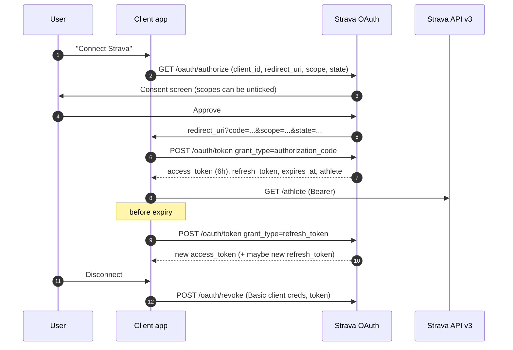
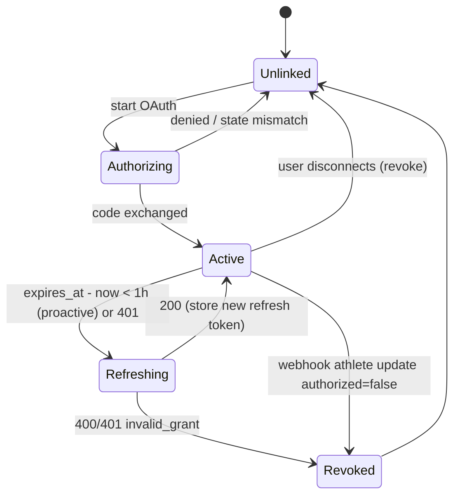
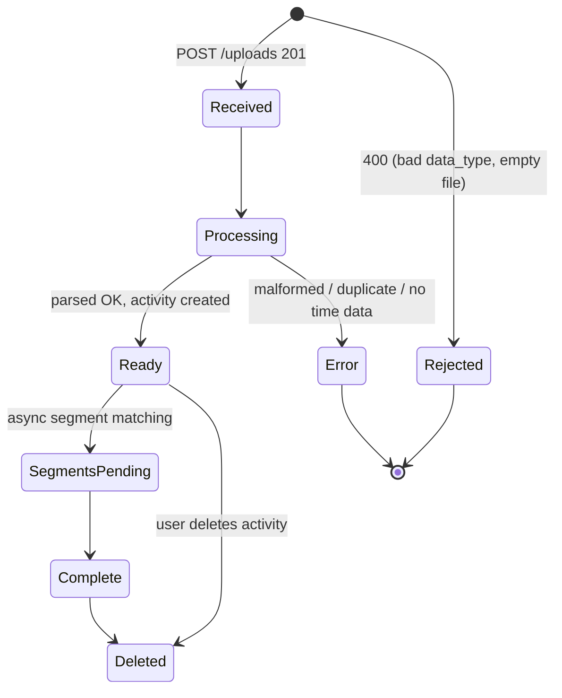
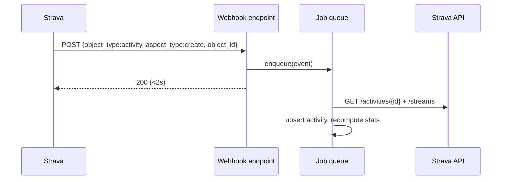
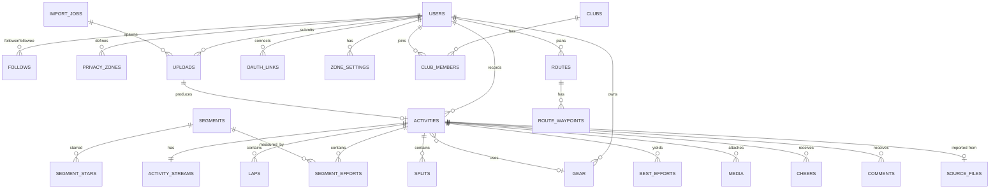
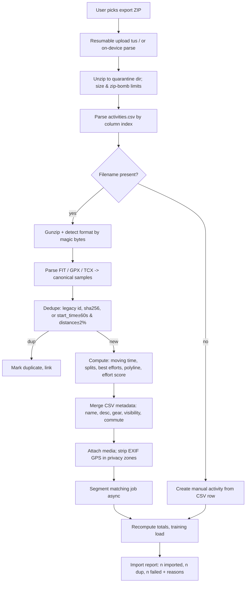

# 06 · Architecture — Data Model & API

> Scope: reference catalog of the public Strava API v3 data model (as documented at developers.strava.com), the activity file formats Strava ingests (FIT, GPX, TCX), and the **StravaFit** normalized schema, REST endpoint surface, and Strava-export migration mapping.
>
> Status legend: **[FREE]** = available to free Strava accounts, **[SUB]** = Strava subscription-gated (reference only — every feature is free in StravaFit), **(unverified)** = could not be confirmed against a primary source while writing this doc.
>
> IP note: everything below is a paraphrased description of publicly documented interfaces and open file formats. No proprietary assets, private APIs or decompiled code were used. Strava trademarks (KOM/QOM, Kudos, Local Legend, Beacon, Flyby…) are named only for reference; StravaFit uses neutral names (see the naming table in §9).

---

## Table of contents

1. [API overview](#1-api-overview)
2. [OAuth 2.0 flow](#2-oauth-20-flow)
3. [Rate limits](#3-rate-limits)
4. [Resource catalog (field tables)](#4-resource-catalog)
5. [Enums: SportType / ActivityType / misc](#5-enums)
6. [Streams, resolutions and polyline encoding](#6-streams-and-polylines)
7. [Uploads & webhook lifecycle](#7-uploads-and-webhooks)
8. [File formats: FIT, GPX, TCX](#8-file-formats)
9. [StravaFit data model (PostgreSQL/PostGIS DDL + ER diagram)](#9-stravafit-data-model)
10. [StravaFit REST API (OpenAPI-ish)](#10-stravafit-rest-api)
11. [Strava bulk-export import mapping](#11-strava-import-mapping)
12. [OSS implementation notes](#oss-implementation-notes)
13. [Sources](#sources)

---

## 1. API overview

| Aspect | Strava API v3 |
|---|---|
| Base URL | `https://www.strava.com/api/v3` |
| Auth | OAuth 2.0 Bearer token (`Authorization: Bearer <access_token>`) |
| Format | JSON over HTTPS; uploads via `multipart/form-data` |
| Pagination | `page` (1-based) + `per_page` (default 30, max 200) on list endpoints; some lists (e.g. athlete activities) also accept `before` / `after` epoch filters |
| Resource representation | Each object carries a `resource_state`: **1 = meta** (id only), **2 = summary**, **3 = detail** |
| IDs | 64-bit integers (activities exceed 2^31 — always store as `bigint`; JS clients should use `id_str` where provided) |
| Units | SI: metres, seconds, m/s, metres elevation, watts, °C, kJ |
| Time | `start_date` = UTC ISO-8601; `start_date_local` = wall-clock time *formatted as if UTC* (a "Z" suffix that is actually local); `timezone` string like `"(GMT-08:00) America/Los_Angeles"`; `utc_offset` seconds |
| Swagger | Machine-readable spec published at `developers.strava.com/swagger/swagger.json` and the Playground |

### Endpoint groups (v3, public)

| Group | Key operations |
|---|---|
| Activities | create manual activity, get activity, list activity comments, list kudoers, list laps, list logged-in athlete activities, get zones (activity), update activity |
| Athletes | get authenticated athlete, get zones, get athlete stats, update athlete (weight; FTP via `profile:write`) |
| Clubs | list club activities, list club admins, get club, list club members, list athlete clubs |
| Gears | get equipment |
| Routes | export route GPX, export route TCX, get route, list athlete routes |
| Segment Efforts | list segment efforts, get segment effort |
| Segments | explore segments (bounding box), list starred, get segment, star/unstar |
| Streams | get activity streams, get route streams, get segment effort streams, get segment streams |
| Uploads | upload activity, get upload |
| Webhooks | `push_subscriptions` create / view / delete (separate docs page) |

Notable **absences** in the public API (relevant to what StravaFit cannot import live): no feed/following endpoints, no kudos-giving endpoint, no write for comments, no full segment leaderboard (removed 2020, unverified exact date), no challenges, no photos upload, no Beacon/live tracking, no "Fitness & Freshness" or Relative Effort series beyond the per-activity `suffer_score` field.

---

## 2. OAuth 2.0 flow

### 2.1 Endpoints

| Step | Endpoint |
|---|---|
| Authorize (web) | `GET https://www.strava.com/oauth/authorize` |
| Authorize (mobile app-to-app) | `GET https://www.strava.com/oauth/mobile/authorize` (opens Strava app if installed; requires Strava app ≥ v75) |
| Token exchange & refresh | `POST https://www.strava.com/oauth/token` |
| Revoke (recommended) | `POST https://www.strava.com/oauth/revoke` — HTTP Basic auth `client_id:client_secret`, body `token`, optional `token_type_hint` |
| Deauthorize (legacy) | `POST https://www.strava.com/oauth/deauthorize` — scheduled to be retired in favour of `/oauth/revoke` on 2027-06-01 |

### 2.2 Authorize parameters

| Param | Req | Notes |
|---|---|---|
| `client_id` | yes | app id |
| `redirect_uri` | yes | must match registered callback domain; `localhost` / `127.0.0.1` allowed |
| `response_type` | yes | always `code` |
| `scope` | yes | comma- or space-separated |
| `approval_prompt` | no | `auto` (default) or `force` |
| `state` | no | echoed back — use for CSRF protection |

### 2.3 Scopes

| Scope | Grants |
|---|---|
| `read` | public segments, public routes, public profile, club feeds/events, leaderboards |
| `read_all` | private routes, private segments, private events |
| `profile:read_all` | full profile even if visibility is restricted |
| `profile:write` | update weight/FTP, star/unstar segments |
| `activity:read` | Everyone + Followers activities, privacy-zone portions excluded; required for activity webhooks |
| `activity:read_all` | above + "Only You" activities + privacy-zone data |
| `activity:write` | create manual activities, uploads, edit activities |

Users may untick scopes on the consent screen → **always parse the granted `scope` returned on redirect**.

### 2.4 Tokens

- Access token lifetime: **6 h** (`expires_in` = 21600; `expires_at` epoch).
- Refreshing with > 1 h left returns the **same** access token.
- A refresh may return a **new refresh token**; the old one is invalidated immediately → persist atomically.
- Token response embeds a summary athlete object on the initial exchange.
- Revoked tokens → `401`.



### 2.5 Token state machine



---

## 3. Rate limits

Default per-application limits (verified on the rate-limits doc page):

| Bucket | 15-minute | Daily |
|---|---|---|
| Overall (all requests) | 200 | 2,000 |
| Read (non-upload) | 100 | 1,000 |

- Headers: `X-RateLimit-Limit`, `X-RateLimit-Usage`, `X-ReadRateLimit-Limit`, `X-ReadRateLimit-Usage`; each value is `"<15min>,<daily>"`.
- 15-min windows reset at :00/:15/:30/:45; daily resets at **midnight UTC**.
- Exceeding → `429`. Requests rejected by the short window still count toward the daily window.
- Higher limits require an app review by Strava; apps also default to a single connected athlete until approved (unverified — the "Single Player Mode" capacity policy was introduced in 2024 per community reports).

**Implication for StravaFit**: live Strava sync for many users is impractical on one app key; the primary migration path must be the **bulk export ZIP** (§11), with the API only as an optional "bring your own client id" connector.

---

## 4. Resource catalog

Field tables list the documented field, type, and meaning in our own words. `rs` column = minimum `resource_state` where the field appears (1/2/3).

### 4.1 Athlete (`SummaryAthlete` / `DetailedAthlete`)

| Field | Type | rs | Notes |
|---|---|---|---|
| `id` | long | 1 | |
| `resource_state` | int | 1 | |
| `firstname`, `lastname` | string | 2 | lastname may be abbreviated for others |
| `profile_medium`, `profile` | url | 2 | 62px / 124px avatars |
| `city`, `state`, `country` | string | 2 | |
| `sex` | enum `M`/`F` | 2 | nullable |
| `premium` | bool | 2 | deprecated → `summit` |
| `summit` | bool | 2 | has subscription |
| `created_at`, `updated_at` | datetime | 2 | |
| `follower_count`, `friend_count` | int | 3 | |
| `measurement_preference` | `feet` / `meters` | 3 | |
| `ftp` | int | 3 | needs `profile:read_all` |
| `weight` | float (kg) | 3 | |
| `clubs` | SummaryClub[] | 3 | |
| `bikes`, `shoes` | SummaryGear[] | 3 | |

Related: `GET /athletes/{id}/stats` → `ActivityStats`: `biggest_ride_distance`, `biggest_climb_elevation_gain`, and `ActivityTotal` blocks `recent_*_totals` (last 4 weeks), `ytd_*_totals`, `all_*_totals` for ride/run/swim, each with `count, distance, moving_time, elapsed_time, elevation_gain, achievement_count`.

`GET /athlete/zones` → `heart_rate {custom_zones, zones[{min,max}]}` and `power {zones[]}` [SUB for power zones in-app].

### 4.2 Activity (`SummaryActivity` / `DetailedActivity`)

| Field | Type | rs | Notes |
|---|---|---|---|
| `id` | long | 1 | |
| `external_id` | string | 2 | from uploaded file name / device |
| `upload_id` | long | 2 | (`upload_id_str` too) |
| `athlete` | MetaAthlete | 2 | |
| `name` | string | 2 | |
| `distance` | float m | 2 | |
| `moving_time`, `elapsed_time` | int s | 2 | |
| `total_elevation_gain` | float m | 2 | |
| `elev_high`, `elev_low` | float m | 2 | |
| `type` | ActivityType | 2 | **deprecated** – use `sport_type` |
| `sport_type` | SportType | 2 | |
| `workout_type` | int | 2 | run: 0 default, 1 race, 2 long run, 3 workout; ride: 10 default, 11 race, 12 workout (unverified exact codes) |
| `start_date`, `start_date_local` | datetime | 2 | |
| `timezone` | string | 2 | |
| `utc_offset` | float s | 2 | |
| `start_latlng`, `end_latlng` | [lat,lng] | 2 | empty array if none |
| `achievement_count`, `kudos_count`, `comment_count`, `athlete_count`, `photo_count`, `total_photo_count` | int | 2 | |
| `map` | PolylineMap | 2 | `{id, summary_polyline}` (+ `polyline` at rs 3) |
| `trainer`, `commute`, `manual`, `private`, `flagged` | bool | 2 | |
| `hide_from_home` | bool | 2 | "mute" |
| `visibility` | `everyone`/`followers_only`/`only_me` | 2 | (unverified as documented field; seen in responses) |
| `gear_id` | string | 2 | `b123` bikes, `g123` shoes |
| `average_speed`, `max_speed` | float m/s | 2 | |
| `average_cadence` | float | 2 | rpm; runs = steps/min per foot (×2 for spm) |
| `average_temp` | int °C | 2 | |
| `average_watts`, `weighted_average_watts`, `max_watts` | float/int | 2 | weighted = normalised-power-like |
| `kilojoules` | float | 2 | rides only |
| `device_watts` | bool | 2 | true if power meter vs estimated |
| `has_heartrate`, `average_heartrate`, `max_heartrate` | | 2 | |
| `pr_count` | int | 2 | |
| `suffer_score` | int | 3 | Relative Effort [SUB in-app detail] |
| `description` | string | 3 | |
| `calories` | float | 3 | |
| `segment_efforts` | DetailedSegmentEffort[] | 3 | `include_all_efforts=true` for hidden |
| `splits_metric`, `splits_standard` | Split[] | 3 | per km / per mile |
| `laps` | Lap[] | 3 | |
| `best_efforts` | DetailedSegmentEffort[] | 3 | run best efforts (400m, 1k, 1 mile, 5k…) |
| `gear` | SummaryGear | 3 | |
| `photos` | PhotosSummary | 3 | `{count, primary{...}}` |
| `highlighted_kudosers` | | 3 | |
| `device_name` | string | 3 | e.g. "Garmin Forerunner 965" |
| `embed_token` | string | 3 | for embed widget |
| `similar_activities`, `available_zones` | | 3 | |

**Update activity** (`PUT /activities/{id}`, `UpdatableActivity`): `commute, trainer, hide_from_home, description, name, sport_type, gear_id ("none" to clear)`. **Create manual** (`POST /activities`): `name, sport_type, start_date_local, elapsed_time, description, distance, trainer, commute`; optional `tags` ∈ {WithPet, Recovery, Competition, ForACause, Commute} (not combinable with legacy `commute`).

### 4.3 Lap

| Field | Type | Notes |
|---|---|---|
| `id` | long | |
| `activity`, `athlete` | Meta | |
| `name` | string | "Lap 1" |
| `lap_index` | int | 1-based |
| `split` | int | |
| `start_index`, `end_index` | int | indices into the activity streams |
| `start_date`, `start_date_local` | datetime | |
| `elapsed_time`, `moving_time` | int s | |
| `distance` | float m | |
| `total_elevation_gain` | float m | |
| `average_speed`, `max_speed` | float m/s | |
| `average_cadence` | float | |
| `average_watts`, `device_watts` | | rides |
| `average_heartrate`, `max_heartrate` | | |
| `pace_zone` | int | runs |

### 4.4 Split (auto per km/mile)

| Field | Type | Notes |
|---|---|---|
| `split` | int | 1-based |
| `distance` | float m | last split partial |
| `elapsed_time`, `moving_time` | int s | |
| `elevation_difference` | float m | net, end − start |
| `average_speed` | float m/s | |
| `average_grade_adjusted_speed` | float m/s | GAP (unverified as documented; present in responses) |
| `average_heartrate` | float | |
| `pace_zone` | int | |

### 4.5 Streams — see §6.

### 4.6 Segment (`SummarySegment` / `DetailedSegment`)

| Field | Type | Notes |
|---|---|---|
| `id`, `name` | | |
| `activity_type` | `Ride` / `Run` | |
| `distance` | float m | |
| `average_grade`, `maximum_grade` | float % | |
| `elevation_high`, `elevation_low` | float m | |
| `start_latlng`, `end_latlng` | [lat,lng] | |
| `climb_category` | int 0–5 | 0 = uncategorised (NC), 1 = Cat 4 … 4 = Cat 1, 5 = HC |
| `city`, `state`, `country` | | |
| `private`, `hazardous`, `starred` | bool | |
| `athlete_pr_effort` | SummaryPRSegmentEffort | `pr_elapsed_time`, `pr_date`, `effort_count` |
| `athlete_segment_stats` | | |
| `created_at`, `updated_at` | | detail |
| `total_elevation_gain` | float | detail |
| `map` | PolylineMap | detail |
| `effort_count`, `athlete_count`, `star_count` | int | detail |
| `xoms` | `{kom, qom, overall, destination}` | detail — leader times as display strings (unverified exact shape) |
| `local_legend` | object | detail (unverified) |

`GET /segments/explore?bounds=swLat,swLng,neLat,neLng&activity_type=running|riding&min_cat&max_cat` → `ExplorerSegment[]` with `points` (encoded polyline), `climb_category_desc`, `avg_grade`, `elev_difference`.

### 4.7 SegmentEffort (`DetailedSegmentEffort`)

| Field | Type | Notes |
|---|---|---|
| `id` | long | |
| `activity_id`, `activity`, `athlete` | | |
| `segment` | SummarySegment | |
| `name` | string | segment name |
| `elapsed_time`, `moving_time` | int s | |
| `start_date`, `start_date_local` | | |
| `distance` | float | |
| `start_index`, `end_index` | int | into activity streams |
| `average_cadence`, `average_watts`, `device_watts` | | |
| `average_heartrate`, `max_heartrate` | | |
| `kom_rank` | int 1–10 / null | overall top-10 position at upload time |
| `pr_rank` | int 1–3 / null | athlete's 1st/2nd/3rd best |
| `is_kom` | bool | |
| `hidden` | bool | |
| `achievements` | `[{type_id, type, rank}]` | (unverified) |

[SUB] Listing *your* efforts on a segment (`GET /segment_efforts?segment_id=`) requires a subscription for the athlete (unverified current state).

### 4.8 Club (`SummaryClub` / `DetailedClub`)

| Field | Type | Notes |
|---|---|---|
| `id`, `name` | | |
| `profile_medium`, `cover_photo`, `cover_photo_small` | url | |
| `sport_type` | `cycling`/`running`/`triathlon`/`other` | legacy |
| `activity_types` | ActivityType[] | |
| `city`, `state`, `country` | | |
| `private`, `featured`, `verified` | bool | |
| `member_count` | int | |
| `url` | string | vanity slug |
| `membership` | `member`/`pending` | detail |
| `admin`, `owner` | bool | detail |
| `following_count` | int | detail |

`GET /clubs/{id}/activities` returns **ClubActivity** — deliberately stripped: athlete first name + last initial, name, distance, moving/elapsed time, elevation, sport_type, workout_type; **no ids, no dates**.

### 4.9 Route

| Field | Type | Notes |
|---|---|---|
| `id`, `id_str` | | |
| `athlete` | SummaryAthlete | |
| `name`, `description` | | |
| `distance` | float m | |
| `elevation_gain` | float m | |
| `map` | PolylineMap | |
| `private`, `starred` | bool | |
| `timestamp` | int epoch | |
| `type` | int | 1 = ride, 2 = run |
| `sub_type` | int | 1 road, 2 MTB, 3 cross, 4 trail, 5 mixed |
| `created_at`, `updated_at` | | |
| `estimated_moving_time` | int s | |
| `segments` | SummarySegment[] | |
| `waypoints` | `[{latlng, target_latlng, categories[], title, description, distance_into_route}]` | |

Export: `GET /routes/{id}/export_gpx`, `/export_tcx`. Route streams: `latlng, distance, altitude`.

### 4.10 Gear

| Field | Type | Notes |
|---|---|---|
| `id` | string | `b`-prefixed bike, `g`-prefixed shoe |
| `primary` | bool | default for its sport |
| `name` | string | user nickname |
| `distance` | float m | lifetime |
| `brand_name`, `model_name` | | detail |
| `frame_type` | int | bikes: 1 MTB, 2 cross, 3 road, 4 TT, 5 gravel (unverified mapping) |
| `description` | | detail |
| `retired` | bool | (unverified in API; present in app) |

### 4.11 Upload

| Field | Type | Notes |
|---|---|---|
| `id`, `id_str` | | upload id (≠ activity id) |
| `external_id` | string | |
| `error` | string/null | human-readable, may contain HTML |
| `status` | string | see §7 |
| `activity_id` | long/null | set when ready |

### 4.12 Webhook subscription

| Field | Notes |
|---|---|
| `id` | subscription id |
| `application_id` / `callback_url` | one subscription per app |
| `created_at`, `updated_at` | |

Event payload: `object_type` (`activity`/`athlete`), `object_id`, `aspect_type` (`create`/`update`/`delete`), `updates` (activity: `title`, `type`, `private`; athlete: `authorized:"false"`), `owner_id`, `subscription_id`, `event_time`.

### 4.13 Other models

- **Comment**: `id, activity_id, text, athlete, created_at` (read-only).
- **Zones / ActivityZone**: `score, distribution_buckets[{min,max,time}], type (heartrate|power), sensor_based, points, custom_zones, max` [SUB].
- **PhotosSummary**: `count, primary{id, source, unique_id, urls{size:url}}`.
- **Fault**: `{message, errors[{resource, field, code}]}` on 4xx.

---

## 5. Enums

### 5.1 SportType (current, documented)

| Group | Values |
|---|---|
| Foot | `Run`, `TrailRun`, `VirtualRun`, `Walk`, `Hike`, `Snowshoe` |
| Bike | `Ride`, `MountainBikeRide`, `GravelRide`, `EBikeRide`, `EMountainBikeRide`, `VirtualRide`, `Velomobile`, `Handcycle` |
| Water | `Swim`, `Rowing`, `VirtualRow`, `Canoeing`, `Kayaking`, `StandUpPaddling`, `Surfing`, `Kitesurf`, `Windsurf`, `Sail` |
| Snow/ice | `AlpineSki`, `BackcountrySki`, `NordicSki`, `Snowboard`, `IceSkate` |
| Wheels | `InlineSkate`, `RollerSki`, `Skateboard`, `Wheelchair` |
| Gym / fitness | `Workout`, `WeightTraining`, `Crossfit`, `HighIntensityIntervalTraining`, `Elliptical`, `StairStepper`, `Yoga`, `Pilates`, `PhysicalTherapy`, `Dance` |
| Racket / ball | `Badminton`, `Pickleball`, `Padel`, `Racquetball`, `Squash`, `TableTennis`, `Tennis`, `Basketball`, `Cricket`, `Soccer`, `Volleyball`, `Golf` |
| Other | `RockClimbing` |

56 values total as of the fetched reference. Note: the API enum lags the app; the app adds types over time (2024–2025 added e.g. Pilates, Padel, Basketball, Volleyball, Cricket, Dance, PhysicalTherapy — dates unverified).

### 5.2 ActivityType (legacy, deprecated)

Older coarse enum (37 values) — e.g. `TrailRun`/`GravelRide`/`MountainBikeRide` all collapse to `Run` / `Ride`. Racket sports and Pilates have no ActivityType equivalent and appear as `Workout`. Store both on import: `sport_type` authoritative, legacy type for compatibility.

### 5.3 Misc enums

| Enum | Values |
|---|---|
| `resource_state` | 1 meta, 2 summary, 3 detail |
| `measurement_preference` | `feet`, `meters` |
| `visibility` | `everyone`, `followers_only`, `only_me` |
| `climb_category` | 0 NC, 1 Cat4, 2 Cat3, 3 Cat2, 4 Cat1, 5 HC |
| Stream `series_type` | `distance`, `time` |
| Stream `resolution` | `low`, `medium`, `high` (deprecated; see §6) |
| Upload `data_type` | `fit`, `fit.gz`, `tcx`, `tcx.gz`, `gpx`, `gpx.gz`, `json` (strength-type only) |
| Webhook `aspect_type` | `create`, `update`, `delete` |
| Webhook `object_type` | `activity`, `athlete` |
| Route `type` / `sub_type` | see §4.9 |

---

## 6. Streams and polylines

### 6.1 Stream types

`GET /activities/{id}/streams?keys=time,latlng,...&key_by_type=true`

| Key | Element type | Unit | Notes |
|---|---|---|---|
| `time` | int | s since start | always returned |
| `distance` | float | m | cumulative |
| `latlng` | [float,float] | deg | WGS84; privacy-zone points removed unless `activity:read_all` + owner |
| `altitude` | float | m | barometric or DEM-corrected |
| `velocity_smooth` | float | m/s | smoothed |
| `heartrate` | int | bpm | |
| `cadence` | int | rpm (spm/2 for runs) | |
| `watts` | int | W | `device_watts` flag on activity tells real vs estimated |
| `temp` | int | °C | |
| `moving` | bool | | moving/stopped classification |
| `grade_smooth` | float | % | smoothed grade |

Each stream object: `{type, data[], series_type, original_size, resolution}`. All streams share the same index — stream *i* in every series refers to the same sample, so `Lap.start_index/end_index` and `SegmentEffort.start_index/end_index` slice all of them consistently.

### 6.2 Resolution / downsampling

- Historically `resolution=low|medium|high` returned ~100 / ~1000 / ~10000 points and `series_type` chose the x-axis used for downsampling. Current docs describe streams as returned at full resolution and treat these params as deprecated/ignored (unverified — community reports differ).
- `original_size` tells the raw sample count.
- Typical recording rate: 1 Hz ("every second" mode) or Garmin "smart recording" (variable, 1–8 s gaps). Our schema must handle **irregular sampling**.

### 6.3 Encoded polyline

`map.summary_polyline` (≈ low-res, for lists/feeds) and `map.polyline` (detail) use the **Google Encoded Polyline Algorithm**, precision 1e5:

1. Multiply lat/lng by 1e5, round to int.
2. Delta-encode against the previous point.
3. Left-shift by 1; if negative, invert bits (zig-zag).
4. Split into 5-bit chunks (LSB first), OR `0x20` on all but last chunk, add 63, emit ASCII.

```
encode(-179.9832104) → "`~oia@"   (Google's documented example)
points [(38.5,-120.2),(40.7,-120.95),(43.252,-126.453)]
       → "_p~iF~ps|U_ulLnnqC_mqNvxq`@"
```

Edge cases: activities with no GPS → empty `summary_polyline` (`""` or null); privacy zones trim start/end; polylines are already simplified server-side (Douglas-Peucker-like, unverified algorithm).

---

## 7. Uploads and webhooks

### 7.1 Upload request

`POST /uploads` (multipart, `activity:write`): `file`*, `data_type`*, `sport_type`, `activity_type` (deprecated), `name`, `description`, `trainer` (0/1), `commute` (0/1), `external_id` (defaults to filename; use for dedupe).

### 7.2 Upload status lifecycle

Documented status strings (paraphrased categories → literal strings appear in the API):

| State | Status text (as returned) | `activity_id` | `error` |
|---|---|---|---|
| Queued/processing | "Your activity is still being processed." | null | null |
| Ready | "Your activity is ready." | set | null |
| Error | "There was an error processing your activity." | null | message (e.g. duplicate of activity N) |
| Deleted | "The created activity has been deleted." | (stale) | null |

- `201 Created` on accept; `400` on immediate rejection.
- Poll `GET /uploads/{id}` ≥ 1 s apart; mean processing < 2 s; segment matching may finish later (watch the activity, or a webhook `update`).



### 7.3 Webhooks

- One subscription per app: `POST /push_subscriptions` (form: `client_id, client_secret, callback_url ≤255 chars, verify_token`).
- Validation: GET to callback with `hub.mode=subscribe&hub.challenge=X&hub.verify_token=T`; respond **within 2 s**, 200, `{"hub.challenge":"X"}`.
- Delivery: POST event JSON; must 200 within 2 s, else retried — up to 3 attempts total. Do heavy work async.
- One save may emit multiple `update` events (async fields).
- With only `activity:read`, visibility change to/from "Only You" arrives as `delete`/`create`.
- Deauth: `object_type=athlete`, `aspect_type=update`, `updates.authorized="false"`.



---

## 8. File formats

### 8.1 FIT (Flexible and Interoperable Data Transfer, Garmin ANT+ — open SDK)

Binary, little/big-endian per definition message. Structure: 14-byte header (`.FIT` signature, protocol/profile version, data size, CRC) → stream of **definition** and **data** messages → 2-byte CRC. Compressed timestamp headers possible. Developer data fields (Connect IQ) via `developer_data_id` + `field_description`.

Key conventions:
- **Timestamps**: uint32 seconds since **1989-12-31T00:00:00Z** (FIT epoch = Unix 631065600).
- **Positions**: sint32 **semicircles**; degrees = `sc × 180 / 2^31`.
- Invalid values are sentinel (`0xFF`, `0xFFFF`, `0x7FFFFFFF`…), not null.
- Scale/offset per field (e.g. `altitude` scale 5, offset 500 m; `speed` scale 1000 m/s).

| Message (global #) | Key fields | Our use |
|---|---|---|
| `file_id` (0) | `type` (4 = activity, 6 = course…), `manufacturer`, `product`/`garmin_product`, `serial_number`, `time_created` | dedupe key = manufacturer+serial+time_created; device attribution |
| `device_info` (23) | `device_index`, `manufacturer`, `product`, `software_version`, `battery_status`, `ant_device_number`, `device_type`, `source_type` | list of sensors (HRM, power meter) |
| `event` (21) | `event` (timer=0…), `event_type` (start/stop/stop_all) | pause/resume → moving time |
| `record` (20) | `timestamp`, `position_lat`, `position_long`, `altitude`/`enhanced_altitude`, `distance`, `speed`/`enhanced_speed`, `heart_rate`, `cadence`, `fractional_cadence`, `power`, `temperature`, `grade`, `vertical_oscillation`, `stance_time`, `left_right_balance`… | streams |
| `lap` (19) | `start_time`, `timestamp` (end), `total_elapsed_time`, `total_timer_time`, `total_distance`, `avg/max_speed`, `avg/max_heart_rate`, `avg_power`, `normalized_power`, `total_ascent`, `lap_trigger` (manual/distance/time/position…), `sport` | laps |
| `length` (101) | pool swim lengths: `swim_stroke`, `total_strokes`, `length_type` (idle/active) | swim lengths |
| `session` (18) | `sport`, `sub_sport`, `start_time`, `total_elapsed_time`, `total_timer_time`, `total_distance`, `total_calories`, `total_ascent/descent`, avg/max HR/speed/power/cadence, `training_stress_score`, `pool_length`, `num_laps` | activity summary; multisport = multiple sessions |
| `activity` (34) | `timestamp`, `local_timestamp`, `num_sessions`, `type` | **local_timestamp − timestamp = UTC offset** |
| `hrv` (78) | RR intervals | optional |
| `set` (225) | strength sets: `repetitions`, `weight`, `category` | strength workouts |
| `workout`/`workout_step` | structured workouts | phase 2 |

Sport mapping example: `sport=1 running, sub_sport=3 trail` → `TrailRun`; `sport=2 cycling, sub_sport=7 mountain` → `MountainBikeRide`; `sub_sport=58 virtual_activity` → `VirtualRide`/`VirtualRun`; `sport=5 swimming, sub_sport=17 lap_swimming|18 open_water`.

### 8.2 GPX 1.1

```xml
<gpx version="1.1" creator="StravaFit Android"
     xmlns="http://www.topografix.com/GPX/1/1"
     xmlns:gpxtpx="http://www.garmin.com/xmlschemas/TrackPointExtension/v1">
  <metadata><time>2026-05-01T06:00:00Z</time></metadata>
  <trk><name>Morning Run</name><type>running</type>
    <trkseg>
      <trkpt lat="52.5200" lon="13.4050">
        <ele>34.2</ele><time>2026-05-01T06:00:01Z</time>
        <extensions><gpxtpx:TrackPointExtension>
          <gpxtpx:atemp>14</gpxtpx:atemp><gpxtpx:hr>131</gpxtpx:hr><gpxtpx:cad>84</gpxtpx:cad>
        </gpxtpx:TrackPointExtension></extensions>
      </trkpt>
    </trkseg></trk>
</gpx>
```

- Strava reads Garmin **TrackPointExtension v1** (`atemp`, `hr`, `cad`), Cluetrust (`cadence`, `distance`, `hr`, `temp`), and generic `<extensions>` tags named `cadence`, `distance`, `heartrate`, `power`.
- TrackPointExtension **v2** adds `wtemp`, `depth`, `speed`, `course`, `bearing`. Power is commonly in `<power>` inside `<extensions>` (non-standard, popular).
- Every `trkpt` needs `<time>` for activities; routes use `<rte>/<rtept>` or time-less tracks.
- A creator string containing "with barometer" makes Strava trust file elevation instead of DEM.
- Multiple `<trkseg>` = pauses (unverified Strava treatment; we treat as auto-pause gaps).

### 8.3 TCX (Garmin Training Center v2)

Hierarchy: `TrainingCenterDatabase/Activities/Activity[@Sport=Running|Biking|Other]/Id(start time)/Lap[@StartTime]/{TotalTimeSeconds, DistanceMeters, MaximumSpeed, Calories, AverageHeartRateBpm, Intensity, TriggerMethod, Track/Trackpoint{Time, Position{LatitudeDegrees, LongitudeDegrees}, AltitudeMeters, DistanceMeters, HeartRateBpm/Value, Cadence, Extensions/ns3:TPX{Speed, Watts, RunCadence}}}`, plus `Creator` device info.

- Strava uses only Lap `Track`, `TotalTimeSeconds`, `DistanceMeters`, `Calories`; reads `RunCadence` as cadence and `Watts` as power; **no temperature**. Sport from `@Sport` (biking/running/hiking/walking/swimming).
- Common gotcha: files with leading whitespace before `<?xml` fail strict parsers — trim BOM/whitespace.

### 8.4 Format comparison

| Capability | FIT | GPX | TCX |
|---|---|---|---|
| Laps | yes | no (ext only) | yes |
| HR/cad/power | native | extensions | native + TPX |
| Temperature | yes | ext | no |
| Pool swim lengths | yes | no | no |
| Multisport | yes (sessions) | no | partial (multiple Activity) |
| Device info | yes | creator string | Creator |
| Size | smallest | largest | large |

---

## 9. StravaFit data model

### 9.1 Neutral naming (trademark-safe)

| Strava term | StravaFit term |
|---|---|
| Kudos | **Cheers** |
| KOM / QOM / CR | **Segment Crown** (top overall) / **Course Best** |
| Local Legend | **Local Regular** (most efforts in 90 days) |
| Beacon | **Live Share** |
| Flyby | **Crossings** |
| Relative Effort / Suffer score | **Effort Score** |
| Fitness & Freshness | **Training Load** (CTL/ATL/TSB) |
| Segment | Segment (generic term) |
| Summit / subscription | n/a — everything free |

### 9.2 ER diagram



### 9.3 DDL (PostgreSQL 16 + PostGIS 3.4)

```sql
-- =========================================================
-- StravaFit core schema v0.1
-- =========================================================
CREATE EXTENSION IF NOT EXISTS postgis;
CREATE EXTENSION IF NOT EXISTS citext;
CREATE EXTENSION IF NOT EXISTS pgcrypto;          -- gen_random_uuid()

-- ---------- enums ----------
CREATE TYPE sport_type AS ENUM (
  'Run','TrailRun','VirtualRun','Walk','Hike','Snowshoe',
  'Ride','MountainBikeRide','GravelRide','EBikeRide','EMountainBikeRide',
  'VirtualRide','Velomobile','Handcycle',
  'Swim','Rowing','VirtualRow','Canoeing','Kayaking','StandUpPaddling',
  'Surfing','Kitesurf','Windsurf','Sail',
  'AlpineSki','BackcountrySki','NordicSki','Snowboard','IceSkate',
  'InlineSkate','RollerSki','Skateboard','Wheelchair',
  'Workout','WeightTraining','Crossfit','HighIntensityIntervalTraining',
  'Elliptical','StairStepper','Yoga','Pilates','PhysicalTherapy','Dance',
  'Badminton','Pickleball','Padel','Racquetball','Squash','TableTennis',
  'Tennis','Basketball','Cricket','Soccer','Volleyball','Golf','RockClimbing',
  'Other');                                        -- forward-compat bucket
-- NB: adding values later: ALTER TYPE sport_type ADD VALUE 'X';
-- Alternative: lookup table sport_types(code text pk, family text) — preferred
-- if we expect frequent additions without migrations.

CREATE TYPE visibility AS ENUM ('everyone','followers','only_me');
CREATE TYPE gear_kind  AS ENUM ('bike','shoe','other');
CREATE TYPE upload_state AS ENUM ('queued','processing','ready','error','duplicate','deleted');
CREATE TYPE file_format AS ENUM ('fit','gpx','tcx','json','manual');
CREATE TYPE workout_kind AS ENUM ('default','race','long','workout','commute');

-- ---------- users ----------
CREATE TABLE users (
  id             bigserial PRIMARY KEY,
  public_id      uuid NOT NULL DEFAULT gen_random_uuid() UNIQUE,
  handle         citext UNIQUE NOT NULL,
  email          citext UNIQUE NOT NULL,
  password_hash  text,                    -- null if SSO-only
  first_name     text NOT NULL,
  last_name      text,
  sex            char(1) CHECK (sex IN ('M','F','X')),
  birthdate      date,
  city text, region text, country char(2),
  avatar_url     text,
  bio            text,
  units          text NOT NULL DEFAULT 'metric' CHECK (units IN ('metric','imperial')),
  weight_kg      numeric(5,2),
  ftp_w          smallint,
  max_hr         smallint,
  resting_hr     smallint,
  default_visibility visibility NOT NULL DEFAULT 'followers',
  profile_private boolean NOT NULL DEFAULT false,   -- require follow approval
  created_at     timestamptz NOT NULL DEFAULT now(),
  updated_at     timestamptz NOT NULL DEFAULT now(),
  deleted_at     timestamptz
);

CREATE TABLE follows (
  follower_id bigint REFERENCES users(id) ON DELETE CASCADE,
  followee_id bigint REFERENCES users(id) ON DELETE CASCADE,
  status      text NOT NULL DEFAULT 'accepted' CHECK (status IN ('pending','accepted','blocked')),
  created_at  timestamptz NOT NULL DEFAULT now(),
  PRIMARY KEY (follower_id, followee_id),
  CHECK (follower_id <> followee_id)
);
CREATE INDEX follows_followee_idx ON follows(followee_id, status);

CREATE TABLE privacy_zones (
  id        bigserial PRIMARY KEY,
  user_id   bigint NOT NULL REFERENCES users(id) ON DELETE CASCADE,
  center    geography(Point,4326) NOT NULL,
  radius_m  integer NOT NULL CHECK (radius_m BETWEEN 200 and 1600),
  created_at timestamptz NOT NULL DEFAULT now()
);
-- also users.hide_start_end_m (global start/end trimming) could be added

CREATE TABLE zone_settings (
  user_id   bigint REFERENCES users(id) ON DELETE CASCADE,
  kind      text CHECK (kind IN ('heartrate','power','pace')),
  bounds    int[] NOT NULL,      -- ascending upper bounds, e.g. {120,140,155,170}
  custom    boolean NOT NULL DEFAULT false,
  valid_from date NOT NULL DEFAULT current_date,
  PRIMARY KEY (user_id, kind, valid_from)
);

CREATE TABLE oauth_links (               -- external connectors (Strava BYO key, Garmin, etc.)
  user_id        bigint REFERENCES users(id) ON DELETE CASCADE,
  provider       text NOT NULL,
  external_user  text NOT NULL,
  scopes         text[] NOT NULL,
  access_token   bytea NOT NULL,        -- encrypted (pgp_sym_encrypt / app-level KMS)
  refresh_token  bytea NOT NULL,
  expires_at     timestamptz NOT NULL,
  revoked_at     timestamptz,
  PRIMARY KEY (user_id, provider)
);

-- ---------- gear ----------
CREATE TABLE gear (
  id           bigserial PRIMARY KEY,
  user_id      bigint NOT NULL REFERENCES users(id) ON DELETE CASCADE,
  kind         gear_kind NOT NULL,
  name         text NOT NULL,
  brand        text, model text,
  frame_type   text,                      -- road, mtb, gravel, tt, cx
  weight_kg    numeric(5,2),
  default_for  sport_type[],              -- auto-assign
  initial_distance_m double precision NOT NULL DEFAULT 0,
  distance_m   double precision NOT NULL DEFAULT 0, -- maintained by trigger/job
  reminder_at_m double precision,          -- "replace shoes at 800 km"
  retired      boolean NOT NULL DEFAULT false,
  legacy_strava_id text,                   -- 'b123'/'g456' for import mapping
  created_at   timestamptz NOT NULL DEFAULT now()
);
CREATE INDEX gear_user_idx ON gear(user_id) WHERE NOT retired;

CREATE TABLE gear_components (            -- chains, tyres (Strava "components", web only)
  id bigserial PRIMARY KEY,
  gear_id bigint NOT NULL REFERENCES gear(id) ON DELETE CASCADE,
  kind text NOT NULL, brand text, model text,
  added_on date, retired_on date,
  distance_m double precision NOT NULL DEFAULT 0
);

-- ---------- source files & uploads ----------
CREATE TABLE source_files (
  id          bigserial PRIMARY KEY,
  user_id     bigint NOT NULL REFERENCES users(id) ON DELETE CASCADE,
  format      file_format NOT NULL,
  gzipped     boolean NOT NULL DEFAULT false,
  storage_key text NOT NULL,              -- S3/MinIO object key; originals kept for re-export
  sha256      bytea NOT NULL,
  byte_size   integer NOT NULL,
  device_manufacturer text, device_product text, device_serial text,
  fit_time_created timestamptz,
  created_at  timestamptz NOT NULL DEFAULT now(),
  UNIQUE (user_id, sha256)                -- exact-duplicate guard
);

CREATE TABLE import_jobs (
  id         uuid PRIMARY KEY DEFAULT gen_random_uuid(),
  user_id    bigint NOT NULL REFERENCES users(id) ON DELETE CASCADE,
  source     text NOT NULL,              -- 'strava_zip','gpx_batch','strava_api'
  state      text NOT NULL DEFAULT 'queued',
  total      int, processed int DEFAULT 0, failed int DEFAULT 0,
  report     jsonb,                      -- per-row errors
  created_at timestamptz NOT NULL DEFAULT now(),
  finished_at timestamptz
);

CREATE TABLE uploads (
  id            bigserial PRIMARY KEY,
  user_id       bigint NOT NULL REFERENCES users(id) ON DELETE CASCADE,
  import_job_id uuid REFERENCES import_jobs(id) ON DELETE SET NULL,
  source_file_id bigint REFERENCES source_files(id),
  external_id   text,                     -- client-supplied idempotency key
  state         upload_state NOT NULL DEFAULT 'queued',
  error         text,
  activity_id   bigint,                   -- FK added after activities
  created_at    timestamptz NOT NULL DEFAULT now(),
  updated_at    timestamptz NOT NULL DEFAULT now(),
  UNIQUE (user_id, external_id)
);

-- ---------- activities ----------
CREATE TABLE activities (
  id              bigserial PRIMARY KEY,
  public_id       uuid NOT NULL DEFAULT gen_random_uuid() UNIQUE,
  user_id         bigint NOT NULL REFERENCES users(id) ON DELETE CASCADE,
  source_file_id  bigint REFERENCES source_files(id),
  client_uuid     uuid,                   -- generated on-device for offline-first idempotency
  legacy_strava_id bigint,                -- from export, for redirects/dedupe
  name            text NOT NULL,
  description     text,
  sport_type      sport_type NOT NULL,
  workout_kind    workout_kind NOT NULL DEFAULT 'default',
  visibility      visibility NOT NULL,
  hide_from_feed  boolean NOT NULL DEFAULT false,
  is_commute      boolean NOT NULL DEFAULT false,
  is_indoor       boolean NOT NULL DEFAULT false,   -- trainer
  is_manual       boolean NOT NULL DEFAULT false,
  flagged         boolean NOT NULL DEFAULT false,
  tags            text[] NOT NULL DEFAULT '{}',     -- with_pet, recovery, competition, for_a_cause
  gear_id         bigint REFERENCES gear(id) ON DELETE SET NULL,
  device_name     text,
  start_time      timestamptz NOT NULL,             -- UTC instant
  tz_name         text,                             -- IANA, e.g. 'Europe/Berlin'
  utc_offset_s    integer NOT NULL DEFAULT 0,       -- at start; local = start_time + offset
  elapsed_s       integer NOT NULL CHECK (elapsed_s >= 0),
  moving_s        integer NOT NULL CHECK (moving_s >= 0),
  distance_m      double precision NOT NULL DEFAULT 0,
  elev_gain_m     real, elev_loss_m real, elev_high_m real, elev_low_m real,
  avg_speed_mps   real, max_speed_mps real,
  avg_hr          real, max_hr smallint,
  avg_cadence     real, max_cadence smallint,
  avg_watts       real, max_watts smallint, weighted_avg_watts real,
  power_from_device boolean,
  kilojoules      real,
  calories        real,
  avg_temp_c      real,
  effort_score    real,               -- our Relative-Effort analogue (TRIMP-based)
  training_load   real,               -- TSS-like
  start_point     geography(Point,4326),
  end_point       geography(Point,4326),
  route_full      geometry(LineStringZM,4326),  -- Z=altitude, M=seconds offset
  route_summary   geometry(LineString,4326),    -- simplified (feed/map tiles)
  summary_polyline text,                        -- encoded, precision 5, cached
  bbox            box2d,
  start_cell      text,                         -- H3 res-7 cell for "nearby"/heatmap
  cheer_count     integer NOT NULL DEFAULT 0,
  comment_count   integer NOT NULL DEFAULT 0,
  media_count     integer NOT NULL DEFAULT 0,
  achievement_count integer NOT NULL DEFAULT 0,
  pr_count        integer NOT NULL DEFAULT 0,
  created_at      timestamptz NOT NULL DEFAULT now(),
  updated_at      timestamptz NOT NULL DEFAULT now(),
  deleted_at      timestamptz,
  UNIQUE (user_id, client_uuid),
  UNIQUE (user_id, legacy_strava_id)
);
CREATE INDEX act_user_time_idx   ON activities(user_id, start_time DESC) WHERE deleted_at IS NULL;
CREATE INDEX act_route_gix       ON activities USING gist(route_summary);
CREATE INDEX act_start_gix       ON activities USING gist(start_point);
CREATE INDEX act_sport_idx       ON activities(user_id, sport_type, start_time DESC);
-- Feed: (followee activities ordered by start_time) served via fan-out table below.

ALTER TABLE uploads ADD CONSTRAINT uploads_activity_fk
  FOREIGN KEY (activity_id) REFERENCES activities(id) ON DELETE SET NULL;

-- Streams: columnar arrays (1 row per activity). Simple, compact (TOAST-compressed),
-- fast whole-activity reads; ~3600 samples/hr. Alternative: TimescaleDB hypertable.
CREATE TABLE activity_streams (
  activity_id   bigint PRIMARY KEY REFERENCES activities(id) ON DELETE CASCADE,
  sample_count  integer NOT NULL,
  t_s           integer[] NOT NULL,      -- seconds from start
  lat           double precision[],      -- null arrays when absent
  lng           double precision[],
  altitude_m    real[],
  distance_m    real[],
  speed_mps     real[],                  -- smoothed
  heartrate     smallint[],
  cadence       smallint[],
  watts         smallint[],
  temp_c        smallint[],
  moving        boolean[],
  grade_pct     real[],
  extra         jsonb,                   -- dev fields: vertical_oscillation, lr_balance, etc.
  privacy_mask  boolean[],               -- true = inside privacy zone (hidden from others)
  version       smallint NOT NULL DEFAULT 1
);

CREATE TABLE laps (
  activity_id bigint REFERENCES activities(id) ON DELETE CASCADE,
  lap_index   smallint NOT NULL,
  name        text,
  trigger     text,                      -- manual, distance, time, position, session_end
  start_idx   integer NOT NULL, end_idx integer NOT NULL,
  start_time  timestamptz NOT NULL,
  elapsed_s   integer NOT NULL, moving_s integer NOT NULL,
  distance_m  double precision NOT NULL,
  elev_gain_m real,
  avg_speed_mps real, max_speed_mps real,
  avg_hr real, max_hr smallint,
  avg_cadence real, avg_watts real,
  PRIMARY KEY (activity_id, lap_index)
);

CREATE TABLE splits (
  activity_id bigint REFERENCES activities(id) ON DELETE CASCADE,
  unit        char(2) NOT NULL CHECK (unit IN ('km','mi')),
  split_index smallint NOT NULL,
  distance_m  real NOT NULL,
  elapsed_s   integer NOT NULL, moving_s integer NOT NULL,
  elev_diff_m real,
  avg_speed_mps real, gap_speed_mps real, avg_hr real,
  PRIMARY KEY (activity_id, unit, split_index)
);

CREATE TABLE best_efforts (               -- 400m, 1/2 mile, 1k, 1 mile, 2 mile, 5k, 10k, 15k, 10 mile, 20k, HM, 30k, M; ride: 5/10/20/60-min power
  activity_id bigint REFERENCES activities(id) ON DELETE CASCADE,
  user_id     bigint NOT NULL REFERENCES users(id) ON DELETE CASCADE,
  effort_key  text NOT NULL,             -- 'run_5k', 'ride_power_20m'
  value       real NOT NULL,             -- seconds for distance efforts, watts for power
  start_idx integer NOT NULL, end_idx integer NOT NULL,
  pr_rank     smallint,                  -- 1..3 at time of computing
  PRIMARY KEY (activity_id, effort_key)
);
CREATE INDEX best_efforts_user_key ON best_efforts(user_id, effort_key, value);

-- ---------- segments ----------
CREATE TABLE segments (
  id            bigserial PRIMARY KEY,
  creator_id    bigint REFERENCES users(id) ON DELETE SET NULL,
  name          text NOT NULL,
  sport_family  text NOT NULL CHECK (sport_family IN ('ride','run','other')),
  path          geometry(LineStringZ,4326) NOT NULL,
  start_point   geography(Point,4326) NOT NULL,
  end_point     geography(Point,4326) NOT NULL,
  distance_m    real NOT NULL,
  avg_grade_pct real, max_grade_pct real,
  elev_high_m real, elev_low_m real, elev_gain_m real,
  climb_category smallint CHECK (climb_category BETWEEN 0 AND 5),
  city text, region text, country char(2),
  is_private boolean NOT NULL DEFAULT false,
  is_hazardous boolean NOT NULL DEFAULT false,
  effort_count integer NOT NULL DEFAULT 0,
  athlete_count integer NOT NULL DEFAULT 0,
  star_count   integer NOT NULL DEFAULT 0,
  source       text NOT NULL DEFAULT 'user',  -- 'user','osm','imported'
  created_at timestamptz NOT NULL DEFAULT now()
);
CREATE INDEX seg_path_gix  ON segments USING gist(path);
CREATE INDEX seg_start_gix ON segments USING gist(start_point);

CREATE TABLE segment_efforts (
  id           bigserial PRIMARY KEY,
  segment_id   bigint NOT NULL REFERENCES segments(id) ON DELETE CASCADE,
  activity_id  bigint NOT NULL REFERENCES activities(id) ON DELETE CASCADE,
  user_id      bigint NOT NULL REFERENCES users(id) ON DELETE CASCADE,
  start_time   timestamptz NOT NULL,
  elapsed_s    integer NOT NULL, moving_s integer NOT NULL,
  start_idx integer NOT NULL, end_idx integer NOT NULL,
  avg_hr real, max_hr smallint, avg_watts real, avg_cadence real,
  power_from_device boolean,
  hidden       boolean NOT NULL DEFAULT false,
  pr_rank      smallint,        -- 1..3 personal
  overall_rank integer,         -- computed snapshot at insert time
  sex          char(1),         -- denormalised for crown boards
  visibility   visibility NOT NULL,   -- copy of activity visibility for leaderboard filtering
  UNIQUE (activity_id, segment_id, start_idx)
);
CREATE INDEX se_board_idx ON segment_efforts(segment_id, elapsed_s) WHERE NOT hidden;
CREATE INDEX se_user_idx  ON segment_efforts(user_id, segment_id, elapsed_s);
CREATE INDEX se_regular_idx ON segment_efforts(segment_id, start_time); -- "Local Regular" 90-day counts

CREATE TABLE segment_stars (
  user_id bigint REFERENCES users(id) ON DELETE CASCADE,
  segment_id bigint REFERENCES segments(id) ON DELETE CASCADE,
  created_at timestamptz NOT NULL DEFAULT now(),
  PRIMARY KEY (user_id, segment_id)
);

-- Leaderboard materialisation: best effort per user per segment
CREATE MATERIALIZED VIEW segment_board AS
SELECT DISTINCT ON (segment_id, user_id)
       segment_id, user_id, id AS effort_id, elapsed_s, start_time, sex
FROM segment_efforts
WHERE NOT hidden AND visibility <> 'only_me'
ORDER BY segment_id, user_id, elapsed_s, start_time;
CREATE UNIQUE INDEX ON segment_board(segment_id, user_id);
CREATE INDEX ON segment_board(segment_id, elapsed_s);

-- ---------- routes ----------
CREATE TABLE routes (
  id            bigserial PRIMARY KEY,
  user_id       bigint NOT NULL REFERENCES users(id) ON DELETE CASCADE,
  name          text NOT NULL, description text,
  sport_family  text NOT NULL,           -- ride, run, hike, gravel, mtb, trail
  path          geometry(LineStringZ,4326) NOT NULL,
  distance_m    real NOT NULL, elev_gain_m real,
  est_moving_s  integer,
  visibility    visibility NOT NULL DEFAULT 'only_me',
  starred       boolean NOT NULL DEFAULT false,
  created_from_activity bigint REFERENCES activities(id) ON DELETE SET NULL,
  legacy_strava_id bigint,
  created_at timestamptz NOT NULL DEFAULT now(), updated_at timestamptz NOT NULL DEFAULT now()
);
CREATE INDEX routes_path_gix ON routes USING gist(path);

CREATE TABLE route_waypoints (
  route_id bigint REFERENCES routes(id) ON DELETE CASCADE,
  seq smallint NOT NULL,
  point geography(Point,4326) NOT NULL,
  title text, description text, category text,
  distance_into_m real,
  PRIMARY KEY (route_id, seq)
);

-- ---------- social ----------
CREATE TABLE cheers (
  activity_id bigint REFERENCES activities(id) ON DELETE CASCADE,
  user_id     bigint REFERENCES users(id) ON DELETE CASCADE,
  created_at  timestamptz NOT NULL DEFAULT now(),
  PRIMARY KEY (activity_id, user_id)
);

CREATE TABLE comments (
  id          bigserial PRIMARY KEY,
  activity_id bigint NOT NULL REFERENCES activities(id) ON DELETE CASCADE,
  user_id     bigint NOT NULL REFERENCES users(id) ON DELETE CASCADE,
  body        text NOT NULL CHECK (length(body) <= 2000),
  mentions    bigint[] NOT NULL DEFAULT '{}',
  created_at  timestamptz NOT NULL DEFAULT now(),
  edited_at   timestamptz, deleted_at timestamptz
);
CREATE INDEX comments_act_idx ON comments(activity_id, created_at);

CREATE TABLE media (
  id          bigserial PRIMARY KEY,
  activity_id bigint NOT NULL REFERENCES activities(id) ON DELETE CASCADE,
  user_id     bigint NOT NULL REFERENCES users(id) ON DELETE CASCADE,
  kind        text NOT NULL CHECK (kind IN ('photo','video')),
  storage_key text NOT NULL,
  width int, height int, duration_s real,
  taken_at    timestamptz,
  location    geography(Point,4326),   -- EXIF, stripped if in privacy zone
  caption     text,
  sort_order  smallint NOT NULL DEFAULT 0,
  is_cover    boolean NOT NULL DEFAULT false
);

CREATE TABLE feed_items (                   -- fan-out-on-write inbox
  owner_id    bigint NOT NULL REFERENCES users(id) ON DELETE CASCADE,
  activity_id bigint NOT NULL REFERENCES activities(id) ON DELETE CASCADE,
  sort_time   timestamptz NOT NULL,
  PRIMARY KEY (owner_id, sort_time, activity_id)
);

-- ---------- clubs ----------
CREATE TABLE clubs (
  id bigserial PRIMARY KEY,
  slug citext UNIQUE NOT NULL,
  name text NOT NULL, description text,
  sport_families text[] NOT NULL DEFAULT '{}',
  city text, region text, country char(2),
  is_private boolean NOT NULL DEFAULT false,
  avatar_url text, cover_url text,
  member_count integer NOT NULL DEFAULT 0,
  created_by bigint REFERENCES users(id) ON DELETE SET NULL,
  created_at timestamptz NOT NULL DEFAULT now()
);
CREATE TABLE club_members (
  club_id bigint REFERENCES clubs(id) ON DELETE CASCADE,
  user_id bigint REFERENCES users(id) ON DELETE CASCADE,
  role    text NOT NULL DEFAULT 'member' CHECK (role IN ('owner','admin','member','pending')),
  joined_at timestamptz NOT NULL DEFAULT now(),
  PRIMARY KEY (club_id, user_id)
);

-- ---------- aggregates ----------
CREATE TABLE athlete_totals (               -- recent (28d) / ytd / all-time per sport family
  user_id bigint REFERENCES users(id) ON DELETE CASCADE,
  sport_family text NOT NULL,
  period text NOT NULL CHECK (period IN ('recent','ytd','all')),
  count integer NOT NULL, distance_m double precision NOT NULL,
  moving_s bigint NOT NULL, elapsed_s bigint NOT NULL, elev_gain_m double precision NOT NULL,
  achievement_count integer NOT NULL DEFAULT 0,
  computed_at timestamptz NOT NULL DEFAULT now(),
  PRIMARY KEY (user_id, sport_family, period)
);

CREATE TABLE daily_load (                   -- Training Load (CTL/ATL/TSB) per day
  user_id bigint REFERENCES users(id) ON DELETE CASCADE,
  day date NOT NULL,
  load real NOT NULL DEFAULT 0, ctl real, atl real, tsb real,
  PRIMARY KEY (user_id, day)
);

CREATE TABLE webhooks (                     -- outbound webhooks for 3rd-party StravaFit apps
  id bigserial PRIMARY KEY,
  app_id bigint NOT NULL,
  callback_url text NOT NULL,
  verify_token text NOT NULL,
  created_at timestamptz NOT NULL DEFAULT now()
);
```

Design notes:
- **Two geometries** per activity: full-res `LineStringZM` (Z=elevation, M=time) for analysis and a simplified line for map tiles/feed; PostGIS `ST_Simplify` / `ST_SimplifyPreserveTopology` at ~5–10 m tolerance.
- Activity counters (`cheer_count`, …) are denormalised and maintained transactionally or via outbox events.
- Privacy is enforced at read time: `privacy_mask` hides points; `route_summary` stored *already trimmed* for non-owners (store an `owner_route_summary` if owner view differs — trade-off TBD).
- `start_time` UTC + `utc_offset_s` + `tz_name` avoids Strava's "fake-Z local time" ambiguity.

---

## 10. StravaFit REST API

Conventions: base `/api/v1`, JSON, OAuth2 (PKCE for the Android app, client-credentials for server apps), cursor pagination (`?cursor=…&limit=50`, response `{data:[], next_cursor}`), ISO-8601 UTC timestamps, SI units, `ETag`/`If-None-Match`, `Idempotency-Key` header on POSTs, RFC 7807 problem+json errors, rate-limit headers `RateLimit-Limit/Remaining/Reset` (IETF draft). Optional **Strava-compat shim** under `/compat/strava/v3` reusing Strava field names so existing tools (e.g. analysis scripts) can point at StravaFit.

### 10.1 Auth & account

| Method | Path | Purpose |
|---|---|---|
| POST | `/auth/register` | email/password sign-up |
| POST | `/auth/token` | password / authorization_code+PKCE / refresh_token grants |
| POST | `/auth/revoke` | revoke token |
| GET | `/oauth/authorize` | 3rd-party app consent (scopes mirror Strava's: `read`, `read_all`, `profile:read_all`, `profile:write`, `activity:read`, `activity:read_all`, `activity:write`) |
| GET/PATCH | `/me` | profile, units, weight, FTP, max HR |
| GET/PUT | `/me/zones` | HR / power / pace zones |
| GET/POST/DELETE | `/me/privacy-zones[/{id}]` | |
| GET | `/me/stats` | recent/ytd/all totals |
| GET | `/me/training-load?from&to` | CTL/ATL/TSB series |
| GET | `/me/best-efforts?sport=run` | PR table |
| POST | `/me/export` | GDPR full export (async → email/link) |
| DELETE | `/me` | account deletion (30-day grace) |

### 10.2 Activities

| Method | Path | Purpose |
|---|---|---|
| GET | `/activities?before&after&sport&cursor` | own list |
| POST | `/activities` | manual entry (`client_uuid` for idempotency) |
| GET | `/activities/{id}` | detail (`?include=laps,splits,segment_efforts,best_efforts`) |
| PATCH | `/activities/{id}` | name, description, sport_type, visibility, gear, commute, indoor, hide_from_feed, tags |
| DELETE | `/activities/{id}` | soft delete |
| GET | `/activities/{id}/streams?keys=time,latlng,...&resolution=full|1000|100` | columnar JSON `{key:{data:[]}}`; server-side LTTB downsampling |
| GET | `/activities/{id}/laps`, `/splits?unit=km`, `/segment-efforts`, `/zones` | |
| POST | `/activities/{id}/crop` | trim start/end (`start_idx,end_idx`) |
| POST | `/activities/{id}/elevation:recompute` | DEM correction |
| GET | `/activities/{id}/export?format=gpx|tcx|fit|original` | |
| GET/POST/DELETE | `/activities/{id}/cheers` | |
| GET/POST | `/activities/{id}/comments`; DELETE `/comments/{id}` | |
| POST | `/activities/{id}/media` (multipart) ; DELETE `/media/{id}` | |
| GET | `/activities/{id}/crossings` | others who overlapped in space/time (Flyby analogue) |
| GET | `/feed?cursor` | following feed |

### 10.3 Uploads & imports

| Method | Path | Purpose |
|---|---|---|
| POST | `/uploads` | multipart `file`, `data_type` (`fit[.gz]`,`gpx[.gz]`,`tcx[.gz]`), optional overrides; 202 + `{id,state}` |
| GET | `/uploads/{id}` | `{state: queued|processing|ready|error|duplicate, activity_id, error}` |
| POST | `/imports/strava-archive` | upload export ZIP (resumable via tus) → `import_job` |
| GET | `/imports/{id}` | progress `{total, processed, failed, report}` |
| GET | `/imports/{id}/events` | SSE progress stream |

### 10.4 Segments, routes, gear, clubs, social graph

| Method | Path | Purpose |
|---|---|---|
| GET | `/segments/explore?bbox=&sport=&min_cat=&max_cat=` | |
| POST | `/segments` | create from activity (`activity_id, start_idx, end_idx, name`) |
| GET | `/segments/{id}` ; `/segments/{id}/leaderboard?sex=&age=&weight=&period=year|month|week|today&scope=all|following|club:{id}` | full boards free |
| GET | `/segments/{id}/efforts?user=me` | own history (free) |
| GET | `/segments/{id}/regulars` | "Local Regular" 90-day ranking |
| PUT/DELETE | `/segments/{id}/star` | |
| GET/POST | `/routes`; GET/PATCH/DELETE `/routes/{id}` | |
| POST | `/routes/plan` | body `{waypoints[], profile: road|gravel|mtb|foot}` → routed geometry (BRouter/GraphHopper/Valhalla) |
| GET | `/routes/{id}/export?format=gpx|tcx|fit` | FIT course for devices |
| GET/POST | `/gear`; PATCH/DELETE `/gear/{id}` | incl. retire, reminder |
| GET/POST | `/clubs`; GET `/clubs/{id}`, `/clubs/{id}/members`, `/clubs/{id}/feed`, `/clubs/{id}/leaderboard?week=` | |
| PUT/DELETE | `/clubs/{id}/membership` | join/leave |
| GET | `/users/{id}`, `/users/{id}/activities`, `/users/{id}/followers`, `/following` | |
| PUT/DELETE | `/users/{id}/follow` | follow / unfollow / request |
| POST | `/live-sessions`; PATCH `/live-sessions/{id}` (points); GET `/live/{token}` | Live Share (Beacon analogue) |

### 10.5 Webhooks (outbound, Strava-compatible shape)

- `POST /push-subscriptions {callback_url, verify_token}` → GET challenge (`hub.challenge` echo).
- Events: `{object_type: activity|athlete, object_id, aspect_type: create|update|delete, updates, owner_id, subscription_id, event_time}` — identical shape so existing Strava webhook consumers port trivially.

### 10.6 Example: OpenAPI fragment

```yaml
openapi: 3.1.0
info: { title: StravaFit API, version: 0.1.0 }
paths:
  /activities/{id}/streams:
    get:
      parameters:
        - { name: id, in: path, required: true, schema: { type: integer, format: int64 } }
        - name: keys
          in: query
          schema: { type: string, example: "time,latlng,altitude,heartrate" }
        - name: resolution
          in: query
          schema: { type: string, enum: [full, "1000", "100"], default: full }
      responses:
        "200":
          content:
            application/json:
              schema:
                type: object
                additionalProperties:
                  type: object
                  properties:
                    data: { type: array, items: {} }
                    original_size: { type: integer }
                    resolution: { type: string }
        "404": { $ref: "#/components/responses/Problem" }
```

---

## 11. Strava import mapping

### 11.1 Bulk export archive

Requested via web: Settings → My Account → "Download or delete your account" → Request archive; link emailed, can take hours (verified). The support article does **not** enumerate contents; the layout below is from community knowledge and should be validated against a real archive before shipping (unverified):

```
export_<athleteid>.zip
├── activities.csv              # one row per activity (metadata)
├── activities/                 # original uploads: <n>.fit.gz, <n>.gpx, <n>.tcx.gz, <n>.gpx.gz
├── media/                      # photos/videos referenced from activities.csv
├── profile.csv, profile.jpg
├── bikes.csv, shoes.csv, components.csv
├── routes/                     # <n>.gpx
├── segments.csv                # starred segments (unverified)
├── clubs.csv, followers.csv, following.csv, comments.csv, reactions/kudos csv
├── goals.csv, global_challenges.csv, events.csv, posts.csv
└── ...privacy & consent CSVs
```

Notes (unverified details):
- `activities.csv` has many columns, some **duplicated header names** (e.g. two `Distance`, two `Elapsed Time` — one in user units/km and one in metres/seconds). Parse by **column index**, not name, and detect the set by header row.
- Dates in `Activity Date` are human-formatted in English locale (e.g. `"Jan 2, 2024, 7:15:03 AM"`) in **UTC**; parse with an explicit pattern.
- Manual activities have an empty `Filename`.
- Files may be original device files (FIT preferred) or Strava-generated GPX if the original was unavailable.

### 11.2 Column → schema mapping (activities.csv)

| CSV column (approx.) | StravaFit field | Transform |
|---|---|---|
| Activity ID | `activities.legacy_strava_id` | bigint; dedupe key |
| Activity Date | `start_time` | parse UTC; override from file if present |
| Activity Name | `name` | |
| Activity Type | `sport_type` | map table §11.3; prefer file sub_sport when richer |
| Activity Description | `description` | |
| Elapsed Time (s) | `elapsed_s` | use metres/seconds duplicate column |
| Moving Time | `moving_s` | |
| Distance (m duplicate) | `distance_m` | the km column is display units — ignore |
| Max/Average Speed | `max_speed_mps` / `avg_speed_mps` | m/s |
| Elevation Gain/Loss/Low/High | `elev_*` | |
| Max/Average Heart Rate | `max_hr` / `avg_hr` | |
| Average/Max Watts, Weighted Average Power | `avg_watts`, `max_watts`, `weighted_avg_watts` | |
| Calories | `calories` | |
| Relative Effort | `effort_score` | store original in `extra`; recompute ours |
| Commute | `is_commute` | `true/false` |
| Activity Gear | `gear_id` | lookup by name in bikes.csv/shoes.csv → `gear.legacy_strava_id` |
| Filename | `source_files` | open from `activities/`, gunzip, parse |
| Media | `media` | `|`-separated paths (unverified separator) |
| Activity Private / visibility | `visibility` | map `only_me` etc.; if missing default user setting |
| Flagged | `flagged` | |
| Average Temperature | `avg_temp_c` | |
| Average Cadence | `avg_cadence` | runs ×1 (store per-foot rpm; UI ×2) |

### 11.3 Sport mapping (Strava export label → `sport_type`)

| Export label | sport_type | Notes |
|---|---|---|
| Run | Run | trail if file `sub_sport=trail` → TrailRun |
| Trail Run | TrailRun | |
| Ride | Ride | |
| Mountain Bike Ride | MountainBikeRide | |
| Gravel Ride | GravelRide | |
| E-Bike Ride / E-Mountain Bike Ride | EBikeRide / EMountainBikeRide | |
| Virtual Ride / Virtual Run / Virtual Row | Virtual* | `is_indoor=true` |
| Weight Training | WeightTraining | |
| HIIT | HighIntensityIntervalTraining | |
| Stand Up Paddling | StandUpPaddling | |
| *unknown* | Other | log warning |

Rule: normalise label by stripping spaces/hyphens and case-folding, then lookup against enum names (`"E-Bike Ride"` → `ebikeride` → `EBikeRide`).

### 11.4 Import pipeline



Other files: `bikes.csv`/`shoes.csv` → `gear` (create first, keep `legacy_strava_id`); `routes/*.gpx` → `routes`; `following.csv` → pending "invite/match" list (can only connect to users who also migrated — match by hashed email opt-in); `comments.csv` → own comments only (others' comments on your activities lack consent to republish — import as private archive, unverified columns); kudos → counts only.

---

## OSS implementation notes

**Canonical in-memory model.** Every parser (FIT/GPX/TCX/Strava-API/Health Connect) emits the same `CanonicalActivity { meta, samples: List<Sample(t, lat?, lng?, alt?, dist?, hr?, cad?, pwr?, temp?)>, laps, sessions, deviceInfo }`. All derivation (distance if absent, moving time, splits, best efforts, polyline, effort score) runs on that one model so behaviour is format-independent.

**Libraries.**
- Android/Kotlin: Garmin **FIT SDK** (Java, free licence — check redistribution terms; alternative: pure-Kotlin decoder) ; GPX/TCX via `XmlPullParser` (streaming, low memory); polyline via `com.google.maps.android:android-maps-utils` `PolyUtil.encode/decode` or a 30-line custom encoder; maps via **MapLibre Native** with OSM vector tiles.
- Backend: Go (`tormoder/fit`, `muktihari/fit`) or Python (`fitdecode`, `fitparse`, `gpxpy`, `python-tcxparser`) for import workers; PostGIS for geometry; H3 (`h3-pg`) for proximity buckets; MinIO/S3 for originals; Redis/NATS or Postgres `SKIP LOCKED` queue for jobs.
- Elevation correction: open DEM (Copernicus GLO-30 / SRTM) via a tile service; trust barometric device data when the device reports a barometer.

**Algorithms.**
- Distance: haversine (or Vincenty for accuracy) between consecutive fixes; prefer device `distance` field when present (wheel sensor/footpod).
- Moving time: sample is moving if speed > threshold (run ~0.5 m/s, ride ~1.0 m/s, unverified Strava values) **and** gap < 10 s; also respect FIT timer stop events.
- Splits: interpolate the exact time at each 1000 m / 1609.344 m boundary.
- Best efforts: two-pointer sliding window over cumulative distance (O(n)); power curve via sliding window on time.
- Grade-adjusted pace: Minetti energy-cost polynomial or a data-fitted curve.
- Effort score: Banister TRIMP or Edwards zone-weighted HR minutes; training load: CTL = EWMA 42 d, ATL = EWMA 7 d, TSB = CTL − ATL.
- Segment matching: candidate segments via `ST_DWithin(activity.route_summary, segment.start_point, 25m)` then ordered pass through start → end gates, then Fréchet/coverage check (≥ 90 % of segment points within ~25 m). Run async.
- Downsampling for charts: **LTTB** (largest-triangle-three-buckets) per stream; for maps, Douglas–Peucker.
- Crossings (Flyby): spatio-temporal join — bucket samples into (H3 res-9 cell, 1-min slot), self-join with other public activities.

**Edge cases.**
- FIT sentinel values → null; semicircle conversion; `enhanced_*` fields override 16-bit ones; multisport files → one activity per session (or a linked group).
- Clock jumps / duplicated timestamps; GPS spikes (speed > 30 m/s on foot → drop); missing time in GPX (reject or treat as route).
- Timezone: derive IANA tz from start point (`timezonefinder`/`tz-lookup` offline data) when file lacks `local_timestamp`.
- Pool swims: no GPS → distance from `length` messages × pool length.
- Duplicate detection across devices (watch + phone record same run) → prompt merge.
- Privacy zones must be applied **before** any public derived artefact (polyline, crossings, segment boards for start/end segments).
- 64-bit IDs in JSON → send as strings to JS clients.

**Android specifics.**
- Record locally to Room/SQLite (append-only sample table, flush every 5–10 s) with a foreground service of type `location` + `health` (Android 14+ requires declaring foreground service types and the matching permissions); upload via WorkManager with `client_uuid` idempotency and exponential backoff; resume on reboot.
- Export recorded activities to **FIT** (preferred, compact) using the FIT SDK encoder, with GPX as a fallback; also write to **Health Connect** (`ExerciseSessionRecord`, `HeartRateRecord`, `DistanceRecord`, `ExerciseRoute`) and offer import from it.
- Parse the Strava archive on-device for privacy-first mode (use SAF document picker; stream the ZIP with `ZipInputStream`, never fully extract) or upload to the server.
- iOS difference: HealthKit (`HKWorkout`, `HKWorkoutRoute`) replaces Health Connect; Strava's mobile OAuth uses the `strava://` scheme on iOS vs an implicit intent on Android.

**Strava connector (optional).** Bring-your-own client id to respect Strava rate limits (200/15 min, 2,000/day overall). Use webhooks to stay incremental; respect API terms (no redistribution of others' data; do not use Strava data to train models — check current API agreement, unverified wording).

## Sources

- https://developers.strava.com/docs/reference/
- https://developers.strava.com/docs/authentication/
- https://developers.strava.com/docs/rate-limits/
- https://developers.strava.com/docs/webhooks/
- https://developers.strava.com/docs/uploads/
- https://support.strava.com/hc/en-us/articles/216918437-Exporting-your-Data-and-Bulk-Export
- https://developers.google.com/maps/documentation/utilities/polylinealgorithm (algorithm referenced from prior knowledge; not re-fetched in this session)
- https://developer.garmin.com/fit/protocol/ (FIT protocol; from prior knowledge, not re-fetched)
- https://www.topografix.com/GPX/1/1/ and https://www8.garmin.com/xmlschemas/TrackPointExtensionv1.xsd (from prior knowledge, not re-fetched)

> Research note: the session's shared web-search budget was exhausted mid-run, so the bulk-export archive layout, a few field codes (workout_type, frame_type, climb categories) and FIT message numbers rest on prior knowledge and are flagged (unverified) where they matter. Verified this session: OAuth endpoints/scopes/expiry/revoke date, rate limits and headers, webhook payload and timing, upload data types/params/status strings/GPX & TCX handling, SportType list, StreamSet keys, and the Lap/Split/Segment/Effort/Route/Gear/Club/Upload field lists.
