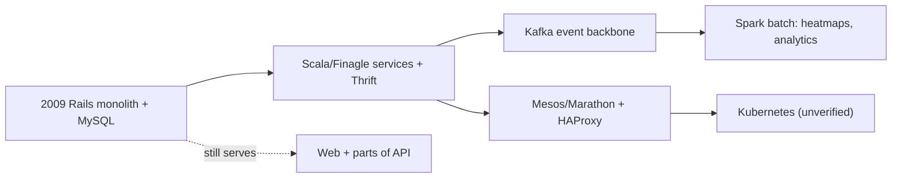
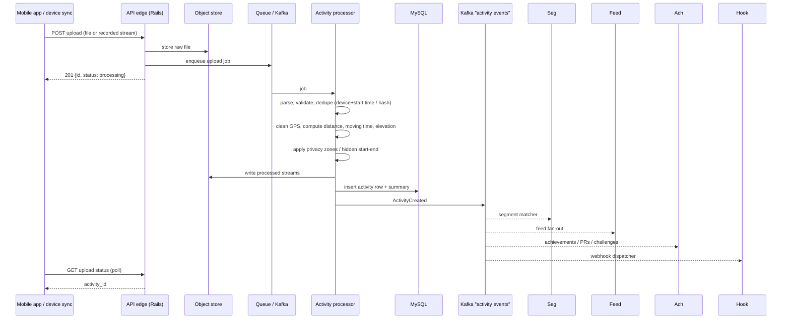
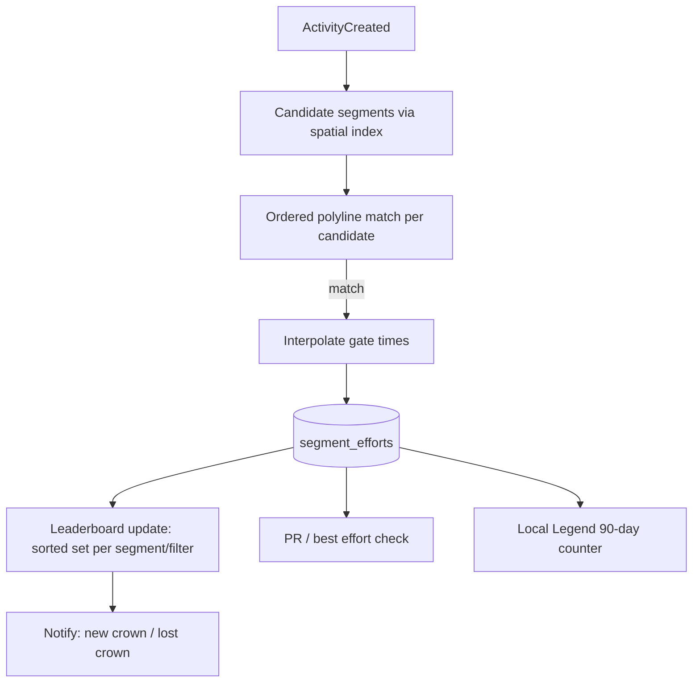
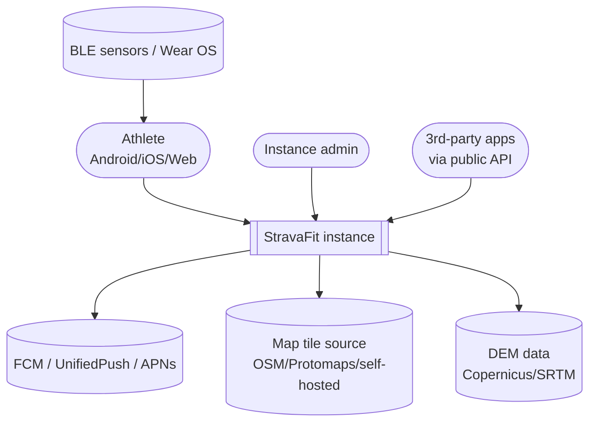
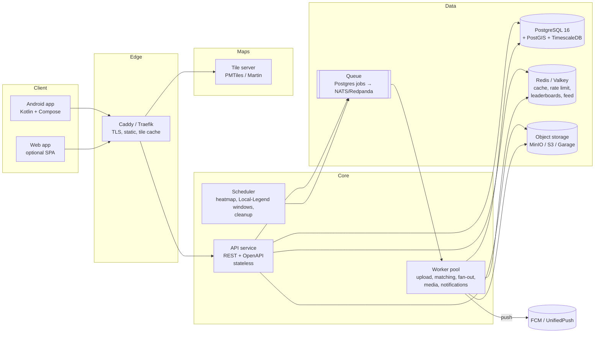
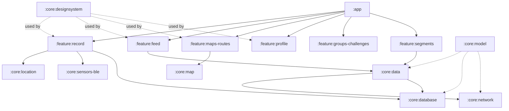
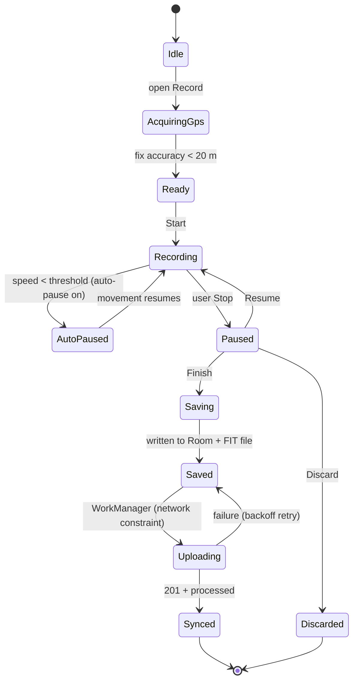
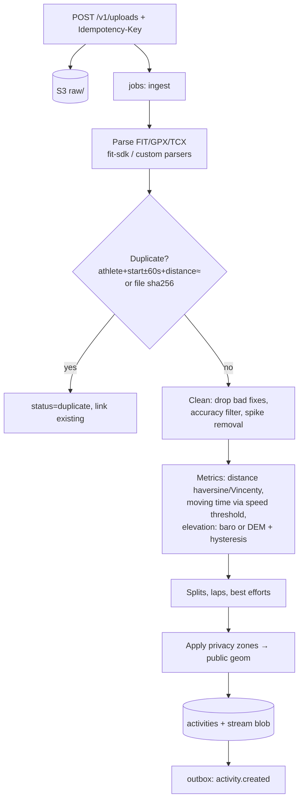

# Strava Architecture (Public Sources) and StravaFit Reference Architecture

> Scope: Strava's backend and client architecture as described in public engineering material, followed by a proposed architecture for **StravaFit**, the open-source alternative (github.com/warpirate/stravafit).
>
> **Research caveat (read first):** The web search budget for this research run was used up before this doc started. Only a few direct page fetches worked. `medium.com/strava-engineering` returned HTTP 403, so engineering-blog claims could not be re-read this session. Sections 1–4 combine:
> - **(verified)**: confirmed this session from developers.strava.com or github.com/strava.
> - **(reported)**: widely cited in Strava engineering posts and talks that the author knows of but could not re-open this session. Treat these as likely but re-check them before relying on them.
> - **(unverified)**: inference or a weak recollection.
>
> Section 5 onward (the StravaFit design) is our own proposal and does not depend on those claims.
>
> [FREE]/[SUB] tags mark Strava's gating for reference only. StravaFit has no subscriptions, so every feature is free.

---

## Table of contents

1. Strava at a glance: architecture timeline
2. Backend building blocks (languages, RPC, datastores, infra)
3. Core pipelines
   1. Activity upload and processing
   2. Segment matching and leaderboards
   3. Feed generation
   4. Global/personal heatmaps
   5. Search
   6. Photo/media
   7. Maps and tiles
   8. Notifications and webhooks
   9. Public API and rate limiting
4. Client architecture (Android, iOS differences)
5. Experimentation, feature flags, and observability
6. Lessons for StravaFit
7. StravaFit reference architecture
   1. Goals and constraints
   2. C4 Level 1: system context
   3. C4 Level 2: containers
   4. Android client architecture
   5. Backend service design
   6. Data model and storage
   7. Pipelines (upload, matching, feed, heatmap, notifications)
   8. Self-hosted docker-compose
   9. Scaling path
   10. Backend language decision
8. OSS implementation notes
9. Sources

---

## 1. Strava at a glance: architecture timeline

| Period | Architecture state | Confidence |
|---|---|---|
| 2009–~2013 | Single **Ruby on Rails** app (web plus API) on **MySQL**. Rails served the website, the mobile API and background jobs. | reported |
| ~2013–2016 | Started breaking the monolith into **JVM services in Scala** using Twitter's **Finagle** RPC stack and **Apache Thrift** IDL. Strava's GitHub org keeps a Thrift mirror fork. | reported, with Thrift fork verified |
| ~2014–2019 | Containers on **Apache Mesos plus Marathon** (also Aurora per some talks), **HAProxy**-based service discovery and **ZooKeeper**. The GitHub org has forks of `bamboo` (HAProxy autoconfig for Mesos/Marathon) and `guano` (ZooKeeper dump/restore). | forks verified, usage reported |
| ~2015 onward | **Apache Kafka** as the event backbone between Rails and services, carrying activity-created and kudos events plus feed fan-out. | reported |
| 2017 | **Global Heatmap** rebuilt as a batch job on **Apache Spark** over AWS S3. Strava publicly described about 1B activities and trillions of GPS points. | reported |
| 2018 | Heatmap privacy incident (military-base exposure), followed by privacy-zone and heatmap opt-out changes. | reported (widely covered in the press) |
| ~2019–2022 | Migration from Mesos to **Kubernetes** on AWS. | unverified |
| ~2020 onward | Mobile clients move to declarative UI (Jetpack Compose and SwiftUI) inside a Kotlin- and Swift-heavy, modularized codebase. A GraphQL gateway for mobile has been reported. | unverified |
| 2023 | Acquired **FATMAP** (3D mapping). 3D/terrain map features followed. | reported |
| 2025 | Acquired **Runna** (training plans) and **The Breakaway** (cycling coaching). | reported |

**Monitoring stack hints (verified forks):** `grafanalib` (Grafana dashboards as Python code) and `passenger_exporter` (a Prometheus exporter for Phusion Passenger, the Rails app server on nginx). Together they suggest **Prometheus plus Grafana** for metrics, with Rails served through **Passenger**.



The Rails monolith reportedly never disappeared completely. It still serves as the "front door" for much of the web and API surface and calls into services. This is the classic "strangler fig" migration.

---

## 2. Backend building blocks

### 2.1 Languages and frameworks

| Language | Use | Confidence |
|---|---|---|
| Ruby (Rails) | Web app, legacy API, admin tooling | reported (Passenger exporter fork supports it) |
| Scala | Most backend services (Finagle/Thrift), streaming consumers | reported |
| Go | Infra tooling. The archived `go.strava` repo is an API *client* library, and several forks are Go. | verified for tooling, unverified for core services |
| Python | Data science and analytics, Grafana dashboards as code | partly verified (grafanalib fork) |
| Java/Scala on Spark | Heatmap and batch analytics | reported |
| Kotlin | Android app | reported |
| Swift (plus legacy Objective-C) | iOS app. The Zendesk SDK fork is Obj-C. | reported |

### 2.2 Datastores (as publicly discussed)

| Store | Reported use | Confidence |
|---|---|---|
| MySQL (AWS RDS/Aurora) | Primary relational data: athletes, activities metadata, clubs, segments | reported |
| Cassandra | High-write, time-ordered data such as feed entries and some activity-derived data | unverified |
| Redis | Caches, counters, leaderboard and feed working sets, rate-limit counters | reported |
| Amazon S3 | Raw uploaded files (FIT/GPX/TCX), processed streams, photos, heatmap inputs and output tiles | reported |
| Elasticsearch | Athlete, club and segment search | unverified |
| Kafka | Event log between services | reported |
| ZooKeeper | Coordination (Kafka, Mesos-era service discovery) | fork verified, use reported |

### 2.3 RPC and integration

- **Thrift over Finagle** for service-to-service calls (reported). This gives load balancing, retries, timeouts and tracing (Finagle integrates with Zipkin).
- **Kafka topics** for asynchronous domain events. An activity-created event triggers segment matching, feed fan-out, achievements, challenge progress, webhooks and notifications.
- **Public REST API v3** (verified at developers.strava.com) is a JSON/REST surface with OAuth2 scopes and webhooks.

---

## 3. Core pipelines

### 3.1 Activity upload and processing

**Public facts (verified, developers.strava.com/docs/uploads):**
- Accepted formats are FIT, TCX and GPX, plus their gzipped variants. JSON is accepted only for strength-type activities.
- Uploads go to `POST /api/v3/uploads` as multipart and need the `activity:write` scope. The 201 response means the file was *queued*, not processed.
- Processing is **asynchronous**. Clients poll `GET /uploads/:id` no more than once a second. Strava says mean processing time is under 2 s.
- A **duplicate check** runs early. A duplicate comes back as an error that names the existing activity, with `activity_id` null.
- The activity does not appear in other API responses until processing succeeds.

**Inferred internal pipeline (reported/unverified detail):**



Downstream consumers (segment efforts, best efforts, challenge progress) fill in after creation. That is why an activity sometimes shows up before its segment results.

**Elevation:** Strava publicly says it can replace device elevation with values from a basemap or DEM. Barometric devices are generally trusted, and the "Correct elevation" option is offered on the web (reported).

### 3.2 Segment matching and leaderboards

**How it reportedly works:**
1. **Candidate selection.** Index segment start points, end points and bounding boxes spatially (geohash or grid buckets). For a new activity, find segments whose start and end fall near the track and whose bbox intersects the activity bbox.
2. **Geometric matching.** Walk the activity track and look for passing near the segment start (within a radius of roughly 15–30 m, unverified), then following the segment polyline in order to the end. Strava's help center says matching needs the activity to follow the segment closely, and that GPS drift can cause misses.
3. **Effort timing.** Interpolate the exact crossing times at the start and end gates to get elapsed time. Repeated passes create multiple efforts.
4. **Leaderboard update.** Write an effort row, then update per-athlete best and leaderboard position. KOM/QOM [FREE to hold, full leaderboard filters SUB], Local Legend (most efforts in a 90-day window) and personal records all come from these efforts.

**Leaderboard storage (reported/unverified):** A sorted structure per segment and filter, such as Redis sorted sets keyed by `segment:{id}:{gender}:{age}`, with the canonical efforts in a durable store. Filtered leaderboards (age, weight, club, following, this year) are computed or cached on demand. Strava also has hazardous-segment flags and leaderboard moderation (flagging, Fair Play/"Strava Fair Play" review). Rebuilds happen when an activity is flagged or deleted.



### 3.3 Feed generation (fan-out)

- Strava's home feed is a mix of followed athletes' activities, clubs, challenges, suggestions and ads/promos. It moved from chronological to a "personalized/ranked" option, and in recent years chronological ordering returned as a user choice (reported).
- **Architecture (reported):** A hybrid **fan-out-on-write** puts activity IDs into each follower's feed list (Redis/Cassandra), capped in length. Heavy accounts such as pros with many followers get **fan-out-on-read** merges. Feed entries store IDs. A hydrator service then batch-loads activity summaries, kudos and comments counts, and photos.
- The feed reads from an eventually consistent projection. That is why kudos counts and new activities can lag.

### 3.4 Heatmaps

**Global Heatmap 2017 rebuild (reported, from the Strava engineering post "The Global Heatmap, Now 6x Hotter"):**
- Input was about **1 billion activities** and trillions of GPS points from public, non-opted-out data. The job ran on **Apache Spark** over data in S3.
- Points are rasterized per zoom level into pixel counts per tile, using line rendering between consecutive points rather than dots.
- Counts are **normalized** with a CDF-style or percentile transform per tile region, so busy and quiet areas both show detail.
- Output is pre-rendered raster tiles at many zooms (and higher max zoom than before), stored in S3 and served via CDN.
- Sport layers (ride, run, water, winter) and colour themes.
- Refresh is periodic (roughly monthly, unverified). Activities from opted-out athletes, private activities and privacy-zone sections are excluded.

**Personal Heatmap [SUB]** renders only the athlete's own activities and supports filters such as date and sport. It is likely generated on demand or incrementally per athlete (unverified).

**Privacy fallout (2018):** Military-base exposure led to clearer opt-outs and minimum-activity thresholds for showing low-traffic areas (reported).

### 3.5 Search

Athlete, club and segment search, plus the route explore/search UI. Likely Elasticsearch-type full-text indexing with geo filters (unverified). Segment Explore is geo-bbox driven.

### 3.6 Photo and media pipeline

- Photos and videos are uploaded to object storage (S3) and resized or transcoded into variants (thumbnails, feed size, full). Video support was added around 2023 (reported), with clip length limits (unverified).
- Media is served via CDN with signed or obfuscated URLs. The API exposes `activities#upload_media` (verified by name in the rate-limit doc's exclusion list).

### 3.7 Maps and tiles

- Basemaps: Strava moved its mobile maps to **Mapbox** (reported) and offers its own styles (Standard, Satellite, Hybrid, Winter). 3D terrain came after the FATMAP acquisition.
- Overlays: heatmap raster tiles, segment and route lines, POIs.
- Routes: the Route Builder uses popularity data (heatmap-derived) for routing preference, a feature called "Popularity routing" (reported).
- Offline maps for routes [SUB] (reported).

### 3.8 Notifications and webhooks

- Push via FCM on Android and APNs on iOS. Notification types include kudos, comments, follows, crowns gained or lost, club posts and challenge milestones. Per-type toggles exist in settings.
- **Webhooks (verified, developers.strava.com/docs/webhooks):**
  - `object_type` ∈ {activity, athlete}; `aspect_type` ∈ {create, update, delete}.
  - Activity updates carry `title`, `type`, `private`. Deauthorization comes as an athlete update with `authorized: "false"`.
  - Subscription handshake: POST client_id/secret/callback_url/verify_token, then Strava GETs the callback with `hub.challenge`, which must be echoed in JSON within **2 s**.
  - **One subscription per app**. The callback must return 200 within 2 s, with **up to 3 total delivery attempts**. Strava says to process asynchronously.
  - One user action may emit **multiple events**.
  - Apps without `activity:read_all` get `delete` when an activity becomes Only You and `create` when it becomes visible again.

### 3.9 Public API and rate limiting (verified)

| Limit | 15 min | Daily |
|---|---|---|
| Overall | 200 | 2,000 |
| Read (non-upload) | 100 | 1,000 |

- Windows reset at :00/:15/:30/:45 and at midnight UTC. Over-limit requests return `429`.
- Headers `X-RateLimit-Limit/Usage` and `X-ReadRateLimit-Limit/Usage` each hold "15min,daily" values.
- Requests that violate the short-term limit still count against the daily limit.

The fixed-window design (not sliding) is easy to copy with Redis `INCR` plus `EXPIRE` on window-aligned keys.

---

## 4. Client architecture

### 4.1 Android (reported/unverified, no decompilation performed)

| Area | Public picture |
|---|---|
| Language | Kotlin-first. Legacy Java remains (reported). |
| UI | Mostly XML views historically, with Jetpack Compose adoption growing for new screens (unverified). |
| Architecture | MVVM/MVI-style presenters (reported in Strava Android talks), DI with Dagger/Hilt (unverified) |
| Async | RxJava historically, moving to Kotlin Coroutines/Flow (unverified) |
| Networking | Retrofit plus OkHttp to an internal mobile API. A GraphQL layer for some screens was reported but not confirmed here. |
| Modularization | Multi-module Gradle (feature modules) to cut build times (reported in conference talks) |
| Recording | Foreground service with persistent notification, GPS through FusedLocationProvider, sensors over BLE (heart rate, power, cadence), Wear OS companion |
| Offline | Recordings saved locally and uploaded later, with retry when connectivity returns |
| Maps | Mapbox SDK (reported) |

### 4.2 iOS differences

- Swift/SwiftUI with UIKit legacy. HealthKit integration for import and export, and an Apple Watch app with standalone recording.
- Background location uses `allowsBackgroundLocationUpdates` instead of a foreground service. Live Activities and Dynamic Island show recording status (reported).
- Android uses Health Connect instead of HealthKit (reported).

---

## 5. Experimentation, feature flags, observability

- **Experimentation:** Strava runs A/B tests on onboarding, subscription paywalls and feed ranking, which is visible as staggered rollouts. The internal system is not public (unverified).
- **Feature flags:** Server-driven flags gate features per platform and per cohort, plus remote config for mobile.
- **Observability:** Prometheus plus Grafana (forks verified, use reported). Finagle-era services typically use Zipkin-style tracing (unverified). Crash reporting on mobile likely uses Firebase Crashlytics or similar (unverified).

---

## 6. Lessons for StravaFit

1. **Async everything after upload.** Return quickly, process in workers and publish events. Strava's 2-second mean is a good target.
2. **Event-driven side effects.** One "activity created" event feeds matching, feed, PRs, challenges and webhooks. Use an outbox so events are never lost.
3. **Spatial indexing is the core of segment matching.** PostGIS does this well at our scale.
4. **Fan-out-on-write with a cap**, falling back to read-time merge for large accounts.
5. **Batch heatmaps** are a periodic job. We can do it with PostGIS/DuckDB and a tile renderer rather than Spark at first.
6. **Privacy is architecture.** Privacy zones must be applied before any derived product (feed map, heatmap, segments shown to others).
7. **Fixed-window rate limits** are simple and transparent.

---

## 7. StravaFit reference architecture

### 7.1 Goals and constraints

| Goal | Implication |
|---|---|
| Self-hostable by one person on a small VPS (2 vCPU / 4 GB) | Few containers, Postgres-centric, no Kafka requirement at small scale |
| Scales to about 1M users without rewrite | Clear module boundaries, stateless API, queue abstraction, partitioned tables |
| Offline-first Android recording | Room as source of truth, WorkManager sync, foreground service |
| No subscriptions | No entitlement service. All features free, with quotas only for abuse protection. |
| Privacy by default | Privacy zones, follower-only defaults, heatmap opt-in |
| Federation-friendly (optional later) | Stable public IDs (UUIDv7), ActivityPub as an option |

### 7.2 C4 Level 1: system context



### 7.3 C4 Level 2: containers



### 7.4 Android client architecture

**Stack**

| Concern | Choice | Notes |
|---|---|---|
| Language | Kotlin 2.x | K2 compiler |
| UI | Jetpack Compose + Material 3 | Navigation Compose with type-safe routes |
| Architecture | Unidirectional data flow (MVI-ish): `UiState` + `ViewModel` + `StateFlow` | Testable reducers |
| DI | Hilt (or Koin for lighter builds) | |
| Async | Coroutines + Flow | No RxJava |
| Local DB | Room (SQLite) | Recording points, outbox, cached feed |
| Prefs | DataStore | |
| Network | Retrofit/Ktor-client + kotlinx.serialization + OkHttp | OpenAPI-generated client |
| Background | WorkManager | Uploads, sync, map prefetch |
| Recording | Foreground service (`foregroundServiceType="location|health"`) | Android 14+ FGS type rules |
| Location | FusedLocationProvider (GMS) with a `LocationManager` fallback for de-Googled/F-Droid builds | Product flavors `gms` / `foss` |
| Sensors | BLE GATT (Heart Rate 0x180D, Cycling Power 0x1818, CSC 0x1816, RSC 0x1814) via Nordic BLE library | |
| Maps | MapLibre Native Android | Vector tiles, offline regions |
| Files | FIT encode/decode (Garmin FIT SDK, a permissive licence; check terms) or a custom encoder. GPX/TCX via XML. | |
| Health | Health Connect read/write | |
| Wear | Wear OS app with Compose for Wear and Data Layer API | Later phase |
| Images | Coil 3 | |
| Push | FCM (gms flavor), UnifiedPush (foss flavor) | |
| Testing | JUnit5, Turbine, Compose UI test, Roborazzi screenshots | |

**Module graph**



**Recording state machine**



**Crash and kill safety:** Each location point is written to Room in small batches every 1–5 s inside a transaction. The FGS restarts on process death with `START_STICKY`, and a "resume recording?" banner appears if a session was left open. Recording works fully offline.

**Upload worker contract**
1. Build a FIT file (or a compact JSON stream) from Room.
2. `POST /v1/uploads` with an `Idempotency-Key` equal to the local recording UUID, so retries never duplicate.
3. Poll the status, or get a push when processing is done. Then replace the local activity with the server ID.

**Recording screen wireframe (~40 cols)**

```
+--------------------------------------+
| <  Run          GPS ●●●   HR 142  [⚙]|
|                                      |
|   [            map view            ] |
|   [        ~~~~ track ~~~~         ] |
|                                      |
|  TIME            DISTANCE            |
|  00:24:13        4.12 km             |
|  PACE            ELEV GAIN           |
|  5:52 /km        38 m                |
|                                      |
|        [ ■ STOP ]  [ ⏸ LAP ]          |
+--------------------------------------+
```

### 7.5 Backend service design

**Shape: a modular monolith plus workers.** Strava's history shows that a Rails monolith scaled a long way before splitting. We start with one deployable that has strict internal modules (`identity`, `activities`, `ingest`, `segments`, `social`, `feed`, `routes`, `media`, `notifications`, `heatmap`, `public-api`). The same binary runs in `api` or `worker` mode. Modules talk through interfaces and domain events, never through each other's tables, so any of them can later become its own service.

**API style**
- REST + JSON, versioned `/v1`, defined in OpenAPI 3.1 and used to generate the Android client.
- Auth uses OAuth2/OIDC: our own authorization server (e.g. built-in, or Keycloak/Authentik for larger instances). Mobile uses PKCE. Third-party apps get scopes similar to Strava's (`read`, `activity:read`, `activity:read_all`, `activity:write`, `profile:read_all`).
- Cursor pagination with opaque cursors.
- Webhooks for third-party apps that follow the same semantics as Strava's (verified model above), but with HMAC signatures and **exponential retry up to 24 h** instead of 3 attempts.
- Rate limits use a fixed window in Redis, keyed by token and window, with Strava-style headers so existing tools work.

**Domain events (outbox pattern)**

| Event | Producers | Consumers |
|---|---|---|
| `activity.created` | ingest | segments, feed, achievements, challenges, heatmap-incremental, webhooks, notifications |
| `activity.updated` / `activity.privacy_changed` | activities | feed (remove/insert), leaderboards (hide), heatmap, webhooks |
| `activity.deleted` | activities | everything above (compensate) |
| `effort.created` | segments | leaderboards, PRs, local-legend, notifications (crown) |
| `social.kudos_given` / `comment.created` | social | notifications, feed counters |
| `follow.created` / `follow.approved` | social | feed backfill, notifications |
| `athlete.deauthorized` | identity | webhooks |

Events are written to an `outbox` table in the same transaction as the state change. A relay publishes them to the queue and consumers are idempotent (`processed_events(consumer, event_id)`).

### 7.6 Data model and storage

**PostgreSQL schemas (core tables)**

| Table | Key columns | Notes |
|---|---|---|
| `athletes` | id (uuid v7), handle, display_name, sex, birth_year, weight_kg, units, privacy defaults | |
| `follows` | follower_id, followee_id, state (pending/accepted), created_at | PK (follower, followee), index on followee |
| `activities` | id, athlete_id, sport_type, start_time, tz, distance_m, moving_s, elapsed_s, elev_gain_m, avg/max speed/hr/power, visibility, device, `summary_polyline` (encoded), `geom` (LineString, privacy-trimmed), `bbox`, `start_point`, `raw_object_key`, status | Partition by `start_time` month at scale. GiST on `geom` and `bbox`. |
| `activity_streams` | activity_id, t, lat, lon, ele, hr, cad, power, speed, temp, distance | TimescaleDB hypertable **or** columnar blobs in S3 (see below) |
| `privacy_zones` | athlete_id, center (Point), radius_m | Applied at processing time |
| `laps` / `splits` / `best_efforts` | activity_id, idx, distance, time | best efforts for 400m, 1k, 1mi, 5k, 10k, HM, M |
| `segments` | id, name, sport, `geom` (LineString), start_pt, end_pt, distance, avg_grade, elev, creator, hazardous, private | GiST on geom, start_pt, end_pt |
| `segment_efforts` | id, segment_id, activity_id, athlete_id, start_idx, end_idx, elapsed_s, moving_s, start_time, avg_hr/power, flagged | Index (segment_id, elapsed_s), (athlete_id, segment_id) |
| `segment_bests` | segment_id, athlete_id, best_effort_id, elapsed_s | Materialized per-athlete best for fast leaderboards |
| `kudos`, `comments` | activity_id, athlete_id, ... | |
| `clubs` / `club_members` / `club_posts` | | |
| `challenges` / `challenge_participants` | goal type, window, progress | |
| `routes` | id, owner, geom, distance, elev, sport, waypoints (jsonb) | |
| `media` | id, activity_id, kind, object_key, variants jsonb, status | |
| `feed_entries` | owner_id, activity_id, ts | Only if Redis is not used for feeds |
| `outbox`, `processed_events`, `jobs` | | |
| `oauth_clients`, `oauth_tokens`, `webhook_subscriptions` | | |

**Streams storage decision**

| Option | Pros | Cons | When |
|---|---|---|---|
| TimescaleDB hypertable (one row per point) | SQL analytics, compression (often 90%+), continuous aggregates | Row count gets huge (about 3,600 rows per hour of activity) | Small and medium instances, analytics features |
| **Columnar blob per activity in S3** (Parquet or a custom delta-encoded protobuf) plus `activity_streams_meta` | Cheap, scales linearly, matches Strava's reported S3 approach | Cross-activity analytics needs batch tools (DuckDB) | Default for scale |
| Both: blob as source of truth, Timescale for recent 90 days | Best of both | Two copies | Large instances wanting fitness analytics |

**Recommendation:** Make the **S3 blob the canonical stream store** (zstd-compressed, delta-encoded int arrays). The API serves streams to clients straight from the blob, which is cacheable. TimescaleDB stays optional, for training-load and fitness charts.

**Redis keys**

| Key | Type | Purpose |
|---|---|---|
| `lb:{segment}:{filter}` | ZSET (score = elapsed_s, member = athlete) | Overall, M/F and age-bucket leaderboards |
| `ll:{segment}:{yyyymmdd-window}` | ZSET (score = count) | Local-legend 90-day counts (rebuilt nightly from SQL) |
| `feed:{athlete}` | ZSET (score = ts, member = activity_id), capped at 800 | Home feed |
| `rl:{token}:{window}` | STRING counter + EXPIRE | Rate limiting |
| `cache:activity:{id}` | HASH | Hydration cache |

Redis is **always rebuildable from Postgres**, so it never holds unique state.

### 7.7 Pipelines

#### Upload and processing



**Algorithms**
- **Moving time:** a point counts as moving if speed exceeds a sport threshold (e.g. run 0.5 m/s, ride 1.0 m/s; unverified relative to Strava). Gaps longer than 10 s with no movement are excluded.
- **Elevation gain:** smooth with a moving median or Kalman filter, then accumulate only climbs that exceed a hysteresis threshold (about 2–5 m). For devices without a barometer, sample DEM elevations (Copernicus GLO-30) along the track.
- **Polyline:** Google encoded-polyline (precision 5) for summaries, with Douglas–Peucker simplification to under 500 points.
- **Best efforts:** a two-pointer sliding window over cumulative distance vs time, O(n) per target distance.

#### Segment matching (PostGIS)

```sql
-- candidate segments for an activity
SELECT s.id
FROM segments s
WHERE s.sport = $sport
  AND s.geom && ST_Expand($activity_bbox, 0.0005)
  AND ST_DWithin(s.start_pt::geography, $activity_geom::geography, 25)
  AND ST_DWithin(s.end_pt::geography,   $activity_geom::geography, 25);
```

Then in application code, for each candidate:
1. Find every index where the track comes within R metres of the start gate. That gives candidate starts.
2. From each start, walk forward and check that the segment's sample points (resampled every 10–20 m) are each within a tolerance of the track, in order. A discrete Fréchet distance with a threshold of about 30–50 m is a good fit.
3. Find the end-gate crossing. Interpolate exact gate times between fixes and reject if track length / segment length is outside 0.9–1.3.
4. Emit an effort, plus a monotonic check so an effort cannot reuse the same points.

Edge cases include loops where start equals end, out-and-back segments, tunnels with GPS gaps (allow gap bridging up to N metres), indoor or virtual activities (never match), privacy-zone-trimmed sections (match on the raw track but hide from public views per the athlete's settings), and flagged or very-high-speed efforts (sanity filters for sport speed limits).

#### Feed

- **Write path:** On `activity.created` with visibility ≥ followers, `ZADD feed:{follower}` for each accepted follower, batched in pipelines of 1k. Accounts with more than 10k followers are marked "celebrity" and skipped for fan-out.
- **Read path:** `ZREVRANGE feed:{me}`, merge with recent activities from followed celebrities (SQL), then hydrate in a batch.
- **Cold start / Redis loss:** rebuild from SQL with `activities JOIN follows ORDER BY start_time DESC LIMIT 200`.
- At small scale (<10k users), skip Redis fan-out and use the SQL query directly.

#### Heatmap

| Stage | Small instance | Large instance |
|---|---|---|
| Extract | SQL over public, opted-in activities' `geom` (privacy-trimmed) | Parquet export of streams to S3 |
| Rasterize | Rust/Go tool (or `tippecanoe` for vector density) drawing Bresenham lines per tile at z≤16 into `uint32` count arrays | Spark or Ray job, or DuckDB spatial in partitions |
| Normalize | Per-tile 99th-percentile clip + log or CDF mapping to colour ramp | same |
| Package | PMTiles archive (raster PNG/WebP) per sport | same, CDN-fronted |
| Refresh | Nightly incremental (dirty tiles from new activities) and monthly full rebuild | same |
| Privacy | Min distinct-athlete count per pixel (k-anonymity, e.g. ≥3) before display | same |

Personal heatmap: render client-side on the fly from the athlete's own simplified polylines with MapLibre line layers and additive opacity. This needs no server job.

#### Notifications

- Notifications are persisted in a `notifications` table, and an inbox screen reads from it.
- Delivery goes through a `push_devices` table to FCM (gms), UnifiedPush (foss) or APNs.
- Rate-limiting and batching ("Alex and 12 others gave kudos") use a 2-minute debounce window per activity.

#### Media

Pre-signed PUT to object storage, then a `media.uploaded` job. That job makes variants with libvips (sizes 256/1024/2048, WebP/AVIF), strips EXIF GPS from public variants, and transcodes video with ffmpeg (HLS 720p, 60 s cap configurable).

### 7.8 Self-hosted docker-compose (sketch)

```yaml
services:
  caddy:
    image: caddy:2
    ports: ["80:80", "443:443"]
    volumes: [./Caddyfile:/etc/caddy/Caddyfile, caddy_data:/data]
  api:
    image: ghcr.io/warpirate/stravafit-server:latest
    command: ["serve", "--mode=api"]
    env_file: .env
    depends_on: [db, redis, minio]
  worker:
    image: ghcr.io/warpirate/stravafit-server:latest
    command: ["serve", "--mode=worker", "--concurrency=4"]
    env_file: .env
    depends_on: [db, redis, minio]
  db:
    image: timescale/timescaledb-ha:pg16   # includes PostGIS
    volumes: [pg_data:/home/postgres/pgdata]
    environment: { POSTGRES_PASSWORD: ${PG_PASSWORD} }
  redis:
    image: valkey/valkey:8
  minio:
    image: minio/minio
    command: server /data --console-address ":9001"
    volumes: [s3_data:/data]
  tiles:
    image: ghcr.io/maplibre/martin   # serves PMTiles + PostGIS vector tiles
    volumes: [./tiles:/tiles]
volumes: { pg_data: {}, s3_data: {}, caddy_data: {} }
```

Pin exact image versions before publishing the compose file. Optional profiles add `--profile observability` (Prometheus, Grafana, Loki, Tempo, OTel collector) and `--profile auth` (Authentik/Keycloak).

### 7.9 Scaling path

| Stage | Users | Topology | Changes |
|---|---|---|---|
| S0 | ≤1k | Single VPS, compose | Postgres-backed job queue (e.g. `SKIP LOCKED`), SQL feed, no Redis needed |
| S1 | ≤50k | 1 API + 2 workers, managed Postgres, S3 + CDN | Redis for leaderboards, feed and rate limit. Read replica. |
| S2 | ≤500k | Kubernetes or Nomad, HPA on API/worker | Partition `activities`/`segment_efforts` by time. PgBouncer. Queue moves to NATS JetStream or Redpanda. CDN for tiles and streams. |
| S3 | 1M+ | Split hot modules into services: ingest, segments, feed | Citus or sharding by athlete_id for activities. Segment matching as a dedicated autoscaled pool. Heatmap batch on Spark/Ray. Search via OpenSearch/Meilisearch. |

**Back-of-envelope (1M MAU):** about 300k activities/day, or 3.5/s average and roughly 30/s at weekend-morning peak. Streams at about 50 KB compressed each come to about 15 GB/day, or 5.5 TB/year, so object storage is mandatory. Segment matching at about 50 ms CPU per activity needs roughly 2 cores at peak, so it is cheap with a spatial index.

### 7.10 Backend language decision

| Option | Pros | Cons |
|---|---|---|
| **Kotlin + Ktor** | Shares models and validation with the Android client (KMP `:shared` module), coroutines, JVM geo libs (JTS, GeoTools), Garmin FIT SDK for Java | JVM memory footprint (about 300 MB+) on tiny VPSes |
| **Go** | Tiny static binaries, low RAM, great concurrency, easy self-hosting | No code sharing with Android. Geo libs (orb, go-geom) are less complete than JTS. |
| **TypeScript (Node/Bun) + Fastify** | Biggest contributor pool, OpenAPI tooling | CPU-bound matching and parsing are slower. Would need worker threads or WASM. |

**Recommendation:** **Kotlin + Ktor**. It is the best fit for an Android-first OSS team because one language spans the stack and Kotlin Multiplatform can share the `model`, `fit-parser`, `metrics` (distance, moving time, best efforts) and `polyline` modules between client and server. That gives identical numbers on device and server, which avoids "the app showed 10.02 km but the server says 9.98". Use GraalVM native image, or a JVM tuned with `-Xmx256m`, for small hosts. Libraries: Exposed or jOOQ, Flyway, HikariCP, kotlinx.serialization, JTS, Lettuce (Redis), AWS SDK S3 (MinIO compatible), OpenTelemetry Java agent.

Record the decision as an ADR in `D:/stravafit/docs/DECISIONS.md` (to be done by the blueprint step).

---

## 8. OSS implementation notes

- **Neutral names for Strava trademarks:**

  | Strava name | StravaFit name |
  |---|---|
  | KOM/QOM | **Segment Crown** (fastest) |
  | Local Legend | **Regular** (most efforts in 90 days) |
  | Kudos | **Props** |
  | Beacon | **Live Share** |
  | Flyby | **Crossings** |
  | Global Heatmap | **Activity Heat** |
  | Fair Play | **Leaderboard Integrity** |

- **Everything [SUB] in Strava is free here.** Personal heatmap, full leaderboard filters, offline maps, route builder and training analytics are not gated. Rate limits exist only to prevent abuse.
- **Shared KMP module:** `:shared:model`, `:shared:metrics`, `:shared:fit`, `:shared:polyline`, `:shared:matching`. Running segment matching on device would allow "live segments" offline.
- **Libraries:** MapLibre Native, JTS/GeoTools, PostGIS, TimescaleDB (optional), PMTiles + Martin, libvips, ffmpeg, Garmin FIT SDK (check licence) or a clean-room FIT codec, Nordic Android BLE library, WorkManager, Room, Hilt, Retrofit/Ktor-client, Coil.
- **Android specifics:**
  - Android 14+ requires `FOREGROUND_SERVICE_LOCATION` and `FOREGROUND_SERVICE_HEALTH` permissions and starting the FGS while visible.
  - Android 12+ restricts background FGS starts, so start recording from the UI only.
  - Ask for `ACCESS_BACKGROUND_LOCATION` only when needed. A recording in an FGS does not need it.
  - Request battery-optimization exemption guidance for OEM killers (Xiaomi, Samsung). Link users to dontkillmyapp.com.
  - Use `BLUETOOTH_SCAN` with `neverForLocation` and `BLUETOOTH_CONNECT` on Android 12+.
  - Ship two flavors, `gms` and `foss`, for F-Droid.
- **Edge cases:**
  - Clock skew between device and server: trust device timestamps per point and server-stamp the upload.
  - DST and time zone: store UTC plus the IANA tz of the start point.
  - Recordings spanning midnight.
  - Treadmill or indoor activities with no GPS.
  - Duplicate imports from Health Connect plus direct upload: dedupe on start ±60 s with distance within 3%.
  - Privacy zone overlapping a segment.
  - Deleted activities must remove efforts and recompute leaderboards and crowns. This is an event-compensation job.
- **Webhooks for 3rd parties:** Keep Strava's payload shape (`object_type`, `aspect_type`, `object_id`, `owner_id`, `updates`, `event_time`) to ease porting, and add an `X-StravaFit-Signature` HMAC header.
- **Import from Strava:** Support the user's Strava **bulk export archive** (activities.csv plus FIT/GPX files), which users can request from their account settings. Avoid scraping. API-based import must follow Strava's API terms.
- **Observability:** OpenTelemetry SDK, Prometheus metrics (`ingest_duration_seconds`, `matching_candidates_total`, `queue_lag_seconds`), Grafana dashboards as code, structured JSON logs. On the client, opt-in crash reporting (ACRA for foss, Crashlytics optional for gms).
- **Feature flags and experiments:** Use OpenFeature with a flagd or Unleash provider (self-hostable). No dark-pattern experiments, and A/B tests are opt-in per instance.

---

## 9. Sources

Consulted this session (verified):
- https://developers.strava.com/docs/webhooks/
- https://developers.strava.com/docs/rate-limits/
- https://developers.strava.com/docs/uploads/
- https://github.com/strava (public repos/forks: thrift, bamboo, guano, grafanalib, passenger_exporter, go.strava, ec2metaproxy, support_sdk_ios)

Attempted but blocked (HTTP 403). Content cited as "reported" from the author's prior knowledge of these:
- https://medium.com/strava-engineering
- https://medium.com/strava-engineering/the-global-heatmap-now-6x-hotter-23fc01d301de

Recommended for the next pass (not consulted this session):
- https://stories.strava.com/ (press releases: FATMAP, Runna, Breakaway acquisitions)
- https://support.strava.com/ (segment matching, privacy zones, elevation correction articles)
- Strava talks at Kafka Summit, Scala Days and Droidcon (search "Strava" on YouTube)
- https://maplibre.org/, https://postgis.net/, https://docs.timescale.com/, https://protomaps.com/docs/pmtiles
