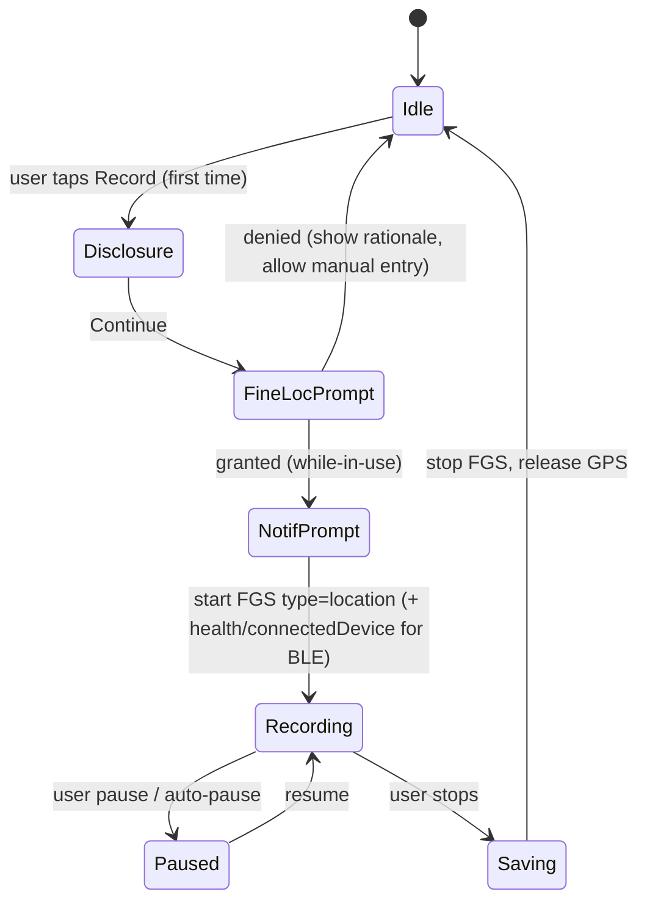
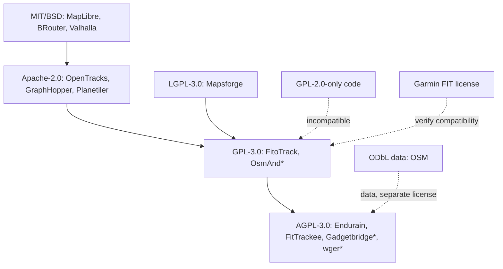

# 07 — Open-Source Landscape & Legal / IP Review

> Scope: survey of existing open-source fitness software we can learn from or reuse, the open map/routing/elevation/data stack, and the legal/IP constraints on building a functional Strava alternative.
> Status: research note, not legal advice. Before public launch, have a lawyer review sections 4–7.
> Research constraint: this pass ran in a shortened, time-boxed mode. The shared web-search budget ran out partway through, so several facts come from direct page fetches and some from prior knowledge. Those are marked **(unverified)**. Section 9 lists the claims that were re-checked.

---

## 0. TL;DR (decisions needed)

| # | Topic | Recommendation | Severity |
|---|---|---|---|
| 1 | **Project name "StravaFit"** | **Rename before any public release.** Strava's own API brand guidelines forbid using "Strava" in an app name, and "Strava" is a registered mark. Store reviewers and Strava can both act on this. | **HIGH / blocking** |
| 2 | Strava patents (segments, heatmaps) | Strava asserted US 9,116,922 (segments) and US 9,297,651 / 9,778,053 (heatmaps, popularity routing) against Garmin in 2025. Design around the claims, keep the design-around documented, and get counsel before monetized or US-scale launch. | HIGH |
| 3 | License | **AGPL-3.0-or-later** for the server, **GPL-3.0-or-later** (or AGPL) for the Android client, and Apache-2.0 for reusable libraries (FIT/GPX parsing, segment matcher). | MEDIUM |
| 4 | Background location (Play) | Use a user-started **foreground service** of type `location`, declare a single feature ("record workouts while screen off"), and ship a prominent disclosure and video. | HIGH for Play approval |
| 5 | Health data / GDPR | Treat HR, location and body data as **special-category (Art. 9) data**. Require explicit consent, privacy zones on by default, data export/delete, and no tracking SDKs. | HIGH |
| 6 | Map data | OSM (ODbL) with self-hosted Protomaps PMTiles or OpenMapTiles and MapLibre Native. **Never** reuse Strava's heatmap tiles or API data in our product. | MEDIUM |
| 7 | Strava API import | Only per user, user-initiated, and for that user's own data. Strava's API agreement bans competitive or replicating use **(verify current terms)**. Prefer file import (FIT/GPX/TCX) and bulk-export ZIP import. | HIGH |

---

## 1. OSS fitness software landscape

### 1.1 Summary matrix

| Project | Type | License | Stack | Status (2025-26) | Relevance |
|---|---|---|---|---|---|
| **OpenTracks** | Android recorder | **Apache-2.0** (confirmed) | Java, SQLite, no Play Services | Active on Codeberg; GitHub repo archived (read-only) | ★★★★★ recorder reference, BLE sensors, GPX/KML export |
| **FitoTrack** | Android recorder + workout log | GPL-3.0 **(unverified)** | Java, Room, Mapsforge | Maintained on Codeberg **(unverified)** | ★★★★ UX ideas, manual workouts |
| **Gadgetbridge** | Wearable companion (no vendor cloud) | AGPL-3.0 **(unverified)** | Java/Kotlin, greenDAO/SQLite | Very active (Codeberg) | ★★★★★ watch/band protocols, sleep and HR data import |
| **Endurain** | Self-hosted Strava-like web | **AGPL-3.0** (confirmed) | FastAPI, SQLAlchemy/Alembic, PostgreSQL, Vue 3 + TS, Tailwind | ~2.3k stars, 5k+ commits; "temporary feature freeze" to harden foundations | ★★★★★ closest server analogue; Strava/Garmin import code |
| **FitTrackee** | Self-hosted workout tracker | **AGPL-3.0** (confirmed) | Flask 3, PostgreSQL + PostGIS, Vue 3 + TS, Leaflet | ~1.2k stars, 6.3k commits; main repo on Codeberg | ★★★★ PostGIS usage, ActivityPub federation work **(unverified)** |
| **Runalyze** | Training analysis (web) | OSS edition archived Nov 2019; runalyze.com is the maintained, closed product | PHP | Abandoned as OSS | ★★ old algorithms (VO2max estimate, TRIMP) for reference only; check license before copying code |
| **wger** | Workout/strength + nutrition manager | AGPL-3.0 **(unverified)** | Django, Flutter app | Active | ★★★ strength/gym logging, exercise DB (CC-BY-SA content) |
| **GoldenCheetah** | Desktop cycling/running analytics | GPL-2.0-or-later **(unverified)** | C++/Qt | Active, slow cadence | ★★★★ power-duration curves, CP/W′, PMC (CTL/ATL/TSB) math |
| **Intervals.icu** | Training analytics web | **Proprietary** (free, donation-funded) | Java/JS **(unverified)** | Very active | ★★★ UX benchmark only; no code reuse |
| **Golden/others: Gpxsee, QMapShack** | Desktop GPX viewers | GPL-3.0 | C++/Qt | Active | ★★ file parsing |
| **OsmAnd** | Offline maps + trip recording | GPL-3.0 (core); some assets with extra terms **(unverified)** | Java/C++ | Very active | ★★★ offline vector maps and track recording |
| **Organic Maps / CoMaps** | Offline maps | Apache-2.0 | C++ | Active (fork split in 2025, unverified) | ★★ offline rendering |
| **Amazfish / Harbour** | Sailfish watch companion | GPL-3.0 **(unverified)** | Qt | Niche | ★ |
| **Sweatcoin, Nike Run Club, Komoot** | Commercial | Proprietary | — | — | Not OSS; UX benchmark only |

### 1.2 Project notes

#### OpenTracks (Apache-2.0)
- Privacy-first recorder: the app uses **no internet permission**, no ads, no analytics and no Google Play Services. Its only listed permissions are fine and background location, plus Bluetooth.
- BLE sensors: heart rate, cycling speed/cadence (CSC), cycling power, running speed/cadence (RSC), and the barometer through the phone or BLE Environmental Sensing. It also supports **sensor-only workouts without GPS** (indoor trainer).
- Export: GPX 1.1, KML/KMZ 2.3 (with photos). It can share tracks via an Intent to other apps such as the "OSMDashboard" pattern.
- **What we can reuse:** Because it is Apache-2.0, we can copy code into GPL/AGPL code (Apache-2.0 is compatible with GPLv3 one-way) as long as we keep the NOTICE file. Candidate modules are the BLE GATT parsers, track-point filtering, the pause/resume logic and the GPX exporter.
- **What to learn:** It shows that a useful recorder can work fully offline. Its "announcements" (voice stats) and custom stat layout are good references.

#### FitoTrack (GPL-3.0, unverified)
- Recorder plus manual-entry log, with interval workouts and voice coach. Maps come from Mapsforge offline/OSM tiles.
- Exports to GPX and syncs to FitTrackee (FitTrackee lists FitoTrack as an import source).
- **Reuse:** GPL-3.0 code can only flow into a GPL-3.0/AGPL-3.0 client, which is another reason to choose GPL for our app.

#### Gadgetbridge (AGPL-3.0, unverified)
- Replaces vendor apps (Mi Band/Amazfit/Zepp, Huawei, Garmin partial, PineTime, Bangle.js, Fossil and others) with no cloud.
- **Learn and integrate:** Rather than reimplementing watch protocols, we should accept Gadgetbridge's export formats and data-sharing intents. Gadgetbridge has GPX export and an "auto export" of its database **(verify integration hooks)**.
- Its Garmin support (2024+) parses FIT files from the watch, which is worth studying.

#### Endurain (AGPL-3.0, confirmed)
- Self-hosted "Strava-like" platform, focused on privacy and customization.
- Backend: Python **FastAPI**, SQLAlchemy and Alembic, PostgreSQL. Integrations use `stravalib` and `python-garminconnect`. File parsing uses `gpxpy`, `tcxreader` and `fitdecode`.
- Frontend: Vue 3, TypeScript, Tailwind, shadcn-vue, Pinia and TanStack Query.
- Deployment: Docker and docker-compose, configured through environment variables. It has a public demo (demo.endurain.com) that resets daily and translations through Codeberg Translate.
- Currently in a **temporary feature freeze** focused on hardening.
- **Opportunity:** Endurain is a possible **server partner or upstream**. Instead of writing a backend from scratch, we could build the Android client to talk to Endurain's API, or contribute the social, segment and leaderboard features upstream. This decision needs input from the team (see open questions).

#### FitTrackee (AGPL-3.0, confirmed)
- Flask, PostgreSQL + **PostGIS**, Vue 3 and Leaflet. It imports from FitoTrack, OpenTracks, Gadgetbridge and Amazfish.
- It has a CLI and third-party integrations, with translations through Weblate.
- Its federation work toward ActivityPub **(unverified status)** is relevant if we want a federated social feed (see 8.4).

#### Runalyze
- The OSS edition was **archived on 9 Nov 2019** and its README says the OSS version is abandoned. runalyze.com continues as the official, separately developed product.
- The license of the archived repo was not confirmed in this pass. **Do not copy code until we confirm the license** **(unverified)**. Published formulas (Daniels VDOT, Banister TRIMP) can be reimplemented from the original papers instead.

#### GoldenCheetah (GPL-2.0+, unverified)
- The gold standard for open power analytics: CP models, W′ balance, the Performance Manager Chart (CTL/ATL/TSB) and mean-max curves.
- Copying code requires GPL compatibility. The **math is not copyrightable**, so we can reimplement it from papers (Skiba W′bal, Coggan TSS and NP).

#### wger (AGPL-3.0, unverified)
- Strength workouts, routines, nutrition and body weight, with a Flutter app.
- Its exercise database (images and descriptions) carries **CC-BY-SA** licensing **(unverified)**. We could reuse it with attribution and share-alike for strength or "weight training" activity types.

#### Intervals.icu (proprietary)
- A UX and feature benchmark (fitness/fatigue, power curves, workout builder, HRV) only. It is not OSS, so **no code or asset reuse**.

### 1.3 What to build vs. reuse

```mermaid
flowchart LR
  subgraph Reuse["Reuse / depend on"]
    A[OpenTracks BLE + GPX code<br/>Apache-2.0]
    B[MapLibre Native<br/>BSD-2]
    C[OSM data via PMTiles<br/>ODbL]
    D[GraphHopper / BRouter<br/>Apache-2.0 / MIT]
    E[Garmin FIT SDK<br/>FIT Protocol License]
    F[Copernicus DEM / SRTM]
  end
  subgraph Learn["Learn from, reimplement"]
    G[GoldenCheetah analytics math]
    H[Endurain / FitTrackee server design]
    I[Gadgetbridge device data]
  end
  subgraph Build["Build ourselves"]
    J[Segment matcher - own design-around]
    K[Social feed, kudos-equivalent, clubs]
    L[Challenges, goals, heatmap (privacy-safe)]
  end
  Reuse --> App[(Our app)]
  Learn --> App
  Build --> App
```

---

## 2. Maps, routing, elevation and file-format stack

### 2.1 Map data and rendering

| Component | License | Use in our app | Notes / obligations |
|---|---|---|---|
| **OpenStreetMap data** | **ODbL 1.0** | Base map, trails, routing graph, POIs | Show attribution "© OpenStreetMap contributors" on every map view. A *Derivative Database* we publicly use must be offered under ODbL. Rendered tiles are a "Produced Work" (attribution only). |
| **MapLibre Native (Android/iOS)** | BSD-2-Clause | Vector map renderer | Open fork of Mapbox GL Native v1 (pre-license change). Avoid Mapbox SDK v2+, which is proprietary with a token. |
| **MapLibre GL JS** (web) | BSD-3-Clause | Web app | — |
| **OpenMapTiles** schema + tools | Code BSD-3; **schema/styles CC-BY 4.0** | Vector tile schema | Requires visible "© OpenMapTiles" attribution **(verify current terms)**. |
| **Protomaps / PMTiles** | BSD-3 (code); basemap builds are ODbL (data) | Single-file vector tiles on S3/CDN with no tile server | Cheapest hosting. Daily planet builds are available **(unverified cadence)**. |
| **Planetiler** | Apache-2.0 | Build our own tiles from OSM PBF | Builds a planet in a few hours on one big machine. |
| **Mapsforge / VTM** | LGPL-3.0 | Offline maps (alternative) | Used by FitoTrack and others. |
| **OSM tile.openstreetmap.org** | Usage policy | **Do not use in production** | The OSMF tile usage policy forbids heavy app use. Self-host or use a provider. |
| Satellite imagery | Varies | Optional | Sentinel-2 cloudless (CC-BY 4.0, EOX) **(unverified)**. Avoid Google/Apple imagery. |

### 2.2 Routing engines

| Engine | License | Strengths | Fit |
|---|---|---|---|
| **GraphHopper** | Apache-2.0 | Java (runs **on-device on Android**), custom models (avoid highways, prefer unpaved), elevation-aware, isochrones, map matching | ★★★★★ route builder plus "snap to road". Some premium features belong to the commercial GraphHopper Directions API, not the OSS core. |
| **BRouter** | MIT | Offline Android app, bike/hiking profiles via scripting, elevation-aware cost | ★★★★ already used by OsmAnd/Locus as a plugin, offline cycling routing |
| **Valhalla** | MIT | Dynamic costing, multimodal, map matching (Meili), elevation service | ★★★★ server-side routing and map matching |
| **OSRM** | BSD-2 | Very fast car/bike/foot, map matching | ★★★ fixed profiles; less flexible for "popularity" |

> **Map matching** (snap GPS traces to roads, needed for segment matching and route cleanup): GraphHopper's map-matching module or Valhalla's Meili.

### 2.3 Elevation (DEM)

| Dataset | Resolution | License | Notes |
|---|---|---|---|
| **SRTM v3 (NASA)** | 1″ (~30 m) | Public domain (US gov) | Gaps above 60°N and in mountainous voids |
| **Copernicus DEM GLO-30** | ~30 m | Free, worldwide, with attribution required **(verify exact attribution wording)** | Best free global DSM in 2024-26. Note that it is a *surface* model (trees and buildings). |
| **Copernicus GLO-90** | 90 m | Same | Lighter |
| **NASADEM / ASTER GDEM** | 30 m | Public domain / free | Alternatives |
| **Mapzen/AWS Terrain Tiles (Terrarium)** | Mixed | Mixed sources, attribution list | Convenient for map hillshade |
| **National LiDAR (USGS 3DEP, EU national)** | 1–10 m | Mostly open | Regional upgrade |

**Elevation strategy:** Use the barometer when one is present (phone or watch). Otherwise **DEM-correct** GPS altitude server-side: look up the DEM at each smoothed point, then apply hysteresis (for example a 3–5 m threshold) for total ascent. Strava itself offers elevation correction from a basemap **(unverified detail)**.

### 2.4 File formats and SDKs

| Format | Spec status | Parsers (license) |
|---|---|---|
| **FIT** (Garmin) | Published FIT Protocol and SDK. GitHub SDKs (JS, Python, Java, C#, C/C++, Swift **(unverified)**) are under Garmin's **FIT Protocol License Agreement**, which is royalty-free with conditions **(unverified: read LICENSE.txt in github.com/garmin/fit-*-sdk before shipping)** | Garmin SDK; `fitdecode` (MIT), `fitparse` (MIT), `fit-file-parser` (JS, MIT) **(licenses unverified)** |
| **GPX 1.1** | Open (Topografix XSD) | gpxpy (Apache-2.0), JVM: `io.jenetics:jpx` (Apache-2.0) |
| **TCX** | Garmin XSD, de facto open | tcxreader (MIT) **(unverified)** |
| **KML/KMZ** | OGC standard | — |
| **Strava bulk export ZIP** | Undocumented layout: CSV plus original files | Our own importer, for users' own data only |

**FIT SDK licensing caution:** Garmin's FIT license historically required accepting its terms and carried conditions on how FIT is used and labeled **(unverified)**. Mitigations:
1. Use an independent permissive parser (`fitdecode`/`fitparse`-style) built from the public profile spec. The `Profile.xlsx` itself is in the SDK, so check its terms too.
2. Or vendor the Garmin SDK in a **separate module** with its own LICENSE so the license stays clear. Confirm that the FIT license is GPL-compatible before linking into a GPL app.

---

## 3. Data sources and services we must NOT reuse

| Item | Why not |
|---|---|
| Strava Global Heatmap tiles | Strava's property and terms. They also have a history of privacy issues (the 2018 military base disclosure). |
| Strava segments and leaderboards via API | The API agreement restricts redistribution and competing use **(verify)**. Leaderboards/segment-efforts endpoints were curtailed in 2020-2024 **(unverified detail)**. |
| Strava route/activity data of other users | Personal data of non-consenting users |
| Garmin Connect private API (`python-garminconnect`) | Unofficial and reverse-engineered, which violates our "no private API" rule. Use the official Garmin Connect Developer Program (needs approval) or FIT file import. |
| Mapbox SDK ≥ v2 / Mapbox styles | Proprietary |
| Google Maps tiles in a MapLibre view | Terms forbid it |

---

## 4. Trademark and naming

### 4.1 The "StravaFit" problem (flagged: HIGH)

- **Strava** is a registered trademark of Strava, Inc. in the US, EU and other markets **(registration numbers unverified)**. "StravaFit" contains the entire distinctive mark plus a descriptive suffix, so a "likelihood of confusion" claim would be strong. It covers the same goods and services (fitness tracking software, class 9/42/41).
- Strava's own **API Brand Guidelines** state that developers **must not use the Strava name in an application name** and must not imply official status or endorsement. Strava may also revoke API access.
- Google Play's **Impersonation** policy and Apple's App Review Guideline 4.1 (copycats) and 5.2 (IP) lead to rejection or removal of apps whose names or icons mimic another brand **(policy wording unverified this pass)**.
- GitHub: a repo named `stravafit` is low risk while private or internal, but a DMCA or trademark complaint is possible once it is public **(general knowledge)**.
- Domain names containing "strava" are exposed to UDRP complaints.

**Action:** Treat "StravaFit" as an **internal codename only**. Pick a new name before the first public commit, store listing or domain purchase.

### 4.2 Alternative name shortlist (pre-screened only by intuition, not by trademark search)

| Name | Idea | Notes |
|---|---|---|
| **OpenStride** | open + stride | Generic words; check for existing apps |
| **Trailmark** | trail + mark (segment) | Check "Trailmark" existing companies |
| **Pacekeeper** | — | Descriptive |
| **Waymark Fit** | waymarks on routes | — |
| **Kinetrail** | kinetic + trail | Coined, more distinctive, so stronger |
| **Tracksy** | — | Check |
| **Velopace** | cycling-leaning | — |
| **FreeSplit** | free + split | — |
| **Runway OSS** | — | Likely conflicts |
| **Stridewell** | — | Coined |

**Screening checklist for the chosen name:** Search USPTO (TESS/new search), EUIPO eSearch, WIPO Global Brand DB, UKIPO and India IP (the repo owner may be India-based) in classes 9, 41, 42 and 44. Also search Google Play and the App Store, check GitHub, and check .app/.org/.com domains.

### 4.3 Neutral naming for Strava-trademarked features

| Strava term | Status | Our neutral name (proposal) |
|---|---|---|
| Strava | ® | (our brand) |
| KOM / QOM / CR | Strava marks **(KOM/QOM registration unverified)**; also generic cycling jargon | "Segment Record", "Fastest Time", "Crown" |
| Local Legend | Strava feature name | "Segment Regular" / "Most Laps" |
| Kudos | Strava uses it as a feature name, and the word is generic | "Cheers" / "Props" / "High-five" |
| Beacon | Strava safety feature | "Live Share" / "Safety Share" |
| Flyby | Strava feature | "Crossed Paths" / "Replay" |
| Segments | Generic word, but the *method* is patented (see 5) | "Sections" / "Stretches" |
| Global Heatmap / Personal Heatmap | Feature names | "Popularity Map" / "My Footprint" |
| Matched Runs, Relative Effort, Fitness & Freshness | Feature names | "Same-Route Compare", "Effort Score", "Form Chart" |
| Athlete Intelligence | Feature name (AI summaries) | "Insights" |
| Strava orange (#FC5200) and logo | Trade dress / brand | Pick a distinctly different primary color (for example teal or violet) |

### 4.4 Trade dress / look-and-feel
- Don't copy Strava's orange-plus-white palette, the chevron logo shape, the feed card layout pixel-for-pixel, icon set, illustrations, badge art, onboarding copy or sounds.
- Functional layouts (map on top, stats grid below, bottom tab bar) are generic and not protectable. Their **combination with Strava's color, logo and wording** could support a trade-dress or passing-off claim.
- Our UX docs (other sections) describe flows in our own words. Designers must create **original** visual assets.

---

## 5. Patents

### 5.1 Strava patents asserted against Garmin (2025)

| Patent | Title / topic (paraphrased) | Filed / issued | Expiry (approx., 20 yr from earliest non-provisional, before PTA) |
|---|---|---|---|
| **US 9,116,922** | Defining and matching **segments** of a route from GPS-based effort data and comparing efforts | Filed 31 Mar 2011, granted 25 Aug 2015 | ~2031 **(unverified, may include PTA)** |
| **US 9,297,651** | Generating a user-preference **activity (heat) map** from many users' activity data and **suggesting routes** from it | Filed 15 Dec 2014 (priority to 11 Dec 2013 provisional), issued 2016 | ~2034 |
| **US 9,778,053** | Continuation of the heatmap/route-suggestion family | Filed 2016, issued 2017 | ~2034 |

- **Timeline:** Strava notified Garmin of infringement by 30 June 2025 and again in July 2025. It filed suit in the US (around 30 Sep–1 Oct 2025), seeking a permanent injunction over Garmin's segment and heatmap features.
- **Outcome:** Widely reported as **voluntarily dismissed by Strava within days (early Oct 2025)** after public backlash **(unverified, with or without prejudice not confirmed)**. Even if dropped, the patents remain in force, and Strava has shown it will assert them.
- Other Strava patents/applications likely exist (for example on flyby/route matching, Beacon live tracking, Relative Effort scoring, and privacy zones) **(unverified, needs a patent search: Google Patents assignee "Strava, Inc.")**.

### 5.2 Risk assessment and design-around strategy

Patent claims are narrow and element-by-element. We infringe only if **every** element of at least one claim is present. Without counsel, we can still lower our exposure:

| Feature | Exposure | Design-around ideas (engineering, not legal opinion) |
|---|---|---|
| Segment matching and leaderboards | **High (US)** | (a) **User-defined, route-based "sections"** matched by an approach we document independently (for example HMM map-matching to OSM way-IDs, with sections defined as sequences of OSM edges rather than raw GPS start/end proximity windows). (b) **Opt-in, local-only leaderboards** (club or friends only). (c) Defer *global* leaderboards to non-US regions or until counsel clears it. Keep an **engineering notebook** of our independent design. |
| Heatmap and popularity-based routing | **High (US)** | (a) Use OSM tags plus *public* datasets (for example Wikiloc-style community *routes* that users explicitly publish) instead of aggregating all users' tracks. (b) If we build a heatmap, make it an **opt-in "community traces" map** without automatic route suggestion. The '651 claims tie the map to **route suggestion**. (c) GraphHopper custom models with OSM surface/highway tags for "good for cycling" routing. |
| Live tracking (Beacon-like) | Unknown | Prior art is widespread (Garmin LiveTrack, Glympse, Google location sharing). |
| Flyby / crossed paths | Unknown | Opt-in only, which also suits privacy. |

**Prior art worth noting:** Segment and leaderboard-like features existed before 2011 in tools such as **MotionBased (Garmin, ~2005-2008)**, Trainingpeaks, **GPSies** and "virtual partner" race features on Garmin Forerunners **(unverified dates)**. This matters for possible invalidity arguments. DC Rainmaker publicly argued the heatmap patent is weak (his opinion).

**Process recommendations**
1. Do **not** have developers read Strava patent claims in detail without counsel (US willful-infringement exposure, treble damages). Let one designated maintainer coordinate with counsel. **(Caution: this doc already summarizes topics at a high level only.)**
2. Join or seek coverage from the **Open Invention Network (OIN)** **(OIN covers the "Linux System" definition, so it likely doesn't cover fitness features, unverified)**.
3. Hosting entity: Being an OSS non-profit project and not selling in the US reduces the damages incentive, but not the injunction risk. Consider a fiscal host (for example OpenCollective Europe or Software Freedom Conservancy) for liability separation.
4. Keep a **feature flag** so segment leaderboards can be disabled per region.

---

## 6. Privacy, health data, GDPR

### 6.1 Classification
- **GPS tracks** reveal home and work addresses, routines, religion (place of worship visits) and more. They are personal data, and in combination they are highly sensitive.
- **Heart rate, HRV, weight, sleep, menstrual data, VO2max** count as **health data under GDPR Art. 9** (special category). Processing needs **explicit consent** (Art. 9(2)(a)).
- Lessons from Strava's history: the 2018 Global Heatmap disclosed military bases, the 2023-24 reports on heads-of-state bodyguards showed the risk, and Flyby could be used to find strangers' homes, after which defaults changed **(well-reported, details unverified this pass)**.

### 6.2 GDPR / regional compliance checklist

| Requirement | Implementation |
|---|---|
| Lawful basis | Contract (Art. 6(1)(b)) for core service; **explicit consent** (Art. 9) for health metrics; consent for social discovery features |
| Data minimisation | Server stores only what features need; optional "local-only" mode (no account) |
| Privacy by default (Art. 25) | Default activity visibility = **Followers**; **privacy zones auto-suggested** at first record near home; hide start/end 200–1000 m; Flyby-equivalent **off** |
| Right of access/portability (Art. 15/20) | One-tap full export: original FIT/GPX + JSON metadata (ZIP) |
| Right to erasure (Art. 17) | Hard delete within 30 days including backups policy; delete from leaderboards/aggregates |
| DPIA (Art. 35) | Required: large-scale processing of special category + location |
| Processors | List hosting provider, email, crash reporting in privacy policy; DPAs signed |
| International transfers | Prefer EU hosting; SCCs otherwise |
| Children | Min age 16 (EU default) / 13 (US COPPA); Families policy if under-13 (avoid) |
| Breach notification | 72 h to DPA |
| Other laws | **India DPDP Act 2023** (consent manager, notice in clear language) **(rules status unverified)**; **US state laws**: Washington **My Health My Data Act** (2024) - consumer health data, requires separate consent and bans geofencing near health facilities; CCPA/CPRA; Nevada SB 370 **(unverified details)** |
| No trackers | No ad SDKs, no Firebase Analytics by default; crash reports opt-in (e.g., ACRA self-hosted) |

### 6.3 Self-hosting / federation
Self-hostable servers (Endurain-style) move controller responsibility to the instance operator. We should ship a **template privacy policy and DPIA** for operators.

---

## 7. App store policies

### 7.1 Google Play: background location (confirmed against Play Help Center)

Key rules:
- Background location is allowed only for **core functionality with significant user benefit**. Health/fitness is listed among the "significant benefit" categories. The help page's own example disclosure is a fitness-tracking app that collects location "even when the app is closed or not in use".
- **Permissions Declaration Form** (Play Console → App content → Sensitive app permissions → Location). Declare **exactly one** location feature, because declaring several leads to rejection.
- **Video** of about 30 s or less on an Android build, showing the disclosure, the runtime prompt and the feature working in the background. YouTube links are preferred.
- **Prominent disclosure:** shown in normal app flow **before** the runtime prompt and not hidden in settings. It must contain the word "location", state background use (for example "when the app is closed or not in use"), and describe what data is collected and how it is used. It must also appear in the store description and on the website, not only in the privacy policy.
- **Foreground service alternative:** A user-initiated FGS that stops when the task ends can qualify. If it is effectively equivalent to background location, the background rules apply.
- Material changes require a new declaration. Removing the permission requires a release to 100% of every track.

**Our approach (Android 14/15/16):**



- Request **only `ACCESS_FINE_LOCATION` + `ACCESS_COARSE_LOCATION`** ("while using the app"). A **foreground service started from user action** keeps recording with the screen off, so **`ACCESS_BACKGROUND_LOCATION` is likely unnecessary**. That avoids the declaration entirely. Only request background location if we add auto-start features (for example "auto-detect activity") later.
- Manifest: `FOREGROUND_SERVICE`, `FOREGROUND_SERVICE_LOCATION`, `FOREGROUND_SERVICE_CONNECTED_DEVICE` (BLE sensors), plus `FOREGROUND_SERVICE_HEALTH` if we read body sensors on Android 14+ **(choose exact FGS types per Android 14 rules)**. `POST_NOTIFICATIONS` (13+). `BLUETOOTH_SCAN` with `neverForLocation` and `BLUETOOTH_CONNECT`. `ACTIVITY_RECOGNITION` for step cadence.
- Battery optimization: guide users to exempt the app on aggressive OEMs (dontkillmyapp.com patterns). Do **not** request `REQUEST_IGNORE_BATTERY_OPTIMIZATIONS` unless we qualify, because Play restricts it **(unverified)**.
- **Health Connect:** Writing exercise sessions and HR to Health Connect requires a **Health Connect permissions declaration** and a privacy policy. Some data types require Play review **(verify current Health Apps declaration rules)**.
- **Play "Health apps" declaration** (from 2024): every app must complete the Health apps form in App content **(unverified exact rollout)**.
- **Data safety form:** Declare location, health and fitness data, and whether data is shared, encrypted in transit and deletable.
- **Account deletion requirement:** Apps with accounts must offer in-app and web account deletion (Play policy since 2023-24).
- **Target API level:** It must track the latest minus one (for example API 35 in 2025, API 36 by Aug 2026) **(verify)**.

### 7.2 F-Droid
- F-Droid requires a FOSS build with no proprietary dependencies (no Google Play Services, no Firebase or proprietary map SDKs). MapLibre and OSM are fine. Anti-features (tracking, non-free network services) get flagged.
- **Plan:** Use build flavors: `foss` (F-Droid, no GMS) and `play` (optional FusedLocationProvider). The default should be **AOSP `LocationManager`** in both flavors, as OpenTracks does.

### 7.3 Apple App Store (iOS differences)
- Background location uses `UIBackgroundModes: location` plus "When In Use" authorization. iOS shows a blue status pill during recording. "Always" authorization is only for auto features.
- Purpose strings (`NSLocationWhenInUseUsageDescription`, etc.) must be specific.
- **HealthKit:** Data must not be used for advertising and must not be stored in iCloud **(rule: no HealthKit data in iCloud, unverified current wording)**. A privacy policy is required.
- Privacy Nutrition Labels, App Tracking Transparency (not needed if no tracking) and account deletion are required.
- **Guideline 4.1 (copycats)** and **5.2.1 (IP)** make the name and look of the app review items, which is another reason to drop "StravaFit".
- GPL/AGPL apps on the App Store have a historic incompatibility debate (the VLC case in 2011) because store terms add restrictions. If we use GPL for the client, we either accept the risk of copyright holders objecting (our own contributors), **add an App Store exception** to the license, or use a CLA. See 8.

---

## 8. License recommendation

### 8.1 Options compared

| License | Copyleft | Network clause | Patent grant | Fit for us |
|---|---|---|---|---|
| **AGPL-3.0** | Strong | **Yes** (SaaS must share modified source) | Yes (§11) | ★★★★★ server; prevents closed hosted forks (a fork from a big vendor) |
| **GPL-3.0** | Strong | No | Yes | ★★★★ Android client; compatible with FitoTrack/GPL reuse |
| **MPL-2.0** | File-level | No | Yes | ★★★ libraries if we want commercial adoption |
| **Apache-2.0** | None | No | **Explicit patent grant + retaliation** | ★★★★ small reusable libs (FIT parser, matcher) |
| **MIT / BSD** | None | No | No explicit | ★★ |

### 8.2 Recommendation
1. **Server/backend: AGPL-3.0-or-later.** This is consistent with Endurain and FitTrackee, which allows code sharing both ways.
2. **Android client: GPL-3.0-or-later** (or AGPL for symmetry). That lets us use Apache-2.0 (OpenTracks), LGPL (Mapsforge), BSD (MapLibre) and GPL-3 (FitoTrack) code.
   - To keep App Store distribution possible, add an **"Additional permission under GPLv3 §7"** that allows distribution through app stores whose terms add usage restrictions, **or** require a **DCO + inbound=outbound** policy with this exception from day 1. **(Lawyer review recommended.)**
3. **Standalone libraries** (FIT/GPX/TCX parsing, the section-matching algorithm, polyline utilities): **Apache-2.0**. This maximizes adoption, and the patent grant protects users.
4. **Content** (docs, exercise descriptions, translations): **CC-BY-SA 4.0**. **Map styles:** CC-BY 4.0 if derived from OpenMapTiles.
5. **Contributor process:** Use the **DCO** (Signed-off-by) rather than a CLA to stay friendly to the community. Use a CLA only if we foresee relicensing. Add SPDX headers and **REUSE** compliance (reuse.software).
6. **Trademark policy:** Once we have a new name, publish a short trademark policy (like the Mozilla or Debian style) so forks must rename.

### 8.3 Compatibility map


\* license unverified in this pass. GoldenCheetah is GPL-2.0-or-later **(unverified)**, so it is compatible with GPL-3 if it is truly "or later".

### 8.4 Federation (optional)
ActivityPub federation (as FitTrackee is exploring) is a privacy-friendly way to deliver a "social feed" without central lock-in. No known patent blocks it, but federation changes GDPR controller roles because each instance becomes a controller.

---

## 9. Re-verified load-bearing claims

| Claim | Verification |
|---|---|
| Strava API Brand Guidelines forbid "Strava" in an app name and implied endorsement | **Confirmed**: developers.strava.com/guidelines |
| Strava asserted US 9,116,922 (segments) and US 9,297,651 / 9,778,053 (heatmaps) against Garmin, notice by 30 Jun 2025 | **Confirmed**: DC Rainmaker, 2 Oct 2025 |
| Lawsuit later dropped | **Unverified** (fetch of follow-up article failed) |
| Endurain: AGPL-3.0, FastAPI/PostgreSQL/Vue 3, feature freeze | **Confirmed**: GitHub |
| FitTrackee: AGPL-3.0, Flask/PostGIS/Vue, imports OpenTracks/FitoTrack/Gadgetbridge | **Confirmed**: GitHub |
| OpenTracks: Apache-2.0, no internet, BLE sensors, GPX/KML export, GitHub archived and moved to Codeberg | **Confirmed**: GitHub |
| Runalyze OSS archived 9 Nov 2019, abandoned | **Confirmed**: GitHub |
| Play background-location rules (single feature, video, prominent disclosure, FGS alternative) | **Confirmed**: Play Console Help 9799150 |
| Garmin FIT SDK license terms | **Not confirmed** (pages did not state the license; read LICENSE.txt) |
| Licenses of Gadgetbridge, wger, FitoTrack, GoldenCheetah | **Unverified** (from prior knowledge) |

---

## OSS implementation notes

### A. Naming and branding
- Rename the repo before going public (for example `warpirate/<newname>`). Keep "StravaFit" out of package IDs: use `org.<newname>.app` and not `com.stravafit`. Package IDs are permanent on Play.
- Use neutral feature names (4.3) everywhere in code, strings and analytics events: `section`, `sectionRecord`, `cheer`, `liveShare`, `crossedPaths`, `popularityMap`.
- When mentioning interoperability, write factually ("Import activities exported from Strava") and never use Strava logos. If we use Strava's OAuth API, follow its button and "Compatible with Strava" rules exactly.

### B. Recorder (Android)
- Use `LocationManager` (GPS_PROVIDER) at 1 Hz in a `ForegroundService` (`foregroundServiceType="location|connectedDevice"`), started only from a user tap. This avoids `ACCESS_BACKGROUND_LOCATION`.
- Port or borrow OpenTracks' BLE GATT parsers (HR 0x180D, CSC 0x1816, CPS 0x1818, RSC 0x1814) under Apache-2.0 with NOTICE.
- Store raw points in Room/SQLite and write FIT on finish. Keep the **original file** for export (GDPR portability).
- Edge cases: GPS cold start, tunnels (gap interpolation flagged), OEM battery killers, Android 14 FGS type requirements, Android 15 restrictions on starting FGS from background, and the 6-hour `dataSync` limit (not applicable to the location type, **verify**).

### C. Maps
- MapLibre Native Android with a self-hosted **PMTiles** basemap (Protomaps build or Planetiler → PMTiles) on object storage plus CDN. Use an original style JSON with our own palette.
- Add an attribution control: "© OpenStreetMap contributors" (plus OpenMapTiles if we use its schema).
- Offline regions: download PMTiles extracts by bounding box (`pmtiles extract`).

### D. Routing and matching
- Route builder: **GraphHopper** server (Apache-2.0), with on-device GraphHopper or BRouter for offline use. Use custom models for "prefer paved/unpaved/avoid traffic" based on OSM tags, with **no user-trace-based popularity** (patent design-around, 5.2).
- Section (segment) matching: HMM map-matching (GraphHopper map-matching or Valhalla Meili) to OSM edge IDs. Define a section as an ordered list of edge IDs plus a direction. An effort matches when the matched path contains that subsequence. Elapsed time comes from interpolated timestamps at the edge boundaries. Document this independent design in `docs/adr/` (engineering notebook).
- Leaderboards: club or friends scope by default, with global boards behind a region/feature flag.

### E. Elevation
- Server-side DEM service: Copernicus GLO-30 COGs plus a small Go/Rust or Python (rasterio) sampler, or Valhalla's `/height` endpoint with SRTM/Copernicus tiles. Smooth GPS, sample the DEM and compute gain with a 3–5 m hysteresis. Prefer barometer data when it exists.

### F. Files and imports
- Parsers: Garmin FIT SDK (once the license is checked) or an independent parser, plus jpx (GPX) and a custom TCX parser.
- Import Strava bulk-export ZIPs (the user's own data). Import from Gadgetbridge and OpenTracks via share intents and GPX. Export everything as a ZIP.
- Don't use unofficial Garmin/Strava private APIs. Use official APIs only, with the user's OAuth, and respect each API agreement's competitive-use clauses **(verify the Strava API Agreement before offering any Strava sync)**.

### G. Privacy engineering
- Privacy zones: For each activity, trim points within radius R (randomized 200–1000 m, not centered on home) server-side **before** storing the public polyline. Keep the full track private to the owner.
- Default visibility: Followers. Heatmap and popularity contributions are opt-in, aggregated with a k-anonymity threshold (for example ≥ 5 distinct users per cell) and exclude privacy-zone areas.
- Send no PII to crash reporting. Self-host ACRA or GlitchTip as an opt-in.
- Ship a DPIA template and privacy policy in the repo for self-hosters.

### H. Licensing hygiene
- Add a `LICENSES/` directory (REUSE), SPDX headers, a DCO bot and a `THIRD_PARTY_NOTICES` generated by `licensee` or the Gradle `com.jaredsburrows.license` plugin.
- CI check: block any GPL-2.0-only, proprietary or "non-commercial" (CC-BY-NC) dependency from entering the client.

### I. Open questions for the team
1. Do we build our own backend, or build the Android client on top of **Endurain** (AGPL, FastAPI) and contribute upstream?
2. Which new name do we choose, after a formal trademark search?
3. Will we launch global leaderboards in the US, given Strava's segment patent, or start with friends/club scope only?
4. Will we have a legal entity or fiscal host for trademark registration and liability?

---

## Sources

- https://developers.strava.com/guidelines/ (Strava API brand guidelines: naming rules)
- https://www.dcrainmaker.com/2025/10/strava-sues-garmin.html (Strava v. Garmin patents and timeline)
- https://support.google.com/googleplay/android-developer/answer/9799150 (Google Play background location policy)
- https://github.com/endurain-project/endurain (Endurain: license, stack, status)
- https://github.com/SamR1/FitTrackee (FitTrackee: license, stack)
- https://github.com/OpenTracksApp/OpenTracks (OpenTracks: license, features, archived)
- https://github.com/Runalyze/Runalyze (Runalyze OSS: archived 2019)
- https://developer.garmin.com/fit/overview/ (FIT overview; no license stated on page)
- https://github.com/garmin/fit-javascript-sdk (FIT SDK repo; LICENSE.txt not read)
- Not re-fetched this pass (prior knowledge, marked unverified in text): openstreetmap.org/copyright, maplibre.org, openmaptiles.org/license, protomaps.com, graphhopper.com, brouter.de, valhalla GitHub, Copernicus DEM licence (spacedata.copernicus.eu), codeberg.org/Freeyourgadget/Gadgetbridge, github.com/wger-project/wger, github.com/GoldenCheetah/GoldenCheetah, codeberg.org/jannis/FitoTrack, developer.apple.com/app-store/review/guidelines/
