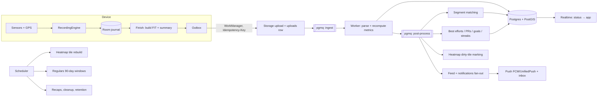

# 08 — Build Blueprint: open-source Android alternative to Strava

> Working name **StravaFit** is an internal codename only (see [Naming](#2-naming-note-trademark-risk)).
> This is the master plan. It follows the binding decisions in [`DECISIONS.md`](../DECISIONS.md): ADR-001 (no paywall), ADR-002 (export is P0), ADR-003 (parity down to minor details), ADR-004 (rename before launch), ADR-005 (Kotlin + Compose), ADR-006 (Supabase, self-hostable), ADR-007 (AGPL-3.0).
> Companion: [`feature-parity-checklist.md`](feature-parity-checklist.md).

---

## Table of contents

1. Product vision and principles
2. Naming note (trademark risk)
3. PRD: prioritized feature list
4. MVP scope definition
5. Phased roadmap and milestones
6. Tech stack (final decisions)
7. Repository / monorepo structure
8. Android module breakdown
9. Backend service breakdown
10. Data pipeline
11. Testing strategy (GPS replay fixtures)
12. CI/CD
13. Contributor onboarding
14. Risk register
15. Proposed new ADRs

---

## 1. Product vision and principles

**Vision.** A free, privacy-first, self-hostable activity tracker for Android that records runs, rides, hikes and every other sport as well as Strava does. It includes the social, segment, route and training features Strava sells behind a subscription, and it lets every user own and export their data in open formats.

**Principles (ordered; earlier wins on conflict)**

| # | Principle | What it means in practice |
|---|---|---|
| 1 | **Never lose a recording** | Offline-first. Points are journaled to Room every 1–5 s. Process death, reboot and dead batteries are tested ([gps-qa](../99-gaps/gps-qa-test-performance.md)). |
| 2 | **Privacy by default** | Health and location are special-category data ([legal §6](../07-oss/landscape-legal.md)). Privacy zones are offered before the first recording. Trimming runs before any render, share or export ([share-export B.2](../04-features/share-export.md)). RLS enforces visibility on the server. No tracking SDKs. |
| 3 | **Fully free, no paywall** | ADR-001. Every Strava `[SUB]` or `[PARTIAL]` feature is built free and prioritized on merit. No trials, upsells, ads, paid placement or "premium" badges. Monetization, if any, is donations or hosted-instance fees, never feature gates. |
| 4 | **Your data is yours** | Export of every activity in GPX/TCX/FIT/GeoJSON/original, route art as SVG/PNG/PDF, and a one-tap account archive (ADR-002). Import from files and from a Strava bulk-export ZIP. |
| 5 | **Self-hostable** | Whole backend runs from the open-source Supabase docker stack plus one worker container. A single `docker compose up` gives a working instance. The app can point to any instance URL. |
| 6 | **Detail parity** | ADR-003. Micro-interactions, defaults, formatting and edge cases follow `docs/09-details/`. Each detail doc's acceptance checklist is a test spec. |
| 7 | **Original identity** | Original name, logo, colors, icons and copy ([design system Part B](../05-design-system/design-system-observed.md)). Neutral feature names (e.g. "High-five" for kudos, "Trusted Contacts Live" for Beacon). No copied trade dress. |
| 8 | **Battery and performance are features** | Budgets: ≤ 4–5 %/h recording, cold start P50 ≤ 800 ms, APK ≤ 25 MB ([gps-qa §9.1](../99-gaps/gps-qa-test-performance.md)). |
| 9 | **De-Googled friendly** | `foss` flavor without GMS (LocationManager, UnifiedPush, ACRA) for F-Droid. `gms` flavor for Play. |
| 10 | **Accessible and localized** | TalkBack labels for stats, charts and maps; font scaling; mixed units allowed ([units-l10n-a11y](../99-gaps/units-localization-accessibility.md)). |

**Target users** ([product-overview §2](../00-overview/product-overview.md)): everyday runners and riders, privacy-conscious athletes, clubs and coaches who need free group tools, and self-hosters (clubs, universities, communities) who want their own instance.

**Non-goals (for now):** iOS app (later, separate effort, ADR-005), ad-supported anything, selling or sharing aggregated data, a training-plan marketplace, federation (optional later, see [legal §8.4](../07-oss/landscape-legal.md)).

---

## 2. Naming note (trademark risk)

**Severity: HIGH, launch-blocking** ([landscape-legal §4.1](../07-oss/landscape-legal.md)).

- "Strava" is a registered trademark. "StravaFit" contains the whole distinctive mark for the same class of goods (fitness software, Nice classes 9/41/42), so a likelihood-of-confusion claim would be strong.
- Strava's API Brand Guidelines forbid "Strava" in an app name. Google Play's impersonation policy can reject or remove the app. Domains containing "strava" are exposed to UDRP.
- **Rule (ADR-004):** "StravaFit" may appear only in the private repo, internal docs and package names that are renamed before launch. Do **not** use it in a public GitHub org, a domain, a store listing, the app icon or the package ID (`applicationId`).
- **Now:** use the neutral placeholder package `org.openactivity.app` (rename once the name is chosen). Keep user-facing strings in `strings.xml` under one `app_name` resource so the rename is one line.
- **Shortlist** (unscreened): OpenStride, Kinetrail, Stridewell, Trailmark, Waymark Fit. Coined names (Kinetrail, Stridewell) are stronger marks. Screen on USPTO, EUIPO, WIPO, UKIPO and India IP in classes 9/41/42/44, plus Play/App Store, GitHub and domains.
- **Feature names:** avoid "Kudos", "KOM/QOM", "Local Legend", "Beacon", "Flyby", "Athlete Intelligence", "Year in Sport", "Relative Effort" as product names ([legal §4.3](../07-oss/landscape-legal.md)). Use names such as High-five, Segment crown, Regular, Trusted Contacts Live, Pass-by, Activity insights, Year Recap, Effort Score.
- **Patents:** Strava asserted US 9,116,922 (segments) and US 9,297,651 / 9,778,053 (heatmaps, popularity routing) in 2025. Keep a written design-around record for segment matching and heatmap routing, and get counsel before a US-scale launch ([legal §5](../07-oss/landscape-legal.md)).

---

## 3. PRD: prioritized feature list

**Priority key**

| Priority | Meaning |
|---|---|
| **P0** | MVP (v0.1 public beta). The product is not usable or not credible without it. |
| **P1** | v0.2–v0.4. Core Strava parity; most Strava `[SUB]` features land here. |
| **P2** | v0.5–v1.0. Full parity and polish. |
| **Later** | After v1.0 or optional. |

`[SUB]` / `[PARTIAL]` marks what Strava gates. **All of these are free for us.** The full row-level list is in the [parity checklist](feature-parity-checklist.md).

### 3.1 Recording ([recording](../04-features/recording.md), [09 record](../09-details/record.md), [platform-extras](../09-details/platform-extras.md))

| Feature | Strava | Pri |
|---|---|---|
| GPS recording for all sport types, foreground service, screen-off, lock-screen notification controls | FREE | P0 |
| Pre-start GPS acquisition (halo, "GPS ready" at ≤ 20 m), sport picker, last-sport memory | FREE | P0 |
| Pause/resume, auto-pause (GPS speed + accelerometer), moving vs elapsed time | FREE | P0 |
| Splits (auto per km/mi), manual laps, auto-lap by distance | FREE | P0 |
| Live elevation (barometer, GPS fallback), elevation gain thresholds | FREE | P0 |
| Crash/kill recovery ("resume recording?"), offline recording, upload queue | FREE | P0 |
| Audio cues per trigger (start, pause, splits, segment), TTS, configurable | FREE | P0 |
| Discard with confirm and Undo | FREE | P0 |
| BLE heart rate (0x180D) | FREE | P0 |
| BLE cycling power (0x1818), speed/cadence (0x1816), running S/C (0x1814) | FREE | P1 |
| Manual activity entry | FREE | P0 |
| Indoor / treadmill / trainer activities (no GPS, sensor distance) | FREE | P1 |
| Follow a route with off-route alerts and turn cues | SUB | P1 |
| Live segments while recording | SUB | P2 |
| Trusted Contacts Live (Beacon) with ≥ 3 contacts | FREE/SUB mix | P1 |
| Map layers (heatmap, terrain) on record map | SUB | P1 |
| "Upload on Wi-Fi only", zero mobile data when map/Beacon off | FREE | P0 |
| Instant/guided workouts | PARTIAL | Later |

### 3.2 Save, edit and activity detail ([core-screens](../03-wireframes/core-screens.md), [09 save-edit](../09-details/save-edit-activity.md), [09 activity-detail](../09-details/activity-detail.md))

| Feature | Strava | Pri |
|---|---|---|
| Save screen: auto-title (Morning/Afternoon/Evening/Night + sport, local TZ), description, sport, audience, hidden details, gear, photos | FREE | P0 |
| Perceived exertion (RPE) | FREE | P0 |
| Tags (race, long run, workout, commute, treadmill, with pet) | FREE | P0 |
| Edit activity, crop activity, delete activity, private notes | FREE | P0 |
| Quick Edit sheet after device sync | FREE | P1 |
| Activity detail: stats grid, map, splits, laps, charts (pace, HR, elevation, power, cadence) with scrubbing linked to map | FREE / SUB (charts) | P0 |
| Long-press stat definitions, elevation source label | FREE | P1 |
| Workout analysis for laps | SUB | P1 |
| GAP column and chart | SUB | P1 |
| HR / pace / power zones (6 pace zones, editable) | SUB | P1 |
| Effort Score (Relative Effort) card | SUB | P1 |
| Matched activities (repeat-route comparison) | SUB | P2 |
| Flyover (3D replay) | SUB | P2 |
| Photos and video on activities | FREE | P1 (photos P0) |

### 3.3 Share and export — **P0 by ADR-002** ([share-export](../04-features/share-export.md))

| Feature | Strava | Pri |
|---|---|---|
| Route art export: **SVG**, **transparent PNG**, PNG with background, **PDF poster** | partial / none | **P0** |
| Share cards: Minimal, Poster, Story 9:16, Square 1:1, Landscape 16:9, Sticker (transparent) | FREE (fewer) | **P0** |
| Share private activities (rendered locally) | — | **P0** |
| Data export: **GPX, TCX, FIT, GeoJSON**, original file | FREE (GPX/original only) | **P0** |
| Privacy trimming before any render/export | FREE | **P0** |
| Instagram Stories intent, FileProvider share, MediaStore save | FREE | **P0** |
| Bulk account export (ZIP: originals + CSV/JSON), no email step | FREE | **P0** |
| Import GPX/TCX/FIT, Strava bulk-export ZIP import | FREE (files) | **P0** |
| Gradient color by pace/HR/elevation/power/speed | — | P1 |
| Optional MapLibre basemap under trace with OSM attribution | — | P1 |
| Elevation profile SVG, km/mi markers, start/end markers | — | P1 |
| Multi-activity collage, "all my runs" heatmap poster | — | P1 |
| Web renderer parity (TS, same golden output) | — | P1 |
| Link share with OG image | FREE | P2 |
| Embeds on web | FREE | P2 |
| Monthly stat cards, Year Recap | SUB | P2 |

### 3.4 Profile, progress and training ([training-analytics](../04-features/training-analytics.md), [09 profile-progress](../09-details/profile-progress.md))

| Feature | Strava | Pri |
|---|---|---|
| You tab: profile header, Progress chart (1W–1Y), activities list | FREE | P0 |
| Weekly/monthly/yearly totals, stats by sport | FREE | P0 |
| Best Efforts (run and ride), PRs, top-3 per distance, remove effort | FREE | P0 |
| Training Log calendar | SUB | P1 |
| Compare date range | PARTIAL | P1 |
| Streaks (weekly) | FREE | P1 |
| Gear (shoes, bikes), mileage, retirement alerts | FREE | P1 |
| Trophy case | FREE | P1 |
| Fitness & Freshness (CTL/ATL/TSB) | SUB | P1 |
| Weekly effort range | SUB | P1 |
| Power curve, estimated FTP, running power | SUB | P1 |
| Goals (distance, time, elevation, segment; weekly/yearly) | SUB | P1 |
| Best-effort trend analysis | SUB | P1 |
| Performance predictions (race times) | SUB | P2 |
| Activity insights (Athlete Intelligence) — on-device, rules-based first; optional self-hosted LLM | SUB | P2 |
| Year Recap | SUB | P2 |
| Training plans | Runna bundle | Later |

### 3.5 Social ([social](../04-features/social.md), [09 home-feed](../09-details/home-feed.md), [09 groups](../09-details/groups-clubs-challenges.md))

| Feature | Strava | Pri |
|---|---|---|
| Follow / unfollow, private profile with follow requests | FREE | P0 |
| Home feed (chronological default; Following / You / Club switch) | FREE | P0 |
| High-fives (kudos) with optimistic UI, facepile | FREE | P0 |
| Comments, delete own comment | FREE | P0 |
| Block, report, mute athlete | FREE | P0 |
| Mentions (@), mute thread | FREE | P1 |
| Group activities (auto-matched, merged card) | FREE | P1 |
| Feed filter chips, favorite athletes | — / FREE | P1 |
| Posts (text + photos) | FREE | P1 |
| Athlete search, suggested athletes, contacts sync (opt-in) | FREE | P1 |
| Clubs: create, join, roles, posts, events, weekly leaderboard | FREE | P1 |
| Challenges: hosted (by instance admins) | FREE | P1 |
| Group challenges (user-created) | SUB | P1 |
| Messaging: DMs, group chats, club channels | FREE | P2 |
| Pass-by (Flyby) | FREE | P2 |
| Personalized feed ranking (opt-in, explained) | FREE | Later |

### 3.6 Segments and competition ([segments-leaderboards](../04-features/segments-leaderboards.md), [09 segments](../09-details/segments-leaderboards.md))

| Feature | Strava | Pri |
|---|---|---|
| Segment creation from an activity | FREE | P1 |
| Automatic segment matching, effort history, PRs (gold/silver/bronze) | FREE | P1 |
| Full leaderboards with all filters (gender, age, weight, following, club, date) | SUB | P1 |
| Crowns (KOM/QOM/CR equivalent), top-10 trophies | FREE | P1 |
| Star segments | FREE | P1 |
| Effort comparison, segment intensity % | SUB | P2 |
| Regulars (Local Legend equivalent, 90-day count) with opt-out | PARTIAL | P2 |
| Segment explore map | FREE | P2 |
| Hazard flag, report segment, "Don't see the segment?" diagnostic | FREE | P2 |
| Leaderboard integrity (anti-cheat) | FREE | P1 |

### 3.7 Maps and routes ([maps-routes](../04-features/maps-routes.md), [secondary-screens §1](../03-wireframes/secondary-screens.md), [09 maps-routes](../09-details/maps-routes.md))

| Feature | Strava | Pri |
|---|---|---|
| Base map (OSM vector, light/dark), activity map | FREE | P0 |
| Route builder (draw, snap to roads/trails via routing engine) | SUB | P1 |
| Saved routes, search/filter | SUB | P1 |
| Route detail with estimated time, elevation profile | FREE/SUB | P1 |
| Offline maps and routes download | SUB | P1 |
| GPX route import/export, route sync to devices (file-based) | FREE | P1 |
| Personal heatmap (all-time, year, range; 6 colors + color-blind preset) | SUB | P1 |
| Community heatmap (opt-in aggregates, k-anonymity) | FREE (low zoom) | P2 |
| Night and Weekly heatmaps | SUB | P2 |
| Suggested routes (generated) | SUB | P2 |
| Natural-language route search | SUB | Later |
| 3D terrain, winter/slope layers | SUB | P2 |
| POIs (9 categories) + suggestion queue | PARTIAL | P2 |
| Photos layer | SUB | Later |

### 3.8 Privacy and safety ([privacy-safety](../04-features/privacy-safety.md), [09 settings-privacy-units](../09-details/settings-privacy-units.md))

| Feature | Strava | Pri |
|---|---|---|
| Activity visibility (Everyone / Followers / Only You), account default, per-sport default | FREE | P0 |
| Privacy zones, hide start/end radius, hide entire map | FREE | P0 |
| Hide individual stats (hideable per sport), owner still sees | FREE | P0 |
| Profile visibility, approve followers | FREE | P0 |
| Account deletion with typed confirm, export offer | FREE | P0 |
| Age gate and consent (Art. 9) | FREE | P0 |
| Social opt-outs (group activity, Pass-by, mentions, leaderboards, Regulars, aggregates) | FREE | P1 |
| 2FA / passkeys, session list | PARTIAL | P1 |
| Trusted Contacts Live | FREE/SUB | P1 |

### 3.9 Notifications, settings, platform ([subscription-notifications](../04-features/subscription-notifications.md), [09 notifications-search](../09-details/notifications-search.md), [IA](../02-navigation/information-architecture.md))

| Feature | Strava | Pri |
|---|---|---|
| In-app inbox (grouped high-fives, relative age, mark all read) | FREE | P0 |
| Push (FCM / UnifiedPush), 7 categories = 7 Android channels | FREE | P1 |
| Email notifications (digest, opt-in) | FREE | P2 |
| Settings tree, server-synced settings | FREE | P0 |
| Units (one switch + per-sport and temperature overrides), theme, per-app language | FREE | P0 |
| Deep links (`https://<instance>/activities/{id}` etc.) | FREE | P1 |
| Launcher widget, app shortcuts (Start run / ride) | FREE | P2 |
| Health Connect read/write | FREE | P1 |
| Wear OS app (standalone + tethered) | FREE | P2 |
| Device sync (Garmin/Coros/Wahoo) — file import first; partner APIs only if terms allow | FREE | P2 |
| Public API (OAuth2, webhooks) for third-party apps | FREE | P2 |
| Moderation admin web UI | (internal) | P1 (minimal), P2 (full) |

---

## 4. MVP scope definition

**MVP = v0.1 public beta.** One person can install the app, sign up on a hosted or self-hosted instance (or use it signed-out, local-only), record any sport reliably, review it in detail, keep it private, export it in every format, share a beautiful card, and follow a few friends who see it in a feed.

### In scope (P0)

1. **Accounts:** email + password, email code (magic link/OTP), Google; local-only mode with later account linking. Instance URL picker (default hosted instance).
2. **Onboarding:** name, birthday (age gate), optional gender, sport choice → default record sport, units, default visibility, privacy-zone prompt before first recording, permissions asked in context ([onboarding](../01-onboarding/onboarding.md); no trial paywall step).
3. **Recording engine** (pure Kotlin `:core:recording`) + Android adapters, everything in §3.1 marked P0.
4. **Save / edit / delete / crop**, auto-title, RPE, tags, photos.
5. **Activity detail** with stats, map, splits, laps, charts and scrubbing.
6. **You tab:** profile, progress chart, activities list, Best Efforts, stats by sport.
7. **Share and export, full ADR-002 set:** SVG, transparent PNG, PNG with background, PDF poster, 6 templates, GPX/TCX/FIT/GeoJSON/original, bulk ZIP, privacy trimming, Stories intent.
8. **Import:** GPX/TCX/FIT files and Strava bulk-export ZIP (user's own data only).
9. **Social core:** follow / requests, home feed, high-fives, comments, block/report/mute.
10. **Privacy:** visibility levels, privacy zones, hide start/end, hide stats, profile visibility, account deletion, data export.
11. **Settings:** units, theme, language, default tab, privacy, notifications (in-app inbox only), about/licenses/map attribution.
12. **Base maps:** MapLibre + self-hosted Protomaps PMTiles (OSM), light/dark.
13. **Backend:** Supabase (Auth, Postgres+PostGIS, Storage, RLS) + ingest worker (FIT/GPX parse, metrics recompute, polyline, thumbnails).
14. **Quality gates:** GPS golden corpus ≥ 30 tracks at MVP (60+ by v1.0), recovery tests, 2 h screen-off survival on Pixel + Samsung, battery ≤ 6 %/h hard limit.

### Explicitly out of MVP

Segments and leaderboards, route builder, heatmaps, clubs, challenges, messaging, training load (F&F), push notifications, Trusted Contacts Live, Wear OS, BLE beyond HR, public API.

### MVP exit criteria

- 0 data-loss bugs open; crash-free sessions ≥ 99.5 % over 2 weeks of beta.
- All P0 acceptance items in `09-details/record.md`, `save-edit-activity.md`, `activity-detail.md` (§1–4), `home-feed.md` (§1–4), `settings-privacy-units.md` pass.
- All share-export golden images match (SE-1 … SE-5, SE-10, SE-11).
- A fresh `docker compose up` instance works end-to-end in ≤ 15 minutes from the README.
- Play internal testing and F-Droid build both green; Play background-location declaration approved.

---

## 5. Phased roadmap and milestones

Time estimates assume 3–5 regular contributors. Each phase ends with a tagged release.

| Phase | Version | Duration | Theme | Milestones (exit criteria) |
|---|---|---|---|---|
| **0. Foundations** | — | 4 wks | Repo, CI, decisions | Name shortlist screened; monorepo skeleton builds; CI L1/L2 green; design tokens v0; Supabase local stack + migrations v0; GPS corpus v0 (10 synthetic tracks) + golden harness. |
| **1. Recorder alpha** | v0.0.x | 8 wks | Record offline | `:core:recording` passes corpus; FGS + journal + recovery; save/edit/detail local-only; GPX/FIT export; BLE HR; audio cues. Dogfood on 5 OEMs. |
| **2. MVP beta** | **v0.1** | 8 wks | Sync, share, social core | Accounts + sync; ingest worker; full share/export suite; import; feed, follow, high-fives, comments; privacy suite; inbox. Play closed beta + F-Droid. |
| **3. Compete & navigate** | v0.2 | 10 wks | Segments, routes | Segment creation + matching worker; leaderboards with all filters; crowns/trophies; route builder (self-hosted routing); saved/offline routes; follow-route navigation; personal heatmap. |
| **4. Train** | v0.3 | 8 wks | Analytics | Zones, GAP, Effort Score, F&F, power curve/FTP, goals, training log, streaks, gear, trophy case, BLE power/cadence, Health Connect. |
| **5. Community** | v0.4 | 10 wks | Groups | Clubs (roles, posts, events, leaderboard), challenges (hosted + group), push notifications (FCM/UnifiedPush), mentions, group activities, search, Trusted Contacts Live, moderation admin UI v1. |
| **6. Parity & polish** | v0.5–v0.9 | 16 wks | Long tail | Messaging, Pass-by, Regulars, segment explore/compare, community heatmap, night/weekly heatmaps, suggested routes, 3D terrain, POIs, Flyover, Wear OS app, widgets/shortcuts, Year Recap, predictions, public API + webhooks, web viewer. |
| **7. v1.0** | v1.0 | 6 wks | Hardening | Every parity checklist item at P0–P2 done or consciously deferred; a11y audit; security review; load test (10k users on one VPS); legal review of name/patents; public launch under new name. |
| **Later** | v1.x+ | — | — | iOS, training plans, federation (ActivityPub), NL route search, guided workouts. |

---

## 6. Tech stack (final decisions)

The architecture doc ([strava-architecture §7.10](../06-architecture/strava-architecture.md)) proposed a Kotlin + Ktor modular monolith. **ADR-006 (Supabase) overrides it for the core backend.** We keep the Kotlin choice for the heavy worker so that metrics code is shared with the app.

| Layer | Decision | Rationale |
|---|---|---|
| Android language/UI | **Kotlin 2.x, Jetpack Compose, Material 3**, Navigation Compose (type-safe routes) | ADR-005. Best GPS FGS, BLE, Health Connect and battery control. |
| App architecture | MVI-style UDF: `UiState` + `ViewModel` + `StateFlow`; clean layering (domain has no Android) | Testable reducers; `:core:recording` must be pure JVM for golden tests. |
| DI / async | Hilt; Coroutines + Flow | Standard, well-documented. |
| Local storage | Room (points journal, outbox, cache), DataStore (prefs) | Crash-safe transactional writes. |
| Network | supabase-kt (Auth, PostgREST, Storage, Realtime) + Ktor client; OpenAPI client for worker endpoints | Official-ish Kotlin SDK; one HTTP stack. |
| Background | Foreground service (`location\|health`), WorkManager (upload, sync, map prefetch) | Android 14+ FGS rules. |
| Location | FusedLocationProvider (`gms` flavor); `LocationManager` (`foss` flavor) | F-Droid compatibility. |
| Sensors | Nordic Kotlin BLE library; GATT HR/CP/CSC/RSC | Proven, Apache-2.0. |
| Maps | **MapLibre Native Android**; tiles: self-hosted **Protomaps PMTiles** (OSM, ODbL); terrain: Copernicus/SRTM DEM | No vendor key, offline regions, self-hostable. |
| Routing | **BRouter** (on-device, offline, bike/hike profiles) + optional server **Valhalla/GraphHopper** | On-device routing keeps route builder free and private. |
| Files | Garmin FIT SDK (Java, check licence) wrapped in `:lib:fit`; own GPX/TCX/GeoJSON writers | Apache-2.0 libs reusable by others. |
| Shared logic | **Kotlin Multiplatform** `:shared:metrics`, `:shared:polyline`, `:shared:fit`, `:shared:model` used by app and worker | Same numbers on device and server. |
| Rendering/export | Own vector pipeline (trim → project → simplify → fit → style) emitting SVG / Canvas PNG / `PdfDocument`; TS port for web | [share-export B.2](../04-features/share-export.md). |
| Images | Coil 3 | Compose-native. |
| Push | FCM (`gms`), UnifiedPush (`foss`) | De-Googled support. |
| Crash reporting | ACRA (self-hosted Acrarium), opt-in, location-scrubbed; optional Sentry in `gms` only | Privacy principle. |
| Backend core | **Supabase**: Postgres 16 + **PostGIS** (+ TimescaleDB optional for streams), GoTrue Auth, Storage (S3/MinIO), Realtime, Edge Functions (Deno/TS) | ADR-006. Self-hostable docker stack; RLS enforces privacy. |
| Heavy jobs | **`worker` service: Kotlin/JVM (Ktor)** consuming a Postgres job queue (pgmq / `SKIP LOCKED`) | Edge Functions have CPU/time limits; segment matching, FIT parsing and heatmap tiling need JTS and the shared KMP modules. |
| Tile/heatmap serving | Martin or static PMTiles behind Caddy | Simple, cacheable. |
| Cache / rate limit | Postgres first; add Valkey when needed | Fewer moving parts for self-hosters. |
| Admin UI | Small web app (SvelteKit or Next.js) on Supabase Auth with `admin` role | [moderation](../99-gaps/moderation-admin-tooling.md). |
| Web viewer (later) | TypeScript + MapLibre GL JS, shares export renderer | Public activity pages, OG images. |
| Infra | Docker Compose (self-host), Caddy (TLS), optional Helm chart | One-command install. |
| Observability | OpenTelemetry → Grafana stack (optional profile in compose) | Optional for small instances. |
| License | **AGPL-3.0-or-later** for app and server (ADR-007); **Apache-2.0** for `lib/*` reusable libraries (FIT/GPX, segment matcher, route-art renderer) | Protects the network service; lets others reuse libraries. |

---

## 7. Repository / monorepo structure

One Git monorepo with Gradle (Android + KMP + worker), pnpm workspace (admin/web), and Supabase project files.

```
stravafit/                         # codename; rename repo before going public
├── README.md  CONTRIBUTING.md  CODE_OF_CONDUCT.md  SECURITY.md  LICENSE (AGPL-3.0)
├── settings.gradle.kts  build.gradle.kts  gradle/libs.versions.toml
├── build-logic/                   # convention plugins (android-app, android-lib, kmp-lib, compose, jvm-service)
├── android/
│   ├── app/                       # :app — shell, nav graph, DI root, flavors gms/foss
│   ├── wear/                      # :wear — Wear OS app (Phase 6)
│   ├── core/
│   │   ├── recording/             # pure Kotlin engine (no android.*)
│   │   ├── recording-service/     # FGS, notification, journal, adapters
│   │   ├── location/              # Fused / LocationManager adapters
│   │   ├── sensors/               # BLE GATT HR/CP/CSC/RSC, barometer, step cadence
│   │   ├── database/              # Room, migrations, DAOs
│   │   ├── datastore/             # prefs
│   │   ├── network/               # supabase-kt, Ktor, auth session
│   │   ├── data/                  # repositories, sync engine, outbox
│   │   ├── sync/                  # WorkManager jobs (upload, pull, prefetch)
│   │   ├── map/                   # MapLibre wrappers, offline regions, styles
│   │   ├── routing/               # BRouter on-device integration
│   │   ├── export/                # route-art + file export UI glue (uses lib/route-art)
│   │   ├── health/                # Health Connect
│   │   ├── notifications/         # channels, FCM/UnifiedPush receivers
│   │   ├── designsystem/          # Compose theme from tokens, components
│   │   ├── ui/                    # shared composables (charts, stat grid, map card)
│   │   ├── analytics-local/       # on-device training metrics (uses shared/metrics)
│   │   ├── i18n/                  # units/format layer, plurals
│   │   └── testing/               # fakes, fixtures loader, test rules
│   └── feature/
│       ├── onboarding/  auth/  record/  save-edit/  activity-detail/  share-export/
│       ├── feed/  profile/  progress/  training/  segments/  maps-routes/  heatmap/
│       ├── groups/ (clubs)  challenges/  messaging/  notifications/  search/
│       ├── settings/  privacy/  gear/  safety-live/ (Trusted Contacts Live)
├── shared/                        # Kotlin Multiplatform (android + jvm + js later)
│   ├── model/                     # SportType, Activity, Stream, Lap, enums
│   ├── metrics/                   # distance, moving time, elevation, GAP, best efforts, zones, CTL/ATL
│   ├── polyline/                  # encode/decode, simplification
│   └── geo/                       # haversine, Mercator, privacy trim
├── lib/                           # Apache-2.0, publishable
│   ├── fit/  gpx-tcx/  geojson/   # parsers and writers
│   ├── segment-matcher/           # matching algorithm (JTS-based on JVM)
│   └── route-art/                 # SVG/PNG/PDF renderer (Kotlin) + ts/ port
├── backend/
│   ├── supabase/
│   │   ├── config.toml
│   │   ├── migrations/            # SQL: schema, PostGIS, RLS policies, functions
│   │   ├── seed.sql
│   │   ├── functions/             # Edge Functions (TS): webhooks, push fan-out, OG images, invite links
│   │   └── tests/                 # pgTAP RLS and function tests
│   ├── worker/                    # Kotlin/Ktor: ingest, matching, heatmap, recaps, exports, moderation jobs
│   └── openapi/                   # spec for worker/public API endpoints
├── web/
│   ├── admin/                     # moderation & instance admin UI
│   └── viewer/                    # public activity pages, embeds (later)
├── design/
│   ├── tokens/                    # tokens.json (W3C design tokens format) → Compose, CSS, TS
│   ├── icons/  illustrations/  badges/   # original artwork only
│   └── figma-links.md
├── infra/
│   ├── docker/                    # docker-compose.yml (supabase stack + worker + tiles + caddy), .env.example
│   ├── tiles/                     # PMTiles build scripts (planetiler), styles
│   ├── routing/                   # BRouter segments / Valhalla configs
│   ├── helm/                      # optional k8s chart
│   └── scripts/                   # backup, restore, upgrade
├── testdata/
│   ├── gps-corpus/                # manifest.yaml, synthetic/, real/, golden/, generators/
│   ├── files/                     # FIT/GPX/TCX import fixtures, Strava-export ZIP fixtures
│   └── render-golden/             # expected SVG/PNG for route-art
├── tools/                         # sfraw recorder, corpus anonymiser, token codegen
├── .github/
│   ├── workflows/                 # ci.yml, nightly.yml, release.yml, supabase.yml
│   ├── ISSUE_TEMPLATE/  PULL_REQUEST_TEMPLATE.md  CODEOWNERS
└── docs/                          # this teardown + blueprint + ADRs (DECISIONS.md)
```

---

## 8. Android module breakdown

Dependency rule: `feature:*` → `core:*` → `shared:*`/`lib:*`. Features never depend on each other; cross-feature navigation goes through route contracts in `:core:ui` (or a `:core:navigation` module).

| Module | Responsibility | Key deps | Phase |
|---|---|---|---|
| `:core:recording` | Pure Kotlin `RecordingEngine`: point acceptance filter, smoothing, distance, moving time (monotonic clock), auto-pause, splits, laps, elevation, live metrics, `finish()` | `shared:metrics`, `shared:geo` | 1 |
| `:core:recording-service` | Foreground service, ongoing notification with Pause/Finish, Room journal every 1–5 s, `START_STICKY` recovery, battery-optimisation prompts | recording, location, sensors, database | 1 |
| `:core:location` | `LocationSource` interface; Fused (gms) / LocationManager (foss); mock-location detection | — | 1 |
| `:core:sensors` | BLE scan/pair/reconnect; HR, CP, CSC, RSC parsers; barometer; step cadence | Nordic BLE | 1 (HR), 4 |
| `:core:database` | Room schema: recordings, points, activities cache, outbox, feed cache, routes, offline regions | — | 1 |
| `:core:network` | Supabase client, session, token refresh, instance URL | supabase-kt | 2 |
| `:core:data` / `:core:sync` | Repositories, offline-first sync, outbox with idempotency key = local UUID | database, network | 2 |
| `:core:map` | MapLibre composable, styles, offline region downloads, polyline layers | MapLibre | 1 |
| `:core:routing` | On-device BRouter, profiles | BRouter | 3 |
| `:core:export` | Glue for `lib:route-art`, `lib:fit`, `lib:gpx-tcx`; FileProvider, MediaStore | lib/* | 1–2 |
| `:core:health` | Health Connect read/write | HC client | 4 |
| `:core:notifications` | Channels (7 categories), FCM / UnifiedPush | — | 5 |
| `:core:designsystem` | Theme from `design/tokens`, components (Record button, stat block, chips, sheets, cards) | — | 0 |
| `:core:i18n` | Units/format layer, per-sport pace vs speed, plurals, dates/TZ | — | 1 |
| `:feature:onboarding`, `:feature:auth` | Sign-up/login flows, permissions in context | — | 2 |
| `:feature:record` | Pre-start, recording, paused, finish UI; sport picker; record sheet (sensors, audio, Trusted Contacts) | recording-service | 1 |
| `:feature:save-edit` | Save, Quick Edit, full Edit, crop, delete, hidden details | — | 1 |
| `:feature:activity-detail` | Stats, map, splits/laps, charts, zones, segments list, social bar | — | 1 |
| `:feature:share-export` | Template carousel, export formats, bulk export | export | 1–2 |
| `:feature:feed` | Home feed, cards, high-fives, comments, filters | — | 2 |
| `:feature:profile`, `:feature:progress` | You tab, progress chart, training log, best efforts, trophies, stats | — | 2–4 |
| `:feature:training` | F&F, Effort Score, power curve, goals, predictions, insights | analytics-local | 4 |
| `:feature:segments` | Segment detail, leaderboards, create, explore, compare | — | 3 |
| `:feature:maps-routes`, `:feature:heatmap` | Maps tab, route builder, route detail, saved/offline routes, heatmaps | map, routing | 3 |
| `:feature:groups`, `:feature:challenges`, `:feature:messaging` | Clubs, events, challenges, chat | — | 5–6 |
| `:feature:notifications`, `:feature:search` | Inbox, search | — | 2, 5 |
| `:feature:settings`, `:feature:privacy`, `:feature:gear`, `:feature:safety-live` | Settings tree, privacy controls, gear, Trusted Contacts Live | — | 2–5 |
| `:wear` | Compose for Wear, Health Services `ExerciseClient`, Data Layer sync | shared, recording | 6 |

---

## 9. Backend service breakdown

**Shape:** Supabase provides Auth, REST (PostgREST), Storage, Realtime and Edge Functions. Domain logic lives in SQL (schema, RLS, RPC functions) and one Kotlin **worker** for CPU-heavy jobs. Jobs flow through a Postgres queue (pgmq), so self-hosters run no extra broker.

| Service / module | Runs in | Responsibilities |
|---|---|---|
| **identity** | Supabase Auth + SQL | Email/password, OTP code (5-min expiry, rate-limited), Google OIDC, optional passkeys/2FA; `profiles`, age gate, consent records |
| **activities** | PostgREST + RLS + RPC | Activity CRUD, visibility, hidden stats (column-level filtering via views/RPC so hidden fields never leave the DB), private notes owner-only |
| **ingest** | Storage + worker | Receive FIT/GPX/TCX/JSON stream (idempotency key), parse, recompute metrics with `shared:metrics`, build polyline + thumbnails, dedupe, status lifecycle (processing → ready/error) |
| **segments** | worker + SQL | Segment creation validation, matching (PostGIS candidate search + `lib:segment-matcher`), efforts, leaderboards (materialized/partitioned), crowns, trophies frozen at upload, Regulars windows |
| **social** | SQL + RLS | Follows, requests, blocks, mutes, high-fives, comments, mentions, group-activity matching |
| **feed** | SQL (fan-out-on-read for small instances; fan-out-on-write table when large) | Chronological feed by default; club/you feeds |
| **routes** | SQL + worker | Routes, saved routes, GPX import/export, server routing proxy (optional Valhalla) |
| **heatmap** | worker (scheduled) | Personal heatmap tiles; opt-in community heatmap with k-anonymity and endpoint trimming; PMTiles output |
| **media** | Storage + worker | Photo upload, EXIF/GPS strip, resize, optional hash-matching for CSAM ([moderation §8](../99-gaps/moderation-admin-tooling.md)) |
| **notifications** | Edge Function + worker | Inbox rows, push fan-out (FCM/UnifiedPush), email digest, per-category preferences |
| **clubs / challenges / messaging** | SQL + Realtime | Clubs, roles, posts, events, challenges, chat channels via Realtime |
| **safety-live** | Realtime + Edge Function | Trusted Contacts Live sessions with expiring share tokens |
| **export** | worker | Account archive ZIP, GDPR requests |
| **moderation** | SQL + admin UI | Reports, queues, actions, strikes, appeals, audit log, anti-cheat flags |
| **public-api** (later) | Edge Function / worker | OAuth2 apps, scopes, webhooks with HMAC + 24 h retry |
| **tiles** | Martin / static PMTiles + Caddy | Base maps, heatmap tiles |

---

## 10. Data pipeline



Rules:
1. **Device is the source of truth for recordings.** The server recomputes with the same KMP code; if numbers differ beyond tolerance, raise a metric alarm, not a silent overwrite.
2. **Idempotency:** upload key = local recording UUID. Duplicate uploads return the existing activity ([platform-extras U2](../09-details/platform-extras.md)).
3. **Privacy first in the pipeline:** privacy zones and visibility are applied when building feed rows, heatmap aggregates, Pass-by candidates and leaderboard eligibility. Only-You and Followers activities never reach public leaderboards or community heatmaps.
4. **Streams storage:** raw streams as compressed columnar blobs in Storage (FIT + `.sfstream`), summary + simplified geometry (PostGIS `geography(LineString)`) in Postgres. Optional TimescaleDB for analytics instances.
5. **Recompute jobs** are versioned (`metrics_version`), so algorithm changes can backfill safely. Trophy ranks stay frozen at upload.
6. **Deletion** cascades through Storage, derived tables, heatmap (dirty-tile rebuild) and backups within the documented retention window ([privacy-safety §9](../04-features/privacy-safety.md)).

---

## 11. Testing strategy (GPS replay fixtures)

Full plan in [gps-qa-test-performance](../99-gaps/gps-qa-test-performance.md). Summary:

| Level | What | When | Gate |
|---|---|---|---|
| L1 JVM | Unit tests (filters, geometry, units), **golden replay** of the GPS corpus through `RecordingEngine`, property tests (kotest/jqwik), `lib/*` parser round-trips, route-art golden SVGs | every PR, < 4 min | merge |
| L2 | Robolectric/instrumented: FGS lifecycle, WorkManager, Room migrations, crash journal, upload queue vs MockWebServer; pgTAP RLS tests on a Supabase test DB; worker integration tests with Testcontainers | every PR, < 15 min | merge |
| L3 | Emulator route playback, mock-location replays on real devices (FTL or device lab), Macrobenchmark + Baseline Profiles, BLE peripheral simulator | nightly | release |
| L4 | Field walks/rides on OEM matrix (Samsung, Xiaomi, OnePlus, Honor, Oppo/realme, Pixel), Doze/OEM-killer soak 2–12 h, battery rig | release candidate | release |

**GPS replay fixtures**
- `testdata/gps-corpus/` with `manifest.yaml` (id, sport, source, license, tags, expected file). Synthetic tracks from a seeded `TrackGen` (straight line, stop-go traffic, urban canyon, tunnel, switchbacks, treadmill, pool, midnight/DST crossings, 26 h ultra, anti-meridian). Real tracks are donated CC0, anonymised (500 m trim, time shift, no IDs), stored raw as `.sfraw` JSON-lines plus GPX/FIT.
- Golden files (`*.expected.json`) hold distance, moving/elapsed time, elevation gain, splits, laps, best efforts, auto-pause intervals, with explicit tolerances per metric. Changing a golden needs a reviewer from `CODEOWNERS` for `testdata/`.
- **Engine contract:** `:core:recording` takes `EngineInput` events (Location, Pressure, Hr, Power, StepCadence, UserAction, Tick) on a monotonic clock and emits `RecordingState` + `FinishedActivity`. No Android imports, so the same replay runs on JVM, device and server.
- **Other fixtures:** FIT/GPX/TCX from many devices (Garmin, Coros, Wahoo, Zwift, Apple Health exports), malformed files, Strava bulk-export ZIP; segment-matching fixtures (out-and-back, loops, partial efforts, GPS drift, privacy-zone starts); route-art render goldens per template and size.
- **Acceptance checklists** in `docs/09-details/*` become UI tests (Compose UI test + Roborazzi screenshots) tagged with the checklist ID (e.g. `@Checklist("record-4.4")`).
- **Budgets** ([gps-qa §9.1](../99-gaps/gps-qa-test-performance.md)): recording ≤ 4 %/h (gate 6), cold start P50 ≤ 800 ms (gate 1.1 s), janky frames < 1 %, APK ≤ 20 MB (gate 25), heap ≤ 150 MB after 12 h, upload P95 ≤ 5 s. Regression > 10 % blocks release.
- **Accessibility CI:** Compose a11y checks, content descriptions for stat grids, charts and maps, font scale 200 % screenshots ([units-l10n-a11y K](../99-gaps/units-localization-accessibility.md)).

---

## 12. CI/CD

GitHub Actions (mirrorable to Forgejo/Woodpecker for self-hosting purists).

| Workflow | Trigger | Steps |
|---|---|---|
| `ci.yml` | PR, push to `main` | Gradle cache → ktlint/detekt → Android Lint → L1 tests (incl. golden replay, route-art goldens) → L2 (ATD emulator API 34) → `apkanalyzer` size check → license/header check (REUSE) → dependency review → OpenAPI and token codegen drift check |
| `supabase.yml` | changes in `backend/supabase/**` | `supabase start` → apply migrations → pgTAP RLS tests → `supabase db lint` → migration squash check |
| `worker.yml` | changes in `backend/worker/**`, `shared/**`, `lib/**` | Unit + Testcontainers (PostGIS) tests → build OCI image (multi-arch) |
| `web.yml` | `web/**` | pnpm lint/test/build; TS route-art golden parity |
| `nightly.yml` | cron | FTL / device lab mock-location replays, Macrobenchmarks (compare to baseline), BLE simulator, Baseline Profile regeneration, dependency updates (Renovate) |
| `release.yml` | tag `v*` | Signed AAB (Play internal → closed → production via Gradle Play Publisher), reproducible `foss` APK for F-Droid metadata, GitHub Release with APKs + SBOM (CycloneDX), worker/admin images to GHCR, compose bundle + upgrade notes |

Other rules: conventional commits, changelog via release-please, `main` always releasable, feature flags (remote config table in Supabase) for unfinished features, signing keys in GitHub OIDC-backed secret store, reproducible builds for F-Droid.

---

## 13. Contributor onboarding

1. **Read first:** `README.md` → `docs/DECISIONS.md` → this blueprint → the teardown doc for your area → its `09-details` acceptance checklist.
2. **Setup (≤ 30 min target):** JDK 21, Android Studio (latest stable), Docker. `./tools/bootstrap.sh` installs the Supabase CLI, starts the local stack (`supabase start`), seeds demo data, and writes `local.properties` pointing the `debug` app to `http://10.0.2.2:54321`.
3. **Run:** `./gradlew :android:app:installGmsDebug` (or `installFossDebug`). Demo accounts are seeded. A "Replay GPS file" developer option feeds corpus tracks into the engine on the emulator.
4. **First issues:** label `good-first-issue` covers units/format, strings/translation, a single checklist item, a corpus track with golden, a design-token component.
5. **Contribution rules:** DCO sign-off (no CLA), AGPL headers via REUSE, one checklist ID per UI PR, screenshots for UI changes, golden changes need `testdata` owner approval, no proprietary SDKs, no copied Strava assets/copy/screenshots, no Strava API data in fixtures.
6. **Areas and owners:** `CODEOWNERS` per top-level area (recording, maps, backend, design, export, docs). Weekly triage, monthly community call, RFCs in `docs/rfcs/` for cross-cutting changes, ADRs appended to `DECISIONS.md`.
7. **Translations:** Weblate (self-hosted or hosted libre plan) wired to `strings.xml`.
8. **Security:** `SECURITY.md` with a private disclosure address; RLS changes need two reviewers.

---

## 14. Risk register

| # | Risk | Likelihood | Impact | Mitigation | Owner |
|---|---|---|---|---|---|
| R1 | **Trademark claim over "StravaFit"** | High if public | Blocking | Codename only; rename before any public commit, domain or listing; trademark screen; neutral feature names (§2) | Maintainers |
| R2 | Patent assertion (segments, heatmaps, popularity routing) | Medium | High | Documented design-around; counsel before US-scale launch; keep matcher and heatmap in separable modules | Maintainers + counsel |
| R3 | Play rejects background location / FGS type | Medium | High | User-started FGS `location`, single declared use, prominent disclosure + video, F-Droid as fallback channel | Android lead |
| R4 | OEM battery killers stop recordings | High | High | OEM matrix soak tests, kill detection + per-OEM guidance (dontkillmyapp), journal recovery | Recording lead |
| R5 | GPS accuracy/metric drift vs Strava expectations | Medium | High | Golden corpus, field-collected reference tracks, shared KMP metrics on device and server | Recording lead |
| R6 | Privacy leak (start/end inference, hidden stats, RLS bug) | Medium | Critical | Trim-before-render, RLS pgTAP tests, hidden fields filtered in DB views, security review per release, bug bounty-lite | Backend lead |
| R7 | Supabase Edge Function limits for heavy jobs | High | Medium | Kotlin worker + pgmq from day one; Edge Functions only for light glue | Backend lead |
| R8 | Hosting cost of the flagship instance (storage, tiles, heatmaps) | Medium | Medium | PMTiles static hosting, compressed streams, per-instance quotas, donations/OpenCollective, encourage self-hosting | Infra |
| R9 | Map data / tile licensing errors (OSM attribution, satellite) | Low | Medium | OSM ODbL attribution in maps and exports; satellite only if licensed | Maps lead |
| R10 | Strava API terms forbid data import for competitors | High | Medium | Prefer file and bulk-ZIP import; any API import user-initiated, own data only, verify current terms | Maintainers |
| R11 | Abuse: spam, harassment, GPS cheating, CSAM | Medium | High | Moderation tooling, rate limits, anti-cheat rules, hash matching, block/report in MVP | Trust & safety |
| R12 | Health data compliance (GDPR Art. 9, DPDP India, minors) | Medium | High | Explicit consent, age gate, export/delete, DPA template for instance operators, no trackers | Maintainers |
| R13 | Scope creep from ADR-003 detail parity | High | Medium | Strict priority tiers; parity checklist as backlog; per-phase cut lines | PM |
| R14 | Network effects: empty feed and leaderboards on a new platform | High | High | Strong solo value (recording, analytics, export) first; Strava bulk import; club-first growth; self-hosted community instances | PM |
| R15 | Contributor burnout / bus factor | Medium | High | CODEOWNERS ≥ 2 per area, docs, good-first-issues, funding for core maintainers | Maintainers |
| R16 | FIT SDK licence incompatibility with AGPL | Low | Medium | Verify licence; fallback to own FIT encoder/decoder in `lib/fit` | Files lead |
| R17 | BLE device fragmentation | Medium | Medium | Standard GATT profiles only; BLE simulator; community device compatibility list | Sensors lead |
| R18 | Self-hosters run outdated, insecure instances | Medium | Medium | Upgrade scripts, version check banner for admins, security advisories | Infra |

---

## 15. Proposed new ADRs

To append to `DECISIONS.md` after maintainer review:

| # | Decision |
|---|---|
| 008 | Heavy backend jobs (ingest, segment matching, heatmaps, exports) run in a Kotlin/JVM worker on a Postgres job queue (pgmq); Edge Functions only for light glue. Supersedes the Ktor-monolith proposal in `06-architecture/strava-architecture.md §7.10`. |
| 009 | Metrics, polyline, geo and model code live in Kotlin Multiplatform `shared/*` modules used by both app and worker. |
| 010 | Reusable libraries in `lib/*` (FIT/GPX/TCX/GeoJSON, segment matcher, route-art) are Apache-2.0; everything else AGPL-3.0-or-later. |
| 011 | Two Android flavors: `gms` (Play) and `foss` (F-Droid, no Google services). |
| 012 | Maps: MapLibre Native + self-hosted Protomaps PMTiles (OSM); on-device routing with BRouter. |
| 013 | Feed is chronological by default; any ranked mode is opt-in and its signals are documented in-app. |
