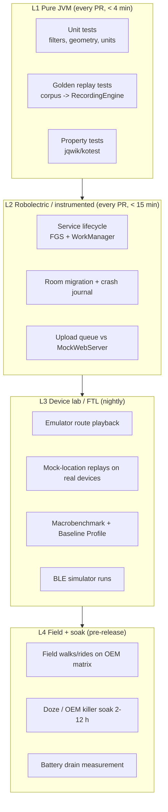
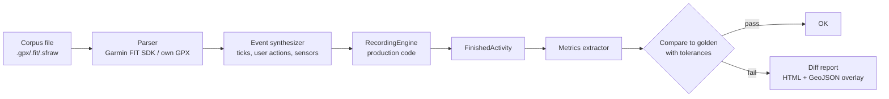
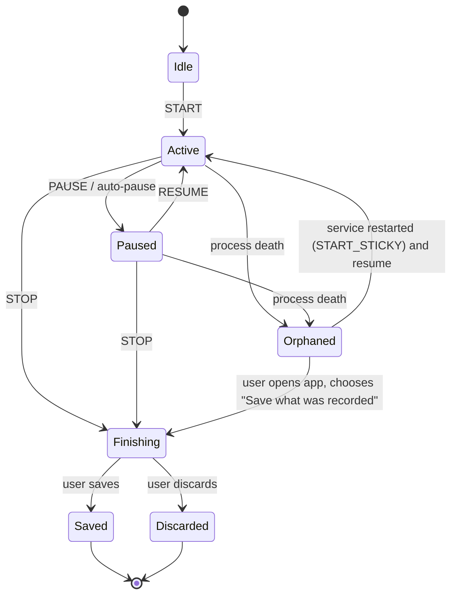
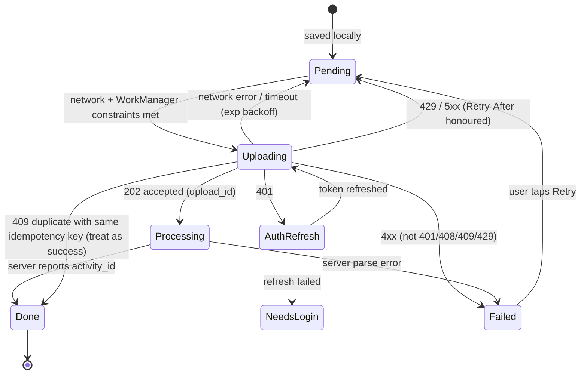
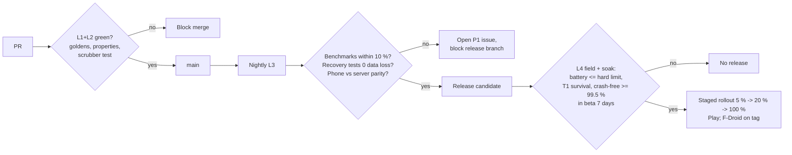

# GPS QA, Test Strategy and Performance Budgets

> **Status:** gap-fill doc (2026-10-29). Intended home: `docs/06-architecture/gps-qa-test-performance.md`.
> **Scope:** how StravaFit proves that its recording engine (auto-pause, moving time, smoothing, distance, elevation, best efforts, splits, segment matching, crash recovery, offline upload) actually works, and the battery and performance targets it must meet before any release.
> **Depends on:** `04-features/recording.md` (algorithms), `04-features/segments-leaderboards.md` (matching), `06-architecture/data-model-api.md` (upload API), `DECISIONS.md` (ADR-005 Kotlin/Compose, ADR-006 Supabase, ADR-007 AGPL).
> **Research note:** this doc relies mostly on engineering practice. The shared web-search budget for this run was used up, so only two pages were fetched (dontkillmyapp.com and the Android Macrobenchmark metrics page). Claims about third-party tools that were not re-checked in this session are marked "(unverified)".

---

## 0. TL;DR

| Area | What we commit to |
|---|---|
| Correctness | A versioned **GPS test corpus** of 60+ synthetic and real tracks. Every one is replayed through the *same* `RecordingEngine` used in production (JVM, no Android), and compared to **golden files** with explicit tolerances. |
| Device realism | Emulator route playback plus a **mock-location instrumentation harness** on real devices, plus a monthly **field-walk protocol** on a fixed OEM matrix. |
| Survival | A **Doze / App Standby / OEM-killer matrix** (Samsung, Xiaomi, OnePlus, Huawei/Honor, Oppo/realme, Pixel). A recording must survive 2 h with the screen off on every tier-1 device. |
| Recovery | Process-death, `kill -9`, reboot, low-storage and battery-dies tests. **Zero lost points before the last 5 s checkpoint.** |
| Offline | Upload queue state-machine tests: airplane mode, flaky network, 401 refresh, 413/5xx, duplicate suppression via idempotency key. |
| Sensors | A BLE peripheral simulator (Heart Rate 0x180D, Cycling Speed/Cadence 0x1816, Cycling Power 0x1818, Running Speed/Cadence 0x1814) and fake-GATT unit tests. |
| Budgets | ≤ **5 %/h** battery (GPS 1 Hz, screen off, no sensors) on the reference device; cold start P50 ≤ **800 ms**; feed and map **P90 frame overrun ≤ 0 ms** and < 1 % janky frames; universal APK ≤ **25 MB**; heap ≤ **150 MB** after a 12 h recording; upload P95 ≤ **5 s** on 4G for a 1 h activity. |
| Gates | Release blocked by any failed golden, any budget regression > 10 %, crash-free sessions < 99.5 %, or any recovery test that loses data. |
| Crash reporting | **ACRA** (self-hosted Acrarium or e-mail) in the F-Droid build; opt-in, scrubbed of coordinates. Optional Sentry or Firebase Crashlytics only in the Play flavour, opt-in, never sending location. |

---

## 1. Test pyramid and where each test runs



| Level | Runner | Trigger | Wall-clock budget | Blocks |
|---|---|---|---|---|
| L1 | Gradle `test` on GitHub Actions `ubuntu-latest` | every PR | 4 min | merge |
| L2 | Robolectric + `connectedCheck` on 1 API-level emulator (API 34, ATD image) | every PR | 15 min | merge |
| L3 | Firebase Test Lab or self-hosted device lab | nightly + release branch | 60 min | release |
| L4 | humans + soak rig | release candidate | 2–3 days | release |

**Architecture prerequisite.** The recording engine must be a pure Kotlin module (`:core:recording`) with **no Android imports**. It takes a stream of `LocationSample`, `SensorSample`, `MotionSample` and `ClockTick` events and emits `RecordingState` plus a finalized `Activity`. Android pieces (FusedLocationProvider / `LocationManager`, BLE, foreground service) are thin adapters. Without this split, golden testing is impossible.

```kotlin
// :core:recording  (no android.* imports)
sealed interface EngineInput {
  data class Location(val tMonoNanos: Long, val tWallMillis: Long, val lat: Double, val lon: Double,
                      val hAcc: Float?, val alt: Double?, val vAcc: Float?, val speed: Float?,
                      val bearing: Float?, val provider: String, val isMock: Boolean) : EngineInput
  data class Pressure(val tMonoNanos: Long, val hPa: Float) : EngineInput
  data class Hr(val tMonoNanos: Long, val bpm: Int) : EngineInput
  data class Power(val tMonoNanos: Long, val watts: Int, val crankRevs: Int?, val crankEventTime: Int?) : EngineInput
  data class StepCadence(val tMonoNanos: Long, val spm: Float) : EngineInput
  data class UserAction(val tMonoNanos: Long, val action: Action) : EngineInput // START, PAUSE, RESUME, LAP, STOP
  data class Tick(val tMonoNanos: Long) : EngineInput
}
interface RecordingEngine {
  fun feed(input: EngineInput): RecordingState
  fun finish(): FinishedActivity
}
```

**Clock rule.** The engine keys all durations on a **monotonic** clock (`elapsedRealtimeNanos` from the `Location` object) and uses wall time only for display and file timestamps. This single rule makes the midnight, DST, time-zone and NTP-jump tests in §2 pass by construction. The tests exist to stop someone from breaking it later.

---

## 2. GPS test corpus

### 2.1 Corpus layout

```
testdata/gps-corpus/
  manifest.yaml            # id, sport, source, license, tags, expected-file
  synthetic/
    S001-straight-line-run-10k.gpx
    S014-stop-go-traffic-ride.gpx
    ...
  real/
    R003-london-city-urban-canyon-run.fit   # contributor-donated, anonymised
    ...
  golden/
    S001.expected.json
    R003.expected.json
  generators/
    TrackGen.kt            # deterministic synthetic generator (seeded)
```

* Every file has a **license** entry. Donated files must be CC0 and **anonymised**: start/end trimmed 500 m, time-shifted to a random epoch, and the contributor ID dropped. No Strava-exported files from other people.
* Real tracks are stored as **raw-as-recorded** samples (all fixes, accuracy, provider, mock flag) in our own `.sfraw` JSON-lines format as well as GPX/FIT. GPX loses `hAcc`, which the filters need.
* Synthetic tracks come from `TrackGen` with a fixed seed, so they are reproducible and diffable. Generated files are checked in (so reviewers see changes) **and** regenerated in CI to detect generator drift.

### 2.2 Synthetic generator model

`TrackGen` builds ground truth first, then corrupts it:

1. **Truth path:** polyline + speed profile (piecewise: accelerate, cruise, stop, climb) + elevation profile from a DEM tile or an analytic function.
2. **Sampling:** 1 Hz nominal, with jitter (±150 ms) and gaps (Poisson drop rate configurable).
3. **Noise:** horizontal error as a first-order Gauss–Markov process (σ = 3–30 m, τ = 30–120 s). This is more realistic than white noise because GPS error is correlated over time. Vertical σ = 1.5× horizontal.
4. **Reported accuracy:** `hAcc` = true σ × U(0.6, 1.6). Receivers misreport, so the filters must not trust it blindly.
5. **Faults:** teleports (multipath jumps of 50–300 m for 1–5 samples), stale repeats (same fix repeated), provider switches (gps→network with 500 m accuracy), clock jumps on wall time only.

Because the truth is known, the golden "expected" values for synthetic files are **analytic** (true distance, true moving time). Our tolerances then express how far the filtered output may drift from truth.

### 2.3 Scenario catalogue

| ID | Scenario | Sport | Source | Main assertions |
|---|---|---|---|---|
| S001 | Straight 10 km at a constant 5:00/km, σ=4 m | Run | synthetic | distance ±1 %, moving = elapsed ±2 s |
| S002 | Same as S001 but σ=15 m (cheap phone) | Run | synthetic | distance ±2.5 %, no phantom pauses |
| S003 | 400 m track, 25 laps (tight curvature) | Run | synthetic | distance ±2 %; smoothing must not cut corners by more than 1.5 % |
| S004 | Urban canyon: 30 m multipath jumps every 20 s | Run | synthetic | distance inflation ≤ 3 %; outliers rejected ≥ 95 % |
| S005 | **GPS drift while paused**: 10 min stationary, σ=10 m random walk | Run | synthetic | auto-pause engages ≤ 5 s; drift distance added ≤ 10 m; moving time added ≤ 5 s |
| S006 | Traffic-light stop-and-go, 12 stops of 20–90 s | Ride | synthetic | 12 auto-pauses ±1; moving time ±3 % |
| S007 | **Fast descent at 50–85 km/h**, switchbacks | Ride | synthetic | Kalman must not lag > 15 m at corners; distance ±1 %; no speed spikes > 1.2× truth |
| S008 | **Tunnel**: 2.1 km, no fix for 140 s, exit fix 2 km away | Ride | synthetic | gap bridged by a straight line; distance within ±5 % of truth; no "teleport rejection" of the exit fix; moving time counts the tunnel (speed implied 54 km/h) |
| S009 | Short tunnel / underpass, 8 s gap | Run | synthetic | no pause triggered |
| S010 | **Treadmill**, no GPS, step cadence + optional footpod | Run (indoor) | synthetic | GPS never requested; distance from footpod or cadence×stride ±5 % after calibration |
| S011 | **Pool swim**: 25 m pool, 40 lengths, no GPS | Swim | synthetic | distance = lengths × pool length exactly; no location permission prompt |
| S012 | **Open-water swim**: GPS only at the surface, 60 % of samples missing, σ=25 m | Swim | synthetic | distance ±8 %; path not zig-zagging (sinuosity ≤ 1.15× truth) |
| S013 | **Multi-hour ultra**: 26 h, 160 km, 1 Hz → 93,600 samples, 2 battery-saver phases (0.2 Hz) | Run | synthetic | memory ≤ budget; finish() ≤ 3 s; distance ±1.5 %; no O(n²) |
| S014 | **Crossing midnight** in local time | Run | synthetic | activity date = start local date; splits continuous; elapsed correct |
| S015 | **DST change** mid-activity (02:00→03:00 forward jump) | Ride | synthetic | elapsed uses monotonic clock; no 1 h jump; FIT timestamps monotonic |
| S016 | **Time-zone crossing** (e.g., Kehl→Strasbourg is same TZ; use an El Paso/Ciudad Juárez-style border or a ferry) | Ride | synthetic | start TZ recorded; display TZ = start TZ; no negative durations |
| S017 | **Wall-clock jump** (NTP correction −90 s) mid-recording | Run | synthetic | elapsed unaffected; file timestamps rebuilt from monotonic offset |
| S018 | Provider flapping gps↔network, network fixes hAcc 300–1500 m | Walk | synthetic | network fixes ignored when hAcc > 50 m; no distance from them |
| S019 | Stale duplicate fixes (same lat/lon/time repeated 5×) | Any | synthetic | deduplicated; no zero-dt divide |
| S020 | Out-of-order timestamps (batched delivery after Doze) | Run | synthetic | samples sorted by monotonic time; no negative speed |
| S021 | Batched delivery: 5 min of fixes arrive at once after screen-on | Run | synthetic | identical result to the unbatched feed (bit-exact distance) |
| S022 | Hike at 2.5 km/h with long photo stops | Hike | synthetic | moving threshold per sport; slow walking is not counted as stopped |
| S023 | Barometer present: 800 m climb with ±3 hPa weather drift over 4 h | Hike | synthetic | gain within ±5 % of truth; drift does not create phantom gain > 20 m |
| S024 | No barometer: same climb from GPS altitude only (σ_v=12 m) | Hike | synthetic | raw gain must **not** exceed truth by > 25 %; DEM-corrected gain ±5 % |
| S025 | Flat 40 km ride with GPS vertical noise | Ride | synthetic | elevation gain ≤ 30 m (truth 0) |
| S026 | Manual pause, then auto-pause enabled, user stands still | Run | synthetic | manual pause is not auto-resumed |
| S027 | Auto-pause off, stops present | Run | synthetic | moving time derived on finish (matches server algorithm) |
| S028 | Lap button pressed 10× including two within 1 s | Run | synthetic | 10 laps; zero-length lap allowed but flagged |
| S029 | Start before GPS fix, first 90 s no fix | Run | synthetic | elapsed starts at START; distance starts at first good fix |
| S030 | Very short activity (8 s, 12 m) | Run | synthetic | saveable; no crash in best efforts / splits |
| S031 | Zero-point activity (indoor, no sensors) | Workout | synthetic | saved with elapsed only |
| S032 | Antimeridian crossing (lon 179.9 → −179.9) | Ride (ferry) | synthetic | distance not 40,000 km; bbox correct |
| S033 | Polar latitudes (lat 78°, Svalbard-like) | Ski | synthetic | Web Mercator clamp OK; haversine OK |
| S034 | Equator / prime meridian crossing | Run | synthetic | sign handling |
| S035 | Mock-location flag set on all samples | Run | synthetic | activity flagged `source=mock`; excluded from leaderboards |
| S036 | Teleport cheating (car segment at 90 km/h in a run) | Run | synthetic | flagged "likely vehicle"; excluded from segments/best efforts |
| S037 | Elevator / stairs in building (barometer changes, no GPS) | Walk | synthetic | gain not counted while auto-paused unless the sport rule says so |
| S038 | Out-and-back with the same segment matched twice | Run | synthetic | two efforts |
| S039 | Segment start missed by 30 m (GPS offset) | Ride | synthetic | match accepted within the start radius; rejected at 60 m |
| S040 | Segment ridden in reverse | Ride | synthetic | no match |
| S041 | Segment with a shortcut (skips 15 % of geometry) | Run | synthetic | no match |
| S042 | Loop segment (start = end) | Ride | synthetic | one effort per loop |
| S043 | Very long segment (Alpe-style, 13.8 km, 1,100 m) | Ride | synthetic | elapsed ±1 s vs truth; gradient ±0.2 % |
| S044 | 100 m sprint segment at 1 Hz | Ride | synthetic | time interpolated between samples (±0.5 s) |
| R001–R020 | Real donated recordings: urban canyon (dense downtown), forest canopy, bridge decks, airport perimeter, mountain switchbacks, a 100-mile ultra, a commute with a metro ride, a ferry crossing | mixed | real | regression vs last accepted golden (see §3.4) |

### 2.4 Field-collected reference tracks (truth for real data)

For real recordings there is no perfect truth. We use three references:

1. **Survey-measured courses:** an athletics track (400 m on lane 1), and a certified road course (AIMS/World Athletics-measured 5K/10K) when contributors can access one. Truth distance is known.
2. **Dual recording:** the same session recorded by a dedicated multi-band GNSS watch and by the phone. The watch track is the reference, tolerance-adjusted.
3. **DEM truth for elevation:** compute gain from an open DEM (Copernicus GLO-30 or SRTM) along the *map-matched* path, with the same hysteresis. That becomes the reference gain.

---

## 3. Replay harness and golden files

### 3.1 Replay pipeline



* **Same code path:** the harness calls the engine exactly as `RecordingService` does, including tick cadence (1 s ticks) and user actions from a sidecar `*.actions.json` (`[{"t": 0, "a": "START"}, {"t": 1834, "a": "PAUSE"}, ...]`).
* **Deterministic:** no `System.currentTimeMillis()`. A `TestClock` is injected. Random elements (none should exist) are seeded.
* **Fast:** the whole corpus must replay in < 60 s on CI. The 26-hour ultra replays in < 3 s because the engine is O(n).
* **Server parity:** segment matching and server-side moving-time recomputation run in a Supabase Edge Function or a worker (ADR-006). The **same golden files** are replayed against the server implementation in a separate CI job (Deno or JVM worker). Phone and server must agree within the tolerances in §3.3. Disagreement is a release blocker, because users would see numbers change after upload.

### 3.2 Golden file format

```json
{
  "corpus_id": "S007",
  "engine_version": ">=0.9.0",
  "expected": {
    "distance_m":          {"value": 18420.0, "tol_pct": 1.0},
    "moving_time_s":       {"value": 1712,    "tol_abs": 5},
    "elapsed_time_s":      {"value": 1760,    "tol_abs": 0},
    "elevation_gain_m":    {"value": 0.0,     "tol_abs": 5},
    "elevation_loss_m":    {"value": 1040.0,  "tol_pct": 5.0},
    "max_speed_mps":       {"value": 23.6,    "tol_pct": 5.0},
    "auto_pause_count":    {"value": 0,       "tol_abs": 0},
    "best_efforts": {
      "1k":  {"elapsed_s": 44,  "tol_abs": 2},
      "5k":  {"elapsed_s": 241, "tol_abs": 3}
    },
    "splits_km": {"count": 18, "each_tol_abs_s": 3},
    "segments": [
      {"segment_id": "seg-synth-0042", "elapsed_s": 312, "tol_abs": 1.0, "start_index_tol": 2}
    ],
    "flags": []
  },
  "rationale": "Truth from TrackGen seed 7; tolerances from ADR-QA-03"
}
```

### 3.3 Tolerance policy

Tolerances are set by **what users can notice** and **what GPS physically allows**, not by "whatever the code currently outputs".

| Metric | Synthetic (vs truth) | Real (vs last accepted golden) | Phone vs server |
|---|---|---|---|
| Distance | ±1 % (σ ≤ 5 m), ±2.5 % (σ ≤ 15 m), ±5 % (tunnels) | ±0.5 % | ±0.2 % |
| Moving time | ±5 s or ±1 %, whichever is larger | ±3 s | ±2 s |
| Elapsed time | exact | exact | exact |
| Elevation gain (baro) | ±5 % or ±5 m | ±2 % | n/a (server uses DEM) |
| Elevation gain (GPS raw) | ≤ +25 % / −10 % | ±3 % | n/a |
| Elevation gain (DEM-corrected) | ±5 % | ±1 % | ±1 % |
| Max speed | ±5 % | ±3 % | ±3 % |
| Best effort time (1k/5k/10k/HM/M) | ±2 s / ±3 s / ±5 s / ±8 s / ±15 s | ±1 s | ±1 s |
| Segment effort time | ±1 s (≤ 5 min), ±0.5 % above | ±1 s | ±0.5 s |
| Segment match yes/no | exact | exact | exact |
| Splits | each ±3 s, count exact | each ±1 s | ±1 s |
| Lap count | exact | exact | exact |

**Golden update rule.** A PR that changes golden values must:

1. Run `./gradlew :core:recording:updateGoldens`, which rewrites only the `value` fields and **never the tolerances**.
2. Include the auto-generated `golden-diff.md` (a table of old → new per corpus file, plus truth where known).
3. Show that the change moves values **closer to truth** for synthetic files, or explain why not.
4. Get a review from a `CODEOWNERS` member of `@stravafit/recording`.

### 3.4 Property-based tests (complement to goldens)

Run with kotest-property or jqwik, 1,000 cases each, seeded.

| Property | Statement |
|---|---|
| Distance monotonic | Cumulative distance never decreases. |
| Moving ≤ elapsed | `moving_time ≤ elapsed_time` for every input. |
| Pause invariance | Inserting a stationary block while auto-paused changes distance by ≤ 10 m and moving time by ≤ 5 s. |
| Time-shift invariance | Shifting all wall timestamps by any Δ (incl. across DST/TZ) does not change distance, moving or elapsed time. |
| Batch invariance | Feeding samples one by one or in batches of any size gives identical output. |
| Reverse symmetry | Reversing a track gives the same distance (±0.1 %) and swaps gain and loss (±2 %). |
| Decimation stability | Downsampling 1 Hz → 0.2 Hz changes distance by ≤ 2 % on smooth paths. |
| No NaN | No metric is NaN or infinite for any input, including zero-dt and identical points. |
| Best-effort consistency | Longer efforts never take less time: `time(best 1k) ≤ time(best 2k) ≤ time(best 5k)`. Average paces need not be ordered. |
| Segment idempotence | Running matching twice gives identical efforts. |

### 3.5 Best-effort algorithm test notes

* Best efforts use a **two-pointer sliding window** over cumulative distance with linear interpolation at both ends. O(n) per target distance.
* Test with an injected sprint: insert a 1 km at 3:00/km into a 4:30/km 10 km run. The 1 km best effort must be 180 s ±2 s, and it must start within 10 m of the injected start.
* Guard: efforts that include vehicle-flagged samples (S036) or mock locations (S035) are dropped.
* Swim, indoor and manual activities have no GPS best efforts.

### 3.6 Segment-matching test notes

Assuming the matcher in `segments-leaderboards.md` (start/end proximity radius, then Fréchet-distance or corridor check on the in-between geometry, with a coverage ratio):

| Test | Expectation |
|---|---|
| Start/end within radius r=25 m (unverified default) | match |
| Start offset 2r | no match |
| Corridor: 95 % of segment points within 30 m of track | match |
| 85 % coverage (shortcut) | no match |
| Reverse direction | no match |
| Multiple passes (loop course) | one effort per pass, non-overlapping |
| Pause inside segment | elapsed includes the pause (Strava behaviour: effort time is elapsed, not moving; verify in segments doc) |
| Effort timing | interpolated crossing of start and end "gates" (perpendicular lines), not nearest sample |
| Performance | 1,000 candidate segments × 10 k-point activity matched in < 2 s on the worker; bbox prefilter in PostGIS (`ST_Intersects` on a GiST index) |

---

## 4. Device-level location playback

### 4.1 Emulator route playback

* The Android Emulator's **Extended controls → Location → Routes** tab can play back GPX and KML files at 1×–5× speed. Use it for manual exploratory tests and demos (unverified for the current emulator version; the feature has existed since the 2020 emulator releases).
* For automation, drive the emulator via the console: `adb emu geo fix <lon> <lat> <alt>` in a script at 1 Hz. Note the **longitude-first** argument order. A Gradle task `:tools:playRoute -Pfile=S007.gpx -Pspeed=4` reads the corpus and emits `geo fix` lines.
* Limitations: the emulator gives no `hAcc` control, no realistic noise, and no Doze side effects. Use it for **UI and service flow** checks (notification updates, stats screen, lock-screen controls), not for algorithm accuracy.

### 4.2 Mock-location instrumentation on real devices

For CI on real devices (FTL or the lab), use a test-only flavour that installs a mock provider:

```kotlin
// androidTest only. Requires: adb shell appops set <test-pkg> android:mock_location allow
val lm = context.getSystemService(LocationManager::class.java)
lm.addTestProvider(LocationManager.GPS_PROVIDER, /* requiresNetwork */ false, false, false,
    false, true, true, true, ProviderProperties.POWER_USAGE_HIGH, ProviderProperties.ACCURACY_FINE)
lm.setTestProviderEnabled(LocationManager.GPS_PROVIDER, true)
corpus.samples.forEach { s ->
  lm.setTestProviderLocation(LocationManager.GPS_PROVIDER, s.toAndroidLocation(elapsedRealtimeNanos()))
  clock.sleepUntil(s.t / speedFactor)
}
```

* If the app uses the **Fused Location Provider** (Play Services), use `FusedLocationProviderClient.setMockMode(true)` and `setMockLocation()` instead. The F-Droid build has no Play Services and uses `LocationManager` directly, so **both paths need playback tests**.
* Every mocked `Location` has `isMock = true` (API 31+; `isFromMockProvider` earlier). The production build must **flag but not reject** these samples (S035), and the test build asserts the flag reaches the saved activity.
* **Speed factor:** up to 10× for flow tests. For battery or Doze tests always use 1×, because acceleration hides scheduling problems.
* Combine with `adb shell dumpsys deviceidle force-idle` during playback to test Doze (§5).

### 4.3 Field-walk protocol (human, per release candidate)

| Route | Length | Purpose | Device set |
|---|---|---|---|
| Athletics track, 10 laps lane 1 | 4 km | distance truth | all tier-1 |
| Downtown grid with high-rises | 3 km | urban canyon | 2 devices |
| Park loop with 3 deliberate 2-min stops | 5 km | auto-pause + drift | all tier-1 |
| Ride with a ≥ 50 km/h descent | 20 km | lag at speed | 2 devices |
| Pocket test: phone in a running belt, screen off, 60 min | 10 km | Doze/OEM survival | all tier-1 |

Testers export the raw `.sfraw` (debug menu) and attach it to the release ticket. Good tracks are anonymised and promoted into `real/` after review.

---

## 5. Background survival: Doze, App Standby and OEM killers

### 5.1 Why this matters

The site dontkillmyapp.com scores vendors on how aggressively they kill background work. Its current worst group (score 5) is **Huawei, Xiaomi, OnePlus and Samsung**. Next come Meizu, Asus, Ulefone/RugOne and Oppo (4), then Wiko, Lenovo, Vivo, realme, Motorola, Blackview and Tecno (3). AOSP, Nokia/Android One and HTC score lowest. The site also publishes a **DontKillMyApp benchmark app** on Google Play that measures whether a phone kills scheduled work. Market share in our likely early user base (Android-heavy, India and Europe) makes Xiaomi/Redmi/POCO, Samsung, OnePlus, Oppo/realme and Vivo the priority.

Even with a correct `foregroundServiceType="location"` and an ongoing notification, these OEMs may:

* kill the process when the screen turns off after N minutes ("battery optimisation", "app auto-launch", "sleeping apps"),
* stop GPS delivery while keeping the process alive,
* batch location updates into large delayed chunks,
* revoke background location after a period without the app opening (Android "permission auto-reset" for unused apps).

### 5.2 Survival test matrix

| Device class | Android | OEM setting state | Screen-off soak | Pass criterion |
|---|---|---|---|---|
| Pixel 8 / 9 (reference) | 15, 16 | stock | 2 h, 12 h | ≥ 99 % of expected samples; gaps ≤ 10 s |
| Samsung Galaxy A-series (A15/A35/A55) | One UI 6/7 | default, then "Never sleeping apps" added | 2 h | default: recording continues **or** the app detects the kill and shows the guided fix; whitelisted: ≥ 99 % |
| Samsung Galaxy S24 | One UI 7 | default | 2 h | same |
| Xiaomi Redmi Note 13 / POCO | HyperOS | default, then Autostart on + "No restrictions" | 2 h | same |
| OnePlus Nord / 12 | OxygenOS 14/15 | default, then "Allow background activity" | 2 h | same |
| Oppo / realme mid-range | ColorOS / realme UI | default, then whitelisted | 2 h | same |
| Vivo Y-series | Funtouch / OriginOS | default, then whitelisted | 2 h | same |
| Honor / Huawei (no GMS) | MagicOS / EMUI | default, then "Manage manually" | 2 h | same; also tests the F-Droid no-GMS path |
| Low-RAM Android Go device (2–3 GB) | 13/14 Go | default | 1 h | no process death caused by our memory use |
| Motorola G-series | 14 | default | 2 h | ≥ 99 % |

**Doze and standby commands** (run on every device in the lab, scripted):

```bash
adb shell dumpsys battery unplug
adb shell dumpsys deviceidle force-idle            # enter deep Doze now
adb shell am set-standby-bucket <pkg> restricted   # worst App Standby bucket
adb shell cmd appops set <pkg> RUN_ANY_IN_BACKGROUND ignore   # simulate "restricted" battery setting
# ... run 30 min mock route ...
adb shell dumpsys deviceidle unforce
adb shell dumpsys battery reset
```

Expected behaviour while the foreground service runs: Doze and standby buckets **must not** stop location delivery. If they do on a device, it is an OEM-specific failure that the "Phone settings check" screen must cover.

### 5.3 Kill detection and user guidance (what the tests assert)

* The engine writes a **heartbeat** to the crash journal every 5 s. On next app open, if a recording was `ACTIVE` and the last heartbeat is older than 30 s **without** a clean stop, the app records a `gap` event and shows a non-blocking banner: "Recording was interrupted by your phone's battery settings. Fix it."
* The fix screen deep-links to `ACTION_REQUEST_IGNORE_BATTERY_OPTIMIZATIONS` (allowed for fitness trackers under Play policy for apps whose core function needs it; verify the current policy before Play submission (unverified)) and to OEM-specific settings via known intents, with a fallback to text instructions per vendor.
* Test: on each matrix device, the kill → reopen → banner → settings-intent path must open the right screen (or the documented fallback).
* `ApplicationExitInfo` (API 30+) is read at startup to tell OEM kills (`REASON_OTHER`/`USER_REQUESTED` from "clean-up") apart from crashes and low-memory kills. The reason is logged locally and in opt-in diagnostics.

### 5.4 Permission edge cases

| Case | Expected |
|---|---|
| Only approximate location granted | Recording refused for GPS sports with an explanation; indoor sports still work |
| "While using the app" only (no background) | Works, because a foreground service started from a visible activity counts as "while in use" |
| Location turned off mid-recording | Notification + in-app warning within 10 s; recording keeps the timer; resumes on re-enable |
| Permission revoked mid-recording via Settings | Process is killed by the OS; recovery path (§6) restores data up to the last checkpoint |
| POST_NOTIFICATIONS denied (API 33+) | FGS still runs; app shows an in-app hint that the controls notification is hidden |
| Battery Saver on | Location requests downgraded? Assert our requested interval is still honoured on Pixel; record actual Hz on others |

---

## 6. Crash and process-death recovery

### 6.1 Persistence design under test

* Samples are appended to a **write-ahead journal** (Room table `recording_point` in WAL mode, or a length-prefixed append-only file) in batches every **5 s** or 10 samples, whichever comes first. `fsync` on each batch.
* Engine state (pause state, lap index, accumulated totals) is snapshotted every 5 s to `recording_state`. On restart, totals are **recomputed** from the journal rather than trusted from the snapshot. The snapshot is only a fast path, checked against recomputation.



### 6.2 Recovery test cases

| ID | Injection | Method | Must hold |
|---|---|---|---|
| C01 | `kill -9` of the app process mid-run | `adb shell am kill` doesn't kill an FGS; use `adb shell kill -9 <pid>` (root/userdebug) or `am crash <pkg>` | Data loss ≤ 5 s; service restarts or app offers recovery |
| C02 | Uncaught exception in the UI process | test hook `DebugCrash.throwOnMain()` | Recording continues if the service is in a separate process **or** recovers; decide in ADR. Default: single process, so recovery path |
| C03 | Uncaught exception inside the engine | inject a corrupt sample (NaN lat) | Engine rejects the sample; never crashes (property test + this) |
| C04 | Device reboot mid-recording | `adb reboot` | On boot, the app shows "Unfinished activity" notification (requires `RECEIVE_BOOT_COMPLETED`); no auto-resume of GPS without user action (Android 14+ restricts starting location FGS from boot) |
| C05 | Battery dies | soak rig pulls power (or `adb shell dumpsys battery set level 0` won't truly kill; use a USB power switch on a battery-removed device or accept emulator `-no-snapshot` power-off) | Journal intact up to the last fsync |
| C06 | Storage full | fill `/data` with a test file until < 5 MB free | Warning banner; recording continues in memory ring buffer for ≥ 30 min; no corruption |
| C07 | App update during recording | `adb install -r` | Play would not update a running FGS app normally (unverified); test anyway: data recovered after update |
| C08 | Room migration with an orphaned recording present | upgrade from N-1 with orphan | Orphan survives migration |
| C09 | Low-memory kill (`am send-trim-memory <pkg> COMPLETE`, then memory pressure via a hog app) | lab script | Same as C01 |
| C10 | Force-stop by user (Settings → Force stop) | `adb shell am force-stop` | No restart (OS rule); on next open, recovery offered; data ≤ 5 s lost |
| C11 | Clock change by user to 2 h earlier | `adb shell date` (root) or settings | Elapsed unaffected (monotonic) |
| C12 | Double start (tap Record twice, or a widget plus the notification) | Espresso / Compose test | One recording only |

### 6.3 Automated harness

`RecoveryTest` (instrumented, runs on the device lab nightly):

1. Start the mock route (§4.2) at 1×.
2. At random t ∈ [60 s, 600 s] (seeded), inject one of C01/C03/C09/C10.
3. Restart the app via `am start`, accept recovery.
4. Finish and compare to the golden for that route with **extra tolerance = gap length**.
5. Assert the journal's last timestamp ≥ injection time − 5 s.

---

## 7. Offline upload queue

### 7.1 State machine under test



### 7.2 Test cases

Use OkHttp `MockWebServer` (L2) and a real local Supabase docker stack (L3).

| ID | Scenario | Expectation |
|---|---|---|
| Q01 | Save in airplane mode, reconnect 2 h later | Upload starts within 60 s of connectivity (WorkManager `NetworkType.CONNECTED`) |
| Q02 | 20 queued activities | Uploaded oldest first, max 2 concurrent, all succeed |
| Q03 | Connection drops at 50 % of a 4 MB upload | Retry with the same **idempotency key** (client UUID); server keeps one activity |
| Q04 | Server returns 200 but the response is lost | Retry gets 409/200-same-id; no duplicate on the feed |
| Q05 | 401 with valid refresh token | Silent refresh then retry; user sees nothing |
| Q06 | 401 with revoked refresh token | Queue paused, "Sign in to upload 3 activities" banner; nothing deleted |
| Q07 | 413 payload too large (26 h ultra raw) | Client uploads compressed FIT (gzip); budget: 1 h ≈ 150–300 KB FIT, 26 h < 8 MB |
| Q08 | 429 with `Retry-After: 120` | Waits ≥ 120 s |
| Q09 | 500 ×5 | Exponential backoff 30 s → 1 h cap, jitter; never gives up silently; after 24 h shows a "stuck" state |
| Q10 | Captive portal (HTTP 200 HTML) | Detected (content-type mismatch); treated as network error |
| Q11 | User edits title while pending | Upload carries the latest edit; no second upload |
| Q12 | User deletes while uploading | Upload cancelled or the server object is deleted after it lands |
| Q13 | App killed during upload | WorkManager resumes; idempotency prevents duplicates |
| Q14 | Metered network + "Upload on Wi-Fi only" setting | Waits for unmetered |
| Q15 | Photos attached (3 × 4 MB) | Activity uploads first; photos follow; activity visible before photos finish |
| Q16 | Clock skew 10 min on device | Server accepts; timestamps derived from the file, not the request |
| Q17 | Same activity imported again from a FIT file | Server-side dedupe by (user, start_time ±60 s, distance ±2 %) per recording doc |

---

## 8. BLE sensor simulation

### 8.1 Layers

1. **Pure parser tests (L1):** byte arrays → values for each GATT characteristic. Cover all flag combinations.
   * Heart Rate Measurement (0x2A37): 8-bit vs 16-bit HR flag, sensor-contact bits, energy expended, multiple RR intervals (1/1024 s units).
   * CSC Measurement (0x2A5B): wheel revs (uint32) + last wheel event time (uint16, 1/1024 s), crank revs (uint16) + crank time; **rollover** of the 16-bit event times every 64 s and of crank revs.
   * Cycling Power Measurement (0x2A63): instantaneous power (sint16), optional pedal balance, accumulated torque, wheel/crank data with the power service's 1/2048 s wheel-time unit.
   * RSC Measurement (0x2A53): speed in 1/256 m/s, cadence, optional stride length and total distance.
2. **Fake GATT (L2):** a `BleTransport` interface with a fake implementation that emits scripted notifications, disconnects and reconnects. Tests the connection state machine without hardware.
3. **Hardware simulator (L3):** a second Android phone, an nRF52 dev kit, or a Linux/Raspberry Pi with BlueZ acting as a **peripheral** advertising HR/CSC/CP/RSC services and replaying a recorded sensor stream. Nordic's nRF Connect app can also host simple GATT servers for manual tests (unverified for current scripting support).

### 8.2 BLE test cases

| ID | Case | Expectation |
|---|---|---|
| B01 | HR strap paired, 2 h ride | HR sampled 1 Hz into the activity; dropouts < 1 % |
| B02 | Strap disconnect for 45 s (out of range) | Auto-reconnect with backoff; gap recorded as missing, **not** zero |
| B03 | Strap contact lost (contact bit = 0) | Values flagged; not used for zones |
| B04 | Two HR sources (strap + watch broadcast) | User-selected priority honoured; no interleaving |
| B05 | CSC wheel-time rollover | Speed continuous through rollover |
| B06 | Power meter dual-sided with balance | Power and L/R balance recorded |
| B07 | Power spikes (2,500 W for 1 s) | Kept (could be a sprint) but excluded from "max power" if > 3,000 W (configurable) |
| B08 | Bluetooth turned off mid-ride | Notification + audio cue; GPS recording unaffected |
| B09 | Android 12+ permissions (BLUETOOTH_SCAN with `neverForLocation`, BLUETOOTH_CONNECT) denied | Recording still works without sensors |
| B10 | Sensor-only indoor ride (trainer, no GPS) | Distance from wheel speed or virtual speed from power |
| B11 | 12 h ultra with HR | Memory flat; reconnects counted |
| B12 | Battery: HR strap adds ≤ 0.5 %/h on the reference device | measured in §9.2 |

---

## 9. Performance and battery budgets

### 9.1 Budget table

The **reference device** is the mid-range phone our users are most likely to own, not a flagship. Proposed: **Samsung Galaxy A35 (or the current A3x)** for budgets, and **Pixel 8** for PowerMetric (Macrobenchmark's `PowerMetric` needs a Pixel 6 or newer). A low-end **Android Go** phone is the floor device for memory and startup.

| Budget | Metric | Target (reference) | Hard limit (gate) | Floor device | How measured |
|---|---|---|---|---|---|
| Battery, recording, screen off, GPS 1 Hz, no sensors | % battery per hour | ≤ 4 %/h | 6 %/h | ≤ 7 %/h | §9.2 rig, 2 h run |
| Battery, + BLE HR + power | %/h | ≤ 5 %/h | 7 %/h | — | same |
| Battery, screen on (recording screen, auto-brightness 50 %) | %/h | ≤ 12 %/h | 15 %/h | — | same; mostly display, informational |
| Battery, idle app not recording | %/day | ≤ 0.5 %/day | 1 %/day | — | Battery Historian over 24 h |
| Wakeups while not recording | alarms + jobs | ≤ 4/h | 8/h | — | `dumpsys alarm`, `dumpsys jobscheduler` |
| GPS fix delivery | samples received ÷ expected | ≥ 99.5 % | 98 % | 97 % | engine counters |
| Cold start → feed first frame | `timeToInitialDisplayMs` P50 | ≤ 800 ms | 1,100 ms | ≤ 1,800 ms | Macrobenchmark `StartupTimingMetric`, `CompilationMode.Partial()` with Baseline Profile |
| Cold start → feed fully drawn (cards visible) | `timeToFullDisplayMs` P50 | ≤ 1,500 ms | 2,000 ms | ≤ 3,000 ms | same, with `reportFullyDrawn()` |
| Record button → GPS acquiring screen | TraceSectionMetric | ≤ 300 ms | 500 ms | — | custom trace section |
| Feed scroll | `frameOverrunMs` P90 / P99 | ≤ 0 ms / ≤ 8 ms | P99 ≤ 16 ms | P90 ≤ 4 ms | `FrameTimingMetric` (overrun needs API 31+) |
| Feed scroll | janky frames | < 1 % | 3 % | 5 % | JankStats in-app + Macrobenchmark |
| Map pan/zoom (activity detail, 10 k-pt polyline) | `frameDurationCpuMs` P90 | ≤ 8 ms | 12 ms | 16 ms | Macrobenchmark with UiAutomator swipes |
| Activity detail open (charts + map) | TTID of detail | ≤ 400 ms | 700 ms | — | TraceSectionMetric |
| Universal APK | download size | ≤ 20 MB | 25 MB | — | `apkanalyzer` in CI; Play AAB per-device ≤ 15 MB |
| F-Droid APK (no GMS, includes MapLibre native libs for all ABIs) | file size | ≤ 35 MB | 45 MB | — | split per ABI if over |
| Java/Kotlin heap during 12 h recording | PSS / heap | ≤ 80 MB heap, flat | 150 MB | ≤ 100 MB | `dumpsys meminfo`, LeakCanary in debug |
| Heap growth while recording | MB per hour | ≤ 1 MB/h | 3 MB/h | — | slope over the soak |
| Engine CPU per sample | µs | ≤ 50 µs | 200 µs | — | JMH microbenchmark on JVM + Jetpack Microbenchmark on device |
| `finish()` for a 26 h activity | wall time | ≤ 2 s | 4 s | ≤ 6 s | Microbenchmark |
| Upload latency (1 h ride, FIT gz ~200 KB, 4G) | save tap → activity visible on feed | P50 ≤ 3 s, P95 ≤ 5 s | P95 ≤ 10 s | — | synthetic test from the lab + server traces |
| Server segment matching latency | upload accepted → efforts available | P95 ≤ 15 s | 60 s | — | worker metrics |
| On-device storage per recorded hour | journal + FIT | ≤ 2 MB | 5 MB | — | file size check |

> Budget numbers are our targets, not observed Strava numbers. Public reviews of fitness apps often quote 5–10 %/h phone battery for GPS recording with the screen off (unverified). We aim at the better end because users choose apps on this.

### 9.2 Battery measurement rig

* **Software method (all devices):** fully charge, unplug, disable adaptive brightness and other apps, start the mock route or a real route at 1×, screen off, 2 h. Read `BatteryManager.BATTERY_PROPERTY_CHARGE_COUNTER` (µAh) at start and end. More precise than the % level. Then `adb bugreport` → **Battery Historian** to attribute drain (GPS, CPU wakelocks, radio).
* **Hardware method (reference device, pre-release):** a USB power monitor in pass-through, or a Monsoon-style power monitor with the battery bypassed if available. Report mean mA at 3.85 V.
* **PowerMetric (Pixel only):** Macrobenchmark `PowerMetric` with categories `CPU`, `GPS`, `NETWORK`, `DISPLAY`. It is **experimental** and needs a Pixel 6 or newer. Use it for **relative** regressions per PR on the lab Pixel, not for absolute claims.
* **Control:** each run also records the same route with the system's own location settings and no app (baseline drain), and if possible a competitor app, to calibrate.

**Battery levers to test for regressions:**

| Lever | Test |
|---|---|
| Location request interval 1 s, `minUpdateDistanceMeters` 0 | baseline |
| Batching (`setMaxUpdateDelayMillis(30_000)` when screen off) | drain ↓, but UI and live segments must handle batches (S021) |
| Wakelocks | only the FGS; no `PARTIAL_WAKE_LOCK` held for > 1 s outside batch processing; assert via `dumpsys power` |
| Notification updates | ≤ 1 per 5 s when screen off (each update wakes the system UI) |
| Map rendering while screen off | must stop completely; assert no GL frames via `dumpsys gfxinfo` |
| Network during recording | none unless live tracking is on; then ≤ 1 request / 60 s batched |
| Sensors | step counter via `TYPE_STEP_COUNTER` (batched, low power) rather than raw accelerometer at 50 Hz where possible |

### 9.3 Macrobenchmark and Baseline Profiles

Module layout:

```
:app
:benchmark            # com.android.test module, targets :app "benchmark" build type
:baselineprofile      # androidx.baselineprofile plugin, generator tests
```

Journeys covered by both the profile generator and the benchmarks:

1. Cold start → feed first page.
2. Feed scroll 3 pages with images and map thumbnails.
3. Open activity detail → scroll charts → open the full map → pan/zoom.
4. Record screen: start → 60 s of mock route → pause → finish → save sheet.
5. Profile → stats tab → year calendar.
6. Search segments / routes.

```kotlin
@RunWith(AndroidJUnit4::class)
class FeedScrollBenchmark {
  @get:Rule val rule = MacrobenchmarkRule()
  @Test fun scrollFeed() = rule.measureRepeated(
    packageName = "org.stravafit.app",
    metrics = listOf(FrameTimingMetric()),
    compilationMode = CompilationMode.Partial(BaselineProfileMode.Require),
    startupMode = StartupMode.WARM,
    iterations = 10,
    setupBlock = { pressHome(); startActivityAndWait(); device.waitForIdle() }
  ) {
    val feed = device.findObject(By.res("feed_list"))
    feed.setGestureMargin(device.displayWidth / 5)
    repeat(3) { feed.fling(Direction.DOWN); device.waitForIdle() }
  }
}
```

* Benchmarks run on **physical devices only** (emulators give unreliable timing). Lab has the reference Samsung and a Pixel; FTL physical devices are an alternative.
* Compare `CompilationMode.None()` vs `Partial(BaselineProfileMode.Require)`. The Baseline Profile must improve cold-start P50 by ≥ 15 %, otherwise the profile is stale and gets regenerated.
* **Startup Profile** (DEX layout optimisation) generated alongside via `includeInStartupProfile = true`.
* Results are stored as JSON per commit. A small script compares against the moving median of the last 10 main-branch runs and fails if a metric regresses > 10 % (startup) or > 15 % (frame metrics, noisier).
* Compose-specific: run with Compose compiler metrics and `stability` reports in CI. Unstable parameters in feed card composables are review blockers.

### 9.4 Memory on long activities

* The engine keeps only **O(1) running state** plus a **downsampled in-memory polyline** for the live map (Douglas–Peucker at 2 m tolerance when > 5,000 points, or a fixed 1-in-N reservoir), never all raw samples. Raw samples live in the journal.
* Live map drawing uses a MapLibre GeoJSON source updated at most every 5 s with the simplified line.
* Soak test M01: replay S013 (26 h) at 20× on the reference device with the screen **on** and the map visible. Heap slope ≤ 1 MB/h equivalent; no `OutOfMemoryError`; frame P90 on the record screen within budget at hour 26.
* LeakCanary in debug builds; an instrumented test fails if any `Activity`, `Fragment` or `ViewModel` leaks after the record flow.

### 9.5 APK size controls

| Control | Note |
|---|---|
| R8 full mode + resource shrinking | mandatory |
| AAB with ABI and density splits for Play | per-device download |
| F-Droid: per-ABI APKs (`splits.abi`) | F-Droid supports multiple APKs per version via version-code offsets (unverified for the current build server config) |
| MapLibre native: only arm64-v8a, armeabi-v7a, x86_64 | drop x86 32-bit |
| No bundled fonts beyond 1 family; use downloadable fonts in the Play build only | F-Droid can't use GMS downloadable fonts |
| Vector drawables, WebP/AVIF for any raster | |
| CI gate: `apkanalyzer apk summary` diff posted on each PR; fail if > +500 KB without a `size-approved` label | |

---

## 10. Device lab and Firebase Test Lab matrix

### 10.1 Matrix

| Tier | Device (examples) | API | Why | Runs |
|---|---|---|---|---|
| T0 | Emulator ATD API 34 (x86_64) | 34 | fast PR checks | every PR |
| T0 | Emulator API 26 (minSdk), API 36 | 26, 36 | API boundaries | nightly |
| T1 | Pixel 8 (physical) | 35/36 | reference + PowerMetric | nightly benchmarks |
| T1 | Samsung Galaxy A35 | 34/35 | reference mid-range, OEM killer | nightly + soak |
| T1 | Xiaomi Redmi Note 13 | 34 | HyperOS killer | nightly + soak |
| T1 | OnePlus Nord CE | 34 | OxygenOS killer | soak |
| T2 | Oppo/realme, Vivo, Motorola G | 33/34 | market share | weekly |
| T2 | Honor (no GMS) or a GMS-free AOSP build | 33/34 | F-Droid / no-Play path | weekly |
| T2 | Android Go 2–3 GB device | 33/34 | memory floor | weekly |
| T3 | Tablet / foldable | 34 | layout only | per release |

### 10.2 Firebase Test Lab usage

* FTL offers physical and virtual devices for instrumentation and Robo tests; we use it for the nightly T1/T2 instrumented suite where we own no device, and for Macrobenchmarks on physical Pixels.
* **F-Droid compatibility:** FTL is a Google service used only in CI, not shipped in the app. The F-Droid flavour has no Firebase SDK. Using FTL in CI does not affect the F-Droid build's anti-features (verify with the F-Droid inclusion policy before submission (unverified)).
* Mock location on FTL: grant `appops` `android:mock_location` to the test APK via `adb shell` in the test orchestrator setup (supported through `--directories-to-pull` and test setup; exact mechanism unverified on FTL physical devices). If blocked, run the mock-location suite on the self-hosted lab only.
* Budget: about 1 h of physical device time per night. The cost of FTL quotas should be checked against the project's funding (unverified current pricing).

### 10.3 Self-hosted lab (low-cost)

* 6–8 phones on a powered USB hub driven by a small Linux box running a GitHub Actions self-hosted runner.
* Phones are factory reset monthly; OEM battery settings are reset to **defaults** before each soak, because the "default" state is what most users have.
* A smart plug or USB-power switch per phone for battery-drain runs (discharge with USB power cut).
* A BLE peripheral (nRF52840 dongle or Raspberry Pi) in range, replaying sensor streams (§8).

---

## 11. Privacy-safe crash reporting and diagnostics

### 11.1 Per flavour

| Flavour | Crash reporting | Default | Destination |
|---|---|---|---|
| `fdroid` | **ACRA** (Apache-2.0, no proprietary dependencies) | **off**; dialog on crash asks to send | self-hosted **Acrarium** or a project e-mail address via `ACRA mail sender` |
| `play` | ACRA as well (same code path), optionally Sentry self-hosted | off; opt-in during onboarding | self-hosted |
| `debug` | ACRA + logcat + StrictMode | on | local |

We **do not** ship Firebase Crashlytics in any flavour by default. It would make the F-Droid build impossible (proprietary dependency) and adds Google telemetry. A Play-only Crashlytics flavour is possible but not recommended.

### 11.2 What a report may and may not contain

| Field | Allowed | Notes |
|---|---|---|
| Stack trace, thread dump | yes | strip file paths with user names (rare on Android) |
| App version, flavour, build type | yes | |
| Android version, device model, OEM, RAM | yes | needed for the OEM matrix |
| Engine state enum (`ACTIVE`, `PAUSED`, ...) and counters (samples, gaps, battery mode) | yes | |
| `ApplicationExitInfo` reason/description | yes | |
| **Latitude/longitude, polylines, start/end points** | **never** | scrubbed by a `ReportInteraction`/custom `ReportDataCollector` that drops any field matching coordinate patterns |
| Activity names, user names, emails, auth tokens | **never** | token-pattern redaction in log lines |
| Logcat | only our own tag, last 200 lines, coordinate-redacted | ACRA `logcatArguments` limited to our tag |
| Sensor device names / MAC addresses | no MACs; device model name OK | |

**Unit test:** feed a synthetic crash report containing a fake coordinate (`51.50135, -0.14189`), a fake JWT and a fake email through the scrubber. All three must be removed. This test is a release gate.

### 11.3 Local diagnostics bundle

A "Send diagnostics" option in Settings → Help builds a zip on demand containing: engine counters, recent `ApplicationExitInfo`, OEM battery-setting state as far as readable, and **optionally** (separate checkbox, off by default) the raw `.sfraw` of a chosen activity so maintainers can add it to the corpus. The user sees the zip contents list before sharing.

---

## 12. Release gates



### 12.1 Gate checklist

| # | Gate | Threshold | Owner |
|---|---|---|---|
| 1 | Golden replay suite | 100 % pass | recording |
| 2 | Property tests | 100 % pass, 1,000 cases each | recording |
| 3 | Phone ↔ server parity | within §3.3 tolerances on all corpus files | backend + recording |
| 4 | Recovery suite C01–C12 | no loss beyond 5 s; no corruption | recording |
| 5 | Upload queue Q01–Q17 | 100 % pass; zero duplicates | sync |
| 6 | BLE B01–B11 | 100 % pass on the fake GATT; B01/B02/B05 on hardware | sensors |
| 7 | OEM survival (T1) | all pass, or kill is detected and guided (banner test) | QA |
| 8 | Battery | ≤ hard limit on the reference device, ≤ +10 % vs the last release | perf |
| 9 | Startup / frames / memory | within hard limits; ≤ +10 % vs the last release | perf |
| 10 | APK size | ≤ hard limit; size diff reviewed | build |
| 11 | Crash-free sessions (beta channel, 7 days) | ≥ 99.5 %; crash-free *recordings* ≥ 99.9 % | release |
| 12 | Crash scrubber test | pass | privacy |
| 13 | Accessibility smoke (TalkBack on record flow) | pass | design |
| 14 | Field walk sheet complete | all routes on all T1 devices | QA |

**Crash-free recordings** is the key product metric: the fraction of started recordings that end in a saved or deliberately discarded activity with no interruption gap > 30 s. Because we have no default telemetry, it is computed from **opt-in** diagnostics and beta testers, and stated as such.

### 12.2 Beta channels

* Play: internal testing → closed testing (≥ 50 testers across OEMs) → open beta.
* F-Droid: users can follow pre-release tags via the project's own F-Droid repo (an IzzyOnDroid-style or self-hosted repo) before the main F-Droid build picks up the release.

---

## 13. CI layout (GitHub Actions)

```yaml
# .github/workflows/ci.yml (sketch)
jobs:
  unit:
    runs-on: ubuntu-latest
    steps:
      - uses: actions/checkout@v4
      - uses: actions/setup-java@v4
        with: { distribution: temurin, java-version: 21 }
      - run: ./gradlew :core:recording:test :core:recording:goldenTest :core:sync:test --scan
      - run: ./gradlew :app:testFdroidDebugUnitTest :app:testPlayDebugUnitTest
      - run: ./gradlew :tools:corpus:verifyGenerated   # regenerate synthetic corpus, diff must be empty
  server-parity:
    runs-on: ubuntu-latest
    services: { postgres: { image: postgis/postgis:16-3.4 } }
    steps:
      - run: supabase start   # local stack
      - run: ./gradlew :tools:parity:run   # replays corpus through server matching + moving time
  instrumented:
    runs-on: ubuntu-latest
    steps:
      - uses: reactivecircus/android-emulator-runner@v2
        with: { api-level: 34, target: aosp_atd, arch: x86_64, script: ./gradlew connectedFdroidDebugAndroidTest }
  size:
    runs-on: ubuntu-latest
    steps:
      - run: ./gradlew :app:assemblePlayRelease :app:assembleFdroidRelease
      - run: ./tools/apk-size-report.sh >> $GITHUB_STEP_SUMMARY
```

Nightly workflow (self-hosted lab runner): `:benchmark:connectedBenchmarkAndroidTest`, recovery suite, mock-route playback, BLE simulator suite, results posted to a `perf-history` branch as JSON plus a generated chart page.

---

## 14. Test data governance and privacy

* No real person's location data enters the repo without explicit CC0 donation and anonymisation (trim 500 m at start/end, random time shift, remove HR if the donor wishes).
* Synthetic tracks use real map geometry only from OSM (ODbL). Store **derived** coordinates with attribution in `testdata/ATTRIBUTION.md`. Synthetic routes built on OSM ways count as a derived database only if extensive (unverified legal reading); to stay simple, keep the corpus small and attributed.
* DEM tiles used for elevation truth (Copernicus GLO-30 / SRTM) are stored as small clipped GeoTIFFs with their licence notes.
* Segment fixtures are synthetic (`seg-synth-*`), never copied from Strava.

---

## 15. Open risks

| Risk | Mitigation |
|---|---|
| OEMs change killer behaviour with each OS update | quarterly re-run of T1 soak with the latest firmware; watch dontkillmyapp.com changes |
| Golden drift through "tolerance creep" | tolerances live in a reviewed ADR, not in golden files; CI rejects tolerance edits without `qa-adr` label |
| Phone/server algorithms diverge | single Kotlin implementation compiled for the JVM worker, or a shared spec + parity job |
| PowerMetric only on Pixels | relative regressions on Pixel; absolute numbers via the charge-counter method on the Samsung reference |
| FTL cost / quota | self-hosted lab as the primary; FTL as overflow |
| Play policy on ignoring battery optimisations | re-check policy each year (unverified current wording) |

---

## OSS implementation notes

* **Modules:** `:core:recording` (pure Kotlin engine), `:core:geo` (haversine/Vincenty, ENU projection, Douglas–Peucker, Fréchet), `:core:fit` (FIT encode/decode via the Garmin FIT SDK, which is free to use under its own licence; check AGPL compatibility for redistribution (unverified), or use an OSS FIT library), `:core:sync` (upload queue), `:feature:*`, `:benchmark`, `:baselineprofile`, `:tools:corpus`, `:tools:parity`.
* **Libraries:** JUnit 5 + kotest (assertions, property testing); Turbine for Flow tests; Robolectric; Espresso + Compose UI test; UiAutomator for benchmarks; `androidx.benchmark:benchmark-macro-junit4` and `benchmark-junit4` (microbenchmarks); `androidx.baselineprofile` Gradle plugin; `androidx.metrics:metrics-performance` (JankStats); LeakCanary (debug only); OkHttp MockWebServer; WorkManager `work-testing` (`TestDriver` to fire constraints); ACRA (`acra-http` or `acra-mail`, `acra-dialog`); Battery Historian (offline analysis tool); Perfetto for traces.
* **Neutral names:** test corpus "TrackBench"; heartbeat banner "Recording interrupted"; leaderboards and segment trophies use the neutral names from `segments-leaderboards.md` (for example "Course record" instead of KOM/QOM). Live tracking, the feature Strava calls Beacon, is "Live share".
* **All [SUB] features are free (ADR-001),** so performance budgets also cover features Strava gates (live segments, heatmaps, route builder). Budget tests must include them.
* **Edge cases to keep in the corpus forever:** antimeridian, poles, DST, midnight, NTP jump, out-of-order batches, zero-length activity, 26 h ultra, tunnel exit jump, mock locations, vehicle segments.
* **Android specifics:** `foregroundServiceType="location|connectedDevice"` (both needed if BLE sensors are active; Android 14 requires the matching FGS permissions); `elapsedRealtimeNanos` as the time base; `ApplicationExitInfo` on startup; `ACTION_REQUEST_IGNORE_BATTERY_OPTIMIZATIONS` only after the user hits a detected kill; `LocationRequest.Builder` with `setMaxUpdateDelayMillis` for screen-off batching; `TYPE_STEP_COUNTER` and `TYPE_PRESSURE` sensors with `maxReportLatencyUs` batching.
* **iOS note (later):** the same golden corpus and engine logic apply. Kotlin Multiplatform for `:core:recording` would let iOS reuse the replay tests. iOS has no OEM-killer matrix, but background location needs the `location` background mode, and `allowsBackgroundLocationUpdates` and `pausesLocationUpdatesAutomatically = false` need their own tests.

## Sources

* https://dontkillmyapp.com/ (vendor ranking and the DontKillMyApp benchmark app; fetched 2026-10-29)
* https://developer.android.com/topic/performance/benchmarking/macrobenchmark-metrics (StartupTimingMetric, FrameTimingMetric with API 31 note, TraceSectionMetric, PowerMetric Pixel 6+ requirement; fetched 2026-10-29)
* D:/stravafit/docs/04-features/recording.md (internal: auto-pause thresholds, moving-time and elevation rules, Kalman proposal)
* D:/stravafit/docs/DECISIONS.md (internal: ADR-001, 005, 006, 007)
* Not fetched this session because the shared web-search budget was used up; cited from prior knowledge and marked (unverified) where load-bearing: Android Emulator extended controls (location routes), `LocationManager.addTestProvider` docs, Firebase Test Lab docs, ACRA documentation (acra.ch), Battery Historian (github.com/google/battery-historian), Bluetooth SIG GATT specifications for HRS/CSCS/CPS/RSCS.
