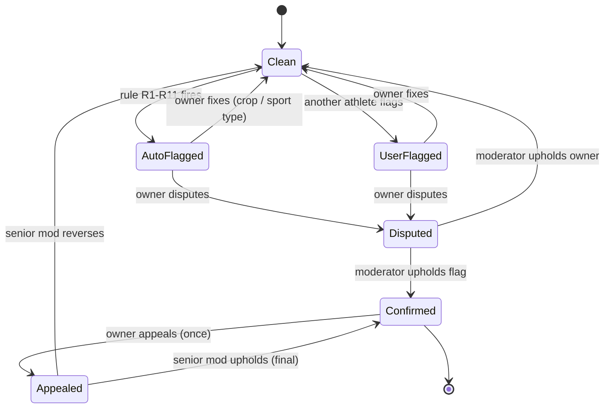
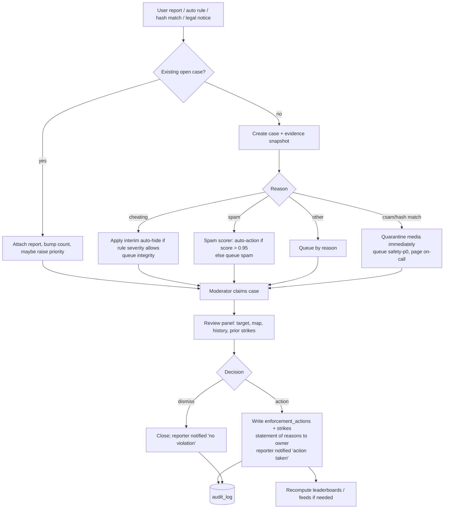
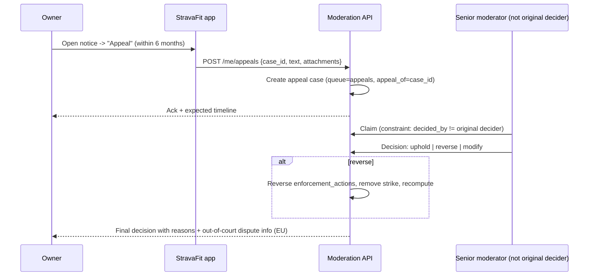
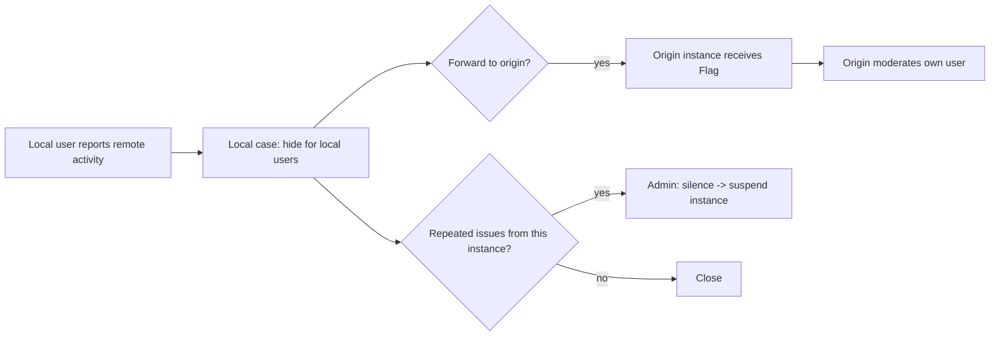

# Moderation, Anti-Cheat and Admin Tooling

> Gap-fill doc. The segments, social and privacy docs mention flags, reports, blocks and leaderboard cleanups, but none of them designs the back office an operator needs to run StravaFit.
>
> **Research caveat:** The shared web-search budget for this run ran out before this agent started, so this doc rests on one fetched first-party page (Strava Community Standards), our existing docs (`06-architecture/strava-architecture.md`, `06-architecture/data-model-api.md`, `07-oss/landscape-legal.md`), and the author's prior knowledge of Strava behaviour. Strava-specific details that could not be re-checked this session are marked **(unverified)**. Treat the Strava half as a reference sketch and the StravaFit half as the design.

Tags: [FREE] means free on Strava and [SUB] means subscription-gated on Strava. StravaFit has no subscriptions, so everything below is free in our app.

---

## 1. How Strava handles abuse

### 1.1 Community Standards (verified, strava.com/community-standards)

| Area | What Strava says (paraphrased) |
|---|---|
| Fair play | Strava backs clean competition. If an effort was cheated, it should not be on the platform. Segment leaderboard guidelines are linked from this rule. |
| Tools for users | Users can **block**, **flag** or **report** content that breaks the Terms. Cheating has its own flagging flow. |
| Review | Reports are judged in context, against policy and the results of an investigation. |
| Harassment and hate | Bullying, shaming, harassment and personal attacks are not tolerated. Hate speech against protected traits is removed. |
| Spam | Repeated or unsolicited posts and comments made to farm attention, followers or fake engagement are prohibited. |
| Authenticity | Users must represent themselves authentically. The page does not name impersonation outright. |
| Trails and law | Users must follow local laws and avoid closed, illegal or private trails. |
| Enforcement | Content takedown, including media the user does not own, and account suspension or termination. Other consequences may apply. |
| Appeals | **Not described on the page.** |

### 1.2 Moderation surfaces in the Strava app

| Surface | User action | Where | Tag |
|---|---|---|---|
| Activity flag (leaderboard integrity) | "Flag" from an activity's overflow menu, or from a segment leaderboard entry, with reason chips such as wrong sport type, vehicle, GPS error or other (unverified exact chips) | Activity detail, segment leaderboard | [FREE] |
| Report athlete | Report profile (spam, fake account, harassment, impersonation, inappropriate content) (unverified exact list) | Athlete profile overflow | [FREE] |
| Report comment / post / photo | Long-press or overflow, then "Report" | Feed, activity comments, club posts | [FREE] |
| Report message | From a chat thread (Messaging launched 2023) (unverified flow) | Messages | [FREE] |
| Block athlete | Block from profile. They cannot follow you, see your activities, comment or give kudos (unverified exact scope) | Profile overflow | [FREE] |
| Mute | Hide someone's activities from your feed without unfollowing | Profile, feed | [FREE] |
| Hide from leaderboards (self) | Owner marks their own activity as not eligible, for example a car ride accidentally recorded as a ride | Edit activity, privacy controls (unverified placement) | [FREE] |
| Report segment as hazardous | Flags a segment as hazardous, which removes it from leaderboard competition | Segment detail | [FREE] |
| Report club / challenge | Report a club or a group challenge (unverified) | Club page | [FREE] |

### 1.3 What happens when an activity is flagged (unverified, from prior knowledge)

1. Any athlete can flag another athlete's activity, usually from a segment leaderboard.
2. The flagged activity is **removed from all segment leaderboards straight away**. It stays on the owner's profile and in feeds, and keeps a "flagged" marker visible to the owner.
3. The owner receives a notification or email that explains the flag and lists self-fix options:
   - change the sport type, for example Ride to E-Bike Ride or Run to Ride
   - crop the section recorded in a vehicle
   - mark the activity as not for leaderboards
   - or, if the activity is legitimate, contact support to dispute.
4. A self-fix usually clears the flag. Disputes go to Strava support, which can remove the flag and restore the efforts.
5. The flagger is not identified to the owner (unverified).
6. Strava's API exposes a boolean `flagged` on activities (see `06-architecture/data-model-api.md`, about line 215). That much is confirmed in our API doc.

### 1.4 Automated detection and leaderboard cleanups (mostly unverified)

| Mechanism | Description | Confidence |
|---|---|---|
| Speed sanity filters | Efforts above per-sport plausibility thresholds are excluded from leaderboards. A run faster than world-record pace is the classic example. | unverified, widely reported |
| Sport-type mismatch | A run whose speed profile looks like cycling, or a ride that looks motorised, is auto-flagged or kept off leaderboards | unverified |
| E-bike detection | E-bike rides must use the E-Bike or E-MTB sport types, which have their own leaderboards. Mislabelled e-bike rides are a known source of fake KOMs. Model-based detection of power-assist patterns was reported around 2025. | unverified |
| Vehicle detection | Long sustained stretches above the human limit, or car-like acceleration and stop patterns | unverified |
| GPS teleport / glitch | Point-to-point jumps with impossible implied speed. These can produce absurd segment times. | unverified |
| Duplicate uploads | The same file or same device and time window uploaded twice is rejected as a duplicate at upload time. Duplicate leaderboard entries are prevented. | partially confirmed (duplicate-upload rejection is visible in upload UX) |
| 2025 leaderboard cleanup | Strava announced a cleanup in 2025 that used an improved algorithm to remove implausible efforts (vehicle, e-bike, GPS errors) from segment leaderboards, with athletes able to flag and appeal | **unverified, could not re-open the announcement this session** |
| Rebuilds on flag or delete | Leaderboards are recomputed when an activity is flagged, deleted, made private or changes sport type | reported (see `strava-architecture.md` §leaderboards) |

### 1.5 Appeals (unverified)

Strava has no in-app appeal button for account actions that we could confirm. Appeals go through the help center's "Submit a request" form, and flagged-activity disputes go through support. Under the EU **Digital Services Act**, an online platform of Strava's size must give a statement of reasons for content restrictions and run an internal complaint-handling system. A DSA-related flow therefore probably exists for EU users (unverified).

### 1.6 Other abuse categories

| Category | Typical Strava response (unverified detail) |
|---|---|
| Comment spam / link spam | Comment removal, rate limiting, account restriction |
| Bot and fake accounts (follow-spam, scam DMs, "crypto" or romance scams) | Account suspension. Users report from the profile. |
| Harmful activity titles / descriptions | Removal on report. GPS art that draws offensive shapes is also removed on report. |
| Harmful photos | Removal on report. Media the user does not own is removed (Community Standards). |
| Impersonation (pro athletes) | Account removal or renaming. Pros get verification badges. |
| Club abuse | Club removal, admin removal. Club admins can remove members and posts themselves. |
| Challenge abuse | Group challenges created by users can be reported. Fake efforts are excluded through the leaderboard rules above. |
| Stalking via Flyby / segments | Mitigated through privacy defaults (privacy zones, Flyby opt-out) rather than through moderation |

---

## 2. StravaFit design principles

1. **Integrity of leaderboards is a product feature, not a ban hammer.** Most bad data comes from honest mistakes such as forgetting to stop recording in the car or picking the wrong sport. Default to **self-fix with a nudge**, then escalate.
2. **Least privilege, full audit.** Every moderator action is attributable, has a reason, and can be reversed except where the law requires otherwise (CSAM).
3. **Privacy first.** Moderators see the minimum data. Private activities and privacy zones are hidden unless a case needs them, and unmasking is logged.
4. **Same pipeline for user reports and automated detections.** Both create `reports` in one queue.
5. **Self-hostable.** No proprietary moderation SaaS is required. Optional hooks exist for PhotoDNA-like services where the operator qualifies.
6. **Federation-aware.** If StravaFit instances federate, moderation acts per instance with defederation as the last resort.

---

## 3. Anti-cheat rule tables

Rules run in the activity ingest pipeline after stream processing and before segment matching publishes efforts (see `06-architecture/strava-architecture.md` §segment matching).

### 3.1 Per-sport plausibility limits (StravaFit defaults, configurable)

The numbers are conservative engineering defaults chosen by us, not Strava's numbers. Speed is computed over a **rolling window**, not raw point-to-point, so a single noisy point never fires a rule.

| Sport | Max sustained speed (30 s window) | Max sustained speed (5 min window) | Max accel (m/s²) | Notes |
|---|---|---|---|---|
| Run / Trail Run | 12.5 m/s (45 km/h) | 7.0 m/s (25.2 km/h) | 6 | WR 100 m is about 10.4 m/s average. WR marathon is about 5.9 m/s. |
| Walk / Hike | 4.0 m/s | 3.0 m/s | 4 | Running while recording as a walk is allowed but hidden from walk leaderboards above 3.0 m/s over 5 min |
| Ride / Gravel / MTB | 33 m/s (119 km/h) descending, 22 m/s flat | 17 m/s flat (61 km/h) | 8 | Gradient-aware: allow higher speed when grade is below -4 % |
| E-Bike / E-MTB | 33 m/s | 20 m/s | 8 | Separate leaderboards. Assist cut-off (25 km/h EU, 32 km/h US class 1/2) is used as a feature, not a hard rule. |
| Virtual Ride / Run | Never on outdoor leaderboards | | | Indoor activities have no segments |
| Swim (open water) | 2.5 m/s | 2.2 m/s | 3 | |
| Rowing / Kayak | 7 m/s | 6 m/s | 4 | |
| Inline skate | 18 m/s | 12 m/s | 6 | |
| Nordic ski | 25 m/s descending | 10 m/s | 6 | |
| Alpine ski / Snowboard | 40 m/s | n/a | 10 | Lift segments excluded by detecting long, constant-speed climbs |
| Wheelchair | 20 m/s descending | 8 m/s | 6 | |

### 3.2 Detection rules

| ID | Rule | Signal | Action | Severity |
|---|---|---|---|---|
| R1 | Sustained over-limit speed | Rolling window above the §3.1 limit | Exclude affected segment efforts. Suggest crop to the athlete. | auto-hide |
| R2 | GPS teleport | Point pair with implied speed above 3x the sport limit, or a jump above 500 m within 2 s | Mark the gap. Interpolate for distance only if under 200 m. Never award segment efforts that span a teleport. | auto-hide (effort only) |
| R3 | Wrong sport type (run vs ride) | Classifier over cadence, speed distribution and accel spectrum. Example: "Run" with cadence 80-100 rpm and median speed 8 m/s, or no step cadence and speed 30 km/h | Prompt the owner to change the sport. Exclude from leaderboards until confirmed. | soft-flag |
| R4 | E-bike as Ride | Features: very flat power-to-speed on climbs, climbing speed vs typical rider, HR low for climb speed, speed plateau near the assist cut-off on climbs, known e-bike device or sensor IDs | Soft-flag. Keep efforts on the leaderboard only if the athlete confirms. Two confirmations overruled by moderators lead to a strike. | soft-flag |
| R5 | Vehicle segment | Speed above the ride limit for at least 60 s, stop-and-go accel spikes near intersections, road matched to motorway class | Auto-crop suggestion. Hide efforts in that span. | auto-hide |
| R6 | Lift / train / ferry | Constant speed and steady climb (lift), or rail or ferry way match | Exclude span | auto-hide |
| R7 | Duplicate upload | Same `(athlete, device, start_time ± 60 s, distance ± 2 %)` or identical file hash | Reject at upload with a link to the existing activity | block |
| R8 | Cross-athlete duplicate | Same track geometry hash (Fréchet distance below 5 m over 95 % of points) and same timestamps as another athlete's activity | Soft-flag. Group rides are legitimate, but identical timestamps plus identical sensor noise point to a copied file. | review |
| R9 | Time-shifted / edited file | Timestamps monotonic but spacing perfectly uniform with no GPS noise; elevation exactly smooth | Review | review |
| R10 | Implausible HR / power | Power above 2,500 W for 5 s, 20 min power above 7.5 W/kg, HR above 230 | Exclude power leaderboards. Review if the effort is a top-10. | soft-flag |
| R11 | Top-of-board sanity | New #1 that beats #2 by more than 10 % on segments with at least 50 athletes | Hold the crown in "pending" for 24 h and queue for review if any other rule touched the activity | review |
| R12 | Manual activity | Manual entries | Never eligible for segments | block |

Severity semantics:
- **block**: the effort or upload is never created.
- **auto-hide**: efforts are kept but leaderboard-ineligible. The owner sees why and can dispute.
- **soft-flag**: same as auto-hide but resolved by owner confirmation, with moderator sampling.
- **review**: efforts stay visible but get a report in the queue.

### 3.3 Owner-facing flag state machine



While an activity is in any non-Clean state, its efforts are **leaderboard-ineligible** but the activity itself stays visible on the profile and feed. This matches Strava's approach (unverified).

### 3.4 Flagging abuse protection

- A user flag costs "trust budget": at most 10 flags a day, and a flagger whose flags are overturned at more than 50 % over 20 flags loses flag power, which turns their flags into review-only reports.
- A single flag from a brand-new account (under 14 days or under 5 activities) is review-only and does not auto-hide.
- Flag storms (more than 3 flags on one athlete's activities within an hour from unconnected accounts) get grouped into one case and do not stack.

---

## 4. Report data model and queue

### 4.1 Entities

```sql
-- Reportable target types
CREATE TYPE report_target AS ENUM (
  'activity','segment_effort','segment','athlete','comment','post',
  'photo','message','club','challenge','route');

CREATE TYPE report_reason AS ENUM (
  'cheating_vehicle','cheating_ebike','wrong_sport','gps_error',
  'spam','scam','harassment','hate','sexual_content','csam',
  'violence_self_harm','impersonation','privacy_doxxing',
  'ip_infringement','illegal_content','hazardous_segment','other');

CREATE TYPE report_source AS ENUM ('user','auto_rule','hash_match','legal','federation');

CREATE TABLE reports (
  id            bigserial PRIMARY KEY,
  target_type   report_target NOT NULL,
  target_id     bigint        NOT NULL,
  target_owner  bigint        REFERENCES athletes(id),
  reporter_id   bigint        REFERENCES athletes(id),  -- NULL for auto/legal
  source        report_source NOT NULL,
  reason        report_reason NOT NULL,
  rule_id       text,                        -- e.g. 'R4' for auto
  details       text CHECK (length(details) <= 2000),
  evidence      jsonb,                       -- rule features, snapshot hash
  snapshot_key  text,                        -- object-store key of frozen copy
  case_id       bigint REFERENCES cases(id),
  created_at    timestamptz NOT NULL DEFAULT now()
);

CREATE TABLE cases (
  id            bigserial PRIMARY KEY,
  target_type   report_target NOT NULL,
  target_id     bigint NOT NULL,
  target_owner  bigint,
  status        text NOT NULL DEFAULT 'open',  -- open|in_review|actioned|dismissed|appealed|closed
  priority      smallint NOT NULL,             -- 0 = P0 (CSAM, threats) .. 4
  queue         text NOT NULL,                 -- integrity|safety|spam|legal|appeals
  report_count  int NOT NULL DEFAULT 1,
  assignee_id   bigint REFERENCES staff(id),
  sla_due_at    timestamptz NOT NULL,
  decision      text,                          -- see actions table
  decision_reason_code text,
  decided_by    bigint REFERENCES staff(id),
  decided_at    timestamptz,
  appeal_of     bigint REFERENCES cases(id),
  dsa_statement_sent boolean DEFAULT false,
  created_at    timestamptz NOT NULL DEFAULT now(),
  UNIQUE (target_type, target_id, status) DEFERRABLE  -- one open case per target
);

CREATE TABLE enforcement_actions (
  id           bigserial PRIMARY KEY,
  case_id      bigint REFERENCES cases(id),
  athlete_id   bigint REFERENCES athletes(id),
  action       text NOT NULL,   -- see §4.3
  scope        jsonb,           -- e.g. {"feature":"comments"}
  starts_at    timestamptz NOT NULL DEFAULT now(),
  ends_at      timestamptz,     -- NULL = permanent
  reversed_at  timestamptz,
  reversed_by  bigint REFERENCES staff(id)
);

CREATE TABLE strikes (
  athlete_id bigint, case_id bigint, category text, weight smallint,
  expires_at timestamptz, PRIMARY KEY (athlete_id, case_id));
```

Snapshots: when a report is created we copy the target (text, photo variant, stream summary) to a write-once bucket, `moderation-evidence/`, with a 180-day retention. The owner can then not erase evidence by editing, and the copy is deleted on dismissal plus 30 days. CSAM evidence follows the legal preservation rules in §8.

### 4.2 Queues, priority and SLA

| Queue | Reasons | Priority | Target SLA (first action) |
|---|---|---|---|
| `safety-p0` | csam, credible threat, self-harm | P0 | 1 h, paging on-call |
| `legal` | DSA notice, court order, DMCA, GDPR | P1 | 24 h (DSA: "timely"; GDPR: 1 month) |
| `safety` | harassment, hate, sexual content, doxxing, impersonation | P1 | 24 h |
| `spam` | spam, scam, bot | P2 | 48 h, mostly automated |
| `integrity` | cheating_*, wrong_sport, gps_error, hazardous_segment | P3 | 7 days (auto-hide covers the interim) |
| `appeals` | any appealed decision | P2 | 7 days |

Case priority = base priority, raised one level when the target has at least 5 unique reporters, or when the target is a top-3 leaderboard effort, or when the reporter is a trusted flagger. Dedup: new reports on a target with an open case attach to that case and bump `report_count`.

### 4.3 Action catalogue

| Action | Effect | Reversible | Notifies owner |
|---|---|---|---|
| `dismiss` | Close case, no change | n/a | No (reporter gets "reviewed") |
| `hide_from_leaderboards` | Activity efforts become ineligible | yes | yes |
| `force_sport_type` | Change sport type, recompute | yes | yes |
| `crop_span` | Exclude a time span from efforts | yes | yes |
| `remove_content` | Comment, photo, title, description or post hidden (soft delete) | yes, for 30 days | yes, with statement of reasons |
| `rename_entity` | Reset club or segment name, or profile display name | yes | yes |
| `segment_hazardous` / `segment_archive` | Segment leaves competition | yes | segment creator |
| `feature_limit` | Block comments, messages, club creation or uploads for N days | yes | yes |
| `shadow_limit` | Content visible only to the author and their existing followers. Not shown in search, suggestions, club feeds or leaderboards. | yes | **no (by design; see §6.4 for ethics)** |
| `suspend` | Login blocked for N days | yes | yes |
| `ban` | Permanent account termination, sessions revoked | appealable | yes |
| `report_to_authority` | NCMEC / national hotline | no | no |

### 4.4 Report and decision flow



### 4.5 Appeal flow



Rules:
- One appeal per decision. Integrity flags may be appealed a second time only with new evidence, such as a device file.
- Appeals must be decided by a different person from the original decider. This is enforced in the database with a check on assignment.
- EU users get a pointer to certified out-of-court dispute settlement bodies (DSA Art. 21), if the operator falls under the DSA.

### 4.6 Strike ladder (defaults)

| Strikes active (90-day decay) | Consequence |
|---|---|
| 1 | Warning |
| 2 | 7-day feature limit in the offending area |
| 3 | 30-day suspension or shadow-limit (spam) |
| 4+ | Ban review |

Integrity strikes (cheating) are tracked separately. Three upheld vehicle or e-bike flags within 12 months remove leaderboard eligibility for 90 days, but the athlete keeps tracking and social features. CSAM, credible threats and doxxing skip the ladder and lead to an immediate ban.

---

## 5. Roles, permissions and audit log

### 5.1 Role model

| Role | Can do | Cannot do |
|---|---|---|
| `support` | Look up users (masked PII), view cases, add notes, trigger password reset email | Take enforcement actions, view private activities |
| `integrity_mod` | Integrity queue: hide, crop, force sport type, recompute leaderboards, segment actions | Safety queue, bans |
| `safety_mod` | Safety and spam queues: remove content, feature limit, suspend up to 30 days | Permanent ban, legal queue |
| `senior_mod` | All mod actions, ban, appeals, shadow-limit | Data export of PII, config changes |
| `legal` | Legal queue, DSA/GDPR requests, authority reports, evidence preservation | Rules config |
| `admin` | Role assignment, rules config, instance federation policy | Must use two-person approval to grant `admin` or `legal` |
| `community_mod` (club admin) | Remove posts and members in their own club only | Anything outside the club |

Implementation: RBAC with permission strings (`case.read`, `case.action.ban`, `pii.unmask`, `activity.private.view`, `leaderboard.recompute`, `rules.edit`, `staff.manage`). Staff accounts are separate from athlete accounts and require **WebAuthn or TOTP 2FA**. Sessions last 8 hours, the admin UI is IP-allowlisted or VPN-only, and it runs on a separate subdomain.

### 5.2 Sensitive-data access ("break glass")

- Private activity tracks, privacy-zone-masked points, emails and IPs are masked by default.
- Unmasking requires a case ID and a free-text justification. It is logged, and a weekly digest of unmask events goes to `admin`.
- Exact home-adjacent points are never shown, even when the track is unmasked. Privacy zones stay masked unless the case reason is `privacy_doxxing` or legal.

### 5.3 Audit log

```sql
CREATE TABLE audit_log (
  id          bigserial PRIMARY KEY,
  at          timestamptz NOT NULL DEFAULT now(),
  staff_id    bigint NOT NULL,
  action      text NOT NULL,        -- 'case.decide', 'pii.unmask', 'leaderboard.recompute'
  target_type text, target_id bigint,
  case_id     bigint,
  reason      text NOT NULL,
  before      jsonb, after jsonb,   -- diffs, PII-redacted
  ip inet, user_agent text,
  prev_hash   bytea, row_hash bytea -- hash chain for tamper evidence
);
REVOKE UPDATE, DELETE ON audit_log FROM app_role;  -- append-only
```

- Hash chain: `row_hash = sha256(prev_hash || canonical_json(row))`. A nightly job verifies the chain and writes the head hash to an external location such as a git tag or an object-lock bucket.
- Retention is 2 years for audit, and longer for legal holds.

---

## 6. Admin web UI

Stack proposal: a server-rendered admin app in the same backend, for example a Kotlin/Ktor or Django admin-like app with htmx, or a small React plus TanStack app. MapLibre GL is used for maps. It is desktop-first, but the layouts below are shown phone-width (40 chars) for consistency with other docs. On desktop, the panels sit side by side.

### 6.1 Queue dashboard

```
+--------------------------------------+
| StravaFit Admin        [me] [logout] |
+--------------------------------------+
| Queues            open  overdue  mine|
| safety-p0            0       0     0 |
| legal                3       0     1 |
| safety              41       2     5 |
| spam               212      18     0 |
| integrity          530      44    12 |
| appeals             17       1     2 |
+--------------------------------------+
| [Claim next in: integrity v] [Go]    |
| Filters: reason [all v] rule [R4 v]  |
|          region [all v] age [>24h v] |
+--------------------------------------+
| #8812 P3 R4 ebike  @alex  3 rpts 2d  |
| #8809 P3 R5 vehicle @sam  auto   2d  |
| #8790 P1 harass  comment  5 rpts 6h  |
+--------------------------------------+
```

### 6.2 User lookup

```
+--------------------------------------+
| Search: [email / handle / id / ip  ] |
+--------------------------------------+
| @alex  id 120034   joined 2024-03-02 |
| email a***@g***.com   [unmask*]      |
| status: active  strikes: 1 (integrity)|
| devices: Garmin 1040, Pixel 8        |
| flags filed: 14 (overturned 2)       |
| trust score: 0.82                    |
+--------------------------------------+
| Tabs: Activities | Cases | Actions | |
|       Social graph | Sessions | Notes|
+--------------------------------------+
| [Feature limit] [Suspend] [Ban]      |
| [Shadow-limit] [Force logout]        |
| [GDPR export] [GDPR erase]           |
+--------------------------------------+
 * requires case id + reason, logged
```

### 6.3 Activity review with map overlay

```
+--------------------------------------+
| Case #8812  R4 e-bike  P3  [claim]   |
| Ride 2026-09-14  42.1 km  1:12:03    |
+--------------------------------------+
| [ map: track coloured by speed     ] |
| [ red = over sport limit           ] |
| [ ### = teleport gap               ] |
| [ segment polylines overlaid       ] |
| [ privacy zone: masked grey disc   ] |
+--------------------------------------+
| speed |    ___/^^^^\___   limit----  |
|  HR   | ~~~~~~~~~~~~~~~~~            |
| power | ______________ (flat on climb)|
| grade |   /\    /\                   |
| [scrub timeline =======o=========]   |
+--------------------------------------+
| Rule evidence                        |
| climb spd vs HR: 4.1 sd above norm   |
| speed plateau 24.8 km/h on 7% grade  |
| affected efforts: 6 (2 top-10)       |
+--------------------------------------+
| Compare: [athlete's history v]       |
| same segment best 2025: 6:40 -> 4:02 |
+--------------------------------------+
| Decision                             |
| ( ) dismiss  ( ) hide from LB        |
| ( ) set sport: [E-Bike Ride v]       |
| ( ) crop span [12:03 - 18:40]        |
| reason code [ebike_mislabel v]       |
| note [______________________]        |
| [ Apply & recompute ]                |
+--------------------------------------+
```

Map overlay layers: raw track, speed-coloured track, rule-hit spans, matched segments, nearby road class (OSM `highway=motorway|trunk` highlighted), and rail and ferry lines. The privacy zone stays masked by default (§5.2).

### 6.4 Shadow-limit: guardrails

Shadow-limiting works well against spam bots but is opaque to real people. StravaFit's policy:
- Only for the `spam`/`scam` category and only with a senior_mod decision or a spam score above 0.98.
- Automatically expires after 30 days unless renewed.
- It appears in the user's GDPR data export (Art. 15) as a "restriction applied", and under the DSA a statement of reasons is still required for EU users. Operators under the DSA must therefore **notify**, which makes the shadow-limit just a visibility limit with notice.

### 6.5 Leaderboard recompute

```
+--------------------------------------+
| Leaderboards > Segment 55120         |
| "Hill Road climb"  Ride  1.8 km 6.2% |
+--------------------------------------+
| Top 10 (current)          eligible   |
| 1 @alex   3:58  R4 soft-flag   no    |
| 2 @kim    4:31                 yes   |
| 3 @lee    4:33                 yes   |
+--------------------------------------+
| [Dry run recompute]  shows diff      |
| [Recompute segment]                  |
| [Bulk: recompute all efforts of      |
|  athlete @alex since 2026-01-01]     |
| [Mark hazardous] [Archive segment]   |
+--------------------------------------+
| Job log: #rc-311 queued 10:41 ...    |
+--------------------------------------+
```

Recompute is an idempotent background job keyed by `(segment_id)` or `(athlete_id, since)`. It rebuilds the sorted set from `segment_efforts WHERE eligible`, then rewrites crowns (our "segment leader") and Local-Legend-equivalent counts ("Regular" title), and emits notifications only for **gained** crowns. Lost crowns caused by a cleanup are announced as "leaderboard corrected", never as "you lost your crown to X".

### 6.6 Takedowns, DSA and GDPR request desk

```
+--------------------------------------+
| Legal desk                           |
+--------------------------------------+
| Type        Due        Status        |
| GDPR Art15  2026-11-20 exporting     |
| GDPR Art17  2026-11-02 pending 2FA   |
| DSA notice  2026-10-30 in review     |
| DMCA photo  2026-10-31 actioned      |
| Authority   2026-10-29 P0 handled    |
+--------------------------------------+
| [New request]  [Transparency report] |
+--------------------------------------+
```

- **GDPR Art. 15/20 (access, portability)**: reuse the bulk-export pipeline from `data-model-api.md`. The deadline is 1 month, extendable by 2. Identity is verified through a logged-in session, never by email alone.
- **GDPR Art. 17 (erasure)**: account deletion cascade. Evidence under legal hold is exempted with a documented legal basis. Leaderboard recompute runs for every affected segment.
- **DSA Art. 16 notice and action**: a public web form for anyone, including non-users, that captures the URL, reason, explanation and notifier contact, with a good-faith statement. Acknowledge receipt, decide, and inform the notifier.
- **DSA Art. 17 statement of reasons**: generated from the `decision_reason_code` template plus the facts. Very large platforms submit these to the EU transparency database. Small operators below that threshold do not have to, but the templates are kept ready.
- **DSA Art. 24 / transparency report**: auto-generated yearly from `cases` aggregated counts. Micro and small enterprises are exempt from several DSA obligations (unverified exact scope; check with counsel).
- **DMCA / copyright** for photos: a takedown and counter-notice workflow.

---

## 7. Spam, bots and rate limits

### 7.1 Signals

| Signal | Use |
|---|---|
| Account age, activity count, has-GPS-activities | New accounts with zero real activities that follow 200 people are the classic follow-spam pattern |
| Follow velocity | More than 50 follows an hour |
| Comment similarity | MinHash of comment text across targets. The same text on more than 10 activities within an hour means spam. |
| Links in comments, bios or messages | Domain reputation via a local allow/deny list. URLhaus and Spamhaus DBL are optional. |
| Message fan-out | First messages to more than 20 non-followers in a day |
| Registration | Disposable-email domain list, proof-of-work captcha (ALTCHA or mCaptcha, self-hosted, no Google reCAPTCHA) |
| Device / IP | Many accounts per IP or ASN in a short window (hosting ASNs weighted higher) |

A spam score is computed by a simple logistic model or rules first, with a small gradient-boosted model later when there is labelled data from moderator decisions.

### 7.2 Rate limits (defaults, per account unless noted)

| Action | Limit | New-account limit (<7 d) |
|---|---|---|
| Comments | 60 / h, 300 / day | 10 / h |
| Kudos-equivalent ("props") | 500 / h | 100 / h |
| Follows | 100 / h, 400 / day | 20 / h |
| DMs to non-followers | 20 / day | 0 (followers-only) |
| Flags | 10 / day | review-only |
| Reports | 30 / day | 10 / day |
| Uploads | 50 / day | 20 / day |
| Club creation | 3 / week | 0 |
| Group challenge creation | 5 / week | 0 |
| Segment creation | 20 / day | 2 / day |
| Account registration | 5 / IP / day | |
| Auth attempts | 10 / 15 min per account and per IP | |

Implementation: Redis token buckets (or `pg` plus `ratelimit` table for small instances), with headers `RateLimit-*` (IETF draft) returned to the client. The Android client backs off and shows a friendly "slow down" message.

### 7.3 Harmful text (titles, descriptions, comments, club names, display names)

- Blocklist plus normalisation (confusables, leetspeak) for slurs, applied at write time. Hits are **soft-blocked**: the author is asked to edit.
- An optional self-hosted classifier, such as a small multilingual toxicity model (Detoxify-style) through ONNX Runtime, scores text and queues high scores for review. It does not auto-remove except for the top band.
- Display names that match a protected list of verified athletes and public figures are blocked at registration, which covers impersonation. The verified badge is admin-granted after an identity check.

### 7.4 GPS art and route abuse

Offensive GPS drawings are handled through user reports on the activity or route. Moderators can hide the map, keeping stats, rather than delete the activity.

### 7.5 Club and challenge abuse

| Abuse | Control |
|---|---|
| Spam clubs (links, scams) | New-account club creation blocked; club descriptions go through link reputation |
| Impersonating brands or teams | Name similarity checks against verified clubs; report reason `impersonation` |
| Club admin abuse (mass DMs, harassment) | Club-level report; senior mod can remove admin role |
| Fake challenge results | Challenge progress counts only leaderboard-eligible activities for distance and elevation goals. Flagged activities drop out. |
| Prize scams via challenges | User-created challenges cannot advertise prizes or include external payment links. Link scanning applies. |

---

## 8. Photos: CSAM and hash matching

| Option | What it is | Fit for OSS operators |
|---|---|---|
| **PhotoDNA** (Microsoft) | Perceptual hash matched against NCMEC lists | Free for qualified organisations after an application. Not open source. Optional integration. |
| **PDQ** (Meta, open source) | Perceptual hash. The ThreatExchange repo has a reference implementation. | Good default for hashing. Hash lists come from industry sharing programmes (eligibility required). |
| **Cloudflare CSAM Scanning Tool** | Free for Cloudflare customers when images go through Cloudflare | Option if the instance uses Cloudflare |
| **Thorn Safer** | Commercial detection service | Paid |
| **NCMEC CyberTipline** reporting (US) / INHOPE hotlines (EU) / IWF (UK) | Mandatory reporting channels | Legal obligation in many jurisdictions |
| Local NSFW classifier | e.g. an open-source NSFW model in ONNX | Use only for **adult nudity** triage, never as a CSAM detector |

Pipeline:
1. On upload, compute PDQ (and a SHA-256) before the image becomes visible.
2. Compare against the operator's hash lists (known-bad shared lists, plus a local list of previously removed images).
3. A match means quarantine (not visible, not deletable by the user), a P0 case, preserved evidence, and a report to the authority per jurisdiction. The account is banned. **Moderators must not download or forward the material.** Show a blurred preview to authorised staff only.
4. Moderator wellness: blur by default, greyscale toggle, exposure limits per shift.

Strava photos are mostly outdoor scenes, so volume is low, but any public photo host needs this path. Smaller self-hosted instances can **turn off public photo uploads** if they cannot run the pipeline. This setting exists as `media.public_photos=false`.

---

## 9. Privacy-respecting metrics

### 9.1 Product analytics

- **Default: none.** The Android app ships no analytics SDK (F-Droid friendly, see `07-oss/landscape-legal.md`).
- Instance operators may enable **Plausible** (self-hosted, cookieless, aggregate) or **Matomo** (self-hosted, with IP anonymisation and cookieless mode) for the web app only.
- Mobile telemetry is **opt-in** and only aggregate counters (screen views, feature use) are sent to the instance's own endpoint. No device IDs, and IPs are truncated at ingress.
- Crash reports are opt-in through ACRA or a self-hosted GlitchTip.

### 9.2 Moderation metrics (internal, Prometheus/Grafana)

| Metric | Type |
|---|---|
| `mod_reports_total{source,reason}` | counter |
| `mod_cases_open{queue,priority}` | gauge |
| `mod_time_to_first_action_seconds{queue}` | histogram |
| `mod_decisions_total{queue,decision}` | counter |
| `mod_appeals_total{outcome}` | counter (reversal rate is a quality signal) |
| `anticheat_rule_hits_total{rule,sport}` | counter |
| `anticheat_owner_fix_rate{rule}` | gauge (self-fix rate) |
| `anticheat_false_positive_rate{rule}` | from disputes upheld for the owner |
| `ratelimit_rejections_total{action}` | counter |

No athlete IDs go into metric labels.

---

## 10. Federation policy (if self-hosting and federation are allowed)

If StravaFit instances federate (ActivityPub-style follows and feed sharing, an option under consideration in the OSS docs):

| Topic | Policy |
|---|---|
| Jurisdiction | Each instance moderates its own users and is the legal operator for its content. |
| Remote reports | A local user can report remote content. The report is handled locally (hide for local users) and **forwarded** to the origin instance with the reporter anonymised by default (Mastodon-style `Flag` activity). |
| Instance-level actions | `silence` (remote content hidden from public timelines and leaderboards), `media reject`, `suspend` (defederate). These are published on a public, machine-readable blocklist with reasons. |
| Leaderboards | **Federated leaderboards accept efforts only from instances on an allowlist** that run the shared anti-cheat ruleset version at least N. Each effort carries `ruleset_version` and the origin's integrity verdict. A local recompute can drop remote efforts. |
| Anti-cheat ruleset | Shipped as a versioned, signed config (YAML) in the main repo, so all instances agree on §3 thresholds. Instances may be stricter, not looser, for federated boards. |
| CSAM | Hash matching runs on every instance that caches remote media. Remote media from an instance without the pipeline is not cached (link-only). |
| Admin contact | Instances must publish a moderation contact and policy at `/.well-known/stravafit-moderation` (proposed). Instances without one are silenced by default. |
| Defederation flow | Notice to the remote admin, 7-day cure period (except P0), then suspend, with periodic review. |



---

## OSS implementation notes

**Neutral names** (our trademark-safe vocabulary):

| Strava term | StravaFit term |
|---|---|
| KOM/QOM / CR | Segment leader ("crown") |
| Local Legend | "Regular" |
| Kudos | "Props" |
| Flyby | "Crossed paths" |
| Beacon | "Live share" |
| Flag (activity) | "Integrity check request" in the UI. Code still says `flag`. |

**Architecture**
- A `moderation` module inside the backend owns the tables in §4/§5, the HTTP API (`/admin/*` for staff and `/me/reports`, `/me/appeals`, `/reports` for users) and a job runner (the same queue as ingest, such as Postgres `SKIP LOCKED`, River, Oban or Sidekiq-equivalent).
- Anti-cheat runs as a stage in the ingest pipeline. Rules are pure functions over `ActivityStreams` → `RuleHit[]{rule_id, span, severity, features}`. They are config-driven from the signed YAML ruleset with a version.
- Speed is computed with a rolling window over resampled 1 Hz streams. Points are smoothed first with a Kalman or Savitzky–Golay filter so GPS jitter does not trip limits.
- Wrong-sport and e-bike classification v1 uses heuristics. v2 is a small gradient-boosted model (LightGBM, exported to ONNX for the JVM) trained on moderator-labelled cases. Keep the features explainable because the review UI shows them.
- Road-class matching uses OSM extracts with a lightweight map-matcher (Valhalla `trace_attributes` or GraphHopper Map Matching), and only runs when R5 is a candidate, to save cost.
- Cross-athlete duplicate detection (R8) uses a geohash-bucketed track fingerprint plus start time. Discrete Fréchet runs only on candidates.
- Leaderboard eligibility is a column on `segment_efforts` (`eligible boolean`, `ineligible_reason text`). It is never deleted, so reversals are cheap.

**Android specifics**
- Overflow menus on activity, comment, profile, club, message, photo and segment lead to a shared `ReportSheet` (bottom sheet) with reason radio list, optional details and a "block this person too" checkbox.
- Owner-side: a "Leaderboard check" banner on flagged activities with **Fix** (crop/sport-type editor deep links), **Dispute** and **Learn more**.
- Notices inbox: a "Account & safety" screen lists statements of reasons with an **Appeal** button, which works offline-first and queues the POST through WorkManager.
- Block and mute run client-side optimistic and server-authoritative. Blocked users' content is filtered server-side, never only on the client.

**Edge cases**
- Group rides: identical tracks are legitimate, so R8 also needs identical timestamps **and** identical sensor noise.
- Tunnels and urban canyons produce teleport-like jumps. R2 only removes spanning efforts, not the activity.
- Downhill MTB and alpine roads can legitimately exceed flat limits, hence the gradient-aware thresholds.
- Treadmill runs synced with phantom GPS from a watch should be treated as virtual: no segments.
- Time-zone or clock errors in device files can make duplicates look different. Compare on UTC and distance as well.
- Privacy zones: rule evaluation uses the raw track, but the review UI masks the zones.
- Deleting an account mid-case: the case keeps the snapshot under legal basis, then purges on schedule.
- Moderator conflict of interest: block assignment of cases involving athletes the moderator follows or shares a club with.
- Small instances with one admin cannot meet the "different decider" rule for appeals. Allow it, but show the conflict in the audit log and the transparency report.

**Libraries (suggested)**
- PDQ: `facebook/ThreatExchange` (pdq), with a JVM port or a native call.
- Captcha: ALTCHA (proof-of-work, self-hosted).
- Text normalisation: ICU4J confusables, `unicode-security`.
- Toxicity: ONNX Runtime with an open multilingual model (optional, off by default).
- Admin UI maps: MapLibre GL JS, deck.gl for speed-coloured paths.
- Analytics: Plausible CE or Matomo, both self-hosted and both optional.

**Open questions**
- Exact numbers in Strava's 2025 cleanup and auto-flagger: re-research before publishing public comparisons (unverified).
- Whether StravaFit operators will be DSA "online platforms" or "hosting services". This affects the statement-of-reasons and complaint duties. Get legal review.
- Eligibility for PDQ/PhotoDNA hash-list access as an OSS project or per instance.
- Federation scope: whether leaderboards federate at all, given the segment-patent risk in `07-oss/landscape-legal.md`.

## Sources

- https://www.strava.com/community-standards (fetched; flag, report, block, spam, harassment, enforcement)
- https://support.strava.com/hc/en-us/articles/216919407 (fetched; the page turned out to cover sport types, not flagging, and was used only to confirm that activities can be re-typed)
- Internal: D:/stravafit/docs/06-architecture/strava-architecture.md (leaderboard rebuilds, hazardous segments, sanity filters)
- Internal: D:/stravafit/docs/06-architecture/data-model-api.md (`flagged` field on activities, sport-type enum incl. EBikeRide, bulk export)
- Internal: D:/stravafit/docs/07-oss/landscape-legal.md (privacy, F-Droid, telemetry stance, segment patent risk)
- Not consulted this session (search budget exhausted, listed for follow-up): Strava help-center articles on flagging, reporting and e-bikes; Strava 2025 leaderboard-cleanup announcement; EU DSA text (Regulation (EU) 2022/2065); GDPR Arts. 15-17, 20; Meta ThreatExchange PDQ; Microsoft PhotoDNA; NCMEC CyberTipline; Mastodon moderation docs.
