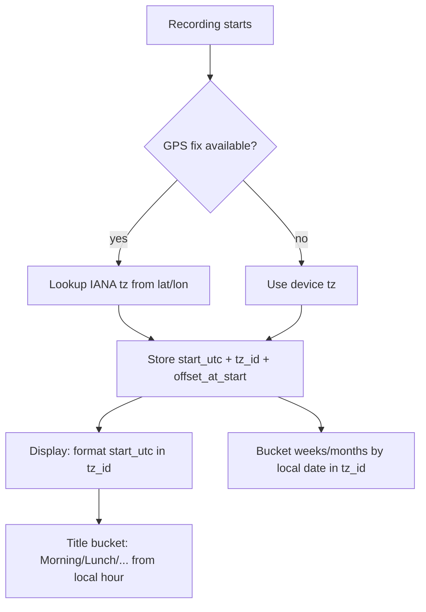
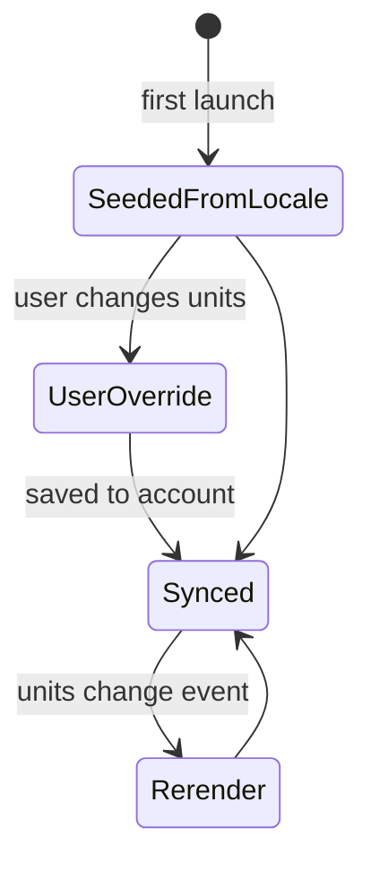

# Units, Localization & Accessibility (gap fill)

> Scope: how Strava (Android primarily, iOS differences noted) handles measurement units, locale formatting, language, time zones, auto-generated activity titles and accessibility, plus how StravaFit should build the same things.
>
> **Research caveat.** The shared web-search budget for this workflow ran out before this doc started, so live research was limited to the Strava API v3 reference (fetched directly). Behaviour described from product knowledge is marked **(unverified)** wherever it was not re-confirmed against a primary source in this pass. Before shipping, re-check these points against the Strava Help Center pages on units, language and accessibility.

Tags: [FREE] = available to free Strava accounts, [SUB] = subscription-gated in Strava (reference only; everything is free in StravaFit).

---

## 1. Summary

| Area | Strava behaviour | Confidence |
|---|---|---|
| Unit system | One account-level toggle with two values: metric (`meters`) or imperial (`feet`) | **Confirmed**: API `measurement_preference` enum is `feet` / `meters` |
| Mixing units | Not supported. One switch flips distance, pace/speed, elevation, temperature and weight together | (unverified), strongly implied by the single enum |
| Storage units | SI internally: distance in m, speed in m/s, elevation in m, weight in kg | **Confirmed** for distance, speed, elev_high and weight (API docs) |
| Pace vs speed | Foot sports show pace (min/km or min/mi). Ride, ski and paddle sports show speed (km/h or mph). Swim shows pace per 100 m or 100 yd | (unverified) in detail; general rule widely observed |
| Date format | Per-athlete `date_preference` strftime-style string, for example `%m/%d/%Y` | **Confirmed** field exists in API sample |
| Time zone | Each activity stores UTC start, local start, a time zone label and an offset | **Confirmed** (`start_date`, `start_date_local`, `timezone`, `utc_offset`) |
| Language | The app follows the device language, with about 15-20 supported locales and an English fallback | (unverified) list |
| RTL | No RTL UI locale known to be shipped | (unverified) |
| Default titles | "<Time-of-day> <Sport>", for example "Morning Run" or "Lunch Ride", localized | (unverified) bucket boundaries |
| Accessibility | Partial TalkBack/VoiceOver support. Charts and maps are largely opaque to screen readers. Many signals rely on colour | (unverified), based on community reports |
| Audio cues | Voice feedback during recording at distance or time splits [FREE] (unverified) | (unverified) |

---

## 2. Units of measurement

### 2.1 Where the setting lives

- **Android app** (unverified path): You avatar or profile > Settings (gear) > Display or Preferences > *Units of Measurement* > Kilometres / Miles.
- **iOS** (unverified): Same setting under Settings > Display Preferences. On iOS the default may be seeded from the device region (`Locale.measurementSystem`) at sign-up.
- **Web**: Settings > My Account / Display Preferences > Units of measurement.
- The setting is **account-level and syncs across devices**. It is exposed through the API as `DetailedAthlete.measurement_preference` with values `feet` or `meters` (confirmed). Note that the enum names the elevation unit, not the distance unit. Our model should not copy that ambiguity.

### 2.2 What the toggle controls

| Quantity | Metric (`meters`) | Imperial (`feet`) | Stored as | Notes |
|---|---|---|---|---|
| Distance | km (m below about 1 km in some contexts, unverified) | mi | metres | Segment lengths can show m or ft for short climbs (unverified) |
| Pace (foot sports) | min/km | min/mi | derived from m/s | Displayed as `m:ss /km` |
| Speed (wheel and board sports) | km/h | mph | m/s (`average_speed`) | |
| Swim pace | /100 m | /100 yd | m/s | Pool length is entered separately in m or yd (unverified) |
| Elevation gain, high, low | m | ft | metres (`elev_high` confirmed) | |
| Temperature (from device or weather) | °C | °F | °C (unverified) | Weather on activities comes from a third-party provider (unverified) |
| Athlete weight | kg | lb | kg (confirmed for Update Athlete) | Used for power-to-weight (W/kg is always metric) and calories |
| Gear distance (shoes and bikes) | km | mi | metres | |
| Goals | km | mi | metres | Goal input converts on change (unverified) |
| Height | cm | ft/in | (unverified) | |
| Heart rate, power, cadence | bpm, W, rpm or spm | same | n/a | Not unit-switchable |
| Wind speed | km/h | mph | (unverified) | Wind direction shown as a compass point |

### 2.3 Mixing units

- **Not supported** (unverified, but consistent with a single binary field). Common community requests that are *not* possible include "km for distance but feet for elevation" (US trail runners), "miles for runs but km for rides", and "°C with miles" (UK users).
- UK users often want miles plus metric weight and temperature. This is a known gap in Strava and an opportunity for StravaFit.
- **Workaround in Strava**: none in-app. Some Garmin users set the watch differently, but Strava re-renders everything in the account unit.

### 2.4 Pace vs speed by sport (expected behaviour)

| SportType (confirmed enum members) | Primary rate metric | Unit (metric / imperial) |
|---|---|---|
| Run, TrailRun, VirtualRun, Walk, Hike, Snowshoe, Wheelchair (unverified, may be speed) | Pace | min/km / min/mi |
| Ride, GravelRide, MountainBikeRide, EBikeRide, EMountainBikeRide, VirtualRide, Velomobile, Handcycle | Speed | km/h / mph |
| Swim | Pace | /100 m / /100 yd |
| Rowing, VirtualRow | Pace per 500 m (unverified, may show speed) | /500 m |
| Canoeing, Kayaking, StandUpPaddling, Sail, Windsurf, Kitesurf, Surfing | Speed | km/h / mph (knots not offered, unverified) |
| AlpineSki, BackcountrySki, NordicSki, Snowboard, RollerSki, InlineSkate, IceSkate, Skateboard | Speed | km/h / mph |
| WeightTraining, Yoga, Pilates, Crossfit, HIIT, Workout, racket and ball sports, Dance, Elliptical, StairStepper, RockClimbing, Golf, PhysicalTherapy | Time-based; no rate metric | n/a |

> Nordic ski is sometimes shown with pace in other apps. Strava's choice is (unverified).

### 2.5 Rounding and display rules (observed or likely)

- Distance: 2 decimals (`5.02 km`), (unverified) dropping to 1 decimal in compact feed cards.
- Pace: `m:ss`, rounded to the nearest second. Hours appear only above 59:59 per unit.
- Speed: 1 decimal (`28.4 km/h`).
- Elevation: integer, with grouping separators (`1,234 m`).
- Moving time: `h:mm:ss`, or `mm:ss` when under an hour. Feed cards use the `1h 2m` form (unverified).
- Splits table: per km or per mile, with a partial final split showing its distance.

---

## 3. Dates, times and numbers

### 3.1 Date format

- API sample: `date_preference: "%m/%d/%Y"` (confirmed). The likely alternative is `%d/%m/%Y` (unverified). This is selectable in web settings (unverified) and otherwise defaults from locale.
- Feed headers use relative or friendly forms such as "Today at 7:12 AM", "Yesterday", or "March 3, 2025 at 6:01 PM" (unverified exact strings). These are localized.

### 3.2 Time format

- 12 h vs 24 h follows the device setting on Android (`DateFormat.is24HourFormat`) (unverified for Strava; this is standard platform behaviour).

### 3.3 Numbers

- Decimal and grouping separators follow the locale, for example `5,02 km` in de/fr/es and `5.02 km` in en (unverified for Strava, expected).
- Note that French uses a narrow no-break space before units and as a thousands separator.

### 3.4 First day of week

- Weekly training summaries, the progress chart and the training calendar use **Monday-start weeks** for many users. Whether the week start follows locale or is fixed to Monday is (unverified). Several community threads mention US users seeing Monday-based weeks. Challenge calendars follow calendar months.

### 3.5 Time zones and travel

The API confirms that each activity carries:

| Field | Meaning |
|---|---|
| `start_date` | UTC start instant |
| `start_date_local` | Wall-clock start at the activity location, serialised with a misleading `Z` |
| `timezone` | Label such as `(GMT-08:00) America/Los_Angeles` |
| `utc_offset` | Seconds, for example `-28800` |

Behaviour:

- The activity's time zone is derived from its **GPS start point** (unverified). For indoor activities without GPS it falls back to the device or upload time zone (unverified).
- The detail screen shows **local time at the activity location**, not viewer time. A run at 07:00 in Tokyo displays "7:00 AM" for a viewer in London (likely; unverified).
- Weekly totals bucket by `start_date_local` (unverified). Travelling across the date line can therefore put two "Mondays" in one week or skip a day.
- DST transitions: `utc_offset` is a snapshot at start. A long activity crossing a DST boundary keeps its start offset.



---

## 4. Language and localization

### 4.1 Selecting a language

- **Android**: the app follows the system language. Android 13+ per-app language settings may be available if the app declares `localeConfig` (unverified for Strava).
- **iOS**: Settings > Strava > Language (iOS per-app language).
- **Web**: a language picker in the footer and settings.
- The account language also drives **email and push notification** language (unverified).

### 4.2 Supported languages (all unverified, from product knowledge)

| Language | Code | Notes |
|---|---|---|
| English (US) | en-US | default |
| English (UK) | en-GB | spelling differences (unverified) |
| German | de | |
| French | fr | |
| Spanish (Spain) | es | |
| Spanish (Latin America) | es-419 | |
| Italian | it | |
| Portuguese (Brazil) | pt-BR | |
| Portuguese (Portugal) | pt-PT | |
| Dutch | nl | |
| Japanese | ja | |
| Korean | ko | |
| Chinese (Simplified) | zh-CN | |
| Chinese (Traditional) | zh-TW | |
| Russian | ru | may have been reduced or removed (unverified) |
| Polish, Czech, Swedish, Danish, Norwegian, Turkish, Indonesian | pl, cs, sv, da, nb, tr, id | (unverified) |

- **RTL**: no Arabic or Hebrew UI locale is known (unverified). RTL user content (titles, comments) is still rendered with bidi text. Maps and charts stay left-to-right.
- User-generated content (titles, descriptions, comments) is not machine-translated (unverified; a "See translation" affordance may exist on some surfaces).

### 4.3 Auto-generated activity titles

When the user does not set a title, Strava names the activity `<period> <sport>`, localized:

| Local start hour (unverified boundaries) | Period (en) |
|---|---|
| 04:00 to 10:59 | Morning |
| 11:00 to 13:59 | Lunch |
| 14:00 to 16:59 | Afternoon |
| 17:00 to 20:59 | Evening |
| 21:00 to 03:59 | Night |

- Examples: "Morning Run", "Lunch Ride", "Evening Walk", "Night Hike", "Afternoon Weight Training".
- The hour uses the **activity's local time zone**, not the device's (unverified).
- Translations reorder words (de: "Morgendlicher Lauf"; fr: "Course à pied le matin", unverified strings). Never concatenate; use a full string per period and sport, or a template with gender and case agreement.
- Garmin and other synced uploads may keep the device's name, for example "City Running" (unverified). Strava may overwrite with its own naming.
- Some newer builds may suggest smart titles, for example AI or "Athlete Intelligence" features [SUB] (unverified). Out of scope.

---

## 5. Accessibility

### 5.1 Current Strava state (community-reported; all unverified)

| Area | Observed state |
|---|---|
| TalkBack/VoiceOver on feed | Cards are readable, but the stat row is often read as separate unlabeled numbers ("5.02", "km", "28:14") |
| Charts (pace, HR, elevation) | Exposed as a single image or not at all. No data-point navigation or summary |
| Maps | Not described. The route has no text alternative beyond the location name |
| Icon buttons (kudos, comment, share) | Mostly labelled. Some unlabeled icons reported |
| Font scaling | Dense stat grids truncate or clip at 150-200% scale. Some text is fixed-size |
| Colour-only signals | HR zones (grey, blue, green, orange, red), segment effort or PR medals by colour, heatmap intensity, map polyline gradients by pace or HR |
| Touch targets | Small chip controls (sport filter, chart tabs) below 48 dp |
| Reduced motion | Celebration animations (PR, goals, year-in-sport video) may not respect "Remove animations" |
| Dark mode | Supported [FREE] |
| Audio cues | Voice announcements during recording at intervals: distance, time, pace and, with sensors, HR (unverified). This is useful for low-vision and eyes-free athletes |
| Beacon / safety | Location sharing [FREE since 2023, unverified] |

### 5.2 Wireframe: accessible stat grid (StravaFit target)

```
+----------------------------------------+
| Morning Run            Tue 7:02 AM     |
| [map: Route, 5.0 km loop, Hyde Park]   |
|----------------------------------------|
| Distance      Pace         Time        |
| 5.02 km       5:38 /km     28:14       |
|----------------------------------------|
| Elev gain     Avg HR       Calories    |
| 42 m          152 bpm      341         |
+----------------------------------------+
TalkBack reads one node per tile:
 "Distance, 5.02 kilometres"
 "Pace, 5 minutes 38 seconds per kilometre"
At font scale >= 1.5 the grid reflows 3 -> 2 -> 1 columns.
```

### 5.3 Wireframe: chart with accessible summary

```
+----------------------------------------+
| Heart rate                    [Table]  |
|  180|        /\                         |
|  150|  _/\__/  \__/\_                   |
|  120|_/              \_                 |
|     +-------------------- time          |
| Zone bar: Z1|Z2 |Z3   |Z4  |Z5          |
|           5%|18%|41%  |30% |6%          |
+----------------------------------------+
contentDescription: "Heart rate chart. Average 152,
 max 181 bpm. Most time in zone 3, 41 percent."
[Table] toggles a data table for screen readers.
Zones carry text and patterns, not colour only.
```

---

## 6. Settings state machine



---

## OSS implementation notes

### A. Neutral naming
- "Units preference", "Activity auto-title", "Voice coach" (for audio cues), "Live location share" (Beacon), "Kudos" -> "Cheers". Do not name the setting values `feet` / `meters`. Use explicit per-dimension values.

### B. Data model (improves on Strava: mixed units allowed)

```kotlin
enum class UnitSystem { METRIC, IMPERIAL, CUSTOM }
data class UnitPrefs(
  val system: UnitSystem = UnitSystem.METRIC,
  val distance: DistanceUnit = DistanceUnit.KM,      // KM, MI
  val elevation: ElevationUnit = ElevationUnit.M,    // M, FT
  val temperature: TempUnit = TempUnit.C,            // C, F
  val weight: WeightUnit = WeightUnit.KG,            // KG, LB, ST (UK stones)
  val swimPool: PoolUnit = PoolUnit.M,               // M, YD
  val firstDayOfWeek: DayOfWeek? = null,             // null = locale default
  val hour24: Boolean? = null                        // null = system default
)
```

- Store **SI only** in the DB (m, m/s, s, kg, °C, epoch-ms UTC plus IANA `tzId`). Convert only in the presentation layer.
- Seed defaults: `LocaleData.getMeasurementSystem(ULocale)` (ICU4J, API 28+) via `android.icu.util.LocaleData`. US, LR and MM map to imperial. GB maps to `CUSTOM` (mi + kg/st + °C).

### C. Kotlin units and format layer

```kotlin
object Conv {
  const val M_PER_MI = 1609.344
  const val M_PER_FT = 0.3048
  const val KG_PER_LB = 0.45359237
  const val M_PER_YD = 0.9144
}

enum class RateKind { PACE_PER_DIST, PACE_PER_100, PACE_PER_500, SPEED, NONE }

fun rateKindFor(sport: SportType): RateKind = when (sport) {
  Run, TrailRun, VirtualRun, Walk, Hike, Snowshoe -> RateKind.PACE_PER_DIST
  Swim -> RateKind.PACE_PER_100
  Rowing, VirtualRow -> RateKind.PACE_PER_500
  WeightTraining, Yoga, Pilates, Workout, Crossfit /* ... */ -> RateKind.NONE
  else -> RateKind.SPEED
}

class StatFormatter(private val locale: Locale, private val p: UnitPrefs) {
  private val nf1 = NumberFormat.getNumberInstance(locale).apply { maximumFractionDigits = 1; minimumFractionDigits = 1 }
  private val nf2 = NumberFormat.getNumberInstance(locale).apply { maximumFractionDigits = 2; minimumFractionDigits = 2 }
  private val nf0 = NumberFormat.getIntegerInstance(locale)

  fun distance(m: Double): String = when (p.distance) {
    DistanceUnit.KM -> "${nf2.format(m / 1000)} km"
    DistanceUnit.MI -> "${nf2.format(m / Conv.M_PER_MI)} mi"
  }
  /** pace in seconds per unit; rounds half-up to whole seconds */
  fun pace(mps: Double): String {
    if (mps < 0.1) return "--:--"
    val unitM = if (p.distance == DistanceUnit.KM) 1000.0 else Conv.M_PER_MI
    val s = Math.round(unitM / mps).toInt()
    return "%d:%02d".format(locale, s / 60, s % 60) + if (p.distance == DistanceUnit.KM) " /km" else " /mi"
  }
  fun speed(mps: Double) = if (p.distance == DistanceUnit.KM) "${nf1.format(mps * 3.6)} km/h"
                           else "${nf1.format(mps * 3600 / Conv.M_PER_MI)} mph"
  fun elevation(m: Double) = if (p.elevation == ElevationUnit.M) "${nf0.format(Math.round(m))} m"
                             else "${nf0.format(Math.round(m / Conv.M_PER_FT))} ft"
  fun temp(c: Double) = if (p.temperature == TempUnit.C) "${nf0.format(Math.round(c))} °C"
                        else "${nf0.format(Math.round(c * 9 / 5 + 32))} °F"
}
```

- Prefer `android.icu.number.NumberFormatter` with `MeasureUnit.KILOMETER` / `MILE` / `KILOMETER_PER_HOUR` and `UnitWidth.SHORT` (API 30+). That gives localized unit symbols and spacing, for example `5,02 km` in de and `5,02 km` with NNBSP in fr. Use `MeasureFormat` on API 24-29. Keep the hand-rolled formatter only as a fallback.
- Pace is not a CLDR unit. Format it with the template `R.string.pace_per_km = "%1$s /km"`, which translators can reorder.
- **Accessibility strings are separate** from visual strings. The visual `5:38 /km` becomes the spoken "5 minutes 38 seconds per kilometre" (plurals). `MeasureFormat` with `UnitWidth.WIDE` produces "5.02 kilometers".

#### Test vectors (JUnit, parameterised)

| Input (SI) | Prefs / locale | Expected |
|---|---|---|
| 5020 m | KM / en-US | `5.02 km` |
| 5020 m | MI / en-US | `3.12 mi` |
| 5020 m | KM / de-DE | `5,02 km` |
| 1609.344 m | MI / en-US | `1.00 mi` |
| 2.9586 m/s (pace) | KM | `5:38 /km` |
| 2.9586 m/s | MI | `9:04 /mi` |
| 3.0 m/s | KM | `5:33 /km` (333.3 s rounds to 333) |
| 0.0 m/s | any | `--:--` |
| 7.888 m/s (speed) | KM / en | `28.4 km/h` |
| 7.888 m/s | MI / en | `17.6 mph` |
| 1234.4 m elev | M / en-US | `1,234 m` |
| 1234.4 m elev | FT / en-US | `4,050 ft` |
| 1234.4 m elev | M / fr-FR | `1 234 m` (NNBSP) |
| 20 °C | F | `68 °F` |
| -0.4 °C | C | `0 °C` (avoid "-0": normalise) |
| 70 kg | LB | `154 lb` |
| 1694 s duration | any | `28:14` |
| 3725 s duration | any | `1:02:05` |
| swim 1.0 m/s | /100 m | `1:40 /100m` |
| swim 1.0 m/s | /100 yd | `1:31 /100yd` |

Edge cases: NaN or Infinity from zero-time GPS glitches, a negative elevation (Dead Sea), pace caps (show `--:--` when slower than 60:00/km), a final partial split ("0.37 km, 5:41 /km"), and a units change mid-recording, which re-renders without altering stored data.

### D. Dates, time zones and week start
- Use `java.time` (core library desugaring for minSdk < 26). Persist `startInstant: Instant`, `tzId: String` (IANA) and `utcOffsetSec: Int`.
- On device, resolve the time zone from lat/lon with an offline polygon library such as `net.iakovlev:timeshape` (about 2-10 MB; consider a server-side lookup instead) or use the device tz when there is no GPS. On import from FIT or GPX, compute it from the first trackpoint.
- Display with `DateTimeFormatter.ofLocalizedDateTime(FormatStyle.MEDIUM).withLocale(locale)` in the activity zone. Show a small "(local time)" hint plus the zone abbreviation when it differs from the device zone.
- Relative dates: `android.text.format.DateUtils.getRelativeTimeSpanString`, or ICU `RelativeDateTimeFormatter`.
- Week start: `WeekFields.of(locale).firstDayOfWeek`, overridable in settings. Bucket by `LocalDate` in the activity zone.
- Hour format: `DateFormat.is24HourFormat(context)` unless the user overrides it.

### E. Auto-title
```kotlin
enum class DayPeriod { MORNING, LUNCH, AFTERNOON, EVENING, NIGHT }
fun periodFor(localHour: Int) = when (localHour) {
  in 4..10 -> MORNING; in 11..13 -> LUNCH; in 14..16 -> AFTERNOON
  in 17..20 -> EVENING; else -> NIGHT
}
// strings: title_morning_run, title_lunch_run, ... one string per period x sport-group
// (5 x ~12 groups = 60 strings) so translators control word order and grammatical gender.
```
- Fallback: when a sport has no dedicated string, use the generic `"%1$s activity"` with the period.
- Tests: 03:59 gives NIGHT and 04:00 gives MORNING. A Tokyo activity viewed in London is titled from Tokyo time. DST spring-forward hours are handled.

### F. Android per-app language
- Add `res/xml/locales_config.xml` listing shipped locales, and reference it with `android:localeConfig` in the manifest. Set `generateLocaleConfig = true` in `androidResources` (AGP 8.1+) to generate it automatically.
- Use `AppCompatDelegate.setApplicationLocales(LocaleListCompat.forLanguageTags("de"))` with `autoStoreLocales` metadata on `AppLocalesMetadataHolderService` to support API < 33.
- Provide an in-app language picker that mirrors the system per-app setting.
- Pseudolocales: enable `pseudoLocalesEnabled true` in debug. CI runs screenshot tests in `en-XA` (expansion) and `ar-XB` (RTL).
- **RTL**: set `android:supportsRtl="true"`. Use Compose `start`/`end` rather than left/right. Keep charts' time axis LTR (`CompositionLocalProvider(LocalLayoutDirection provides Ltr)`) and mirror the surrounding UI. Wrap user content in `BidiFormatter.unicodeWrap` and numbers in LRI marks.
- Translation pipeline: Weblate (FOSS-friendly) with Android XML resources. Lint rules `MissingTranslation`, `PluralsCandidate` and `StringFormatInvalid` are errors.

### G. Plural rules
- Use `<plurals>` (`pluralStringResource` in Compose) for "%d activities", "%d kudos/cheers", "%d day streak", and the spoken duration "%d minutes". CLDR categories include zero, one, two, few, many and other. Arabic needs all six, Polish needs one, few and many, and Japanese uses only other.
- Never pluralise by `if (n == 1)`. Add a lint or test that greps for `== 1 ->` near string resources.
- Fractional values ("1.0 miles" vs "1 mile"): use ICU `MessageFormat` with `{n, plural, ...}` on the formatted number for spoken text.

### H. Chart and map content descriptions
- Every chart gets `Modifier.semantics { contentDescription = summary }`, where the summary is generated as: chart type, range, average, max/min, notable events ("fastest split km 3, 5:12"), and dominant zone.
- Provide a "View as table" toggle. Use a `LazyColumn` with one row per split or zone, each row merged with `semantics(mergeDescendants = true)`.
- For scrubbable charts, use custom accessibility actions ("Next data point", "Previous") via `customActions`. Use `AccessibilityLiveRegion.Polite` for the scrubbed value readout.
- Maps: the description includes "Route map, 5.0 km loop starting near <reverse-geocoded place>, ends at start". Respect privacy zones and never speak hidden start or end points. Mark the map with `importantForAccessibility` set to no-hide-descendants and expose the summary node. Provide a non-map "Route details" list (laps, elevation).
- HR zones: label each with "Zone 3, Tempo, 41 percent". Use colour, a number and a pattern (stripes or dots) in bars. Use a colour-blind-safe palette (Okabe-Ito or viridis-like) and verify contrast of at least 3:1 for graphical objects (WCAG 1.4.11).
- Segment and PR medals: show text "PR", "2nd", "3rd" plus a shape, not only gold, silver and bronze colour.
- Polyline gradients (pace or HR): add a legend with labelled stops and offer a solid-line mode.

### I. Font scaling and dense grids
- Use `sp` for all text and never fixed `dp` text. Test at fontScale 1.0, 1.3, 2.0 (Android 14 nonlinear scaling up to 200%).
- Stat grid: a `FlowRow` or adaptive columns based on `LocalDensity.current.fontScale` and width. Use 3 columns at ≤1.3, 2 at ≤1.8, and 1 beyond that. Use no ellipsis on numbers. Labels may wrap.
- Avoid `maxLines = 1` with `TextOverflow.Ellipsis` on values. Use autosize text (`BasicText(autoSize = TextAutoSize.StepBased(...))`, Compose 1.8+) only as a last resort, with a minimum of 12 sp.

### J. Touch targets, motion and audio
- Interactive elements must be at least 48×48 dp. Compose's `minimumInteractiveComponentSize()` is on by default for Material3; keep it.
- Reduced motion: read `Settings.Global.ANIMATOR_DURATION_SCALE`. When it is 0, skip confetti and celebration animations and replace them with a static banner. Year-in-review video gets a static slideshow alternative.
- Voice coach: use `TextToSpeech` with the app locale and announce at user-configured intervals (distance or time). Speak units fully ("five kilometres, pace five minutes thirty eight seconds per kilometre"). Use audio focus `AUDIOFOCUS_GAIN_TRANSIENT_MAY_DUCK`. Add a haptic pattern option for deaf athletes. Also announce auto-pause and resume and GPS lost.
- The recording screen must be fully operable with TalkBack: large start, pause and stop buttons; stop requires a long-press with an accessible custom action alternative; lock-screen media-style notification controls.

### K. Accessibility checklist for CI
1. **Compose UI tests** (`createAndroidComposeRule`):
   - `onAllNodes(hasClickAction()).assertAll(hasContentDescriptionOrText)` via a custom matcher.
   - Every `StatTile` has a merged node whose `contentDescription` matches the spoken-format regex.
   - Every chart node has a non-empty `contentDescription` of 20 characters or more.
2. **Accessibility Test Framework**: `composeTestRule.enableAccessibilityChecks()` (Compose 1.8+ `ui-test` with ATF) or Espresso `AccessibilityChecks.enable().setRunChecksFromRootView(true)`. This fails on touch target < 48 dp, low contrast, missing labels, and duplicate descriptions.
3. **Screenshot tests** (Roborazzi or Paparazzi) across a matrix of {en, de, ar-XB, en-XA} × {fontScale 1.0, 2.0} × {light, dark}. Diff-reviewed.
4. **Lint**: `ContentDescription`, `RtlHardcoded`, `HardcodedText`, `MissingTranslation`, `PluralsCandidate`, `UnusedResources` set to error.
5. **Unit tests**: the formatter test vectors above, `periodFor` boundaries, and tz bucketing across the date line and DST.
6. **Manual pre-release pass**: Google Accessibility Scanner on the 10 key screens (feed, activity detail, record, segment, profile, settings, maps, challenges, clubs, search). TalkBack walk-through script. Switch Access spot check.
7. **Colour**: a design-token test that every zone or medal colour pair meets 3:1 against the background in light and dark themes.

### L. Data needed
- CLDR (bundled via ICU on Android), an IANA tz database (system), a tz-boundary polygons dataset (timeshape or a server API), translation files for each locale, and per-sport title strings.

---

## Sources
- https://developers.strava.com/docs/reference/ (consulted: `measurement_preference` enum `feet`/`meters`; `date_preference` sample `%m/%d/%Y`; `start_date`, `start_date_local`, `timezone`, `utc_offset` samples; weight in kilograms; distance in metres; average_speed in m/s; elev_high in metres; full SportType enum)
- https://support.strava.com/hc/en-us/articles/216917527 (fetched; turned out to be an Apple Health article and did not cover units, so it is not relied on)
- Not consulted, owing to the exhausted search budget; recommended for follow-up: Strava Help Center pages on units of measurement, language settings, voice announcements and accessibility; the Android developer docs on per-app language preferences and Compose accessibility testing.
