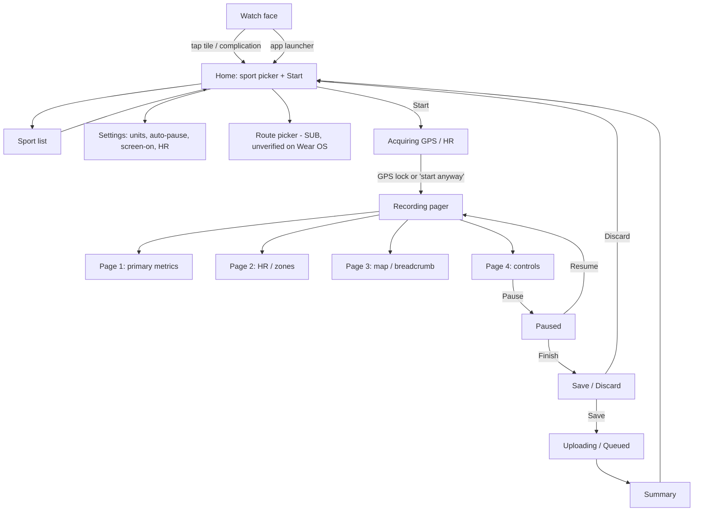
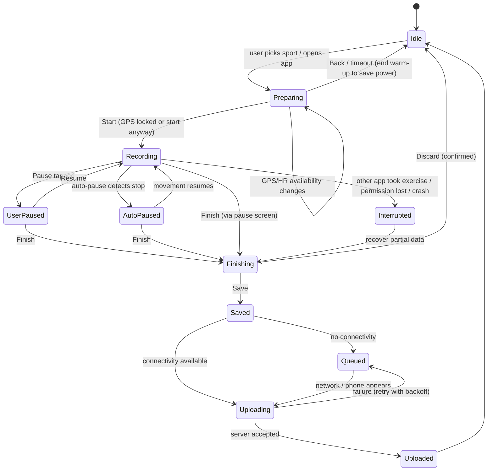
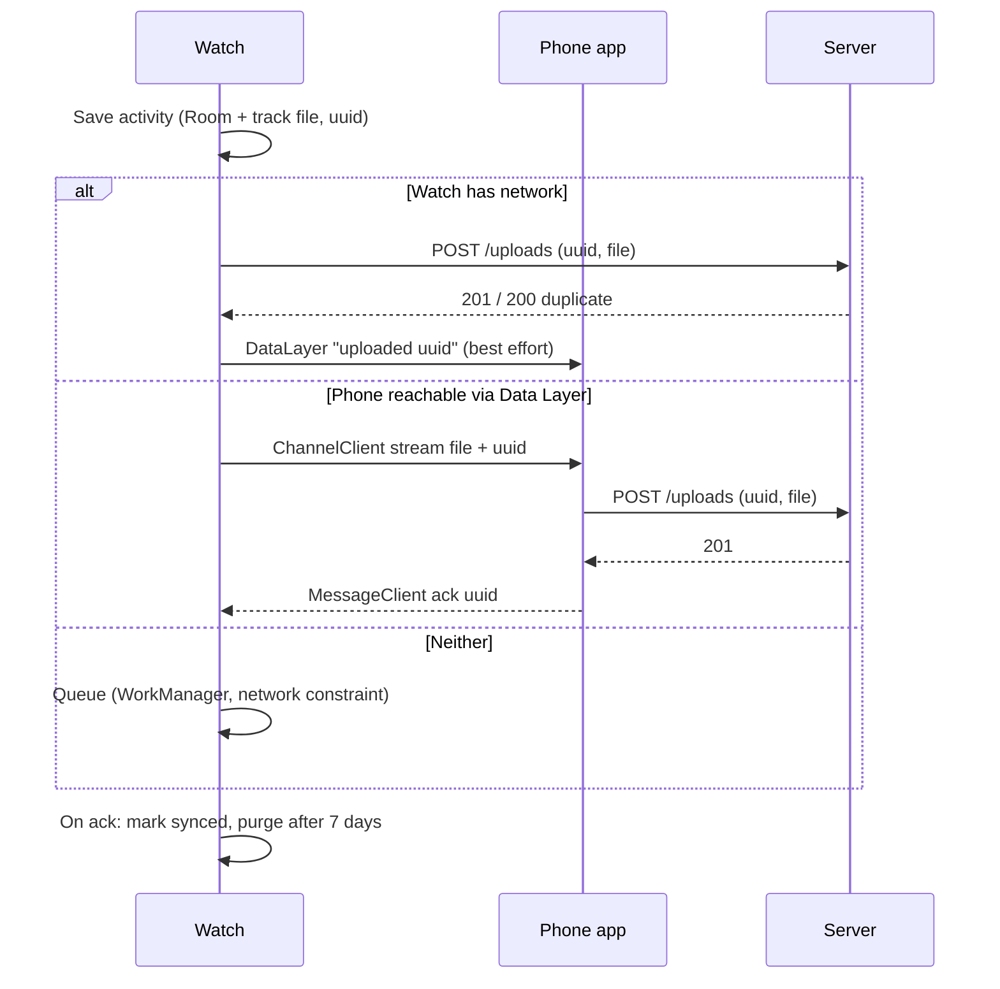

# Wear OS Watch App: Screens, Recording and Sync

> Gap-fill doc. Four other docs (overview, integrations, navigation, recording) list the watch feature set as an open question. This doc closes that gap with the best information available and states its confidence level plainly.

> **Research caveat (read first).** This was written in a shortened run because the user asked for speed. The shared web-search budget for the workflow ran out before this agent could search, and the direct fetches of Strava help-center pages returned 404s or unrelated articles. The Strava product facts below therefore come from prior knowledge of the public product (help center, store listings and press up to 2025). **Every Strava-specific behaviour not confirmed in this run is marked (unverified).** The Android platform guidance in the OSS notes (Health Services `ExerciseClient`) **was** fetched and checked against developer.android.com during this run. Before implementation, a follow-up pass should confirm the (unverified) items against support.strava.com and current store listings.

---

## 1. Scope and platform summary

| Item | Wear OS (Android) | Apple Watch (iOS, reference only) |
|---|---|---|
| Distribution | Separate Wear OS app delivered through the Play Store on the watch, paired with the phone app (unverified) | Bundled watchOS companion of the iPhone app |
| Standalone recording (no phone nearby) | Yes, GPS on the watch (unverified) | Yes on GPS models; LTE models can upload without the phone (unverified) |
| Heart rate | From the watch's optical sensor (unverified) | From the watch's optical sensor via HealthKit workout session |
| Upload path | Direct upload over Wi-Fi/LTE, or relayed via the paired phone (unverified) | Direct upload or via iPhone (unverified) |
| Routes on watch | Limited or absent compared with Apple Watch (unverified) | Saved routes with a breadcrumb map and off-route alerts [SUB] (unverified) |
| Live Segments on watch | Not confirmed (unverified) | Added in the 2024-2025 Apple Watch rebuild [SUB] (unverified) |
| Beacon from watch | Not confirmed (unverified) | Supported on cellular models (unverified) |
| Tiles / complications | Wear OS Tile for quick start and/or weekly stats (unverified) | Watch-face complications to launch the app (unverified) |
| Garmin, COROS, Wahoo and similar | Not this doc: those devices record natively and sync through the cloud (see integrations doc) | Same |

**Key product insight:** for Strava the watch app is a *lightweight recorder*. The phone app stays the main surface for the feed, analysis, social features and editing. The watch handles start, record, pause, save or discard, and upload. Rich post-activity editing (title, description, photos, gear, privacy) happens on the phone or web (unverified for the exact field list).

---

## 2. Sport types recordable on the watch

Strava's phone app supports 50+ sport types. Its watch apps have historically offered a **shorter list** focused on GPS and cardio sports (unverified):

| Sport | Wear OS | Apple Watch | Notes |
|---|---|---|---|
| Run | Yes | Yes | Core |
| Ride | Yes | Yes | Core |
| Walk | Yes | Yes | Core |
| Hike | Yes (unverified) | Yes | |
| Trail Run | (unverified) | Yes (unverified) | Sometimes a sub-type of Run |
| Virtual / indoor run (treadmill) | (unverified) | Yes (unverified) | No GPS; distance from accelerometer |
| Workout / Weight Training / Yoga / HIIT | (unverified) | Yes (unverified) | Time and HR only |
| Swim | No (unverified) | Pool/open-water swim was historically missing or limited (unverified) | |
| Ski / snowboard, paddle sports | (unverified) | (unverified) | |

After upload, the user can change the sport type on the phone. That is the escape hatch for any type the watch does not offer [FREE].

**OSS position:** offer every `ExerciseType` that Health Services reports as supported on the device. Map each to our internal sport-type enum (see the recording doc), and fall back to a generic "Workout" type.

---

## 3. Information architecture



---

## 4. Screens (ASCII wireframes, round ~20 chars)

Notes on the wireframes: they are our own neutral layouts that describe *function*, not a pixel copy. Round screens lose about 15% of the edge to the curve, so content is centered and edge items use curved text.

### 4.1 Home / ready screen

```
     .--------.
   /   12:04    \
  |  [ Run   v ] |
  |              |
  |   ( START )  |
  |              |
  |  GPS ok  HR ok|
   \  settings  /
     '--------'
```

- Big circular start button in the middle (unverified exact layout).
- A sport selector at the top opens a scrolling list (rotary-crown/bezel scrollable).
- Status indicators for GPS lock and the HR sensor. Starting before GPS lock is allowed, but distance is less accurate early on (unverified).

### 4.2 Sport list

```
     .--------.
   /  Sport     \
  |  > Run       |
  |    Ride      |
  |    Walk      |
  |    Hike      |
  |    Workout   |
   \     ...    /
     '--------'
```

### 4.3 Acquiring signal

```
     .--------.
   /            \
  |   Finding   |
  |    GPS...   |
  |   ( ~~~ )   |
  |              |
  | [Start anyway]|
   \            /
     '--------'
```

### 4.4 Recording: primary metrics page

```
     .--------.
   /  00:23:41  \
  |   4.12 km    |
  |  5:44 /km    |
  |  ----------  |
  |  HR  148     |
   \  * REC     /
     '--------'
```

- Elapsed or moving time (configurable is unverified), distance, current or average pace (speed for Ride), and heart rate.
- A recording indicator or ring around the bezel shows state (unverified).

### 4.5 Recording: heart-rate page

```
     .--------.
   /   HR       \
  |    152       |
  |  Zone 3      |
  | [1][2][3][4][5]|
  |  avg 141     |
   \            /
     '--------'
```

The exact HR-zone display on Strava's watch is (unverified). Zones are computed from the user's max-HR settings, which live on the phone or web.

### 4.6 Recording: route / map page [SUB in Strava]

```
     .--------.
   /     N      \
  |    ..       |
  |   .  \__    |
  |  .  o   \   |
  |       ...    |
   \  2.1 km left/
     '--------'
```

- Breadcrumb line for the planned route, a dot for the current position, and the remaining distance.
- **Apple Watch:** route following with off-route alerts is documented in press around the rebuild (unverified).
- **Wear OS:** route display on the watch is not confirmed (unverified).

### 4.7 Controls page (swipe or press the side button)

```
     .--------.
   /            \
  | (II)  (Lap)  |
  |  Pause  Lap  |
  |              |
  | (lock) (vol) |
  |  Lock  Audio |
   \            /
     '--------'
```

- Pause; lap (unverified on Strava; the Health Services API supports it); screen lock against rain or sweat (unverified).

### 4.8 Paused

```
     .--------.
   /  PAUSED    \
  |  00:23:41    |
  |              |
  | (>) Resume   |
  | ([]) Finish  |
  |              |
   \            /
     '--------'
```

### 4.9 Save / discard

```
     .--------.
   /  Finish?   \
  |  4.12 km     |
  |  23:41       |
  | [  Save   ]  |
  | [ Discard ]  |
   \            /
     '--------'
```

- Discard asks for confirmation (unverified, but standard).
- Very short activities may be flagged or prevented (unverified).

### 4.10 Upload / summary

```
     .--------.
   /  Saved     \
  |  Uploading.. |
  |   [=====  ]  |
  |              |
  |  Open on     |
  |  phone  ->   |
   \            /
     '--------'
```

When it is offline, the summary says the activity is saved and will upload later (unverified wording).

### 4.11 Tile (Wear OS)

```
     .--------.
   /  This week \
  |  18.4 km     |
  |  3 runs      |
  |              |
  |  ( > Run )   |
   \            /
     '--------'
```

A tile that starts the last-used sport and/or shows weekly totals (unverified for Strava's exact content).

---

## 5. Recording state machine



---

## 6. Recording flow in detail

| Step | Behaviour (Strava, mostly unverified) | Our design |
|---|---|---|
| Launch | Opens to the ready screen with the last sport preselected | Same; remember the last sport per user |
| Warm-up | GPS and HR warm up while the ready screen shows | `prepareExerciseAsync` |
| Start | One tap; a short countdown is optional (unverified) | Optional 3-second countdown setting |
| During | Swipeable pages; the screen dims to ambient mode with a reduced display | Ambient mode shows time and distance only, updated about once a minute |
| Auto-pause | Supported for run and ride on the phone; on the watch (unverified) | Use Health Services auto-pause only when the capability is present |
| Audio / haptic splits | Haptic buzz at each km/mi split (unverified) | Milestone goals with a period of 1 km or 1 mi |
| Pause / Resume | Via an on-screen button or the hardware button (unverified) | Both, with button debounce |
| Finish | Pause first, then Finish, then Save or Discard | Same, with a hold-to-finish option to avoid accidental taps |
| Crash recovery | (unverified) | Persist samples to Room every N seconds; on relaunch, offer to resume or save |

---

## 7. Metrics available on the watch

| Metric | Run | Ride | Walk/Hike | Workout | Source |
|---|---|---|---|---|---|
| Elapsed time | Yes | Yes | Yes | Yes | Clock |
| Moving time | Yes (unverified) | Yes (unverified) | Yes | n/a | Derived from auto-pause or speed |
| Distance | Yes | Yes | Yes | n/a | GPS, or steps when indoors |
| Current pace / speed | Yes | Speed | Yes | n/a | GPS |
| Average pace / speed | Yes (unverified) | Yes (unverified) | Yes | n/a | Derived |
| Split / lap pace | (unverified) | (unverified) | | | Derived |
| Heart rate (current) | Yes | Yes | Yes | Yes | Optical sensor |
| HR zone | (unverified) | (unverified) | | | Derived from zones |
| Elevation gain | (unverified) | (unverified) | (unverified) | | Barometer or GPS |
| Cadence | (unverified) | No (needs sensor) | | | Accelerometer |
| Calories | (unverified) | | | | Health Services |

Customising data fields on the watch is not confirmed for Strava (unverified). **OSS:** make data fields configurable per sport, with a maximum of four fields per page on a round screen.

---

## 8. Heart rate from the watch sensor

- Strava uses the watch's own optical HR during watch-recorded activities, and the HR stream appears in the uploaded activity like any other HR data (unverified for the exact sample rate).
- Phone-recorded activities can also pull HR from a paired watch in some setups. On iOS this works through Apple Watch / HealthKit. On Android, pairing a Wear OS watch as a live HR source for phone recording is (unverified). The established Android path is Bluetooth LE HR straps.
- Relative Effort (heart-rate-based effort score) is then computed server-side from the HR stream [FREE in recent versions; earlier it was SUB] (unverified; see the analysis docs).
- HR accuracy: Health Services exposes `HrAccuracy` per sample. Low-accuracy samples should be marked and smoothed rather than dropped silently.

---

## 9. Standalone vs phone-tethered recording

| Mode | Data source | Upload | Notes |
|---|---|---|---|
| **Standalone** (phone at home) | Watch GPS + HR | Watch uploads directly over Wi-Fi/LTE, or later via the phone (unverified) | The main reason watch apps exist |
| **Tethered** (phone in pocket) | Watch GPS or phone GPS (unverified which one) | Via the phone | Some apps use phone GPS to save watch battery |
| **Phone as recorder, watch as remote/display** | Phone GPS, watch shows metrics | Phone uploads | Strava supported this "mirror/remote" pattern on Apple Watch historically (unverified) |

For Wear OS, Strava's watch app is believed to record independently and sync afterwards, not to act as a remote for the phone recorder (unverified).

**OSS recommendation:** v1 is standalone-first. The watch is always the recorder of its own activity. A remote-control mode for the phone recorder comes later.

---

## 10. Sync to phone and conflict resolution

### 10.1 What Strava appears to do (unverified)
- The finished activity is saved locally on the watch as a file (FIT/TCX-like or internal format).
- Upload goes to Strava's servers either directly from the watch (when it has network) or through the phone app.
- The activity then appears in the feed and on the phone like any other upload.
- **Duplicate handling:** Strava's server rejects or flags duplicates when two recordings overlap in time from the *same device source*. The known behaviour is that a duplicate upload of the *same file* is rejected with a "duplicate" message, while overlapping activities from different devices both remain and the user deletes one manually (this server behaviour is documented in the upload/API docs; the watch-specific handling is unverified).

### 10.2 Conflict cases and our resolution

| Case | Our resolution |
|---|---|
| Same activity uploaded twice (watch direct + via phone relay) | Client-generated UUID `external_id` on every recording; the server upserts by `(user_id, external_id)` and the second upload is a no-op |
| User recorded on both the phone and the watch at the same time | Server detects a >80% time overlap with a different `device_id`. It keeps both but shows a "possible duplicate" banner offering *Merge* (watch HR + phone GPS) or *Delete one* |
| Watch upload fails mid-transfer | Chunked upload with a resumable session id; the watch keeps the file until a server ACK |
| User edits the activity on the phone before the watch finishes uploading | Impossible by design: the activity exists server-side only after the upload ACK. The watch never edits server data after upload |
| User discarded on the watch but the phone already got a partial relay | The phone receives a `discard` message with the same UUID and deletes its staged copy |
| Clock skew between watch and phone | Use watch `elapsedRealtime`-based timestamps converted with the boot instant (see OSS notes), and record the timezone offset |
| Watch storage full | Refuse to start a new recording when less than X MB is free; prompt the user to sync |



---

## 11. Routes and off-route alerts

- **Strava, Apple Watch:** after the watchOS rebuild, saved/starred routes sync to the watch and display as a breadcrumb line, with distance remaining and an alert when you leave the route [SUB] (unverified).
- **Strava, Wear OS:** route following on Wear OS is not confirmed (unverified). Several other docs treat this as an open question, and it should stay open until checked.
- **Garmin/Wahoo:** routes are pushed through the device integrations, not the watch app (see integrations doc).

**OSS design (free):**
1. On the phone, the user "sends to watch" a saved route. The phone pushes a simplified polyline (Douglas-Peucker to about 1 point every 20-30 m, or at most ~2,000 points) through the Data Layer `DataClient` as an Asset.
2. The watch renders it on a Canvas (no map tiles in v1, which saves battery and storage). An optional offline vector tile overlay comes later.
3. **Off-route detection:** compute the distance from the current fix to the nearest polyline segment, using a sliding search window around the last matched index so it stays O(window) rather than O(n). Raise "off route" when the distance is above 50 m (configurable) for at least 3 consecutive fixes (or about 10 s). Raise "back on route" when the distance falls below 30 m. The hysteresis prevents flapping.
4. Haptic pattern for off-route versus back on route, plus an optional tone.
5. Remaining distance = route length - cumulative distance at the matched index.
6. Edge cases: loop routes and out-and-back routes (the matching window must move forward only, with a re-acquire search when lost); starting mid-route; GPS drift under tree cover.

---

## 12. Live Segments on the watch [SUB in Strava]

- Strava's Live Segments show real-time progress against a segment PR or the leader on supported devices (Garmin and others). Press around the 2024-2025 Apple Watch rebuild reported Live Segments arriving on Apple Watch (unverified). Wear OS support is not confirmed (unverified).
- **OSS (free, later phase):** the phone pushes starred segments near the user's area (or along a sent route) to the watch. The watch detects segment start with a geofence (within 25 m of the start point plus heading match). It shows a "segment ahead" alert at 200 m, a live delta versus PR (time ahead or behind, computed by matching distance along the segment), and the final result. Server-side matching remains the source of truth after upload.

---

## 13. Beacon from the watch [SUB in Strava]

- Strava Beacon shares a live location link with safety contacts. It works from the phone recorder, and on cellular Apple Watch models it works from the watch (unverified). Wear OS Beacon is not confirmed (unverified).
- **OSS (free, proposed name "Live Share" / "Safety Link"):**
  - If the watch has LTE: POST location every 30-60 s to `/live/{session_token}` with batching.
  - If tethered: the watch sends location to the phone through the Data Layer and the phone posts it.
  - Without either: Live Share is unavailable, and the UI must say so clearly before the start. No false sense of safety.
  - Contacts get an SMS or link at start. The session expires automatically at finish + 30 minutes.

---

## 14. Tiles and complications

| Surface | Strava (unverified) | OSS |
|---|---|---|
| Tile | Start an activity and/or show weekly progress | Tile A: "Quick start" (last 3 sports). Tile B: "This week" (distance, time, count, versus goal) |
| Complication | Launch the app (Apple Watch); Wear OS complication (unverified) | `SHORT_TEXT` complication with weekly distance, and `MONOCHROMATIC_IMAGE` launcher |
| Ongoing activity chip | Recording shows on the watch face / recents (standard Wear OS behaviour) | Ongoing Activity API with live elapsed time |

---

## 15. Free vs subscription (Strava reference)

| Watch feature | Strava tier (mostly unverified) | StravaFit |
|---|---|---|
| Record activities on the watch | [FREE] | Free |
| Heart rate on the watch | [FREE] | Free |
| Upload / sync | [FREE] | Free |
| Routes on the watch, off-route alerts | [SUB] | Free |
| Live Segments | [SUB] | Free |
| Beacon | [SUB] (the phone-based Beacon was made free in some form; check the safety doc) | Free |
| Training/analysis after upload (Relative Effort, zones) | Mixed (see the analysis doc) | Free |

---

## 16. Open questions / to verify in a follow-up pass

1. The exact sport list on Strava Wear OS today.
2. Whether the Strava Wear OS app supports routes, Live Segments, and Beacon on LTE watches.
3. Whether a Wear OS watch can feed live HR to the Android phone recorder.
4. Whether Wear OS uploads go directly or always via the phone.
5. Tile and complication content.
6. Configurable data fields on the watch.
7. Exact device and OS minimums (Wear OS 3+ is assumed, unverified).

---

## OSS implementation notes

### A. Module layout

```
:wear                 Wear OS app (Compose for Wear OS)
  ui/                 screens, pager, tiles, complications
  exercise/           ExerciseService (FGS), ExerciseClient wrapper
  sync/               DataLayer client + direct uploader (WorkManager)
  data/               Room: Recording, Sample, Lap, OutboxItem
:shared               sport enum, track encoding, polyline utils, off-route matcher
:mobile               phone app, DataLayer listener service, relay uploader
```

### B. Health Services `ExerciseClient` (checked against developer.android.com during this run)

- Dependency `androidx.health:health-services-client` (1.1.x). Get the client with `HealthServices.getClient(ctx).exerciseClient`.
- **Capabilities first:** call `getCapabilitiesAsync()` on every launch. Drive the sport list from `supportedExerciseTypes` and the data fields from `getExerciseTypeCapabilities(type).supportedDataTypes`. Only enable auto-pause when `supportsAutoPauseAndResume` is true.
- **One exercise system-wide:** before starting, check `getCurrentExerciseInfoAsync()`. If another app owns one (`OTHER_APP_IN_PROGRESS`), warn the user before taking over.
- **Warm-up:** call `prepareExerciseAsync(WarmUpConfig(type, {HEART_RATE_BPM, LOCATION}))` on the ready screen, and watch `onAvailabilityChanged` to drive the GPS/HR indicators. If the user leaves without starting, end it to save power.
- **Start:** `ExerciseConfig(exerciseType, dataTypes, isAutoPauseAndResumeEnabled, isGpsEnabled = true for outdoor, exerciseGoals)`. Use **milestone goals** (`ExerciseGoal.createMilestone`, period 1,000 m or 1,609 m) for split haptics.
- **Laps:** `markLapAsync()`, then `onLapSummaryReceived`.
- **State truth:** treat `ExerciseUpdate.exerciseStateInfo.state` as the source of truth. Do not flip the UI on the `pauseExerciseAsync()` future. Disable the button until the state arrives.
- **Timer:** seed a chronometer from `ActiveDurationCheckpoint`: `elapsed = (now - checkpoint.time) + checkpoint.activeDuration`. Never tick the timer from update arrivals, because updates are batched.
- **Timestamps:** samples use boot-relative time. Convert them with `bootInstant = now - elapsedRealtime`.
- **Accuracy:** check `HrAccuracy` and `LocationAccuracy` per sample. Drop location fixes with large horizontal error (> 50 m) from distance calculation, but keep them for display.
- **Batching:** keep the defaults. Override with `BatchingMode.HEART_RATE_5_SECONDS` only when streaming HR to the phone or for Live Share.
- **Termination:** handle `isEnded` with reasons such as permission lost or another app taking over. Save partial data, remove the ongoing activity, and notify the user.
- **Persistence:** write samples to Room in batches. **Defer network uploads until after the exercise** (WorkManager with a network constraint), as Google recommends.
- Reference sample: `android/health-samples` → `health-services/ExerciseSampleCompose`.

### C. Foreground service, permissions, and ongoing activity

- An `ExerciseService` foreground service owns the `ExerciseClient` callback, so recording survives the activity being destroyed. The manifest sets `foregroundServiceType="health|location"`; use `location` only on Wear OS 4 and below.
- Permissions: `BODY_SENSORS` (or the granular heart-rate permission on API 36+), `ACCESS_FINE_LOCATION`, `ACTIVITY_RECOGNITION`, and `FOREGROUND_SERVICE_*`. If a permission is denied, degrade gracefully (no HR, or step-based distance).
- **Ongoing Activity API** (`androidx.wear:wear-ongoing`): build an `OngoingActivity` from the FGS notification with a `Status` that uses a `TimerPart` for elapsed time, so the watch face and recents show a live chip that reopens the recorder.
- Ambient mode: use `AmbientLifecycleObserver`. In ambient, render black background, outline text, and no animations, updating once a minute or per batch.

### D. Compose for Wear OS UI

- Libraries: `androidx.wear.compose:compose-material3`, `compose-foundation`, `compose-navigation`, plus Horologist where it still helps.
- `AppScaffold` / `ScreenScaffold` with `TimeText`; `HorizontalPager` for the metric pages; `TransformingLazyColumn` / `ScalingLazyColumn` for lists, with rotary input (`rotaryScrollable`).
- `EdgeButton` for the primary Start action on round screens.
- Data fields are a composable `MetricField(label, value, unit)` with auto-size text. Each page holds at most 3-4 fields.
- Hardware button: map a long press of a configurable button to pause (`onKeyEvent`, `KEYCODE_STEM_1`), where the OEM allows it.
- Screen lock (rain mode): a full-screen touch-consuming overlay, unlocked by a crown press.
- Tiles: `androidx.wear.protolayout` + `androidx.wear.tiles` (`TileService`). Complications: `androidx.wear.watchface.complications.datasource` (`SuspendingComplicationDataSourceService`).

### E. Wearable Data Layer vs direct network sync

| | Data Layer (`com.google.android.gms:play-services-wearable`) | Direct network (watch HTTP) |
|---|---|---|
| Works without the phone | No | Yes (Wi-Fi/LTE) |
| Auth | Phone holds the token; no token needed on the watch | The watch needs its own token (bootstrapped via the Data Layer from the phone, never typed on the watch) |
| Large files | `ChannelClient` streams; `DataClient` Assets (up to ~100 KB comfortable) | Normal multipart/resumable upload |
| Battery | Bluetooth is cheap | Wi-Fi is OK; LTE is expensive |
| Play Services dependency | Required (not available on non-GMS watches) | None |

**Decision:** use both, as a strategy chain: (1) if the phone is connected via the Data Layer, relay through the phone (cheapest), (2) else if an unmetered network is available, upload directly, (3) else queue in WorkManager. Every upload carries a client UUID, and the server is idempotent on `(user, uuid)`, so racing paths are harmless. Settings sync (units, zones, sport list, routes) flows phone → watch through `DataClient` items under `/settings` and `/routes/{id}`.

### F. Track format and size

- Store samples as columns (time delta, lat/lon int E7 deltas, HR, altitude). A 1-hour run at 1 Hz GPS is about 3,600 points, roughly 60-100 KB compressed.
- Export to FIT (Garmin FIT SDK is under a permissive licence, so verify it) or our own protobuf for upload. The server converts and also accepts GPX/TCX.

### G. Battery budget (targets, to be measured)

| Component | Approx. share | Lever |
|---|---|---|
| GPS | Largest | Let Health Services manage it; no extra FusedLocation polling during the workout |
| Display (interactive) | High | Short timeout to ambient; dark UI; ambient at 1/min |
| Optical HR | Medium | Default batching while the screen is off |
| Radio (BT/Wi-Fi/LTE) | Medium-high when used | No uploads during recording; Live Share batched at ≥30 s |
| CPU | Low | No per-sample recomposition; aggregate in the service, push to UI at ≤1 Hz |

Target: under 10-12% battery per hour of GPS+HR recording on a typical Wear OS 4/5 watch (unverified target; benchmark on a Pixel Watch and a Galaxy Watch). Warn at start when the battery is below 20%. Auto-save and finish at 5%.

### H. Edge cases checklist

- Another fitness app starts an exercise mid-run → save partial data and notify.
- GPS never locks → allow start; distance from steps; mark the track as low-accuracy.
- Watch reboots mid-activity → on boot, detect an unfinished Recording row and offer Resume/Save.
- Timezone change during an activity → store UTC plus the start offset.
- User logged out on the phone → watch uploads stall; show "Sign in on phone".
- Non-GMS watches (some regions/OEMs) → direct-sync only path.
- Indoor sports → `isGpsEnabled=false`; distance from accelerometer with a calibration factor.

### I. Neutral naming

| Strava term | StravaFit term |
|---|---|
| Beacon | Live Share |
| Live Segments | Live Sections |
| KOM/QOM, Local Legend | Section Crown / Section Regular (see the segments doc) |
| Relative Effort | Effort Score |

## Sources

- https://developer.android.com/health-and-fitness/guides/health-services/active-data (fetched; ExerciseClient guidance, foreground service, ongoing activity, batching, timestamps, deferred upload)
- https://github.com/android/health-samples/tree/main/health-services/ExerciseSampleCompose (referenced from the page above; not fetched separately)
- https://support.strava.com/hc/en-us/articles/360044624651 (attempted; returned 404)
- https://support.strava.com/hc/en-us/articles/216917527 (attempted; returned an Apple Health article, not Wear OS)
- https://play.google.com/store/apps/details?id=com.strava (attempted; content not retrievable)
- Web searches for Strava Wear OS and the Apple Watch rebuild were blocked by the workflow's exhausted search budget; Strava-specific claims are marked (unverified) accordingly.
