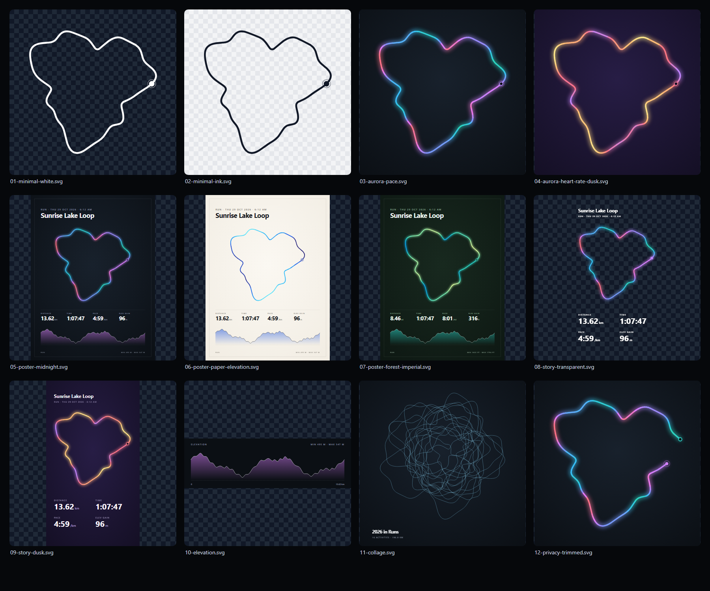

# lib/route-art

Pure-Kotlin route-art exporter (no Android dependencies) — turns a GPS track into shareable SVG.
Used by the Android app for share cards, stickers and posters; also runnable on the JVM/server.



## Templates (`RouteArt`)

| Function | Output | Use |
|---|---|---|
| `minimal` | square, transparent, single stroke | sticker over photos |
| `aurora` | glowing gradient route on vignette | feed / social square |
| `poster` | 1200×1600: title, route on dot grid, stats, elevation | print / wallpaper |
| `story` | 1080×1920, transparent or themed | Instagram/WhatsApp stories |
| `elevationProfile` | wide area chart | activity detail, embeds |
| `collage` | many activities blended | year-in-review / personal heatmap art |

Colour the route by `PACE`, `HEART_RATE`, `ELEVATION`, `POWER`, `PROGRESS` or `SOLID`
(falls back to `PROGRESS` when data is missing). Themes: `MIDNIGHT`, `DUSK`, `FOREST`, `PAPER`.
Every template accepts `privacyRadiusM` to hide the start/end area **before** framing.

## Pipeline

privacy trim → Web Mercator → uniform fit to box → Douglas–Peucker (px tolerance) →
Catmull–Rom → chunked strokes coloured via OKLab ramp (5–95th percentile normalised).

## Run

```bash
./gradlew :lib:route-art:test      # unit + well-formed-SVG tests
./gradlew :lib:route-art:samples   # writes lib/route-art/samples/*.svg (open gallery.html)
```

## Next

- PNG via Android `Canvas` (same geometry) + `FileProvider` share intents
- MapLibre snapshot basemap under the trace (OSM attribution)
- GPX / TCX / FIT / GeoJSON writers
- Swap placeholder theme colours for `design-system/tokens.json`
